# Art Bible: Capsule Arena: Last Man Standing

> **Status**: Approved
> **Owned By**: art-director
> **Last Updated**: 2026-11-10
> **Art Director Sign-Off (AD-ART-BIBLE)**: APPROVED 2026-11-10 — *"Tactical Toybox Arena" (9/9 Sections Complete & Production-Ready)*

`/art-bible` writes these nine sections in this order and replaces each
section's `[To be designed]` line as that section is approved. A section still
holding its placeholder is incomplete; a later run fills only those.

## 1. Visual Identity Statement

### Tuyên Ngôn Thị Giác Cốt Lõi (Visual Identity Anchor)

> **Định hướng chủ đạo (`AD-CONCEPT-VISUAL: STRONG`)**: **"Tactical Toybox Arena" (Đấu Trường Đồ Chơi Chiến Thuật)**
>
> **One-Line Visual Rule (Quy Tắc Thị Giác Một Dòng):**
> *"Mọi bề mặt môi trường đều tĩnh lặng và lì (matte), mọi hành động chiến đấu đều đàn hồi và phát sáng."*

### Triết Lý Thẩm Mỹ & Lý Giải Thiết Kế (Aesthetic Rationale)

*Capsule Arena: Last Man Standing* kết hợp sự đối lập có chủ đích giữa hai thế giới thị giác: một bên là **nhân vật Cartoon Capsule tròn trịa, tươi sáng, giàu tính đàn hồi như những mô hình đồ chơi Designer Vinyl cao cấp** (gói `Cartoon Capsule Pack Lite`), và một bên là **đấu trường hình học kiến trúc sạch sẽ, sắc gọn, chuẩn kích thước vật lý như một sa bàn thể thao điện tử (Esports Tactical Diorama)** được dựng trên **Unity 6 (`6000.6.8f1`, Universal Render Pipeline - URP)**.

- Khi mặt sàn (`Plane`), khối vật cản (`Obstacle`) và tường bao (`Boundary`) sử dụng bề mặt lì (high roughness / matte), độ bão hòa thấp và lưới định chuẩn kích thước (Metric Grid), mắt người chơi không bị nhiễu bởi chi tiết môi trường thừa.
- Ngược lại, mọi thay đổi trạng thái mạng trong `FixedUpdateNetwork()` — từ một pha **Forward Dash (`[2]`)**, **Side Dodge Roll (`[Q]`/`[E]`)**, **Chém dọc (`[Left Click]`)**, **Chém ngang quét quạt $90^\circ$ kèm xoay thân người + camera $90^\circ$ trong `~0.15s` (`[1]`/`[3]`)**, cho đến **Đạn bắn xa (`[Right Click]`)** — đều bật lên tức thì nhờ biến dạng **DOTween Squash & Stretch**, chất liệu phát sáng (HDR Emission) và bảng màu nguyên sắc bão hòa cao.

### 4 Nguyên Tắc Thị Giác Nền Tảng (Supporting Visual Principles)

1. **Nguyên Tắc 1 — Nhân Vật Đàn Hồi & Biểu Cảm Động Học (Elastic Capsule Readability):**
   - *Liên kết Trụ cột:* **Pillar 1 — Cơ Động Phản Xạ Định Đoạt Sinh Tồn (Mobility & Reflex Outplay)**.
   - *Mô tả:* Chuyển động cơ thể trên nhánh `VisualRoot` được cường điệu hóa bằng **DOTween Squash & Stretch** (biên độ nén/kéo giãn `120%–135%`) kết hợp vệt **Trail Renderer** đặc trưng. Khi bấm `[2]` (`Forward Dash`), thân Capsule vươn dài về phía trước; khi bấm `[Q]`/`[E]` (`Side Dodge Roll`), thân Capsule nén thấp và nghiêng lăn ngang; khi vung đòn cận chiến (`[Left Click]`, `[1]`, `[3]`), nhân vật vặn mình và bung lực đàn hồi rõ rệt.
   - *Design Test:* Khi hiệu ứng môi trường hoặc khói bụi va chạm làm mờ đường viền (silhouette) của nhân vật hoặc khiến người chơi không phân biệt được đối thủ đang đứng yên hay vừa bắt đầu lăn né `Q`/`E` trong `100ms` đầu tiên, bắt buộc **lược bỏ hiệu ứng môi trường gây nhiễu, tăng độ tương phản viền của nhân vật và khuếch đại biên độ Squash & Stretch**.

2. **Nguyên Tắc 2 — Hình Học Chiến Thuật Tương Phản Độ Sáng & Định Hướng Kép (High-Contrast Dual-Perspective Geometry):**
   - *Liên kết Trụ cột:* **Pillar 2 — Nhãn Quan Chiến Thuật Kép FPS $\leftrightarrow$ TPS (Dual-Perspective Tactical Mastery)**.
   - *Mô tả:* Các khối `Plane`, `Obstacle` Cubes và `Boundary` Walls có va chạm vật lý khớp 1:1 với hình khối hiển thị, được phân tách bằng độ sáng (Value Contrast) rõ rệt và hệ thống đường lưới/viền chỉ kỹ thuật (Metric Grid & Edge Trim). Ở góc nhìn **TPS**, lưới mặt sàn giúp ước lượng chính xác cự ly `Forward Dash [2]` và tầm quét cận chiến; ở góc nhìn **FPS** (phím `V`) hoặc khi **xoay mượt nhân vật + camera $90^\circ$ trong `~0.15s` (`[1]`/`[3]`)**, các đường viền chỉ ngang tầm mắt (`1.5m`) giúp não bộ định vị góc quay tức thời mà không bị chóng mặt hay mất phương hướng.
   - *Design Test:* Khi người chơi ở góc nhìn FPS đứng sát một khối `Obstacle` hoặc vừa xoay camera $90^\circ$ bằng phím `1`/`3` mà cảm thấy bề mặt tường phẳng lì gây mất cảm giác khoảng cách/góc quay, bắt buộc **thêm đường viền chỉ tương phản (Edge Trim) và dải vạch chia độ cao ngang tầm mắt (`1.5m`) trên mọi khối `Obstacle` và `Boundary`**.

3. **Nguyên Tắc 3 — Hình Học Hóa Đòn Đánh Đa Hướng & Trung Thực Trạng Thái Mạng (Network-True Multi-Directional Combat Geometry):**
   - *Liên kết Trụ cột:* **Pillar 3 — Công Bằng Mạng Tuyệt Đối Trên Shared Mode (Tick-Accurate Shared Authority)**.
   - *Mô tả:* Hình dạng VFX của mỗi chiêu thức phản ánh trung thực 100% vùng sát thương vật lý (`CharacterCombatConfigSO`):
     - **Chém dọc (`Vertical Slash [Left Click]`):** Vệt chém bán nguyệt bổ thẳng từ đỉnh đầu xuống đất ngay chính diện.
     - **Chém ngang xoay người $90^\circ$ (`Horizontal Turning Slash [1]` Trái / `[3]` Phải):** Vệt quạt ngang góc đúng $90^\circ$ từ chính diện quét sang trái hoặc phải, đồng bộ với nhịp xoay thân người + camera $90^\circ$ trong `~0.15s`.
     - **Đạn bắn xa (`Ranged Attack [Right Click]`):** Khối cầu/mũi tên năng lượng bay thẳng với đuôi Trail sắc nét từ Object Pool (`INetworkObjectProvider`).
   - *Design Test:* Khi hiệu ứng VFX chém hoặc đường đạn có kích thước hiển thị lệch với vùng quạt Physics Cast thực tế trong `FixedUpdateNetwork()`, hoặc hiệu ứng chém ngang `[1]`/`[3]` quá giống chém dọc `[Left Click]`, bắt buộc **cắt gọn khung mesh/particle của VFX khớp 100% với `MeleeRange` và góc quạt trong `CharacterCombatConfigSO`, đồng thời tách biệt trục không gian (Dọc vs. Ngang) và sắc độ màu**.

4. **Nguyên Tắc 4 — Phân Cấp Tín Hiệu Thể Thao Điện Tử & Khán Đài Hồn Ma (Esports-Grade Signal & Ghost Broadcast Hierarchy):**
   - *Liên kết Trụ cột:* **Pillar 4 — Khán Đài Hồn Ma & Vinh Quang Bảng Vàng (Active Spectating & Competitive Glory)**.
   - *Mô tả:* Thanh máu World-Space Billboard (`100/100`), cụm **7 nút bấm kỹ năng mềm ở góc dưới phải màn hình (Mobile-Ready On-Screen Action Buttons)** đồng bộ nhãn phím từ `keybinding.json`, khung **Chat (`CanvasGroup`)**, chế độ **Ghost Mode Spectator** và bảng **PlayFab Leaderboard** tuân theo thứ bậc đọc thông tin tốc độ cao của giải đấu Esports.
   - *Design Test:* Khi bố cục HUD che khuất vùng ngắm trung tâm hoặc làm lu mờ thanh máu World-Space Billboard trên đầu đối thủ, bắt buộc **đẩy toàn bộ cụm HUD điều khiển/Chat ra sát rìa màn hình với nền bán trong suốt (`Alpha 70%–85%`), giữ trống vùng trung tâm $\ge 78\%$ màn hình cho giao tranh**.

## 2. Mood & Atmosphere

### Định Hướng Ánh Sáng Tổng Thể (Global URP Lighting Architecture)

- **Main Directional Light:** Góc chiếu nghiêng `50°` (Pitch `50°`, Yaw `-35°`, `5600K`, Intensity `1.5`) tạo bóng đổ ngắn gọn dưới chân nhân vật Capsule và cạnh các khối `Obstacle`.
- **Environment Ambient Mode:** Chế độ **Trilight (Gradient Ambient)** (Sky `#7DD3FC`, Equator `#64748B`, Ground `#334155`) giúp vùng khuất sáng luôn trong trẻo, không có vùng tối đen đặc `#000000`.
- **Post-Processing (URP Volume):** Bật nhẹ **Bloom** (`Threshold: 1.1`, `Intensity: 0.65`, `Downscale: Quarter`) cho các chất liệu HDR Emission của đòn đánh/đạn bắn và **Color Adjustments** (`Contrast: +12`, `Saturation: +8`). **Tắt hoàn toàn Motion Blur** để tránh mỏi mắt khi xoay Camera $90^\circ$ bằng phím `1`/`3` hoặc đổi góc nhìn `V`.

### Đặc Tả Khí Quyển Theo 6 Trạng Thái Trò Chơi

| Trạng Thái (Game State) | Mục Tiêu Cảm Xúc (Emotional Target) | Đặc Tính Ánh Sáng & Màu Sắc (Lighting & Color Temp) | Từ Khóa Khí Quyển (Descriptors) | Mức Năng Lượng | Yếu Tố Thị Giác Trọng Tâm (Key Visuals) |
| :--- | :--- | :--- | :--- | :---: | :--- |
| **1. Loading & Bootstrap** *(Nạp `keybinding.json`)* | Tin cậy, gọn gàng, sẵn sàng (Clean Readiness) | Backdrop tối `#14181F` + Radial Glow `#1E293B`, `6500K` Cool Daylight, tương phản cao | *Minimalist, Instantaneous, Sleek, Calibrated* | **2 / 10** | Biểu tượng Capsule xoay nhẹ + thông báo nạp `keybinding.json` (`0.5s–1.5s`). |
| **2. Lobby & Keybinding Settings** *(Region, Tên, Rebind UI)* | Hào hứng chuẩn bị, làm chủ công cụ (Tactical Customization) | Studio Showcase `45°` (`5800K`, `#FFF9F0`) + Rim Light `#38BDF8` tách khối nhân vật | *Showroom-Clean, Inviting, Empowering, Crisp* | **4 / 10** | Nhân vật Capsule nhún Idle; bảng chọn Region/Tên; Modal **Keybinding Rebind UI** sáng viền `#F59E0B` khi chờ phím và nháy `#10B981` khi bấm **Save**. |
| **3. Active Combat — TPS Mode** *(Bao quát quanh `Obstacle`)* | Tỉnh táo chiến thuật, kiểm soát không gian 360° (Spatial Mastery) | Directional `5600K` (`#FFFDF8`), Soft Shadows `0.55`, tương phản Value cao giữa sàn (`47%`) và `Obstacle` (`94%`) | *High-Visibility, Kinetic, Tactical, Bouncy, Uncluttered* | **8 / 10** | Camera góc nhìn thứ ba bao quát; Squash & Stretch khi Dash `[2]` / Dodge `[Q/E]`; vệt quạt chém dọc `[LMB]` & ngang $90^\circ$ `[1/3]`; cụm 7 nút mềm góc dưới phải. |
| **4. Active Combat — FPS Mode** *(Phím `V` — Khe hẹp & Xoay $90^\circ$)* | Tập trung cao độ, quyết đoán, tốc độ trực diện (Razor-Sharp Focus) | Giữ nguyên ánh sáng `5600K` để chuyển đổi mượt với TPS; bề mặt `Obstacle` roughness `0.85` chống chói | *Immediate, Surgical, High-Velocity, Tense* | **9.5 / 10** | Tâm ngắm **Crosshair 2 lớp màu** cố định ở tâm; dải chỉ ngang `1.5m` trên `Obstacle` giúp mắt định vị mượt khi nhân vật + camera xoay $90^\circ$ trong `~0.15s` (`[1]`/`[3]`). |
| **5. Ghost Mode Spectator** *(`IsDead == true` — Khán đài Hồn ma)* | Thư giãn sau giao tranh, hào hứng cổ vũ & trò chuyện (Social Broadcast) | Phủ viền màn hình **Ethereal Cyan Vignette (`#06B6D4`, Alpha `18%`)**, cảm nhận mát lạnh `~7500K` | *Ethereal, Observational, Communal, Broadcast-Ready* | **5 / 10** | Ẩn cụm 7 nút chiến đấu; hiện **Spectator Control Bar** (`Previous [Q/A]` – Tên mục tiêu – `Next [E/D]`) và khung **Chat (`CanvasGroup`)** Public/Whisper. |
| **6. Victory & PlayFab Leaderboard** *(`AliveCount == 1`)* | Vinh quang bùng nổ, khẳng định thứ hạng (Triumphant Glory) | Victory Spotlight Vàng Kim (`4500K`, `#FACC15`) trên nền Backdrop mờ tối `#0F172A` (`Alpha 75%`) | *Triumphant, Prestigious, Celebratory, Competitive* | **9 / 10 $\rightarrow$ 6 / 10** | Banner **CHAMPION / LAST MAN STANDING** + Bảng xếp hạng **PlayFab Leaderboard (`Wins` / `Kills`)** tô sáng dòng của người chơi. |

## 3. Shape Language

### 3.1. Triết Lý Đường Nét Nhân Vật (Character Silhouette Philosophy)
- **Khối Viên Nhộng Bo Tròn (`Cartoon Capsule Pack Lite`):** Tỷ lệ `Height ~2.0m`, `Radius ~0.5m` khớp 1:1 với `CharacterController` và `HitboxRoot` của Photon Fusion 2.
- **Dấu Hiệu Định Hướng Mặt Trước/Sau (Facing Indicator):** Mặt trước có mảng kính chắn/khuôn mặt (Visor/Face Decal) tương phản cao ở 1/3 thân trên và hướng cầm vũ khí, giúp người chơi khác nhận biết ngay khi nhân vật vừa xoay vuông góc $90^\circ$ sau đòn chém ngang (`[1]`/`[3]`).
- **Biến Dạng Đàn Hồi DOTween Squash & Stretch (trên nhánh `VisualRoot`):**
  - *Forward Dash (`[2]`):* Nén lấy đà (`Scale Y: 0.80, X/Z: 1.15`) rồi vươn dài theo trục +Z (`Scale X: 0.78, Y: 0.85, Z: 1.35`) trong `~0.18s`.
  - *Side Dodge Roll (`[Q]`/`[E]`):* Hạ thấp chiều cao (`Scale X: 1.28, Y: 0.72, Z: 1.10`) kèm nghiêng lăn ngang trong `~0.20s`.
  - *Vertical Slash (`[Left Click]`):* Vươn cao (`Scale Y: 1.22`) rồi bổ mạnh xuống (`Scale Y: 0.82, X/Z: 1.18`).
  - *Horizontal Turning Slash (`[1]` Trái / `[3]` Phải):* Mở rộng trục ngang (`Scale X: 1.25, Y: 0.90, Z: 1.15`) đồng bộ với phép xoay `NetworkTransform` + `CinemachineCamera` đúng $90^\circ$ trong `~0.15s`.

### 3.2. Hình Học Hiệu Ứng Chiến Đấu Đa Hướng (Combat VFX Geometry)

| Kỹ Năng (Phím Mặc Định) | Hình Học Cốt Lõi (Core Geometry) | Trục Không Gian & Kích Thước (`CharacterCombatConfigSO`) | Đặc Điểm Nhận Diện Tức Thì (`< 100ms`) |
| :--- | :--- | :--- | :--- |
| **Chém Dọc — `Vertical Slash` (`Left Click`)** | **Hình Bán Nguyệt Dọc (Vertical Crescent Blade Arc)** | Mặt phẳng thẳng đứng **(Trục Y–Z)** chính diện trước mặt, góc hẹp ngang (`~45°`), bán kính `MeleeRange`. | Vệt sáng bổ thẳng từ đỉnh đầu xuống mặt sàn; hình dáng mỏng, cao và sắc gọn. |
| **Chém Ngang Xoay $90^\circ$ — `Horizontal Turning Slash` (`1` Trái / `3` Phải)** | **Hình Quạt Ngang Góc Vuông $90^\circ$ (Horizontal $90^\circ$ Fan Sector)** | Mặt phẳng nằm ngang ngang ngực **(Trục X–Z, `Y = 1.0m`)**, mở rộng chính xác góc vuông **$90^\circ$** sang Trái (`[1]`) hoặc Phải (`[3]`). | Mảng quạt phẳng rộng đúng $1/4$ hình tròn quét ngang hông kèm vòng xoáy dưới chân khi nhân vật và camera xoay mượt $90^\circ$ trong `~0.15s`. |
| **Đạn Bắn Xa — `Ranged Attack` (`Right Click`)** | **Đầu Đạn Cầu Vát Cạnh + Đuôi Ruy-băng Thẳng (Icosahedron Orb + Linear Trail)** | Bay thẳng theo tia ngắm **(Trục +Z)**, đường kính `0.40m` (`ProjectileRadius = 0.20m`), đuôi Trail dài `2.0m`. | Khối năng lượng cô đặc kéo vệt chỉ sáng thẳng tắp, dễ đọc quỹ đạo để bấm `Q`/`E` lăn né. |
| **Lướt Tiến (`2`) & Lăn Né (`Q`/`E`)** | **Mũi Tên Khí Động Học (`2`) & Dải Xoắn Ngang (`Q`/`E`)** | Trục dọc **+Z** (`Forward Dash`) vs. Trục ngang **$\pm$X** (`Side Dodge Roll`). | Nếp sóng chữ `V` phóng tới trước (`[2]`) phân biệt rõ với vệt bụi lăn dẹt sang hai bên hông (`[Q]`/`[E]`). |

### 3.3. Hình Học Môi Trường, Giao Diện & Phân Cấp Hero/Supporting
- **Environment Geometry:** Mặt sàn `Plane` phẳng tuyệt đối có lưới **Metric Grid 2 cấp** (`1m × 1m` và `5m × 5m`); khối `Obstacle` Cube (`Height 2.5m` cao hơn Capsule `2.0m`) có cạnh vát nhẹ và **dải chỉ ngang tầm mắt (`Y = 1.5m`)** giúp định vị góc quay ở FPS; tường bao `Boundary` có dải sọc cảnh báo $45^\circ$ ở chân tường.
- **UI Shape Grammar:**
  - *Thanh máu (Billboard & HUD):* Hình **Pill / Capsule bo tròn** đồng điệu với nhân vật.
  - *Cụm 7 Button mềm góc dưới phải (Mobile-Ready Action Pad):* Hình tròn / Squircle bố trí theo **Cung Không Gian Trực Giác (Spatial Directional Arc)** kèm nhãn **Keycap Pill Badge** lấy động từ `keybinding.json`.
  - *Bảng Chat (`CanvasGroup`), Rebind UI & Leaderboard:* Khung chữ nhật vát góc công nghệ (**Chamfered Tech Panels**).
- **Hero vs. Supporting Shapes:** Nhân vật Capsule, vệt quạt chém dọc/ngang $90^\circ$, viên đạn và thanh máu Billboard là **Hero Shapes** (chuyển động đàn hồi, phát sáng); cụm HUD/Chat là **Secondary Shapes** ở rìa màn hình; sàn `Plane`, `Obstacle` và `Boundary` là **Supporting Shapes** hoàn toàn tĩnh.

## 4. Color System

### 4.1. Bảng Màu Chủ Đạo 7 Thành Phần (Primary World Palette)

| # | Tên Màu (Color Name) | Mã Hex | RGB | Độ Sáng (Value %) & Độ Bão Hòa (Sat %) | Vai Trò Trong Thế Giới Game |
| :-: | :--- | :---: | :---: | :---: | :--- |
| **1** | **Tactical Floor Slate** *(Mặt sàn `Plane`)* | `#5E6B78` *(Grid: `#4A5562`)* | `94, 107, 120` | **Value: 47%** / Sat: 22% | Nền trung tính làm nổi bật cả VFX phát sáng lẫn khung viền tối của Billboard UI mà không gây mỏi mắt. |
| **2** | **Obstacle Porcelain & Industrial Trim** *(Khối `Obstacle`)* | `#E6EAEF` *(Trim: `#F97316`)* | `230, 234, 239` | **Value: 94%** / Sat: 4% | Tương phản độ sáng gấp đôi mặt sàn (`94%` vs `47%`) để nhận diện vị trí nấp tức thì; dải chỉ Cam `#F97316` ở `Y = 1.5m` định hướng góc xoay $90^\circ$ ở FPS. |
| **3** | **Boundary Charcoal & Hazard Amber** *(Tường bao `Boundary`)* | `#262B33` *(Stripe: `#EAB308`)* | `38, 43, 51` | **Value: 20%** / Sat: 25% | Đóng khung rìa đấu trường bằng sắc tối trầm kèm vạch vàng cảnh báo giới hạn sân đấu. |
| **4** | **Local Hero Azure** *(Nhân vật Bản thân)* | `#0EA5E9` *(Highlight: `#38BDF8`)* | `14, 165, 233` | **Value: 91%** / Sat: 94% | Định danh cho nhân vật có `HasStateAuthority == true` và thanh máu bản thân. |
| **5** | **Rival Crimson Coral** *(Đối thủ / Sát thương)* | `#F43F5E` *(Accent: `#FB7185`)* | `244, 63, 94` | **Value: 96%** / Sat: 74% | Định danh đối thủ cạnh tranh (`Remote Players`), thanh máu địch và đạn đối phương bắn tới. |
| **6** | **Kinetic Combat Gold-Cyan** *(VFX Chiến đấu)* | `#FACC15` / `#38BDF8` | `250, 204, 21` | **Value: 98%** / Sat: 92% | Lõi phát sáng HDR của vệt chém dọc (`#F59E0B`), chém ngang $90^\circ$ (`#38BDF8`), đạn bắn xa và tia nổ trúng đòn (`Rpc_PlayAttackEffect`). |
| **7** | **Ethereal Ghost Cyan** *(Ghost Mode Spectator)* | `#06B6D4` *(Glow: `#67E8F9`)* | `6, 182, 212` | **Value: 83%** / Sat: 97% | Viền màn hình Vignette, thanh điều khiển `Next/Previous` và nhãn `[GHOST]` khi `IsDead == true`. |

### 4.2. Màu Ngữ Nghĩa, Quy Tắc Góc Nhìn FPS/TPS & An Toàn Mù Màu (Colorblind Safety)
- **Tách biệt màu theo chiêu thức:**
  - *Chém dọc (`Left Click`):* **Vàng Hổ Phách Rực Lửa (`#F59E0B` $\rightarrow$ `#FEF08A`)**.
  - *Chém ngang xoay $90^\circ$ (`1` Trái / `3` Phải):* **Xanh Điện Từ / Lam Sắc Lẹm (`#38BDF8` $\rightarrow$ `#818CF8`)**.
  - *Đạn bắn xa (`Right Click`):* **Vàng Chanh Năng Lượng (`#FACC15`)** cho đạn bản thân; **Đỏ Cam Cảnh Báo (`#FB923C`)** cho đạn đối phương.
  - *Lướt tiến (`2`) & Lăn né (`Q`/`E`):* Trắng Xanh Khí Động Học (`#BAE6FD`) cho Dash; Xanh Ngọc (`#34D399`) cho Dodge Roll.
- **Quy tắc tương phản FPS vs. TPS:** Ở TPS (nền sàn `#5E6B78`), mọi VFX và Billboard có viền tối `#0F172A` dày `2px`. Ở FPS (nền tường `#E6EAEF`), tâm ngắm **Crosshair** dùng 2 lớp màu (lõi Xanh Cyan `#00F5D4` + viền Đen `#090D16` `2px`) để không bao giờ chìm vào tường sáng hay tối.
- **Mã hóa kép cho người Mù màu (Deuteranopia / Protanopia / Tritanopia):**
  1. *Thanh máu:* Tách biệt sắc độ giữa Máu bản thân (Xanh Ngọc Lam `#10B981` $\rightarrow$ `#06B6D4`) và Máu đối thủ (Đỏ San Hô `#F43F5E` $\rightarrow$ `#FB923C`), luôn đi kèm **chữ số trực tiếp (`100/100`)**, vạch chia mỗi `25 HP` và thanh tụt trễ màu Trắng (`Damage Trail`).
  2. *Chiêu thức & Cụm 7 nút mềm:* Phân biệt đồng thời bằng trục không gian (Dọc vs. Ngang $90^\circ$ vs. Đường thẳng) và biểu tượng (Icon kiếm bổ dọc, kiếm quét cong trái $\curvearrowleft$ / phải $\curvearrowright$, mũi tên lướt $\Uparrow$, cuộn lăn ngang).
  3. *Kênh Chat:* Kèm tiền tố văn bản rõ ràng `[ALL]`, `[WHISPER -> @Tên]` (màu `#E879F9`) và `[GHOST]` (màu `#22D3EE`).

## 5. Character Design Direction

### 5.1. Visual Archetype — "Elastic Toy Gladiator" (Dựa trên gói *Cartoon Capsule Pack Lite*)

Nhân vật trung tâm của *Capsule Arena: Last Man Standing* được xây dựng dựa trên nguyên mẫu **"Đấu Sĩ Đồ Chơi Đàn Hồi" (Elastic Toy Gladiator)**, khai thác trực tiếp phom dáng từ gói tài nguyên **Cartoon Capsule Pack Lite** trên Unity Asset Store. Thay vì mô phỏng giải phẫu người thật với tay chân dài dễ gây rối mắt ở tốc độ cao, mỗi đấu sĩ mang hình khối trụ tròn đầu (`Capsule`) chuẩn mực với tỷ lệ vàng **1:2** (đường kính thân `1.0m`, chiều cao tổng thể `2.0m`).

- **Lý do lựa chọn mỹ thuật & kỹ thuật (Rationale):**
  1. **Đồng nhất tuyệt đối giữa Thị giác và Vật lý Mạng (1:1 Visual-to-Hitbox Integrity):** Hình khối của nhân vật khớp hoàn toàn với `CharacterController` (`Radius = 0.5m`, `Height = 2.0m`) và vùng va chạm `Hitbox` thuộc `HitboxRoot` của hệ thống **Photon Fusion 2 Lag Compensation**. Điều này triệt tiêu hoàn toàn hiện tượng đạn bay xuyên qua phần rìa trang phục mà không tính sát thương — hiện thực hóa trực tiếp **Pillar 3 (Công Bằng Mạng Tuyệt Đối Trên Shared Mode)**.
  2. **Chất liệu Bề mặt (Surface Materiality):** Thân nhân vật sử dụng vật liệu **Semi-Matte Vinyl** (nhựa đồ chơi cao cấp có độ bóng nhẹ `Smoothness = 0.55`, kết hợp hiệu ứng sáng viền `Fresnel Rim Light`). Trong khi toàn bộ môi trường sàn đấu và tường chắn được khóa ở chất liệu lì (`Smoothness <= 0.25`), lớp vỏ nhựa bán bóng giúp đấu sĩ Capsule luôn bắt sáng và tách biệt hoàn toàn khỏi phông nền ở mọi góc camera.
  3. **Điểm nhấn Định hướng Mặt (`Forward-Facing Visor / Eyes`):** Phía trước mặt nhân vật tại độ cao `Y = 1.55m` có cụm mắt/kính Visor tương phản cao, giúp đối phương đọc được ngay hướng nhìn (`transform.forward`) của đấu sĩ để phán đoán hướng bắn đạn `Right Click` hoặc hướng chuẩn bị tung đòn chém dọc `Left Click`.

### 5.2. Hệ thống Phân biệt Thực thể Tức thì trong 100ms (`LocalPlayer` vs. `Remote Alive` vs. `Ghost Mode`)

| Trạng thái Thực thể | Điều kiện Mạng (`Photon Fusion 2`) | Bảng màu & Tín hiệu Thị giác Bắt buộc | Lý do Thiết kế (Visual Rationale) |
| :--- | :--- | :--- | :--- |
| **1. Bản thân (`LocalPlayer`)** | `Object.HasStateAuthority == true && !IsDead` | - **Màu thân chủ đạo:** Xanh Dương Điện Tử / Lam Ngọc Sáng (**Hero Azure `#0EA5E9`**, Saturation `89%`, Value `91%`).<br>- **Vòng định vị dưới chân (`Local Ground Ring`):** Vòng tròn phẳng phát sáng màu Vàng Kim (`#FFD166`) hoặc Xanh Lục Bảo (`#10B981`) đường kính `1.3m` sát mặt sàn (`Y = 0.02m`), có **mũi tên tam giác chỉ hướng mặt** và vạch chia góc phụ $\pm 90^\circ$ ở hai bên hông. | Giúp người chơi ở góc nhìn **TPS** nhận diện ngay vị trí chân đứng trên lưới sàn đấu và biết chính xác biên độ vùng quét quạt ngang $90^\circ$ trước khi bấm phím `1` (chém trái) hoặc phím `3` (chém phải). |
| **2. Đối thủ còn sống (`Remote Alive Players`)** | `Object.HasStateAuthority == false && !IsDead` | - **Màu thân & Viền cảnh báo:** Tông màu nóng rực (**Rival Crimson Coral `#F43F5E`** / **Blaze Orange `#FB7185`**) hoặc giữ màu skin riêng nhưng **bắt buộc phủ lớp Fresnel Rim Light màu Đỏ Cảnh Báo (`#FF2A55`, độ dày viền `0.18`)**.<br>- **Overhead Billboard UI:** Hiển thị rõ Tên nhân vật và Thanh máu đỏ rực (`100/100`) ngay trên đỉnh đầu. | Tạo sự đối lập Nóng – Lạnh (Warm Enemy vs. Cool Arena Floor `#5E6B78`) cực mạnh. Chỉ cần đối thủ ló ra `20%` thân người sau khối `Obstacle`, viền đỏ và thanh máu Billboard sẽ báo động ngay cho võng mạc người chơi. |
| **3. Người chơi đã tử trận (`Ghost Mode Spectator`)** | `IsDead == true` (`CurrentHealth <= 0`) | - **Trạng thái đối với người còn sống:** Tắt hoàn toàn `CharacterController`, `HitboxRoot`, `Overhead Billboard UI` và ẩn `MeshRenderer` (hoặc tan biến thành hạt sáng bay lên trời trong `0.4s` ngay khi nhận đòn kết liễu).<br>- **Trạng thái biểu trưng Ghost Mode:** Sử dụng vật liệu **Ethereal Ghost Cyan (`#06B6D4`, Alpha `0.25`, Additive Fresnel Glow)** không có bóng đổ xuống sàn. | Đảm bảo người đã chết không bao giờ gây cản trở tầm nhìn, không làm nhiễu tâm ngắm FPS ở khe hẹp và không khiến người còn sống bắn nhầm vào xác (**Anti-Pillar 4: Cluttered Maze Over Readability**). |

### 5.3. Ngôn ngữ Chuyển động, Tư thế Chiến đấu & Xử lý Camera FPS (Pose, DOTween & Occlusion Rules)

> **Quy tắc Kiến trúc Bắt buộc cho `VisualRoot`:** Mọi phép biến đổi tỷ lệ (`DOScale`), nghiêng thân (`DOLocalRotate`) và giật lùi (`DOLocalMove`) của DOTween **chỉ được phép tác động lên GameObject con `VisualRoot`** (chứa Mesh nhân vật). Tuyệt đối không được biến đổi `transform.localScale` hay `transform.rotation` của Root `NetworkObject` chứa `CharacterController` và `HitboxRoot` để không làm lệch kết quả va chạm vật lý mạng trong `FixedUpdateNetwork()`.

1. **Lướt tiến (`Forward Dash` — Phím mặc định: `2`):**
   - **Tư thế & Biến dạng DOTween:** Ngay tại Tick bắt đầu lướt, `VisualRoot` nén nhanh theo trục dọc trong `0.04s` (`Scale(1.18, 0.82, 1.18)`), sau đó vươn dài về phía trước và nghiêng đầu tới trước một góc $+22^\circ$ quanh trục X (`Scale(0.78, 1.28, 0.78)`) trong suốt `DashDuration`. Khi kết thúc lướt, thân người nảy đàn hồi về `Scale(1, 1, 1)` trong `0.08s` với hàm `Ease.OutBack`.
   - **Tín hiệu thị giác kèm theo:** Phát ra một dải **Trail Renderer** bản rộng `0.6m` ở ngang hông (`Y = 1.0m`) màu Trắng Xanh Khí Động Học (`#BAE6FD` $\rightarrow$ `#00F5D4` $\rightarrow$ trong suốt sau `0.2s`), giúp đối phương nhìn rõ quỹ đạo đột kích tốc độ cao.
2. **Lăn né ngang (`Side Dodge Roll` — Phím mặc định: `Q` Lăn Trái / `E` Lăn Phải):**
   - **Tư thế & Biến dạng DOTween:** Thân Capsule ép thấp trọng tâm xuống sát mặt đất (`Scale(1.30, 0.70, 1.15)`) đồng thời nghiêng gập trục Z một góc $+35^\circ$ (khi bấm `Q` lăn trái) hoặc $-35^\circ$ (khi bấm `E` lăn phải) — hoặc xoay tròn $360^\circ$ nhanh trên `VisualRoot` trong thời gian `DodgeDuration`, trước khi bật nảy trở lại trạng thái đứng thẳng (`Ease.OutElastic` biên độ nhẹ).
   - **Tín hiệu thị giác kèm theo:** Hình dáng dẹp ngang rộng rãi ở tư thế `Scale.y = 0.70` tạo cảm giác "lách mình né đạn" cực kỳ rõ ràng, kèm 2 luồng khói bụi trắng nhỏ bung ra ở điểm xuất phát dưới chân.
3. **Tư thế Bổ dọc từ trên xuống (`Vertical Slash` — Mặc định: `Left Click`):**
   - **Tư thế & Biến dạng DOTween:** Nhân vật thực hiện nhịp vươn cao lấy đà trong `0.05s` (`Scale(0.88, 1.20, 0.88)`, ngửa nhẹ $-10^\circ$) rồi dập mạnh thân người xuống phía trước trong `0.10s` (`Scale(1.16, 0.85, 1.16)`, gập tới $+18^\circ$).
   - **VFX Vệt chém dọc (`Rpc_PlayAttackEffect`):** Tạo một mặt phẳng lưới bán nguyệt dựng đứng (`Vertical Slash Arc Mesh`) bổ thẳng từ độ cao `Y = 2.2m` xuống `Y = 0.2m` ngay chính diện trước mặt nhân vật (độ vươn xa khớp với `MeleeRange` trong `CharacterCombatConfigSO`), mang dải màu **Vàng Trắng Rực (`#FEF08A`) chuyển sang Cam Lửa (`#F59E0B`)**.
4. **Tư thế Quét ngang $90^\circ$ kèm Xoay thân người $90^\circ$ mượt mà trong `~0.15s` (`Horizontal Turning Slash` — Mặc định: Phím `1` Trái / Phím `3` Phải):**
   - **Cơ chế Đồng bộ Thân người & Camera (`~0.15s` Tick-Accurate Turn):** Khi người chơi bấm phím `1` (chém ngang trái) hoặc phím `3` (chém ngang phải), hệ thống vừa tạo vùng sát thương hình quạt ngang $90^\circ$ (`HorizontalSlashAngle = 90°`) vừa **xoay mượt đồng bộ cả hướng mặt nhân vật (`NetworkTransform`) lẫn góc nhìn Camera Cinemachine (`FPS` hoặc `TPS`) đúng $90^\circ$ sang trái (`-90°` Yaw) hoặc sang phải (`+90°` Yaw) trong thời gian `HorizontalTurnDuration = 0.15s`** bên trong `FixedUpdateNetwork()`.
   - **Tư thế & Biến dạng DOTween:** Trong `0.15s` xoay người, `VisualRoot` mở rộng nhẹ theo phương ngang (`Scale(1.22, 0.90, 1.10)`) và nghiêng vai vào tâm góc xoay để tạo lực ly tâm tự nhiên.
   - **VFX Quạt ngang $90^\circ$ định hướng:** Khác biệt hoàn toàn với màu Cam Vàng của đòn bổ dọc, nhát chém ngang phím `1`/`3` phát ra một **vệt quạt phẳng nằm ngang ở độ cao `Y = 1.0m` mở rộng đúng một góc vuông $90^\circ$** từ hướng mặt ban đầu sang hướng mặt mới, sử dụng tông màu **Xanh Điện Từ / Lam Sắc Lẹm (`#38BDF8` $\rightarrow$ `#818CF8` $\rightarrow$ Trắng sáng ở lưỡi đao)**.
5. **Tư thế Bắn đạn tầm xa (`Ranged Attack` — Mặc định: `Right Click`):**
   - **Tư thế & Biến dạng DOTween (Recoil):** Ngay khi viên đạn năng lượng được khởi tạo từ Object Pool (`INetworkObjectProvider`), `VisualRoot` giật lùi về phía sau `0.12m` dọc trục `-Z` đồng thời nén ngắn chiều sâu (`Scale(1.08, 1.08, 0.84)`) trong `0.06s` rồi hồi lại vị trí `(0, 0, 0)` trong `0.12s` (`Ease.OutQuad`), kèm tia chớp **Muzzle Flash** 4 cánh tại `MuzzlePoint (0, 1.15m, 0.6m)`.
6. **Quy tắc Ẩn/Làm mờ Mesh Đầu & Thân khi ở Góc nhìn FPS (`FPS Camera Occlusion Rule`):**
   - Khi chuyển sang chế độ **FPS** (chỉ áp dụng trên máy `Object.HasStateAuthority == true`), script điều khiển camera chuyển `MeshRenderer` thân và phụ kiện đầu của `LocalPlayer` sang chế độ **`ShadowCastingMode.ShadowsOnly`** (hoặc đổi Layer của `VisualRoot` bản thân sang `LocalPlayerHidden` bị loại khỏi `Culling Mask` của Camera FPS), đồng thời đặt `CanvasGroup.alpha = 0f` cho Overhead Billboard của chính mình.
   - Nhờ đó, màn hình FPS luôn thông thoáng 100% khi Squash & Stretch hoặc xoay $90^\circ$ trong `0.15s`, vẫn giữ nguyên bóng đổ dưới mặt đất, và khi bấm `V` quay lại **TPS** (hoặc trên màn hình của các `Remote Players` khác), Mesh nhân vật hiển thị đầy đủ (`ShadowCastingMode.On`).

### 5.4. Triết lý LOD & Tầm nhìn xa trên Đấu trường (Arena-Scale LOD & Distance Readability)

- **Geometry LOD (Không giảm lưới gây biến dạng):** Với ngân sách đa giác nhẹ của gói *Cartoon Capsule Pack Lite* (`~1,500 – 3,500 tris/nhân vật`), giữ nguyên Mesh gốc (LOD0) trong phạm vi đấu trường `0m – 65m` để đường viền tròn trịa của Capsule không bao giờ bị gãy khúc (popping) khi nhìn qua tâm ngắm FPS; bắt buộc tắt `Update When Offscreen` trên `SkinnedMeshRenderer`.
- **Shader & Silhouette LOD theo khoảng cách:** Ở cự ly xa (`15m – 65m`), tăng nhẹ cường độ sáng của viền **Fresnel Rim Light** trên Shader nhân vật đối thủ và kẹp tỷ lệ thu nhỏ tối thiểu (`Distance Scale Clamping [0.65, 1.15]`) của thanh máu World-Space Billboard để đối phương đứng ở sát tường bao phía bên kia sàn đấu vẫn đọc rõ vị trí và lượng máu `100/100`.

## 6. Environment Design Language

### 6.1. Phong cách Kiến trúc "Tactical Toybox Arena" (Cấu trúc Hình học & Phân lớp Vật lý)

1. **Mặt sàn Đấu trường (`Arena Floor` — `Plane` / Box Mesh phẳng):** Kích thước tiêu chuẩn `40m x 40m` (hoặc `48m x 48m` chia chẵn cho lưới `2m`), đặt tại cao độ chuẩn `Y = 0.0m`. Mặt sàn hoàn toàn phẳng để đảm bảo `CharacterController` khi thực hiện `Forward Dash [2]` hoặc `Side Dodge Roll [Q/E]` trượt mượt mà 100% theo Tick mạng.
2. **Hệ thống 4 Tường bao Chu vi (`Arena Boundary` — 4 khối `BoxCollider` khép kín):** Bao quanh 4 cạnh Bắc – Nam – Đông – Tây của mặt sàn, gắn `BoxCollider` cao `>= 5.0m` thuộc Layer `Boundary`, chặn tuyệt đối nhân vật văng khỏi sàn và tự động thu hồi đạn `Right Click` về Object Pool (`INetworkObjectProvider`) ngay khi va chạm.
3. **Hệ thống Khối Vật cản Chiến thuật (`Tactical Obstacles` — các khối `Cube` tỷ lệ chuẩn):** Gắn `BoxCollider` khớp khít 100% với biên dạng Mesh và gán Layer `Obstacle` — chặn đường di chuyển của `Player`, chặn đường đạn `Projectile` (`Right Click`), và chặn tia kiểm tra tầm nhìn (`Line-of-Sight Linecast`) của các đòn cận chiến (`Left Click`, phím `1`/`3`).

### 6.2. Triết lý Texture & Material trong Unity 6 URP (Stylized Matte PBR với Metric Grid & Edge Trim)

1. **Quy chuẩn Bề mặt Lì Độ Bão Hòa Thấp (`Low-Saturation Matte PBR`):** Toàn bộ Material của `Floor`, `Obstacle` và `Boundary` khóa thông số `Metallic = 0.0` và `Smoothness = 0.15 – 0.25`. Mặt sàn sử dụng tông **Xám Lam Đá Phiến (`Tactical Slate Floor #5E6B78`, Saturation `14%`, Value `47%`)**.
2. **Hệ thống Lưới Đo Lường Khoảng Cách (`World-Space Metric Grid`):** Mặt sàn áp dụng Shader/Texture kẻ ô lưới theo tọa độ thế giới (`World-Space UV`) gồm **lưới chính mỗi `2.0m x 2.0m`** và **lưới phụ mỗi `1.0m x 1.0m`** (`#6E7C8B`), giúp người chơi ở cả góc nhìn **TPS** lẫn **FPS** cảm nhận chính xác vận tốc lướt `Forward Dash [2]` và tầm quét cận chiến (`MeleeRange`).
3. **Quy chuẩn Bề mặt Khối `Obstacle` 3 Tầng Chống Mất Phương Hướng ở FPS (`3-Tier Trim Architecture`):**
   - **Tầng Chân Đế (`Base Plinth` — `Y = 0.0m` đến `0.25m`):** Màu Xám Than Đậm (`#1E293B`), tạo đường chân tường sắc nét tách biệt khối vật cản khỏi mặt sàn mà không cần bật SSAO.
   - **Tầng Thân Tường Kẻ Chỉ Định Hướng (`Mid-Wall Orientation Lines`):** Nền màu Trắng Sứ Lạnh (`Porcelain Cover White #E6EAEF`, Value `90%`) có hệ thống đường rãnh kỹ thuật ngang và dọc màu Xám Nhạt (`#CBD5E1`) cách đều mỗi `0.5m – 1.0m`. Khi người chơi ở góc nhìn FPS đứng sát tường và lia chuột hoặc xoay $90^\circ$ bằng phím `1`/`3`, các đường rãnh này tạo dòng chảy thị giác (`Optical Flow`) tức thời, chống mất phương hướng.
   - **Tầng Viền Đỉnh & Cạnh Đứng Cam Công Nghiệp (`Top & Vertical Edge Trim` — rộng `0.15m`):** Viền màu **Cam Công Nghiệp (`#F97316`)** giúp định hình rõ biên giới góc khuất (Cover Corner) khi nhìn lướt qua ở tốc độ cao.

### 6.3. Quy tắc Mật độ Vật cản & Hình học Chiến thuật (Prop/Obstacle Density & Tactical Layout Rules)

| Thông số Hình học | Quy chuẩn Sản xuất Cụ thể | Tác dụng Chiến thuật & Thị giác |
| :--- | :--- | :--- |
| **Tỷ lệ Che phủ Mặt bằng (`Obstacle Footprint`)** | **18% – 22%** tổng diện tích sàn đấu (`~12 đến 16 cụm khối` trên sàn `40m x 40m`). | Đủ điểm ẩn nấp để tránh đạn `Right Click`, nhưng vẫn giữ gần **80% mặt sàn thông thoáng** cho các pha lướt `Forward Dash [2]` và lăn né `Side Dodge Roll [Q/E]`. |
| **Chiều cao Khối Che Chắn Toàn phần (`High Cover Cubes`)** | **Cao `2.6m – 3.0m`** (so với chiều cao Capsule `2.0m` và Overhead Billboard `2.35m`). | Che khuất hoàn toàn thân người ở tầm nhìn thẳng **FPS (`Y = 1.65m`)**, nhưng cho phép góc nhìn **TPS** quan sát chuyển động đối thủ phía bên kia khối hộp. |
| **Chiều cao Khối Che Chắn Tầm thấp (`Low Waist Blocks`)** | **Cao `1.2m – 1.3m`**, đặt xen kẽ ở vùng trung tâm. | Chặn đạn bắn thẳng ngang ngực (`Y = 1.15m`) nhưng để lộ đỉnh đầu và thanh máu Billboard (`100/100`), thúc đẩy giao tranh di chuyển liên tục. |
| **Khoảng cách Khe hẹp & Hành lang (`Corridors & FPS Sightlines`)** | - Khoảng cách tối thiểu giữa 2 khối độc lập: **`>= 2.5m`**.<br>- Khe ngắm chiến thuật (`FPS Peek Gaps`): **`1.5m – 2.0m`**.<br>- Hành lang bắn xa (`Ranged Sightlines`): **`14m – 22m`**. | Ngăn chặn lỗi kẹt vật lý khi 2 người chơi cùng lướt qua lối đi; đồng thời tạo các khe ngắm hẹp nơi việc bấm `V` chuyển sang **FPS** mang lại lợi thế ngắm bắn chuẩn xác tuyệt đối. |
| **Góc vuông Chữ L phục vụ Chém ngang Xoay $90^\circ$ (`L-Corner 90° Combat Zones`)** | Bố trí **4 cụm khối hình chữ L vuông góc $90^\circ$** bao quanh khu vực trung tâm đấu trường. | Thiết kế "sân khấu riêng" cho kỹ năng **Chém ngang xoay người $90^\circ$ (phím `1` Trái / phím `3` Phải)**: người truy đuổi có thể bấm `2` (`Forward Dash`) lao tới ngang mép tường chữ L rồi bấm ngay `1` hoặc `3` để vừa quét lưỡi đao $90^\circ$ bọc hậu góc khuất vừa xoay mặt + camera $90^\circ$ thẳng vào hành lang mới chỉ trong `0.15s`. |

### 6.4. Kể chuyện qua Môi trường (Environmental Storytelling cho Đấu trường Giải đấu Sinh tồn)

1. **Vòng Tròn Quyết Đấu Trung Tâm (`Center Showdown Ring`):** Chính giữa mặt sàn `(0, 0, 0)` in chìm họa tiết vòng tròn đường kính `12.0m` với viền trắng-vàng mờ và biểu tượng Ngôi Sao / Vương Miện Đấu Sĩ ở tâm, thu hút 2 người chơi sống sót cuối cùng (`AliveCount == 2`) tiến vào phân định ngôi vương.
2. **Đế Xuất Phát Đánh Số (`Numbered Spawn Pads 01–08`):** Dọc theo vòng ngoài của sàn đấu (cách tường bao `4.0m` và được che chắn trước mặt bởi một khối `Obstacle` an toàn) là 8 tấm đệm tròn phẳng mang ký hiệu `P-01` đến `P-08`.
3. **Vạch Cảnh Báo Ranh Giới (`Perimeter Hazard Striping`):** Dọc chân 4 bức tường bao `Boundary` có dải sơn cảnh báo sọc chéo Vàng Hổ Phách (`#F59E0B`) – Xám Đen (`#1E293B`) rộng `0.5m`, giúp người chơi đang lùi ở góc nhìn **FPS** nhận ra bằng tầm nhìn ngoại vi rằng lưng mình đã chạm sát tường bao.

## 7. UI/HUD Visual Direction

### 7.1. Quy hoạch Vùng nhìn & World-Space Overhead Billboard

- **Vùng Trung tâm Tác chiến (Central Combat Viewport — Chiếm $\ge 78\%$ diện tích màn hình):** Giữ hoàn toàn thông thoáng ở cả góc nhìn **FPS** và **TPS**; không đặt thông báo tĩnh trong bán kính `250px` quanh tâm ngắm (`Crosshair`).
- **World-Space Overhead Billboard (`(0, 2.35m, 0)` trên đầu mỗi nhân vật):**
  - Xoay hướng đồng phẳng với `mainCameraTransform.rotation` trong `LateUpdate()` (dùng biến cache, tắt `Raycast Target = false` trên toàn bộ phần tử Billboard).
  - Gồm 2 tầng trên nền khung **Đen Đá Phiến (`#0F172A`, Alpha `85%`, viền đen `2px`)**:
    1. **Tên nhân vật (`[Networked] NetworkString<_16> PlayerName`):** Font `18pt–20pt Bold`, màu Trắng `#FFFFFF` có Outline đen `2px`.
    2. **Thanh máu (`100/100 Health Bar`):** Hiển thị đồng thời thanh máu chính (màu `#F43F5E` cho địch / `#10B981` cho bản thân), vạch chia mỗi `25 HP`, lớp tụt máu trễ màu Trắng Vàng (`Damage Catch-up Fill` trễ `0.15s`, co về trong `0.25s` khi `[OnChangedRender(nameof(OnHealthChanged))]` kích hoạt) và con số **`100/100`** in đậm ở chính giữa.

### 7.2. Screen-Space HUD & Cụm 7 Button Chiêu Thức Mềm Góc Dưới Phải (Mobile-Ready / Fitts's Law)

Màn hình `Screen Space - Overlay` (`Canvas Scaler: Scale With Screen Size`, độ phân giải tham chiếu `1920 x 1080`, `Match Width Or Height = 0.5`) bố trí:
- **Góc trên chính giữa (`Top-Center Match Header`):** Đồng hồ đếm ngược `MatchTimer` (`[Networked] TickTimer`, font `Monospaced Bold 32pt` bật `Tabular Figures`) kẹp giữa huy hiệu **`ALIVE: X`** (`#06D6A0`) và **`KILLS: Y`** (`#FFD166`).
- **Góc trên bên phải:** Huy hiệu trạng thái góc nhìn **`[V] CAMERA: TPS / FPS`** và nút mở bảng **`[⚙ PHÍM]`** (`Keybinding Rebind UI`).
- **Góc dưới bên trái:** Khung **In-Game Chat (`CanvasGroup`)** đặt phía trên **Thanh máu bản thân (`100 / 100 HP`)**, chừa khoảng trống hợp lý cho Virtual Joystick khi mở rộng sang Mobile.
- **Góc dưới bên phải — Cụm 7 Nút Kỹ Năng Mềm theo Định luật Fitts & Bản đồ Không gian Trực giác (Spatial Directional Mapping):**

| Nhóm Chức Năng | Kỹ Năng & Phím Mặc Định (từ `keybinding.json`) | Vị Trí Trên Cánh Cung Góc Dưới Phải | Kích Thước Chuẩn (1080p) | Thiết Kế Icon, Màu Viền & Lý Do Công Thái Học (Fitts's Law) |
| :--- | :--- | :--- | :--- | :--- |
| **1. Đòn Cận Chiến Chủ Lực (Primary Anchor)** | **Vertical Slash (Chém dọc)** — Mặc định: **`LMB`** | **Tâm góc dưới phải** (`Anchor Point`) | **`96 × 96 px` – `110 × 110 px`** | **Icon:** Lưỡi đao bổ thẳng từ trên xuống kèm quạt dọc hẹp chính diện. **Viền:** Vàng Cam (`#F59E0B`). Nút lớn nhất nằm ngay điểm nghỉ tự nhiên của ngón cái phải. |
| **2. Đòn Bắn Tầm Xa (Secondary Primary)** | **Ranged Attack (Bắn đạn xa)** — Mặc định: **`RMB`** | **Vị trí 12h / Phải-Trên** của vòng cung | **`78 × 78 px` – `90 × 90 px`** | **Icon:** Viên đạn năng lượng phóng qua tâm ngắm. **Viền:** Xanh Dương Sáng (`#38BDF8`). Tách biệt rõ với cụm chém để chống bấm nhầm. |
| **3. Cung Tác Chiến Trái $90^\circ$** | **Horizontal Slash Left $90^\circ$ (Chém ngang xoay trái $90^\circ$)** — Mặc định: **`1`** | **Vị trí 9h–10h** (Bên trái cụm nút chính) | **`74 × 74 px` – `82 × 82 px`** | **Icon:** Vùng quạt vuông góc $90^\circ$ sang trái kèm mũi tên xoay ngược chiều kim đồng hồ (`↺ 90°`). **Viền:** Tím Lam Điện Quang (`#4CC9F0`). Đặt bên trái khớp trực giác với hướng chém & xoay camera trái $90^\circ$. |
| **4. Cung Tác Chiến Giữa (Đột kích)** | **Forward Dash (Lướt tiến)** — Mặc định: **`2`** | **Vị trí 11h–12h** (Giữa-Trên) | **`74 × 74 px` – `84 × 84 px`** | **Icon:** Đấu sĩ Capsule lao vọt về trước kèm mũi tên kép hướng lên (`▲▲`). **Viền:** Xanh Ngọc Tốc Độ (`#00F5D4`). Nằm giữa phím `1` và `3` đúng thứ tự bàn phím `1 – 2 – 3`. |
| **5. Cung Tác Chiến Phải $90^\circ$** | **Horizontal Slash Right $90^\circ$ (Chém ngang xoay phải $90^\circ$)** — Mặc định: **`3`** | **Vị trí 1h–2h** (Bên phải-trên) | **`74 × 74 px` – `82 × 82 px`** | **Icon:** Vùng quạt vuông góc $90^\circ$ sang phải kèm mũi tên xoay thuận chiều kim đồng hồ (`↻ 90°`). **Viền:** Tím Lam Điện Quang (`#4CC9F0`). Đối xứng hoàn hảo với phím `1`. |
| **6. Hàng Cơ Động Dưới — Trái** | **Side Dodge Roll Left (Lăn né trái)** — Mặc định: **`Q`** | **Vị trí 7h–8h** (Cạnh dưới bên trái) | **`68 × 68 px` – `76 × 76 px`** | **Icon:** Nhân vật nghiêng mình kèm mũi tên lăn sang trái (`◄◄`). **Viền:** Xanh Lục Sáng (`#10B981`). Tuân thủ quy luật: **Nửa Trái = Trái (`1` Chém trái, `Q` Lăn trái)**. |
| **7. Hàng Cơ Động Dưới — Phải** | **Side Dodge Roll Right (Lăn né phải)** — Mặc định: **`E`** | **Vị trí 4h–5h** (Cạnh dưới bên phải) | **`68 × 68 px` – `76 × 76 px`** | **Icon:** Nhân vật nghiêng mình kèm mũi tên lăn sang phải (`►►`). **Viền:** Xanh Lục Sáng (`#10B981`). Tuân thủ quy luật: **Nửa Phải = Phải (`3` Chém phải, `E` Lăn phải)**. Khoảng cách rìa-tới-rìa $\ge 18\text{ px}$. |

- **Hiển thị Cooldown 3 Lớp & Nhãn Phím Tắt Động (`Dynamic Keycap Pill`):**
  1. *Radial Cooldown Overlay:* `Image.fillAmount` (`Radial 360`, ngược chiều kim đồng hồ, màu `#090D16` Alpha `0.78`) đồng bộ trực tiếp từ `RemainingTime / TotalCooldown` của `[Networked] TickTimer` và `*Cooldown` trong `CharacterCombatConfigSO`.
  2. *Numeric Timer & Ready Pulse:* In số giây đếm ngược (`1.4s`, font `18px–20px Bold`) ở tâm nút khi đang hồi chiêu; nháy sáng kèm `DOTween.PunchScale(1.12f, 0.12f)` ngay khi hồi xong.
  3. *Dynamic Keycap Badge:* Nhãn hình viên thuốc (`Height = 20px–22px`, nền `#0F172A`, chữ `14px ExtraBold`) gắn ở cạnh dưới mỗi nút, tự động cập nhật ký tự phím mới ngay khi người chơi bấm **Lưu (Save)** trong bảng Keybinding Rebind UI.

### 7.3. Luồng Gán Phím (`keybinding.json` Bootstrap tại Loading Scene & In-Game Rebind UI)

```mermaid
flowchart LR
    A["Loading Scene Bootstrap"] --> B{"Tồn tại keybinding.json?"}
    B -- "Không / Lỗi cú pháp" --> C["Tạo file mặc định (WASD, LMB, RMB, 1, 2, 3, Q, E, V, Enter)"]
    B -- "Có & Hợp lệ" --> D["Nạp cấu hình phím vào InputManager"]
    C --> D
    D --> E["Đồng bộ nhãn Keycap lên 7 Button mềm"]
    E --> F["Mở bảng In-Game Rebind UI"]
    F --> G["Click ô phím -> Trạng thái 'Nhấn phím mới... (ESC hủy)'"]
    G --> H{"Kiểm tra Trùng phím (Conflict)?"}
    H -- "Trùng phím khác" --> I["Cảnh báo Đỏ Cam + Tự động Hoán đổi (Smart Swap) hoặc Hủy"]
    H -- "Hợp lệ" --> J["Cập nhật bản nháp trên UI"]
    I --> J
    J --> K["Bấm nút LƯU (Save)"]
    K --> L["Ghi đè keybinding.json + Cập nhật tức thì nhãn 7 Button mềm + Toast xác nhận"]
```



- **Bootstrap tại Loading Scene:** Tự động đọc `keybinding.json` ngay tại Loading Scene; nếu chưa có hoặc lỗi cú pháp, tự động khởi tạo file mặc định đầy đủ (`WASD`, `LMB`, `RMB`, `1`, `2`, `3`, `Q`, `E`, `V`, `Enter`).
- **In-Game Rebind UI:** Khi click vào một ô phím, chuyển sang trạng thái chờ màu Vàng Hổ Phách (`#F59E0B`) `"Nhấn phím/chuột mới... [ESC để hủy]"`. Hỗ trợ phát hiện trùng phím (**Conflict Detection & Smart Swap**) và khóa nút Lưu nếu còn hành động bị bỏ trống. Khi bấm **`[ LƯU VÀO KEYBINDING.JSON ]`**, hệ thống ghi xuống `keybinding.json`, phát sự kiện `OnKeybindingsApplied` cập nhật ngay lập tức 7 nhãn `Keycap Badge` trên HUD góc dưới phải và hiện Toast xác nhận.

### 7.4. Ma trận Quản lý Trạng thái Focus (`InputFocusManager`), Chat `CanvasGroup` & Ghost Mode Spectator

| Trạng Thái Focus | Điều Khiển Nhân Vật (`WASD`, `1/2/3`, `Q/E`, `LMB/RMB`) | Đổi Góc Nhìn (`V`) & Xoay Camera Chuột | Trạng Thái Con Trỏ Chuột (`Cursor`) | Cụm 7 Nút Kỹ Năng Góc Dưới Phải | Khung Chat (`CanvasGroup`) |
| :--- | :--- | :--- | :--- | :--- | :--- |
| **1. `CombatActive`** *(Mặc định khi sống)* | **BẬT** (Gửi vào `FixedUpdateNetwork()`) | **BẬT** | Khóa tâm (`Locked`) hoặc mở khi bấm nút mềm | `Alpha = 0.85`, `interactable = true` | Thu gọn (`Alpha = 0.35`, `blocksRaycasts = false`) |
| **2. `ChatTyping`** *(Nhấn `Enter`)* | **KHÓA HOÀN TOÀN** (Gửi Input rỗng `default` vào mạng) | **KHÓA HOÀN TOÀN** | Mở khóa (`None`, `visible = true`) | Làm mờ (`Alpha = 0.30`, `interactable = false`) | Sáng rõ (`Alpha = 1.0`, `blocksRaycasts = true`, Focus `InputField`) |
| **3. `RebindModalOpen`** *(Mở bảng gán phím)* | **KHÓA HOÀN TOÀN** | **KHÓA HOÀN TOÀN** | Mở khóa (`None`, `visible = true`) | Làm mờ (`Alpha = 0.25`) nhưng thấy rõ nhãn phím cập nhật khi bấm Lưu | Ẩn tạm thời dưới lớp Modal |
| **4. `GhostSpectating`** *(`IsDead == true`)* | **KHÓA CHIẾN ĐẤU** (Dùng `A/D` hoặc `Q/E` đổi mục tiêu xem) | **BẬT XOAY QUAN SÁT** quanh mục tiêu đang theo dõi | Mở khóa (`None`, `visible = true`) để bấm `Next / Previous` & Chat | **Ẩn/Làm mờ (`Alpha = 0`)** — Thay bằng thanh Spectator Control Bar | Hoạt động đầy đủ (nhấn `Enter` để bình luận Public/Whisper) |

- **Giao diện Ghost Mode Spectator & Bảng Vinh Danh PlayFab:**
  - Khi `IsDead == true`, cạnh trên hiện dải băng Xanh Lục Lam (`#06B6D4`) **`👻 GHOST MODE — CHẾ ĐỘ QUAN SÁT`**, cạnh dưới chính giữa hiện thanh điều khiển **`[ ◄ Trước (Q/A) ]  ĐANG THEO DÕI: [Tên Đấu Sĩ] (HP: 80/100)  [ Sau (E/D) ► ]`**.
  - Khi `AliveCount == 1`, bung bảng tổng kết bằng `DOTween` (`Ease.OutBack`) gồm **Thẻ Vinh Danh Winner** bên trái và **Bảng Xếp Hạng Đám Mây PlayFab (`WINS` / `KILLS`)** bên phải.

### 7.5. Quy chuẩn Typography, Iconography & Giải quyết Xung đột Thẩm mỹ vs. Khả năng đọc (Art vs. UX Resolutions)

- **Typography & Minimum Readable Size:** Sử dụng **TextMeshPro (SDF)** phông chữ Sans-Serif hình học nét dày hỗ trợ đầy đủ tiếng Việt (như **Montserrat / Rubik Bold**). Kích thước tối thiểu trên chuẩn `1080p`: Đồng hồ `MatchTimer` & Tiêu đề `32pt–48pt ExtraBold` (bật `Tabular Figures`); Thanh máu & Tên nhân vật Billboard `18pt–22pt Bold` kèm Outline đen `2px`; Nội dung Chat, bảng Rebind UI & nhãn `Keycap Badge` **tối thiểu `14pt–16pt SemiBold/ExtraBold`** (không có bất kỳ chữ nào nhỏ hơn `14pt`).
- **4 Quyết định Giải quyết Xung đột giữa Thẩm mỹ và Khả năng đọc (Resolved Trade-offs):**
  1. *Overhead Billboard trên nền tường `Obstacle` trắng sáng:* Bắt buộc bọc toàn bộ cụm Tên + Thanh máu `100/100` trong khung nền **Đen Đá Phiến (`#0F172A`, Alpha `85%`, viền đen `2px`)** đạt chuẩn tương phản WCAG AAA ($\ge 10:1$); ẩn Billboard khi mục tiêu nấp khuất hoàn toàn sau khối `Obstacle` và không chịu sát thương để bảo toàn giá trị chiến thuật của góc nhìn **TPS** (**Pillar 2**).
  2. *Chống mỏi mắt (Motion Sickness) khi xoay mượt Camera $90^\circ$ trong `~0.15s` (Phím `1`/`3`):* Luôn duy trì **Tâm ngắm cố định (`Persistent High-Contrast Center Reticle`)** tại chính giữa màn hình làm điểm neo thị giác, **cấm tuyệt đối Motion Blur**, và dùng đường cong nội suy `SmoothStep / EaseOutQuad` kết hợp vệt quạt định hướng $90^\circ$ trước mặt.
  3. *An toàn Mù màu (Colorblind Dual-Coding):* Kết hợp bảng màu tách biệt sắc độ (Xanh Ngọc Lam `#10B981` cho bản thân vs. Đỏ San Hô `#F43F5E` cho địch) với chữ số `100/100`, vạch chia `25 HP` và thanh tụt máu trễ màu Trắng.
  4. *Độ trong suốt Cụm 7 Nút Mềm góc dưới phải:* Không dùng tấm nền đặc bao quanh cả cụm nút; giữ khoảng hở xuyên thấu (`CanvasGroup.alpha = 0.82`) để không che khuất góc nhìn FPS/TPS.

## 8. Asset Standards

### 8.1. Mục tiêu Hiệu năng Tổng thể (Unity 6.6 `6000.6.8f1` URP Render Graph & Multi-Client Context)

Do đặc thù kiểm thử môn học **GAM302** đòi hỏi chạy đồng thời **2–4 cửa sổ Client** trên cùng một máy PC để kiểm tra đồng bộ **Photon Fusion 2 (`GameMode.Shared`)**, đồng thời chuẩn bị sẵn sàng cho **Mobile**, ngân sách hiệu năng được khóa chặt như sau:

| Chỉ số (Metric) | Ngân sách PC (1 Client Standalone) | Ngân sách PC Multi-Client (3–4 cửa sổ chạy song song) | Ngân sách Mobile-Ready (Target mở rộng) |
| :--- | :--- | :--- | :--- |
| **Target Framerate** | **60+ FPS** (`<= 16.6ms`, mục tiêu thực tế `< 8.0ms`) | **$\ge 60$ FPS ổn định trên cửa sổ đang Focus (`<= 16.6ms`)** | **60 FPS (`<= 16.6ms`)** |
| **CPU Main + Render Thread** | **$\le 4.5\text{ ms}$** (dành dư địa cho `FixedUpdateNetwork()` & `LagCompensation`) | **$\le 8.0\text{ ms}$** | **$\le 6.5\text{ ms}$** |
| **GPU Frame Time** | **$\le 4.0\text{ ms}$** (1080p) | **$\le 8.5\text{ ms}$** (720p/900p Windowed) | **$\le 7.5\text{ ms}$** |
| **SetPass Calls / Batches** | **$\le 25$ SetPass Calls** / **$\le 80$ Batches** | **$\le 25$ SetPass Calls** | **$\le 20$ SetPass Calls** |
| **Total Visible Triangles** | **$\le 60,000\text{ Tris}$** (8+ người chơi + đấu trường + đạn + VFX) | **$\le 60,000\text{ Tris}$** | **$\le 50,000\text{ Tris}$** |
| **VRAM / Texture Memory** | **$\le 256\text{ MB}$** | Chia sẻ tốt trên GPU | **$\le 150\text{ MB}$** (ASTC 6x6) |

### 8.2. Quy chuẩn Đặt tên File (`[category]_[name]_[variant]_[size].[ext]`) & Định dạng

| Tiền tố `[category]` | Loại Tài nguyên | Định dạng Chuẩn (`.ext`) | Ví dụ Đặt tên File Cụ thể trong Dự án |
| :--- | :--- | :--- | :--- |
| **`chr_`** | Mô hình & Prefab Nhân vật | `.fbx`, `.prefab` | `chr_capsule_gladiator_base_m.fbx`, `chr_capsule_player_networked_m.prefab` |
| **`env_`** | Địa hình, Tường bao, Khối vật cản | `.fbx`, `.prefab` | `env_floor_arena_grid_xl.prefab`, `env_boundary_wall_perimeter_xl.prefab`, `env_obstacle_cover_high_l.prefab`, `env_obstacle_corner_lshape_m.prefab` |
| **`prj_`** | Đạn bắn xa (Object Pool) | `.prefab` | `prj_energy_bolt_ranged_s.prefab` |
| **`vfx_`** | Hiệu ứng Chém, Đạn nổ, Lướt | `.prefab` | `vfx_slash_vertical_lmb_m.prefab`, `vfx_slash_horizontal_turn90_m.prefab`, `vfx_dash_trail_cyan_m.prefab`, `vfx_hit_spark_impact_s.prefab` |
| **`mat_`** / **`shd_`** | Vật liệu & Shader Graph URP | `.mat`, `.shadergraph` | `mat_chr_capsule_local_blue.mat`, `mat_chr_capsule_enemy_red.mat`, `mat_chr_capsule_ghost_cyan.mat`, `shd_env_world_grid_urp.shadergraph` |
| **`tex_`** | Texture 3D & Sprite UI | `.png` | `tex_env_metric_grid_tile_1024.png`, `tex_ui_skill_slash_vert_256.png`, `tex_ui_skill_slash_turn90_left_256.png` |
| **`ui_`** | Prefab Giao diện HUD / Modal / Billboard | `.prefab` | `ui_world_overhead_billboard_s.prefab`, `ui_hud_skill_cluster_mobile_l.prefab`, `ui_modal_keybinding_rebind_l.prefab` |
| **`sfx_`** | Âm thanh Không gian 3D & UI | `.wav`, `.ogg` | `sfx_combat_slash_vertical_01.wav`, `sfx_combat_slash_turn90_01.wav`, `sfx_combat_ranged_shot_01.wav`, `sfx_move_dash_whoosh_01.wav` |
| **`so_`** / **`cfg_`** | `ScriptableObject` & Keybinding JSON | `.asset`, `.json` | `so_character_combat_config_default_01.asset` (`CharacterCombatConfigSO`), `keybinding.json` |

### 8.3. Ngân sách Đa giác, Material, SRP Batcher, VFX & UI Rebuild theo Danh mục

| Danh mục Tài nguyên | Triangle Budget (LOD0) | Số Material Slot tối đa | Độ phân giải Texture | Ràng buộc Kỹ thuật Bắt buộc (Unity 6.6 URP & Fusion 2) |
| :--- | :--- | :--- | :--- | :--- |
| **Nhân vật (`Cartoon Capsule Pack Lite`)** | **1,500 – 3,500 Tris / nhân vật** *(8 người chơi $\le 28,000\text{ Tris}$)* | **1 Material** (`Simple Lit` / `URP Lit`) | **1024×1024** | Tối đa 1 `SkinnedMeshRenderer` ($\le 24$ bones), tắt `Read/Write Enabled`, tắt `Update When Offscreen`. Đổi trạng thái Ghost Mode bằng `renderer.sharedMaterial` (cấm gọi `renderer.material.color` gây rò rỉ bộ nhớ và phá vỡ **SRP Batcher**). |
| **Đạn tầm xa (`Projectile` — `INetworkObjectProvider` Pool)** | **64 – 160 Tris / viên** | **1 Material** (`URP Unlit HDR`) | **128×128 – 256×256** | Pool giữ sẵn 24–32 viên; tắt `Cast/Receive Shadows = Off`. **Bắt buộc gọi `trailRenderer.Clear()` và `particleSystem.Clear()`** mỗi khi `Spawn` từ Pool hoặc `Despawn` để không vẽ vệt đạn nối dài từ vị trí cũ sang vị trí mới. |
| **Khối vật cản (`Obstacle`) & Tường bao (`Boundary`)** | **12 – 108 Tris / khối** | **1 Material / loại** | **512×512 – 1024×1024** | Đánh dấu `Batching Static`. Mặt sàn `Plane` (`2–128 Tris`) bật `Anisotropic Filtering = 4x/8x` để lưới đo lường không bị nhòe ở góc nhìn nghiêng FPS/TPS. |
| **VFX Chiến đấu (`Slash`, `Dash`, `Dodge`, `Hit Impact`)** | **16 – 24 Tris** (Fan Arc Mesh) + **8 – 25 Particles / hiệu ứng** | **1 Shared VFX Atlas Material** | **512×512** (VFX Atlas) | Dùng **Mesh hình quạt tĩnh (`Vertical Arc Mesh` & `90° Horizontal Fan Mesh`)** khớp `MeleeRange` và `HorizontalSlashAngle = 90°` trong `CharacterCombatConfigSO`. Tổng hạt toàn Scene $\le 250$ Particles; quản lý qua Local VFX Pool (cấm `Instantiate/Destroy` lúc chiến đấu). |
| **Giao diện HUD, Chat & World-Space Billboard** | Screen-Space + 8 World-Space Canvases | **1 UI Sprite Atlas** | **256×256** (Icon kỹ năng, tắt Mipmaps) | - **Bắt buộc dùng `CanvasGroup` (`alpha`, `interactable`, `blocksRaycasts`)** thay cho `GameObject.SetActive()` đối với khung Chat, bảng Keybinding Rebind UI và Ghost Mode HUD.<br>- Tách `Canvas_StaticHUD` và `Canvas_DynamicHUD`. Chỉ cập nhật thanh máu và tên Billboard trong callback `[OnChangedRender]`, tuyệt đối không cập nhật chuỗi chữ mỗi frame trong `Update()`. |

### 8.4. Cấu trúc Prefab Mạng (`NetworkObject`, `HitboxRoot`) & Ma trận Vật lý 4 Layer (`Physics Layer Matrix`)

```text
chr_capsule_player_networked_m (Root GameObject | Layer: "Player")
 ├── Components trên Root:
 │    ├── NetworkObject (Allow State Authority Override: False, Destroy When State Authority Leaves: True)
 │    ├── NetworkTransform (Sync Scale: False — chỉ đồng bộ Position & Rotation theo Tick)
 │    ├── CharacterController (Height: 2.0m, Radius: 0.5m, Center: (0, 1.0, 0))
 │    ├── HitboxRoot (Broad-phase Radius: 1.5m — phục vụ Runner.LagCompensation)
 │    ├── AudioSource (Spatial Blend: 1.0 [3D], Logarithmic Rolloff, Min: 2.0m, Max: 28.0m)
 │    └── NetworkBehaviours (Đọc toàn bộ chỉ số từ CharacterCombatConfigSO)
 ├── [1] Hitbox_Body (Layer: "Player")
 │    └── Hitbox (Capsule/Box Radius: 0.52m, Height: 2.0m — Độc lập với VisualRoot để DOTween không làm lệch Hitbox mạng!)
 ├── [2] VisualRoot (LocalPos: (0,0,0) — Nhánh duy nhất nhận hiệu ứng DOTween Squash & Stretch + gọi DOKill trước mỗi Tween mới)
 │    ├── CartoonCapsule_Mesh (Chuyển sang ShadowCastingMode.ShadowsOnly trên máy Local khi ở góc nhìn FPS)
 │    ├── LocalGroundRing_Mesh (Vòng định hướng + vạch góc ±90° dưới chân — chỉ hiển thị cho HasStateAuthority)
 │    ├── MuzzlePoint (LocalPos: (0, 1.15, 0.6) — Điểm xuất phát đạn Right Click)
 │    └── SlashVFXAnchor & DashTrailRenderer (Vệt chém dọc LMB, quạt ngang 90° phím 1/3, Trail Dash [2] & Dodge [Q/E])
 ├── [3] CameraTargets (Điểm neo cho CinemachineCamera: FPS_CameraTarget tại (0, 1.65, 0.15) & TPS_CameraTarget tại (0, 1.5, 0))
 └── [4] OverheadUI_Canvas (LocalPos: (0, 2.35, 0) — World-Space Canvas + CanvasGroup, Raycast Target = False)
```

| Layer Vật lý | Tương tác với `Player` | Tương tác với `Projectile` | Tương tác với `Obstacle` | Tương tác với `Boundary` | Quy tắc Xử lý trong `FixedUpdateNetwork()` |
| :--- | :---: | :---: | :---: | :---: | :--- |
| **`Player`** | **BẬT** *(Tắt khi `IsDead == true` sang Ghost Mode)* | **BẬT** | **BẬT** | **BẬT** | Chặn đi xuyên nhau và chặn lướt xuyên tường; khi sang Ghost Mode thì tắt `CharacterController` & `Hitbox`. |
| **`Projectile`** | **BẬT** *(Trừ người bắn)* | **TẮT (`OFF`)** | **BẬT** | **BẬT** | Khi chạm `Player`, kiểm tra cờ `_hasDealtDamage == false` $\rightarrow$ đặt `_hasDealtDamage = true` $\rightarrow$ gửi 1 lệnh `Rpc_TakeDamage` + `Rpc_PlayAttackEffect` $\rightarrow$ `Runner.Despawn()`. Khi chạm `Obstacle` hoặc `Boundary`, lập tức `Runner.Despawn()` trả về Pool. |
| **`Obstacle`** | **BẬT** | **BẬT** | **TẮT (`OFF`)** | **TẮT (`OFF`)** | Chặn đường di chuyển, chặn đạn `Right Click` và chặn tia `Physics.Linecast` kiểm tra tầm nhìn của đòn chém cận chiến (`LMB`, `1`, `3`). |
| **`Boundary`** | **BẬT** | **BẬT** | **TẮT (`OFF`)** | **TẮT (`OFF`)** | Giữ toàn bộ người chơi và đạn nằm trong phạm vi sàn đấu. |

### 8.5. Các Điểm Đánh Đổi Kỹ Thuật Đã Quyết Định (Documented Art vs. Technical Trade-offs)

1. **DOTween Squash & Stretch vs. Hitbox Mạng:** Không biến dạng trên Root chứa `Hitbox` và tắt `Sync Scale` trên `NetworkTransform` (tiết kiệm 12 bytes/tick/player); chỉ chạy DOTween cục bộ trên nhánh con `VisualRoot`.
2. **Hiệu ứng Chém Quạt $90^\circ$ vs. Số lượng Hạt Particle:** Thay vì sinh hàng trăm hạt Particle gây Overdraw, sử dụng **1 Mesh hình quạt tĩnh (`Fan Arc Mesh`) có góc mở chuẩn xác** kết hợp UV Scroll Unlit Shader + 8–20 hạt tia lửa, giúp phản ánh chính xác 100% vùng Hitbox thực tế.
3. **Ánh sáng Đạn & Chiêu thức vs. Đèn Động (`Realtime Point Lights`):** Không gắn `Point Light` thời gian thực lên viên đạn hay hiệu ứng nổ; sử dụng **Unlit HDR Color** trên nền sàn đấu trung tính (`Value ~47%`) để giữ số lượng SetPass Calls ổn định tuyệt đối khi 8 người chơi cùng xả đạn.
4. **Đổ bóng Thời gian thực trong Multi-Client Test:** Chỉ dùng **1 Directional Light (1 Cascade, Shadow Distance 35m–40m)** kết hợp `Gradient Ambient Lighting` (`0ms` chi phí GI) và tắt hoàn toàn bóng đổ khi nhân vật sang trạng thái **Ghost Mode (`IsDead == true`)**, giảm hơn 60% chi phí Shadow Pass khi mở 3–4 cửa sổ Client song song.
5. **Hiển thị Nhân vật khi chuyển góc nhìn `FPS <-> TPS`:** Không tạo bộ tay FPS Rig riêng biệt; dùng chung 1 Prefab `Cartoon Capsule` duy nhất và chuyển `MeshRenderer` thân của `LocalPlayer` sang `ShadowsOnly` khi bật **FPS**, giúp đồng bộ tức thì phép xoay $90^\circ$ trong `0.15s` của đòn chém ngang (`1`/`3`) giữa cả hai góc nhìn.

## 9. Reference Direction

### 9.1. Nguồn tham chiếu 1: *Brawl Stars* (Supercell)
- **Yếu tố thị giác cụ thể cần học hỏi (What to Emulate):**
  1. **Thiết kế Overhead Billboard UI (Tên + Thanh máu trên đầu nhân vật):** Tỷ lệ thanh máu lớn, in rõ chữ số `100/100`, có khung nền đen đậm và lớp tụt máu trễ màu trắng/vàng giúp đọc lượng máu đối thủ chỉ bằng một cái liếc mắt.
  2. **Ngôn ngữ Hình học của Vùng Kỹ năng & Cụm Button Mềm Góc Dưới Phải:** Biểu diễn vùng đánh bằng hình quạt cực kỳ rõ ràng cho **vệt chém dọc (`Left Click`)**, **vệt chém ngang hình quạt vuông góc $90^\circ$ (`Phím 1 / Phím 3`)** và bố cục cánh cung công thái học của 7 nút kỹ năng ở góc dưới phải màn hình.
- **Yếu tố cần chủ động tránh (What to Actively Avoid):**
  1. **Tránh góc nhìn Top-Down cố định và vật cản lùn:** Khối vật cản `Obstacle` trong *Capsule Arena* phải cao `2.6m – 3.0m` để che khuất hoàn toàn tầm nhìn ở góc nhìn thứ nhất (**FPS**).
  2. **Tránh chi tiết mặt đất rườm rà (cỏ mọc, sỏi đá nổi):** Giữ mặt sàn `Plane` kẻ lưới đo lường (`Metric Grid`) phẳng và sạch tuyệt đối.

### 9.2. Nguồn tham chiếu 2: *PUBG: Battlegrounds* / *Valorant* (Krafton / Riot Games)
- **Yếu tố thị giác cụ thể cần học hỏi (What to Emulate):**
  1. **Ngôn ngữ Góc che chắn & Chuyển đổi Góc nhìn Chiến thuật (`TPS Corner Peeking` vs. `FPS Precision Aiming` từ *PUBG*):** Tận dụng các khối `Obstacle` vuông vức và khe ngắm hẹp để người chơi nép sau tường bật **TPS** quan sát góc khuất, rồi bấm `V` chuyển sang **FPS** bước ra khe hẹp bắn đạn `Right Click` chuẩn xác.
  2. **Độ tương phản Mục tiêu trên Nền Tường Sáng/Trung tính (`Target-to-Wall Value Contrast` từ *Valorant*):** Tường giao tranh có tông sáng/trung tính ít chi tiết kèm đường kẻ chân tường (`Base Plinth`) và rãnh định hướng ngang tầm mắt, kết hợp viền sáng đỏ (**Fresnel Rim Outline**) quanh nhân vật địch.
- **Yếu tố cần chủ động tránh (What to Actively Avoid):**
  1. **Tránh chất liệu PBR tả thực bụi bẩn, rỉ sét (Gritty Photorealism):** Không dùng texture bê tông nứt vỡ hay bùn đất u tối vì xung đột với tạo hình tươi sáng của gói **Cartoon Capsule Pack Lite**.
  2. **Tránh giao diện HUD quân sự nhiều thông số nhỏ (La bàn, bản đồ thu nhỏ, balo nhặt đồ):** Giữ HUD tinh gọn đúng tinh thần đấu trường sinh tồn tức thì (**Anti-Pillar 2**).

### 9.3. Nguồn tham chiếu 3: *Fall Guys* (Mediatonic)
- **Yếu tố thị giác cụ thể cần học hỏi (What to Emulate):**
  1. **Tạo hình Nhân vật Viên Nhộng Tươi Sáng & Biến dạng Đàn hồi (`Capsule Silhouette & Squash-and-Stretch`):** Chất liệu nhựa Vinyl bán bóng bắt sáng kết hợp độ nảy đàn hồi **DOTween Squash & Stretch** khi `Forward Dash [2]`, `Side Dodge Roll [Q/E]` và khi tung đòn chém dọc/ngang.
  2. **Không khí Khán đài Quan sát Sôi động sau khi bị loại (`Active Spectator Experience`):** Chuyển ngay sang camera **Ghost Mode Spectator** (`Next / Previous`) với dải băng thông báo tươi sáng và khung **In-Game Chat (Public/Whisper)** để cổ vũ cho tới khi tìm ra **Winner** duy nhất.
- **Yếu tố cần chủ động tránh (What to Actively Avoid):**
  1. **Tránh bảng màu sàn đấu hồng/vàng quá chói (Hyper-Saturated Pastel Floors) và vật lý lảo đảo mất kiểm soát (Ragdoll Clumsiness):** Mặt sàn phải giữ tông **Xám Lam Trung Tính (`#5E6B78`)** để không nuốt mất màu tia đạn/thanh máu, và mọi chuyển động lướt (`2`), lăn (`Q`/`E`) hay xoay người $90^\circ$ (`1`/`3`) phải sắc bén, dứt khoát theo từng Tick mạng (**Pillar 1 & Pillar 3**).

### 9.4. Nguồn tham chiếu 4: *Designer Vinyl Toys* & *Overwatch Workshop Chamber Arena* (Kidrobot / Blizzard Entertainment)
- **Yếu tố thị giác cụ thể cần học hỏi (What to Emulate):**
  1. **Chất liệu Đồ chơi Mô hình Cao cấp (`Designer Vinyl Toy Finish`):** Bề mặt nhựa Vinyl bán bóng với các mảng màu nguyên sắc phân tách sắc nét đặt bên trong hộp sa bàn ("Toybox") có ánh sáng Directional Light ấm áp.
  2. **Kiến trúc Phòng Thử Nghiệm Lưới Đo Lường (`Overwatch Workshop Chamber Grid & Edge Trim`):** Mặt sàn kẻ ô lưới mét (`Metric Grid`) chuẩn xác, các khối hộp che chắn màu trắng sứ có đường viền chỉ Cam Công Nghiệp (`Safety Orange Trim`) ở các mép góc vuông chữ L — biến các khối `Plane` và `Cube` cơ bản thành một sàn đấu thể thao điện tử chuyên nghiệp, có chủ đích thẩm mỹ rõ ràng.
- **Yếu tố cần chủ động tránh (What to Actively Avoid):**
  1. **Tránh lạm dụng hiệu ứng Hậu kỳ gây lóa và mỏi mắt (`Excessive Bloom & Motion Blur`):** Tuyệt đối tắt `Motion Blur` khi xoay camera $90^\circ$ trong `0.15s` bằng phím `1`/`3` và giữ `Bloom` ở mức tiết chế để không làm lóa chữ trên thanh máu Billboard.
