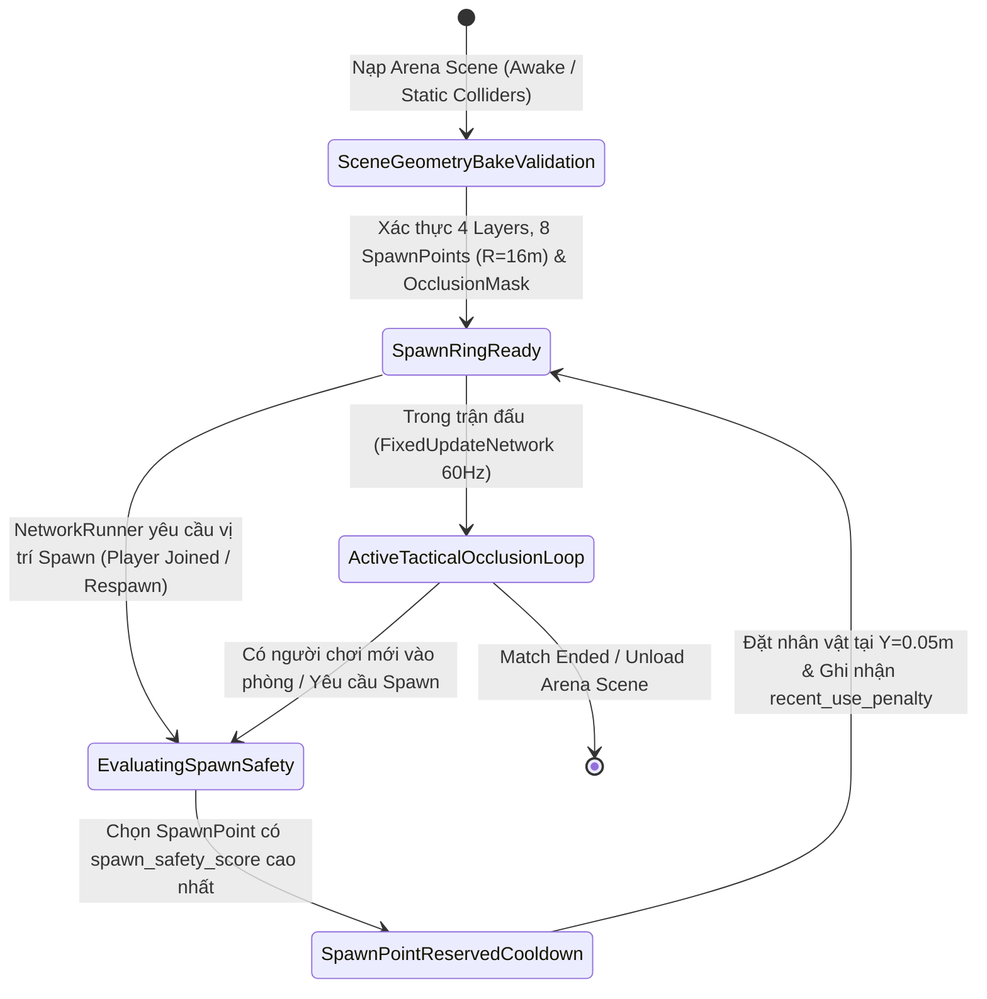

# Arena Level & Tactical Obstacle Architecture

> **Status**: Designed
> **Creative Director Review (CD-GDD-ALIGN)**: APPROVED 2026-11-10
> **Author**: Solo Developer + Studio Agents (`systems-designer`, `level-designer`, `unity-specialist`, `creative-director`, `qa-lead`)
> **Last Updated**: 2026-11-10
> **Last Verified**: 2026-11-10
> **Implements Pillar**: Pillar 1 (Cơ Động Phản Xạ Định Đoạt Sinh Tồn) & Pillar 2 (Chuyển Đổi Góc Nhìn Chiến Thuật Tức Thì FPS <-> TPS) & Pillar 3 (Công Bằng Mạng Tuyệt Đối Trên Shared Mode)

## Summary

**Arena Level & Tactical Obstacle Architecture** là hệ thống kiến trúc không gian chiến thuật và ma trận vật lý nền tảng (`Layer 1 — Foundation`) định hình toàn bộ sân khấu giao tranh của *Capsule Arena: Last Man Standing*. Hệ thống quy định mặt sàn đấu trường phẳng chuẩn mực `Plane` kích thước `ArenaSize = 40.0m x 40.0m` (`1,600 m²`) phủ lưới đo lường **World-Space Metric Grid** 2 cấp (`PrimaryGridStep = 2.0m`, `SecondaryGridStep = 1.0m`), được bao bọc bởi 4 bức tường chu vi `Boundary` (`BoundaryHeight = 4.0m`, `BoundaryThickness = 1.0m`) và hệ thống khối vật cản chiến thuật `Obstacle` (tổng diện tích chiếm chỗ `256 m²`, mật độ `16%`) gồm khối che chắn cao (`ObstacleHighHeight = 2.60m`), rào chắn thấp (`ObstacleLowHeight = 1.25m`), 4 cụm góc vuông chữ L (`CorridorWidth = 4.0m`) và các khe ngắm bắn hẹp (`SniperSlitWidth = 1.00m`), kết hợp cùng vòng 8 điểm hồi sinh an toàn (`SpawnRingRadius = 16.0m`) và ma trận va chạm 4 Layer vật lý (`Player`, `Projectile`, `Obstacle`, `Boundary`). Người chơi trực tiếp cảm nhận hệ thống này trong từng bước di chuyển: khoảng cách ô lưới dưới chân khớp tuyệt đối với cự ly **Forward Dash (phím `2` = `4.00m` = `2 ô chính`)** và **Side Dodge Roll (`Q`/`E` = `2.80m`)**, các góc chữ L mời gọi những pha **Chém ngang xoay người $90^\circ$ (phím `1` Trái / phím `3` Phải)** kết hợp xoay Camera trong `0.15s`, các khe hẹp `1.00m` tưởng thưởng xứng đáng cho người chơi nhấn phím `V` chuyển sang góc nhìn **FPS** để bắn đạn tầm xa (`Right Click`), trong khi dải chỉ ngang tầm mắt (`EyeLevelTrimHeight = 1.50m`) giữ cho não bộ luôn định vị phương hướng hoàn hảo.

> **Quick reference** — Layer: `Foundation` · Priority: `MVP` · Key deps: `None`

## Overview

**Arena Level & Tactical Obstacle Architecture** đóng vai trò là "bản thiết kế hình học và hiến pháp vật lý" ở tầng **Foundation (`Core` / `MVP`)** của *Capsule Arena: Last Man Standing*, nơi mọi thông số cơ động và chiến đấu từ `CharacterCombatConfigSO` (**System #1**) được chuyển hóa thành những bài toán không gian 3D hữu hình. Thay vì sắp đặt các khối hộp ngẫu nhiên chỉ mang tính trang trí, từng mét vuông trên mặt sàn `Plane` (`40.0m x 40.0m`) đều được tính toán theo **Thiết Kế Màn Chơi Dựa Trên Thước Đo Động Học (Metric-Driven Tactical Level Design)**:
- Mặt sàn phẳng tuyệt đối (`Y = 0.0m`) kẻ lưới **World-Space Metric Grid** (`PrimaryGridStep = 2.0m`, `SecondaryGridStep = 1.0m`) giúp người chơi bằng mắt thường đo ngay được cự ly **Forward Dash (phím `2` = `4.00m`)**, **Side Dodge Roll (`Q`/`E` = `2.80m`)**, tầm quét kiếm cận chiến (`MeleeRange = 2.80m`) và tầm bay tối đa của đạn (`ProjectileMaxDistance = 26.0m` = `13 ô chính`).
- Bốn loại cấu trúc vật cản chiến thuật `Obstacle` (nền Trắng Sứ `#E6EAEF` kèm dải chỉ Cam Công Nghiệp `#F97316` ở độ cao `EyeLevelTrimHeight = 1.50m`) tạo nên sân chơi chuyên biệt cho **Nhãn Quan Chiến Thuật Kép FPS $\leftrightarrow$ TPS (Pillar 2)**: ở góc nhìn thứ ba (**TPS**), người chơi lợi dụng các khối `High Cover Blocks` (`2.60m`) và `Low Tactical Barriers` (`1.25m`) để đọc vị hướng di chuyển cùng thanh máu **Overhead Billboard (`100/100`)** của kẻ địch; khi lao vào **4 Cụm Góc Vuông Chữ L (`L-Corner 90° Combat Zones`, hành lang rộng `4.0m`)**, người chơi tung combo `Forward Dash [2]` + `Horizontal Turning Slash 90° [1/3]` để quét kiếm bọc góc vuông và xoay mượt cả thân người lẫn Camera đúng $90^\circ$ trong `0.15s`; và khi đứng trước **Khe Ngắm Bắn Hẹp (`SniperSlitWidth = 1.00m`)**, người chơi nhấn phím `V` chuyển sang góc nhìn thứ nhất (**FPS**) để luồn viên đạn đường kính `0.40m` (`ProjectileRadius = 0.20m`) qua khe thông thủy `0.60m` với độ chính xác phẫu thuật.
- Dưới tầng kỹ thuật **Photon Fusion 2 (`GameMode.Shared`)**, toàn bộ hình học đấu trường là các Collider tĩnh bất biến (`Static Batching` / `BoxCollider` khớp 1:1 với Mesh) được phân vào ma trận 4 Layer vật lý (`Layer 6: Player`, `Layer 7: Projectile`, `Layer 8: Obstacle`, `Layer 9: Boundary`). Quy tắc kiểm tra tia `Physics.Linecast` với mặt nạ `OcclusionLayerMask = Obstacle | Boundary` đảm bảo tính toàn vẹn thể thao điện tử (**Pillar 3**): không một nhát kiếm cận chiến (`LMB`, `1`, `3`) hay viên đạn tầm xa (`RMB`) nào có thể gây sát thương xuyên tường trên bất kỳ máy Client nào.

## Player Fantasy

> **System Framing:** `[A] Direct / Spatial Mastery — Người chơi trực tiếp đọc địa hình, làm chủ từng góc khuất chữ L, từng khe ngắm hẹp và từng ô lưới khoảng cách để biến không gian đấu trường thành vũ khí sinh tồn.`

### 1. Giấc mơ cốt lõi: "Bậc Thầy Không Gian Giao Tranh — Đọc Góc Khuất Ở TPS, Xuyên Tâm Ngắm Ở FPS, Quét Vuông Góc $90^\circ$ Chớp Nhoáng"
Khi bước chân vào *Capsule Arena: Last Man Standing*, người chơi không cảm thấy mình đang bị nhốt trong một chiếc hộp 3D đơn điệu, mà đang đứng trên một **Sa Bàn Võ Thuật Chiến Thuật (Esports Tactical Toybox Diorama)** nơi người hiểu địa hình hơn là người chiến thắng.

Đấu trường trao cho người chơi quyền năng của một chiến lược gia kiêm kiếm khách phản xạ siêu việt:
- Bạn nép mình sau một khối `High Cover Block` cao `2.60m` màu Trắng Sứ, xoay góc nhìn **TPS** để quan sát đối thủ đang tiến vào hành lang chữ L rộng `4.0m` trong khi kẻ địch hoàn toàn mù thông tin về bạn.
- Ngay khoảnh khắc đối phương bước ngang qua mép tường chữ L, bạn nhìn lướt qua 2 ô lưới `PrimaryGridStep = 2.0m` trên mặt sàn, nhấn phím `2` (**Forward Dash**) phóng vọt đúng `4.00m` ra đầu góc vuông, rồi lập tức nhấn phím `1` (hoặc phím `3`) tung cú **Chém ngang xoay người $90^\circ$**. Lưỡi đao năng lượng xanh điện từ quét trọn góc vuông $90^\circ$ của hành lang chữ L, trong khi thân nhân vật và Camera của bạn xoay mượt $90^\circ$ chỉ trong `0.15s`, khóa chặt mục tiêu ngay trước mặt mà không hề bị khựng hay mất phương hướng nhờ dải chỉ màu Cam Công Nghiệp (`#F97316`) chạy ngang tầm mắt ở độ cao `1.50m`.
- Khi kẻ địch hoảng loạn dùng `Side Dodge Roll (Q/E)` lùi về sau bức tường có **Khe Ngắm Bắn Hẹp (`SniperSlitWidth = 1.00m`)** để hồi nhịp thở, bạn bấm phím `V` chuyển tức thì sang góc nhìn **FPS**, đặt tâm ngắm **Crosshair 2 lớp màu** xuyên qua khe hở `1.00m` và nhấp `Right Click` bắn viên đạn cầu năng lượng bay lọt qua khoảng thông thủy `0.60m` kết liễu mục tiêu.

### 2. Trải nghiệm cảm giác qua từng khoảnh khắc (How the Player Experiences Spatial Mastery)
1. **Đo Khoảng Cách Bằng Mắt Thường Qua Lưới Metric Grid (Instant Visual Rangefinding):** Người chơi không cần đoán mò xem đòn **Forward Dash (`[2]`)** hay nhát kiếm của mình có tới đích hay không. Trên nền sàn Xám Đá Phiến (`#5E6B78`), mỗi ô lưới chính `2.0m x 2.0m` và ô lưới phụ `1.0m x 1.0m` đóng vai trò như một thước ngắm tự nhiên: thấy kẻ địch cách 2 ô lưới chính (`4.0m`) nghĩa là bấm `[2]` sẽ áp sát ngay sát mũi kiếm; thấy kẻ địch cách hơn 1 ô lưới chính một chút (`2.80m`) nghĩa là nhát **Chém dọc (`Left Click`)** sẽ bổ trúng đích 100%.
2. **Sân Khấu Riêng Cho Phép Xoay $90^\circ$ Và Chuyển Đổi `FPS <-> TPS` (Geometry Built for Dual-Perspective & $90^\circ$ Turns):** Mọi cấu trúc trên sàn đấu đều trả lời câu hỏi *"Tại sao tôi nên đổi góc nhìn bằng phím `V` và tại sao tôi nên dùng phím `1`/`3` thay vì chỉ bấm chuột trái?"*:
   - **Khối cao `2.60m` & Rào thấp `1.25m`:** Tưởng thưởng cho góc nhìn **TPS** khả năng kiểm soát thông tin 360° và đọc thanh máu `100/100` trên đầu đối phương.
   - **Khe ngắm hẹp `1.00m`:** Tưởng thưởng cho góc nhìn **FPS** đường ngắm thẳng trực diện không bị góc lệch vai camera (camera shoulder offset) cản trở.
   - **4 Cụm góc vuông chữ L (`CorridorWidth = 4.0m`):** Tưởng thưởng cho kỹ năng **Chém ngang xoay người $90^\circ$ (`1`/`3`)** khả năng vừa tấn công bọc góc khuất vừa chuyển hướng di chuyển vuông góc mà không cần rê chuột thủ công.
3. **Sự Tin Cậy Vật Lý Tuyệt Đối (Zero Ghost-Hits Through Walls):** Khi một người chơi đã kịp lăn né (`Q`/`E`) khuất hoàn toàn sau khối `Obstacle` trước khi nhát kiếm hoặc viên đạn của đối phương chạm tới, bức tường thực sự bảo vệ họ 100%. Không bao giờ có cảnh lưỡi kiếm dài `2.80m` xuyên qua khối bê tông để trừ máu một cách vô lý.

### 3. Điểm chạm Tham chiếu & Đối chiếu Trụ cột Thiết kế

| Điểm tham chiếu / Trụ cột | Cách `Arena Level & Tactical Obstacle Architecture` hiện thực hóa trải nghiệm |
| :--- | :--- |
| ***Valorant / CS2*** *(Clean Sightlines, Corner Peeking & Zero Wall-Clip Integrity)* | Các góc chữ L vuông vắn, độ tương phản độ sáng cực đại giữa sàn (`Value 47%`) và khối chắn (`Value 94%`), cùng quy tắc `Physics.Linecast` chặn sát thương xuyên tường mang lại cảm giác đấu trí quanh góc khuất chuẩn Esports. |
| ***Brawl Stars*** *(Readable Tactical Cover & Arena Ring Spawn)* | Bố cục đối xứng tâm với 8 điểm `SpawnPoint` vòng ngoài (`SpawnRingRadius = 16.0m`) có khối chắn bảo vệ và vùng quyết đấu trung tâm giúp trận đấu luôn hội tụ tự nhiên về giữa bản đồ. |
| ***Superhot / Splatoon Test Range*** *(Metric Grid Floor & Eye-Level Trim)* | Hệ thống lưới `PrimaryGridStep = 2.0m` / `SecondaryGridStep = 1.0m` dưới sàn và dải chỉ ngang tầm mắt `EyeLevelTrimHeight = 1.50m` biến không gian 3D thành một phòng thí nghiệm chiến thuật minh bạch tuyệt đối. |
| **Pillar 1, Pillar 2 & Pillar 3** | Khớp cự ly hình học với `Dash [2]` / `Dodge [Q/E]` (**Pillar 1**), tạo địa hình chuyên biệt cho `FPS <-> TPS` và xoay $90^\circ$ (**Pillar 2**), đồng thời khóa cứng Collider tĩnh bất biến trên mọi máy Client `GameMode.Shared` (**Pillar 3**). |

## Detailed Design

### Core Rules

1. **Quy tắc Mặt Sàn Chuẩn Kích Thước & Lưới Đo Lường 2 Cấp (`Plane` & `World-Space Metric Grid`):**
   - Mặt sàn đấu trường (`Arena Floor` / `Plane`) là một mặt phẳng hình vuông tuyệt đối có kích thước chuẩn **`ArenaSize = 40.0m x 40.0m`** (`ArenaWidth = 40.0m`, `ArenaLength = 40.0m`, tổng diện tích **`1,600.0 m²`**), tâm đặt tại gốc tọa độ thế giới `(0.0, 0.0, 0.0)` (trải dài từ `-20.0m` đến `+20.0m` trên cả hai trục `X` và `Z`).
   - Toàn bộ bề mặt sàn hoàn toàn phẳng (`Y = 0.0m`, không có bậc thang hay độ dốc gồ ghề) để đảm bảo `CharacterController` khi thực thi **Forward Dash (phím `2`)** hoặc **Side Dodge Roll (phím `Q`/`E`)** trong `FixedUpdateNetwork()` luôn dịch chuyển tuyến tính 100% mà không bị nảy trục `Y` hay khựng bước.
   - Bề mặt sàn sử dụng vật liệu lì **Tactical Floor Slate (`#5E6B78`, Value `47%`, Smoothness `0.20`)** tích hợp Shader kẻ lưới **World-Space Metric Grid 2 cấp** (`#4A5562` / `#6E7C8B`):
     - **Lưới chính (`PrimaryGridStep = 2.0m`):** Chia sàn đấu `40.0m x 40.0m` thành `20 x 20 = 400` ô chính. Cự ly **Forward Dash (phím `2` = `4.00m`)** bằng chính xác **`2 ô lưới chính`**.
     - **Lưới phụ (`SecondaryGridStep = 1.0m`):** Chia mỗi ô chính thành 4 ô con `1.0m x 1.0m`. Cự ly **Side Dodge Roll (`Q`/`E` = `2.80m`)** và bán kính **Tầm chém cận chiến (`MeleeRange = 2.80m`)** tương ứng gần **`3 ô lưới phụ`** (`1.4 ô chính`), giúp người chơi ước lượng tầm đánh tức thì.

2. **Quy tắc 4 Bức Tường Bao Chu Vi Khép Kín (`Boundary` Perimeter Walls):**
   - Bao quanh 4 cạnh Bắc (`Z = +20.5m`), Nam (`Z = -20.5m`), Đông (`X = +20.5m`) và Tây (`X = -20.5m`) của mặt sàn là 4 bức tường bao khép kín thuộc **`Layer 9: Boundary`**.
   - Mỗi bức tường có chiều cao chuẩn **`BoundaryHeight = 4.0m`** (cao gấp đôi chiều cao nhân vật Capsule `2.0m`) và độ dày **`BoundaryThickness = 1.0m`** (gắn `BoxCollider` nguyên khối không có khe hở ở 4 góc tiếp giáp).
   - Bề mặt tường bao sử dụng màu **Boundary Charcoal (`#262B33`, Value `20%`)** kết hợp dải **Sọc Cảnh Báo Vàng Hổ Phách (`#EAB308`, cao `0.50m`)** chạy dọc chân tường, cung cấp tín hiệu thị giác ngoại vi rõ rệt để người chơi đang lùi hoặc xoay Camera $90^\circ$ ở góc nhìn **FPS** biết ngay lưng mình đã chạm ranh giới đấu trường.

3. **Quy tắc Hệ Thống Khối Vật Cản Chiến Thuật 4 Phân Loại (`Obstacle` Architecture & `EyeLevelTrimHeight = 1.50m`):**
   - Mọi khối vật cản chiến thuật bên trong sân đấu đều thuộc **`Layer 8: Obstacle`**, sử dụng `BoxCollider` khớp 1:1 với biên dạng Mesh hiển thị.
   - Về mặt thị giác (tuân thủ **Art Bible §3.3, §4.1 & §6.2**), toàn bộ khối `Obstacle` mang màu **Obstacle Porcelain (`#E6EAEF`, Value `94%`)**, chân đế tối màu (`#1E293B`, cao `0.25m`) và **bắt buộc có dải chỉ định hướng ngang tầm mắt ở độ cao `EyeLevelTrimHeight = 1.50m` mang màu Cam Công Nghiệp (`#F97316`, dày `0.15m`)**. Khi người chơi ở góc nhìn **FPS** (`CameraHeight = 1.60m`) kích hoạt đòn **Chém ngang xoay người $90^\circ$ (phím `1` Trái / phím `3` Phải)** khiến nhân vật và Camera xoay mượt $90^\circ$ trong `HorizontalTurnDuration = 0.15s` (`10.0°/tick`), dải chỉ ngang `1.50m` màu `#F97316` này đóng vai trò đường chân trời nhân tạo (Artificial Horizon Reference) giúp mắt định vị góc quay tức thì, triệt tiêu hoàn toàn cảm giác chóng mặt hay mất phương hướng.
   - Hệ thống `Obstacle` trên sàn đấu `40.0m x 40.0m` được cấu thành từ **4 nhóm hình học chiến thuật chuyên biệt** với tổng diện tích chân đế **`total_obstacle_footprint_area = 256.0 m²`** (đạt tỷ lệ mật độ chuẩn **`obstacle_coverage_ratio = 16.0%`**, để lại `84.0%` diện tích sàn thông thoáng cho cơ động):

| Phân Loại Vật Cản (`Obstacle` Type) | Thông Số Kích Thước Chuẩn | Số Lượng & Diện Tích Chiếm Chỗ (`Footprint`) | Vai Trò Chiến Thuật Đối Với Góc Nhìn `FPS <-> TPS` & 7 Kỹ Năng |
| :--- | :--- | :---: | :--- |
| **1. High Cover Blocks** *(Khối Che Chắn Toàn Phần)* | Chiều cao **`ObstacleHighHeight = 2.60m`** (`> Capsule 2.0m` và `> Overhead Billboard 2.35m`). Gồm 8 khối bảo vệ vòng Spawn (`3.0m x 2.0m`). | `8 khối` (`8 × 6.0 m² = 48.0 m²`) | Chặn 100% tầm nhìn thẳng ở góc nhìn **FPS** và chặn hoàn toàn đường đạn `Right Click`. Buộc người chơi phải chuyển sang góc nhìn **TPS** (phím `V`) để nhìn vòng qua mép tường, hoặc dùng `Forward Dash [2]` để đột kích qua góc khuất. |
| **2. Low Tactical Barriers** *(Rào Chắn Chiến Thuật Tầm Thấp)* | Chiều cao **`ObstacleLowHeight = 1.25m`** (`> MuzzleHeight 1.15m` nhưng `< EyeHeight 1.60m`). Kích thước mỗi khối: `4.5m x 2.0m`. | `8 khối` (`8 × 9.0 m² = 72.0 m²`) | Chặn các viên đạn tầm xa (`Right Click`) bắn ngang tầm ngực (`Y = 1.15m`), nhưng **cho phép nhìn thấy nửa thân trên của đối thủ (`Y > 1.25m`) và đọc rõ thanh máu Overhead Billboard (`100/100`)**. Ngăn chặn lối chơi nấp thụ động (anti-camping). |
| **3. 4 Cụm Góc Vuông Chữ L** *(`L-Corner 90° Combat Zones`)* | Chiều cao **`ObstacleHighHeight = 2.60m`**. Mỗi cụm gồm 2 cánh vuông góc (`6.0m x 2.0m` ghép với `4.0m x 2.0m`), tạo thành hành lang chữ L có bề rộng chuẩn **`CorridorWidth = 4.0m`**. | `4 cụm chữ L` (`4 × 20.0 m² = 80.0 m²`) | **Thiết kế chuyên biệt cho kỹ năng Chém ngang xoay người $90^\circ$ (phím `1` Trái / phím `3` Phải) kết hợp Forward Dash (phím `2`):** Người chơi lướt tiến `4.00m` bằng phím `2` tới đúng giao điểm chữ L, lập tức nhấn phím `1` hoặc `3` để quét cung kiếm vuông góc $90^\circ$ (`MeleeRange = 2.80m` + bán kính Capsule `0.50m` = `3.30m` bao phủ gần trọn hành lang `CorridorWidth = 4.0m`) đồng thời xoay mặt + Camera $90^\circ$ trong `0.15s` thẳng vào nhánh hành lang mới. |
| **4. Khe Ngắm Bắn Hẹp** *(`Sniper Slit Barriers`)* | 4 cặp trụ cao **`ObstacleHighHeight = 2.60m`** (mỗi trụ `3.5m x 2.0m`), đặt song song cách nhau một khoảng khe hẹp chuẩn **`SniperSlitWidth = 1.00m`**. | `4 cặp (8 trụ)` (`4 × 14.0 m² = 56.0 m²`) | **Thiết kế chuyên biệt cho việc chuyển sang góc nhìn thứ nhất (`FPS` — phím `V`) kết hợp Bắn đạn tầm xa (`Right Click`):** Ở góc nhìn `TPS`, góc lệch camera khiến việc nhắm xuyên qua khe `1.00m` dễ vướng mép tường; khi bấm `V` sang `FPS`, tâm ngắm thẳng hàng tuyệt đối với đường bay của viên đạn đường kính `0.40m` (`ProjectileRadius = 0.20m`), tạo khoảng thông thủy an toàn `effective_slit_clearance = 0.60m`. |

4. **Quy tắc Hệ Thống 8 Điểm Hồi Sinh An Toàn Vòng Ngoài (`SpawnPoint` Ring Architecture):**
   - Đấu trường bố trí **8 điểm hồi sinh cố định (`SpawnPoint` từ `P-01` đến `P-08`)** phân bố đều mỗi góc $45^\circ$ trên một vòng tròn đồng tâm có bán kính chuẩn **`SpawnRingRadius = 16.0m`** tính từ tâm sàn đấu `(0, 0, 0)` (cách tường bao `Boundary` một khoảng đệm an toàn `4.0m` để người chơi vừa xuất hiện có thể lùi hoặc lăn né ngay).
   - Mỗi `SpawnPoint` được đặt tại cao độ **`SpawnHeightOffset = 0.05m`** (cao hơn mặt sàn `5cm` để ngăn `CharacterController` hoặc `BoxCollider` bị lún xuyên qua mặt phẳng `Plane` ở Tick khởi tạo đầu tiên) và có trục hướng mặt (`transform.forward`) nhìn thẳng về tâm đấu trường `(0, 0, 0)`.
   - Phía trước mỗi `SpawnPoint` (ở bán kính `~12.5m`) được bố trí một khối `High Cover Block` (`2.60m`) làm lá chắn xuất phát (`Spawn Shield`), ngăn chặn tuyệt đối việc người chơi vừa được `Runner.Spawn()` đã bị bắn tỉa trực diện từ phía bên kia bản đồ (Anti-Spawn-Camping).
   - Khi khởi tạo nhân vật mới hoặc hồi sinh, hệ thống bắt buộc kiểm tra bán kính thông thoáng tối thiểu **`MinSpawnClearance = 8.0m`** và chấm điểm an toàn theo công thức `spawn_safety_score` để luôn chọn điểm `SpawnPoint` xa kẻ địch còn sống nhất.

5. **Quy tắc Ma Trận Va Chạm Vật Lý 4 Layer & Kiểm Tra Tia Chống Xuyên Tường (`4-Layer Physics Matrix` & `OcclusionLayerMask`):**
   - Dự án định nghĩa cố định 4 Layer vật lý chuyên biệt cho đấu trường trong `ProjectSettings/TagManager.asset` và `DynamicsManager.asset`:
     - **`Layer 6: Player`** — Gán cho `CharacterController` và các node `Hitbox` thuộc `HitboxRoot` của đấu sĩ Capsule (`Radius = 0.50m`, `Height = 2.00m`).
     - **`Layer 7: Projectile`** — Gán cho thực thể đạn năng lượng tầm xa (`Right Click`, bán kính cầu `ProjectileRadius = 0.20m` từ `INetworkObjectProvider` Pool).
     - **`Layer 8: Obstacle`** — Gán cho toàn bộ khối vật cản chiến thuật bên trong sân đấu (`High Cover`, `Low Barrier`, `L-Corner`, `Sniper Slit`).
     - **`Layer 9: Boundary`** — Gán cho 4 bức tường bao chu vi và mặt sàn giới hạn của đấu trường.
   - **Bảng Ma Trận Tương Tác Vật Lý 4 Layer (Physics Layer Collision & Query Matrix):**

| Layer | `Layer 6: Player` | `Layer 7: Projectile` | `Layer 8: Obstacle` | `Layer 9: Boundary` | Quy Tắc Xử Lý Trong `FixedUpdateNetwork()` |
| :--- | :---: | :---: | :---: | :---: | :--- |
| **`Layer 6: Player`** | **CÓ** *(Chặn đẩy nhau)* | **CÓ** *(LagComp Hitbox)* | **CÓ** *(Chặn di chuyển)* | **CÓ** *(Chặn văng khỏi sàn)* | `CharacterController` trượt mượt dọc theo bề mặt `Obstacle` và `Boundary` khi chạy `WASD`, `Forward Dash [2]` hoặc `Side Dodge Roll [Q/E]`. |
| **`Layer 7: Projectile`** | **CÓ** *(Trừ `20 HP` + Despawn)* | **KHÔNG** *(Đạn xuyên qua đạn)* | **CÓ** *(Hủy đạn + VFX nổ)* | **CÓ** *(Hủy đạn về Pool)* | Hai viên đạn bay ngược chiều qua khe ngắm `SniperSlitWidth = 1.00m` không tự hủy nhau; chạm `Obstacle` hoặc `Boundary` lập tức trả đạn về Pool. |
| **`Layer 8: Obstacle`** | **CÓ** | **CÓ** | **KHÔNG** *(Tĩnh)* | **KHÔNG** *(Tĩnh)* | Chặn hoàn toàn đường di chuyển và nằm trong mặt nạ `OcclusionLayerMask` chống chém/bắn xuyên tường. |
| **`Layer 9: Boundary`** | **CÓ** | **CÓ** | **KHÔNG** *(Tĩnh)* | **KHÔNG** *(Tĩnh)* | Giữ toàn bộ thực thể trong không gian `40.0m x 40.0m` và nằm trong mặt nạ `OcclusionLayerMask`. |

   - **Quy tắc Bắn Tia Kiểm Tra Che Khuất Bắt Buộc (`OcclusionLayerMask = (1 << 8) | (1 << 9)` tức `Obstacle | Boundary`):**
     - Trước khi bất kỳ đòn đánh cận chiến nào (**Vertical Slash `Left Click`** hoặc **Horizontal Turning Slash $90^\circ$ phím `1`/`3`**) gửi lệnh `Rpc_TakeDamage` tới mục tiêu nằm trong bán kính `MeleeRange = 2.80m` và góc quạt hợp lệ, hệ thống **bắt buộc** thực hiện một phép bắn tia `Physics.Linecast(attacker_eye_pos, target_center_pos, OcclusionLayerMask)`.
     - Nếu tia `Linecast` chạm phải bất kỳ Collider nào thuộc `Layer 8: Obstacle` hoặc `Layer 9: Boundary`, đòn đánh bị coi là **bị tường che khuất (`line_of_sight_clear == false`)** và bị hủy bỏ sát thương hoàn toàn đối với mục tiêu đó (kể cả khi mục tiêu đứng sau rào chắn thấp `ObstacleLowHeight = 1.25m` nếu tâm ngực bị chắn hoặc đứng sau góc tường chữ L).

### States and Transitions

Mặc dù hình học của đấu trường (`Plane`, `Boundary`, `Obstacle`) là bất biến trong suốt trận đấu để đảm bảo `0 Byte` băng thông mạng, hệ thống **Quản lý Không gian Đấu trường & Điểm Hồi Sinh (`ArenaLevelManager` & `SpawnPoint` Lifecycle)** vận hành qua **5 trạng thái xác định** từ lúc nạp Scene cho tới khi kết thúc ván đấu:

1. **`SceneGeometryBakeValidation` (Khởi tạo & Xác thực Hình học Tĩnh trong `Awake()`):** Kiểm tra sự tồn tại và cấu hình Layer của mặt sàn `Plane` (`40.0m x 40.0m`), 4 bức tường `Boundary` (`Layer 9`), các khối `Obstacle` (`Layer 8`), khởi tạo mặt nạ bit `OcclusionLayerMask = LayerMask.GetMask("Obstacle", "Boundary")` một lần duy nhất và thu thập mảng 8 `SpawnPoint` cố định (`P-01` đến `P-08`).
2. **`SpawnRingReady` (Sẵn sàng Cung cấp Điểm Xuất Phát):** Hệ thống giữ danh sách 8 `SpawnPoint` trên vòng tròn bán kính `SpawnRingRadius = 16.0m` cùng dấu thời gian sử dụng gần nhất của từng điểm.
3. **`EvaluatingSpawnSafety` (Chấm điểm An toàn Không gian):** Khi **System #4 (`Session & Object Pool`)** yêu cầu tọa độ để gọi `Runner.Spawn()` cho một người chơi, hệ thống quét khoảng cách từ cả 8 `SpawnPoint` tới toàn bộ kẻ địch đang còn sống (`!IsDead`), kiểm tra ngưỡng `MinSpawnClearance = 8.0m` và tính điểm `spawn_safety_score = min_enemy_distance - (recent_use_penalty * 4.0)`.
4. **`SpawnPointReservedCooldown` (Khóa Tạm thời Điểm Vừa Dùng):** Điểm `SpawnPoint` có `spawn_safety_score` cao nhất được trả về kèm cao độ `SpawnHeightOffset = 0.05m` và hướng nhìn về tâm `(0, 0, 0)`, đồng thời bật cờ `recent_use_penalty = 1` trong `3.0s` để ngăn việc 2 người chơi vào phòng cùng lúc bị chồng xác lên nhau.
5. **`ActiveTacticalOcclusionLoop` (Vòng lặp Kiểm tra Va chạm & Che khuất `60Hz`):** Cung cấp dịch vụ kiểm tra `IsLineOfSightClear(attackerEyePos, targetCenterPos)` và va chạm vật lý 4 Layer cho các hệ thống `#5`, `#7`, `#9` với chi phí `0 Byte GC Allocation`.

### Interactions with Other Systems

| Hệ Thống Liên Quan | Chiều Tương Tác | Hợp Đồng Dữ Liệu / Phương Thức Vật Lý & Không Gian |
| :--- | :---: | :--- |
| **System #1: Character & Combat Config Data (`CharacterCombatConfigSO`)** | **Tham chiếu Thiết kế (`1:1 Metric Alignment`)** | Kích thước ô lưới `PrimaryGridStep = 2.0m` và `CorridorWidth = 4.0m` được thiết kế khớp 1:1 với `DashSpeed * DashDuration = 4.00m`, `DodgeSpeed * DodgeDuration = 2.80m`, `MeleeRange = 2.80m` và `ProjectileRadius = 0.20m` của System #1. |
| **System #4: Photon Fusion 2 Shared Mode Session & Object Pool** | **Downstream (`#2` $\rightarrow$ `#4`)** | `#4` gọi `IArenaSpawnProvider.GetSafestSpawnPose(activePlayers)` của `#2` để lấy vị trí `(X, 0.05m, Z)` và góc quay hướng tâm trên vòng tròn `SpawnRingRadius = 16.0m` khi `Runner.Spawn()` nhân vật người chơi. |
| **System #5: Tick-Accurate Character Movement & Mobility System** | **Downstream (`#2` $\rightarrow$ `#5`)** | `CharacterController` (`Layer 6: Player`) trong `#5` tương tác vật lý trực tiếp với mặt sàn `Plane`, trượt dọc theo các khối `Obstacle` (`Layer 8`) và `Boundary` (`Layer 9`) khi thực hiện `Forward Dash [2]`, `Side Dodge Roll [Q/E]` và xoay $90^\circ$ trong hành lang chữ L `CorridorWidth = 4.0m`. |
| **System #7: Multi-Directional Melee & Pooled Ranged Combat System** | **Downstream (`#2` $\rightarrow$ `#7`)** | `#7` sử dụng `OcclusionLayerMask` (`Layer 8: Obstacle | Layer 9: Boundary`) của `#2` để bắn tia `Physics.Linecast` chặn sát thương cận chiến xuyên tường (`LMB`, `1`, `3`), đồng thời hủy viên đạn `Right Click` (`Layer 7: Projectile`) trả về Pool ngay khi chạm `Obstacle` hoặc `Boundary`. |
| **System #9: Dual-Perspective Camera (FPS/TPS) & Ghost Mode Spectator** | **Downstream (`#2` $\rightarrow$ `#9`)** | Camera **TPS** trong `#9` sử dụng `OcclusionLayerMask` (`Obstacle | Boundary`) trên `CinemachineDeoccluder` / `CinemachineThirdPersonFollow` để tự động kéo gần camera khi lưng nhân vật áp sát tường, không bao giờ để camera xuyên ra ngoài `Boundary` hoặc lọt vào trong ruột khối `Obstacle`; ở góc nhìn **FPS**, dải chỉ `EyeLevelTrimHeight = 1.50m` hỗ trợ định hướng khi xoay $90^\circ$ (`0.15s`). |

## Formulas

### 1. Điểm An Toàn Khi Lựa Chọn Điểm Hồi Sinh (`spawn_safety_score`)

The `spawn_safety_score` formula is defined as:

`spawn_safety_score = min_enemy_distance - (recent_use_penalty * 4.0)`

**Variables:**

| Variable | Type | Range | Source | Description |
| :--- | :---: | :---: | :--- | :--- |
| `min_enemy_distance` | `float` | `0.0–40.0` | Khoảng cách Euclid nhỏ nhất từ `SpawnPoint[i]` tới mọi kẻ địch còn sống (`!IsDead`) trên sàn đấu (`m`) | Khoảng cách từ điểm hồi sinh đang xét tới đối thủ gần nhất hiện diện trên mặt sàn `40.0m x 40.0m` (nếu phòng chưa có kẻ địch nào, gán mặc định bằng `2 * SpawnRingRadius = 32.0m`). |
| `recent_use_penalty` | `int` | `0` hoặc `1` | Trạng thái nội bộ của `SpawnPoint[i]` (`1` nếu điểm này vừa được dùng trong vòng `3.0s` gần nhất, ngược lại `0`) | Hệ số phạt chống trùng lặp điểm xuất phát khi nhiều người chơi cùng vào phòng hoặc hồi sinh liên tiếp (trọng số phạt cố định `4.0m`, tương đương `2 ô lưới chính`). |
| `spawn_safety_score` | `float` | `-4.0–40.0` | Bộ chọn điểm hồi sinh (`ArenaSpawnSelector`) | Điểm số ưu tiên của từng `SpawnPoint` trong 8 điểm vòng ngoài (`SpawnRingRadius = 16.0m`); hệ thống luôn chọn điểm có `spawn_safety_score` lớn nhất và ưu tiên thỏa mãn `min_enemy_distance >= MinSpawnClearance (8.0m)`. |

**Output Range:** `-4.0` đến `40.0` (đơn vị quy đổi tương đương mét).

**Example:**
- Giả sử trên sàn đấu đang có 2 kẻ địch còn sống. Hệ thống so sánh 2 ứng viên `SpawnPoint`:
  - **Điểm `P-01`:** Cách kẻ địch gần nhất `min_enemy_distance = 14.0m`, nhưng vừa có người chơi khác xuất hiện cách đây `1.2s` nên `recent_use_penalty = 1`:
    `spawn_safety_score(P-01) = 14.0 - (1 * 4.0) = 10.0`.
  - **Điểm `P-05` (đối diện qua tâm):** Cách kẻ địch gần nhất `min_enemy_distance = 12.5m` (`>= MinSpawnClearance = 8.0m`) và chưa có ai dùng (`recent_use_penalty = 0`):
    `spawn_safety_score(P-05) = 12.5 - (0 * 4.0) = 12.5`.
  - **Kết quả:** Hệ thống chọn **`P-05`** (`12.5 > 10.0`), đặt nhân vật tại tọa độ vòng ngoài `SpawnRingRadius = 16.0m` với cao độ `Y = SpawnHeightOffset = 0.05m`.

---

### 2. Điều Kiện Không Bị Tường Che Khuất Của Đòn Chém Cận Chiến (`line_of_sight_clear`)

The `line_of_sight_clear` formula is defined as:

`line_of_sight_clear = !Physics.Linecast(attacker_eye_pos, target_center_pos, Obstacle | Boundary)`

**Variables:**

| Variable | Type | Range | Source | Description |
| :--- | :---: | :---: | :--- | :--- |
| `attacker_eye_pos` | `Vector3` | Trong không gian `[-20, +20]` trục X/Z, `Y = 1.50m` | `attackerTransform.position + Vector3.up * EyeLevelTrimHeight` (`1.50m`) | Tọa độ điểm xuất phát của tia kiểm tra tầm nhìn tại đúng tầm mắt / ngực trên của người tấn công (`Y = 1.50m`). |
| `target_center_pos` | `Vector3` | Trong không gian `[-20, +20]` trục X/Z, `Y = 1.00m` | `targetTransform.position + Vector3.up * 1.0f` | Tọa độ tâm thân hình trụ Capsule của mục tiêu (`Height = 2.0m`, tâm ở `Y = 1.00m`). |
| `Obstacle \| Boundary` | `LayerMask` | Bitmask `(1 << 8) \| (1 << 9)` (`768`) | `ArenaLevelConfig.OcclusionLayerMask` | Mặt nạ bit chỉ lọc va chạm với `Layer 8: Obstacle` và `Layer 9: Boundary` (bỏ qua hoàn toàn `Layer 6: Player` và `Layer 7: Projectile`). |
| `line_of_sight_clear` | `bool` | `true` hoặc `false` | Hệ thống Chiến đấu (`System #7`) gọi trong `FixedUpdateNetwork()` | Kết quả xác nhận đường chém thông thoáng (`true` = cho phép gửi `Rpc_TakeDamage`; `false` = bị tường/vật cản chặn, hủy sát thương). |

**Output Range:** Giá trị logic Boolean (`true` = Không bị chắn, gây sát thương hợp lệ; `false` = Bị khối `Obstacle` hoặc `Boundary` che khuất, chặn sát thương 100%).

**Example:**
- **Trường hợp 1 (Chém bọc góc chữ L thành công):** Người chơi A đứng ở đầu góc vuông chữ L tại `(4.0, 0.0, 4.0)` tung đòn **Chém ngang xoay người $90^\circ$ (phím `1`)** vào Người chơi B đang đứng trong hành lang chữ L tại `(6.2, 0.0, 4.0)` (cự ly `2.20m <= MeleeRange 2.80m`). Tia `Physics.Linecast` nối từ `(4.0, 1.50, 4.0)` tới `(6.2, 1.00, 4.0)` đi hoàn toàn trong khoảng trống của hành lang `CorridorWidth = 4.0m`, không chạm khối `Obstacle` nào $\rightarrow$ `Physics.Linecast` trả về `false` $\rightarrow$ `line_of_sight_clear = !false = true` (Mục tiêu B nhận đủ `25 HP` sát thương).
- **Trường hợp 2 (Chém xuyên góc tường bị chặn):** Người chơi A đứng ở mặt ngoài bức tường chữ L dày `2.0m` tại `(1.5, 0.0, 4.0)` vung kiếm khi Người chơi B đứng sát mặt bên kia tường tại `(4.0, 0.0, 4.0)` (khoảng cách `2.50m <= MeleeRange 2.80m`). Dù B nằm trong bán kính hình quạt `2.80m`, tia `Physics.Linecast` từ `(1.5, 1.50, 4.0)` tới `(4.0, 1.00, 4.0)` đâm xuyên qua `BoxCollider` của khối tường chữ L (`Layer 8: Obstacle`) $\rightarrow$ `Physics.Linecast` trả về `true` $\rightarrow$ `line_of_sight_clear = !true = false` (Sát thương bị hủy bỏ hoàn toàn, chống lỗi chém xuyên tường).

---

### 3. Khoảng Thông Thủy An Toàn Cho Đạn Bay Qua Khe Ngắm Hẹp (`effective_slit_clearance`)

The `effective_slit_clearance` formula is defined as:

`effective_slit_clearance = SniperSlitWidth - (2 * ProjectileRadius)`

**Variables:**

| Variable | Type | Range | Source | Description |
| :--- | :---: | :---: | :--- | :--- |
| `SniperSlitWidth` | `float` | `0.60–2.00` | `ArenaLevelArchitecture` (`mặc định 1.00m`) | Khoảng cách hình học giữa hai mép trong của cặp trụ chắn tạo thành khe ngắm bắn hẹp (`mét`). |
| `ProjectileRadius` | `float` | `0.05–0.60` | `CharacterCombatConfigSO.ProjectileRadius` (`mặc định 0.20m`) | Bán kính va chạm hình cầu của viên đạn tầm xa `Right Click` (`đường kính đạn = 2 * ProjectileRadius = 0.40m`). |
| `effective_slit_clearance` | `float` | `0.10–1.80` | Thông số kiểm chứng thiết kế **Pillar 2 (`FPS` Sightline Mastery)** | Độ rộng dung sai phương ngang thực tế (`mét`) mà tâm viên đạn có thể đi lệch khỏi chính giữa khe ngắm mà không bị quệt vào mép `BoxCollider` của hai trụ `Obstacle` hai bên. |

**Output Range:** `0.10m` đến `1.80m` (Ở cấu hình chuẩn phải đảm bảo `effective_slit_clearance >= 0.40m` để bắn lọt dễ dàng ở góc nhìn `FPS`, nhưng `< 2 * PlayerCapsuleRadius (1.00m)` để nhân vật không thể lách người đi xuyên qua khe ngắm).

**Example:**
- Với khe ngắm chuẩn `SniperSlitWidth = 1.00m` và bán kính đạn `ProjectileRadius = 0.20m` (từ `CharacterCombatConfigSO`):
  `effective_slit_clearance = 1.00 - (2 * 0.20) = 1.00 - 0.40 = 0.60m` (tức tâm viên đạn có biên độ lệch an toàn $\pm 0.30\text{m}$ tính từ đường tâm khe ngắm — đủ rộng để người chơi nhấn phím `V` sang góc nhìn **FPS** ngắm bắn xuyên khe chuẩn xác, trong khi thân hình trụ của nhân vật có đường kính `1.00m` bị chặn lại hoàn toàn).

---

### 4. Tỷ Lệ Mật Độ Vật Cản Trên Sàn Đấu (`obstacle_coverage_ratio`)

The `obstacle_coverage_ratio` formula is defined as:

`obstacle_coverage_ratio = total_obstacle_footprint_area / (ArenaWidth * ArenaLength)`

**Variables:**

| Variable | Type | Range | Source | Description |
| :--- | :---: | :---: | :--- | :--- |
| `total_obstacle_footprint_area` | `float` | `160.0–384.0` | Tổng diện tích mặt bằng $\sum (w_i \times l_i)$ của toàn bộ khối `Obstacle` trên sân (`m²`) | Tổng diện tích chiếm chỗ trên mặt phẳng `X–Z` của 4 nhóm vật cản (`80 m²` góc chữ L + `56 m²` trụ khe ngắm + `48 m²` chắn Spawn + `72 m²` rào thấp = `256.0 m²`). |
| `ArenaWidth` | `float` | `32.0–60.0` | `ArenaLevelArchitecture` (`mặc định 40.0m`) | Chiều rộng mặt sàn đấu trường theo trục `X` (`mét`). |
| `ArenaLength` | `float` | `32.0–60.0` | `ArenaLevelArchitecture` (`mặc định 40.0m`) | Chiều dài mặt sàn đấu trường theo trục `Z` (`mét`). |
| `obstacle_coverage_ratio` | `float` | `0.10–0.24` | Chỉ số cân bằng không gian giữa **Pillar 1 (Cơ động)** và **Pillar 2 (Ẩn nấp góc nhìn)** | Tỷ lệ phần trăm diện tích mặt sàn bị chiếm bởi các khối `Obstacle` (phần diện tích thông thoáng để di chuyển là `1.0 - obstacle_coverage_ratio`). |

**Output Range:** `0.10` (`10%`) đến `0.24` (`24%`).

**Example:**
- Với tổng diện tích mặt bằng vật cản `total_obstacle_footprint_area = 256.0 m²` trên mặt sàn chuẩn `ArenaWidth = 40.0m`, `ArenaLength = 40.0m`:
  `obstacle_coverage_ratio = 256.0 / (40.0 * 40.0) = 256.0 / 1600.0 = 0.16` (tức **`16.0%`** diện tích sàn là vật cản chiến thuật, để lại **`84.0%`** tương đương **`1,344.0 m²`** mặt sàn phẳng thông thoáng cho các pha lướt `Forward Dash [2]` và lăn né `Side Dodge Roll [Q/E]`).

## Edge Cases

- **If a player activates `Forward Dash [2]` (`4.00m`) or `Side Dodge Roll [Q/E]` (`2.80m`) directly into an `Obstacle` (`Layer 8`) or `Boundary` (`Layer 9`) at an oblique angle**: Thành phần `CharacterController.Move()` trong `FixedUpdateNetwork()` tự động phân giải vector vận tốc theo pháp tuyến bề mặt va chạm (`Slide Along Surface`) và dừng phần dịch chuyển vuông góc vào tường mà không làm hủy sớm `TickTimer` của trạng thái Dash/Dodge, đảm bảo nhân vật trượt mượt dọc theo mép tường hành lang chữ L thay vì bị bật ngược (rubber-band) hay xuyên qua `BoxCollider`.
- **If a player performs a `Vertical Slash [Left Click]` or `Horizontal Turning Slash 90° [1/3]` when an enemy is within `MeleeRange = 2.80m` and inside the slash cone, but separated by a thin `Obstacle` corner or `Low Tactical Barrier`**: Phép kiểm tra `line_of_sight_clear = !Physics.Linecast(attacker_eye_pos, target_center_pos, Obstacle | Boundary)` phát hiện va chạm với `Layer 8: Obstacle` và trả về `false`, hủy bỏ hoàn toàn lệnh `Rpc_TakeDamage` đối với mục tiêu đó (kể cả khi vệt Mesh VFX của nhát chém hiển thị chạm nhẹ vào bề mặt tường).
- **If a player stands directly behind a `Low Tactical Barrier` (`ObstacleLowHeight = 1.25m`) and fires a `Ranged Attack [Right Click]`**: Do điểm đầu nòng đạn `MuzzlePoint` của nhân vật Capsule nằm ở độ cao `Y = 1.15m` (`< 1.25m`), viên đạn vừa rời nòng sẽ chạm ngay vào mặt trong của khối `Low Tactical Barrier` (`Layer 8: Obstacle`) và tự hủy về Pool; người chơi buộc phải bước sang mép rào chắn hoặc tận dụng rào thấp để quan sát thanh máu `100/100` của địch trước khi `Side Dodge Roll [Q/E]` ra khoảng trống để bắn.
- **If a player attempts to walk or `Forward Dash [2]` through a `Sniper Slit` (`SniperSlitWidth = 1.00m`)**: Do `CharacterController` của nhân vật Capsule có bán kính `Radius = 0.50m` (đường kính đúng `1.00m`) cộng thêm `skinWidth = 0.08m` (tổng bề rộng vật lý `1.16m > SniperSlitWidth = 1.00m`), hai trụ `Obstacle` hai bên khe ngắm sẽ chặn đứng hoàn toàn thân người chơi, đảm bảo khe ngắm `1.00m` chỉ cho phép đạn tầm xa (`2 * ProjectileRadius = 0.40m`) bay qua chứ không cho phép nhân vật lách qua.
- **If two opposing players fire `Ranged Attack [Right Click]` projectiles (`Layer 7: Projectile`) simultaneously through the exact same `SniperSlitWidth = 1.00m` gap**: Nhờ ma trận vật lý tắt va chạm `Layer 7 <-> Layer 7` (`Projectile` không va chạm với `Projectile`), cả hai viên đạn đều bay xuyên qua nhau mượt mà qua khoảng thông thủy `effective_slit_clearance = 0.60m` mà không bị nổ giữa khe hẹp.
- **If all 8 `SpawnPoint` locations currently have an active enemy closer than `MinSpawnClearance = 8.0m` during a chaotic 8-player match**: Thay vì trả về `null` hoặc làm treo lệnh `Runner.Spawn()`, thuật toán chọn điểm hồi sinh tự động chuyển sang chế độ **Best-Effort Fallback**: chọn điểm `SpawnPoint[i]` có giá trị `spawn_safety_score = min_enemy_distance - (recent_use_penalty * 4.0)` lớn nhất trong 8 điểm để đảm bảo nhân vật luôn được xuất hiện tức thì tại vị trí tương đối an toàn nhất trên vòng tròn `SpawnRingRadius = 16.0m`.
- **If multiple players join the Photon Fusion 2 Shared Mode session on the exact same simulation Tick**: Mỗi lần `GetSafestSpawnPose()` cấp phát một `SpawnPoint[i]`, hệ thống lập tức đánh dấu `recent_use_penalty = 1` cho điểm đó ngay trong bộ nhớ trước khi xử lý người chơi tiếp theo trong cùng Tick, đảm bảo người chơi thứ hai nhận được một `SpawnPoint` khác (giảm `4.0` điểm trên điểm vừa dùng) và không bao giờ có 2 `CharacterController` bị `Spawn()` chồng khít lên cùng một tọa độ `(X, 0.05m, Z)`.
- **If a player backs up against the `Boundary` wall (`BoundaryHeight = 4.0m`) or a `High Cover Block` (`ObstacleHighHeight = 2.60m`) while in `TPS` camera mode**: Thành phần chống xuyên tường của Camera (`System #9`) đọc chung mặt nạ `OcclusionLayerMask = Obstacle | Boundary` để trượt điểm đặt Camera về phía vai nhân vật, ngăn chặn tuyệt đối việc Camera xuyên qua bức tường dày `BoundaryThickness = 1.0m` nhìn ra khoảng không bên ngoài sàn đấu.
- **If a player triggers `Horizontal Turning Slash 90° [1/3]` while standing flush against an `L-Corner` wall**: Vì phép xoay thân người và Camera $\pm 90^\circ$ trong `0.15s` (`RequestTimedYawTurn`) chỉ thay đổi góc quay trục đứng `Yaw` quanh tâm hình trụ đối xứng của `CharacterController` (không làm phình kích thước `BoxCollider` hay `HitboxRoot`, và biến dạng `DOTween Squash & Stretch` chỉ nằm trên `VisualRoot`), nhân vật xoay góc vuông $90^\circ$ mượt mà 100% mà không bao giờ bị kẹt góc tường.

## Dependencies

### Upstream Dependencies (Hệ thống này phụ thuộc vào)

- **Không có (`None — Layer 1 Foundation`):** `Arena Level & Tactical Obstacle Architecture` nằm ở tầng nền tảng thấp nhất (`Layer 1 — Foundation` trong `design/gdd/systems-index.md`), chỉ sử dụng các thành phần vật lý và hình học lõi của `UnityEngine` (`BoxCollider`, `MeshRenderer`, `LayerMask`, `Physics.Linecast`, `Transform`) mà không phụ thuộc vào bất kỳ hệ thống code nào ở tầng trên.

### Downstream Dependents (Các hệ thống phụ thuộc vào hệ thống này)

| Hệ Thống Hạ Nguồn | Loại Phụ Thuộc | Hợp Đồng Hình Học & Vật Lý Cung Cấp Bởi Hệ Thống #2 |
| :--- | :---: | :--- |
| **System #4: Photon Fusion 2 Shared Mode Session & Object Pool** | **Hard (MVP)** | Truy vấn danh sách 8 `SpawnPoint` (`SpawnRingRadius = 16.0m`, `SpawnHeightOffset = 0.05m`, `MinSpawnClearance = 8.0m`) và công thức `spawn_safety_score` để khởi tạo người chơi bằng `Runner.Spawn()`. |
| **System #5: Tick-Accurate Character Movement & Mobility System** | **Hard (MVP)** | Vận hành `CharacterController` (`Layer 6: Player`) trên mặt sàn phẳng `Plane` (`40.0m x 40.0m`), va chạm trượt với `Layer 8: Obstacle` và `Layer 9: Boundary`, đồng thời khai thác hành lang chữ L `CorridorWidth = 4.0m` cho combo `Forward Dash [2]` + `Horizontal Turning Slash 90° [1/3]`. |
| **System #7: Multi-Directional Melee & Pooled Ranged Combat System** | **Hard (MVP)** | Sử dụng `OcclusionLayerMask` (`Obstacle \| Boundary`) cho phép kiểm tra `Physics.Linecast` chống chém cận chiến xuyên tường và xử lý va chạm hủy đạn `Layer 7: Projectile` khi chạm tường hoặc bay qua khe ngắm `SniperSlitWidth = 1.00m`. |
| **System #9: Dual-Perspective Camera (FPS/TPS) & Ghost Mode Spectator** | **Hard (Vertical Slice)** | Sử dụng `OcclusionLayerMask` để chống xuyên tường cho Camera `TPS`, khai thác chiều cao `ObstacleHighHeight = 2.60m` / `ObstacleLowHeight = 1.25m` và khe ngắm `SniperSlitWidth = 1.00m` cho việc chuyển đổi góc nhìn phím `V` (`FPS <-> TPS`), và dựa vào dải chỉ `EyeLevelTrimHeight = 1.50m` để chống chóng mặt khi xoay $90^\circ$ (`0.15s`). |

## Tuning Knobs

Toàn bộ các thông số kiến trúc mặt sàn, tường bao, khối vật cản chiến thuật và vòng điểm hồi sinh dưới đây được chuẩn hóa trong cấu hình màn chơi (`ArenaLevelConfig` / Prefab cấu trúc đấu trường) với biên độ tinh chỉnh an toàn:

| Knob Name | Default Value | Safe Range (Min–Max) | Effect if Too Low | Effect if Too High | Interacts With |
| :--- | :---: | :---: | :--- | :--- | :--- |
| `ArenaSize` (`ArenaWidth` × `ArenaLength`) | `40.0m × 40.0m` (`1,600 m²`) | `32.0m – 56.0m` (`1,024 – 3,136 m²`) | Đấu trường quá chật hẹp, 4–8 người chơi vừa Spawn đã đụng mặt nhau ngay lập tức, không có không gian cấu rỉa tầm xa (`ProjectileMaxDistance = 26.0m`). | Bản đồ quá mênh mông khiến người chơi mất nhiều thời gian chạy bộ `WASD` (`6.5 m/s`) đi tìm nhau, làm nguội nhịp độ giao tranh 30 giây. | `MoveSpeed`, `ProjectileMaxDistance` (`#1`), `SpawnRingRadius`, `obstacle_coverage_ratio`. |
| `PrimaryGridStep` / `SecondaryGridStep` | `2.0m` / `1.0m` | `Primary: 1.0m – 4.0m` `Secondary: 0.5m – 2.0m` | Lưới kẻ quá dày đặc gây nhiễu thị giác (Moiré pattern) khi camera di chuyển nhanh hoặc xoay $90^\circ$. | Ô lưới quá thưa không còn khớp với bội số của `Forward Dash [2] = 4.00m` và `MeleeRange = 2.80m`, làm mất khả năng ước lượng cự ly bằng mắt thường. | Shader `World-Space Metric Grid` (`Art Bible §6.2`), `DashSpeed * DashDuration` (`#1`). |
| `BoundaryHeight` | `4.0m` | `3.0m – 6.0m` | Tường bao quá thấp tạo cảm giác nhân vật có thể nhảy/văng qua rìa sàn đấu và không che kín đường chân trời ở góc nhìn `FPS`. | Tường bao quá cao như đáy giếng sâu, gây cảm giác bí bách và che khuất ánh sáng `Directional Light` góc nghiêng `50°` ở rìa sân. | `Camera TPS/FPS` (`#9`), Directional Light (`Art Bible §2`). |
| `BoundaryThickness` | `1.0m` | `0.5m – 2.0m` | Tường quá mỏng dễ bị viên đạn tốc độ cao (`ProjectileSpeed = 22.0 m/s`) hoặc `CharacterController` khi Dash `16.0 m/s` gặp hiện tượng xuyên hầm (tunneling) khi mạng giật. | Tốn diện tích bao ngoài không cần thiết trong Scene. | `BoxCollider` (`Layer 9: Boundary`), `DashSpeed`, `ProjectileSpeed` (`#1`). |
| `ObstacleHighHeight` | `2.60m` | `2.30m – 3.50m` | Nếu thấp hơn `2.35m`, thanh máu **World-Space Overhead Billboard** (`Y = 2.35m`) sẽ nhô lên khỏi đỉnh khối che chắn toàn phần, làm lộ vị trí nấp ở cả góc nhìn `FPS`. | Khối hộp quá cao làm cản trở tầm nhìn bao quát của Camera góc nhìn thứ ba (`TPS`), làm giảm lợi thế chiến thuật của việc bấm phím `V` sang `TPS`. | Chiều cao Capsule (`2.0m`), Overhead Billboard (`2.35m` — `#8`), Camera `TPS` (`#9`). |
| `ObstacleLowHeight` | `1.25m` | `1.00m – 1.45m` | Nếu thấp hơn `1.15m`, viên đạn tầm xa (`Right Click`, xuất phát tại `MuzzleHeight = 1.15m`) sẽ bay vọt qua trên đỉnh rào chắn, làm mất tác dụng chắn đạn của rào thấp. | Nếu cao hơn `1.50m`, rào thấp sẽ che khuất cả đầu lẫn mắt nhân vật (`Y = 1.55m`), biến thành khối chắn cao và làm mất cơ chế "nhìn thấy nửa thân trên + thanh máu `100/100`". | `MuzzlePoint` (`Y = 1.15m`), `EyeLevelTrimHeight` (`1.50m`), Overhead Billboard (`#8`). |
| `EyeLevelTrimHeight` | `1.50m` | `1.40m – 1.65m` | Dải chỉ màu Cam `#F97316` nằm quá thấp dưới ngực, trượt khỏi vùng nhìn trung tâm khi người chơi ở góc nhìn `FPS` (`CameraHeight = 1.60m`). | Dải chỉ nằm quá cao trên trán, không còn khớp với mặt phẳng tia kiểm tra `attacker_eye_pos` (`Y = 1.50m`) và tâm ngắm `Crosshair`. | Camera `FPS` (`#9`), phép xoay $90^\circ$ trong `HorizontalTurnDuration = 0.15s` (`#5`, `#7`). |
| `CorridorWidth` *(Hành lang chữ L)* | `4.0m` | `3.0m – 5.5m` | Hành lang quá hẹp (`< 3.0m`) khiến 2 nhân vật Capsule (`đường kính 1.0m`) dễ va kẹt vào nhau và không đủ chỗ để `Side Dodge Roll [Q/E]` (`2.80m`). | Hành lang quá rộng (`> 5.5m`) khiến nhát **Chém ngang xoay người $90^\circ$ (`MeleeRange = 2.80m`)** không quét tới kẻ địch đi sát mép tường đối diện, làm giảm hiệu quả của cụm góc chữ L. | `MeleeRange = 2.80m`, `HorizontalSlashAngle = 90°`, `Forward Dash = 4.00m` (`#1`, `#5`, `#7`). |
| `SniperSlitWidth` *(Khe ngắm bắn hẹp)* | `1.00m` | `0.70m – 1.20m` | Khe quá hẹp (`< 0.70m`) khiến khoảng thông thủy `effective_slit_clearance` còn dưới `0.30m`, viên đạn (`ProjectileRadius = 0.20m`) cực kỳ dễ va vào mép tường gây ức chế. | Nếu `> 1.15m`, thân nhân vật Capsule (`Radius = 0.50m`) có thể lách người đi xuyên qua khe ngắm, biến khe bắn tỉa thành lối đi thường. | `ProjectileRadius = 0.20m` (`#1`), `effective_slit_clearance`, Camera `FPS` (`#9`). |
| `obstacle_coverage_ratio` | `0.16` (`16%` — `256 m²`) | `0.12 – 0.22` (`12% – 22%`) | Sàn đấu quá trống trải như sân bóng phẳng, lối chơi bắn xa (`Right Click`) thống trị hoàn toàn vì không có chỗ nấp để áp sát cận chiến. | Sàn đấu biến thành mê cung chật chội (**Anti-Pillar 4: Cluttered Maze Over Readability**), người chơi lướt `Dash [2]` hay lăn `Dodge [Q/E]` liên tục đâm sầm vào tường. | Toàn bộ kỹ năng cơ động (`#5`) và chiến đấu (`#7`). |
| `SpawnRingRadius` | `16.0m` | `12.0m – 18.0m` | Điểm hồi sinh đặt quá gần khu vực giao tranh trung tâm `(0, 0, 0)`, người chơi vừa vào trận đã bị cuốn ngay vào tầm chém của người khác. | Nếu `> 18.5m` (trên sàn bán kính `20.0m`), nhân vật sẽ xuất hiện sát rạt bức tường `Boundary`, không có khoảng lùi phía sau lưng. | `ArenaSize`, `MinSpawnClearance`, `SpawnPoint` (`#4`). |
| `MinSpawnClearance` | `8.0m` | `5.0m – 14.0m` | Cho phép hồi sinh ngay sát kẻ địch (trong tầm `Forward Dash 4.0m + MeleeRange 2.8m = 6.8m`), dẫn tới bị chém lén ngay khi vừa `Spawn()`. | Ngưỡng quá khắt khe khiến hầu hết các điểm `SpawnPoint` đều bị đánh dấu không đạt khi phòng đông người, buộc hệ thống liên tục rơi vào nhánh Fallback. | `spawn_safety_score`, `Forward Dash [2]` + `MeleeRange` (`#1`, `#4`). |
| `SpawnHeightOffset` | `0.05m` | `0.02m – 0.20m` | Đặt tại `0.00m` dễ làm đáy `CharacterController` giao cắt với `BoxCollider` của mặt sàn `Plane` ngay ở Tick đầu tiên, gây lỗi xuyên sàn. | Đặt quá cao khiến nhân vật bị rơi tự do một nhịp ngắn khi vừa xuất hiện trên màn hình. | `CharacterController` (`#5`), `Runner.Spawn()` (`#4`). |

## Visual/Audio Requirements

Toàn bộ thiết kế thị giác và âm thanh của đấu trường tuân thủ nghiêm ngặt **Art Bible (`design/art/art-bible.md` §1, §3.3, §4.1 & §6)** theo định hướng **"Tactical Toybox Arena"**:

1. **Bảng Màu & Chất Liệu Bề Mặt Lì Tương Phản Độ Sáng (`Low-Saturation Matte PBR — Value Contrast Hierarchy`):**
   - Toàn bộ vật liệu môi trường (`Floor`, `Obstacle`, `Boundary`) khóa cứng `Metallic = 0.0` và `Smoothness = 0.15 – 0.25` để không bao giờ gây lóa sáng cạnh tranh với nhân vật Capsule (`Smoothness = 0.55`) hay hiệu ứng VFX phát sáng HDR:
     - **Mặt sàn `Plane` (`40.0m x 40.0m`):** Màu **Tactical Floor Slate (`#5E6B78`, Value `47%`)** kèm đường kẻ lưới **World-Space Metric Grid** màu **`#4A5562`** (lưới chính `PrimaryGridStep = 2.0m` dày `4cm`, lưới phụ `SecondaryGridStep = 1.0m` dày `2cm`) và vòng tròn quyết đấu trung tâm (`Center Showdown Ring` đường kính `12.0m`).
     - **Khối vật cản `Obstacle` (`High Cover 2.60m`, `Low Barrier 1.25m`, `L-Corner`, `Sniper Slit`):** Thân tường màu **Obstacle Porcelain (`#E6EAEF`, Value `94%`)** tạo độ tương phản độ sáng gấp đôi mặt sàn (`94%` so với `47%`); chân đế cao `0.25m` màu Xám Than (`#1E293B`); và **dải chỉ ngang tầm mắt tại đúng độ cao `EyeLevelTrimHeight = 1.50m` cùng viền cạnh đứng màu Cam Công Nghiệp (`#F97316`)**.
     - **Tường bao `Boundary` (`BoundaryHeight = 4.0m`, `BoundaryThickness = 1.0m`):** Thân tường màu **Boundary Charcoal (`#262B33`, Value `20%`)** kết hợp dải sọc chéo cảnh báo $45^\circ$ màu **Hazard Amber (`#EAB308`)** cao `0.50m` dọc chân tường.
2. **Hiệu Ứng Va Chạm Bề Mặt Môi Trường (`Environment Impact VFX & 3D Spatial Audio — System #14`):**
   - Khi viên đạn tầm xa (`Right Click`, `Layer 7: Projectile`) va chạm với khối `Obstacle` (`Layer 8`) hoặc tường `Boundary` (`Layer 9`) — ví dụ khi người chơi bắn trượt vào mép khe ngắm `SniperSlitWidth = 1.00m` — hệ thống kích hoạt một chùm tia lửa/hạt vuông nhỏ màu Vàng Cam (`Wall Spark Burst`, tự tắt sau `0.25s` từ Local VFX Pool) kèm âm thanh va đập nhựa cứng đanh gọn (`sfx_proj_wall_impact_01`, `Spatial Blend = 1.0`) ngay tại điểm tiếp xúc trước khi thu hồi đạn về `INetworkObjectProvider` Pool.
   - Khi nhân vật bước chạy hoặc tiếp đất sau cú lướt `Forward Dash [2]` / `Side Dodge Roll [Q/E]` trên mặt sàn `Plane`, phát âm thanh bước chân đồ chơi vinyl nhẹ nhàng (`sfx_footstep_slate_01`) không gây vang vọng (zero reverb clutter).

## Game Feel

Kiến trúc màn chơi đóng góp trực tiếp vào cảm giác điều khiển sắc bén ("Spatial & Kinetic Game Feel") thông qua 3 cơ chế phối hợp:

1. **Cảm Giác "Lướt Khớp Ô Lưới, Quét Khớp Hành Lang" (`Metric Grid & L-Corner Flow`):**
   - Nhờ `PrimaryGridStep = 2.0m` và `CorridorWidth = 4.0m` được thiết kế đồng bộ với `Forward Dash [2] = 4.00m` và `MeleeRange = 2.80m`, người chơi khi thực hiện chuỗi thao tác `Dash [2]` $\rightarrow$ `Chém ngang xoay 90° [1/3]` tại bất kỳ cụm góc chữ L nào đều cảm nhận được sự vừa vặn cơ học hoàn hảo: cú lướt đưa nhân vật dừng lại đúng tâm ngã rẽ chữ L, và cú xoay $90^\circ$ trong `0.15s` mở ra hành lang mới thẳng tắp trước mắt.
2. **Điểm Neo Thị Giác Chống Chóng Mặt Khi Xoay $90^\circ$ Ở Góc Nhìn FPS (`EyeLevelTrimHeight = 1.50m` Optical Anchor):**
   - Xoay góc nhìn thứ nhất (`FPS`) một góc vuông $90^\circ$ chỉ trong `0.15s` (`9 ticks`) trước một bức tường trắng trơn sẽ gây mất cảm giác không gian. Dải chỉ ngang tầm mắt màu Cam Công Nghiệp (`#F97316`) ở độ cao `1.50m` cùng các đường rãnh dọc mỗi `1.0m` trên khối `Obstacle` cung cấp dòng chảy thị giác (`Optical Flow`) rõ nét, giúp mắt người chơi cảm nhận cú xoay $90^\circ$ mượt và uy lực như một pha lia máy điện ảnh.
3. **Trượt Tường Mượt Mà Không Kẹt Góc (`Frictionless Wall-Sliding`):**
   - Toàn bộ `BoxCollider` của `Obstacle` và `Boundary` sử dụng `PhysicsMaterial` có ma sát động và ma sát tĩnh bằng `0.0` (`Dynamic Friction = 0.0`, `Static Friction = 0.0`, `Friction Combine = Minimum`) kết hợp vát nhẹ góc hiển thị, đảm bảo khi người chơi lăn né `Q`/`E` hoặc lướt `2` quệt sượt qua mép tường, nhân vật trượt đi trơn tru thay vì bị khựng lại.

## UI Requirements

Mặc dù hệ thống #2 không sở hữu màn hình UI riêng, hình học của nó đặt ra 3 quy chuẩn hiển thị trực tiếp cho **System #8 (`Combat HUD & Overhead Billboard`)** và **System #9 (`Dual-Perspective Camera`)**:

1. **Quy Chuẩn Hiển Thị Thanh Máu Overhead Billboard Qua Rào Chắn Thấp vs. Khối Chắn Cao:**
   - Thanh máu **World-Space Overhead Billboard (`100/100`)** gắn trên đầu nhân vật ở độ cao `Y = 2.35m`:
     - Khi đối thủ đứng sau **Low Tactical Barrier (`ObstacleLowHeight = 1.25m`)**: Nửa thân trên của đối thủ (`1.25m – 2.00m`) và toàn bộ thanh máu Billboard (`Y = 2.35m`) **hiển thị rõ 100%** ở cả góc nhìn `FPS` và `TPS`, cho phép người chơi đọc lượng máu còn lại để quyết định có nên `Forward Dash [2]` băng qua rào chắn để kết liễu hay không.
     - Khi đối thủ đứng nấp hoàn toàn sau **High Cover Block (`ObstacleHighHeight = 2.60m`)**: Khối hộp cao `2.60m` che khuất hoàn toàn cả thân hình Capsule (`2.0m`) lẫn thanh máu Billboard (`2.35m`) đối với tầm nhìn thẳng của góc nhìn `FPS`, bảo toàn yếu tố bất ngờ chiến thuật khi ẩn nấp.
2. **Độ Tương Phản Của Tâm Ngắm `Crosshair` Khi Ngắm Qua Khe Hẹp (`SniperSlitWidth = 1.00m`):**
   - Khi người chơi bấm phím `V` chuyển sang góc nhìn **FPS** và đặt tâm ngắm vào khe hẹp `SniperSlitWidth = 1.00m`, hai bên tâm ngắm là bề mặt khối `Obstacle` sáng màu (`#E6EAEF`, Value `94%`) trong khi chính giữa khe ngắm là mặt sàn tối màu hơn (`#5E6B78`, Value `47%`) hoặc tường bao tối (`#262B33`, Value `20%`). Tâm ngắm **Crosshair 2 lớp màu** (lõi Xanh Cyan `#00F5D4` + viền Đen `#090D16` dày `2px` theo `Art Bible §4.2`) đảm bảo người chơi luôn nhìn rõ tâm bắn trên cả hai nền sáng và tối.
3. **Tầm Nhìn Bao Quát Khi Ở Chế Độ Khán Giả Hồn Ma (`Ghost Mode Spectator`):**
   - Chiều cao `BoundaryHeight = 4.0m` và `ObstacleHighHeight = 2.60m` đảm bảo khi người chơi tử trận (`IsDead == true`) và chuyển sang **Ghost Mode Spectator** (theo dõi qua các góc camera `Next / Previous`), không có phần mái che hay trần nhà nào cản trở góc nhìn từ trên cao xuống sàn đấu `40.0m x 40.0m`.

## Cross-References

- **Game Concept Document (`design/gdd/game-concept.md`):** Xác lập trụ cột **Pillar 1 (Cơ Động Phản Xạ Định Đoạt Sinh Tồn)**, **Pillar 2 (Chuyển Đổi Góc Nhìn Chiến Thuật Tức Thì FPS $\leftrightarrow$ TPS)**, **Pillar 3 (Công Bằng Mạng Tuyệt Đối Trên Shared Mode)**, cấu trúc sàn đấu gồm `Plane`, `Obstacle` Cubes, `Boundary` và yêu cầu chống tấn công xuyên tường.
- **Character & Combat Config Data (`design/gdd/character-combat-config.md` — System #1):** Cung cấp các thông số động học gốc để thiết kế kích thước sàn đấu: `DashSpeed (16.0 m/s) * DashDuration (0.25s) = 4.00m`, `DodgeSpeed (12.0 m/s) * DodgeDuration (0.22s) = 2.80m`, `MeleeRange = 2.80m`, `HorizontalSlashAngle = 90.0°`, `HorizontalTurnDuration = 0.15s`, `ProjectileMaxDistance = 26.0m`, và `ProjectileRadius = 0.20m`.
- **Art Bible (`design/art/art-bible.md` — §3.3, §4.1 & §6):** Quy định bảng màu chủ đạo (`#5E6B78` cho mặt sàn `Plane`, `#E6EAEF` kèm dải chỉ `#F97316` ở `Y = 1.50m` cho khối `Obstacle`, `#262B33` kèm sọc `#EAB308` cho tường `Boundary`), hệ thống lưới `World-Space Metric Grid` 2 cấp và kiến trúc 4 cụm góc vuông chữ L.
- **Systems Index (`design/gdd/systems-index.md`):** Định vị **System #2 (`Arena Level & Tactical Obstacle Architecture`)** ở tầng `Layer 1 — Foundation` (`MVP`) và xác lập luồng phụ thuộc một chiều tới các hệ thống `#4`, `#5`, `#7`, `#9`.

## Acceptance Criteria

1. **AC-01 (Kích thước chuẩn của mặt sàn `Plane` và lưới đo lường `World-Space Metric Grid` 2 cấp):**
   - **GIVEN** Scene đấu trường chính được nạp vào bộ nhớ
   - **WHEN** kiểm tra kích thước hình học, vị trí `BoxCollider` và thông số Material của mặt sàn `Plane`
   - **THEN** mặt sàn có kích thước chính xác `ArenaWidth = 40.0m` và `ArenaLength = 40.0m` (`1,600.0 m²`, trải từ `-20.0m` đến `+20.0m` trên trục X và Z tại cao độ `Y = 0.0m`), sử dụng màu nền `#5E6B78` và hiển thị lưới **World-Space Metric Grid** với bước lưới chính `PrimaryGridStep = 2.0m` (khớp 2 ô với `Forward Dash [2] = 4.00m`) và bước lưới phụ `SecondaryGridStep = 1.0m`.

2. **AC-02 (Cấu hình 4 bức tường bao chu vi `Boundary` khép kín):**
   - **GIVEN** 4 bức tường bao chu vi Bắc, Nam, Đông, Tây của đấu trường
   - **WHEN** kiểm tra thuộc tính `Layer`, kích thước `BoxCollider` và bảng màu của từng bức tường
   - **THEN** cả 4 bức tường đều thuộc `Layer 9: Boundary`, có chiều cao `BoundaryHeight = 4.0m`, độ dày `BoundaryThickness = 1.0m`, ghép khép kín không có khe hở ở 4 góc sàn `40.0m x 40.0m`, và sử dụng màu `#262B33` kèm dải sọc cảnh báo `#EAB308`.

3. **AC-03 (Chiều cao phân hóa của `High Cover Blocks`, `Low Tactical Barriers` và dải chỉ định hướng `EyeLevelTrimHeight = 1.50m`):**
   - **GIVEN** các khối vật cản chiến thuật thuộc `Layer 8: Obstacle` trên mặt sàn đấu trường
   - **WHEN** đo chiều cao `BoxCollider` và kiểm tra cấu trúc thị giác của từng phân loại vật cản
   - **THEN** các khối che chắn cao có chiều cao `ObstacleHighHeight = 2.60m` (che khuất hoàn toàn nhân vật `2.0m` và thanh máu Billboard `2.35m` ở góc nhìn `FPS`), các rào chắn thấp có chiều cao `ObstacleLowHeight = 1.25m` (chặn đạn ở `Y = 1.15m` nhưng để lộ nửa thân trên và thanh máu Billboard `100/100`), và mọi khối `Obstacle` cao đều có nền `#E6EAEF` kèm dải chỉ ngang tầm mắt ở độ cao `EyeLevelTrimHeight = 1.50m` màu `#F97316`.

4. **AC-04 (Hình học 4 Cụm Góc Vuông Chữ L phục vụ `Horizontal Turning Slash 90° [1/3]`):**
   - **GIVEN** 4 cụm vật cản góc vuông chữ L (`L-Corner 90° Combat Zones`) bố trí quanh khu vực trung tâm đấu trường
   - **WHEN** nhân vật thực hiện `Forward Dash (phím 2 = 4.00m)` tiến tới giao điểm chữ L và kích hoạt **Chém ngang xoay người $90^\circ$ (phím `1` Trái / phím `3` Phải)**
   - **THEN** bề rộng hành lang chữ L đạt chuẩn `CorridorWidth = 4.0m` ($\pm 0.05\text{m}$), cho phép vùng quạt chém ngang (`MeleeRange = 2.80m`, góc mở `HorizontalSlashAngle = 90.0°`) bao phủ trọn vẹn mục tiêu có bán kính Capsule `0.50m` đứng trong hành lang đồng thời nhân vật và Camera xoay mượt $90^\circ$ trong `0.15s` thẳng vào nhánh hành lang vuông góc.

5. **AC-05 (Khoảng thông thủy `effective_slit_clearance` của Khe Ngắm Bắn Hẹp `SniperSlitWidth = 1.00m`):**
   - **GIVEN** cặp trụ chắn tạo khe ngắm bắn hẹp có khoảng cách `SniperSlitWidth = 1.00m`, nhân vật có bán kính `CharacterController.radius = 0.50m` (`skinWidth = 0.08m`), và viên đạn tầm xa (`Right Click`) có `ProjectileRadius = 0.20m`
   - **WHEN** nhân vật cố gắng đi bộ/lướt qua khe hẹp HOẶC chuyển sang góc nhìn `FPS` (phím `V`) để bắn đạn tầm xa xuyên qua khe hẹp
   - **THEN** thân nhân vật bị chặn lại hoàn toàn không thể đi lọt qua khe `1.00m`, trong khi viên đạn bay qua khe với khoảng thông thủy an toàn `effective_slit_clearance = 1.00m - (2 * 0.20m) = 0.60m` mà không bị vướng vào `BoxCollider` của hai trụ chắn.

6. **AC-06 (Tỷ lệ mật độ vật cản chuẩn `obstacle_coverage_ratio = 16%`):**
   - **GIVEN** toàn bộ các khối `Obstacle` (`4 cụm chữ L = 80 m²`, `4 cặp trụ khe ngắm = 56 m²`, `8 khối chắn Spawn = 48 m²`, `8 rào chắn thấp = 72 m²`) trên mặt sàn `40.0m x 40.0m` (`1,600 m²`)
   - **WHEN** tính tổng diện tích mặt bằng chiếm chỗ theo công thức `obstacle_coverage_ratio = total_obstacle_footprint_area / (ArenaWidth * ArenaLength)`
   - **THEN** tổng diện tích chân đế vật cản bằng `256.0 m²` và `obstacle_coverage_ratio` đạt đúng `0.16` (`16.0%`), đảm bảo `84.0%` (`1,344.0 m²`) diện tích sàn thông thoáng cho cơ động.

7. **AC-07 (Bố cục 8 điểm `SpawnPoint` vòng ngoài và thuật toán chấm điểm `spawn_safety_score`):**
   - **GIVEN** 8 điểm `SpawnPoint` (`P-01` đến `P-08`) nằm trên vòng tròn bán kính `SpawnRingRadius = 16.0m` tại cao độ `SpawnHeightOffset = 0.05m` và trên sân đang có ít nhất 1 kẻ địch còn sống
   - **WHEN** hệ thống chọn điểm xuất phát theo công thức `spawn_safety_score = min_enemy_distance - (recent_use_penalty * 4.0)`
   - **THEN** hệ thống luôn trả về điểm `SpawnPoint` có `spawn_safety_score` cao nhất (ưu tiên thỏa mãn `min_enemy_distance >= MinSpawnClearance = 8.0m`), đặt nhân vật tại cao độ `Y = 0.05m` hướng mặt về tâm `(0, 0, 0)`, và tự động bật `recent_use_penalty = 1` để người chơi tiếp theo không bị Spawn trùng vị trí.

8. **AC-08 (Ma trận va chạm vật lý 4 Layer trong `ProjectSettings/DynamicsManager`):**
   - **GIVEN** 4 Layer vật lý `Layer 6: Player`, `Layer 7: Projectile`, `Layer 8: Obstacle`, và `Layer 9: Boundary`
   - **WHEN** kiểm tra ma trận tương tác vật lý (`Physics.GetIgnoreLayerCollision`) và mô phỏng va chạm trong `FixedUpdateNetwork()`
   - **THEN** `Player` va chạm với `Player`, `Projectile`, `Obstacle`, `Boundary`; `Projectile` va chạm với `Player`, `Obstacle`, `Boundary` nhưng **bỏ qua va chạm với `Projectile` khác** (`GetIgnoreLayerCollision(7, 7) == true`); và hai tầng tĩnh `Obstacle` / `Boundary` bỏ qua va chạm lẫn nhau.

9. **AC-09 (Chặn tuyệt đối đòn chém cận chiến xuyên tường bằng `Physics.Linecast`):**
   - **GIVEN** Người chơi A và Người chơi B đứng cách nhau `2.00m` (`<= MeleeRange = 2.80m`) nhưng bị ngăn cách ở giữa bởi một khối `Obstacle` (`Layer 8`) hoặc tường `Boundary` (`Layer 9`)
   - **WHEN** Người chơi A tung đòn **Vertical Slash (`Left Click`)** hoặc **Horizontal Turning Slash $90^\circ$ (`Phím 1/3`)** hướng thẳng về phía Người chơi B
   - **THEN** công thức `line_of_sight_clear = !Physics.Linecast(attacker_eye_pos, target_center_pos, Obstacle | Boundary)` trả về `false` và Người chơi B nhận `0 HP` sát thương (`CurrentHealth` giữ nguyên không đổi).

10. **AC-10 (Thu hồi đạn tầm xa về Object Pool ngay khi chạm `Obstacle` hoặc `Boundary`):**
    - **GIVEN** một viên đạn tầm xa (`Right Click`, `Layer 7: Projectile`) đang bay trong `FixedUpdateNetwork()` với vận tốc `ProjectileSpeed = 22.0 m/s`
    - **WHEN** hình cầu va chạm của viên đạn (`ProjectileRadius = 0.20m`) chạm vào bất kỳ `BoxCollider` nào thuộc `Layer 8: Obstacle` hoặc `Layer 9: Boundary` trước khi hết `ProjectileMaxDistance = 26.0m`
    - **THEN** viên đạn lập tức dừng di chuyển, không gây sát thương xuyên qua phía bên kia bức tường, kích hoạt hiệu ứng va chạm tường và gọi `Runner.Despawn()` để trả đối tượng về `INetworkObjectProvider` Object Pool ngay trong Tick đó.

## Open Questions

- Không còn câu hỏi mở (`None`). Toàn bộ kích thước mặt sàn `40.0m x 40.0m`, lưới `World-Space Metric Grid` (`2.0m` / `1.0m`), 4 phân loại khối vật cản chiến thuật (`High Cover 2.60m`, `Low Barrier 1.25m`, `L-Corner CorridorWidth = 4.0m`, `SniperSlitWidth = 1.00m`), dải chỉ ngang tầm mắt `EyeLevelTrimHeight = 1.50m`, vòng 8 điểm hồi sinh (`SpawnRingRadius = 16.0m`, `MinSpawnClearance = 8.0m`, `SpawnHeightOffset = 0.05m`) và ma trận vật lý 4 Layer đã được khóa hoàn toàn.
