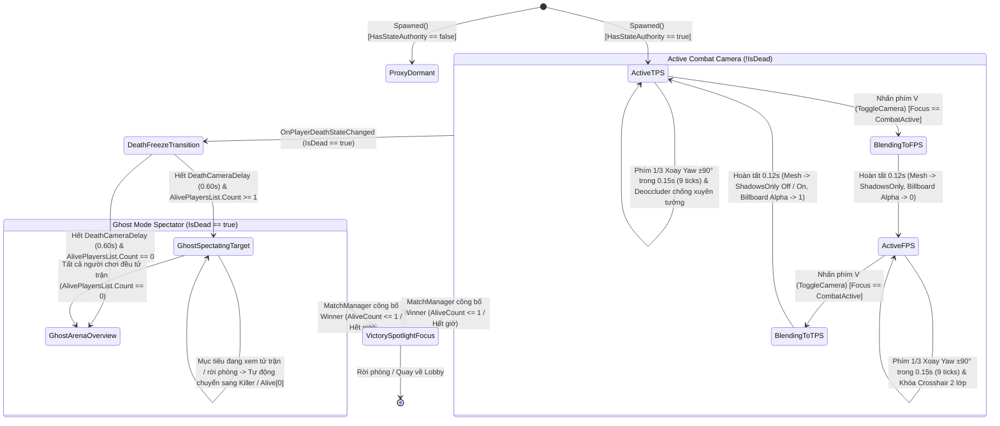

# Dual-Perspective Camera (FPS/TPS) & Ghost Mode Spectator System

> **Status**: Designed
> **Creative Director Review (CD-GDD-ALIGN)**: APPROVED 2026-11-10
> **Author**: Solo Developer + Studio Agents (`game-designer`, `gameplay-programmer`, `ux-designer`, `creative-director`, `qa-lead`)
> **Last Updated**: 2026-11-10
> **Last Verified**: 2026-11-10
> **Implements Pillar**: Pillar 2 (Nhãn Quan Chiến Thuật Kép FPS <-> TPS — Chuyển Đổi Góc Nhìn Chiến Thuật Tức Thì) & Pillar 4 (Khán Đài Hồn Ma & Vinh Quang Bảng Vàng — Ghost Mode Spectator)

## Summary

**Dual-Perspective Camera (FPS/TPS) & Ghost Mode Spectator System (`DualPerspectiveCameraController` & `GhostSpectatorController`)** là hệ thống điều khiển thị giác chiến thuật và camera khán đài ở tầng **Feature (`Vertical Slice`)** của *Capsule Arena: Last Man Standing*, hiện thực hóa trực tiếp **Pillar 2 (Chuyển Đổi Góc Nhìn Chiến Thuật Tức Thì `FPS <-> TPS`)** và **Pillar 4 (Khán Đài Hồn Ma — `Ghost Mode Spectator`)** trên nền **Unity 6.6 (`6000.6.8f1`, URP, Unity Cinemachine 3.x)** và **Photon Fusion 2 (`GameMode.Shared`)**. Hệ thống đảm bảo nghiêm ngặt quy tắc **Quyền Sở Hữu Camera Cục Bộ (`Local Authority Camera Binding`)**: chỉ nhân vật có `Object.HasStateAuthority == true` (`LocalPlayer`) mới được kích hoạt cụm `CinemachineCamera` (`Priority = 20`) và `AudioListener`, trong khi các nhân vật `Proxy` hoàn toàn tắt camera để tránh xung đột khung hình. Khi còn sống (`!IsDead`), người chơi nhấn phím **`V`** (`GameActionId.ToggleCamera` nạp động từ `keybinding.json`) để chuyển đổi mượt trong `PerspectiveBlendDuration = 0.12s` giữa góc nhìn thứ ba (**TPS** — `TPSCameraDistance = 4.50m`, `FOV = 65.0°`, tích hợp `CinemachineDeoccluder` chống xuyên tường `Obstacle`/`Boundary`) và góc nhìn thứ nhất (**FPS** — `FPSEyeOffset = (0.0m, 1.60m, 0.10m)`, `FOV = 75.0°`, tự động chuyển `MeshRenderer` thân bản thân sang `ShadowCastingMode.ShadowsOnly` và hiện tâm ngắm **Crosshair 2 lớp màu**). Đặc biệt, vì cả hai camera đều bám theo nút gốc `CameraYawPivot` được cập nhật bởi `MovementController.RequestTimedYawTurn` (`#5`), góc nhìn ở cả `FPS` lẫn `TPS` đều tự động xoay mượt đúng $\pm 90^\circ$ trong `HorizontalTurnDuration = 0.15s` (`9 ticks` ở `60Hz`, tắt hoàn toàn Motion Blur) mỗi khi người chơi tung đòn chém ngang bằng phím **`1`** hoặc **`3`**. Ngay khi `LocalPlayer` tử trận (`IsDead == true` từ `#6`), sau `DeathCameraDelay = 0.60s`, hệ thống tự động chuyển sang **Chế độ Khán Đài Hồn Ma (`GhostSpectating`)**, phủ hiệu ứng viền màn hình **Ethereal Ghost Cyan Vignette (`#06B6D4`, Alpha `18%`)**, cho phép bấm `Q`/`A` (`Previous`) hoặc `E`/`D` (`Next`) để chuyển camera theo dõi tuần hoàn qua danh sách đấu sĩ còn sống (`AlivePlayersList`) trong khi vẫn mở khung Chat (`Enter`) để trò chuyện và cổ vũ tới cuối trận.

> **Quick reference** — Layer: `Feature` · Priority: `Vertical Slice` · Key deps: `Tick-Accurate Character Movement & Mobility System`, `Health, Damage RPC & Death State System`, `Keybinding & Input Management System`

## Overview

Trong một đấu trường sinh tồn 3D có nhịp độ phản xạ cao và bố cục nhiều khối vật cản che chắn (`Obstacle` Cubes cao `2.6m–3.0m`, tường thấp `1.2m–1.3m`, và 4 cụm góc vuông chữ L $90^\circ$), góc nhìn camera không đơn thuần là một ống kính quan sát thụ động mà là **một vũ khí chiến thuật chủ động**. **Dual-Perspective Camera (FPS/TPS) & Ghost Mode Spectator System (`#9`)** giải quyết trọn vẹn bài toán nhận thức không gian của người chơi trong suốt vòng đời một trận đấu *Last Man Standing* từ lúc `Spawned()` cho đến khi tìm ra nhà vô địch (`Winner`):

1. **Nhãn Quan Chiến Thuật Kép (`TPS <-> FPS` Toggle qua phím `V`):**
   - Ở **Chế độ TPS (`Third-Person Tactical View` — Mặc định khi vào trận):** Camera lùi về sau lưng đấu sĩ ở khoảng cách `4.50m`, lệch nhẹ qua vai phải (`TPSShoulderOffset = (0.60m, 1.80m, 0.0m)`) với góc mở `TPSFieldOfView = 65.0°`. Góc nhìn này cho phép người chơi tận dụng lợi thế "ngó góc khuất" (*Corner Peeking*) khi nấp sau khối `Obstacle` cao `2.6m`, đọc rõ quỹ đạo đạn tầm xa đang bay tới để bấm `Q`/`E` (**Side Dodge Roll**) và căn chính xác cự ly `4.00m` của cú **Forward Dash (`[2]`)** trên mặt sàn kẻ lưới `Metric Grid`. Khi người chơi lùi sát vào tường, bộ giải va chạm `CinemachineDeoccluder` (quét `Layer 8: Obstacle | Layer 9: Boundary` với bán kính đệm `0.25m`) tự động kéo camera trượt êm về sát vai mà không bao giờ xuyên thủng vào bên trong khối hộp.
   - Ở **Chế độ FPS (`First-Person Precision View` — Nhấn phím `V`):** Camera lướt mượt trong `0.12s` (`EaseInOutQuad`) về đúng vị trí tầm mắt nhân vật (`FPSEyeOffset = (0.0m, 1.60m, 0.10m)`), mở rộng trường nhìn lên `FPSFieldOfView = 75.0°` và bật tâm ngắm **Crosshair 2 lớp màu** (`#00F5D4` lõi + `#090D16` viền `2px`). Để triệt tiêu hoàn toàn hiện tượng Mesh thân hình Capsule hoặc hiệu ứng đàn hồi `DOTween Squash & Stretch` che khuất màn hình khi đang lướt/xoay người, hệ thống áp dụng **Quy tắc Ẩn Thân Mình Chống Che Khuất (`FPS Self-Occlusion Rule`)**: chuyển toàn bộ `MeshRenderer` trên nhánh `VisualRoot` của `LocalPlayer` sang `ShadowCastingMode.ShadowsOnly` (vẫn giữ nguyên bóng đổ dưới mặt sàn) và ẩn thanh máu Overhead Billboard của chính mình (`CanvasGroup.alpha = 0f`). Góc nhìn FPS biến những khe ngắm hẹp (`1.5m–2.0m`) giữa hai khối `Obstacle` thành "lỗ châu mai" lý tưởng để xả đạn **Ranged Attack (`Right Click`)** chuẩn xác từng milimét.

2. **Đồng Bộ Động Học Xoay $\pm 90^\circ$ Trong `0.15s` Khi Chém Ngang (`Phím 1 / Phím 3`):**
   - Một trong những cơ chế đặc trưng nhất của *Capsule Arena* là đòn **Chém ngang xoay người $90^\circ$ (`Horizontal Turning Slash`)**: bấm phím `1` để quét kiếm $90^\circ$ sang trái, hoặc bấm phím `3` để quét kiếm $90^\circ$ sang phải.
   - Thay vì tự ý xoay camera bằng một hàm Tween độc lập gây lệch pha với hướng mặt vật lý trên mạng, cả `CinemachineCamera_TPS` và `CinemachineCamera_FPS` đều được gắn làm con/bám theo nút gốc `CameraYawPivot` trên nhân vật. Khi Hệ thống Chiến đấu (`#7`) kích hoạt đòn chém ngang và ủy quyền một chiều xuống `MovementController.RequestTimedYawTurn(±90f, 0.15f)` (`#5`), nút `CameraYawPivot` xoay mượt đúng $\pm 10.0^\circ/\text{tick}$ trong `9 ticks` (`0.15s` ở `60Hz`). Kết quả là dù người chơi đang ở **FPS** hay **TPS**, khung hình đều lia mượt đúng một góc vuông $90^\circ$ đồng bộ tuyệt đối 1:1 với lưỡi đao và hướng mặt mới của nhân vật, không có Motion Blur, giúp người chơi lập tức khóa mục tiêu ở hành lang vuông góc chữ L.

3. **Khán Đài Hồn Ma Sôi Động (`Ghost Mode Spectator` khi `IsDead == true`):**
   - Trong thể thức *Last Man Standing*, bị hạ gục sớm không đồng nghĩa với việc bị đẩy ra màn hình đen nhàm chán (**Pillar 4**). Khi `HealthSystem` (`#6`) phát sự kiện `OnPlayerDeathStateChanged(isDead: true)` cho `LocalPlayer`, hệ thống giữ camera tại vị trí tử trận trong `DeathCameraDelay = 0.60s` để người chơi chứng kiến khoảnh khắc nhân vật của mình tan biến, sau đó tự động chuyển sang trạng thái **`GhostSpectating`**.
   - Hệ thống thông báo cho `InputFocusManager` (`#3`) chuyển sang chế độ `GhostSpectating`, bật lớp phủ viền màn hình **Ethereal Ghost Cyan Vignette (`#06B6D4`, Alpha `18%`)** kèm thanh điều khiển **Spectator Control Bar**, và gắn điểm bám của camera TPS sang đấu sĩ còn sống đầu tiên trong `AlivePlayersList`. Người chơi đã khuất có thể bấm `Q`/`A` (hoặc nút UI `[◄ Trước]`) và `E`/`D` (hoặc nút UI `[Sau ►]`) để chuyển góc nhìn vòng quanh các đấu sĩ còn đang giao tranh, xoay chuột tự do quanh mục tiêu đang xem, và nhấn `Enter` mở khung **Public/Whisper Chat (`#12`)** để bình luận trực tiếp diễn biến trận đấu.

## Player Fantasy

> **System Framing:** `[A] Direct — Người chơi trực tiếp điều khiển ống kính chiến thuật (nhấn V chuyển đổi tức thì FPS <-> TPS, lia chuột ngắm bắn, cảm nhận cú xoay camera 90° sắc ngọt khi bấm phím 1/3) và trực tiếp làm đạo diễn góc máy trên Khán Đài Hồn Ma (nhấn Q/A, E/D chuyển mục tiêu theo dõi khi tử trận).`

### 1. Giấc mơ cốt lõi: "Nhãn Quan Chiến Thuật Đa Chiều & Khán Đài Không Bao Giờ Tắt Lửa"
Trong các tựa game hành động góc nhìn cố định truyền thống, người chơi thường xuyên rơi vào sự bất lực của góc máy: ở góc nhìn thứ ba (TPS), thân hình nhân vật của chính mình đôi khi chắn mất khe hẹp phía trước khi cần bắn tỉa chính xác; ngược lại, ở góc nhìn thứ nhất (FPS), người chơi bị "mù thông tin" hoàn toàn khi nép sau một bức tường lớn và dễ bị đánh úp từ hai bên hông.

**Dual-Perspective Camera & Ghost Mode Spectator System** trao cho người chơi quyền năng làm chủ không gian thị giác theo ý muốn trong tích tắc (**Pillar 2**):
- **Làm chủ Góc Khuất ở TPS ("Bậc thầy Đọc Tình Huống"):** Khi máu chỉ còn `35/100 HP` và đang nép sau một khối `Obstacle` cao `2.6m`, góc nhìn **TPS** rộng rãi cho phép bạn bình tĩnh quan sát tên địch màu Đỏ San Hô (`#F43F5E`) đang rình rập phía bên kia bức tường mà không cần thò mặt ra chịu đạn.
- **Phẫu thuật Không Gian ở FPS ("Xạ thủ Khe Hẹp & Kiếm khách Góc Vuông"):** Ngay khi thấy đối phương lộ sơ hở, một cú chạm nhẹ vào phím **`V`** (`0.12s`) đưa bạn lao thẳng vào đôi mắt của chiến binh Capsule (**FPS**). Toàn bộ thân mình nhân vật biến mất khỏi màn hình (`ShadowsOnly`), chỉ còn lại **tâm ngắm Crosshair xanh Cyan sắc lẹm** khóa chặt vào khe hẹp `1.5m` giữa hai khối hộp để tung cú bắn **Right Click** chuẩn xác. Và khi kẻ địch lăn né (`Q`/`E`) qua góc tường chữ L để đánh úp bên sườn, bạn nhấn phím **`1`** hoặc **`3`** — cả lưỡi đao ánh sáng xanh điện từ lẫn góc nhìn FPS của bạn đồng loạt quét vút một góc vuông $90^\circ$ trong đúng `0.15s`, chém gục đối phương ngay trong nhịp xoay người như một cảnh phim hành động đỉnh cao.
- **Hoá thân thành Linh Hồn Khán Giả Quyền Năng ("Khán Đài Hồn Ma"):** Ngay cả khi ngã xuống trước ngưỡng cửa chiến thắng, cuộc vui vẫn chưa kết thúc (**Pillar 4**). Chỉ sau `0.60s`, bạn hóa thành một "Linh Hồn Quan Sát" với viền màn hình **Ethereal Cyan** huyền ảo, bấm `Q`/`E` lướt qua từng góc máy của những kẻ sống sót cuối cùng, vừa theo dõi pha 1v1 nghẹt thở tại vòng tròn trung tâm vừa gõ Chat cổ vũ rôm rả cùng những người chơi khác.

### 2. Trải nghiệm cảm giác qua từng khoảnh khắc (Key Emotional & Kinetic Beats)
1. **Nhịp Chuyển Cảnh `0.12s` "Nhanh Như Chớp Mắt" (`V` Toggle):** Thời gian chuyển đổi `PerspectiveBlendDuration = 0.12s` với hàm cong `EaseInOutQuad` được tinh chỉnh ở ngưỡng vàng nhận thức thị giác: đủ mượt để mắt người cảm nhận được cú phóng thu (zoom) không gian từ sau lưng vào chính giữa hốc mắt, nhưng đủ nhanh để thực hiện ngay trong lúc đang lướt **Forward Dash (`[2]`)** mà không làm gián đoạn nhịp ngắm bắn.
2. **Sự Tĩnh Lặng Không Mỏi Mắt Khi Xoay $90^\circ$ (`Phím 1 / 3`):** Khi xoay góc nhìn một góc lớn $90^\circ$ trong `0.15s`, việc tắt hoàn toàn **Motion Blur**, giữ cố định tâm ngắm ở chính giữa màn hình và bố trí các đường chỉ ngang tầm mắt (`Y = 1.5m`, màu Cam Công Nghiệp `#F97316` theo `Art Bible §6.2`) trên tường `Obstacle` giúp não bộ định vị ngay mặt phẳng mới mà không hề bị choáng hay mất phương hướng.
3. **Chuyển Giao Góc Nhìn Khán Đài Không Độ Trễ (`Ghost Mode Cycling`):** Khi đang theo dõi Đấu sĩ B ở chế độ Ghost Mode mà Đấu sĩ B bất ngờ bị Đấu sĩ C hạ gục, camera tự động nhận biết và chuyển mượt sang theo dõi chính kẻ vừa kết liễu (Đấu sĩ C) chỉ sau một nhịp dừng ngắn, giữ trọn mạch kịch tính của trận đấu như một bàn điều khiển truyền hình Esports chuyên nghiệp.

### 3. Điểm chạm Tham chiếu & Đối chiếu Trụ cột Thiết kế

| Điểm tham chiếu / Trụ cột | Cách Hệ thống `#9` hiện thực hóa trải nghiệm người chơi |
| :--- | :--- |
| ***PUBG: Battlegrounds*** *(Instant FPP <-> TPP Tactical Toggle)* | Cho phép bấm phím `V` chuyển đổi tức thì giữa góc nhìn thứ ba (quan sát vượt tường `Obstacle`) và góc nhìn thứ nhất (ngắm bắn chính xác qua khe hẹp), kèm bộ chống xuyên tường `CinemachineDeoccluder`. |
| ***Valorant / Overwatch*** *(Clean FPS Reticle & Zero Self-Clipping)* | Áp dụng `ShadowCastingMode.ShadowsOnly` cho Mesh bản thân khi ở FPS, tắt hoàn toàn Motion Blur và dùng Crosshair 2 lớp màu tương phản cao để đảm bảo tầm nhìn chiến thuật sạch tuyệt đối. |
| ***Fall Guys / Apex Legends*** *(Seamless Elimination-to-Spectator Flow)* | Tự động chuyển sang `Ghost Mode Spectator` sau `0.60s` kể từ lúc tử trận, cung cấp thanh điều khiển `Previous [Q/A]` / `Next [E/D]` trực quan kết hợp khung Chat trực tiếp. |
| **Pillar 2 & Pillar 4** | Kết nối trực tiếp cơ chế đổi góc nhìn `FPS <-> TPS` (bám theo phép xoay $90^\circ$ của phím `1`/`3`) với hệ thống Khán Đài Hồn Ma không làm gián đoạn kết nối phòng `GameMode.Shared`. |

## Detailed Design

### Core Rules

1. **Quy tắc Quyền Sở Hữu Camera Cục Bộ Đối Xứng Giữa Host & Client Join (`Local Authority Camera Binding — Zero Proxy Camera Rule`):**
   - Trong kiến trúc **Photon Fusion 2 (`GameMode.Shared`)**, mỗi máy Client tải toàn bộ `NetworkObject` của tất cả người chơi trong phòng (`LocalPlayer` có `Object.HasStateAuthority == true` hoặc `Object.HasInputAuthority == true`, và các nhân vật `Proxy` từ xa).
   - **Liên kết Camera ưu tiên ngay khi Spawn (`Avatar-First Binding`)**: Trong `ArenaSceneBootstrapper.HandleLocalPlayerSpawned(localPlayer)`, `CameraController.BindLocalCamera` và lệnh chụp khung hình tức thì `StepCameraFrame(0f)` được gọi **trước tiên** (tách biệt hoàn toàn khỏi trạng thái `Spawned()` của `MatchManager`), đồng thời `CameraController.Spawned()` kiểm tra cả `!Object.HasInputAuthority && !Object.HasStateAuthority` trước khi đặt `_isBoundAsLocalPlayer = false`. Nhờ đó, máy Client join vào Host không bao giờ bị kẹt ở camera tổng quan trên cao `(0, 22, -26)` và phím `V` (`OnToggleCameraViewRequested`) luôn hoạt động ngay từ khung hình đầu tiên.
   - **Trên các thực thể `Proxy` (`!HasInputAuthority && !HasStateAuthority`):** Mọi thành phần điều khiển camera cục bộ luôn tắt (`_isBoundAsLocalPlayer = false`), đảm bảo `0ms` chi phí CPU và không bao giờ nhảy góc nhìn sang màn hình người chơi khác.

2. **Quy tắc Chuyển Đổi Góc Nhìn Kép `TPS <-> FPS` (Phím mặc định `V` — `GameActionId.ToggleCamera`):**
   - Phím kích hoạt chuyển đổi góc nhìn được truy xuất động từ `IInputProvider` (`#3 Keybinding & Input Management System`) theo định danh `GameActionId.ToggleCamera` (giá trị khởi tạo mặc định trong `keybinding.json` là `KeyCode.V`). Nếu người chơi gán lại phím này trong **In-Game Keybinding Rebind UI (`#11`)**, hệ thống tự động nhận phím mới ngay khi sự kiện `OnKeybindingsUpdated` phát ra.
   - Việc nhấn phím `ToggleCamera` chỉ có hiệu lực khi `InputFocusManager.CurrentState == InputFocusState.CombatActive` và `LocalPlayer` còn sống (`!IsDead`).
   - **Đặc tả Chế độ TPS (`Third-Person Tactical View` — Mặc định khi `Spawned()`):**
     - Điểm neo theo dõi (`TPS_CameraTarget`): Đặt tại `TPSShoulderOffset = (0.60m, 1.80m, 0.0m)` trong không gian cục bộ của `CameraYawPivot` (lệch nhẹ `0.60m` sang vai phải để thân hình Capsule không chắn chính giữa tâm ngắm).
     - Khoảng cách lùi về sau: `TPSCameraDistance = 4.50m`.
     - Trường nhìn dọc: `TPSFieldOfView = 65.0°`.
     - Chống xuyên tường (`CinemachineDeoccluder` / `CameraCollisionSolver`): Quét tia hình cầu (`SphereCast`) từ `TPS_CameraTarget` ngược về vị trí ống kính với bán kính đệm `CameraCollisionRadius = 0.25m`, khoảng cách tối thiểu `MinCameraDistance = 0.65m`, chỉ kiểm tra va chạm với mặt nạ vật lý **`CollisionLayerMask = (1 << 8) | (1 << 9)` (`Layer 8: Obstacle | Layer 9: Boundary`)** — bỏ qua hoàn toàn `Layer 6: Player` và `Layer 7: Projectile` để camera không bị giật khi đấu sĩ khác hoặc viên đạn lướt ngang qua sau lưng. Thời gian co ống kính khi gặp tường `DampingIntoCollision = 0.02s` (tức thì) và thời gian trả lại khoảng cách `4.50m` khi rời tường `DampingFromCollision = 0.15s`.
   - **Đặc tả Chế độ FPS (`First-Person Precision View` — Nhấn phím `V`):**
     - Điểm đặt ống kính (`FPS_CameraTarget`): Đặt tại `FPSEyeOffset = (0.0m, 1.60m, 0.10m)` trong không gian cục bộ của `CameraYawPivot` (ngang tầm mắt/kính Visor của đấu sĩ Capsule, nhô nhẹ `0.10m` về phía trước tâm trục xoay).
     - Trường nhìn dọc: `FPSFieldOfView = 75.0°` (mở rộng thêm `+10.0°` so với TPS để bù tầm nhìn ngoại vi khi đứng gần khối `Obstacle`).
     - Giới hạn góc ngẩng/cúi dọc (`PitchClamp`): Khóa chặt góc Pitch trong đoạn `[-65.0°, +65.0°]` (`MinPitchDeg = -65.0°` nhìn lên trời, `MaxPitchDeg = +65.0°` nhìn xuống sàn) ở cả FPS và TPS để ngăn hiện tượng lật ngược trục Gimbal Lock.
     - Chuyển cảnh mượt (`PerspectiveBlendDuration`): `CinemachineBrain` thực hiện phép nội suy vị trí, góc quay và `FieldOfView` (`65.0° <-> 75.0°`) giữa `CinemachineCamera_TPS` và `CinemachineCamera_FPS` trong đúng `PerspectiveBlendDuration = 0.12s` theo đường cong `EaseInOutQuad` путем hoán đổi `Priority` (`20 <-> 0`).

3. **Quy tắc Ẩn Thân Mình Chống Che Khuất Màn Hình ở FPS (`FPS Self-Occlusion Rule`):**
   - Để giải quyết triệt để nguy cơ Mesh đầu/thân nhân vật hoặc biến dạng đàn hồi **DOTween Squash & Stretch** (`VisualStretchScale`, `VisualSquashScale` khi bấm `2` Dash hoặc `Q`/`E` Dodge Roll) trồi vào ống kính camera FPS:
     - **Ngay tại thời điểm bắt đầu chuyển sang `FPS` (hoặc khi độ pha trộn `BlendWeight` của `CinemachineCamera_FPS >= 0.50`):**
       1. Toàn bộ các thành phần `MeshRenderer` và `SkinnedMeshRenderer` thuộc nhánh con đồ họa `VisualRoot` của `LocalPlayer` được chuyển sang chế độ **`ShadowCastingMode.ShadowsOnly`**. Nhờ đó, hình khối nhân vật bản thân hoàn toàn vô hình trước ống kính `FPS`, nhưng **bóng đổ thời gian thực dưới mặt sàn (`Main Directional Light 50°`) vẫn được vẽ đầy đủ 100%**, giữ nguyên cảm giác hiện diện vật lý trong thế giới 3D.
       2. Vòng định hướng dưới chân `LocalGroundRing_Mesh` (`Y = 0.02m`) vẫn được giữ hiển thị (`ShadowCastingMode.Off`, hiển thị bình thường) để nếu người chơi cúi xuống ở FPS vẫn thấy mũi tên chỉ hướng và vạch góc $\pm 90^\circ$.
       3. Thanh máu **World-Space Overhead Billboard** trên đỉnh đầu (`(0, 2.35m, 0)`) và **chữ số sát thương/hồi máu bay nổi (`FloatingDamageTextManager`)** của chính `LocalPlayer` được ẩn tức thì khi ở góc nhìn `FPS` (tránh che khuất tầm nhìn trung tâm; người chơi vẫn nhìn thấy rõ chữ số sát thương/hồi máu bay lên trên đầu mọi đối thủ khác ở `FPS`, và thấy đầy đủ trên cả bản thân khi chuyển về `TPS`).
       4. Hiển thị rõ **Tâm ngắm Crosshair 2 lớp màu** tại chính tâm màn hình (`(0.5, 0.5)` Viewport): lớp lõi màu **Xanh Cyan Sáng (`#00F5D4`)** bọc ngoài bởi viền **Đen Đá Phiến (`#090D16`) dày `2px`** (đảm bảo độ tương phản tuyệt đối dù đang ngắm vào tường `Obstacle` trắng sứ `#E6EAEF` hay tường bao `Boundary` tối `#262B33` theo `Art Bible §4.2`).
     - **Ngay khi bấm `V` chuyển ngược về `TPS`:**
       1. Khôi phục toàn bộ `MeshRenderer` / `SkinnedMeshRenderer` trên nhánh `VisualRoot` của `LocalPlayer` về **`ShadowCastingMode.On`** ngay khi camera bắt đầu rời khỏi điểm mắt (`BlendWeight` của `TPS >= 0.35`).
       2. Khôi phục `OverheadCanvasGroup.alpha = 1.0f` cho thanh máu Billboard trên đầu bản thân.
   - **Lưu ý Mạng Quan Trọng:** Quy tắc `ShadowCastingMode.ShadowsOnly` chỉ thực thi cục bộ trên máy của chính `LocalPlayer` đó; trên màn hình của tất cả những người chơi khác trong phòng (`Remote Clients`), nhân vật này luôn hiển thị đầy đủ với `ShadowCastingMode.On`.

4. **Quy tắc Đồng Bộ Xoay Camera $\pm 90^\circ$ Trong `0.15s` Khi Chém Ngang (`Phím 1 / Phím 3` — `Tick-Accurate Yaw Synchronization`):**
   - Trong *Capsule Arena*, kỹ năng **Chém ngang xoay người $90^\circ$ (`Horizontal Turning Slash`)** (nhấn phím `1` quét trái `-90°` hoặc phím `3` quét phải `+90°`) yêu cầu cả thân người nhân vật lẫn góc nhìn Camera (`FPS` hoặc `TPS`) phải xoay mượt đồng bộ một góc vuông $\pm 90^\circ$ trong `HorizontalTurnDuration = 0.15s` (`9 ticks` ở tần số `60Hz`, mỗi tick xoay `±10.0°`).
   - **Kiến trúc Phân cấp Transform chống xung đột (`Single Writer Hierarchy`):**
     - Hệ thống Camera (`#9`) **tuyệt đối không** tự chạy một vòng lặp xoay Yaw riêng biệt khi phím `1`/`3` được nhấn.
     - Thay vào đó, trên Prefab nhân vật, nút gốc `CameraYawPivot` được đặt đồng bộ hướng ngang (`Yaw`) với `NetworkTransform` của nhân vật được điều khiển độc quyền bởi `MovementController` (`#5`) bên trong `FixedUpdateNetwork()` và nội suy khung hình trong `Render()`.
     - Khi người chơi nhấn phím `1` hoặc `3`, Hệ thống Chiến đấu (`#7`) gọi một chiều xuống `MovementController.RequestTimedYawTurn(±90.0f, 0.15f)` (`#5`). Trong suốt `9 ticks` (`0.15s`), `MovementController` cộng dồn `horizontal_turn_step_angle = ±10.0°/tick` vào góc Yaw của nhân vật và `CameraYawPivot`.
     - Vì cả `TPS_CameraTarget` và `FPS_CameraTarget` đều là con trực tiếp của `CameraYawPivot` (với `Yaw Damping = 0.0f` trên trục xoay ngang của `CinemachineCamera`), cả hai chế độ góc nhìn **FPS** và **TPS** đều tự động xoay mượt đúng `-90.0°` (phím `1`) hoặc `+90.0°` (phím `3`) trong đúng `0.15s` với độ trễ bằng `0`.
   - **Quy tắc Chống Mỏi Mắt (`Anti-Motion Sickness Enforcement`):**
     - Bắt buộc **tắt hoàn toàn hiệu ứng `Motion Blur`** trong `Universal Render Pipeline (URP) Volume Profile` của toàn bộ Scene (`Art Bible §2 & §7.5`).
     - Duy trì tâm ngắm **Crosshair** cố định tại chính giữa màn hình trong suốt `0.15s` xoay góc $90^\circ$ để làm điểm neo thị giác (`Visual Anchor`) cho mắt người chơi.

5. **Quy tắc Chế Độ Khán Đài Hồn Ma (`Ghost Mode Spectator` Khi `IsDead == true`):**
   - Hệ thống đăng ký lắng nghe một chiều sự kiện `OnPlayerDeathStateChanged(PlayerRef victim, PlayerRef attacker, bool isDead)` từ **Hệ thống `#6 (Health, Damage RPC & Death State System)`**.
   - **Trình tự Kích hoạt khi `LocalPlayer` tử trận (`victim == Runner.LocalPlayer && isDead == true`):**
     1. **Pha Dừng Nhìn Khoảnh Khắc Tử Trận (`DeathFreezeTransition` — `DeathCameraDelay = 0.60s`):**
        - Ngay khi `CurrentHealth <= 0` và `IsDead == true`, nếu `LocalPlayer` đang ở góc nhìn `FPS`, hệ thống lập tức chuyển mượt về góc nhìn `TPS` (`Priority = 20`) và giữ nguyên vị trí camera nhìn vào nơi nhân vật vừa ngã xuống trong `DeathCameraDelay = 0.60s` để người chơi nhìn rõ hiệu ứng tan biến thành hạt sáng (`0.40s` theo `Art Bible §5.2`) và biết ai là người vừa hạ gục mình.
        - Đồng thời, thông báo ngay cho `InputFocusManager` (`#3`) chuyển trạng thái sang **`InputFocusState.GhostSpectating`** (khóa toàn bộ 7 phím chiến đấu/di chuyển `WASD`, `LMB`, `RMB`, `1`, `2`, `3`, tắt cụm 7 nút mềm góc dưới phải màn hình, và mở khóa con trỏ chuột `Cursor.lockState = CursorLockMode.None`, `Cursor.visible = true`).
     2. **Pha Nhập Đài Quan Sát Hồn Ma (`GhostSpectatingTarget`):**
        - Sau khi hết `0.60s`, hệ thống xây dựng và duy trì danh sách động các đấu sĩ còn sống trên đấu trường: `AlivePlayersList` (chứa tất cả các thực thể `Player` hợp lệ trong `NetworkRunner` thỏa mãn `!player.IsDead && player.Object != null && player.Object.IsValid`, được sắp xếp ổn định theo `PlayerRef.PlayerId` tăng dần).
        - **Ưu tiên Mục tiêu Theo dõi Đầu tiên (`Killer-First Targeting`):** Nếu người vừa kết liễu (`attacker`) có trong `AlivePlayersList` (vẫn còn sống), camera tự động chọn `attacker` làm mục tiêu theo dõi đầu tiên; nếu không, chọn phần tử đầu tiên `AlivePlayersList[0]`.
        - Hệ thống chuyển điểm bám `Follow` / `LookAt` của `CinemachineCamera_TPS` sang `TPS_CameraTarget` của mục tiêu đang được theo dõi (bắt buộc sử dụng góc nhìn **TPS** ở Ghost Mode để bao quát toàn cảnh giao tranh và tránh gây chóng mặt do rung lắc chuột của người chơi khác ở FPS).
     3. **Điều khiển Chuyển Đổi Mục Tiêu Tuần Hoàn (`Previous / Next Target Cycling`):**
        - Khi ở trạng thái `GhostSpectating` (và không đang gõ chữ trong khung Chat `ChatTyping`), người chơi có thể chuyển mục tiêu theo dõi theo vòng tròn khép kín:
          - **Mục tiêu Trước đó (`Previous` — `step_direction = -1`):** Nhấn phím **`Q`** hoặc **`A`**, hoặc click chuột vào nút UI **`[ ◄ Trước (Q/A) ]`** trên thanh `Spectator Control Bar`.
          - **Mục tiêu Kế tiếp (`Next` — `step_direction = +1`):** Nhấn phím **`E`** hoặc **`D`**, hoặc click chuột vào nút UI **`[ Sau (E/D) ► ]`** trên thanh `Spectator Control Bar`.
        - Trong khi theo dõi một mục tiêu, người chơi ở Ghost Mode có thể giữ chuột phải hoặc di chuột để xoay góc quan sát tự do (`GhostOrbitYaw`, `GhostOrbitPitch`) quanh đấu sĩ đang xem mà không ảnh hưởng đến hướng mặt mạng của đấu sĩ đó, hoặc không chạm chuột trong `2.0s` để camera tự động bám mượt theo hướng nhìn lưng (`Auto-Follow Behind`) của mục tiêu.
     4. **Tín hiệu Thị giác & Giao tiếp Xã hội ở Ghost Mode:**
        - Kích hoạt lớp phủ viền màn hình **Ethereal Ghost Cyan Vignette** (`Color = #06B6D4`, `Alpha = 0.18` / `18%`, `Smoothness = 0.45`) kết hợp dải băng tiêu đề **`👻 GHOST MODE — CHẾ ĐỘ QUAN SÁT`** ở cạnh trên màn hình.
        - Giữ hoạt động đầy đủ cho phím **`Enter`** để người chơi chuyển sang `InputFocusState.ChatTyping` và trò chuyện trên kênh **Public (`[ALL]`)** hoặc **Whisper (`[WHISPER -> @Tên]`)** của Hệ thống `#12`.

6. **Bảng Đặc Tả Cấu Trúc Tham Số `CameraSpectatorConfig` (16 Thông Số Chuẩn Hóa):**

| Nhóm Cấu Hình | Tên Tham Số (`Property` / `_field`) | Kiểu Dữ Liệu | Giá Trị Mặc Định | Đơn Vị | Mô Tả Ngữ Nghĩa & Ràng Buộc An Toàn |
| :--- | :--- | :---: | :---: | :---: | :--- |
| **1. Authority & Priority** | `ActiveCameraPriority` | `int` | `20` | `Priority` | Độ ưu tiên của `CinemachineCamera` đang kích hoạt trên máy `HasStateAuthority == true`. |
| **1. Authority & Priority** | `InactiveCameraPriority` | `int` | `0` | `Priority` | Độ ưu tiên của camera đang ẩn (hoặc trên các thực thể `Proxy`). |
| **2. TPS Perspective** | `TPSCameraDistance` | `float` | `4.50` | `mét (m)` | Khoảng cách chuẩn từ điểm neo vai `TPS_CameraTarget` lùi về ống kính TPS. `[Range(2.50f, 8.00f)]`. |
| **2. TPS Perspective** | `TPSShoulderOffset` | `Vector3` | `(0.60, 1.80, 0.00)` | `mét (m)` | Tọa độ điểm neo vai phải trong không gian cục bộ của `CameraYawPivot`. |
| **2. TPS Perspective** | `TPSFieldOfView` | `float` | `65.0` | `độ (°)` | Góc mở trường nhìn dọc của chế độ TPS. `[Range(50.0f, 80.0f)]`. |
| **3. Deoccluder (Anti-Clip)** | `CameraCollisionRadius` | `float` | `0.25` | `mét (m)` | Bán kính hình cầu đệm của `CinemachineDeoccluder` chống xuyên tường `Obstacle`/`Boundary`. `[Range(0.10f, 0.50f)]`. |
| **3. Deoccluder (Anti-Clip)** | `MinCameraDistance` | `float` | `0.65` | `mét (m)` | Khoảng cách tối thiểu từ điểm neo vai tới camera khi đứng ép sát lưng vào tường. `[Range(0.35f, 1.20f)]`. |
| **3. Deoccluder (Anti-Clip)** | `CollisionLayerMask` | `LayerMask` | `Layer 8 \| Layer 9` | `Bitmask` | Chỉ va chạm với `Obstacle` (Layer 8) và `Boundary` (Layer 9); bỏ qua `Player` (Layer 6) và `Projectile` (Layer 7). |
| **4. FPS Perspective** | `FPSEyeOffset` | `Vector3` | `(0.00, 1.60, 0.10)` | `mét (m)` | Vị trí đặt camera FPS tại tầm mắt nhân vật Capsule (`Height 2.0m`). |
| **4. FPS Perspective** | `FPSFieldOfView` | `float` | `75.0` | `độ (°)` | Góc mở trường nhìn dọc của chế độ FPS. `[Range(65.0f, 95.0f)]`. |
| **4. FPS Perspective** | `PerspectiveBlendDuration` | `float` | `0.12` | `giây (s)` | Thời gian nội suy chuyển đổi mượt giữa `TPS <-> FPS` (`EaseInOutQuad`). `[Range(0.05f, 0.30f)]`. |
| **5. Pitch & Turn Sync** | `MinPitchDeg` / `MaxPitchDeg` | `float` | `-65.0` / `+65.0` | `độ (°)` | Giới hạn góc ngẩng lên tối đa (`-65.0°`) và cúi xuống tối đa (`+65.0°`) của Camera. |
| **5. Pitch & Turn Sync** | `HorizontalTurnDuration` | `float` | `0.15` | `giây (s)` | Đọc từ `CharacterCombatConfigSO` (`#1`): thời gian xoay mượt $\pm 90^\circ$ (`9 ticks` ở `60Hz`) khi bấm phím `1`/`3`. |
| **6. Ghost Mode Spectator** | `DeathCameraDelay` | `float` | `0.60` | `giây (s)` | Thời gian dừng nhìn nhân vật tan biến sau khi `IsDead == true` trước khi chuyển sang theo dõi đồng đội/đối thủ. `[Range(0.20f, 1.50f)]`. |
| **6. Ghost Mode Spectator** | `SpectatorSwitchBlendDuration` | `float` | `0.25` | `giây (s)` | Thời gian lướt camera mượt khi bấm `Q`/`A` (`Previous`) hoặc `E`/`D` (`Next`) đổi mục tiêu theo dõi. `[Range(0.10f, 0.50f)]`. |
| **6. Ghost Mode Spectator** | `GhostVignetteColor` / `Alpha` | `Color` | `#06B6D4` (`Alpha 0.18`) | `RGBA` | Màu Xanh Lục Lam Hồn Ma (**Ethereal Ghost Cyan**) phủ viền màn hình khi ở trạng thái `GhostSpectating`. |

### States and Transitions

Máy trạng thái của **Dual-Perspective Camera & Ghost Mode Spectator System (`#9`)** chỉ vận hành trên thực thể `LocalPlayer` (`Object.HasStateAuthority == true`) và đi qua **7 trạng thái xác định**:

1. **`ProxyDormant` (Tắt hoàn toàn trên thực thể `Proxy`):** Khi `Object.HasStateAuthority == false`, mọi thành phần camera trên Prefab bị vô hiệu hóa ngay trong `Spawned()`, tiêu tốn `0 Byte` và `0ms` thời gian xử lý.
2. **`ActiveTPS` (Góc nhìn Thứ ba Chiến thuật — Mặc định khi sống):** `CinemachineCamera_TPS.Priority = 20`, `CinemachineCamera_FPS.Priority = 0`. `MeshRenderer` của nhánh `VisualRoot` bản thân ở chế độ `ShadowCastingMode.On`, thanh máu Overhead Billboard bản thân ở `alpha = 1.0f`, và `CinemachineDeoccluder` liên tục bảo vệ khoảng cách `effective_tps_distance` trong đoạn `[0.65m, 4.50m]`.
3. **`BlendingToFPS` / `BlendingToTPS` (Chuyển cảnh Góc nhìn Kép trong `0.12s`):** Khi người chơi nhấn phím `V` (`GameActionId.ToggleCamera`), hệ thống đảo `Priority` giữa hai camera ảo và nội suy vị trí + `FOV` (`65.0° <-> 75.0°`) theo hàm `EaseInOutQuad` trong `0.12s`. Tại ngưỡng vượt qua mặt phẳng đầu nhân vật, chế độ đổ bóng của `VisualRoot` được chuyển đổi tức thì giữa `ShadowCastingMode.On` và `ShadowCastingMode.ShadowsOnly` để không bao giờ lộ mặt trong (backface) của Mesh Capsule.
4. **`ActiveFPS` (Góc nhìn Thứ nhất Ngắm bắn Chính xác):** `CinemachineCamera_FPS.Priority = 20`, `CinemachineCamera_TPS.Priority = 0`. `VisualRoot` bản thân giữ `ShadowCastingMode.ShadowsOnly`, Overhead Billboard bản thân giữ `alpha = 0f`, và tâm ngắm **Crosshair 2 lớp màu (`#00F5D4` / `#090D16`)** hiển thị sắc nét ở tâm màn hình.
5. **`DeathFreezeTransition` (Khoảnh khắc Tử trận `0.60s`):** Kích hoạt ngay khi `LocalPlayer` nhận `IsDead == true`. Nếu đang ở `ActiveFPS`, camera tự động rút ra `TPS` để người chơi thấy hiệu ứng nhân vật của mình tan biến trong `0.60s`, đồng thời chuyển `InputFocusManager` sang `GhostSpectating` và bật viền màn hình **Ethereal Ghost Cyan Vignette (`#06B6D4`, Alpha `18%`)**.
6. **`GhostSpectatingTarget` (Theo dõi Đấu sĩ Còn sống trên Khán Đài Hồn Ma):** Sau `0.60s`, camera bám theo `TPS_CameraTarget` của một người chơi còn sống trong `AlivePlayersList`. Người chơi dùng `Q`/`A` (`Previous`) hoặc `E`/`D` (`Next`) để chuyển mục tiêu tuần hoàn với thời gian lướt `SpectatorSwitchBlendDuration = 0.25s`.
7. **`GhostArenaOverview` & `VictorySpotlightFocus` (Góc nhìn Toàn cảnh Dự phòng & Vinh danh Nhà Vô Địch):** Nếu trong tích tắc mọi người chơi cùng tử trận (`AlivePlayersList.Count == 0`), camera chuyển về điểm neo toàn cảnh trên cao nhìn xuống vòng tròn trung tâm `(0, 18.0m, -18.0m)`. Khi `MatchManager` (`#10`) công bố người chiến thắng cuối cùng (`Winner`), camera của toàn bộ người chơi trong phòng đều hướng về nhà vô địch dưới ánh đèn `Victory Spotlight` trong lúc bảng **PlayFab Leaderboard (`#13`)** hiện lên.

### Interactions with Other Systems

| Hệ Thống Liên Quan | Chiều Tương Tác & Hợp Đồng Giao Tiếp | Cơ Chế Phối Hợp Chi Tiết |
| :--- | :--- | :--- |
| **System #1: Character & Combat Config Data (`CharacterCombatConfigSO`)** | `#9` đọc một chiều từ `#1` (`ICharacterCombatConfig`) | Đọc `RotationSensitivity` (`1.0`), `HorizontalSlashAngle` (`90.0°`) và `HorizontalTurnDuration` (`0.15s`) để đồng bộ độ nhạy chuột và tốc độ xoay góc nhìn khi chém ngang phím `1`/`3`. |
| **System #2: Arena Level & Tactical Obstacle Architecture** | `#9` kiểm tra va chạm vật lý với `#2` | `CinemachineDeoccluder` chỉ quét va chạm với `Layer 8: Obstacle` và `Layer 9: Boundary` để kéo gần camera TPS khi đứng sát tường; các dải chỉ ngang tầm mắt `Y = 1.5m` trên khối `Obstacle` của `#2` giúp định hướng thị giác cho camera FPS của `#9`. |
| **System #3: Keybinding & Input Management System** | `#9` đọc Input & cập nhật `InputFocusManager` của `#3` | Đọc tín hiệu phím `GameActionId.ToggleCamera` (`V` mặc định) từ `IInputProvider`, lắng nghe `OnKeybindingsUpdated` để cập nhật nhãn UI `[V] CAMERA: TPS / FPS`, và gọi `InputFocusManager.SetFocusState(InputFocusState.GhostSpectating)` khi `LocalPlayer` tử trận. Khi `InputFocusManager` ở trạng thái `ChatTyping` hoặc `RebindModalOpen`, `#9` khóa hoàn toàn việc xoay chuột và đổi góc nhìn. |
| **System #5: Tick-Accurate Character Movement & Mobility System** | `#9` bám theo `CameraYawPivot` do `#5` điều khiển | `#5` là hệ thống duy nhất cập nhật góc xoay ngang (`Yaw`) của nhân vật và nút gốc `CameraYawPivot` trong `FixedUpdateNetwork()` (bao gồm cả phép xoay chuột thường và phép xoay tự động $\pm 90^\circ$ trong `0.15s` qua `RequestTimedYawTurn`). `#9` chỉ điều khiển góc ngẩng/cúi dọc cục bộ (`Pitch`) và bám theo `CameraYawPivot` của `#5`. |
| **System #6: Health, Damage RPC & Death State System** | `#9` lắng nghe sự kiện `OnPlayerDeathStateChanged` từ `#6` | Khi `#6` phát sự kiện `OnPlayerDeathStateChanged(victim, attacker, isDead: true)`: nếu `victim` là `LocalPlayer`, `#9` kích hoạt `DeathFreezeTransition (0.60s)` rồi vào `GhostSpectating`; nếu `victim` là một người chơi khác đang nằm trong `AlivePlayersList`, `#9` loại `victim` khỏi danh sách và tự động chuyển mục tiêu nếu người chơi đang theo dõi đúng `victim` đó. |
| **System #8: Combat HUD, Overhead Billboard & Mobile Action Pad UI** | `#9` phát sự kiện `OnCameraPerspectiveChanged` & `OnSpectatorTargetChanged` cho `#8` | Khi đổi `TPS <-> FPS`, `#9` ẩn/hiện `Overhead Billboard` của chính `LocalPlayer` (`CanvasGroup.alpha = 0f / 1f`), đổi kiểu tâm ngắm `Crosshair` và cập nhật huy hiệu góc trên phải `[V] CAMERA: TPS / FPS`. Khi sang `GhostSpectating`, `#8` ẩn cụm 7 nút kỹ năng mềm góc dưới phải và hiện thanh `Spectator Control Bar` (`[◄ Trước (Q/A)] ĐANG THEO DÕI: [Tên] (HP: X/100) [Sau (E/D) ►]`). |
| **System #10: Last Man Standing Match Manager** | `#9` đọc danh sách người chơi & lắng nghe sự kiện `OnMatchEnded` từ `#10` | Đồng bộ danh sách người chơi còn sống trong phòng và chuyển camera về hướng tôn vinh `Winner` khi `#10` kết thúc trận đấu. |
| **System #12: In-Game Chat System (Public & Private Whisper)** | Phối hợp qua `#3 InputFocusManager` | Khi người chơi ở `GhostSpectating` nhấn `Enter` mở khung Chat (`#12`), `InputFocusManager` chuyển sang `ChatTyping`: `#9` tạm dừng nhận phím `Q`/`A`/`E`/`D` để người chơi gõ chữ `q`, `a`, `e`, `d` trong câu chat mà không bị nhảy camera sang người chơi khác; ngay khi gửi tin nhắn xong (`Enter`/`ESC`), `InputFocusManager` trả về `GhostSpectating`. |
| **System #14: 3D Spatial Audio & Combat VFX Feedback System** | `#9` quản lý vị trí `AudioListener` & `VisualRoot` `ShadowCastingMode` | Giữ `AudioListener` gắn trên `MainCamera` (hoặc tại vị trí đầu của mục tiêu đang được theo dõi ở Ghost Mode) để âm thanh không gian 3D (`Spatial Blend = 1.0`) của `#14` luôn định vị trái/phải chính xác theo hướng nhìn hiện tại của camera. |

## Formulas

### 1. Khoảng Cách Kéo Gần Camera TPS Khi Vướng Tường (`effective_tps_distance`)

The `effective_tps_distance` formula is defined as:

`effective_tps_distance = clamp(raycast_hit_distance - CameraCollisionRadius, MinCameraDistance, TPSCameraDistance)`

**Variables:**

| Variable | Type | Range | Source | Description |
| :--- | :---: | :---: | :--- | :--- |
| `raycast_hit_distance` | `float` | `0.00–4.50` | `Physics.SphereCast` từ `TPS_CameraTarget` ngược theo hướng `-camera_forward` trên `Layer 8: Obstacle \| Layer 9: Boundary` | Khoảng cách từ điểm neo vai nhân vật tới bề mặt bức tường/vật cản gần nhất phía sau lưng (nếu không chạm vật cản nào thì `raycast_hit_distance = Infinity`). |
| `CameraCollisionRadius` | `float` | `0.10–0.50` | `CameraSpectatorConfig.CameraCollisionRadius` (`mặc định 0.25m`) | Bán kính đệm hình cầu của `CinemachineDeoccluder` giữ cho mặt phẳng cắt gần (`Near Clip Plane = 0.05m`) của ống kính không bao giờ xuyên thủng vào trong khối `Obstacle`. |
| `MinCameraDistance` | `float` | `0.35–1.20` | `CameraSpectatorConfig.MinCameraDistance` (`mặc định 0.65m`) | Khoảng cách lùi tối thiểu tính từ điểm neo vai khi người chơi đứng dựa sát lưng vào tường. |
| `TPSCameraDistance` | `float` | `2.50–8.00` | `CameraSpectatorConfig.TPSCameraDistance` (`mặc định 4.50m`) | Khoảng cách camera TPS tiêu chuẩn khi không gian phía sau hoàn toàn thông thoáng. |
| `effective_tps_distance` | `float` | `0.65–4.50` | `DualPerspectiveCameraController` (`LateUpdate` / `CinemachineDeoccluder`) | Khoảng cách thực tế từ `TPS_CameraTarget` tới vị trí đặt `CinemachineCamera_TPS` trong khung hình hiện tại. |

**Output Range:** `0.65m` đến `4.50m`.

**Example:**
- **Trường hợp 1 (Không gian sau lưng thông thoáng):** Không có khối `Obstacle` nào trong phạm vi `4.50m` (`raycast_hit_distance = Infinity`):
  `effective_tps_distance = clamp(Infinity - 0.25, 0.65, 4.50) = 4.50m` (Camera giữ nguyên cự ly chiến thuật chuẩn `4.50m`).
- **Trường hợp 2 (Đứng cách bức tường `Obstacle` một khoảng `2.10m`):** Tia `SphereCast` chạm mặt tường ở `raycast_hit_distance = 2.10m` với `CameraCollisionRadius = 0.25m`:
  `effective_tps_distance = clamp(2.10 - 0.25, 0.65, 4.50) = clamp(1.85, 0.65, 4.50) = 1.85m` (Camera tự động kéo gần về `1.85m`, nằm phía trước mặt tường đúng `0.25m` và không xuyên qua khối hộp).
- **Trường hợp 3 (Lùi chạm sát lưng vào tường `Boundary` ở khoảng cách `0.55m`):**
  `effective_tps_distance = clamp(0.55 - 0.25, 0.65, 4.50) = clamp(0.30, 0.65, 4.50) = 0.65m` (Khóa ở ngưỡng an toàn tối thiểu `0.65m` ngay trên vai phải nhân vật).

---

### 2. Chỉ Số Quay Vòng Mục Tiêu Theo Dõi Ở Ghost Mode (`next_spectator_index`)

The `next_spectator_index` formula is defined as:

`next_spectator_index = (current_index + step_direction + alive_count) % alive_count`

**Variables:**

| Variable | Type | Range | Source | Description |
| :--- | :---: | :---: | :--- | :--- |
| `current_index` | `int` | `0` đến `alive_count - 1` | `GhostSpectatorController._currentSpectatorIndex` | Vị trí chỉ mục hiện tại của đấu sĩ đang được theo dõi trong danh sách `AlivePlayersList`. |
| `step_direction` | `int` | `-1` hoặc `+1` | Đầu vào phím/nút UI ở chế độ `GhostSpectating` (`Q`/`A`/Nút `Previous` = `-1`; `E`/`D`/Nút `Next` = `+1`) | Bước nhảy lùi (`-1`) hoặc tiến (`+1`) khi người chơi chuyển đổi mục tiêu quan sát. |
| `alive_count` | `int` | `1–8` | `AlivePlayersList.Count` (`!IsDead`) | Tổng số đấu sĩ còn sống trên đấu trường tại thời điểm nhấn nút chuyển mục tiêu (bắt buộc `alive_count >= 1`). |
| `next_spectator_index` | `int` | `0` đến `alive_count - 1` | `GhostSpectatorController.CycleTarget(int stepDirection)` | Chỉ mục hợp lệ kế tiếp trong `AlivePlayersList` (đảm bảo không bao giờ gây lỗi `IndexOutOfRangeException` kể cả khi lùi qua `0`). |

**Output Range:** Số nguyên từ `0` đến `alive_count - 1`.

**Example:**
- Giả sử trên sàn đấu còn `alive_count = 3` đấu sĩ còn sống tại các vị trí `[0: Player_Alpha, 1: Player_Bravo, 2: Player_Charlie]`:
  - **Đang xem `Player_Alpha` (`current_index = 0`) và nhấn phím `Q` hoặc `A` (`Previous`, `step_direction = -1`):**
    `next_spectator_index = (0 + (-1) + 3) % 3 = 2 % 3 = 2` $\rightarrow$ Chuyển vòng mượt sang người cuối danh sách là `Player_Charlie` (`index = 2`).
  - **Đang xem `Player_Charlie` (`current_index = 2`) và nhấn phím `E` hoặc `D` (`Next`, `step_direction = +1`):**
    `next_spectator_index = (2 + 1 + 3) % 3 = 6 % 3 = 0` $\rightarrow$ Quay vòng mượt về lại người đầu danh sách là `Player_Alpha` (`index = 0`).

---

### 3. Góc Pitch Giới Hạn Của Camera (`clamped_camera_pitch`)

The `clamped_camera_pitch` formula is defined as:

`clamped_camera_pitch = clamp(current_pitch - (mouse_delta_y * RotationSensitivity), MinPitchDeg, MaxPitchDeg)`

**Variables:**

| Variable | Type | Range | Source | Description |
| :--- | :---: | :---: | :--- | :--- |
| `current_pitch` | `float` | `-65.0` đến `+65.0` | `DualPerspectiveCameraController._currentPitchDeg` | Góc nghiêng dọc hiện tại của trục nhìn camera (`độ`, giá trị âm là ngẩng lên trời, giá trị dương là cúi xuống đất theo hệ trục左手 của Unity Euler X). |
| `mouse_delta_y` | `float` | `-50.0` đến `+50.0` | `IInputProvider.GetLookDelta().y` (`#3`) | Độ dịch chuyển dọc của con trỏ chuột trong khung hình hiện tại (đẩy chuột lên mang giá trị dương). |
| `RotationSensitivity` | `float` | `0.1–5.0` | `CharacterCombatConfigSO.RotationSensitivity` (`#1`, `mặc định 1.0`) | Hệ số nhạy xoay góc nhìn đọc trực tiếp từ tài nguyên cấu hình trung tâm. |
| `MinPitchDeg` | `float` | `-65.0` | `CameraSpectatorConfig.MinPitchDeg` | Giới hạn góc ngẩng lên cao nhất (`-65.0°`). |
| `MaxPitchDeg` | `float` | `+65.0` | `CameraSpectatorConfig.MaxPitchDeg` | Giới hạn góc cúi nhìn xuống thấp nhất (`+65.0°`). |
| `clamped_camera_pitch` | `float` | `-65.0` đến `+65.0` | `CameraYawPivot` / `CameraPitchPivot.localEulerAngles.x` | Góc Pitch hợp lệ sau khi đã kẹp biên an toàn, dùng chung cho cả `TPS` và `FPS`. |

**Output Range:** `-65.0°` đến `+65.0°`.

**Example:**
- Người chơi đang nhìn chếch lên cao ở `current_pitch = -58.0°`, đẩy mạnh chuột lên thêm một khoảng `mouse_delta_y = +12.0` với `RotationSensitivity = 1.0`:
  `clamped_camera_pitch = clamp(-58.0 - (12.0 * 1.0), -65.0, +65.0) = clamp(-70.0, -65.0, +65.0) = -65.0°` (Camera dừng êm tại góc ngẩng tối đa `-65.0°`, không bị lật ngửa qua đỉnh đầu).

---

### 4. Góc Xoay Ngang Của Camera Theo Từng Tick Khi Chém Ngang Xoay Người $90^\circ$ (`camera_yaw_angle_at_tick`)

The `camera_yaw_angle_at_tick` formula is defined as:

`camera_yaw_angle_at_tick = initial_yaw_deg + (elapsed_turn_ticks * turn_direction_sign * (HorizontalSlashAngle / ceil(HorizontalTurnDuration * tick_rate)))`

**Variables:**

| Variable | Type | Range | Source | Description |
| :--- | :---: | :---: | :--- | :--- |
| `initial_yaw_deg` | `float` | `-180.0` đến `+180.0` | `CameraYawPivot.eulerAngles.y` tại Tick bắt đầu nhấn phím `1` hoặc `3` | Góc hướng mặt ngang (Yaw) ban đầu của nhân vật và Camera ngay trước khi tung nhát chém ngang. |
| `elapsed_turn_ticks` | `int` | `1–9` | Bộ đếm Tick trong `MovementController.RequestTimedYawTurn` (`#5`) | Số Tick mạng đã trôi qua kể từ lúc bắt đầu pha xoay người (`1` đến `9` ở `60Hz`). |
| `turn_direction_sign` | `int` | `-1` hoặc `+1` | Phím kỹ năng (`Phím 1 = -1` xoay Trái, `Phím 3 = +1` xoay Phải) | Chiều quay quanh trục thẳng đứng `Vector3.up`. |
| `HorizontalSlashAngle` | `float` | `90.0` | `CharacterCombatConfigSO.HorizontalSlashAngle` (`#1`) | Tổng góc quạt chém ngang và tổng góc xoay Camera (`90.0°`). |
| `HorizontalTurnDuration` | `float` | `0.15` | `CharacterCombatConfigSO.HorizontalTurnDuration` (`#1`) | Tổng thời gian hoàn tất cú xoay người + Camera (`0.15s`). |
| `tick_rate` | `int` | `60` | `NetworkRunner.Config.Simulation.TickRate` | Tần số mô phỏng mạng của Photon Fusion 2 (`60 ticks/giây`). |
| `camera_yaw_angle_at_tick` | `float` | `-360.0` đến `+360.0` | `CinemachineCamera_FPS` & `CinemachineCamera_TPS` (bám theo `CameraYawPivot`) | Góc Yaw chính xác của ống kính Camera tại từng Tick trong suốt quá trình vung kiếm ngang. |

**Output Range:** `initial_yaw_deg - 90.0°` đến `initial_yaw_deg + 90.0°` (chuẩn hóa về `[-180.0°, +180.0°]`).

**Example:**
- Người chơi đang ở góc nhìn **FPS** hướng thẳng về phía Bắc (`initial_yaw_deg = 0.0°`) và nhấn **phím `3` (Chém ngang phải $90^\circ$, `turn_direction_sign = +1`)** với `HorizontalSlashAngle = 90.0°`, `HorizontalTurnDuration = 0.15s`, `tick_rate = 60` (`ceil(0.15 * 60) = 9 ticks`, mỗi tick quay `+10.0°`):
  - Tại Tick thứ 3 (`elapsed_turn_ticks = 3`, tức `0.05s`): `camera_yaw_angle_at_tick = 0.0 + (3 * 1 * 10.0) = +30.0°`.
  - Tại Tick thứ 6 (`elapsed_turn_ticks = 6`, tức `0.10s`): `camera_yaw_angle_at_tick = 0.0 + (6 * 1 * 10.0) = +60.0°`.
  - Tại Tick thứ 9 (`elapsed_turn_ticks = 9`, tức `0.15s`): `camera_yaw_angle_at_tick = 0.0 + (9 * 1 * 10.0) = +90.0°` (Camera và nhân vật nhìn thẳng sang hướng Đông `+90.0°`).

## Edge Cases

1. **If the player presses `V` (`ToggleCamera`) right in the middle of a `0.15s` $90^\circ$ Horizontal Turning Slash (`Key 1` or `Key 3`)**:
   - Vì phép chuyển đổi góc nhìn `TPS <-> FPS` chỉ hoán đổi `Priority` (`20 <-> 0`) và nội suy vị trí cục bộ giữa `TPS_CameraTarget` và `FPS_CameraTarget`, trong khi cả hai điểm neo này đều là con trực tiếp của cùng một nút `CameraYawPivot` đang được xoay $\pm 10.0^\circ/\text{tick}$ bởi `MovementController` (`#5`), hai quá trình này hoàn toàn trực giao (orthogonal). Camera vừa thu phóng mượt từ `TPS` vào `FPS` (hoặc ngược lại) trong `0.12s` vừa tiếp tục hoàn tất đủ $\pm 90.0^\circ$ xoay ngang trong `0.15s` mà không mất một độ góc quay nào và không gây giật khung hình.

2. **If the player spams the `V` key rapidly multiple times within `0.12s` (`PerspectiveBlendDuration`)**:
   - `CinemachineBrain` trong Unity Cinemachine 3.x tự động nội suy tiếp từ vị trí trung gian hiện tại của ống kính về lại camera đích mới mà không nhảy giật về điểm xuất phát. Đồng thời, ngưỡng bật/tắt `ShadowCastingMode.ShadowsOnly` trên `VisualRoot` được kiểm tra theo khoảng cách thực tế từ `MainCamera.transform.position` tới `FPS_CameraTarget.position` (`distance < 0.85m` $\rightarrow$ bật `ShadowsOnly`; `distance >= 0.85m` $\rightarrow$ khôi phục `ShadowCastingMode.On`), đảm bảo dù người chơi bấm `V` liên thanh thì ống kính cũng không bao giờ nhìn thấy mặt trong của Mesh đầu Capsule.

3. **If the target player currently being watched in `Ghost Mode Spectator` dies (`IsDead == true`) or disconnects/leaves the room mid-spectate**:
   - Ngay khi nhận sự kiện `OnPlayerDeathStateChanged` hoặc callback `OnPlayerLeft` từ `NetworkRunner`, `GhostSpectatorController` lập tức loại thực thể đó khỏi `AlivePlayersList`.
   - Nếu thực thể vừa bị loại chính là mục tiêu đang được camera Ghost Mode theo dõi:
     - Nếu nguyên nhân là bị hạ gục và kẻ kết liễu (`attacker`) vẫn còn sống trong `AlivePlayersList`, hệ thống giữ góc máy lại `0.35s` rồi tự động lướt camera sang theo dõi chính `attacker` đó.
     - Nếu nguyên nhân là rời phòng (Disconnect) hoặc tự hủy, hệ thống lập tức tính lại chỉ mục `current_index = current_index % AlivePlayersList.Count` và chuyển ngay sang đấu sĩ còn sống kế tiếp trong `0.25s` mà không bao giờ truy cập vào `NetworkObject` đã bị `Despawn()` (`NullReferenceException` protection).

4. **If only `1` survivor remains in `AlivePlayersList` (`alive_count == 1`) while the local player is in `Ghost Mode Spectator` and presses `Q`/`A` or `E`/`D`**:
   - Theo công thức modulo `next_spectator_index = (0 + (±1) + 1) % 1 = 0`, chỉ mục trả về vẫn là `0`. Hệ thống kiểm tra `if (AlivePlayersList.Count <= 1) return;` để bỏ qua lệnh chuyển cảnh thừa, đồng thời làm mờ nhẹ hai nút UI `[◄ Trước]` và `[Sau ►]` (`interactable = false`, `alpha = 0.40`) để báo hiệu cho người xem biết đây là đấu sĩ sống sót duy nhất trên sân.

5. **If all remaining players eliminate each other on the exact same Network Tick (`alive_count == 0`, Simultaneous Mutual Elimination)**:
   - Khi `AlivePlayersList.Count == 0`, hệ thống tuyệt đối không thực hiện phép chia lấy dư `% 0` (tránh lỗi `DivideByZeroException`). Thay vào đó, `GhostSpectatorController` lập tức chuyển sang trạng thái dự phòng **`GhostArenaOverview`**, kích hoạt điểm neo tĩnh `ArenaOverviewAnchor` đặt tại tọa độ `(0.0m, 18.0m, -18.0m)` nhìn nghiêng $45^\circ$ xuống vòng tròn quyết đấu trung tâm `(0, 0, 0)` cho đến khi `MatchManager` (`#10`) hiển thị bảng tổng kết trận đấu.

6. **If a player in `Ghost Mode Spectator` presses `Enter` to type a message containing the letters `q`, `a`, `e`, `d`, or `v` in the In-Game Chat (`#12`)**:
   - Khi nhấn `Enter`, `InputFocusManager` (`#3`) chuyển sang trạng thái độc quyền `InputFocusState.ChatTyping`. Cả `DualPerspectiveCameraController` lẫn `GhostSpectatorController` đều kiểm tra cổng bảo vệ ở đầu hàm cập nhật: nếu `InputFocusManager.CurrentState != InputFocusState.CombatActive` (đối với người còn sống) hoặc `InputFocusManager.CurrentState != InputFocusState.GhostSpectating` (đối với Hồn ma), toàn bộ các phím `V`, `Q`, `A`, `E`, `D` và chuyển động chuột đều bị bỏ qua 100%, giúp người chơi gõ chữ thoải mái mà không bị xoay hay nhảy camera.

7. **If the local player is in `ActiveFPS` mode at the exact moment they take fatal damage (`CurrentHealth <= 0`, `IsDead == true`)**:
   - Ngay khi bước vào trạng thái `DeathFreezeTransition (0.60s)`, hệ thống tự động khôi phục `ShadowCastingMode.On` (hoặc vật liệu tan biến) cho nhánh `VisualRoot` của `LocalPlayer` và chuyển `CinemachineCamera_TPS.Priority = 20`, `CinemachineCamera_FPS.Priority = 0` để camera lùi ra góc nhìn thứ ba trong `0.20s`, đồng thời tắt tâm ngắm Crosshair FPS. Nhờ đó, người chơi nhìn thấy rõ khoảnh khắc nhân vật của mình ngã xuống/tan biến thay vì nhìn vào khoảng không trống rỗng ở góc nhìn thứ nhất.

8. **If the player backs tightly into a $90^\circ$ L-shaped `Obstacle` corner in `TPS` mode and activates `Forward Dash [2]` or `Horizontal Turning Slash [1/3]`**:
   - Bộ giải va chạm `CinemachineDeoccluder` chạy trong giai đoạn `LateUpdate` / `Cinemachine Core Stage` sau khi `NetworkTransform` và `CameraYawPivot` đã cập nhật vị trí mới, luôn bắn tia `SphereCast` từ tâm trong `TPS_CameraTarget` ra phía ống kính với `CollisionLayerMask = Obstacle | Boundary`. Do điểm xuất phát của tia nằm bên trong hình trụ an toàn của `CharacterController` (`Radius = 0.50m`), tia kiểm tra không bao giờ bị bắt đầu từ phía bên kia bức tường, đảm bảo camera luôn kẹp đúng ở `MinCameraDistance = 0.65m` mà không bị lọt ra ngoài tường bao `Boundary`.

9. **If 3–4 Client windows are running simultaneously on the same PC for GAM302 Multi-Client testing**:
   - Mỗi cửa sổ ứng dụng Unity chỉ có duy nhất 1 `MainCamera` gắn `CinemachineBrain` và `AudioListener`. Khi 4 nhân vật được `Runner.Spawn()` trong mỗi cửa sổ, chỉ đúng 1 nhân vật có `Object.HasStateAuthority == true` trên cửa sổ đó mới kích hoạt `CinemachineCamera` của mình (`Priority = 20`), trong khi 3 nhân vật `Proxy` còn lại giữ `Priority = 0` và `enabled = false`. Không bao giờ xuất hiện cảnh báo `"There are 2 audio listeners in the scene"` trên Console.

## Dependencies

### Upstream Dependencies (Hệ thống này phụ thuộc vào)

| Hệ Thống Thượng Nguồn | Loại Phụ Thuộc | Chi Tiết Hợp Đồng Giao Tiếp |
| :--- | :---: | :--- |
| **System #5: Tick-Accurate Character Movement & Mobility System** | **Hard (`Core`)** | Cung cấp nút gốc `CameraYawPivot` (chứa `TPS_CameraTarget` và `FPS_CameraTarget`) được cập nhật góc Yaw theo từng Tick mạng trong `FixedUpdateNetwork()` (bao gồm cả phép xoay chuột thường và phép xoay tự động $\pm 90^\circ$ trong `0.15s` khi chém ngang phím `1`/`3`). |
| **System #6: Health, Damage RPC & Death State System** | **Hard (`Core`)** | Cung cấp thuộc tính `[Networked] NetworkBool IsDead`, `[Networked] int CurrentHealth` và phát sự kiện một chiều `OnPlayerDeathStateChanged(PlayerRef victim, PlayerRef attacker, bool isDead)` để kích hoạt `Ghost Mode Spectator`. |
| **System #3: Keybinding & Input Management System** | **Hard (`Foundation`)** | Cung cấp giao diện `IInputProvider` để đọc phím `GameActionId.ToggleCamera` (`V` mặc định từ `keybinding.json`), phím chuyển mục tiêu Ghost Mode (`Q`/`A`, `E`/`D`), độ dịch chuyển chuột `GetLookDelta()`, sự kiện `OnKeybindingsUpdated`, và máy trạng thái khóa phím `InputFocusManager` (`CombatActive`, `ChatTyping`, `RebindModalOpen`, `GhostSpectating`). |
| **System #1: Character & Combat Config Data (inferred)** | **Soft (`Foundation`)** | Cung cấp `RotationSensitivity` (`1.0`), `HorizontalSlashAngle` (`90.0°`) và `HorizontalTurnDuration` (`0.15s`) qua giao diện `ICharacterCombatConfig`. |
| **System #2: Arena Level & Tactical Obstacle Architecture (inferred)** | **Soft (`Foundation`)** | Cung cấp ma trận Layer vật lý chuẩn (`Layer 8: Obstacle`, `Layer 9: Boundary`) cho `CinemachineDeoccluder` và điểm neo `ArenaOverviewAnchor` khi `AlivePlayersList.Count == 0`. |

### Downstream Dependents (Các hệ thống phụ thuộc vào hệ thống này)

| Hệ Thống Hạ Nguồn | Loại Phụ Thuộc | Chi Tiết Hợp Đồng Giao Tiếp |
| :--- | :---: | :--- |
| **System #8: Combat HUD, Overhead Billboard & Mobile Action Pad UI** | **Soft (Sự kiện C#)** | Lắng nghe sự kiện `OnCameraPerspectiveChanged(CameraPerspectiveMode mode)` để đổi huy hiệu `[V] CAMERA: TPS / FPS` và tâm ngắm `Crosshair`; lắng nghe `OnSpectatorStateChanged(bool isSpectating, Player targetPlayer)` để bật/tắt thanh `Spectator Control Bar`; và sử dụng `MainCamera.transform.rotation` để xoay đồng phẳng các thanh máu `Overhead Billboard` trong `LateUpdate()`. |
| **System #14: 3D Spatial Audio & Combat VFX Feedback System** | **Soft (Transform)** | Dựa vào vị trí và hướng xoay của `MainCamera` (chứa `AudioListener`) để tính toán hiệu ứng âm thanh không gian 3D (`Spatial Blend = 1.0`, Panning Trái/Phải và suy hao khoảng cách Logarithmic Rolloff). |

## Tuning Knobs

Toàn bộ các thông số tinh chỉnh của Hệ thống `#9` được đóng gói trên Inspector của `DualPerspectiveCameraController` và `GhostSpectatorController` (hoặc `CameraSpectatorConfigSO`) với các thanh trượt giới hạn biên an toàn:

| Knob Name | Default Value | Safe Range (Min–Max) | Effect if Too Low | Effect if Too High | Interacts With |
| :--- | :---: | :---: | :--- | :--- | :--- |
| `TPSCameraDistance` | `4.50 m` | `2.50 – 8.00 m` | Góc nhìn TPS quá sát lưng khiến thân hình Capsule che khuất tầm nhìn và khó quan sát hai bên hông khối `Obstacle`. | Camera lùi quá xa biến trò chơi thành góc nhìn Top-Down, làm giảm sự kịch tính trực diện và dễ vướng trần/tường bao. | `TPSShoulderOffset`, `TPSFieldOfView`, `CinemachineDeoccluder`. |
| `TPSShoulderOffset` | `(0.60, 1.80, 0.00) m` | `X: 0.30–1.00 m` `Y: 1.40–2.20 m` | Nếu `X < 0.30m`, đầu nhân vật Capsule chắn ngay chính giữa tâm ngắm đạn tầm xa `Right Click` ở chế độ TPS. | Nếu `X > 1.00m`, góc ngắm bị lệch hẳn sang một bên gây sai số thị sai (parallax error) khi bắn ở cự ly gần. | `TPSCameraDistance`, `Ranged Attack [RMB]` (`#7`). |
| `TPSFieldOfView` | `65.0°` | `50.0° – 80.0°` | Trường nhìn hẹp gây cảm giác bức bối, khó phát hiện đối thủ đang `Forward Dash [2]` từ hai cánh. | Góc mở quá rộng ở TPS gây biến dạng mắt cá (fisheye distortion) làm méo lưới `Metric Grid` dưới sàn đấu. | `FPSFieldOfView`, `PerspectiveBlendDuration`. |
| `FPSFieldOfView` | `75.0°` | `65.0° – 95.0°` | Tầm nhìn ngoại vi ở FPS quá hẹp khiến người chơi dễ bị mất phương hướng khi đứng sát khối `Obstacle` hoặc xoay $90^\circ$ bằng phím `1`/`3`. | Vượt quá `95.0°` làm mục tiêu ở xa trông quá nhỏ và gây méo hình học ở hai rìa màn hình. | `TPSFieldOfView`, `HorizontalTurnDuration` (`0.15s`). |
| `PerspectiveBlendDuration` | `0.12 s` | `0.05 – 0.30 s` | Chuyển đổi cắt cảnh tức thời (`< 0.05s`) gây giật mắt đột ngột khi đổi giữa hai khoảng cách `4.50m` và `0.0m`. | Thời gian lướt ống kính quá lâu (`> 0.25s`) làm trễ nhịp ngắm bắn khi người chơi cần bật nhanh sang FPS để bắn qua khe hẹp. | Phím `V` (`ToggleCamera`), ngưỡng ẩn `ShadowsOnly`. |
| `CameraCollisionRadius` | `0.25 m` | `0.10 – 0.50 m` | Bán kính đệm quá mỏng khiến rìa ống kính vẫn có thể liếm nhẹ vào mặt trong của bức tường `Obstacle` khi quay chuột nhanh. | Bán kính quá lớn khiến camera bị đẩy giật về phía trước ngay cả khi nhân vật chỉ mới đi ngang qua gần mép tường. | `MinCameraDistance`, `Layer 8: Obstacle`, `Layer 9: Boundary`. |
| `MinCameraDistance` | `0.65 m` | `0.35 – 1.20 m` | Camera ép quá sát vào bên trong đầu nhân vật ở chế độ TPS khi dựa lưng vào tường. | Khoảng cách tối thiểu quá lớn khiến ống kính bị đẩy xuyên qua lưng nhân vật về phía trước hoặc kẹt trong góc hẹp. | `CameraCollisionRadius`, `TPSCameraDistance`. |
| `MinPitchDeg` / `MaxPitchDeg` | `-65.0°` / `+65.0°` | `-80.0°` đến `+80.0°` | Biên độ quá hẹp (`±35°`) khiến người chơi không nhìn thấy mặt sàn ngay trước mũi chân hoặc không ngước nhìn được đỉnh khối hộp. | Tiếp cận `±90.0°` gây hiện tượng khóa trục vạn năng (Gimbal Lock) và làm lật ngược hướng xoay ngang của camera. | `RotationSensitivity` (`#1`), `FPS` / `TPS` Pitch Pivot. |
| `DeathCameraDelay` | `0.60 s` | `0.20 – 1.50 s` | Chuyển cảnh sang người chơi khác quá đột ngột ngay tại khung hình chết khiến người chơi không kịp hiểu mình vừa bị hạ gục bởi đòn gì. | Chờ quá lâu trước xác nhân vật đã biến mất gây cảm giác trò chơi bị treo trước khi vào `Ghost Mode Spectator`. | Hiệu ứng tan biến `0.40s` (`#6`, `#14`), `GhostSpectating`. |
| `SpectatorSwitchBlendDuration` | `0.25 s` | `0.10 – 0.50 s` | Nhảy cắt cảnh thô ráp giữa hai vị trí cách nhau `30m` trên sàn đấu khi bấm `Q`/`E`. | Camera bay lơ lửng xuyên qua các khối tường quá lâu mới tới được đấu sĩ tiếp theo. | Phím `Q`/`A` (`Previous`) và `E`/`D` (`Next`) ở Ghost Mode. |

## Visual/Audio Requirements

Hệ thống `#9` tuân thủ nghiêm ngặt các quy chuẩn mỹ thuật và kỹ thuật đã khóa trong **Art Bible (`design/art/art-bible.md` §2, §4.2, §5.3, §7, §8.4, §8.5)**:

1. **Quy Chuẩn Hiển Thị Góc Nhìn FPS vs. TPS (`VisualRoot` & Crosshair):**
   - **Tâm ngắm Crosshair 2 Lớp Màu ở FPS (`Art Bible §4.2`):** Khi ở chế độ `ActiveFPS`, hiển thị tâm ngắm chữ thập/chấm tròn cố định ở chính giữa màn hình với **lõi Xanh Cyan Sáng (`#00F5D4`)** và **viền Đen Đá Phiến (`#090D16`) dày `2px`** để nổi bật tuyệt đối trên cả nền tường `Obstacle` trắng sứ (`#E6EAEF`, Value `94%`) lẫn nền sàn đấu (`#5E6B78`, Value `47%`). Khi ở chế độ `ActiveTPS`, chuyển sang tâm ngắm vòng tròn mảnh bán trong suốt (`Alpha 65%`) để không che khuất nhân vật.
   - **Chế độ Đổ Bóng `ShadowCastingMode.ShadowsOnly` ở FPS (`Art Bible §5.3 & §8.5`):** Tuyệt đối không dùng `GameObject.SetActive(false)` hay `Renderer.enabled = false` lên nhánh `VisualRoot` khi vào FPS vì sẽ làm mất bóng đổ dưới mặt đất. Bắt buộc gán `renderer.shadowCastingMode = ShadowCastingMode.ShadowsOnly` khi ở `FPS` và trả về `ShadowCastingMode.On` khi về `TPS`.
   - **Chống Mỏi Mắt Khi Xoay $90^\circ$ (`Art Bible §2 & §7.5`):** Khóa cứng `Motion Blur = Off` trên `URP Global Volume`. Tận dụng hệ thống đường rãnh kỹ thuật và dải viền **Cam Công Nghiệp (`#F97316`) ở cao độ `Y = 1.50m`** trên thân khối `Obstacle` để tạo luồng định hướng thị giác (`Optical Flow`) mượt mà khi camera FPS/TPS xoay $\pm 90^\circ$ trong `0.15s`.

2. **Quy Chuẩn Thị Giác Chế Độ Khán Đài Hồn Ma (`Ghost Mode Visual Treatment` — `Art Bible §2, §4.1, §5.2`):**
   - **Lớp Phủ Viền Màn Hình (`Ethereal Ghost Cyan Vignette`):** Ngay khi chuyển sang trạng thái `GhostSpectating`, kích hoạt lớp phủ UI toàn màn hình (hoặc URP Vignette Override) mang sắc **Xanh Lục Lam Hồn Ma (`#06B6D4`, Glow `#67E8F9`, Alpha `18%`, `Raycast Target = false`)**, tạo bầu không khí mát lạnh (`~7500K`) tách biệt rõ rệt giữa trạng thái đang chiến đấu sống còn và trạng thái khán giả.
   - **Xử lý Thực thể đã Tử trận (`Anti-Clutter Rule`):** Nhân vật của người chơi đã tử trận (`IsDead == true`) tắt hoàn toàn `CharacterController`, `HitboxRoot`, `Overhead Billboard UI` và bóng đổ thời gian thực (giảm hơn `60%` chi phí Shadow Pass trong kiểm thử Multi-Client theo `Art Bible §8.5`), đảm bảo không bao giờ làm khuất tầm nhìn của những người chơi còn sống.

3. **Quy Chuẩn Âm Thanh Không Gian 3D Khi Đổi Góc Nhìn & Khi Spectate (`Audio Requirements`):**
   - **Hiệu ứng Âm thanh Chuyển Đổi Góc Nhìn (`sfx_ui_camera_toggle_whoosh_01.wav`):** Phát âm thanh `2D UI Sound` (`Spatial Blend = 0.0`, âm lượng nhẹ `-12dB`, độ dài `0.10s`, cao độ tăng nhẹ `Pitch 1.05` khi vào FPS và `Pitch 0.95` khi lùi ra TPS) chỉ nghe thấy trên máy `LocalPlayer` khi bấm phím `V`.
   - **Hiệu ứng Âm thanh Chuyển Mục Tiêu Ghost Mode (`sfx_ui_spectator_switch_tick_01.wav`):** Phát tiếng click công nghệ êm ái (`0.06s`) mỗi khi người chơi bấm `Q`/`A` hoặc `E`/`D` đổi mục tiêu theo dõi.
   - **Đồng bộ `AudioListener` (`3D Spatial Audio Sync`):** Chỉ có duy nhất 1 `AudioListener` gắn trên `MainCamera`. Khi ở Ghost Mode và theo dõi Đấu sĩ B, vì `MainCamera` bám theo Đấu sĩ B, toàn bộ âm thanh chém kiếm (`Rpc_PlayAttackEffect`), tiếng bước chân lướt `Dash [2]` và tiếng đạn bay của Hệ thống `#14` sẽ tự động được định vị không gian 3D (`Spatial Blend = 1.0`) lấy vị trí của Đấu sĩ B làm trung tâm nghe.

## Game Feel

1. **Độ Nhạy Tức Thì Không Độ Trễ Ngang (`Zero Yaw Damping for Esports Precision`):**
   - Trong các trò chơi bắn súng và đối kháng phản xạ, bất kỳ độ trễ làm mượt (smoothing/damping) nào trên trục xoay ngang (`Yaw`) hoặc trục dọc (`Pitch`) khi lia chuột đều tạo cảm giác "chuột bơi trong nước" (floaty input lag). Do đó, cả `CinemachineCamera_TPS` và `CinemachineCamera_FPS` đều khóa `Rotation Damping = 0.0s` đối với thao tác lia chuột trực tiếp của người chơi, chỉ áp dụng nội suy mượt `EaseInOutQuad` trong `0.12s` khi chuyển đổi khoảng cách `TPS <-> FPS` và nội suy theo Tick `0.15s` (`9 ticks`) khi thực hiện kỹ năng chém ngang xoay người phím `1`/`3`.

2. **Cảm Giác "Khóa Cứng Góc Vuông $90^\circ$" Khi Chém Ngang (`1` / `3` Kinetic Snap):**
   - Khi người chơi nhấn phím `1` (chém trái) hoặc phím `3` (chém phải), sự kết hợp giữa: (a) góc nhìn Camera xoay đúng $\pm 10.0^\circ/\text{tick}$ trong `0.15s`, (b) vệt quạt ánh sáng xanh điện từ (`#38BDF8`) quét ngang trước ống kính, và (c) thân hình `VisualRoot` nghiêng nhẹ vào tâm góc quay (ở chế độ TPS) tạo ra cảm giác lực ly tâm sắc gọn như một cú vung đao xoay người thực thụ. Ngay tại Tick thứ 9 (`0.15s`), camera dừng dứt khoát ở đúng góc $\pm 90.0^\circ$ mà không bị rung lắc dư thừa (zero overshoot).

3. **Sự Liền Mạch Cảm Xúc Từ Chiến Đấu Sang Khán Đài (`Zero-Friction Spectator Transition`):**
   - Khoảng dừng `DeathCameraDelay = 0.60s` đóng vai trò như một "nhịp thở điện ảnh" (cinematic beat): người chơi kịp nhìn thấy đòn đánh vừa kết liễu mình, sau đó ống kính lướt êm sang góc nhìn của đối thủ còn sống kèm viền sáng **Ethereal Cyan** dịu mắt, biến sự tiếc nuối khi bị loại thành sự tò mò và hào hứng theo dõi xem ai sẽ là người trụ lại cuối cùng.

## UI Requirements

Hệ thống `#9` phối hợp trực tiếp với **Hệ thống `#8 (Combat HUD)`**, **Hệ thống `#11 (Keybinding Rebind UI)`** và **Hệ thống `#12 (In-Game Chat)`** thông qua các thành phần giao diện sau (sử dụng `CanvasGroup` để bật/tắt với `0 Layout Rebuild spike` theo `Art Bible §7.2, §7.4 & §8.3`):

1. **Huy Hiệu Trạng Thái Góc Nhìn Góc Trên Phải (`Top-Right Camera Mode Badge`):**
   - Hiển thị nhãn **`[V] CAMERA: TPS`** (nền `#0F172A` Alpha `80%`, viền Xanh Dương `#38BDF8`) hoặc **`[V] CAMERA: FPS`** (viền Xanh Ngọc `#00F5D4`).
   - Ký tự phím tắt trong ngoặc vuông (`[V]`) được liên kết động với `GameActionId.ToggleCamera` từ `keybinding.json` và tự động cập nhật ngay khi nhận sự kiện `OnKeybindingsUpdated` từ `#3` (ví dụ: nếu người chơi đổi sang phím `C` trong bảng Rebind UI và bấm Lưu, huy hiệu lập tức hiển thị **`[C] CAMERA: TPS / FPS`**).
   - Cho phép click chuột/chạm cảm ứng trực tiếp vào huy hiệu này trên màn hình để chuyển đổi `TPS <-> FPS` (hỗ trợ Mobile-Ready song song với phím cứng).

2. **Tâm Ngắm Trung Tâm (`Center Reticle / Crosshair Overlay`):**
   - Đặt tại tâm màn hình `(0.5, 0.5)` với `Raycast Target = false` hoàn toàn.
   - Chế độ **FPS**: Hiển thị Crosshair 2 lớp màu độ tương phản cao (`#00F5D4` lõi + `#090D16` viền `2px`).
   - Chế độ **TPS**: Hiển thị vòng ngắm chiến thuật mảnh (`Alpha 0.65`).
   - Chế độ **Ghost Mode Spectator**: Ẩn hoàn toàn Crosshair (`CanvasGroup.alpha = 0f`) để màn hình quan sát sạch sẽ như một luồng phát sóng trực tiếp.

3. **Giao Diện Khán Đài Hồn Ma (`Ghost Mode Spectator HUD` — Chỉ hiện khi `IsDead == true`):**
   - Quản lý bằng một `CanvasGroup` riêng (`GhostSpectatorHUD_CanvasGroup`: mặc định `alpha = 0f, interactable = false, blocksRaycasts = false`; khi vào `GhostSpectating` chuyển thành `alpha = 1f, interactable = true, blocksRaycasts = true`).
   - **Dải băng Tiêu đề Cạnh Trên (`Top Ghost Banner`):** Khung vát góc màu **Ethereal Ghost Cyan (`#06B6D4`)** in dòng chữ **`👻 GHOST MODE — CHẾ ĐỘ QUAN SÁT (BẤM ENTER ĐỂ CHAT)`**.
   - **Thanh Điều Khiển Mục Tiêu Cạnh Dưới Chính Giữa (`Bottom-Center Spectator Control Bar`):**
     - Nút trái: **`[ ◄ Trước (Q / A) ]`** (hỗ trợ cả click chuột lẫn nhấn phím `Q`/`A`).
     - Nhãn trung tâm: **`ĐANG THEO DÕI: [PlayerName]  |  ♥ HP: [CurrentHealth]/100`** (cập nhật thời gian thực từ thuộc tính `[Networked]` của mục tiêu đang xem).
     - Nút phải: **`[ Sau (E / D) ► ]`** (hỗ trợ cả click chuột lẫn nhấn phím `E`/`D`).
   - **Ẩn Cụm 7 Nút Kỹ Năng Chiến Đấu:** Khi `GhostSpectatorHUD_CanvasGroup` bật lên, cụm **7 Button kỹ năng mềm góc dưới phải màn hình** (`#8`) tự động chuyển `CanvasGroup.alpha = 0f` và `interactable = false` để giải phóng không gian màn hình.

## Cross-References

- **Game Concept Document (`design/gdd/game-concept.md`):** Định nghĩa **Pillar 2 (Chuyển Đổi Góc Nhìn Chiến Thuật Tức Thì `FPS <-> TPS` bằng phím `V`)** và **Pillar 4 (Khán Đài Hồn Ma — `Ghost Mode Spectator` kết hợp In-Game Chat khi `IsDead == true`)**.
- **Art Bible (`design/art/art-bible.md`):**
  - **§2 (Mood & Atmosphere):** Quy định tắt hoàn toàn `Motion Blur` khi xoay camera $90^\circ$ bằng phím `1`/`3` hoặc đổi góc nhìn `V`, và đặc tả khí quyển của trạng thái `3. Active Combat — TPS Mode`, `4. Active Combat — FPS Mode`, `5. Ghost Mode Spectator` (`Ethereal Cyan Vignette #06B6D4`, Alpha `18%`).
  - **§4.2 (Color System — FPS/TPS Contrast):** Quy định tâm ngắm **Crosshair 2 lớp màu** (lõi Cyan `#00F5D4` + viền Đen `#090D16` `2px`) ở góc nhìn FPS.
  - **§5.3 (FPS Camera Occlusion Rule):** Quy định chuyển `MeshRenderer` của nhánh `VisualRoot` bản thân sang `ShadowCastingMode.ShadowsOnly` và ẩn `Overhead Billboard` bản thân khi bật FPS.
  - **§7.4 (InputFocusManager & Ghost Mode HUD):** Quy định ma trận khóa phím giữa `CombatActive`, `ChatTyping`, `RebindModalOpen`, `GhostSpectating` và bố cục thanh điều khiển `Previous [Q/A]` / `Next [E/D]`.
  - **§8.4 (Networked Prefab Hierarchy):** Quy định cấu trúc nhánh `[3] CameraTargets` (`FPS_CameraTarget` và `TPS_CameraTarget`) trên Prefab nhân vật.
- **Systems Index (`design/gdd/systems-index.md`):** Định vị **System #9 (`Dual-Perspective Camera (FPS/TPS) & Ghost Mode Spectator System`)** ở tầng `Feature` (`Vertical Slice`), phụ thuộc một chiều xuống `#5 Movement`, `#6 Health` và `#3 Keybinding & Input`.
- **System #1 GDD (`design/gdd/character-combat-config.md`):** Cung cấp các thông số gốc `RotationSensitivity = 1.0`, `HorizontalSlashAngle = 90.0°` và `HorizontalTurnDuration = 0.15s` (`9 ticks` ở `60Hz`).

## Acceptance Criteria

1. **AC-01 (Cô lập quyền sở hữu Camera và `AudioListener` theo `HasStateAuthority`):**
   - **GIVEN** một phiên chơi **Photon Fusion 2 (`GameMode.Shared`)** có 4 nhân vật người chơi được `Runner.Spawn()` vào cùng một Scene
   - **WHEN** kiểm tra trạng thái các thành phần Camera trên từng máy Client sau khi `Spawned()` hoàn tất
   - **THEN** chỉ duy nhất nhân vật có `Object.HasStateAuthority == true` (`LocalPlayer`) được kích hoạt cụm `CinemachineCamera` (`Priority == 20` cho camera đang chọn), cả 3 nhân vật `Proxy` (`Object.HasStateAuthority == false`) đều có `Priority == 0` và `DualPerspectiveCameraController.enabled == false`, và toàn bộ Scene chỉ có đúng `1` `AudioListener` đang hoạt động.

2. **AC-02 (Khởi tạo mặc định ở chế độ TPS và chuyển đổi mượt `TPS <-> FPS` trong `0.12s` bằng phím `V`):**
   - **GIVEN** `LocalPlayer` vừa được `Spawned()` với trạng thái `IsDead == false` và `InputFocusManager.CurrentState == InputFocusState.CombatActive`
   - **WHEN** người chơi nhấn phím `GameActionId.ToggleCamera` (mặc định là phím `V` đọc từ `keybinding.json`)
   - **THEN** hệ thống chuyển từ trạng thái mặc định `ActiveTPS` (`TPSCameraDistance = 4.50m`, `TPSShoulderOffset = (0.60m, 1.80m, 0.0m)`, `FOV = 65.0°`) sang `ActiveFPS` (`FPSEyeOffset = (0.0m, 1.60m, 0.10m)`, `FOV = 75.0°`) trong thời gian `PerspectiveBlendDuration = 0.12s` ($\pm 0.02s$), và khi nhấn `V` lần nữa sẽ chuyển ngược về `ActiveTPS` trong `0.12s`.

3. **AC-03 (Chống xuyên tường ở chế độ TPS bằng `CinemachineDeoccluder` trên `Layer 8 | Layer 9`):**
   - **GIVEN** `LocalPlayer` đang ở chế độ `ActiveTPS` (`TPSCameraDistance = 4.50m`, `CameraCollisionRadius = 0.25m`, `MinCameraDistance = 0.65m`)
   - **WHEN** nhân vật lùi lưng lại gần một bức tường thuộc `Layer 8: Obstacle` hoặc `Layer 9: Boundary` ở khoảng cách `raycast_hit_distance = 1.80m`, hoặc có một người chơi khác (`Layer 6: Player`) / viên đạn (`Layer 7: Projectile`) bay cắt ngang phía sau lưng
   - **THEN** đối với tường `Obstacle`/`Boundary`, khoảng cách camera tự động rút ngắn về đúng `effective_tps_distance = clamp(1.80 - 0.25, 0.65, 4.50) = 1.55m` ($\pm 0.05m$) mà không xuyên vào mặt trong của bức tường; đối với `Player` hoặc `Projectile` bay ngang sau lưng, camera hoàn toàn bỏ qua và giữ nguyên khoảng cách `4.50m`.

4. **AC-04 (Quy tắc Ẩn Thân Mình `ShadowCastingMode.ShadowsOnly` và hiện Crosshair 2 lớp ở chế độ FPS):**
   - **GIVEN** `LocalPlayer` đang ở chế độ `ActiveTPS` với `VisualRoot` có `ShadowCastingMode.On` và `OverheadCanvasGroup.alpha == 1.0f`
   - **WHEN** người chơi nhấn phím `V` chuyển sang chế độ `ActiveFPS` và thực hiện kỹ năng `Forward Dash (phím 2)` hoặc `Side Dodge Roll (phím Q/E)` có biến dạng `DOTween Squash & Stretch`
   - **THEN** toàn bộ `MeshRenderer` / `SkinnedMeshRenderer` trên nhánh `VisualRoot` của `LocalPlayer` chuyển sang `ShadowCastingMode.ShadowsOnly` (màn hình FPS không bị bất kỳ đa giác nào của thân mình che khuất nhưng bóng đổ dưới mặt sàn vẫn hiển thị), `OverheadCanvasGroup.alpha` của bản thân bằng `0.0f`, tâm ngắm **Crosshair 2 lớp màu (`#00F5D4` / `#090D16`)** hiển thị ở tâm màn hình, và khi nhấn `V` quay lại `ActiveTPS` thì `VisualRoot` khôi phục `ShadowCastingMode.On` cùng `OverheadCanvasGroup.alpha == 1.0f`.

5. **AC-05 (Đồng bộ xoay Camera $\pm 90^\circ$ trong `0.15s` khi tung đòn Chém ngang phím `1` / `3` ở cả FPS và TPS):**
   - **GIVEN** `LocalPlayer` đang ở chế độ `ActiveFPS` hoặc `ActiveTPS` với góc nhìn ngang ban đầu `initial_yaw_deg = 0.0°` và `HorizontalTurnDuration = 0.15s` (`9 ticks` ở `60Hz`)
   - **WHEN** người chơi nhấn **phím `1` (Chém ngang trái $90^\circ$)** hoặc **phím `3` (Chém ngang phải $90^\circ$)**
   - **THEN** góc Yaw của Camera xoay mượt đồng bộ 1:1 với `CameraYawPivot` của nhân vật với tốc độ `±10.0°/tick` trong suốt `9 ticks`, kết thúc chính xác ở góc Yaw `-90.0°` (phím `1`) hoặc `+90.0°` (phím `3`) ($\pm 0.1^\circ$) sau `0.15s` mà không bật `Motion Blur`.

6. **AC-06 (Giới hạn góc ngẩng/cúi dọc `PitchClamp` trong đoạn `[-65.0°, +65.0°]`):**
   - **GIVEN** `LocalPlayer` đang điều khiển camera ở chế độ `ActiveFPS` hoặc `ActiveTPS`
   - **WHEN** người chơi kéo chuột liên tục lên phía trên (`mouse_delta_y > 0`) hoặc kéo xuống phía dưới (`mouse_delta_y < 0`) vượt quá giới hạn góc nhìn
   - **THEN** góc nghiêng dọc `clamped_camera_pitch` của camera luôn bị khóa chặt trong khoảng `[-65.0°, +65.0°]` và không bao giờ xảy ra hiện tượng lật ngược camera qua đỉnh đầu.

7. **AC-07 (Kích hoạt tự động `Ghost Mode Spectator` sau `0.60s` khi `LocalPlayer` tử trận):**
   - **GIVEN** `LocalPlayer` đang chiến đấu trong trận và nhận sát thương dẫn đến `CurrentHealth <= 0` và `[Networked] IsDead == true` (kích hoạt sự kiện `OnPlayerDeathStateChanged`)
   - **WHEN** thời gian trôi qua đúng `DeathCameraDelay = 0.60s`
   - **THEN** `InputFocusManager.CurrentState` chuyển sang `InputFocusState.GhostSpectating`, cụm 7 nút kỹ năng chiến đấu góc dưới phải được ẩn (`alpha == 0f`), viền màn hình **Ethereal Ghost Cyan Vignette (`#06B6D4`, Alpha `0.18`)** và thanh `Spectator Control Bar` hiển thị, đồng thời camera tự động bám theo một đấu sĩ còn sống trong `AlivePlayersList` (ưu tiên kẻ vừa hạ gục `attacker` nếu người đó còn sống).

8. **AC-08 (Chuyển đổi tuần hoàn mục tiêu theo dõi ở Ghost Mode bằng phím `Q`/`A` và `E`/`D` hoặc nút UI):**
   - **GIVEN** `LocalPlayer` đang ở trạng thái `GhostSpectatingTarget` và danh sách `AlivePlayersList` có `alive_count = 3` đấu sĩ còn sống `[0, 1, 2]`, đang theo dõi mục tiêu tại `current_index = 0`
   - **WHEN** người chơi nhấn phím `Q` / `A` (hoặc nút UI `[◄ Trước]`) rồi sau đó nhấn phím `E` / `D` (hoặc nút UI `[Sau ►]`)
   - **THEN** lần nhấn `Previous` đầu tiên chuyển mục tiêu theo dõi sang `next_spectator_index = (0 - 1 + 3) % 3 = 2` kèm cập nhật đúng `PlayerName` và `CurrentHealth/100` của mục tiêu `2` trên thanh `Spectator Control Bar`, và lần nhấn `Next` tiếp theo quay vòng mục tiêu về lại `next_spectator_index = (2 + 1 + 3) % 3 = 0`.

9. **AC-09 (Tự động chuyển tiếp mục tiêu khi đấu sĩ đang được Spectate bị hạ gục hoặc thoát phòng):**
   - **GIVEN** `LocalPlayer` đang ở chế độ `GhostSpectatingTarget` theo dõi Đấu sĩ B
   - **WHEN** Đấu sĩ B bị Đấu sĩ C hạ gục (`B.IsDead == true`) hoặc Đấu sĩ B ngắt kết nối khỏi phòng `NetworkRunner`
   - **THEN** Đấu sĩ B lập tức bị loại khỏi `AlivePlayersList` và camera của người xem tự động chuyển mượt sang Đấu sĩ C (hoặc đấu sĩ còn sống hợp lệ tiếp theo) mà không phát sinh lỗi `NullReferenceException` hay đứng hình tại vị trí rỗng.

10. **AC-10 (Phối hợp khóa phím với `InputFocusManager` khi gõ Chat hoặc mở bảng Rebind UI):**
    - **GIVEN** người chơi đang ở trạng thái `ActiveFPS`/`ActiveTPS` (còn sống) hoặc `GhostSpectatingTarget` (đã tử trận) và nhấn phím `Enter` để mở khung Chat (`InputFocusState.ChatTyping`) hoặc mở bảng `Keybinding Rebind UI` (`InputFocusState.RebindModalOpen`)
    - **WHEN** người chơi gõ các phím `V`, `Q`, `A`, `E`, `D`, `1`, `3` trên bàn phím hoặc di chuyển chuột
    - **THEN** góc nhìn camera hiện tại và mục tiêu đang theo dõi ở Ghost Mode được giữ nguyên tuyệt đối (không đổi `FPS <-> TPS`, không chuyển mục tiêu Spectate, không xoay camera theo chuột) cho đến khi người chơi đóng khung nhập liệu và `InputFocusManager` trả về trạng thái `CombatActive` hoặc `GhostSpectating`.

## Open Questions

- Không còn câu hỏi mở (`None`). Toàn bộ thông số khoảng cách camera `TPS` (`4.50m`, `FOV 65°`, `Deoccluder Layer 8 | 9`), thông số `FPS` (`(0, 1.60m, 0.10m)`, `FOV 75°`, `Blend 0.12s`, `ShadowCastingMode.ShadowsOnly`), cơ chế đồng bộ xoay $\pm 90^\circ$ trong `0.15s` (`9 ticks` ở `60Hz`) khi chém ngang phím `1`/`3`, và luồng chuyển tiếp **Ghost Mode Spectator (`0.60s` delay, `Q/A` & `E/D` modulo cycling, `#06B6D4` Vignette)** đã được khóa hoàn toàn và đồng bộ 100% với **Art Bible** cùng **Systems Index**.
