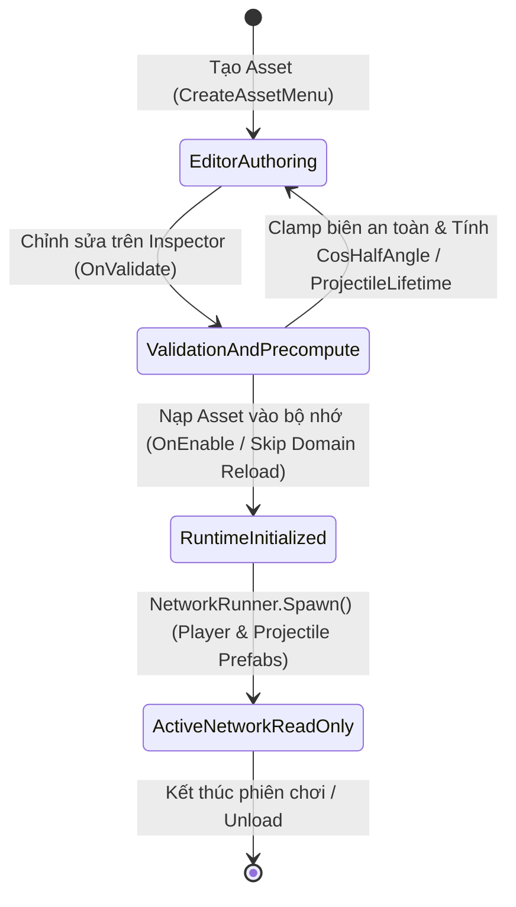

# Character & Combat Config Data

> **Status**: Designed
> **Creative Director Review (CD-GDD-ALIGN)**: APPROVED 2026-11-10
> **Author**: Solo Developer + Studio Agents (`systems-designer`, `gameplay-programmer`, `engine-programmer`, `creative-director`, `qa-lead`)
> **Last Updated**: 2026-11-10
> **Last Verified**: 2026-11-10
> **Implements Pillar**: Pillar 1 (Cơ Động Phản Xạ Định Đoạt Sinh Tồn) & Pillar 3 (Công Bằng Mạng Tuyệt Đối Trên Shared Mode)

## Summary

**Character & Combat Config Data (`CharacterCombatConfigSO`)** là hệ thống dữ liệu cấu hình trung tâm (`ScriptableObject` chỉ đọc) định nghĩa toàn bộ chỉ số sinh tồn (`MaxHealth = 100`), vận tốc di chuyển (`MoveSpeed = 6.5 m/s`), thông số cơ động (`Forward Dash` phím `2`, `Side Dodge Roll` phím `Q`/`E`) và thông số chiến đấu đa hướng (`Vertical Slash` chuột trái, `Horizontal Turning Slash 90°` phím `1`/`3`, `Ranged Attack` chuột phải) của nhân vật trong *Capsule Arena: Last Man Standing*. Người chơi cảm nhận trực tiếp sự tồn tại của hệ thống này qua nhịp điệu chiến đấu nhất quán, các ngưỡng sát thương minh bạch trên thanh máu `100/100` và sự cân bằng đối xứng 100% giữa mọi máy Client trong phòng **Photon Fusion 2 (`GameMode.Shared`)**. Hệ thống tồn tại ở tầng **Foundation** nhằm loại bỏ hoàn toàn các hằng số cứng (magic numbers) trong mã nguồn, đảm bảo tính toàn vẹn thể thao điện tử (**Pillar 1** & **Pillar 3**) và cho phép tinh chỉnh cân bằng tức thì trên Unity Inspector mà không cần biên dịch lại code *(lưu ý kỹ thuật: không có tệp `core.md` trong `docs/engine-reference/unity/modules/`; tính khả thi của `ScriptableObject` và `Enter Play Mode Skip Domain Reload` đã được đối chiếu trực tiếp với `VERSION.md` và `breaking-changes.md` của Unity 6.6)*.

> **Quick reference** — Layer: `Foundation` · Priority: `MVP` · Key deps: `None`

## Overview

**Character & Combat Config Data (`CharacterCombatConfigSO`)** là hệ thống dữ liệu cấu hình trung tâm ở tầng **Foundation (`Core` / `MVP`)** của *Capsule Arena: Last Man Standing*, đóng vai trò là **Nguồn Dữ Liệu Chân Lý Duy Nhất (Single Source of Truth)** cho toàn bộ chỉ số sinh tồn, vận tốc di chuyển, thông số cơ động và sát thương chiến đấu của nhân vật Cartoon Capsule. Thay vì lưu trữ các hằng số cứng (magic numbers) nằm rải rác trong từng script điều khiển, toàn bộ các thông số cốt lõi — bao gồm máu tối đa (`MaxHealth = 100`), tốc độ chạy (`MoveSpeed`), vận tốc/thời lượng/hồi chiêu của **Forward Dash (phím `2`)** và **Side Dodge Roll (`Q`/`E`)**, sát thương/tầm xa/góc quạt của **Vertical Slash (`Left Click`)** và **Horizontal Turning Slash $90^\circ$ (phím `1`/`3` kèm thời gian xoay thân người + camera `HorizontalTurnDuration = 0.15s`)**, cũng như tốc độ/tầm bay tối đa của **Ranged Attack (`Right Click`)** — đều được đóng gói trong một tài nguyên `ScriptableObject` chỉ đọc (`so_character_combat_config_default_01.asset`). Người chơi tương tác gián tiếp với hệ thống này trong từng khoảnh khắc giao tranh: mọi máy Client trong phòng **Photon Fusion 2 (`GameMode.Shared`)** đều tham chiếu tới cùng một cấu hình bất biến khi tính toán chuyển động theo Tick mạng (`FixedUpdateNetwork()`), kiểm tra va chạm bù trễ (`HitboxRoot` Lag Compensation) và hiển thị vòng đếm ngược Cooldown trên cụm **7 Button kỹ năng mềm góc dưới phải màn hình**, đảm bảo tính cân bằng đối xứng tuyệt đối (**Pillar 1** & **Pillar 3**) đồng thời cho phép nhà thiết kế tinh chỉnh nhịp độ trò chơi tức thì trên Unity Inspector mà không cần biên dịch lại mã nguồn *(các chi tiết kỹ thuật về đóng gói interface `ICharacterCombatConfig` và bất biến bộ nhớ trong Unity 6.6 sẽ được ghi nhận vào ADR kiến trúc tương ứng)*.

## Player Fantasy

> **System Framing:** `[B] Indirect — Người chơi không trực tiếp tương tác với tệp dữ liệu, nhưng cảm nhận hệ quả của nó trong từng pha lăn né, từng nhát chém và từng vạch máu tụt xuống trên đấu trường.`

### 1. Giấc mơ cốt lõi: "Đấu Trường Võ Thuật Phản Xạ Thuần Khiết — Nơi Kỹ Năng Là Quyền Lực Duy Nhất"
Người chơi không bao giờ nhìn thấy tệp tài nguyên `CharacterCombatConfigSO` trong suốt quá trình trải nghiệm *Capsule Arena: Last Man Standing*, nhưng chính "bản hiến pháp dữ liệu vô hình" này là nền móng kiến tạo nên cảm xúc mãnh liệt nhất của trò chơi: **cảm giác chiến thắng bằng thực lực phản xạ thuần túy (Pure Martial Reflex Outplay)**.

Khi bước vào sàn đấu 3D dưới góc nhìn **TPS** hay **FPS**, người chơi mang theo tâm thế của một võ sĩ bước lên đài sinh tử công bằng tuyệt đối. Không có cấp độ nhân vật, không có trang bị cộng chỉ số mua bằng tiền, không có xác suất chí mạng ngẫu nhiên (RNG), và không có bất kỳ lợi thế ngầm nào che chở cho kẻ yếu thế (**Anti-Pillar 1: NOT a Pay-to-Win / Stat-Grinding RPG**). Mọi chiến binh Cartoon Capsule khi được `Runner.Spawn()` xuống mặt sàn kẻ lưới đều khởi đầu với cùng một giới hạn sinh mệnh (`MaxHealth = 100`), cùng một tốc độ bước chạy (`MoveSpeed`), và cùng một bộ kỹ năng có thông số vận tốc, cự ly, góc quét cũng như thời gian hồi chiêu (`TickTimer`) đối xứng 100% trên mọi máy trạm thông qua một hợp đồng dữ liệu chỉ đọc duy nhất (`Single Source of Truth`). Chính sự đối xứng nghiêm ngặt đó giải phóng người chơi khỏi nỗi nghi ngờ *"Mình thua vì chỉ số đối phương cao hơn hay do lỗi lệch thông số mạng?"*, để toàn bộ sự tập trung tâm lý dồn vào câu hỏi duy nhất của thể loại Arena PvP (**Pillar 1** & **Pillar 3**): *"Ai đọc vị nhanh hơn, ai căn khoảng cách chuẩn hơn, và ai bấm phím chính xác hơn trong khoảnh khắc quyết định?"*

### 2. Trải nghiệm cảm giác qua từng khoảnh khắc (How the Player Experiences the Effects)
1. **Nhịp điệu Trí nhớ Cơ bắp (Muscle Memory & Kinetic Consistency):** Khi một viên đạn tầm xa (`Right Click`) lao tới từ khe hẹp giữa hai khối `Obstacle`, vận tốc bay cố định (`ProjectileSpeed`) và tầm bay tối đa (`ProjectileMaxDistance`) trong `CharacterCombatConfigSO` tạo ra một "cửa sổ phản xạ" vừa đủ để người chơi kịp nhận diện và nhấn `Q` hoặc `E` (**Side Dodge Roll**). Quãng đường lăn (`DodgeSpeed * DodgeDuration`) luôn dịch chuyển nhân vật đi một cự ly bất biến trên lưới sàn đấu (`Metric Grid`), cho phép người chơi hình thành **trí nhớ cơ bắp (Muscle Memory)** chuẩn xác khi canh nhịp Cooldown trên cụm **7 nút bấm mềm góc dưới phải**, bấm phím `2` (**Forward Dash**) phóng vọt qua khoảng trống vừa khít tầm `MeleeRange` và tung đòn kết liễu.
2. **Sự ăn khớp hoàn hảo giữa Góc chém, Cự ly và Phép xoay góc nhìn $90^\circ$ (Spatial-Visual Harmony):** Khi kẻ địch lăn né (`Q/E`) sang bên hông, người chơi nhấn phím `1` (chém trái) hoặc phím `3` (chém phải) để tung đòn **Chém ngang xoay người $90^\circ$ (`Horizontal Turning Slash`)**. Sở dĩ cú vung kiếm quét hình quạt vuông góc (`HorizontalSlashAngle = 90°`) và cú xoay mượt cả thân người lẫn góc nhìn Camera Cinemachine (`FPS` / `TPS`) trong đúng `HorizontalTurnDuration = 0.15s` mang lại cảm giác sắc ngọt, liền mạch là bởi cả hệ thống Chiến đấu (`#7`), hệ thống Di chuyển (`#5`) lẫn hệ thống Hiệu ứng (`#14`) đều đọc chung một thông số thời gian và góc độ từ `CharacterCombatConfigSO`.
3. **Bài toán Sinh tử Minh bạch (Readable Combat Math & Damage Breakpoints):** Nhờ toàn bộ sát thương của **Chém dọc (`Left Click` — `VerticalSlashDamage = 35`)**, **Chém ngang $90^\circ$ (`1`/`3` — `HorizontalSlashDamage = 25`)** và **Bắn đạn tầm xa (`Right Click` — `RangedDamage = 20`)** được thiết kế theo các ngưỡng cố định (Damage Breakpoints) trên nền `MaxHealth = 100`, thanh máu **World-Space Overhead Billboard (`100/100`)** trên đầu đối thủ trở thành một bảng tính chiến thuật trực quan. Khi thấy đối phương còn `35/100 HP`, người chơi biết chắc chắn chỉ cần bấm `2` (`Forward Dash`) lao vào tung đúng 1 nhát **Chém dọc (`Left Click`)** là hạ gục mục tiêu ngay tức khắc.

### 3. Điểm chạm Tham chiếu & Đối chiếu Trụ cột Thiết kế

| Điểm tham chiếu / Trụ cột | Cách `CharacterCombatConfigSO` hiện thực hóa trải nghiệm người chơi |
| :--- | :--- |
| ***Brawl Stars*** *(Damage Breakpoints & Cooldown Rhythm)* | Giúp người chơi thuộc lòng số đòn đánh cần thiết để hạ gục đối thủ (`3 nhát chém dọc`, `4 nhát chém ngang`, `5 viên đạn xa`) và bắt bài khoảng trống Cooldown sau khi đối thủ vừa dùng mất `Forward Dash [2]` hoặc `Dodge Roll [Q/E]`. |
| ***Valorant*** *(Symmetrical Competitive Integrity)* | Khóa chặt mọi chỉ số cơ động và sát thương vào một `ScriptableObject` dùng chung cho mọi Client trong phòng `GameMode.Shared`, đảm bảo mỗi pha đấu trí quanh các góc vuông chữ L đều công bằng như một trận thi đấu thể thao điện tử. |
| ***Overwatch Workshop*** *(Data-Driven Sandbox Tuning)* | Thay đổi thông số trong một tệp `CharacterCombatConfigSO` duy nhất sẽ tự động đồng bộ tức thì tốc độ đạn, thời gian đếm ngược `TickTimer` trên mạng, kích thước quạt chém VFX và vòng quay Cooldown trên HUD Mobile mà không bao giờ xảy ra lỗi lệch dữ liệu. |
| **Pillar 1 & Pillar 3** | Bảo toàn "cửa sổ phản xạ lăn né" thông qua tỷ lệ giữa `ProjectileSpeed` và `DodgeSpeed`, đồng thời loại bỏ hoàn toàn các hằng số ma (Magic Numbers) gây lệch tính toán giữa các máy Client. |

## Detailed Design

### Core Rules

1. **Quy tắc Nguồn Dữ Liệu Chân Lý Duy Nhất (Single Source of Truth — Zero Magic Numbers):**
   - Toàn bộ các hệ thống hạ nguồn (**System #5 Movement**, **System #6 Health**, **System #7 Combat**, **System #8 HUD/Mobile Action Pad**, **System #14 Audio/VFX**) **bắt buộc** phải đọc thông số từ tài nguyên `so_character_combat_config_default_01.asset` (thuộc lớp `CharacterCombatConfigSO` kế thừa `ScriptableObject` và thực thi giao diện `ICharacterCombatConfig`).
   - Nghiêm cấm khai báo bất kỳ hằng số cứng (`const float`, `magic number`) nào liên quan đến máu, tốc độ chạy, cự ly lướt, thời gian hồi chiêu, sát thương, góc quạt chém hay tốc độ đạn bên trong các lớp `NetworkBehaviour` hoặc `MonoBehaviour`.

2. **Quy tắc Bất Biến Khi Chạy & Tương Thích Unity 6.6 Skip Domain Reload (Runtime Read-Only & Immutability Contract):**
   - Trong suốt phiên chạy (`Play Mode` hoặc bản Build), mọi thuộc tính của `CharacterCombatConfigSO` chỉ cung cấp `public getter` thông qua giao diện `ICharacterCombatConfig` và trường dữ liệu gốc được đóng gói dạng `[SerializeField] private` nhằm ngăn chặn mọi hành vi ghi đè tại Runtime.
   - Do **Unity 6.6 (`6000.6.8f1`)** bật mặc định chế độ **Enter Play Mode without Domain Reload**, các trường dữ liệu trên `ScriptableObject` trong bộ nhớ Editor sẽ không tự động khởi tạo lại nếu bị thay đổi lúc chạy. Việc ép buộc **Immutability 100% tại Runtime** (kết hợp tính toán lại các trường dẫn xuất trong cả `OnValidate()` lẫn `OnEnable()`) đảm bảo an toàn tuyệt đối khi vào/thoát Play Mode liên tục mà không cần Domain Reload.
   - Dữ liệu cấu hình tĩnh (`Static Configuration Data`) nằm trong `CharacterCombatConfigSO` được phân tách hoàn toàn khỏi trạng thái động trên mạng (`Dynamic Networked State` như `[Networked] public int CurrentHealth { get; set; }` hay `[Networked] public TickTimer CooldownTimer { get; set; }`).

3. **Quy tắc Đối Xứng Tuyệt Đối Trên Photon Fusion 2 Shared Mode (Shared Mode Symmetrical Integrity):**
   - Không đồng bộ các chỉ số tĩnh của `CharacterCombatConfigSO` qua gói tin mạng (`[Networked]`) để tiết kiệm băng thông. Thay vào đó, Prefab nhân vật mạng (`pf_char_capsule_player_01.prefab`) và Prefab đạn mạng (`pf_proj_ranged_orb_01.prefab`) giữ tham chiếu trực tiếp tới cùng một asset `so_character_combat_config_default_01.asset`.
   - Khi một người chơi có `StateAuthority` thực thi di chuyển trong `FixedUpdateNetwork()`, kiểm tra hình nón cận chiến hoặc gọi `Runner.Spawn()` bắn đạn từ Pool, cả máy `StateAuthority` lẫn các máy `Proxy` đều tra cứu cùng một hằng số từ `CharacterCombatConfigSO`.

4. **Quy tắc Định Danh Kỹ Năng & Tra Cứu Cooldown Đa Hình (`CombatSkillId` Lookup Contract):**
   - Hệ thống định nghĩa kiểu liệt kê `CombatSkillId` gồm 5 nhóm kỹ năng kích hoạt tương ứng với **7 nút hành động trên màn hình**:
     - `VerticalSlash` (Chuột trái `LMB` — Nhát chém dọc thẳng trước mặt)
     - `HorizontalSlash` (Phím `1` Chém ngang xoay trái $90^\circ$ / Phím `3` Chém ngang xoay phải $90^\circ$)
     - `RangedAttack` (Chuột phải `RMB` — Bắn đạn tầm xa từ Object Pool)
     - `ForwardDash` (Phím `2` — Lướt tiến tốc độ cao)
     - `SideDodge` (Phím `Q` Lăn né trái / Phím `E` Lăn né phải)
   - Phương thức `GetCooldown(CombatSkillId skillId)` trả về thời gian hồi chiêu chính xác bằng giây (`float`) để cả bộ đếm mạng `TickTimer.CreateFromSeconds(Runner, config.GetCooldown(skillId))` lẫn UI vòng quay Cooldown (`fillAmount`) trên cụm 7 nút mềm Mobile góc dưới phải sử dụng chung mà không cần viết cấu trúc `switch-case` trùng lặp.

5. **Quy tắc Tiền Tính Toán Thông Số Dẫn Xuất Trên Hot-Path (`Precomputed Derived Properties — Zero Runtime Trig/Div`):**
   - Để tối ưu hiệu năng CPU trong vòng lặp mạng `FixedUpdateNetwork()` (`60Hz`), `CharacterCombatConfigSO` tự động tính sẵn và lưu đệm (cache) 3 thuộc tính dẫn xuất ngay trong `OnValidate()` và `OnEnable()` thông qua hàm `RecalculateDerivedStats()`:
     - `CosHalfVerticalAngle = Mathf.Cos(VerticalSlashAngle * 0.5f * Mathf.Deg2Rad)` ($\approx 0.9239$ với góc $45^\circ$) — dùng để so sánh trực tiếp với tích vô hướng `Vector3.Dot(forward, dirToTarget)` mà không cần gọi `Mathf.Acos()` mỗi khung hình.
     - `CosHalfHorizontalAngle = Mathf.Cos(HorizontalSlashAngle * 0.5f * Mathf.Deg2Rad)` ($\approx 0.7071$ với góc $90^\circ$) — dùng cho kiểm tra hình quạt ngang $90^\circ$ của phím `1` và `3`.
     - `ProjectileLifetime = ProjectileMaxDistance / ProjectileSpeed` ($\approx 1.1818\text{s}$ với $26.0\text{m} / 22.0\text{ m/s}$) — dùng để khởi tạo `TickTimer` thu hồi đạn về `INetworkObjectProvider` Pool ngay khi `Spawned()`.

6. **Bảng Đặc Tả Cấu Trúc Dữ Liệu `CharacterCombatConfigSO` (5 Nhóm Inspector Headers — 23 Trường Cấu Hình):**

| Nhóm Inspector Header | Tên Trường (`_camelCase` / Property `PascalCase`) | Kiểu Dữ Liệu | Giá Trị Mặc Định | Đơn Vị | Mô Tả Ngữ Nghĩa & Ràng Buộc `[Range]` / `[Min]` |
| :--- | :--- | :---: | :---: | :---: | :--- |
| **1. Base Vitality & Locomotion** | `MaxHealth` (`_maxHealth`) | `int` | `100` | `HP` | Máu tối đa khi `Spawned()` và hồi sinh; làm mẫu số cho thanh máu `100/100`. `[Range(50, 500)]`. |
| **1. Base Vitality & Locomotion** | `MoveSpeed` (`_moveSpeed`) | `float` | `6.5` | `m/s` | Tốc độ di chuyển cơ bản bằng `WASD` trong `FixedUpdateNetwork()`. `[Range(3.0f, 12.0f)]`. |
| **1. Base Vitality & Locomotion** | `RotationSensitivity` (`_rotationSensitivity`) | `float` | `1.0` | `multiplier` | Hệ số nhạy xoay góc nhìn chuột cơ bản cho Camera `FPS` / `TPS`. `[Range(0.1f, 5.0f)]`. |
| **2. Mobility Skills (`Dash [2]` & `Dodge [Q/E]`)** | `DashSpeed` (`_dashSpeed`) | `float` | `16.0` | `m/s` | Vận tốc lướt tiến về phía trước khi nhấn phím `2` (**Forward Dash**). `[Range(10.0f, 30.0f)]`. |
| **2. Mobility Skills (`Dash [2]` & `Dodge [Q/E]`)** | `DashDuration` (`_dashDuration`) | `float` | `0.25` | `giây (s)` | Thời lượng hiệu lực của cú lướt tiến phím `2` (`15 ticks` ở `60Hz`, đi được `4.0m`). `[Range(0.10f, 0.60f)]`. |
| **2. Mobility Skills (`Dash [2]` & `Dodge [Q/E]`)** | `DashCooldown` (`_dashCooldown`) | `float` | `2.50` | `giây (s)` | Thời gian hồi chiêu của **Forward Dash (phím `2`)** (`150 ticks` ở `60Hz`). `[Range(0.50f, 10.0f)]`. |
| **2. Mobility Skills (`Dash [2]` & `Dodge [Q/E]`)** | `DodgeSpeed` (`_dodgeSpeed`) | `float` | `12.0` | `m/s` | Vận tốc lăn né ngang trái/phải khi nhấn phím `Q` hoặc `E` (**Side Dodge Roll**). `[Range(8.0f, 24.0f)]`. |
| **2. Mobility Skills (`Dash [2]` & `Dodge [Q/E]`)** | `DodgeDuration` (`_dodgeDuration`) | `float` | `0.22` | `giây (s)` | Thời lượng lăn né ngang `Q`/`E` (`14 ticks` ở `60Hz`, dịch chuyển `~2.80m`). `[Range(0.10f, 0.50f)]`. |
| **2. Mobility Skills (`Dash [2]` & `Dodge [Q/E]`)** | `DodgeCooldown` (`_dodgeCooldown`) | `float` | `1.80` | `giây (s)` | Thời gian hồi chiêu dùng chung cho động tác lăn né `Q`/`E` (`108 ticks` ở `60Hz`). `[Range(0.50f, 8.0f)]`. |
| **3. Multi-Directional Melee (`LMB`, `1`, `3`)** | `MeleeRange` (`_meleeRange`) | `float` | `2.80` | `mét (m)` | Bán kính tầm vung kiếm cận chiến tính từ tâm nhân vật (dùng chung cho cả chém dọc và chém ngang). `[Range(1.50f, 5.00f)]`. |
| **3. Multi-Directional Melee (`LMB`, `1`, `3`)** | `VerticalSlashDamage` (`_verticalSlashDamage`) | `int` | `35` | `HP` | Sát thương của **Nhát chém dọc (`Left Click` / `LMB`)** (`3 hits = 105 dmg` hạ gục mục tiêu `100 HP`). `[Range(10, 100)]`. |
| **3. Multi-Directional Melee (`LMB`, `1`, `3`)** | `VerticalSlashAngle` (`_verticalSlashAngle`) | `float` | `45.0` | `độ (°)` | Góc mở hình quạt phía trước mặt của nhát chém dọc `Left Click` ($\pm 22.5^\circ$ quanh trục `transform.forward`). `[Range(20.0f, 90.0f)]`. |
| **3. Multi-Directional Melee (`LMB`, `1`, `3`)** | `VerticalSlashCooldown` (`_verticalSlashCooldown`) | `float` | `0.65` | `giây (s)` | Thời gian hồi chiêu của nhát chém dọc `Left Click` (`39 ticks` ở `60Hz`). `[Range(0.20f, 3.00f)]`. |
| **3. Multi-Directional Melee (`LMB`, `1`, `3`)** | `HorizontalSlashDamage` (`_horizontalSlashDamage`) | `int` | `25` | `HP` | Sát thương của **Nhát chém ngang xoay người $90^\circ$ (phím `1` Trái / phím `3` Phải)** (`4 hits = 100 dmg`). `[Range(10, 100)]`. |
| **3. Multi-Directional Melee (`LMB`, `1`, `3`)** | `HorizontalSlashAngle` (`_horizontalSlashAngle`) | `float` | `90.0` | `độ (°)` | Góc quạt quét ngang từ thẳng trước mặt sang trái (`1`) hoặc sang phải (`3`), đồng thời là tổng góc xoay thân người + Camera sau nhát chém. `[Range(45.0f, 120.0f)]`. |
| **3. Multi-Directional Melee (`LMB`, `1`, `3`)** | `HorizontalTurnDuration` (`_horizontalTurnDuration`) | `float` | `0.15` | `giây (s)` | Thời gian nội suy xoay mượt nhân vật (`NetworkTransform`) và Camera Cinemachine đúng $\pm 90^\circ$ (`9 ticks` ở `60Hz`, `10°/tick`). `[Range(0.08f, 0.35f)]`. |
| **3. Multi-Directional Melee (`LMB`, `1`, `3`)** | `HorizontalSlashCooldown` (`_horizontalSlashCooldown`) | `float` | `0.85` | `giây (s)` | Thời gian hồi chiêu của kỹ năng chém ngang xoay người phím `1` / `3` (`51 ticks` ở `60Hz`). `[Range(0.30f, 3.00f)]`. |
| **4. Pooled Ranged Attack (`RMB`)** | `RangedDamage` (`_rangedDamage`) | `int` | `20` | `HP` | Sát thương mỗi viên đạn tầm xa bắn ra bằng **Chuột phải (`RMB`)** (`5 hits = 100 dmg`). `[Range(5, 100)]`. |
| **4. Pooled Ranged Attack (`RMB`)** | `ProjectileSpeed` (`_projectileSpeed`) | `float` | `22.0` | `m/s` | Vận tốc bay tuyến tính của viên đạn trong `FixedUpdateNetwork()`. `[Range(10.0f, 50.0f)]`. |
| **4. Pooled Ranged Attack (`RMB`)** | `ProjectileMaxDistance` (`_projectileMaxDistance`) | `float` | `26.0` | `mét (m)` | Quãng đường tối đa viên đạn bay được trước khi tự hủy và trả về `INetworkObjectProvider` Pool (`ProjectileLifetime ≈ 1.1818s`). `[Range(10.0f, 60.0f)]`. |
| **4. Pooled Ranged Attack (`RMB`)** | `ProjectileRadius` (`_projectileRadius`) | `float` | `0.20` | `mét (m)` | Bán kính hình cầu kiểm tra va chạm bù trễ (`Runner.LagCompensation.OverlapSphere`) của viên đạn. `[Range(0.05f, 0.60f)]`. |
| **4. Pooled Ranged Attack (`RMB`)** | `RangedCooldown` (`_rangedCooldown`) | `float` | `0.55` | `giây (s)` | Thời gian hồi chiêu giữa hai phát bắn tầm xa `Right Click` (`33 ticks` ở `60Hz`). `[Range(0.15f, 3.00f)]`. |
| **5. VisualRoot Feel & DOTween Tuning** | `VisualStretchScale` / `VisualSquashScale` / `DodgeVisualTiltAngle` / `TweenElasticityDuration` | `Vector3` / `float` | `Stretch: (0.78, 1.28, 0.78)` `Squash: (1.30, 0.70, 1.15)` `Tilt: 35.0°` `Duration: 0.18s` | `scale` / `độ (°)` / `giây (s)` | Bộ thông số đàn hồi DOTween áp dụng **duy nhất trên nhánh con `VisualRoot`** (khớp `Art Bible §5.3`, không bao giờ làm biến dạng `HitboxRoot` mạng). |

### States and Transitions

Mặc dù `CharacterCombatConfigSO` là một tài nguyên dữ liệu tĩnh (không có máy trạng thái hành vi như nhân vật), vòng đời dữ liệu của nó đi qua **4 trạng thái xác định** từ lúc chỉnh sửa trong Unity Editor cho tới khi cung cấp hằng số cho phiên chơi mạng:

1. **`EditorAuthoring` (Thiết lập trên Inspector):** Nhà thiết kế điều chỉnh các thanh trượt `[Range]` trên tệp `so_character_combat_config_default_01.asset`.
2. **`ValidationAndPrecompute` (Kiểm tra biên & Tiền tính toán trong `OnValidate()`):** Ngay khi bất kỳ giá trị nào thay đổi trên Inspector, phương thức `OnValidate()` thực thi kiểm tra ràng buộc chéo (ví dụ: ép `DashSpeed > MoveSpeed`, `DodgeSpeed > MoveSpeed`, `HorizontalTurnDuration < HorizontalSlashCooldown`) và gọi `RecalculateDerivedStats()` để cập nhật tức thì `CosHalfVerticalAngle`, `CosHalfHorizontalAngle` và `ProjectileLifetime`.
3. **`RuntimeInitialized` (Khởi tạo bộ nhớ trong `OnEnable()`):** Khi vào Play Mode (kể cả khi bật **Skip Domain Reload** trên Unity 6.6) hoặc khi nạp bản Build, `OnEnable()` gọi lại `RecalculateDerivedStats()` để đảm bảo các biến dẫn xuất luôn có giá trị hợp lệ trước khi bất kỳ `Awake()` hay `Spawned()` nào truy cập.
4. **`ActiveNetworkReadOnly` (Truy xuất Chỉ Đọc trong `Spawned()` & `FixedUpdateNetwork()`):** Các thành phần điều khiển nhân vật và đạn lưu trữ tham chiếu `ICharacterCombatConfig` ngay trong `Awake()` / `Spawned()` và chỉ đọc dữ liệu với chi phí bộ nhớ `0 Byte GC Allocation` trong suốt trận đấu.

### Interactions with Other Systems

| Hệ Thống Hạ Nguồn (Downstream Consumer) | Giao Diện & Trường Dữ Liệu Đọc Từ `ICharacterCombatConfig` | Thời Điểm Truy Xuất & Cơ Chế Tác Động |
| :--- | :--- | :--- |
| **System #5: Hybrid Camera & Mobility Controller** | `MoveSpeed`, `RotationSensitivity`, `DashSpeed`, `DashDuration`, `DashCooldown`, `DodgeSpeed`, `DodgeDuration`, `DodgeCooldown`, `HorizontalSlashAngle`, `HorizontalTurnDuration` | Trong `FixedUpdateNetwork()`: điều khiển vận tốc chạy `WASD`, dịch chuyển `Forward Dash (phím 2)` và `Side Dodge Roll (Q/E)` theo `TickTimer`, đồng thời xoay mượt thân người (`NetworkTransform`) + trục Yaw của Camera Cinemachine đúng $\pm 90^\circ$ trong `HorizontalTurnDuration = 0.15s` khi kích hoạt chém ngang phím `1`/`3`. |
| **System #6: Networked Health, Damage & Elimination** | `MaxHealth` | Trong `Spawned()` và khi Respawn: khởi tạo `[Networked] CurrentHealth = Config.MaxHealth` (`100 HP`); cung cấp mẫu số cho thanh máu Overhead Billboard (`CurrentHealth / Config.MaxHealth`). |
| **System #7: Multi-Directional Melee & Pooled Ranged Combat** | `MeleeRange`, `VerticalSlashDamage`, `VerticalSlashAngle`, `CosHalfVerticalAngle`, `VerticalSlashCooldown`, `HorizontalSlashDamage`, `HorizontalSlashAngle`, `CosHalfHorizontalAngle`, `HorizontalSlashCooldown`, `RangedDamage`, `ProjectileSpeed`, `ProjectileMaxDistance`, `ProjectileLifetime`, `ProjectileRadius`, `RangedCooldown` | Trong `FixedUpdateNetwork()`: kiểm tra bù trễ `LagCompensation.OverlapSphere` với bán kính `MeleeRange` / `ProjectileRadius`, lọc mục tiêu bằng `CosHalfVerticalAngle` (`LMB`) hoặc `CosHalfHorizontalAngle` (`1`/`3`), trừ máu mục tiêu và quản lý vòng đời đạn trong `INetworkObjectProvider` Pool. |
| **System #8: Tactical Arena HUD & Mobile Action Pad** | `MaxHealth`, `GetCooldown(CombatSkillId)` | Trong `Render()` / `LateUpdate()`: tính tỷ lệ lấp đầy vòng quay Cooldown (`fillAmount = RemainingTime / Config.GetCooldown(skillId)`) trên cụm **7 nút hành động mềm góc dưới phải màn hình** (`LMB`, `RMB`, `1`, `2`, `3`, `Q`, `E`). |
| **System #14: Combat Telegraph VFX, Squash-and-Stretch & Audio** | `MeleeRange`, `VerticalSlashAngle`, `HorizontalSlashAngle`, `VisualStretchScale`, `VisualSquashScale`, `DodgeVisualTiltAngle`, `TweenElasticityDuration` | Trong `Render()`: đồng bộ bán kính và góc mở của vệt chém Mesh/Shader với đúng hitbox vật lý; kích hoạt hiệu ứng DOTween Squash & Stretch trên nhánh con `VisualRoot` khi lướt `2`, lăn `Q/E` hoặc vung kiếm. |

## Formulas

### 1. Chuyển Đổi Thời Lượng Kỹ Năng & Cooldown Sang Số Tick Mạng (`skill_duration_ticks`)

The `skill_duration_ticks` formula is defined as:

`skill_duration_ticks = ceil(duration_seconds * tick_rate)`

**Variables:**

| Variable | Type | Range | Source | Description |
| :--- | :---: | :---: | :--- | :--- |
| `duration_seconds` | `float` | `0.08–10.0` | `CharacterCombatConfigSO` (`DashDuration`, `DodgeDuration`, `HorizontalTurnDuration`, `*Cooldown`) | Thời lượng hiệu lực hoặc thời gian hồi chiêu của kỹ năng tính bằng giây. |
| `tick_rate` | `int` | `60` (cố định) | `NetworkRunner.Config.Simulation.TickRate` | Tần số mô phỏng vật lý và mạng của Photon Fusion 2 (`60 ticks/giây`, $\Delta t = 1/60\text{s} \approx 0.01667\text{s}$). |
| `skill_duration_ticks` | `int` | `5–600` | Tính toán nội bộ trong `TickTimer.CreateFromSeconds` | Tổng số Tick mạng nguyên mà trạng thái kỹ năng hoặc Cooldown tồn tại. |

**Output Range:** `5` đến `600` ticks (tương ứng `0.0833s` đến `10.0s` ở tần số `60Hz`).

**Example:**
- Với `DashDuration = 0.25s` và `tick_rate = 60`:
  `skill_duration_ticks = ceil(0.25 * 60) = ceil(15.0) = 15 ticks` (tương đương đúng `0.2500s`).
- Với `DodgeDuration = 0.22s` và `tick_rate = 60`:
  `skill_duration_ticks = ceil(0.22 * 60) = ceil(13.2) = 14 ticks` (tương đương `14 / 60 ≈ 0.2333s` thời gian mô phỏng thực tế).
- Với `HorizontalTurnDuration = 0.15s` và `tick_rate = 60`:
  `skill_duration_ticks = ceil(0.15 * 60) = ceil(9.0) = 9 ticks` (tương đương đúng `0.1500s`).

---

### 2. Quãng Đường Dịch Chuyển Thực Tế Khi Lướt Tiến & Lăn Né (`mobility_displacement`)

The `mobility_displacement` formula is defined as:

`mobility_displacement = mobility_speed * (ceil(mobility_duration * tick_rate) / tick_rate)`

**Variables:**

| Variable | Type | Range | Source | Description |
| :--- | :---: | :---: | :--- | :--- |
| `mobility_speed` | `float` | `8.0–30.0` | `CharacterCombatConfigSO` (`DashSpeed` hoặc `DodgeSpeed`) | Vận tốc dịch chuyển tức thời trong suốt trạng thái cơ động (`m/s`). |
| `mobility_duration` | `float` | `0.10–0.60` | `CharacterCombatConfigSO` (`DashDuration` hoặc `DodgeDuration`) | Thời lượng thiết kế của kỹ năng cơ động (`giây`). |
| `tick_rate` | `int` | `60` | `NetworkRunner.Config.Simulation.TickRate` | Tần số Tick mạng (`60Hz`). |
| `mobility_displacement` | `float` | `0.80–18.0` | Hệ thống Di chuyển (`System #5`) | Tổng quãng đường dịch chuyển trên mặt phẳng đấu trường (`mét`) khi không va chạm tường/chướng ngại vật. |

**Output Range:** `0.80m` đến `18.00m`.

**Example:**
- **Forward Dash (Phím `2`):** Với `DashSpeed = 16.0 m/s`, `DashDuration = 0.25s`, `tick_rate = 60`:
  `dash_displacement = 16.0 * (ceil(0.25 * 60) / 60) = 16.0 * (15 / 60) = 16.0 * 0.25 = 4.00m` (vừa khít 1 ô lưới chuẩn `4m` của sàn đấu để áp sát mục tiêu).
- **Side Dodge Roll (Phím `Q` / `E`):** Với `DodgeSpeed = 12.0 m/s`, `DodgeDuration = 0.22s`, `tick_rate = 60`:
  `dodge_displacement = 12.0 * (ceil(0.22 * 60) / 60) = 12.0 * (14 / 60) = 12.0 * 0.23333 = 2.80m` (dịch chuyển ngang `2.80m`, thoát hoàn toàn khỏi đường đạn `ProjectileRadius = 0.20m` hoặc hình nón hẹp của nhát chém dọc đối phương).

---

### 3. Góc Xoay Nội Suy Mỗi Tick Của Nhát Chém Ngang Xoay Người $90^\circ$ (`horizontal_turn_step_angle`)

The `horizontal_turn_step_angle` formula is defined as:

`horizontal_turn_step_angle = turn_direction_sign * (HorizontalSlashAngle / ceil(HorizontalTurnDuration * tick_rate))`

**Variables:**

| Variable | Type | Range | Source | Description |
| :--- | :---: | :---: | :--- | :--- |
| `turn_direction_sign` | `int` | `-1` hoặc `+1` | Đầu vào phím kỹ năng (`Phím 1 = -1` xoay Trái, `Phím 3 = +1` xoay Phải) | Dấu chiều quay quanh trục đứng `Vector3.up` (Yaw). |
| `HorizontalSlashAngle` | `float` | `45.0–120.0` | `CharacterCombatConfigSO.HorizontalSlashAngle` | Tổng góc quạt chém ngang đồng thời là tổng góc xoay thân người + Camera (`mặc định 90.0°`). |
| `HorizontalTurnDuration` | `float` | `0.08–0.35` | `CharacterCombatConfigSO.HorizontalTurnDuration` | Thời gian hoàn tất cú xoay người sau nhát chém ngang (`mặc định 0.15s`). |
| `tick_rate` | `int` | `60` | `NetworkRunner.Config.Simulation.TickRate` | Tần số Tick mạng (`60Hz`). |
| `horizontal_turn_step_angle` | `float` | `-25.0` đến `+25.0` | Hệ thống Di chuyển & Camera (`System #5`) | Góc Yaw cộng thêm vào `NetworkTransform` và trục ngang Camera Cinemachine trong mỗi Tick của pha xoay. |

**Output Range:** `-25.0°/tick` đến `+25.0°/tick`.

**Example:**
- Người chơi nhấn **phím `1` (Chém ngang trái $90^\circ$)** với `turn_direction_sign = -1`, `HorizontalSlashAngle = 90.0°`, `HorizontalTurnDuration = 0.15s`, `tick_rate = 60`:
  `horizontal_turn_step_angle = -1 * (90.0 / ceil(0.15 * 60)) = -1 * (90.0 / 9) = -10.0°/tick`.
  Sau đúng `9 ticks` (`0.15s`), cả nhân vật lẫn Camera Cinemachine (`FPS` hoặc `TPS`) xoay mượt một góc tổng cộng `9 * (-10.0°) = -90.0°` (quay mặt sang chính hướng Tây/Trái vừa quét kiếm).

---

### 4. Thời Gian Sống Tối Đa Của Đạn Tầm Xa Trong Object Pool (`projectile_lifetime_seconds`)

The `projectile_lifetime_seconds` formula is defined as:

`projectile_lifetime_seconds = ProjectileMaxDistance / ProjectileSpeed`

**Variables:**

| Variable | Type | Range | Source | Description |
| :--- | :---: | :---: | :--- | :--- |
| `ProjectileMaxDistance` | `float` | `10.0–60.0` | `CharacterCombatConfigSO.ProjectileMaxDistance` | Quãng đường tối đa viên đạn được phép bay trước khi tự thu hồi về Pool (`mặc định 26.0m`). |
| `ProjectileSpeed` | `float` | `10.0–50.0` | `CharacterCombatConfigSO.ProjectileSpeed` | Vận tốc bay của viên đạn (`mặc định 22.0 m/s`). |
| `projectile_lifetime_seconds` | `float` | `0.20–6.00` | `CharacterCombatConfigSO.ProjectileLifetime` (tiền tính toán) | Thời gian tồn tại tối đa của viên đạn (`giây`) dùng để đặt `TickTimer` tự hủy khi không trúng mục tiêu. |

**Output Range:** `0.20s` đến `6.00s` (`12` đến `360` ticks ở `60Hz`).

**Example:**
- Với `ProjectileMaxDistance = 26.0m` và `ProjectileSpeed = 22.0 m/s`:
  `projectile_lifetime_seconds = 26.0 / 22.0 ≈ 1.1818s` (tương đương `ceil(1.1818 * 60) = 71 ticks` trước khi tự động gọi `Runner.Despawn()` để trả về `INetworkObjectProvider` Pool).

---

### 5. Cửa Sổ Phản Xạ Lăn Né Đạn Tầm Xa (`ranged_evasion_reaction_window`)

The `ranged_evasion_reaction_window` formula is defined as:

`ranged_evasion_reaction_window = (target_distance / ProjectileSpeed) - (network_rtt_ms / 2000.0)`

**Variables:**

| Variable | Type | Range | Source | Description |
| :--- | :---: | :---: | :--- | :--- |
| `target_distance` | `float` | `2.80–26.0` | Khoảng cách Euclid giữa người bắn và mục tiêu (`m`) | Cự ly thực tế từ đầu nòng đạn tới nhân vật bị nhắm bắn. |
| `ProjectileSpeed` | `float` | `10.0–50.0` | `CharacterCombatConfigSO.ProjectileSpeed` | Vận tốc bay của viên đạn (`mặc định 22.0 m/s`). |
| `network_rtt_ms` | `float` | `20.0–150.0` | `Runner.GetPlayerRtt(PlayerRef)` | Độ trễ mạng khứ hồi (Round-Trip Time) tính bằng mili-giây (`ms`); chia `2000.0` để đổi sang độ trễ một chiều tính bằng giây (`s`). |
| `ranged_evasion_reaction_window` | `float` | `0.05–2.50` | Chỉ số kiểm chứng cân bằng **Pillar 1** | Thời gian thực tế (giây) mà người chơi mục tiêu có được kể từ lúc thấy đạn rời nòng trên màn hình đến khi phải nhấn `Q`/`E` (**Side Dodge Roll**). |

**Output Range:** `0.05s` đến `2.50s` (Ngưỡng chuẩn **Pillar 1** ở cự ly giao tranh trung bình `12m–15m` là `0.45s–0.65s`, lớn hơn thời gian phản xạ thị giác trung bình của con người `~0.25s`).

**Example:**
- Ở cự ly giao tranh tầm trung `target_distance = 13.2m`, `ProjectileSpeed = 22.0 m/s`, và mạng khu vực có `network_rtt_ms = 60ms`:
  `ranged_evasion_reaction_window = (13.2 / 22.0) - (60.0 / 2000.0) = 0.60s - 0.03s = 0.57s` (`570ms` — đủ rộng để người chơi nhận diện viên đạn đang bay tới và nhấn `Q` hoặc `E` lăn né sang ngang một quãng `2.80m`).

---

### 6. Số Đòn Hạ Gục (`hits_to_kill`) & Thời Gian Hạ Gục Lý Thuyết (`theoretical_ttk`)

The `hits_to_kill` and `theoretical_ttk` formulas are defined as:

`hits_to_kill = ceil(MaxHealth / attack_damage)`

`theoretical_ttk = (hits_to_kill - 1) * attack_cooldown`

**Variables:**

| Variable | Type | Range | Source | Description |
| :--- | :---: | :---: | :--- | :--- |
| `MaxHealth` | `int` | `50–500` | `CharacterCombatConfigSO.MaxHealth` | Máu tối đa của nhân vật (`mặc định 100 HP`). |
| `attack_damage` | `int` | `5–100` | `CharacterCombatConfigSO` (`VerticalSlashDamage`, `HorizontalSlashDamage`, `RangedDamage`) | Sát thương mỗi đòn đánh trúng đích của từng kỹ năng. |
| `attack_cooldown` | `float` | `0.15–3.00` | `CharacterCombatConfigSO` (`VerticalSlashCooldown`, `HorizontalSlashCooldown`, `RangedCooldown`) | Thời gian hồi chiêu giữa hai lần ra đòn liên tiếp của cùng một kỹ năng (`giây`). |
| `hits_to_kill` | `int` | `1–100` | Bảng cân bằng Damage Breakpoints | Số đòn đánh trúng liên tiếp cần thiết để hạ gục một mục tiêu đầy máu (`100 HP`). |
| `theoretical_ttk` | `float` | `0.00–60.0` | Bảng cân bằng Time-To-Kill (TTK) | Thời gian tối thiểu (giây) từ đòn trúng đầu tiên ở `t = 0.0s` đến đòn kết liễu cuối cùng khi chỉ dùng một kỹ năng. |

**Output Range:** `hits_to_kill`: `1–100` đòn; `theoretical_ttk`: `0.00s–60.00s`.

**Example:**
- **Vertical Slash (`Left Click` — `35 dmg`, `0.65s` cooldown):**
  `hits_to_kill = ceil(100 / 35.0) = 3 hits` (`105 tổng sát thương`); `theoretical_ttk = (3 - 1) * 0.65 = 1.30s`.
- **Horizontal Turning Slash $90^\circ$ (`Phím 1/3` — `25 dmg`, `0.85s` cooldown):**
  `hits_to_kill = ceil(100 / 25.0) = 4 hits` (`100 tổng sát thương`); `theoretical_ttk = (4 - 1) * 0.85 = 2.55s`.
- **Ranged Attack (`Right Click` — `20 dmg`, `0.55s` cooldown):**
  `hits_to_kill = ceil(100 / 20.0) = 5 hits` (`100 tổng sát thương`); `theoretical_ttk = (5 - 1) * 0.55 = 2.20s`.
- **Combo Áp Sát Chuẩn (`1x Ranged [20]` + `Forward Dash [2]` + `2x Vertical Slash [35x2 = 70]` + `1x Horizontal Slash [25]`):** Tổng sát thương `20 + 70 + 25 = 115 >= 100 HP`, khuyến khích người chơi phối hợp linh hoạt cả 3 loại đòn đánh thay vì chỉ spam một nút duy nhất.

## Edge Cases

- **If `CharacterCombatConfigSO` reference on the Player or Projectile Prefab is `null` when `Spawned()` executes**: Hệ thống ghi log lỗi `Debug.LogError("[CharacterCombatConfigSO] Missing config reference on prefab — loading fallback default instance")` và khởi tạo một thực thể dự phòng trong bộ nhớ (`ScriptableObject.CreateInstance<CharacterCombatConfigSO>()` với đầy đủ 23 giá trị mặc định chuẩn) để ngăn chặn ngoại lệ `NullReferenceException` làm sập vòng lặp mạng `FixedUpdateNetwork()`.
- **If a designer enters `0` or a negative number for `ProjectileSpeed`, `DashDuration`, `DodgeDuration`, or `HorizontalTurnDuration` in the Unity Inspector**: Phương thức `OnValidate()` tự động giới hạn (`Mathf.Max`) các trường vận tốc ở mức tối thiểu `0.1f` và thời lượng ở mức tối thiểu `0.05f` trước khi tính `ProjectileLifetime = ProjectileMaxDistance / ProjectileSpeed` hoặc `horizontal_turn_step_angle`, loại bỏ hoàn toàn nguy cơ chia cho `0` (`NaN` / `Infinity`).
- **If a designer sets `DashSpeed <= MoveSpeed` or `DodgeSpeed <= MoveSpeed` in the Inspector**: Phương thức `OnValidate()` tự động nâng `DashSpeed` lên tối thiểu bằng `MoveSpeed + 2.0f` và `DodgeSpeed` lên tối thiểu bằng `MoveSpeed + 1.5f` kèm cảnh báo `Debug.LogWarning`, đảm bảo kỹ năng cơ động không bao giờ biến thành hiệu ứng làm chậm nhân vật ngoài ý muốn.
- **If `HorizontalTurnDuration` is set greater than or equal to `HorizontalSlashCooldown` in the Inspector**: Phương thức `OnValidate()` tự động kẹp `HorizontalTurnDuration = Mathf.Min(HorizontalTurnDuration, HorizontalSlashCooldown - 0.05f)`, ngăn chặn tình huống người chơi kích hoạt nhát chém ngang $90^\circ$ tiếp theo khi pha xoay người + Camera của nhát chém trước vẫn chưa kết thúc (tránh cộng dồn góc xoay gây lệch hướng).
- **If `duration_seconds * tick_rate` is not an exact integer (e.g., `DodgeDuration = 0.22s * 60 = 13.2 ticks`)**: Hệ thống bắt buộc làm tròn lên bằng `Mathf.CeilToInt` (`14 ticks ≈ 0.2333s`) thông qua `TickTimer.CreateFromSeconds(Runner, duration)` để đảm bảo quãng đường lăn né thực tế trên mạng không bao giờ bị hụt ngắn hơn thiết kế do cắt phần thập phân.
- **If Unity 6.6 (`6000.6.8f1`) enters Play Mode with `Skip Domain Reload` enabled**: Do các trường static hoặc biến dẫn xuất không được CLR khởi tạo lại khi bỏ qua Domain Reload, phương thức `OnEnable()` trên `CharacterCombatConfigSO` luôn gọi `RecalculateDerivedStats()` và mọi thuộc tính chỉ cho phép `read-only getter`, đảm bảo 100% không có dữ liệu rác (stale state) tồn đọng giữa các lần nhấn Play liên tiếp trong Editor.
- **If a developer edits a slider on `so_character_combat_config_default_01.asset` inside the Unity Editor while a multiplayer Play Mode session is actively running**: Các hệ thống đọc trực tiếp thuộc tính tốc độ/sát thương sẽ nhận giá trị mới ngay trong `OnValidate()`, nhưng những bộ đếm `TickTimer` đang chạy dở trên mạng sẽ giữ nguyên thời hạn kết thúc của Tick cũ và chỉ áp dụng thời gian `*Cooldown` mới ở lần kích hoạt kỹ năng kế tiếp (tránh làm hỏng trạng thái nội suy mạng giữa chừng).
- **If `VisualStretchScale` or `VisualSquashScale` is applied during `Forward Dash [2]` or `Side Dodge Roll [Q/E]`**: Hiệu ứng biến dạng tỷ lệ của DOTween chỉ được phép tác động lên Transform của nhánh con đồ họa `VisualRoot`; hệ thống nghiêm cấm đọc các thông số này để thay đổi `transform.localScale` của `NetworkObject` gốc hoặc nhánh `HitboxRoot`, bảo toàn kích thước hình học va chạm bù trễ `Lag Compensation` trên toàn mạng.
- **If an automated EditMode unit test needs to test extreme boundary values without modifying the production `.asset` file on disk**: Giao diện `ICharacterCombatConfig` cho phép bộ kiểm thử tiêm (inject) một đối tượng giả lập (`MockCharacterCombatConfig`) hoặc một thực thể tạm thời tạo bằng `ScriptableObject.CreateInstance<CharacterCombatConfigSO>()` trong bộ nhớ mà không chạm vào tệp `so_character_combat_config_default_01.asset`.

## Dependencies

### Upstream Dependencies (Hệ thống này phụ thuộc vào)

- **Không có (`None — Layer 1 Foundation`):** `CharacterCombatConfigSO` nằm ở đáy tháp phụ thuộc (`Layer 1 — Foundation` trong `design/gdd/systems-index.md`), chỉ sử dụng thư viện lõi `UnityEngine` (`ScriptableObject`, `SerializeField`, `Range`, `Mathf`, `Vector3`) và không phụ thuộc vào bất kỳ hệ thống gameplay hay mạng nào khác.

### Downstream Dependents (Các hệ thống phụ thuộc vào hệ thống này)

| Hệ Thống Hạ Nguồn | Loại Phụ Thuộc | Giao Diện Hợp Đồng Dữ Liệu (`ICharacterCombatConfig`) |
| :--- | :---: | :--- |
| **System #5: Hybrid Camera & Mobility Controller** | **Hard (MVP)** | Đọc `MoveSpeed`, `RotationSensitivity`, `DashSpeed`, `DashDuration`, `DashCooldown`, `DodgeSpeed`, `DodgeDuration`, `DodgeCooldown`, `HorizontalSlashAngle`, `HorizontalTurnDuration`. |
| **System #6: Networked Health, Damage & Elimination** | **Hard (MVP)** | Đọc `MaxHealth` để khởi tạo máu khi `Spawned()` / Respawn và chuẩn hóa tỷ lệ thanh máu `CurrentHealth / MaxHealth`. |
| **System #7: Multi-Directional Melee & Pooled Ranged Combat** | **Hard (MVP)** | Đọc toàn bộ thông số sát thương, bán kính `MeleeRange`, góc chém `CosHalfVerticalAngle` / `CosHalfHorizontalAngle`, vận tốc đạn `ProjectileSpeed`, tầm bay `ProjectileMaxDistance`, thời gian sống `ProjectileLifetime`, bán kính đạn `ProjectileRadius` và các thông số `*Cooldown`. |
| **System #8: Tactical Arena HUD & Mobile Action Pad** | **Hard (MVP)** | Đọc `MaxHealth` và phương thức `GetCooldown(CombatSkillId)` để hiển thị đồng hồ đếm ngược Cooldown trên cụm **7 nút hành động mềm góc dưới phải**. |
| **System #14: Combat Telegraph VFX, Squash-and-Stretch & Audio** | **Soft (Polish)** | Đọc `MeleeRange`, `VerticalSlashAngle`, `HorizontalSlashAngle` để khớp kích thước vệt chém VFX và đọc nhóm `VisualStretchScale` / `VisualSquashScale` / `DodgeVisualTiltAngle` / `TweenElasticityDuration` cho hiệu ứng DOTween trên `VisualRoot`. |

## Tuning Knobs

Toàn bộ 23 thông số dưới đây được hiển thị trực tiếp trên Unity Inspector của tệp `Assets/_Project/Data/Combat/so_character_combat_config_default_01.asset` với thanh trượt `[Range]` có khóa biên an toàn:

| Knob Name | Default Value | Safe Range (Min–Max) | Effect if Too Low | Effect if Too High | Interacts With |
| :--- | :---: | :---: | :--- | :--- | :--- |
| `MaxHealth` | `100 HP` | `50 – 500 HP` | Trận đấu kết thúc quá chóng vánh (1–2 đòn chết ngay), người chơi không kịp dùng `Dodge Roll [Q/E]` để phản công. | Thời gian hạ gục (TTK) kéo dài lê thê, biến trận đấu phản xạ nhanh thành cuộc bào máu mệt mỏi. | `VerticalSlashDamage`, `HorizontalSlashDamage`, `RangedDamage`, Overhead Health Bar (`#6`, `#8`). |
| `MoveSpeed` | `6.5 m/s` | `3.0 – 12.0 m/s` | Nhân vật di chuyển nặng nề, dễ trở thành bia tập bắn cho đạn tầm xa `Right Click`. | Chạy bộ thường quá nhanh khiến kỹ năng `Forward Dash [2]` và `Dodge Roll [Q/E]` mất giá trị chiến thuật; khó ngắm bắn trên mạng. | `DashSpeed`, `DodgeSpeed`, `ProjectileSpeed`, kích thước sàn đấu (`#2`). |
| `RotationSensitivity` | `1.0` | `0.1 – 5.0` | Xoay góc nhìn chuột chậm chạp, khó theo kịp đối thủ đang lướt qua lưng. | Camera quay quá gắt gây chóng mặt (Motion Sickness), đặc biệt khi chuyển sang góc nhìn thứ nhất (`FPS`). | Cinemachine Camera (`#5`), `HorizontalTurnDuration`. |
| `DashSpeed` | `16.0 m/s` | `10.0 – 30.0 m/s` | Cú lướt tiến phím `2` không tạo được đột biến thu hẹp khoảng cách so với chạy bộ (`6.5 m/s`). | Nhân vật dịch chuyển tức thời như biến hình trên màn hình các máy Client khác (`Proxy`), gây khó đọc vị và dễ xuyên góc tường. | `DashDuration`, `MoveSpeed`, `MeleeRange` (`#5`, `#7`). |
| `DashDuration` | `0.25 s` (`15 ticks`) | `0.10 – 0.60 s` | Quãng đường lướt quá ngắn (`< 2m`), không đủ băng qua khe hở giữa hai khối `Obstacle`. | Người chơi bị khóa hướng lướt thẳng quá lâu, mất quyền điều khiển và dễ lao đầu vào đạn địch. | `DashSpeed`, `TickTimer` (`#5`). |
| `DashCooldown` | `2.50 s` (`150 ticks`) | `0.50 – 10.00 s` | Người chơi spam phím `2` liên tục để di chuyển thay cho bước chạy thường, phá vỡ nhịp độ chiến thuật. | Kỹ năng áp sát bị khóa quá lâu khiến lối chơi cận chiến hoàn toàn lép vế trước lối chơi bắn tỉa tầm xa. | `RangedCooldown`, HUD Cooldown Radial (`#8`). |
| `DodgeSpeed` | `12.0 m/s` | `8.0 – 24.0 m/s` | Lăn né ngang `Q`/`E` quá chậm, vẫn bị viên đạn tầm xa (`22.0 m/s`) hoặc nhát chém dọc quét trúng. | Lăn né văng quá xa khỏi vị trí giao tranh, làm trượt cự ly phản đòn cận chiến ngay sau khi né. | `DodgeDuration`, `ProjectileSpeed`, `ProjectileRadius`. |
| `DodgeDuration` | `0.22 s` (`14 ticks`) | `0.10 – 0.50 s` | Động tác lăn kết thúc quá gấp, hiệu ứng nghiêng mình DOTween không kịp hiển thị rõ cho mắt người. | Thời gian lăn kéo dài làm trễ nhịp tung đòn phản công (`Counter-Attack`) sau khi né đạn thành công. | `DodgeSpeed`, `TweenElasticityDuration` (`#14`). |
| `DodgeCooldown` | `1.80 s` (`108 ticks`) | `0.50 – 8.00 s` | Đối thủ lăn né vô hạn khiến đạn tầm xa (`Right Click`) và chém dọc (`Left Click`) không bao giờ trúng đích. | Người chơi không kịp hồi lượt lăn né trước nhịp bắn đạn liên tiếp của đối phương. | `RangedCooldown`, `VerticalSlashCooldown`. |
| `MeleeRange` | `2.80 m` | `1.50 – 5.00 m` | Phải đứng sát sạt thân hình Capsule đối phương mới chém trúng, dễ trượt đòn khi có độ trễ mạng nhỏ. | Kiếm chém trúng mục tiêu từ khoảng cách vô lý như đánh xa, làm mất ý nghĩa của việc áp sát bằng `Forward Dash [2]`. | `DashSpeed`, `DashDuration`, VFX Slash Mesh (`#7`, `#14`). |
| `VerticalSlashDamage` | `35 HP` | `10 – 100 HP` | Đòn chém dọc `Left Click` (góc hẹp $45^\circ$ khó trúng hơn) không có ưu thế sát thương so với đòn chém ngang $90^\circ$ (`25 HP`). | Hạ gục đối thủ chỉ sau 1–2 nhát chém (`One-Shot`), triệt tiêu cơ hội sửa sai trong giao tranh. | `MaxHealth`, `HorizontalSlashDamage`, `RangedDamage`. |
| `VerticalSlashAngle` | `45.0°` | `20.0° – 90.0°` | Hình quạt quá hẹp như đâm kim, đòi hỏi tâm ngắm tuyệt đối khiến đánh cận chiến trở nên ức chế. | Góc quét quá rộng làm lu mờ vai trò chuyên biệt của đòn **Chém ngang xoay người $90^\circ$ (`1`/`3`)**. | `CosHalfVerticalAngle`, `HorizontalSlashAngle` (`#7`). |
| `VerticalSlashCooldown` | `0.65 s` (`39 ticks`) | `0.20 – 3.00 s` | Vung kiếm dọc liên thanh quá nhanh gây rối loạn hoạt ảnh và làm bốc hơi máu mục tiêu tức thì. | Nhịp đánh quá rời rạc, tạo cảm giác điều khiển bị khựng (input lag giả tạo). | `VerticalSlashDamage`, HUD Cooldown (`#8`). |
| `HorizontalSlashDamage` | `25 HP` | `10 – 100 HP` | Đòn quét ngang phím `1`/`3` quá yếu (cần 5–6 nhát mới hạ gục), người chơi bỏ hẳn phím `1`/`3`. | Nếu cao ngang hoặc hơn `VerticalSlashDamage (35 HP)`, đòn chém ngang góc rộng $90^\circ$ sẽ thống trị tuyệt đối (Dominant Strategy) và làm phế nút `Left Click`. | `MaxHealth`, `VerticalSlashDamage` (`#7`). |
| `HorizontalSlashAngle` | `90.0°` | `45.0° – 120.0°` | Không quét hết góc vuông bên hông để bắt bài đối thủ đang lăn né `Q`/`E`, đồng thời làm lệch quy tắc xoay góc vuông $90^\circ$. | Quét quá rộng về phía sau lưng và làm góc xoay Camera vượt quá góc vuông tự nhiên của sàn đấu chữ L. | `CosHalfHorizontalAngle`, `HorizontalTurnDuration` (`#5`, `#7`). |
| `HorizontalTurnDuration` | `0.15 s` (`9 ticks`) | `0.08 – 0.35 s` | Camera giật cục tức thời $90^\circ$ trong 1–2 khung hình gây mất phương hướng không gian nghiêm trọng ở góc nhìn `FPS`. | Quá trình tự động xoay thân người + Camera kéo dài lê thê, chiếm quyền điều khiển chuột của người chơi quá lâu. | `HorizontalSlashAngle`, `HorizontalSlashCooldown`, Camera (`#5`). |
| `HorizontalSlashCooldown` | `0.85 s` (`51 ticks`) | `0.30 – 3.00 s` | Người chơi xoay vòng tròn $90^\circ$ liên tục như chong chóng, gây chóng mặt và spam vùng sát thương rộng. | Khoảng nghỉ quá dài khiến kỹ năng chuyển hướng chiến thuật mất đi tính cơ động. | `HorizontalTurnDuration`, `HorizontalSlashDamage`. |
| `RangedDamage` | `20 HP` | `5 – 100 HP` | Đạn tầm xa `Right Click` chỉ như gãi ngứa, không tạo được áp lực buộc đối thủ phải nấp sau `Obstacle` hoặc lăn né `Q`/`E`. | Bắn tỉa từ xa quá mạnh (`2–3 viên chết`), không ai dám lao lên đánh cận chiến. | `MaxHealth`, `RangedCooldown`, `VerticalSlashDamage`. |
| `ProjectileSpeed` | `22.0 m/s` | `10.0 – 50.0 m/s` | Đạn bay lờ đờ như bong bóng, đối thủ chỉ cần đi bộ `WASD` (`6.5 m/s`) cũng né được mà không cần dùng `Dodge Roll [Q/E]`. | Đạn bay nhanh gần như tia laser (Hitscan), làm sụp đổ hoàn toàn **Pillar 1** vì mắt người không kịp phản xạ lăn né. | `DodgeSpeed`, `ProjectileMaxDistance`, `ranged_evasion_reaction_window`. |
| `ProjectileMaxDistance` | `26.0 m` | `10.0 – 60.0 m` | Tầm bắn quá cụt, mất vai trò cấu rỉa tầm trung-xa. | Đạn bay xuyên suốt từ đầu này sang đầu kia bản đồ mà không bao giờ tự hủy, gây áp lực bắn lén ngoài tầm nhìn và giữ đối tượng trong Pool quá lâu. | `ProjectileSpeed`, `ProjectileLifetime`, kích thước Arena (`#2`). |
| `ProjectileRadius` | `0.20 m` | `0.05 – 0.60 m` | Viên đạn quá nhỏ như đầu kim, cực kỳ khó bắn trúng mục tiêu đang di chuyển trong không gian 3D. | Viên đạn quá to khiến việc lăn né `Q`/`E` vẫn bị quệt trúng cạnh hitbox và dễ vướng vào mép tường `Obstacle` khi bắn qua khe hẹp. | `LagCompensation.OverlapSphere` (`#7`), `Obstacle` (`#2`). |
| `RangedCooldown` | `0.55 s` (`33 ticks`) | `0.15 – 3.00 s` | Tạo ra màn mưa đạn dày đặc trên màn hình, gây quá tải thị giác và làm cạn Pool đạn nhanh chóng. | Nhịp bắn quá thưa khiến lối chơi cấu rỉa tầm xa bị đứt mạch cảm xúc. | `RangedDamage`, `DodgeCooldown`, Object Pool size (`#7`). |
| `VisualStretchScale` / `VisualSquashScale` / `DodgeVisualTiltAngle` / `TweenElasticityDuration` | `Stretch: (0.78, 1.28, 0.78)` `Squash: (1.30, 0.70, 1.15)` `Tilt: 35.0°` `Duration: 0.18s` | `Scale: 0.60 – 1.40` `Tilt: 10.0° – 45.0°` `Duration: 0.08 – 0.35s` | Biến dạng quá nhẹ (`~1.0`) khiến nhân vật Capsule trông cứng đờ như khối hình học thô khi lướt/lăn. | Biến dạng quá lố làm mesh nhân vật bị bẹp dí hoặc lệch hẳn khỏi tâm `HitboxRoot`, gây hiểu nhầm về vị trí thực tế của mục tiêu. | Nhánh đồ họa `VisualRoot` (`#14`), `Art Bible §5.3`. |

## Visual/Audio Requirements

Mặc dù `CharacterCombatConfigSO` là một tài nguyên dữ liệu (`ScriptableObject`), các thông số của nó quy định trực tiếp kích thước hình học và thời lượng của các hiệu ứng thị giác/âm thanh ở tầng **Presentation & Polish** (tuân thủ nghiêm ngặt **Art Bible `design/art/art-bible.md` §3.2, §4.2 & §5.3**):

1. **Đồng Bộ Hình Học Vệt Chém Cận Chiến (1:1 Gameplay-to-Visual Geometry Match):**
   - Vệt chém dọc của **Vertical Slash (`Left Click`)** phải đọc trực tiếp `MeleeRange = 2.80m` và `VerticalSlashAngle = 45.0°` từ `CharacterCombatConfigSO` để dựng hình bán nguyệt năng lượng màu **Vàng Hổ Phách Rực Lửa (`#F59E0B` $\rightarrow$ `#FEF08A`)** bổ từ đỉnh đầu xuống mặt đất.
   - Vệt chém ngang của **Horizontal Turning Slash $90^\circ$ (phím `1` Trái / phím `3` Phải)** phải đọc trực tiếp `MeleeRange = 2.80m` và `HorizontalSlashAngle = 90.0°` để dựng cung quạt phẳng màu **Xanh Điện Từ / Lam Sắc Lẹm (`#38BDF8` $\rightarrow$ `#818CF8`)** quét đúng một góc vuông từ trước mặt sang trái hoặc sang phải, khớp tuyệt đối với vùng kiểm tra `CosHalfHorizontalAngle`.
   - 📌 **Asset Spec (`System #14`)**: Shader/Mesh của vệt chém cận chiến cần nhận tham số động `_ArcRadius` và `_ArcAngleDeg` truyền từ `CharacterCombatConfigSO` thay vì vẽ cứng trong Texture.
2. **Đồng Bộ Kích Thước & Tốc Độ Đạn Tầm Xa (`Right Click`):**
   - Quả cầu năng lượng của đạn tầm xa (**Vàng Chanh Năng Lượng `#FACC15`** cho đạn bản thân / **Đỏ Cam Cảnh Báo `#FB923C`** cho đạn đối phương theo `Art Bible §4.2`) có bán kính hiển thị khớp 1:1 với `ProjectileRadius = 0.20m` (đường kính `0.40m`) và tự động tắt vệt đuôi (`TrailRenderer.Clear()`) ngay khi hết `ProjectileLifetime = 1.1818s` để trả về `INetworkObjectProvider` Pool.
3. **Đồng Bộ Thời Lượng Âm Thanh (Audio Stinger Sync):**
   - Độ dài hiệu ứng âm thanh gió rít khi lướt tiến (`Forward Dash [2]`) và lăn né (`Side Dodge Roll [Q/E]`) được thiết kế khớp với `DashDuration = 0.25s` và `DodgeDuration = 0.22s`; âm thanh vung kiếm xoay người của phím `1`/`3` khớp với `HorizontalTurnDuration = 0.15s`.

## Game Feel

`CharacterCombatConfigSO` đóng vai trò là "bộ điều chỉnh cảm giác vật lý (Kinetic Feel Controller)" của nhân vật Cartoon Capsule thông qua 3 cơ chế dữ liệu:

1. **Độ Đàn Hồi Squash & Stretch Không Chạm Hitbox (`VisualRoot` Isolation):**
   - Toàn bộ 4 thông số `VisualStretchScale = (0.78, 1.28, 0.78)`, `VisualSquashScale = (1.30, 0.70, 1.15)`, `DodgeVisualTiltAngle = 35.0°` và `TweenElasticityDuration = 0.18s` được thiết kế khớp với `Art Bible §5.3` để tạo cảm giác nhân vật có "trọng lượng và lực bật lò xo" sống động khi nhấn phím `2` (Lướt tiến), `Q`/`E` (Lăn né) hoặc tiếp đất, trong khi nhánh `HitboxRoot` của Photon Fusion 2 giữ nguyên tỷ lệ `(1, 1, 1)`.
2. **Cảm Giác Xoay Thân Người & Camera $90^\circ$ Mượt Mà (`HorizontalTurnDuration = 0.15s`):**
   - Thay vì xoay giật cục 1 khung hình gây choáng váng hoặc xoay quá chậm gây tù túng, thông số `HorizontalTurnDuration = 0.15s` (`9 ticks` ở `60Hz`, mỗi tick xoay `10.0°`) tạo ra một cú vung kiếm lia camera sắc gọn như điện ảnh võ thuật mỗi khi người chơi nhấn phím `1` hoặc `3`.
3. **Nhịp Điệu Phản Xạ Giữa Tốc Độ Đạn & Tốc Độ Lăn Né:**
   - Tỷ lệ vàng giữa `ProjectileSpeed = 22.0 m/s` và `DodgeSpeed = 12.0 m/s` (đi được `2.80m` trong `0.22s`) đảm bảo mỗi pha lăn né `Q`/`E` kịp thời đều mang lại cảm giác "lách qua đường đạn trong gang tấc" đầy phấn khích (**Pillar 1**).

## UI Requirements

- **Đồng Bộ Vòng Đếm Ngược Cooldown Trên Cụm 7 Nút Kỹ Năng Mềm Mobile (`System #8`):**
  - Cụm **7 Button kỹ năng mềm ở góc dưới bên phải màn hình** (`Left Click`, `Right Click`, `1`, `2`, `3`, `Q`, `E` — phục vụ cả thao tác nhấn chuột/cảm ứng trên màn hình lẫn hiển thị trạng thái phím cứng) phải đọc thời gian hồi chiêu chuẩn từ `ICharacterCombatConfig.GetCooldown(CombatSkillId)` để tính tỷ lệ quạt mờ `Image.fillAmount = RemainingCooldown / TotalCooldown` và hiển thị số giây đếm ngược (`0.0s`).
  - Hai nút chém ngang **phím `1` (Trái $90^\circ$)** và **phím `3` (Phải $90^\circ$)** dùng chung thông số `HorizontalSlashCooldown = 0.85s`; hai nút lăn né **phím `Q` (Trái)** và **phím `E` (Phải)** dùng chung thông số `DodgeCooldown = 1.80s`.
- **Đồng Bộ Thanh Máu HUD & Overhead Billboard (`System #6` & `System #8`):**
  - Cả thanh máu cá nhân góc trên trái màn hình lẫn thanh máu **World-Space Overhead Billboard** treo trên đầu mỗi nhân vật đều đọc `ICharacterCombatConfig.MaxHealth` (`100`) làm mẫu số chuẩn để hiển thị văn bản `CurrentHealth / MaxHealth` (ví dụ: `100/100`, `65/100`) và nội suy thanh trượt.
- 📌 **UX Flag (`System #8 — Tactical Arena HUD & Mobile Action Pad`)**: Khi thiết kế chi tiết UX cho cụm 7 nút mềm góc dưới phải, UI Controller chỉ cần nhận một tham chiếu `ICharacterCombatConfig` duy nhất để tự động cấu hình toàn bộ thời gian Cooldown mà không cần nhập lại thông số trên Prefab UI.

## Cross-References

- **Game Concept Document (`design/gdd/game-concept.md`):** Định nghĩa các trụ cột thiết kế (**Pillar 1: Cơ Động Phản Xạ Định Đoạt Sinh Tồn**, **Pillar 3: Công Bằng Mạng Tuyệt Đối Trên Shared Mode**), cơ chế 7 phím kỹ năng (`LMB`, `RMB`, `1`, `2`, `3`, `Q`, `E`) và yêu cầu đóng gói toàn bộ chỉ số vào `ScriptableObject`.
- **Art Bible (`design/art/art-bible.md`):** Quy định bảng màu cảnh báo chiến đấu (**Vàng Hổ Phách `#F59E0B` $\rightarrow$ `#FEF08A`** cho Chém dọc, **Xanh Điện Từ `#38BDF8` $\rightarrow$ `#818CF8`** cho Chém ngang $90^\circ$, **Vàng Chanh `#FACC15` / Đỏ Cam `#FB923C`** cho Đạn tầm xa), quy chuẩn biến dạng DOTween trên nhánh `VisualRoot` tách biệt khỏi `HitboxRoot` (§5.3 & §6), và bố cục cụm 7 nút hành động mềm góc dưới phải màn hình (§7).
- **Systems Index (`design/gdd/systems-index.md`):** Định vị **System #1 (`Character & Combat Config Data`)** ở tầng `Layer 1 — Foundation` (`MVP`) và xác lập bản đồ luồng dữ liệu tới các hệ thống `#5`, `#6`, `#7`, `#8`, `#14`.

## Acceptance Criteria

1. **AC-01 (Khởi tạo đầy đủ 23 thông số mặc định và tính bất biến chỉ đọc của `CharacterCombatConfigSO`):**
   - **GIVEN** tài nguyên cấu hình chuẩn `so_character_combat_config_default_01.asset` được nạp vào bộ nhớ thông qua giao diện `ICharacterCombatConfig`
   - **WHEN** bộ kiểm thử tự động EditMode truy xuất toàn bộ 23 thuộc tính cấu hình trên `ICharacterCombatConfig`
   - **THEN** các thuộc tính trả về chính xác 100% giá trị mặc định đã khóa (`MaxHealth == 100`, `MoveSpeed == 6.5f`, `RotationSensitivity == 1.0f`, `DashSpeed == 16.0f`, `DashDuration == 0.25f`, `DashCooldown == 2.50f`, `DodgeSpeed == 12.0f`, `DodgeDuration == 0.22f`, `DodgeCooldown == 1.80f`, `MeleeRange == 2.80f`, `VerticalSlashDamage == 35`, `VerticalSlashAngle == 45.0f`, `VerticalSlashCooldown == 0.65f`, `HorizontalSlashDamage == 25`, `HorizontalSlashAngle == 90.0f`, `HorizontalTurnDuration == 0.15f`, `HorizontalSlashCooldown == 0.85f`, `RangedDamage == 20`, `ProjectileSpeed == 22.0f`, `ProjectileMaxDistance == 26.0f`, `ProjectileRadius == 0.20f`, `RangedCooldown == 0.55f`) và không có bất kỳ thuộc tính công khai nào cho phép gán lại (`public setter`) tại Runtime.

2. **AC-02 (Tiền tính toán chính xác các thuộc tính dẫn xuất `CosHalfAngle` và `ProjectileLifetime`):**
   - **GIVEN** `CharacterCombatConfigSO` có `VerticalSlashAngle = 45.0f`, `HorizontalSlashAngle = 90.0f`, `ProjectileMaxDistance = 26.0f`, và `ProjectileSpeed = 22.0f`
   - **WHEN** phương thức `OnValidate()` hoặc `OnEnable()` thực thi `RecalculateDerivedStats()`
   - **THEN** `CosHalfVerticalAngle` bằng `0.9238795f` ($\pm 0.0001f$), `CosHalfHorizontalAngle` bằng `0.7071068f` ($\pm 0.0001f$), và `ProjectileLifetime` bằng `1.181818f` giây ($\pm 0.0001f$, tương đương `71 ticks` ở `60Hz`).

3. **AC-03 (Chuyển đổi thời lượng và Cooldown sang số Tick mạng `60Hz` của Photon Fusion 2):**
   - **GIVEN** tần số mô phỏng mạng `tick_rate = 60` ticks/giây và các thông số thời gian từ `CharacterCombatConfigSO`
   - **WHEN** hệ thống tính số Tick hiệu lực theo công thức `skill_duration_ticks = ceil(duration_seconds * tick_rate)`
   - **THEN** `DashDuration (0.25s)` tạo ra đúng `15 ticks`, `DodgeDuration (0.22s)` tạo ra đúng `14 ticks`, `HorizontalTurnDuration (0.15s)` tạo ra đúng `9 ticks`, `DashCooldown (2.50s)` tạo ra `150 ticks`, `DodgeCooldown (1.80s)` tạo ra `108 ticks`, `VerticalSlashCooldown (0.65s)` tạo ra `39 ticks`, `HorizontalSlashCooldown (0.85s)` tạo ra `51 ticks`, và `RangedCooldown (0.55s)` tạo ra `33 ticks`.

4. **AC-04 (Quãng đường dịch chuyển của `Forward Dash [2]` và `Side Dodge Roll [Q/E]`):**
   - **GIVEN** nhân vật đứng trên mặt sàn phẳng không có vật cản với `DashSpeed = 16.0f`, `DashDuration = 0.25f` (`15 ticks`) và `DodgeSpeed = 12.0f`, `DodgeDuration = 0.22f` (`14 ticks`) ở tần số `60Hz`
   - **WHEN** người chơi kích hoạt **Forward Dash (phím `2`)** hoặc **Side Dodge Roll (phím `Q`/`E`)**
   - **THEN** quãng đường dịch chuyển thực tế sau khi kết thúc `TickTimer` của **Forward Dash** đạt `4.00m` ($\pm 0.05m$) theo hướng trước mặt và của **Side Dodge Roll** đạt `2.80m` ($\pm 0.05m$) theo phương vuông góc trái/phải.

5. **AC-05 (Tốc độ xoay thân người và Camera $\pm 90^\circ$ của `Horizontal Turning Slash [1/3]`):**
   - **GIVEN** `HorizontalSlashAngle = 90.0f`, `HorizontalTurnDuration = 0.15f` (`9 ticks` ở `60Hz`), và nhân vật đang hướng mặt ở góc Yaw ban đầu $\theta_0 = 0.0^\circ$
   - **WHEN** người chơi nhấn **phím `1` (Chém ngang trái, `turn_direction_sign = -1`)** hoặc **phím `3` (Chém ngang phải, `turn_direction_sign = +1`)**
   - **THEN** mỗi Tick trong `9 ticks` tiếp theo xoay cả `NetworkTransform` của nhân vật lẫn trục Yaw của Camera Cinemachine (`FPS` hoặc `TPS`) đúng một bước `horizontal_turn_step_angle = -10.0°/tick` (phím `1`) hoặc `+10.0°/tick` (phím `3`), kết thúc ở góc Yaw chính xác `-90.0°` hoặc `+90.0°` ($\pm 0.1^\circ$) sau `0.15s`.

6. **AC-06 (Ngưỡng sát thương `Damage Breakpoints` và số đòn hạ gục trên nền `MaxHealth = 100`):**
   - **GIVEN** mục tiêu có `CurrentHealth = MaxHealth = 100` từ `CharacterCombatConfigSO`
   - **WHEN** mục tiêu nhận sát thương lần lượt từ **Vertical Slash (`Left Click`, `35 dmg`)**, **Horizontal Turning Slash (`Phím 1/3`, `25 dmg`)**, hoặc **Ranged Attack (`Right Click`, `20 dmg`)**
   - **THEN** số đòn đánh cần thiết để hạ gục mục tiêu (`CurrentHealth <= 0`) lần lượt là đúng `3 hits` cho Vertical Slash (`theoretical_ttk = 1.30s`), `4 hits` cho Horizontal Turning Slash (`theoretical_ttk = 2.55s`), và `5 hits` cho Ranged Attack (`theoretical_ttk = 2.20s`).

7. **AC-07 (Tra cứu Cooldown đa hình qua `GetCooldown(CombatSkillId)` cho cụm 7 nút mềm Mobile):**
   - **GIVEN** cụm 7 nút kỹ năng mềm góc dưới phải màn hình (`LMB`, `RMB`, `1`, `2`, `3`, `Q`, `E`) liên kết với `ICharacterCombatConfig.GetCooldown(CombatSkillId)`
   - **WHEN** từng kỹ năng trong 5 giá trị `CombatSkillId` được truy vấn thời gian hồi chiêu
   - **THEN** phương thức trả về chính xác `0.65f` cho `VerticalSlash` (`LMB`), `0.85f` cho `HorizontalSlash` (dùng chung cho nút `1` và `3`), `0.55f` cho `RangedAttack` (`RMB`), `2.50f` cho `ForwardDash` (nút `2`), và `1.80f` cho `SideDodge` (dùng chung cho nút `Q` và `E`).

8. **AC-08 (Khóa biên an toàn `OnValidate()` chống chia cho 0 và chống nghịch đảo vận tốc):**
   - **GIVEN** một thực thể `CharacterCombatConfigSO` trong bộ nhớ bị gán giá trị không hợp lệ (`ProjectileSpeed = 0f`, `DashDuration = -1f`, `DashSpeed = 4.0f` thấp hơn `MoveSpeed = 6.5f`, hoặc `HorizontalTurnDuration = 1.20f` lớn hơn `HorizontalSlashCooldown = 0.85f`)
   - **WHEN** phương thức `OnValidate()` được gọi
   - **THEN** `ProjectileSpeed` được kẹp về `>= 0.1f` (`ProjectileLifetime` là số hữu hạn hợp lệ, không phải `NaN` hay `Infinity`), `DashDuration` được kẹp về `>= 0.05f`, `DashSpeed` được tự động nâng lên `>= 8.5f` (`MoveSpeed + 2.0f`), và `HorizontalTurnDuration` được kẹp về `<= 0.80f` (`HorizontalSlashCooldown - 0.05f`).

9. **AC-09 (Cơ chế tự phục hồi `Fallback Config` khi thiếu tham chiếu Asset trên Prefab):**
   - **GIVEN** một Prefab nhân vật hoặc đạn bị bỏ trống (`null`) trường tham chiếu `_combatConfig` trên Inspector
   - **WHEN** đối tượng được khởi tạo (`Awake()` / `Spawned()`)
   - **THEN** hệ thống phát ra đúng 1 thông báo `Debug.LogError` chỉ rõ tên GameObject bị thiếu cấu hình và tự động gán một thực thể `CharacterCombatConfigSO` mặc định trong bộ nhớ để phiên chơi tiếp tục hoạt động bình thường mà không phát sinh `NullReferenceException`.

10. **AC-10 (An toàn bộ nhớ với chế độ `Enter Play Mode without Domain Reload` trên Unity 6.6):**
    - **GIVEN** trình biên tập Unity 6.6 (`6000.6.8f1`) được cấu hình bật `Enter Play Mode Settings -> Disable Domain Reload`
    - **WHEN** phiên chơi Play Mode được khởi chạy, kết thúc và khởi chạy lại liên tiếp nhiều lần
    - **THEN** toàn bộ 23 thông số gốc và 3 thông số dẫn xuất (`CosHalfVerticalAngle`, `CosHalfHorizontalAngle`, `ProjectileLifetime`) trên `so_character_combat_config_default_01.asset` giữ nguyên giá trị chuẩn 100% mà không xuất hiện trạng thái rò rỉ hay sai lệch giữa các lần chạy.

11. **AC-11 (Cô lập biến dạng `VisualRoot` khỏi `HitboxRoot` mạng):**
    - **GIVEN** các thông số `VisualStretchScale = (0.78, 1.28, 0.78)` và `VisualSquashScale = (1.30, 0.70, 1.15)` được đọc từ `CharacterCombatConfigSO` khi nhân vật thực hiện **Forward Dash (phím `2`)** hoặc **Side Dodge Roll (phím `Q`/`E`)**
    - **WHEN** hiệu ứng DOTween đang biến dạng nhân vật ở mức cực đại
    - **THEN** chỉ có `VisualRoot.localScale` thay đổi theo thông số cấu hình, trong khi `transform.localScale` của `NetworkObject` gốc và `HitboxRoot` giữ nguyên tuyệt đối ở `(1.0, 1.0, 1.0)`.

12. **AC-12 (Đảm bảo `Zero GC Allocation` khi truy xuất cấu hình trên vòng lặp mạng `60Hz`):**
    - **GIVEN** 4 nhân vật người chơi và 10 viên đạn trong Pool cùng truy xuất các thuộc tính của `ICharacterCombatConfig` bên trong `FixedUpdateNetwork()` suốt `600 ticks` liên tiếp (`10 giây` mô phỏng ở `60Hz`)
    - **WHEN** đo đạc bộ nhớ cấp phát Heap bằng Unity Profiler / Performance Test
    - **THEN** tổng dung lượng bộ nhớ rác phát sinh (`GC.Alloc`) từ mọi lời gọi đọc thuộc tính và `GetCooldown(CombatSkillId)` trên `CharacterCombatConfigSO` bằng đúng `0 Bytes`.

## Open Questions

- Không còn câu hỏi mở (`None`). Toàn bộ 23 thông số mặc định, công thức chuyển đổi Tick mạng `60Hz`, quy tắc xoay người + Camera $\pm 90^\circ$ của phím `1`/`3`, và hợp đồng dữ liệu `ICharacterCombatConfig` đã được khóa hoàn toàn.
