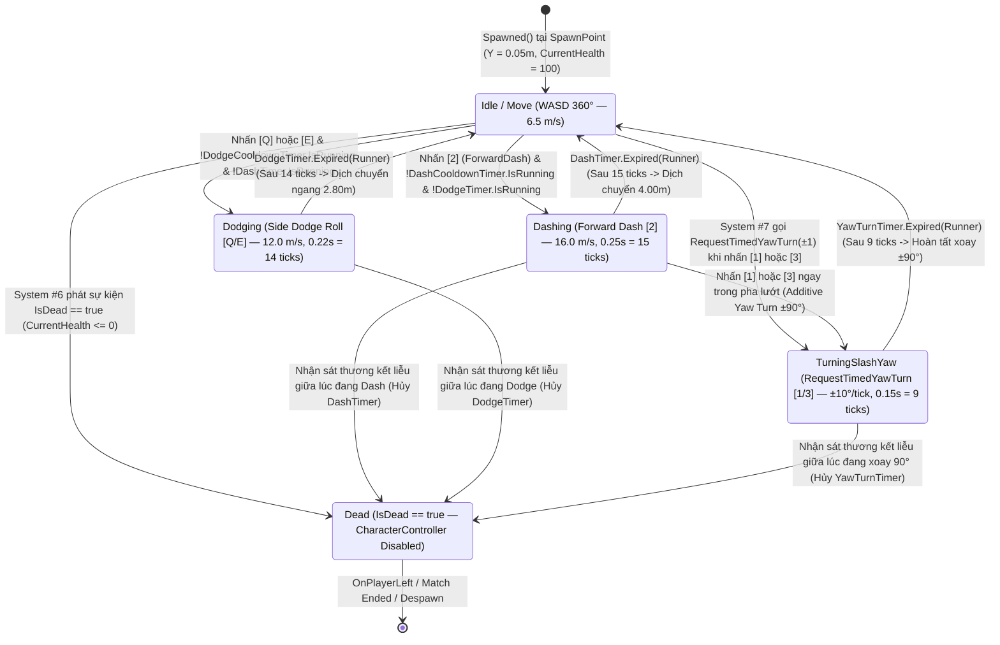

# Tick-Accurate Character Movement & Mobility System

> **Status**: Designed
> **Creative Director Review (CD-GDD-ALIGN)**: APPROVED 2026-11-10
> **Author**: Solo Developer + Studio Agents (`game-designer`, `gameplay-programmer`, `network-engineer`, `creative-director`, `qa-lead`)
> **Last Updated**: 2026-11-10
> **Last Verified**: 2026-11-10
> **Implements Pillar**: Pillar 1 (Cơ Động Phản Xạ Định Đoạt Sinh Tồn), Pillar 2 (Chuyển Đổi Góc Nhìn Chiến Thuật Tức Thì FPS $\leftrightarrow$ TPS) & Pillar 3 (Công Bằng Mạng Tuyệt Đối Trên Shared Mode)

## Summary

**Tick-Accurate Character Movement & Mobility System (`PlayerMovementController`)** là hệ thống điều khiển vận động, kỹ năng cơ động phản xạ và định hướng góc nhìn theo Tick mạng ở tầng **Core (`Gameplay` / `MVP`)** của *Capsule Arena: Last Man Standing*. Vận hành độc quyền bên trong vòng lặp mô phỏng mạng `FixedUpdateNetwork()` (`60Hz`) dưới quyền `Object.HasStateAuthority == true`, hệ thống đọc cấu trúc đầu vào `NetworkInputData` (`System #3`) và các hằng số bất biến từ `ICharacterCombatConfig` (`System #1`) để điều khiển `CharacterController` (`Radius = 0.50m`, `Height = 2.00m`, `Layer 6: Player`) thực thi: di chuyển cơ bản `WASD` 360° (`MoveSpeed = 6.5 m/s`) kết hợp trọng lực bám sàn phẳng (`Gravity = -20.0 m/s²`), kỹ năng lướt tiến tốc độ cao **Forward Dash (phím `2`, `DashSpeed = 16.0 m/s` trong `0.25s` = `15 ticks`, đi đúng `4.00m`, hồi chiêu `2.50s`)**, kỹ năng lăn né ngang **Side Dodge Roll (phím `Q` Trái / `E` Phải, `DodgeSpeed = 12.0 m/s` trong `0.22s` = `14 ticks`, đi đúng `2.80m`, hồi chiêu chung `1.80s`)**, và cơ chế ủy quyền một chiều **`RequestTimedYawTurn(int directionSign)`** xoay mượt cả thân nhân vật (`NetworkTransform`) lẫn `CameraPivot` đúng $\pm 90.0^\circ$ trong `HorizontalTurnDuration = 0.15s` (`9 ticks`, `±10.0°/tick`) khi người chơi tung nhát chém ngang phím `1` hoặc `3`. Người chơi trực tiếp cảm nhận hệ thống này qua sự nhạy bén tức thì không độ trễ đầu vào (Zero Input Lag trên Local Authority), cự ly lướt/lăn khớp tuyệt đối với lưới sàn đấu `Metric Grid`, hiệu ứng đàn hồi **DOTween Squash & Stretch** sống động trên nhánh `VisualRoot` mà không bao giờ làm sai lệch `HitboxRoot` mạng.

> **Quick reference** — Layer: Core · Priority: MVP · Key deps: Character & Combat Config Data (inferred), Arena Level & Tactical Obstacle Architecture (inferred), Keybinding & Input Management System, Photon Fusion 2 Shared Mode Session & Object Pool System

## Overview

Trong thể loại đấu trường hành động sinh tồn góc nhìn lai **FPS $\leftrightarrow$ TPS** như *Capsule Arena: Last Man Standing*, hệ thống di chuyển và cơ động không chỉ đơn thuần là phương tiện đưa nhân vật từ điểm A tới điểm B, mà chính là **vũ khí phòng ngự và thước ngắm tấn công quan trọng nhất của người chơi (Pillar 1)**. Mọi pha lách người qua khe đạn năng lượng, mọi cú phóng vọt qua 2 ô lưới sàn đấu để bổ kiếm dọc, và mọi pha quét đao bọc góc chữ L $90^\circ$ đều phụ thuộc vào độ chính xác từng phần sáu mươi giây (`16.67ms/tick`) của **Tick-Accurate Character Movement & Mobility System (`System #5`)**.

Được xây dựng trên nền **Unity 6.6 (`6000.6.8f1`, URP)** và kiến trúc **Photon Fusion 2 — Shared Mode (`GameMode.Shared`, `TickRate = 60Hz`)**, hệ thống giải quyết triệt để 4 bài toán kỹ thuật cốt lõi ở tầng **Core**:
1. **Mô phỏng Vận động Chuẩn Tick Mạng Không Độ Trễ Đầu Vào (`StateAuthority Tick-Accurate Locomotion`):** Trong `GameMode.Shared`, mỗi máy Client nắm giữ `Object.HasStateAuthority == true` đối với chính nhân vật Cartoon Capsule của mình (`System #4`). Toàn bộ phép tính dịch chuyển `CharacterController.Move()` được thực thi nghiêm ngặt bên trong `FixedUpdateNetwork()` sử dụng `Runner.DeltaTime` (`1/60s`). Nhờ đó, người chơi điều khiển nhân vật trên máy mình với cảm giác phản hồi tức thì (`0ms` Input Lag), trong khi vị trí và góc xoay được `NetworkTransform` nội suy mượt mà sang 7 máy `Proxy` còn lại trong phòng.
2. **Động Học Cơ Động Xác Định Bằng `[Networked] TickTimer` (`Deterministic Dash & Dodge Kinematics`):** Thay vì sử dụng `Coroutine` hay `Time.deltaTime` dễ bị lệch theo tốc độ khung hình (FPS) của từng máy tính, trạng thái hiệu lực và thời gian hồi chiêu của **Forward Dash (phím `2`)** cùng **Side Dodge Roll (phím `Q`/`E`)** được quản lý hoàn toàn bằng cấu trúc `[Networked] TickTimer` (`DashTimer`, `DashCooldownTimer`, `DodgeTimer`, `DodgeCooldownTimer`). Khi kích hoạt, hướng dịch chuyển được khóa cứng (`LockedMobilityDirection`) tại Tick bắt đầu, đảm bảo cú lướt tiến luôn đi đúng `4.00m` (`15 ticks` $\times$ `16.0 m/s`) và cú lăn né ngang luôn đi đúng `2.80m` (`14 ticks` $\times$ `12.0 m/s`) bất kể máy người chơi chạy ở `30 FPS` hay `240 FPS`.
3. **Quyền Ghi Góc Xoay Duy Nhất & Phép Xoay $\pm 90^\circ$ Theo Tick (`Single Rotation Writer & Timed 90° Yaw Turn`):** Để ngăn chặn xung đột kinh điển khi cả hệ thống Chiến đấu (`#7`), hệ thống Camera (`#9`) và hệ thống Di chuyển (`#5`) cùng cố gắng ghi đè `transform.rotation` gây giật hình (jitter), kiến trúc dự án khóa chặt quy tắc: **chỉ duy nhất `PlayerMovementController` (`#5`) được phép cập nhật góc Yaw của nhân vật và `CameraPivot` trong `FixedUpdateNetwork()`**. Khi người chơi nhấn phím `1` (Chém ngang trái $90^\circ$) hoặc phím `3` (Chém ngang phải $90^\circ$), hệ thống Chiến đấu (`#7`) ủy quyền một chiều qua hàm `RequestTimedYawTurn(int directionSign)`. Hệ thống `#5` lập tức khởi chạy `YawTurnTimer` (`0.15s` = `9 ticks`) và cộng thêm chính xác `±10.0°/tick` vào góc Yaw, giúp cả thân người lẫn Camera (`FPS` hoặc `TPS`) xoay mượt đúng $\pm 90.0^\circ$ sau `0.15s`.
4. **Cô Lập Biến Dạng Đồ Họa `VisualRoot` Khỏi Khung Va Chạm Mạng `HitboxRoot` (`Visual vs. Hitbox Hierarchy Isolation`):** Trong `Render()`, hệ thống kích hoạt các hiệu ứng **DOTween Squash & Stretch** (`VisualStretchScale` khi lướt `2`, `VisualSquashScale` kèm nghiêng mình `DodgeVisualTiltAngle = ±35.0°` khi lăn `Q`/`E`) chỉ trên nhánh con đồ họa `VisualRoot`. Nhánh gốc chứa `CharacterController` và nhánh `HitboxRoot` (phục vụ bù trễ `Lag Compensation` của `System #7`) luôn giữ nguyên tỷ lệ `(1.0, 1.0, 1.0)` và tư thế thẳng đứng tuyệt đối (**Pillar 3**).

## Player Fantasy

> **System Framing:** `[A] Direct — Người chơi trực tiếp điều khiển từng bước chạy 360°, từng cú phóng lướt tiến áp sát 4.00m, từng pha lăn né ngang 2.80m lách qua đường đạn và trực tiếp cảm nhận cú xoay thân người + Camera 90° sắc ngọt như một kiếm khách thực thụ.`

### 1. Giấc mơ cốt lõi: "Thân Pháp Tia Chớp — Lách Đạn Trong Gang Tấc, Đoạt Mạng Qua Góc Khuất $90^\circ$"
Trong *Capsule Arena: Last Man Standing*, không có chiếc khiên chắn sát thương nào ngoài chính đôi chân và phản xạ của người chơi. **Tick-Accurate Character Movement & Mobility System** hiện thực hóa giấc mơ hóa thân thành một **Đấu Sĩ Cơ Động Siêu Phàm (Hyper-Agile Arena Duelist)**:
- Khi một quả cầu năng lượng tầm xa (`Right Click`, tốc độ `22.0 m/s`) xé gió lao thẳng về phía ngực bạn từ khoảng cách `12m`, bạn không hoảng loạn. Chỉ một cú nhấp nhẹ ngón áp út hoặc ngón trỏ lên phím `Q` hoặc `E` (**Side Dodge Roll**), chiến binh Capsule của bạn lập tức nghiêng mình $35^\circ$, nén thấp trọng tâm (`Squash`) và bật ngang `2.80m` chỉ trong `0.22s`. Viên đạn sượt qua đúng vị trí bạn vừa đứng một phần mười giây trước và nổ tung vào bức tường phía sau.
- Ngay khi đối thủ lộ sơ hở vì vừa bắn trượt, bạn nhìn lướt qua 2 ô lưới `PrimaryGridStep = 2.0m` dưới mặt sàn, nhấn phím `2` (**Forward Dash**). Thân hình Capsule kéo thon dài về phía trước (`Stretch`) và phóng vọt đi đúng `4.00m` với vận tốc `16.0 m/s`, xóa sổ hoàn toàn khoảng cách an toàn của kẻ địch chỉ trong một cái chớp mắt (`0.25s`).
- Đỉnh cao của cảm giác làm chủ thân pháp diễn ra tại **4 Cụm Góc Vuông Chữ L (`L-Corner 90° Combat Zones`)**: bạn lướt tiến bằng phím `2` tới sát mép tường vuông góc, rồi nhấn phím `1` (hoặc phím `3`). Ngay lập tức, lưỡi kiếm ánh sáng quét ngang một góc vuông $90^\circ$ đồng thời cơ thể bạn và góc nhìn Camera xoay ngọt lịm đúng $90^\circ$ trong `0.15s` (`10°/tick`), đưa tâm ngắm của bạn khóa thẳng vào mặt kẻ địch đang nấp sau góc chữ L mà tay cầm chuột không cần phải nhấc lên rê lại.

### 2. Trải nghiệm cảm giác qua từng khoảnh khắc (How the Player Experiences the Effects)
1. **Sự Dính Tay Tuyệt Đối Không Quán Tính Trượt (Crisp Arcade-Tactical Stop & Go):** Bước chạy cơ bản bằng `WASD` (`MoveSpeed = 6.5 m/s`) phản hồi tức khắc theo từng nhịp nhấn phím: nhấn là đạt vận tốc chuẩn, nhả phím là dừng đúng điểm trên ô lưới sàn đấu mà không bị trượt băng (no muddy ice-skating inertia), giúp việc nhấp nhả hé góc (`Jiggle-Peeking`) quanh các khối `Obstacle` ở cả góc nhìn **TPS** lẫn **FPS** cực kỳ chuẩn xác.
2. **Cam Kết Hướng Lướt & Nhịp Điệu Đấu Trí Cooldown (Committed Mobility Vector & Cooldown Mindgames):** Khi đã bấm phím `2` (`Forward Dash`) hoặc `Q`/`E` (`Side Dodge Roll`), hướng bay được khóa cứng trong suốt `0.25s` / `0.22s`. Sự cam kết ngắn gọn nhưng dứt khoát này tạo nên chiều sâu tâm lý chiến thuật: người chơi giỏi sẽ đọc được hướng lăn né của đối thủ để đón lõng tại điểm kết thúc `2.80m`, trong khi vòng đếm ngược Cooldown (`2.50s` cho Dash, `1.80s` cho Dodge) trên cụm **7 nút kỹ năng mềm góc dưới phải** nhắc nhở từng nhịp thở sinh tồn.
3. **Trượt Tường Mượt Mà Không Kẹt Góc (Frictionless Wall-Sliding):** Dù người chơi có lướt phím `2` hay lăn né `Q`/`E` đập chéo góc $30^\circ$–$60^\circ$ vào cạnh khối `Obstacle` hoặc tường bao `Boundary`, hệ thống tự động tách thành phần vận tốc vuông góc và cho phép nhân vật trượt mượt dọc theo bề mặt tường nhờ `CharacterController` thay vì bị khựng cứng tại chỗ.

### 3. Điểm chạm Tham chiếu & Đối chiếu Trụ cột Thiết kế

| Điểm tham chiếu / Trụ cột | Cách `Tick-Accurate Character Movement & Mobility System` hiện thực hóa trải nghiệm |
| :--- | :--- |
| ***Battlerite / Hades*** *(Crisp WASD + Committed Dash/Dodge Evasion)* | Di chuyển 360° không độ trễ quán tính thừa, kết hợp hai kỹ năng cơ động tách biệt rõ vai trò: **Forward Dash (`[2]`, `4.00m`)** chuyên dùng để đột kích áp sát và **Side Dodge Roll (`[Q/E]`, `2.80m`)** chuyên dùng để lách ngang né đạn/kiếm. |
| ***Ghostrunner / Chivalry 2*** *(Integrated Combat-Driven Camera & Body Turn)* | Phép xoay thân người và Camera đồng bộ $\pm 90^\circ$ trong `0.15s` (`RequestTimedYawTurn`) khi tung nhát chém ngang phím `1`/`3` giúp người chơi vừa tấn công bọc sườn vừa bẻ góc di chuyển vuông góc mượt như nước chảy. |
| ***Valorant / Overwatch 2*** *(60Hz Deterministic Tick Movement & Clean Hitboxes)* | Toàn bộ dịch chuyển và bộ đếm Cooldown chạy trên `FixedUpdateNetwork()` (`60Hz`) với `TickTimer`; biến dạng đàn hồi `DOTween Squash & Stretch` chỉ tác động lên `VisualRoot`, giữ cho `HitboxRoot` trung thực 100%. |
| **Pillar 1, Pillar 2 & Pillar 3** | Cung cấp động học né đạn/áp sát chuẩn xác từng centimet (**Pillar 1**), đồng bộ góc xoay `CameraPivot` phục vụ chuyển đổi tức thì `FPS <-> TPS` (**Pillar 2**), và vận hành dưới quyền `StateAuthority` công bằng trên `GameMode.Shared` (**Pillar 3**). |

## Detailed Design

### Core Rules

1. **Quy tắc Thực Thi Độc Quyền Trong `FixedUpdateNetwork()` Dưới Quyền `StateAuthority` (`Shared Mode Authority & Input Contract`):**
   - Lớp điều khiển chính **`PlayerMovementController`** kế thừa `NetworkBehaviour` của Photon Fusion 2 và được gắn trên Prefab nhân vật gốc `pf_char_capsule_player_01.prefab`.
   - Trong mỗi Tick mô phỏng mạng (`FixedUpdateNetwork()`, tần số `60Hz`, `Runner.DeltaTime = 1/60s ≈ 0.01667s`):
     - Hệ thống kiểm tra đầu tiên trạng thái sinh tồn từ **System #6 (`PlayerHealthController.IsDead`)**: nếu `IsDead == true`, hệ thống lập tức hủy mọi bộ đếm cơ động đang chạy (`DashTimer = TickTimer.None`, `DodgeTimer = TickTimer.None`, `YawTurnTimer = TickTimer.None`), giữ `CharacterController.enabled = false` và thoát khỏi hàm (`return;`).
     - Tiếp theo, hệ thống kiểm tra quyền sở hữu trạng thái **`if (!Object.HasStateAuthority) return;`**: Trong kiến trúc `GameMode.Shared`, chỉ máy Client sở hữu nhân vật đó mới được phép đọc `GetInput(out NetworkInputData input)` (`System #3`) và gọi `CharacterController.Move(tickDisplacement)` cũng như ghi `transform.rotation`. Các máy khách khác (`Proxy`, nơi `Object.HasStateAuthority == false`) hoàn toàn không tự chạy `CharacterController.Move()` mà nhận vị trí/góc xoay đã được đồng bộ qua thành phần `NetworkTransform`.
     - Toàn bộ chỉ số vận tốc, thời lượng và hồi chiêu bắt buộc đọc trực tiếp từ giao diện **`ICharacterCombatConfig`** (`System #1`), tuyệt đối không dùng số hằng cứng (`magic numbers`).

2. **Quy tắc Di Chuyển Cơ Bản `WASD` 360°, Cấu Hình `CharacterController` & Trọng Lực Bám Sàn (`Base Locomotion & Grounding Physics`):**
   - Thành phần **`CharacterController`** của Unity gắn trên node gốc của `pf_char_capsule_player_01.prefab` (`Layer 6: Player`) được khóa cứng các thông số vật lý chuẩn để khớp 1:1 với kiến trúc địa hình của **System #2 (`Arena Level & Tactical Obstacle Architecture`)**:
     - Bán kính trụ va chạm: **`Radius = 0.50m`** (đường kính `1.00m`).
     - Chiều cao trụ va chạm: **`Height = 2.00m`** (`Center = (0.0f, 1.0f, 0.0f)` để đáy chân Capsule nằm đúng tại `localPosition.y = 0.0f`).
     - Độ cao bậc bước tối đa: **`StepOffset = 0.30m`**.
     - Giới hạn độ dốc: **`SlopeLimit = 45.0°`**.
     - Lớp đệm da va chạm: **`SkinWidth = 0.05m`** (khớp với cao độ xuất hiện `SpawnHeightOffset = 0.05m` của `SpawnPoint` ở `System #2`, ngăn chặn lỗi lún sàn ở Tick đầu tiên) và `MinMoveDistance = 0.001f`.
   - **Di chuyển phẳng `WASD` (`LocomotionState.Idle` / `LocomotionState.Moving`):**
     - Khi nhân vật không ở trong trạng thái lướt (`!DashTimer.IsRunning(Runner)`) và không ở trong trạng thái lăn né (`!DodgeTimer.IsRunning(Runner)`), hệ thống đọc vector 2 chiều đã chuẩn hóa `input.MoveDirection` (`Vector2` từ phím `W/A/S/D` hoặc điều hướng mềm của `System #3`).
     - Vector hướng di chuyển trong không gian thế giới (`World Space`) được tính theo hướng mặt hiện tại của nhân vật trên mặt phẳng ngang `XZ`:
       `Vector3 moveDir = (transform.forward * input.MoveDirection.y + transform.right * input.MoveDirection.x);`
       Nếu `moveDir.sqrMagnitude > 1.0f`, chuẩn hóa lại `moveDir.Normalize()` để ngăn lỗi chạy chéo (`W+D`, `W+A`) nhanh hơn chạy thẳng.
     - Vận tốc ngang cơ bản bằng `moveDir * Config.MoveSpeed` (**`MoveSpeed = 6.5 m/s`**).
   - **Trọng lực phẳng giữ bám sàn (`Gravity = -20.0 m/s²`):**
     - Mặc dù mặt sàn đấu trường `Plane` (`40.0m x 40.0m`, `Y = 0.0m`) hoàn toàn phẳng và trò chơi không có phím nhảy trục `Y` (**Anti-Pillar** ưu tiên phản xạ mặt phẳng ngang), `CharacterController` vẫn cần một thành phần vận tốc dọc âm để cờ `CharacterController.isGrounded` luôn ổn định và ngăn nhân vật bị nảy lên khi va chạm tốc độ cao với cạnh `Obstacle` hay `Player` khác.
     - Hệ thống áp dụng gia tốc trọng trường hằng số **`Gravity = -20.0 m/s²`**:
       - Nếu `CharacterController.isGrounded == true`: kẹp vận tốc dọc ở mức bám sàn nhẹ `_verticalVelocity = -2.0f` (`m/s`).
       - Nếu `CharacterController.isGrounded == false`: cộng dồn `_verticalVelocity = Mathf.Max(_verticalVelocity + Gravity * Runner.DeltaTime, -30.0f)`.

3. **Quy tắc Kỹ Năng Lướt Tiến Tốc Độ Cao (`Forward Dash` — Phím Mặc Định `2` / `GameActionId.ForwardDash`):**
   - **Điều kiện kích hoạt (`Activation Gate`):** Trong `FixedUpdateNetwork()`, khi `input.IsPressed(GameActionId.ForwardDash) == true`, kỹ năng **Forward Dash** chỉ được kích hoạt nếu thỏa mãn đồng thời cả 3 điều kiện bộ đếm mạng:
     `!DashCooldownTimer.IsRunning(Runner) && !DashTimer.IsRunning(Runner) && !DodgeTimer.IsRunning(Runner)`
   - **Khởi tạo Trạng thái & Bộ đếm Tick mạng (`State & TickTimer Initialization`):**
     - Đặt bộ đếm thời lượng lướt: **`DashTimer = TickTimer.CreateFromSeconds(Runner, Config.DashDuration)`** (với `Config.DashDuration = 0.25s`, tạo ra đúng **`15 ticks`** ở tần số `60Hz`).
     - Đặt bộ đếm hồi chiêu lướt: **`DashCooldownTimer = TickTimer.CreateFromSeconds(Runner, Config.DashCooldown)`** (với `Config.DashCooldown = 2.50s`, tạo ra đúng **`150 ticks`** ở tần số `60Hz`, bắt đầu đếm ngược ngay tại Tick kích hoạt).
     - Khóa cứng vector hướng lướt tại Tick bắt đầu: **`[Networked] Vector3 LockedMobilityDirection = Vector3.ProjectOnPlane(transform.forward, Vector3.up).normalized`**.
     - Tăng bộ đếm sự kiện mạng `[Networked] byte MobilityActionCounter` (kèm `[OnChangedRender(nameof(OnMobilityVisualTriggered))]`) để thông báo cho cả máy `StateAuthority` lẫn các máy `Proxy` kích hoạt hiệu ứng hình ảnh/âm thanh.
   - **Thực thi Dịch chuyển trong `15 Ticks` (`Active Dash Execution`):**
     - Trong suốt thời gian `DashTimer.IsRunning(Runner) == true`, hệ thống bỏ qua đầu vào di chuyển `WASD` thông thường và ép nhân vật dịch chuyển theo đúng vector đã khóa `LockedMobilityDirection` với vận tốc **`Config.DashSpeed = 16.0 m/s`**.
     - Mỗi Tick mạng (`1/60s`), nhân vật tiến về phía trước `16.0 * (1/60) ≈ 0.2667m`. Sau trọn vẹn `15 ticks` (`0.25s`), nếu không bị chặn bởi tường hoặc khối `Obstacle`, nhân vật dịch chuyển một quãng đường chính xác tuyệt đối **`4.00m`** (bằng đúng **`2 ô lưới chính PrimaryGridStep = 2.0m`** trên mặt sàn đấu trường `System #2`).
     - *Lưu ý phối hợp chiến đấu:* Trong khi đang lướt `Forward Dash`, người chơi vẫn được phép xoay góc nhìn chuột hoặc nhấn phím `1`/`3` để kết hợp комbo **Lướt Bọc Góc + Chém Ngang Xoay Người $90^\circ$**, nhưng quỹ đạo tịnh tiến của pha lướt hiện tại vẫn giữ nguyên theo `LockedMobilityDirection` cho đến khi hết `15 ticks`.

4. **Quy tắc Kỹ Năng Lăn Né Ngang Phản Xạ (`Side Dodge Roll` — Phím Mặc Định `Q` Lăn Trái / `E` Lăn Phải — `DodgeLeft` / `DodgeRight`):**
   - **Điều kiện kích hoạt (`Activation Gate`):** Trong `FixedUpdateNetwork()`, khi `input.IsPressed(GameActionId.DodgeLeft)` (phím mặc định `Q`) hoặc `input.IsPressed(GameActionId.DodgeRight)` (phím mặc định `E`), kỹ năng **Side Dodge Roll** chỉ được kích hoạt nếu thỏa mãn đồng thời:
     `!DodgeCooldownTimer.IsRunning(Runner) && !DodgeTimer.IsRunning(Runner) && !DashTimer.IsRunning(Runner)`
     *(Nếu cả `DodgeLeft` và `DodgeRight` cùng có bit `1` trong cùng một gói `NetworkInputData`, hệ thống ưu tiên kiểm tra `DodgeLeft` (`Q`, dấu `-1`) trước để đảm bảo tính tất định 100%).*
   - **Khởi tạo Trạng thái & Bộ đếm Tick mạng Dùng Chung (`Shared Cooldown & Direction Lock`):**
     - Đặt bộ đếm thời lượng lăn né: **`DodgeTimer = TickTimer.CreateFromSeconds(Runner, Config.DodgeDuration)`** (với `Config.DodgeDuration = 0.22s`, công thức `ceil(0.22 * 60)` tạo ra đúng **`14 ticks`** $\approx 0.2333\text{s}$ ở tần số `60Hz`).
     - Đặt bộ đếm hồi chiêu dùng chung cho cả hai hướng Trái/Phải: **`DodgeCooldownTimer = TickTimer.CreateFromSeconds(Runner, Config.DodgeCooldown)`** (với `Config.DodgeCooldown = 1.80s`, tạo ra đúng **`108 ticks`** ở tần số `60Hz`).
     - Xác định dấu hướng lăn `[Networked] sbyte LastDodgeSign = -1` (nếu bấm `Q` — `DodgeLeft`) hoặc `+1` (nếu bấm `E` — `DodgeRight`), và khóa cứng vector dịch chuyển ngang vuông góc với hướng mặt tại Tick bắt đầu:
       - Với **`Q` (`DodgeLeft`)**: **`LockedMobilityDirection = -Vector3.ProjectOnPlane(transform.right, Vector3.up).normalized`**.
       - Với **`E` (`DodgeRight`)**: **`LockedMobilityDirection = +Vector3.ProjectOnPlane(transform.right, Vector3.up).normalized`**.
   - **Thực thi Dịch chuyển Ngang & Biến dạng Đồ họa `VisualRoot` (`Active Dodge & Visual Squash-Tilt`):**
     - Trong suốt `14 ticks` khi `DodgeTimer.IsRunning(Runner) == true`, nhân vật dịch chuyển ngang theo `LockedMobilityDirection` với vận tốc **`Config.DodgeSpeed = 12.0 m/s`**, đi được tổng quãng đường **`2.80m`** (`12.0 * 14 / 60 = 2.80m` — đủ rộng để thoát hoàn toàn khỏi đường đạn `ProjectileRadius = 0.20m` hoặc vùng quạt hẹp $45^\circ$ của nhát chém dọc `Left Click`).
     - Trong `Render()`, thông qua callback `[OnChangedRender]`, hệ thống kích hoạt chuỗi **DOTween Squash & Stretch** từ thông số của `ICharacterCombatConfig`: nén thấp tỷ lệ nhánh con `VisualRoot.localScale` về **`VisualSquashScale = (1.30, 0.70, 1.15)`** đồng thời nghiêng `VisualRoot.localRotation` quanh trục `Z` một góc **`DodgeVisualTiltAngle = +35.0°`** (khi lăn trái `Q`) hoặc **`-35.0°`** (khi lăn phải `E`) trong thời gian `TweenElasticityDuration = 0.18s`, sau đó đàn hồi mượt về `Vector3.one` và `Quaternion.identity`. Nhánh gốc và `HitboxRoot` hoàn toàn không bị nghiêng hay biến dạng.

5. **Quy tắc Ủy Quyền Xoay Thân Người & Camera $\pm 90^\circ$ Mượt Mà (`RequestTimedYawTurn` cho Nhát Chém Ngang Phím `1`/`3`):**
   - **Quy tắc Chủ Quyền Góc Xoay Duy Nhất (`Single Rotation Authority Rule`):**
     - Chỉ duy nhất **Hệ thống #5 (`PlayerMovementController`)** được phép ghi giá trị vào `transform.rotation` của nhân vật và `CameraPivot.rotation` bên trong `FixedUpdateNetwork()`.
     - Hệ thống Chiến đấu (`System #7`) khi thực thi đòn **Horizontal Turning Slash $90^\circ$ (phím `1` Trái / phím `3` Phải)** không được tự ý xoay `transform.rotation` mà bắt buộc gọi phương thức ủy quyền công khai một chiều trên `PlayerMovementController`:
       ```csharp
       public void RequestTimedYawTurn(int directionSign)
       ```
       Trong đó:
       - `directionSign = -1`: Tương ứng **Phím `1` (`GameActionId.HorizontalSlashLeft`)** — Quét kiếm ngang sang Trái và xoay thân người + Camera **$-90.0^\circ$**.
       - `directionSign = +1`: Tương ứng **Phím `3` (`GameActionId.HorizontalSlashRight`)** — Quét kiếm ngang sang Phải và xoay thân người + Camera **$+90.0^\circ$**.
   - **Cơ chế Nội suy Góc Yaw Theo Tick Mạng (`9-Tick Deterministic Yaw Interpolation`):**
     - Ngay khi `RequestTimedYawTurn(int directionSign)` được gọi trên máy có `StateAuthority` bên trong `FixedUpdateNetwork()`:
       1. Hệ thống chuẩn hóa dấu hướng xoay: `ActiveTurnDirectionSign = (sbyte)(directionSign < 0 ? -1 : 1)`.
       2. Khởi tạo bộ đếm xoay mạng: **`YawTurnTimer = TickTimer.CreateFromSeconds(Runner, Config.HorizontalTurnDuration)`** (với `Config.HorizontalTurnDuration = 0.15s`, tạo ra đúng **`9 ticks`** ở tần số `60Hz`).
       3. Tính bước góc xoay mỗi Tick từ cấu hình `Config.HorizontalSlashAngle = 90.0°`:
          **`horizontal_turn_step_angle = ActiveTurnDirectionSign * (Config.HorizontalSlashAngle / 9.0f) = ±10.0°/tick`**.
     - Trong mỗi Tick của `9 ticks` tiếp theo khi `YawTurnTimer.IsRunning(Runner) == true`, hàm cập nhật góc nhìn trong `FixedUpdateNetwork()` cộng dồn cả độ lệch chuột `input.LookRotationDelta.x * Config.RotationSensitivity` lẫn bước xoay cưỡng bức `horizontal_turn_step_angle` (`-10.0°` hoặc `+10.0°`) vào biến mạng `[Networked] public float CurrentYaw { get; set; }`.
     - Ngay trong cùng Tick đó, hệ thống gán:
       - `transform.rotation = Quaternion.Euler(0f, CurrentYaw, 0f);` (đồng bộ qua `NetworkTransform` tới mọi máy `Proxy`).
       - `CameraPivot.localRotation = Quaternion.Euler(CurrentPitch, 0f, 0f);` (do `CameraPivot` là node con của nhân vật nên tự động thừa hưởng góc `CurrentYaw` của thân người, giúp `CinemachineCamera` ở cả chế độ **FPS** lẫn **TPS** xoay mượt đúng $\pm 90.0^\circ$ sau đúng `0.15s` mà không bị lệch tâm ngắm dù chỉ $0.01^\circ$).

6. **Bảng Đặc Tả Cấu Trúc Trạng Thái `[Networked]` & Phân Cấp Node Prefab (`Networked State & Hierarchy Specification`):**

| Nhóm Thành Phần | Tên Thuộc Tính / Node | Kiểu Dữ Liệu / Layer | Giá Trị Khởi Tạo / Mặc Định | Mô Tả Ngữ Nghĩa & Cơ Chế Đồng Bộ Photon Fusion 2 |
| :--- | :--- | :---: | :---: | :--- |
| **1. Networked State (`PlayerMovementController`)** | `LocomotionState` | `[Networked] LocomotionState` (`byte` enum) | `LocomotionState.Idle` | Trạng thái vận động hiện tại của nhân vật (`Idle`, `Moving`, `Dashing`, `Dodging`, `TurningSlashYaw`, `Dead`). |
| **1. Networked State (`PlayerMovementController`)** | `CurrentYaw` | `[Networked] float` | `SpawnPoint.eulerAngles.y` | Góc xoay ngang (Yaw) chuẩn xác theo Tick trong khoảng `[-180°, +180°]`, quyết định `transform.rotation`. |
| **1. Networked State (`PlayerMovementController`)** | `DashTimer` | `[Networked] TickTimer` | `TickTimer.None` | Bộ đếm thời gian hiệu lực của **Forward Dash (phím `2`)** (`0.25s` = `15 ticks` ở `60Hz`). |
| **1. Networked State (`PlayerMovementController`)** | `DashCooldownTimer` | `[Networked] TickTimer` | `TickTimer.None` | Bộ đếm thời gian hồi chiêu của **Forward Dash (phím `2`)** (`2.50s` = `150 ticks` ở `60Hz`). |
| **1. Networked State (`PlayerMovementController`)** | `DodgeTimer` | `[Networked] TickTimer` | `TickTimer.None` | Bộ đếm thời gian hiệu lực của **Side Dodge Roll (`Q`/`E`)** (`0.22s` = `14 ticks` ở `60Hz`). |
| **1. Networked State (`PlayerMovementController`)** | `DodgeCooldownTimer` | `[Networked] TickTimer` | `TickTimer.None` | Bộ đếm hồi chiêu dùng chung cho cả **Lăn trái (`Q`)** và **Lăn phải (`E`)** (`1.80s` = `108 ticks` ở `60Hz`). |
| **1. Networked State (`PlayerMovementController`)** | `YawTurnTimer` | `[Networked] TickTimer` | `TickTimer.None` | Bộ đếm thời gian xoay thân người + Camera $\pm 90^\circ$ khi chém ngang phím `1`/`3` (`0.15s` = `9 ticks` ở `60Hz`). |
| **1. Networked State (`PlayerMovementController`)** | `LockedMobilityDirection` | `[Networked] Vector3` | `Vector3.forward` | Vector đơn vị trên mặt phẳng `XZ` lưu hướng lướt/lăn đã khóa tại Tick bắt đầu `Dash` hoặc `Dodge`. |
| **1. Networked State (`PlayerMovementController`)** | `ActiveTurnDirectionSign` | `[Networked] sbyte` | `0` (`-1` hoặc `+1`) | Dấu chiều xoay của `RequestTimedYawTurn` (`-1` cho phím `1` Trái $-90^\circ$, `+1` cho phím `3` Phải $+90^\circ$). |
| **1. Networked State (`PlayerMovementController`)** | `LastDodgeSign` | `[Networked] sbyte` | `-1` (`-1` hoặc `+1`) | Lưu hướng lăn gần nhất (`-1` Trái `Q`, `+1` Phải `E`) để `VisualRoot` nghiêng đúng chiều `±35.0°`. |
| **1. Networked State (`PlayerMovementController`)** | `MobilityActionCounter` | `[Networked] byte` *(kèm `[OnChangedRender]`)* | `0` | Bộ đếm tăng dần mỗi khi kích hoạt `Dash` hoặc `Dodge` để phát hiệu ứng DOTween & Audio trên mọi Client. |
| **2. Physics & Hitbox Hierarchy (`Root`)** | `CharacterController` + `NetworkTransform` | `Layer 6: Player` | `Radius = 0.50m`, `Height = 2.00m`, `StepOffset = 0.30m`, `SlopeLimit = 45°` | Thực thi va chạm vật lý với `Player`, `Obstacle`, `Boundary` trên mặt sàn `Plane` và nội suy vị trí mạng. |
| **2. Physics & Hitbox Hierarchy (`Child 1`)** | `HitboxRoot` (`Hitbox`) | `Layer 6: Player` | `Scale = (1, 1, 1)` cố định | Khung va chạm bù trễ `LagCompensation` của Photon Fusion 2; **tuyệt đối không chịu biến dạng DOTween**. |
| **3. Visual & Camera Hierarchy (`Child 2 & 3`)** | `VisualRoot` & `CameraPivot` | `Default` / `LocalPlayer` | `VisualRoot` tại `(0, 0, 0)`<br>`CameraPivot` tại `(0, 1.60, 0)` | `VisualRoot` nhận hiệu ứng DOTween Squash & Stretch; `CameraPivot` đặt ở độ cao mắt `1.60m` dẫn hướng cho `CinemachineCamera` (`#9`). |

### States and Transitions

Hệ thống vận hành máy trạng thái vận động **`LocomotionState`** bên trong `FixedUpdateNetwork()` gồm 5 trạng thái cốt lõi (`Idle/Move`, `Dashing`, `Dodging`, `TurningSlashYaw`, `Dead`), trong đó trạng thái xoay chém ngang `TurningSlashYaw` (`YawTurnTimer`) có thể diễn ra độc lập hoặc chồng lớp (additive) ngay trong khi nhân vật đang di chuyển để đảm bảo nhịp chiến đấu không bao giờ bị khựng bước:



#### Bảng Ma Trận Ưu Tiên & Tương Tác Trạng Thái Trong `FixedUpdateNetwork()`:

| Trạng Thái Hiện Tại | Nhấn `WASD` (`MoveDirection`) | Nhấn `2` (`ForwardDash`) | Nhấn `Q`/`E` (`DodgeLeft`/`Right`) | Bấm `1`/`3` (`RequestTimedYawTurn`) | Rê Chuột Ngang (`LookRotationDelta.x`) |
| :--- | :---: | :---: | :---: | :---: | :---: |
| **`Idle / Move`** | **Cho phép** (`6.5 m/s`) | **Chuyển sang `Dashing`** *(nếu hết Cooldown `2.50s`)* | **Chuyển sang `Dodging`** *(nếu hết Cooldown `1.80s`)* | **Kích hoạt `TurningSlashYaw`** (`±10.0°/tick` trong `9 ticks`) | **Cho phép** (`CurrentYaw += mouseDelta`) |
| **`Dashing` (`15 ticks`)** | **Bị khóa** *(Giữ cứng `LockedMobilityDirection`)* | **Từ chối** *(Đang lướt & đang Cooldown)* | **Từ chối** *(Không cho hủy Dash bằng Dodge)* | **Cho phép chồng lớp** *(Xoay mặt + Camera $\pm 90^\circ$ khi đang lướt)* | **Cho phép** *(Xoay hướng nhìn cho đòn kế tiếp)* |
| **`Dodging` (`14 ticks`)** | **Bị khóa** *(Giữ cứng `LockedMobilityDirection`)* | **Từ chối** *(Không cho hủy Dodge bằng Dash)* | **Từ chối** *(Đang lăn & đang Cooldown)* | **Cho phép chồng lớp** *(Xoay mặt + Camera $\pm 90^\circ$)* | **Cho phép** |
| **`TurningSlashYaw` (`9 ticks`)** | **Cho phép** *(Vừa chạy `WASD` vừa xoay $\pm 90^\circ$)* | **Cho phép** *(Nếu hết Cooldown `2.50s`)* | **Cho phép** *(Nếu hết Cooldown `1.80s`)* | **Từ chối** *(Đang trong Cooldown chém ngang `0.85s`)* | **Cộng gộp mượt** (`mouseDelta + ±10.0°/tick`) |
| **`Dead` (`IsDead == true`)** | **Bị khóa hoàn toàn** | **Bị khóa hoàn toàn** | **Bị khóa hoàn toàn** | **Bị khóa hoàn toàn** | Chuyển quyền điều khiển cho `Ghost Spectator (#9)` |

### Interactions with Other Systems

| Hệ Thống Liên Quan | Chiều Tương Tác | Cơ Chế Giao Tiếp & Hợp Đồng Dữ Liệu |
| :--- | :---: | :--- |
| **System #1: Character & Combat Config Data (`ICharacterCombatConfig`)** | **Upstream (`#1` $\rightarrow$ `#5`)** | `PlayerMovementController` giữ tham chiếu `ICharacterCombatConfig` để đọc `MoveSpeed (6.5)`, `RotationSensitivity (1.0)`, `DashSpeed (16.0)`, `DashDuration (0.25)`, `DashCooldown (2.50)`, `DodgeSpeed (12.0)`, `DodgeDuration (0.22)`, `DodgeCooldown (1.80)`, `HorizontalSlashAngle (90.0)`, `HorizontalTurnDuration (0.15)` và các thông số DOTween `VisualRoot`. |
| **System #2: Arena Level & Tactical Obstacle Architecture** | **Upstream (`#2` $\rightarrow$ `#5`)** | `CharacterController` (`Layer 6: Player`) tương tác vật lý trực tiếp với mặt sàn `Plane` (`Y = 0.0m`), khối vật cản `Obstacle` (`Layer 8`) và tường bao `Boundary` (`Layer 9`); xuất phát tại `SpawnPoint` (`Y = 0.05m`, hướng về tâm `(0, 0, 0)`). |
| **System #3: Keybinding & Input Management System** | **Upstream (`#3` $\rightarrow$ `#5`)** | Trong `FixedUpdateNetwork()`, `#5` gọi `GetInput(out NetworkInputData input)` để đọc `input.MoveDirection`, `input.LookRotationDelta`, và trạng thái nhấn của `ForwardDash` (phím `2`), `DodgeLeft` (`Q`), `DodgeRight` (`E`). Khi `InputFocusManager` ở trạng thái `ChatTyping` hoặc `RebindModalOpen`, `input` trả về `default` giúp nhân vật dừng lại an toàn. |
| **System #4: Photon Fusion 2 Shared Mode Session & Object Pool System** | **Upstream (`#4` $\rightarrow$ `#5`)** | Cung cấp `NetworkRunner` (`60Hz`, `GameMode.Shared`) và cấp quyền `Object.HasStateAuthority == true` cho nhân vật Local Player ngay khi `Runner.Spawn()`. |
| **System #6: Health, Damage RPC & Death State System** | **Upstream (`#6` $\rightarrow$ `#5`)** | Khi `CurrentHealth <= 0`, `#6` bật `[Networked] IsDead = true`, phát sự kiện `OnPlayerDeathStateChanged` và vô hiệu hóa `CharacterController` để `#5` ngừng toàn bộ mô phỏng di chuyển ngay lập tức. |
| **System #7: Multi-Directional Melee & Pooled Ranged Combat System** | **Downstream (`#7` $\rightarrow$ `#5`)** | Khi người chơi bấm phím `1` (`HorizontalSlashLeft`) hoặc phím `3` (`HorizontalSlashRight`), `#7` gọi phương thức ủy quyền một chiều `PlayerMovementController.RequestTimedYawTurn(directionSign)` (`-1` hoặc `+1`) để `#5` thực thi phép xoay thân người và Camera đúng $\pm 90.0^\circ$ trong `0.15s` (`9 ticks`). |
| **System #8: Combat HUD, Overhead Billboard & Mobile Action Pad UI** | **Downstream (`#5` $\rightarrow$ `#8`)** | `#8` đọc thời gian còn lại từ `DashCooldownTimer.RemainingTime(Runner)` và `DodgeCooldownTimer.RemainingTime(Runner)` thông qua `IPlayerMobilityState` để vẽ vòng quạt Cooldown (`cooldown_fill_ratio`) trên nút mềm **Button #4 (`[2]`)**, **Button #6 (`[Q]`)** và **Button #7 (`[E]`)** ở góc dưới phải màn hình. |
| **System #9: Dual-Perspective Camera (FPS/TPS) & Ghost Mode Spectator** | **Downstream (`#5` $\rightarrow$ `#9`)** | `CinemachineCamera` của `#9` bám trực tiếp theo `CameraPivot` do `#5` điều khiển góc xoay (`CurrentYaw` và `CurrentPitch`). Khi `#5` xoay `CurrentYaw` $\pm 10.0^\circ/\text{tick}$ trong pha chém ngang phím `1`/`3`, Camera ở cả chế độ **FPS** lẫn **TPS** tự động xoay mượt $\pm 90^\circ$ theo nhân vật. |
| **System #14: 3D Spatial Audio & Combat VFX Feedback System** | **Downstream (`#5` $\rightarrow$ `#14`)** | Khi `MobilityActionCounter` thay đổi trong `[OnChangedRender]`, `#14` phát âm thanh gió rít 3D (`Spatial Blend = 1.0`), vệt bụi lướt dưới chân và hiệu ứng biến dạng **DOTween Squash & Stretch** trên nhánh `VisualRoot`. |

## Formulas

### 1. Véc-tơ Dịch Chuyển Mỗi Tick Mạng (`tick_displacement_vector`)

The `tick_displacement_vector` formula is defined as:

`tick_displacement_vector = active_direction * active_speed * runner_delta_time`

**Variables:**

| Variable | Type | Range | Source | Description |
| :--- | :---: | :---: | :--- | :--- |
| `active_direction` | `Vector3` | Độ dài `[0.0, 1.0]` | `PlayerMovementController` (`LockedMobilityDirection` khi `Dash`/`Dodge`, hoặc vector `WASD` chuẩn hóa trên mặt phẳng `XZ`) | Vector đơn vị chỉ hướng di chuyển ngang trong không gian thế giới (`World Space XZ`) tại Tick hiện tại. |
| `active_speed` | `float` | `0.0–30.0` | `ICharacterCombatConfig` (`DashSpeed = 16.0`, `DodgeSpeed = 12.0`, `MoveSpeed = 6.5`, hoặc `0.0` khi đứng yên) | Vận tốc dịch chuyển ngang đang có hiệu lực (`m/s`) theo trạng thái `LocomotionState`. |
| `runner_delta_time` | `float` | `0.01667` (cố định ở `60Hz`) | `NetworkRunner.DeltaTime` (`1.0 / 60.0`) | Bước thời gian cố định của một Tick mô phỏng mạng trong Photon Fusion 2 (`giây`). |
| `tick_displacement_vector` | `Vector3` | Độ dài `0.000–0.500` | Đầu vào ngang cho `CharacterController.Move()` (cộng thêm thành phần trọng lực trục `Y` `_verticalVelocity * runner_delta_time`) | Vector độ dời 3D (`mét`) mà nhân vật dịch chuyển trong đúng 1 Tick mạng (`FixedUpdateNetwork()`). |

**Output Range:** Độ dài dịch chuyển ngang mỗi Tick từ `0.0000m` (khi đứng yên) đến `0.2667m/tick` (khi lướt `Forward Dash` ở `16.0 m/s`), hoặc tối đa `0.5000m/tick` nếu chỉnh `DashSpeed = 30.0 m/s`.

**Example:**
- **Khi chạy bộ `WASD` thẳng về phía trước (`MoveSpeed = 6.5 m/s`, `runner_delta_time = 1/60s`):**
  `tick_displacement_vector = (0, 0, 1) * 6.5 * (1 / 60) = (0, 0, 0.10833m)` mỗi Tick (sau `60 ticks` = `1.0s` nhân vật đi được đúng `6.50m`).
- **Khi kích hoạt `Forward Dash` bằng phím `2` (`DashSpeed = 16.0 m/s`, `DashDuration = 0.25s` = `15 ticks`):**
  `tick_displacement_vector = (0, 0, 1) * 16.0 * (1 / 60) = (0, 0, 0.26667m)` mỗi Tick. Tổng quãng đường sau `15 ticks` = `15 * 0.26667m = 4.00m` (khớp tuyệt đối 2 ô lưới chính `PrimaryGridStep = 2.0m`).
- **Khi kích hoạt `Side Dodge Roll Left` bằng phím `Q` (`DodgeSpeed = 12.0 m/s`, `DodgeDuration = 0.22s` $\rightarrow$ `14 ticks`):**
  `tick_displacement_vector = (-1, 0, 0) * 12.0 * (1 / 60) = (-0.2000m, 0, 0)` mỗi Tick. Tổng quãng đường ngang sau `14 ticks` = `14 * 0.2000m = 2.80m`.

---

### 2. Góc Yaw Cập Nhật Mỗi Tick Khi Kết Hợp Xoay Chuột Và Xoay Chém Ngang $90^\circ$ (`next_yaw_angle`)

The `next_yaw_angle` formula is defined as:

`next_yaw_angle = normalize_angle(current_yaw + mouse_yaw_delta + (is_turning_slash ? horizontal_turn_step_angle : 0.0))`

**Variables:**

| Variable | Type | Range | Source | Description |
| :--- | :---: | :---: | :--- | :--- |
| `current_yaw` | `float` | `-180.0` đến `+180.0` | `[Networked] PlayerMovementController.CurrentYaw` | Góc xoay ngang (Yaw) hiện tại của nhân vật quanh trục đứng `Vector3.up` tính bằng độ (`°`). |
| `mouse_yaw_delta` | `float` | `-45.0` đến `+45.0` | `NetworkInputData.LookRotationDelta.x * Config.RotationSensitivity` | Độ lệch góc xoay ngang do người chơi rê chuột trong Tick hiện tại (`°`). |
| `is_turning_slash` | `bool` | `true` hoặc `false` | `YawTurnTimer.IsRunning(Runner)` | Cờ kiểm tra xem nhân vật có đang trong cửa sổ `0.15s` (`9 ticks`) của phép xoay chém ngang phím `1`/`3` (`RequestTimedYawTurn`) hay không. |
| `horizontal_turn_step_angle` | `float` | `-10.0` hoặc `+10.0` (mặc định) | `ActiveTurnDirectionSign * (Config.HorizontalSlashAngle / ceil(Config.HorizontalTurnDuration * 60))` | Bước góc Yaw tự động cộng thêm mỗi Tick khi chém ngang: `-10.0°/tick` cho phím `1` (Trái) và `+10.0°/tick` cho phím `3` (Phải). |
| `normalize_angle(angle)` | `function` | `-180.0` đến `+180.0` | `Mathf.DeltaAngle(0f, angle)` | Hàm chuẩn hóa góc Euler về miền đối xứng chuẩn `[-180.0°, +180.0°]` để tránh tràn số dấu phẩy động khi xoay nhiều vòng. |
| `next_yaw_angle` | `float` | `-180.0` đến `+180.0` | Gán lại vào `[Networked] CurrentYaw` và `transform.rotation` | Góc Yaw mới của nhân vật và `CameraPivot` tại kết thúc Tick hiện tại (`°`). |

**Output Range:** `-180.0°` đến `+180.0°`.

**Example:**
- **Trường hợp 1 (Đứng giữ nguyên chuột `mouse_yaw_delta = 0.0°` và bấm phím `3` Chém ngang phải $90^\circ$ từ góc nhìn Bắc `current_yaw = 0.0°`):**
  Trong mỗi Tick của `9 ticks` (`is_turning_slash == true`, `horizontal_turn_step_angle = +10.0°`):
  - Tick 1: `next_yaw_angle = normalize_angle(0.0 + 0.0 + 10.0) = +10.0°`
  - Tick 5: `next_yaw_angle = +50.0°`
  - Tick 9 (kết thúc `0.15s`): `next_yaw_angle = +90.0°` (nhân vật và Camera `FPS`/`TPS` quay mặt chính xác sang hướng Đông $+90.0^\circ$).
- **Trường hợp 2 (Vừa bấm phím `1` Chém ngang trái `horizontal_turn_step_angle = -10.0°`, vừa rê nhẹ chuột sang trái `mouse_yaw_delta = -1.5°` từ góc `current_yaw = -175.0°`):**
  `next_yaw_angle = normalize_angle(-175.0 + (-1.5) + (-10.0)) = normalize_angle(-186.5°) = +173.5°` (vượt qua mốc $\pm 180^\circ$ mượt mà không gây giật vòng Camera).

---

### 3. Vận Tốc Trượt Dọc Tường Khi Lướt/Lăn Chéo Vào `Obstacle` (`wall_slide_velocity`)

The `wall_slide_velocity` formula is defined as:

`wall_slide_velocity = desired_velocity - ( wall_normal * dot(desired_velocity, wall_normal) )`

**Variables:**

| Variable | Type | Range | Source | Description |
| :--- | :---: | :---: | :--- | :--- |
| `desired_velocity` | `Vector3` | Độ dài `0.0–30.0` | `active_direction * active_speed` (`m/s`) | Vector vận tốc ngang mong muốn của nhân vật trước khi chạm bề mặt vật cản (`WASD`, `Forward Dash [2]` hoặc `Side Dodge Roll [Q/E]`). |
| `wall_normal` | `Vector3` | Độ dài `1.0` (Vector đơn vị trên mặt phẳng `XZ`) | `ControllerColliderHit.normal` (chiếu lên mặt phẳng ngang `XZ` và chuẩn hóa) | Vector pháp tuyến đơn vị hướng từ bề mặt khối `Obstacle` (`Layer 8`) hoặc `Boundary` (`Layer 9`) ra phía ngoài nhân vật. |
| `dot(desired_velocity, wall_normal)` | `float` | `-30.0` đến `0.0` (khi đang lao vào tường) | `Vector3.Dot(desired_velocity, wall_normal)` | Tích vô hướng biểu thị độ lớn thành phần vận tốc đâm xuyên vuông góc vào mặt tường (`< 0` khi hướng di chuyển lao vào tường). |
| `wall_slide_velocity` | `Vector3` | Độ dài `0.0–30.0` | Xử lý giải quyết va chạm tiếp tuyến của `CharacterController` | Vector vận tốc trượt dọc theo bề mặt tường sau khi đã triệt tiêu hoàn toàn thành phần vận tốc đâm xuyên vào tường (`m/s`). |

**Output Range:** Vector vận tốc song song với mặt tường có độ lớn từ `0.0 m/s` (khi đâm vuông góc trực diện $90^\circ$ vào mặt tường: $\vec{v} \parallel -\vec{n}$) đến `desired_velocity.magnitude` (khi chạy song song sát mép tường: $\vec{v} \perp \vec{n}$).

**Example:**
- Người chơi kích hoạt **Forward Dash (phím `2`, `DashSpeed = 16.0 m/s`)** lao chéo góc $45^\circ$ (hướng Đông-Bắc `active_direction = (0.7071, 0, 0.7071)`) vào một bức tường `Obstacle` trải dọc theo trục Đông-Tây có pháp tuyến hướng về phía Nam `wall_normal = (0, 0, -1)`:
  - `desired_velocity = (11.3137, 0, 11.3137) m/s`
  - `dot(desired_velocity, wall_normal) = (11.3137 * 0) + (0 * 0) + (11.3137 * -1) = -11.3137 m/s`
  - `wall_slide_velocity = (11.3137, 0, 11.3137) - ( (0, 0, -1) * (-11.3137) ) = (11.3137, 0, 0) m/s`
  Nhân vật không bị khựng chết tại điểm chạm tường mà trượt mượt sang hướng Đông dọc theo mặt tường với vận tốc `11.31 m/s` trong phần thời gian còn lại của `DashTimer`.

---

### 4. Tỷ Lệ Phần Trăm Cooldown Còn Lại Cho HUD Mobile (`cooldown_fill_ratio`)

The `cooldown_fill_ratio` formula is defined as:

`cooldown_fill_ratio = clamp(remaining_cooldown_seconds / total_cooldown_seconds, 0.0, 1.0)`

**Variables:**

| Variable | Type | Range | Source | Description |
| :--- | :---: | :---: | :--- | :--- |
| `remaining_cooldown_seconds` | `float` | `0.0–10.0` | `CooldownTimer.RemainingTime(Runner) ?? 0.0f` (`DashCooldownTimer` hoặc `DodgeCooldownTimer`) | Thời gian hồi chiêu còn lại tính bằng giây tại thời điểm dựng hình `Render()` trên máy người chơi. |
| `total_cooldown_seconds` | `float` | `0.50–10.0` | `ICharacterCombatConfig.GetCooldown(CombatSkillId)` (`DashCooldown = 2.50s`, `DodgeCooldown = 1.80s`) | Tổng thời gian hồi chiêu thiết kế của kỹ năng cơ động lấy từ `CharacterCombatConfigSO` (`giây`). |
| `cooldown_fill_ratio` | `float` | `0.0–1.0` | Đầu vào cho `Image.fillAmount` trên cụm 7 nút mềm góc dưới phải (`System #8`) | Tỷ lệ lấp đầy lớp phủ tối (Radial Cooldown Overlay): `1.0` là vừa mới dùng chiêu, `0.0` là chiêu đã hồi xong và sẵn sàng kích hoạt. |

**Output Range:** `0.0` đến `1.0` (không thứ nguyên).

**Example:**
- Người chơi vừa nhấn phím `2` (**Forward Dash**, `total_cooldown_seconds = 2.50s`). Sau `1.00s` (`60 ticks` trôi qua), bộ đếm `DashCooldownTimer.RemainingTime(Runner)` trả về `remaining_cooldown_seconds = 1.50s`:
  `cooldown_fill_ratio = clamp(1.50 / 2.50, 0.0, 1.0) = 0.60` (vòng quạt Cooldown trên **Button #4 `[2]`** ở góc dưới phải màn hình che phủ đúng `60%` diện tích nút và hiển thị số đếm ngược `"1.5"`).
- Đối với **Side Dodge Roll (`Q` / `E`, `total_cooldown_seconds = 1.80s`)**: Khi người chơi nhấn phím `Q` để lăn trái, cả hai nút mềm **Button #6 (`[Q]`)** và **Button #7 (`[E]`)** đều đọc chung `DodgeCooldownTimer.RemainingTime(Runner)` nên cùng hiển thị `cooldown_fill_ratio` đồng bộ 100% từ `1.0` giảm dần về `0.0` sau `1.80s`.

## Edge Cases

- **If the player presses both `Forward Dash [2]` and `Side Dodge Roll [Q/E]` within the exact same Network Tick (`NetworkInputData`)**: Trong `FixedUpdateNetwork()`, hệ thống kiểm tra điều kiện kích hoạt của `Forward Dash [2]` trước `Side Dodge Roll [Q/E]`. Ngay khi `DashTimer` được khởi tạo ở dòng lệnh kiểm tra `ForwardDash`, điều kiện `!DashTimer.IsRunning(Runner)` của khối kiểm tra `SideDodge` ngay bên dưới sẽ trở thành `false`. Nhờ vậy, nhân vật chỉ thực thi `Forward Dash` mà không bao giờ bị kích hoạt chồng cả hai kỹ năng hay làm mất oan `DodgeCooldownTimer` của người chơi.
- **If the player presses both `DodgeLeft [Q]` and `DodgeRight [E]` simultaneously in the same Network Tick**: Hệ thống kiểm tra bit `GameActionId.DodgeLeft` trước `GameActionId.DodgeRight` một cách tất định (`deterministic priority`), khóa hướng lăn sang trái (`LastDodgeSign = -1`, `LockedMobilityDirection = -transform.right`) và đặt `DodgeCooldownTimer = 1.80s`, ngăn chặn tuyệt đối lỗi hai vector `-transform.right` và `+transform.right` cộng lại triệt tiêu nhau bằng `(0, 0, 0)`.
- **If the player triggers `Horizontal Turning Slash [1/3]` (`RequestTimedYawTurn`) while actively mid-flight in a `Forward Dash [2]` or `Side Dodge Roll [Q/E]`**: Phép xoay góc nhìn `YawTurnTimer` (`±10.0°/tick` trong `9 ticks`) được phép chạy song song (additive) với `DashTimer` / `DodgeTimer`. Nhân vật vẫn tiếp tục bay hết quãng đường còn lại theo vector `LockedMobilityDirection` đã khóa từ đầu pha lướt/lăn, trong khi thân người (`transform.rotation`) và `CameraPivot` xoay mượt $\pm 90^\circ$ sang hướng vừa chém để người chơi sẵn sàng chạy tiếp theo hướng mới ngay ở Tick thứ `16`.
- **If the player dashes (`[2]`) or dodges (`[Q/E]`) head-on ($0^\circ$) or diagonally into an `Obstacle` (`Layer 8`) or `Boundary` (`Layer 9`) wall**: `CharacterController.Move()` tự động giải quyết va chạm theo công thức `wall_slide_velocity`. Nếu đâm vuông góc trực diện ($0^\circ$), nhân vật dừng lại sát mặt tường mà không bao giờ xuyên qua `BoxCollider`; nếu đâm chéo góc, nhân vật trượt dọc theo mặt tường cho đến khi `DashTimer` / `DodgeTimer` hết hạn. Bộ đếm `DashTimer` / `DodgeTimer` vẫn chạy hết số Tick quy định chứ không gây lỗi kẹt trạng thái.
- **If two living `Player` capsules (`Layer 6`) `Forward Dash [2]` directly into each other from opposite directions**: Do ma trận vật lý của `System #2` bật va chạm `Layer 6 (Player) <-> Layer 6 (Player)`, hai `CharacterController` sẽ chặn nhau tại mặt phẳng tiếp xúc giữa hai hình trụ (`khoảng cách tâm = 2 * Radius = 1.00m`) và trượt nhẹ sang hai bên mà không đẩy văng nhau lên không trung (nhờ trọng lực bám sàn `Gravity = -20.0 m/s²` và khóa dịch chuyển trên mặt phẳng `XZ`).
- **If the player presses `Enter` to open Chat (`ChatTyping`) or opens the Keybinding Rebind UI (`RebindModalOpen`) while currently moving, dashing, or turning**: Theo hợp đồng với `InputFocusManager` (`System #3`), gói `NetworkInputData` gửi vào `FixedUpdateNetwork()` lập tức có `MoveDirection = Vector2.zero`, `LookRotationDelta = Vector2.zero` và `Buttons = 0`. Nếu nhân vật đang chạy `WASD`, vận tốc ngang về `0 m/s` ngay trong Tick đó; nếu đang dở pha `Dash` (`15 ticks`), `Dodge` (`14 ticks`) hoặc `YawTurn` (`9 ticks`), bộ đếm `TickTimer` hiện tại tự động chạy nốt vài phần mười giây còn lại rồi đưa nhân vật về trạng thái `Idle` đứng yên an toàn.
- **If the player receives lethal damage (`CurrentHealth <= 0`, `IsDead = true` from `System #6`) mid-dash, mid-dodge, or mid-90°-turn**: Ngay ở đầu hàm `FixedUpdateNetwork()`, nhánh kiểm tra `if (_healthController.IsDead)` lập tức đặt `DashTimer = TickTimer.None`, `DodgeTimer = TickTimer.None`, `YawTurnTimer = TickTimer.None`, chuyển `LocomotionState = LocomotionState.Dead`, gọi `_visualRoot.DOKill()` để đưa `VisualRoot.localScale` về `Vector3.one` và tắt `CharacterController.enabled = false`, ngăn xác nhân vật trượt thêm trên sàn đấu hay cản đường người chơi còn sống.
- **If the player needs to be teleported to a `SpawnPoint` during initialization or respawn while `CharacterController` is attached**: Vì `CharacterController` của Unity sẽ ghi đè `transform.position` nếu di chuyển trực tiếp khi đang bật, phương thức `TeleportToSpawnPoint(Vector3 pos, Quaternion rot)` bắt buộc thực hiện đúng thứ tự 4 bước: (1) `CharacterController.enabled = false`, (2) gán `transform.SetPositionAndRotation(pos, rot)` và `NetworkTransform.Teleport(pos, rot)`, (3) đồng bộ `CurrentYaw = rot.eulerAngles.y`, rồi mới (4) bật lại `CharacterController.enabled = true`.
- **If a remote `Proxy` client (`Object.HasStateAuthority == false`) experiences a brief network packet jitter while a player executes a `0.15s` $90^\circ$ turn or `0.25s` Dash**: Vì `CurrentYaw` và vị trí gốc được đồng bộ qua `NetworkTransform` của Photon Fusion 2 ở tần số `60Hz` và hiệu ứng biến dạng `VisualRoot` được kích hoạt qua `[Networked] byte MobilityActionCounter` (`[OnChangedRender]`), máy `Proxy` luôn nội suy mượt quỹ đạo từ bộ đệm snapshot mà không bao giờ tự chạy `CharacterController.Move()` gây lệch vị trí (desync).

## Dependencies

### Upstream Dependencies (Hệ thống này phụ thuộc vào)

| Hệ Thống Thượng Nguồn | Loại Phụ Thuộc | Hợp Đồng Giao Tiếp & Dữ Liệu Đầu Vào |
| :--- | :---: | :--- |
| **System #1: Character & Combat Config Data (`character-combat-config.md`)** | **Hard (MVP)** | Đọc các thuộc tính chỉ đọc từ `ICharacterCombatConfig`: `MoveSpeed`, `RotationSensitivity`, `DashSpeed`, `DashDuration`, `DashCooldown`, `DodgeSpeed`, `DodgeDuration`, `DodgeCooldown`, `HorizontalSlashAngle`, `HorizontalTurnDuration`, `VisualStretchScale`, `VisualSquashScale`, `DodgeVisualTiltAngle`, `TweenElasticityDuration`. |
| **System #2: Arena Level & Tactical Obstacle Architecture (`arena-level-architecture.md`)** | **Hard (MVP)** | Sử dụng mặt sàn `Plane` (`40m x 40m`, `Y = 0.0m`), hệ thống `SpawnPoint` (`Y = 0.05m`) và ma trận vật lý `Layer 6: Player` va chạm với `Layer 8: Obstacle` và `Layer 9: Boundary`. |
| **System #3: Keybinding & Input Management System (`keybinding-input-system.md`)** | **Hard (MVP)** | Đọc cấu trúc `NetworkInputData` trong `FixedUpdateNetwork()` qua `GetInput(out NetworkInputData input)` (`MoveDirection`, `LookRotationDelta`, và các cờ nút `ForwardDash`, `DodgeLeft`, `DodgeRight`). |
| **System #4: Photon Fusion 2 Shared Mode Session & Object Pool System (`shared-mode-session-pool.md`)** | **Hard (MVP)** | Vận hành trên `NetworkRunner` (`GameMode.Shared`, `60Hz`), kiểm tra `Object.HasStateAuthority` và sử dụng `[Networked] TickTimer` cùng `NetworkTransform`. |
| **System #6: Health, Damage RPC & Death State System (`health-damage-rpc-system.md`)** | **Hard (MVP)** | Kiểm tra cờ `[Networked] NetworkBool IsDead` để khóa hoàn toàn di chuyển và tắt `CharacterController` ngay khi nhân vật tử trận. |

### Downstream Dependents (Các hệ thống phụ thuộc vào hệ thống này)

| Hệ Thống Hạ Nguồn | Loại Phụ Thuộc | Hợp Đồng Giao Tiếp & Dữ Liệu Đầu Ra |
| :--- | :---: | :--- |
| **System #7: Multi-Directional Melee & Pooled Ranged Combat System** | **Hard (MVP)** | Gọi phương thức ủy quyền một chiều `PlayerMovementController.RequestTimedYawTurn(int directionSign)` khi kích hoạt đòn **Horizontal Turning Slash $90^\circ$ (phím `1`/`3`)**; đọc hướng mặt `transform.forward` / `CameraPivot.forward` để xác định tâm quạt chém và hướng bắn đạn. |
| **System #8: Combat HUD, Overhead Billboard & Mobile Action Pad UI** | **Hard (MVP)** | Đọc thời gian hồi chiêu còn lại của `DashCooldownTimer` và `DodgeCooldownTimer` qua giao diện `IPlayerMobilityState` để cập nhật vòng quay Cooldown (`cooldown_fill_ratio`) trên nút mềm `[2]`, `[Q]`, `[E]`. |
| **System #9: Dual-Perspective Camera (FPS/TPS) & Ghost Mode Spectator System** | **Hard (Vertical Slice)** | Gắn `CinemachineCamera` bám theo `CameraPivot` của `PlayerMovementController` để thừa hưởng góc xoay chuột và phép xoay mượt $\pm 90^\circ$ trong `0.15s`. |
| **System #14: 3D Spatial Audio & Combat VFX Feedback System** | **Soft (Polish)** | Lắng nghe sự kiện thay đổi `MobilityActionCounter` (`[OnChangedRender]`) để phát âm thanh lướt/lăn 3D và vệt bụi bước chân. |

## Tuning Knobs

Bên cạnh các thông số tốc độ/thời lượng/hồi chiêu được kế thừa trực tiếp từ `CharacterCombatConfigSO` (`System #1`), `PlayerMovementController` cung cấp các núm tinh chỉnh vật lý và điều khiển góc nhìn trên Prefab `pf_char_capsule_player_01.prefab`:

| Knob Name | Source / Location | Default Value | Safe Range (Min–Max) | Effect if Too Low | Effect if Too High | Interacts With |
| :--- | :---: | :---: | :---: | :--- | :--- | :--- |
| `MoveSpeed` | `CharacterCombatConfigSO` (`#1`) | `6.5 m/s` | `3.0 – 12.0 m/s` | Nhân vật di chuyển chậm chạp, không kịp nấp sau `Obstacle` khi bị bắn tỉa. | Chạy thường quá nhanh làm giảm giá trị của `Forward Dash [2]` và gây khó khăn khi ngắm bắn cận chiến. | `DashSpeed`, `DodgeSpeed`, `CharacterController` (`#5`). |
| `DashSpeed` & `DashDuration` | `CharacterCombatConfigSO` (`#1`) | `16.0 m/s` & `0.25 s` (`15 ticks` = `4.00m`) | `10.0 – 30.0 m/s` & `0.10 – 0.60 s` | Cú lướt không đủ vượt qua 2 ô lưới chính (`4.0m`) để áp sát đối thủ hoặc băng qua hành lang chữ L. | Lướt quá xa hoặc quá lâu khiến người chơi mất kiểm soát vị trí và dễ đâm sầm vào tường bao `Boundary`. | `DashCooldown (2.50s)`, `CorridorWidth (4.0m)` (`#2`). |
| `DodgeSpeed` & `DodgeDuration` | `CharacterCombatConfigSO` (`#1`) | `12.0 m/s` & `0.22 s` (`14 ticks` = `2.80m`) | `8.0 – 24.0 m/s` & `0.10 – 0.50 s` | Quãng đường lăn né `< 1.5m`, không đủ thoát khỏi đường đạn `ProjectileRadius = 0.20m` hoặc quạt chém dọc `45°`. | Lăn văng quá xa khỏi tầm `MeleeRange = 2.80m`, làm mất cơ hội phản đòn ngay sau khi né thành công. | `DodgeCooldown (1.80s)`, `ProjectileSpeed (22.0 m/s)` (`#7`). |
| `HorizontalTurnDuration` | `CharacterCombatConfigSO` (`#1`) | `0.15 s` (`9 ticks` = `±10.0°/tick`) | `0.08 – 0.35 s` (`5 – 21 ticks`) | Camera giật cục $90^\circ$ gần như tức thời (`18°–30°/tick`), gây mất phương hướng thị giác ở góc nhìn `FPS`. | Phép xoay $90^\circ$ kéo dài lê thê, tạo cảm giác trì trệ khi bọc góc chữ L bằng phím `1`/`3`. | `HorizontalSlashAngle (90.0°)`, `CameraPivot` (`#9`). |
| `Gravity` | `PlayerMovementController` | `-20.0 m/s²` | `-40.0` đến `-9.81 m/s²` | Trọng lực quá mạnh (dưới `-40`) không cần thiết trên sàn phẳng. | Trọng lực quá nhẹ (gần `0`) khiến Capsule dễ bị nảy nhẹ trục `Y` khi va chạm tốc độ cao với `Player` khác. | `GroundedStickVelocityY (-2.0 m/s)`, `CharacterController.isGrounded`. |
| `PitchClampMin` / `PitchClampMax` | `PlayerMovementController` | `-70.0°` / `+75.0°` | `-85.0°` đến `+85.0°` | Khoảng nhìn lên/xuống quá hẹp gây cảm giác bó buộc tầm mắt ở góc nhìn `FPS`. | Cho phép ngửa/cúi quá $\pm 89^\circ$ gây hiện tượng khóa trục vạn hướng (`Gimbal Lock`) và nhìn xuyên vào thân mình. | `CameraPivot.localRotation`, `CinemachineCamera` (`#9`). |
| `ControllerRadius` & `ControllerHeight` | `CharacterController` | `0.50 m` & `2.00 m` | `0.40 – 0.60 m` & `1.80 – 2.20 m` | Khung va chạm vật lý nhỏ hơn Mesh hiển thị khiến tay/thân Capsule lún vào tường `Obstacle`. | Khung va chạm quá to khiến nhân vật bị vướng khi đi qua hành lang hoặc lệch khỏi `HitboxRoot`. | `HitboxRoot` (`#7`), `SniperSlitWidth (1.00m)` (`#2`). |

## Visual/Audio Requirements

Hệ thống phối hợp chặt chẽ với **Art Bible (`design/art/art-bible.md` §3.2, §5.3 & §6)** và **System #14 (`3D Spatial Audio & Combat VFX Feedback System`)** để truyền tải cảm giác động học rõ ràng trên cả máy người chơi lẫn máy đối phương:

1. **Cô Lập Tuyệt Đối Biến Dạng `DOTween Squash & Stretch` Trên Nhánh `VisualRoot`:**
   - Khi kích hoạt **Forward Dash (phím `2`)**: Nhánh con `VisualRoot` thực hiện phép biến dạng kéo giãn khí động học theo hướng tiến với tỷ lệ **`VisualStretchScale = (0.78, 1.28, 0.78)`** (hoặc nén chiều ngang, vươn dài theo trục tiến) trong thời gian `TweenElasticityDuration = 0.18s` rồi đàn hồi mượt về `(1.0, 1.0, 1.0)`.
   - Khi kích hoạt **Side Dodge Roll (phím `Q` Lăn trái / `E` Lăn phải)**: Nhánh con `VisualRoot` nén thấp trọng tâm theo tỷ lệ **`VisualSquashScale = (1.30, 0.70, 1.15)`** đồng thời nghiêng trục `Z` local một góc **`DodgeVisualTiltAngle = +35.0°`** (khi lăn trái `Q`) hoặc **`-35.0°`** (khi lăn phải `E`) trong `0.18s` rồi trả về thẳng đứng `0.0°`.
   - **Quy tắc Bất khả xâm phạm (`Zero Hitbox Distortion`):** Mọi lệnh `DOScale` và `DOLocalRotate` của DOTween chỉ được phép gọi trên `_visualRootTransform`. Node gốc `transform` và nhánh `_hitboxRootTransform` bắt buộc giữ nguyên `localScale = (1.0, 1.0, 1.0)` và góc nghiêng Roll/Pitch bằng `0.0°` ở mọi thời điểm.
2. **Tín Hiệu Nhận Diện Hướng Mặt (`Visor Plate` & Vệt Khí Động Học):**
   - Tấm kính chắn gió trước ngực/mặt (`Visor Plate` màu **Trắng Sáng `#F8FAFC` / Xanh Cyan `#38BDF8`** cho bản thân và **Vàng Cam `#F59E0B`** cho địch theo `Art Bible §3.2`) gắn trên `VisualRoot` quay theo đúng `CurrentYaw`, giúp đối thủ nhận diện tức thì khi nhân vật thực hiện cú xoay $\pm 90^\circ$ (`RequestTimedYawTurn`) trong `0.15s`.
   - 📌 **Asset Spec (`System #14`)**: Cần 1 Prefab hiệu ứng vệt gió lướt nhanh (`vfx_mobility_dash_trail_01.prefab`, tồn tại `0.25s`) gắn tại lưng nhân vật khi nhấn phím `2` và 1 hiệu ứng bụi lăn ngang (`vfx_mobility_dodge_puff_01.prefab`, tồn tại `0.22s`) phát tại chân nhân vật khi nhấn `Q`/`E`.
3. **Âm Thanh Không Gian 3D (`Spatial Audio Stingers`):**
   - Phát âm thanh gió rít tần số cao (`sfx_char_dash_whoosh_01.wav`, độ dài `0.25s`, `Spatial Blend = 1.0`) khi kích hoạt `Forward Dash [2]` và âm thanh lướt ma sát trầm (`sfx_char_dodge_roll_01.wav`, độ dài `0.22s`, `Spatial Blend = 1.0`) khi kích hoạt `Side Dodge Roll [Q/E]`, giúp người chơi nghe được tiếng đối thủ đang lướt áp sát từ sau góc khuất chữ L.

## Game Feel

**Tick-Accurate Character Movement & Mobility System** là trung tâm tạo nên cảm giác "điều khiển sắc như dao cạo" (**Aesthetic 3: Kinetic Sensation**) của trò chơi:

1. **Nhịp Điệu Tương Phản Tốc Độ 3 Tầng (`6.5 m/s` $\rightarrow$ `12.0 m/s` $\rightarrow$ `16.0 m/s`):**
   - Sự chênh lệch rõ rệt giữa tốc độ bước chạy cơ bản (`MoveSpeed = 6.5 m/s`), tốc độ lăn né ngang (`DodgeSpeed = 12.0 m/s` — nhanh gần gấp đôi chạy bộ) và tốc độ phóng lướt tiến (`DashSpeed = 16.0 m/s` — nhanh gấp `2.46 lần` chạy bộ) tạo ra xung lực thị giác mạnh mẽ mỗi khi người chơi nhấn phím `2`, `Q` hoặc `E`.
2. **Sự Hòa Quyện Giữa Lưỡi Kiếm Và Phép Xoay $90^\circ$ (`0.15s` Kinetic Whip-Turn):**
   - Khi người chơi nhấn phím `1` hoặc `3`, thay vì chỉ phát một hoạt ảnh vung kiếm đơn điệu trong khi góc nhìn đứng im, cơ chế `RequestTimedYawTurn` xoay cả thân người lẫn Camera đúng `10.0°/tick` trong `9 ticks` (`0.15s`). Kết hợp với dải chỉ định hướng ngang tầm mắt `EyeLevelTrimHeight = 1.50m` màu Cam Công Nghiệp (`#F97316`) trên các khối `Obstacle` (`System #2`), người chơi cảm nhận một cú "vung đao quăng mình" xoay góc vuông cực kỳ uy lực mà mắt vẫn bám dính vào mục tiêu, không hề bị choáng hay mất phương hướng.
3. **Phản Hồi Xúc Giác Trên Cụm 7 Nút Mềm HUD (`Tactile Button Compression`):**
   - Ngay khoảnh khắc ngón tay nhấn phím `2`, `Q` hoặc `E` trên bàn phím (hoặc chạm trực tiếp lên màn hình), nút mềm tương ứng ở góc dưới phải màn hình lập tức co nhẹ tỷ lệ (`0.90x scale` trong `0.08s`) đồng thời nhân vật bật vọt đi ở cùng Tick mạng đó, xóa nhòa ranh giới giữa giao diện điều khiển và chuyển động vật lý.

## UI Requirements

- **Hiển Thị Trạng Thái Cooldown Thời Gian Thực Trên Cụm 7 Nút Kỹ Năng Mềm Góc Dưới Phải (`System #8`):**
  - `PlayerMovementController` triển khai giao diện chỉ đọc `IPlayerMobilityState` cung cấp:
    - `float GetDashCooldownRemaining(NetworkRunner runner)` và `float GetDashCooldownRatio(NetworkRunner runner)` cho **Button #4 (`Forward Dash` — nhãn mặc định `[2]`)**.
    - `float GetDodgeCooldownRemaining(NetworkRunner runner)` và `float GetDodgeCooldownRatio(NetworkRunner runner)` dùng chung cho cả **Button #6 (`Dodge Left` — nhãn mặc định `[Q]`)** và **Button #7 (`Dodge Right` — nhãn mặc định `[E]`)**.
  - Khi người chơi nhấn `Q` (hoặc `E`), cả hai nút `[Q]` và `[E]` trên cụm 7 nút mềm góc dưới phải màn hình cùng hiển thị lớp phủ quạt mờ (`Image.fillAmount` tính theo công thức `cooldown_fill_ratio`) và chữ số đếm ngược từ `1.8s` về `0.0s` để người chơi nhận biết rõ hai hướng lăn né dùng chung một bộ đếm `DodgeCooldownTimer`.
- **Đồng Bộ Nhãn Phím Tắt Động (`Dynamic Keycap Pill` từ `System #3`):**
  - Nếu người chơi mở bảng Rebind UI (`System #11`) đổi phím `ForwardDash` từ `2` sang `LeftShift` hoặc đổi `DodgeLeft`/`DodgeRight` sang phím khác và bấm **Save (Lưu)**, hệ thống `#5` không cần sửa bất kỳ dòng code nào vì luôn đọc theo định danh logic `GameActionId.ForwardDash`, `GameActionId.DodgeLeft`, `GameActionId.DodgeRight`, trong khi `#8` tự động đổi nhãn chữ trên nút mềm tương ứng.
- 📌 **UX Flag (`System #8 — Combat HUD & Mobile Action Pad`)**: Nút mềm `Forward Dash [2]`, `Dodge Left [Q]` và `Dodge Right [E]` cần phát sáng viền trắng (`Ready Flash` trong `0.12s`) ngay khoảnh khắc `cooldown_fill_ratio` vừa giảm về `0.0` để báo hiệu bằng thị giác ngoại vi rằng kỹ năng cơ động đã sẵn sàng.

## Cross-References

- **Character & Combat Config Data (`design/gdd/character-combat-config.md` — System #1):** Nguồn dữ liệu chân lý duy nhất cung cấp toàn bộ thông số `MoveSpeed (6.5)`, `RotationSensitivity (1.0)`, `DashSpeed (16.0)`, `DashDuration (0.25)`, `DashCooldown (2.50)`, `DodgeSpeed (12.0)`, `DodgeDuration (0.22)`, `DodgeCooldown (1.80)`, `HorizontalSlashAngle (90.0)`, `HorizontalTurnDuration (0.15)` và thông số biến dạng DOTween `VisualRoot`.
- **Arena Level & Tactical Obstacle Architecture (`design/gdd/arena-level-architecture.md` — System #2):** Định nghĩa mặt sàn phẳng `Plane` (`40m x 40m`) kẻ lưới `PrimaryGridStep = 2.0m` (khớp với `Dash = 4.00m`), **4 Cụm Góc Vuông Chữ L (`CorridorWidth = 4.0m`)** (khớp với phép xoay $90^\circ$ của `RequestTimedYawTurn`), dải chỉ tầm mắt `EyeLevelTrimHeight = 1.50m` chống chóng mặt khi xoay Camera, và ma trận vật lý `Layer 6: Player`.
- **Keybinding & Input Management System (`design/gdd/keybinding-input-system.md` — System #3):** Định nghĩa `GameActionId` (`MoveForward/Backward/Left/Right`, `ForwardDash`, `DodgeLeft`, `DodgeRight`), cấu trúc `NetworkInputData` (`16 bytes`) và cơ chế khóa phím `InputFocusManager` khi gõ Chat / Rebind.
- **Photon Fusion 2 Shared Mode Session & Object Pool System (`design/gdd/shared-mode-session-pool.md` — System #4):** Quy định tần số `TickRate = 60` (`60Hz`) và quy tắc cấp quyền `Object.HasStateAuthority == true` cho từng máy Client trong `OnPlayerJoined`.
- **Art Bible (`design/art/art-bible.md` §5.3 & §6):** Quy định tách biệt cấu trúc Prefab giữa `HitboxRoot` và `VisualRoot`, cùng thông số đàn hồi `VisualStretchScale` / `VisualSquashScale` / `DodgeVisualTiltAngle`.

## Acceptance Criteria

1. **AC-01 (Thực thi độc quyền trong `FixedUpdateNetwork()` dưới quyền `StateAuthority` và vận tốc chạy cơ bản `WASD`):**
   - **GIVEN** một nhân vật người chơi được khởi tạo qua `Runner.Spawn()` trên mặt sàn phẳng `Plane` (`Y = 0.0m`) với `Object.HasStateAuthority == true` và `Config.MoveSpeed = 6.5f` ở tần số `60Hz`
   - **WHEN** người chơi giữ phím tiến (`MoveDirection = (0, 1)`) hoặc chạy chéo (`MoveDirection = (0.7071, 0.7071)`) liên tục trong `60 ticks` (`1.00 giây` mô phỏng) mà không có vật cản
   - **THEN** nhân vật dịch chuyển một quãng đường ngang chính xác `6.50m` ($\pm 0.05m$) theo cả hướng thẳng lẫn hướng chéo (không có lỗi chạy chéo nhanh hơn chạy thẳng), `CharacterController.isGrounded` giữ giá trị `true`, và các máy `Proxy` (`Object.HasStateAuthority == false`) không tự thực thi `CharacterController.Move()`.

2. **AC-02 (Động học, cự ly `4.00m` và Cooldown `2.50s` của kỹ năng `Forward Dash` phím `2`):**
   - **GIVEN** nhân vật đang ở trạng thái `Idle/Move` với `!DashCooldownTimer.IsRunning(Runner)`, `!DashTimer.IsRunning(Runner)`, `!DodgeTimer.IsRunning(Runner)`, `Config.DashSpeed = 16.0f`, `Config.DashDuration = 0.25f` và `Config.DashCooldown = 2.50f`
   - **WHEN** gói `NetworkInputData` tại Tick $T_0$ có bật cờ `GameActionId.ForwardDash` (phím mặc định `2`)
   - **THEN** `DashTimer` được khởi tạo đúng `15 ticks` (`0.25s`), `DashCooldownTimer` được khởi tạo đúng `150 ticks` (`2.50s`), hướng lướt `LockedMobilityDirection` được khóa theo `transform.forward` tại $T_0$, và sau khi kết thúc `15 ticks` tại $T_{15}$ trên mặt sàn trống, nhân vật dịch chuyển đúng `4.00m` ($\pm 0.05m$ — tương đương đúng 2 ô lưới chính `PrimaryGridStep = 2.0m`).

3. **AC-03 (Động học, cự ly `2.80m` và Cooldown dùng chung `1.80s` của kỹ năng `Side Dodge Roll` phím `Q` / `E`):**
   - **GIVEN** nhân vật đang ở trạng thái `Idle/Move` với `!DodgeCooldownTimer.IsRunning(Runner)`, `!DodgeTimer.IsRunning(Runner)`, `!DashTimer.IsRunning(Runner)`, `Config.DodgeSpeed = 12.0f`, `Config.DodgeDuration = 0.22f` và `Config.DodgeCooldown = 1.80f`
   - **WHEN** gói `NetworkInputData` tại Tick $T_0$ có bật cờ `GameActionId.DodgeLeft` (phím `Q`) hoặc `GameActionId.DodgeRight` (phím `E`)
   - **THEN** `DodgeTimer` được khởi tạo đúng `14 ticks` (`ceil(0.22 * 60)`), `DodgeCooldownTimer` được khởi tạo đúng `108 ticks` (`1.80s`) khóa cả hai hướng `Q` và `E`, và sau `14 ticks` nhân vật dịch chuyển ngang theo phương `-transform.right` (`Q`) hoặc `+transform.right` (`E`) một quãng đường chính xác `2.80m` ($\pm 0.05m$).

4. **AC-04 (Ủy quyền xoay thân người và Camera $\pm 90^\circ$ mượt mà qua `RequestTimedYawTurn` trong `0.15s`):**
   - **GIVEN** nhân vật đang hướng mặt tại góc Yaw ban đầu `CurrentYaw = 0.0°`, người chơi giữ nguyên chuột (`LookRotationDelta.x = 0.0f`), `Config.HorizontalSlashAngle = 90.0f` và `Config.HorizontalTurnDuration = 0.15f` (`9 ticks` ở `60Hz`)
   - **WHEN** Hệ thống Chiến đấu (`#7`) gọi `PlayerMovementController.RequestTimedYawTurn(-1)` (khi bấm phím `1` Chém ngang trái) hoặc `RequestTimedYawTurn(+1)` (khi bấm phím `3` Chém ngang phải)
   - **THEN** `YawTurnTimer` chạy trong đúng `9 ticks`, mỗi Tick cộng thêm chính xác `horizontal_turn_step_angle = -10.0°/tick` (phím `1`) hoặc `+10.0°/tick` (phím `3`) vào `CurrentYaw`, giúp cả `transform.rotation` của nhân vật lẫn `CameraPivot.rotation` kết thúc ở góc Yaw đúng `-90.0°` hoặc `+90.0°` ($\pm 0.1^\circ$) sau `0.15s`.

5. **AC-05 (Cộng gộp mượt giữa xoay chuột thủ công và xoay tự động $\pm 90^\circ$ mà không vượt biên góc):**
   - **GIVEN** nhân vật đang ở trong cửa sổ `9 ticks` của `YawTurnTimer` (`is_turning_slash == true`, `horizontal_turn_step_angle = +10.0°/tick`) tại góc `CurrentYaw = 175.0°`
   - **WHEN** người chơi đồng thời rê chuột sang phải với `mouse_yaw_delta = +2.0°` trong 1 Tick
   - **THEN** công thức `next_yaw_angle` tính ra góc mới được chuẩn hóa qua `normalize_angle(175.0 + 2.0 + 10.0) = -173.0°` (nằm trong miền chuẩn `[-180.0°, +180.0°]`) mà không gây giật ngược Camera Cinemachine.

6. **AC-06 (Loại trừ lẫn nhau giữa `Forward Dash [2]` và `Side Dodge Roll [Q/E]` trong cùng Tick hoặc khi đang bay):**
   - **GIVEN** người chơi gửi gói `NetworkInputData` có bật đồng thời cả bit `ForwardDash` (`2`) lẫn `DodgeLeft` (`Q`) trong cùng một Tick mạng $T_0$
   - **WHEN** `PlayerMovementController.FixedUpdateNetwork()` xử lý đầu vào tại $T_0$
   - **THEN** hệ thống chỉ kích hoạt `Forward Dash [2]` (`DashTimer` và `DashCooldownTimer` chạy), trong khi `DodgeTimer` và `DodgeCooldownTimer` vẫn giữ nguyên ở trạng thái chưa kích hoạt (`!IsRunning`), và trong suốt `15 ticks` đang lướt, mọi thao tác bấm `Q`/`E` đều bị từ chối cho đến khi `DashTimer` kết thúc.

7. **AC-07 (Trượt dọc tường mượt mà theo `wall_slide_velocity` khi lướt/lăn chéo vào `Obstacle` hoặc `Boundary`):**
   - **GIVEN** nhân vật kích hoạt `Forward Dash [2]` (`16.0 m/s`) lao chéo góc $45^\circ$ vào mặt bên của một khối `Obstacle` (`Layer 8`) hoặc tường `Boundary` (`Layer 9`)
   - **WHEN** `CharacterController` chạm vào bề mặt `BoxCollider` của tường giữa chừng pha lướt
   - **THEN** nhân vật không bao giờ xuyên qua bề mặt tường (`penetration == 0.0m`) và không bị khựng đứng yên tại điểm chạm, mà tiếp tục trượt dọc theo phương tiếp tuyến của mặt tường với vận tốc chiếu `wall_slide_velocity` cho đến khi hết `15 ticks`.

8. **AC-08 (Cô lập biến dạng `DOTween Squash & Stretch` trên `VisualRoot` khỏi `HitboxRoot` mạng):**
   - **GIVEN** nhân vật kích hoạt `Forward Dash [2]` (`VisualStretchScale = (0.78, 1.28, 0.78)`) hoặc `Side Dodge Roll [Q/E]` (`VisualSquashScale = (1.30, 0.70, 1.15)`, `DodgeVisualTiltAngle = ±35.0°`)
   - **WHEN** hiệu ứng DOTween đang biến dạng ở biên độ cực đại trong `Render()`
   - **THEN** chỉ có `VisualRoot.localScale` và `VisualRoot.localRotation` thay đổi theo thông số cấu hình, trong khi `transform.localScale` của `NetworkObject` gốc và `HitboxRoot.localScale` / `HitboxRoot.localRotation` giữ nguyên tuyệt đối ở `(1.0, 1.0, 1.0)` và `Quaternion.identity`.

9. **AC-09 (Khóa sạch chuyển động khi ở trạng thái `ChatTyping` / `RebindModalOpen` hoặc khi tử trận `IsDead == true`):**
   - **GIVEN** nhân vật đang di chuyển trên sàn đấu
   - **WHEN** người chơi nhấn `Enter` chuyển `InputFocusManager` sang `ChatTyping` (hoặc mở bảng Rebind UI), HOẶC nhân vật nhận sát thương kết liễu khiến `IsDead == true` (`System #6`)
   - **THEN** khi đang gõ Chat/Rebind, nhân vật dừng di chuyển ngang (`active_speed = 0`) và không kích hoạt `Dash`/`Dodge` khi gõ các phím `W, A, S, D, 2, Q, E`; khi `IsDead == true`, toàn bộ `DashTimer`, `DodgeTimer`, `YawTurnTimer` bị hủy ngay lập tức và `CharacterController.enabled` chuyển về `false`.

10. **AC-10 (Truy xuất chính xác tỷ lệ Cooldown `cooldown_fill_ratio` cho cụm 7 nút mềm HUD và đảm bảo `0 Byte GC Allocation`):**
    - **GIVEN** 8 nhân vật người chơi cùng di chuyển, lướt `2`, lăn `Q/E` và xoay $90^\circ$ trong `FixedUpdateNetwork()` suốt `600 ticks` liên tiếp (`10 giây` ở `60Hz`), đồng thời HUD (`System #8`) truy vấn `cooldown_fill_ratio` mỗi khung hình
    - **WHEN** kiểm tra giá trị trả về của `cooldown_fill_ratio` và đo bộ nhớ bằng Unity Profiler
    - **THEN** `cooldown_fill_ratio` luôn nằm trong đoạn `[0.0, 1.0]` khớp chính xác với `RemainingTime / TotalCooldown`, và tổng bộ nhớ rác cấp phát (`GC.Alloc`) của `PlayerMovementController.FixedUpdateNetwork()` bằng đúng `0 Bytes`.

## Open Questions

- Không còn câu hỏi mở (`None`). Toàn bộ quy tắc vận động `WASD` (`6.5 m/s`), trọng lực bám sàn (`-20.0 m/s²`), động học `Forward Dash [2]` (`4.00m` / `15 ticks`), `Side Dodge Roll [Q/E]` (`2.80m` / `14 ticks`), và hợp đồng ủy quyền một chiều `RequestTimedYawTurn(int directionSign)` xoay thân người + Camera $\pm 90^\circ$ trong `0.15s` (`9 ticks` / `±10.0°/tick`) đã được khóa hoàn toàn và đồng bộ 100% với các Hệ thống `#1`, `#2`, `#3`, `#4`, `#6`, `#7`, `#8`, `#9`, `#14`.
