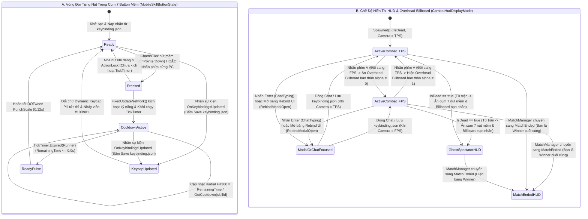

# Combat HUD, Overhead Billboard & Mobile Action Pad UI

> **Status**: Designed
> **Creative Director Review (CD-GDD-ALIGN)**: APPROVED 2026-11-10
> **Author**: Solo Developer + Studio Agents (`ux-designer`, `gameplay-programmer`, `ui-programmer`, `creative-director`, `qa-lead`)
> **Last Updated**: 2026-11-10
> **Last Verified**: 2026-11-10
> **Implements Pillar**: Pillar 1 (Cơ Động Phản Xạ Định Đoạt Sinh Tồn), Pillar 2 (Nhãn Quan Chiến Thuật Kép FPS $\leftrightarrow$ TPS), Pillar 3 (Công Bằng Mạng Tuyệt Đối Trên Shared Mode) & Pillar 4 (Khán Đài Hồn Ma & Vinh Quang Bảng Vàng)

## Summary

**Combat HUD, Overhead Billboard & Mobile Action Pad UI (`OverheadBillboardUI`, `MobileActionPadController`, `MobileSkillButtonWidget` & `TacticalCombatHUDController`)** là hệ thống giao diện chiến đấu trực tiếp ở tầng **Presentation (`UI` / `MVP`)** của *Capsule Arena: Last Man Standing*, kết nối trạng thái mô phỏng mạng **Photon Fusion 2 (`GameMode.Shared`)** với thị giác và thao tác điều khiển của người chơi thông qua 3 phân hệ đồng bộ: (1) **Thanh Máu Treo Trên Đầu Nhân Vật (`World-Space Overhead Billboard UI`)** neo tại độ cao `BillboardHeightOffset = 2.35m` hiển thị `PlayerName` và thanh máu **`100/100`** có vạch chia `25 HP` cùng lớp tụt máu trễ `Damage Catch-up Fill` chỉ cập nhật khi sự kiện mạng `[OnChangedRender(nameof(OnHealthChanged))]` kích hoạt (`0 Update() polling`); (2) **Cụm 7 Button Kỹ Năng Mềm Góc Dưới Phải Màn Hình (`Mobile-Ready Thumb-Arc Action Pad`)** cung cấp đầy đủ 7 nút bấm cảm ứng/chuột theo bố cục cánh cung ngón cái (`LMB`, `RMB`, `1`, `2`, `3`, `Q`, `E`) vừa gửi lệnh trực tiếp vào `IInputProvider` (`System #3`) vừa hiển thị vòng quét Cooldown `TickTimer` thời gian thực và **Nhãn Phím Tắt Động (`Dynamic Keycap Pill Badge`)** tự động đổi chữ tức thì khi người chơi bấm **Lưu (Save)** vào `keybinding.json` trên bảng Rebind UI (`System #11`); và (3) **HUD Thông Tin Trận Đấu & Tâm Ngắm (`Screen-Space Tactical HUD`)** hiển thị thanh máu bản thân (`100/100`) + số mạng hạ gục (`Kills`) ở góc trên trái, đồng hồ trận đấu (`04:00`) + số người còn sống (`Alive: 8/8`) ở giữa trên, cùng tâm ngắm **Crosshair 2 lớp màu** cố định ở chính giữa màn hình giúp chống chóng mặt khi xoay thân người và Camera $\pm 90^\circ$ trong `0.15s` bằng phím `1`/`3`.

> **Quick reference** — Layer: Presentation · Priority: MVP · Key deps: Multi-Directional Melee & Pooled Ranged Combat System, Health, Damage RPC & Death State System, Keybinding & Input Management System

## Overview

Trong một tựa game đối kháng đấu trường sinh tồn 3D nhịp độ cao như *Capsule Arena: Last Man Standing*, giao diện người dùng (UI/HUD) không chỉ là lớp trang trí hiển thị thông số mà là **bảng điều khiển phản xạ sinh tử** quyết định thắng bại trong từng phần mười giây (**Pillar 1** & **Pillar 2**). Người chơi phải vừa đọc lượng máu còn lại của đối phương sau mỗi nhát chém dọc (`35 HP`), chém ngang xoay người $90^\circ$ (`25 HP`) hay đạn bắn xa (`20 HP`), vừa theo dõi chính xác phần mười giây hồi chiêu của `Forward Dash (phím 2)` và `Side Dodge Roll (phím Q/E)`, đồng thời có thể thao tác linh hoạt bằng cả bàn phím/chuột PC lẫn chạm/nhấp trực tiếp lên các nút kỹ năng trên màn hình.

**Combat HUD, Overhead Billboard & Mobile Action Pad UI (`System #8`)** được kiến trúc thành **3 phân hệ chuyên biệt**, tuân thủ nghiêm ngặt quy chuẩn thẩm mỹ **"Tactical Toybox Arena"** (`design/art/art-bible.md` §4.2, §5.2, §7) và hợp đồng hiệu năng `Zero Update() String Allocation`:

1. **Phân hệ 1 — Thanh Máu Treo Trên Đầu Nhân Vật (`World-Space Overhead Billboard UI`):**
   - Gắn trực tiếp vào từng Prefab nhân vật (`pf_char_capsule_player_01.prefab`) tại tọa độ cục bộ `(0f, 2.35f, 0f)` (`BillboardHeightOffset = 2.35m` — nằm ngay phía trên đỉnh đầu Capsule cao `2.0m`).
   - Hiển thị tên định danh mạng `PlayerName` (`TextMeshProUGUI`) và **Thanh máu `100/100`** gồm 4 lớp thông tin: khung nền Đen Đá Phiến (`#0F172A`, Alpha `85%`, viền `2px`), lớp tụt máu trễ `Damage Catch-up Fill` màu Trắng Vàng (`#FEF08A` giữ nguyên `0.15s` rồi co mượt về mức máu mới trong `0.25s`), lớp máu chính `Primary Health Fill` (màu Xanh Ngọc `#10B981` cho bản thân / Đỏ San Hô `#F43F5E` cho đối thủ kèm vạch chia mỗi `25 HP`), và con số **`100/100`** in đậm ở chính giữa.
   - **Tối ưu hóa hướng sự kiện & Góc nhìn FPS:** Chỉ cập nhật chuỗi chữ và thanh máu khi callback `[OnChangedRender(nameof(OnHealthChanged))]` từ Hệ thống `#6` kích hoạt (`0 Update() polling`). Trong `LateUpdate()`, Billboard chỉ thực hiện phép xoay mặt phẳng song song với Camera (`transform.rotation = mainCameraTransform.rotation`) và kẹp tỷ lệ kích thước theo khoảng cách `DistanceScaleClamp = [0.65, 1.15]` trong phạm vi `0m–65m`. Đặc biệt, khi `LocalPlayer` nhấn phím `V` chuyển sang góc nhìn thứ nhất (`FPS`), `Overhead Billboard` của chính bản thân tự động đặt `CanvasGroup.alpha = 0f` để không bao giờ che khuất tầm nhìn phía trên mắt.

2. **Phân hệ 2 — Cụm 7 Button Kỹ Năng Mềm Góc Dưới Phải Màn Hình (`Mobile-Ready Thumb-Arc Action Pad`):**
   - Đáp ứng trọn vẹn yêu cầu cốt lõi của trò chơi: toàn bộ **7 thao tác chiến đấu và cơ động (`Left Click`, `Right Click`, `1`, `2`, `3`, `Q`, `E`)** đều sở hữu nút bấm mềm tương tác được (`On-Screen Action Buttons`) xếp theo hình cánh cung công thái học ngón cái ở góc dưới bên phải màn hình:
     - **Nút Tâm Chính (`Primary Action Button — 72x72 px`):** `VerticalSlash` (Nhãn mặc định: `LMB` — Nhát chém dọc từ trên xuống, icon kiếm bổ dọc màu Vàng Hổ Phách `#F59E0B`, Cooldown `0.65s`).
     - **Vòng Cung Trong — 3 Nút Tấn Công & Xoay Hướng (`Inner Arc — 60x60 px`, bán kính `R1 = 105 px`):**
       - `HorizontalSlashLeft` (Nhãn mặc định: `1` — Nhát chém ngang trái $90^\circ$ kèm xoay người/camera $-90^\circ$, icon kiếm quét cong trái $\curvearrowleft$ màu Xanh Điện Từ `#38BDF8`, Cooldown dùng chung `0.85s`).
       - `HorizontalSlashRight` (Nhãn mặc định: `3` — Nhát chém ngang phải $90^\circ$ kèm xoay người/camera $+90^\circ$, icon kiếm quét cong phải $\curvearrowright$ màu Xanh Điện Từ `#38BDF8`, Cooldown dùng chung `0.85s`).
       - `RangedAttack` (Nhãn mặc định: `RMB` — Bắn đạn tầm xa từ Object Pool, icon quả cầu năng lượng màu Vàng Chanh `#FACC15`, Cooldown `0.55s`).
     - **Vòng Cung Ngoài — 3 Nút Cơ Động (`Outer Arc — 56x56 px`, bán kính `R2 = 175 px`):**
       - `ForwardDash` (Nhãn mặc định: `2` — Lướt tiến tốc độ cao `4.0m`, icon mũi tên kép phóng tới $\Uparrow$ màu Trắng Xanh `#BAE6FD`, Cooldown `2.50s`).
       - `DodgeLeft` (Nhãn mặc định: `Q` — Lăn né trái `2.80m`, icon cuộn lăn trái màu Xanh Ngọc `#34D399`, Cooldown dùng chung `1.80s`).
       - `DodgeRight` (Nhãn mặc định: `E` — Lăn né phải `2.80m`, icon cuộn lăn phải màu Xanh Ngọc `#34D399`, Cooldown dùng chung `1.80s`).
   - **Tương tác Kép (PC Keyboard/Mouse + Mobile Touch/Pointer) & Đồng bộ `keybinding.json`:** Mỗi nút thực thi `IPointerDownHandler` và `IPointerUpHandler` để bơm trực tiếp tín hiệu vào `VirtualActionPadInputProvider : IInputProvider` của Hệ thống `#3`, đồng thời nhún đàn hồi (`0.90x scale`) khi người chơi nhấn phím cứng tương ứng trên bàn phím PC. Ở góc dưới phải của mỗi nút là **Nhãn Phím Tắt Động (`Dynamic Keycap Pill Badge`)** lắng nghe sự kiện `KeybindingManager.OnKeybindingsUpdated` (`#3`) để **đổi ký tự phím tức thì ngay khi người chơi bấm Lưu (Save) bộ phím mới vào `keybinding.json` trên bảng Rebind UI (`#11`)**.

3. **Phân hệ 3 — HUD Thông Tin Trận Đấu & Tâm Ngắm (`Screen-Space Tactical HUD`):**
   - **Góc trên trái (`Top-Left Player Status Panel`):** Hiển thị thanh máu kích thước lớn của bản thân (`100/100`) đồng bộ với `Overhead Billboard` và huy hiệu số mạng hạ gục cá nhân (`Kills`).
   - **Giữa trên (`Top-Center Match Header`):** Hiển thị đồng hồ đếm ngược trận đấu (`04:00`) từ `MatchManager.PhaseTimer` và bộ đếm số đấu sĩ còn sống (`Alive: 8/8`) từ Hệ thống `#10`.
   - **Chính giữa màn hình (`Center Fixed Reticle`):** Tâm ngắm **Crosshair 2 lớp màu** (lõi Cyan `#00F5D4` + viền Đen `#090D16` dày `2px`) luôn neo cố định tại tâm màn hình `(0, 0)`, đóng vai trò điểm tựa thị giác chống chóng mặt (anti-motion sickness) khi nhân vật và Camera xoay mượt $\pm 90^\circ$ trong `0.15s` bằng phím `1`/`3` hoặc khi chuyển đổi góc nhìn `FPS <-> TPS` bằng phím `V`.

## Player Fantasy

> **System Framing:** `[A] Direct — Người chơi trực tiếp quan sát thanh máu 100/100, ngắm bắn qua tâm Crosshair 2 lớp màu, theo dõi vòng quay Cooldown và trực tiếp chạm/click chuột lên cụm 7 nút kỹ năng mềm góc dưới phải màn hình cũng như thấy nhãn phím tắt đổi ngay lập tức khi lưu cấu hình keybinding.json.`

### 1. Giấc mơ cốt lõi: "Buồng Lái Chiến Thuật Tức Thời — Đọc Vị Trong Một Ánh Nhìn, Ra Đòn Bằng Cả Phím Cứng Lẫn Đầu Ngón Tay"
Khi bước vào sàn đấu *Capsule Arena: Last Man Standing*, người chơi không muốn bị bủa vây bởi những bảng thông số rườm rà che khuất tầm nhìn, càng không muốn phải đoán mò xem đối thủ còn bao nhiêu máu hay chiêu lướt của mình đã hồi xong chưa. Hệ thống **Combat HUD, Overhead Billboard & Mobile Action Pad UI** mang đến cảm giác của một **buồng lái thể thao điện tử sắc gọn, trung thực và nhạy bén tuyệt đối (Esports Tactical Cockpit)**:
- **Đọc máu đối thủ như đọc bàn cờ (Instant Breakpoint Calculation):** Nhìn lên đầu bất kỳ đối thủ nào trên sân, thanh máu **Overhead Billboard (`100/100`)** nổi bật trên nền khung tối với các vạch chia mỗi `25 HP` và con số nguyên rõ ràng. Khi bạn vừa tung một nhát **Chém dọc (`Left Click` — `35 dmg`)**, phần máu đỏ tụt xuống ngay lập tức từ `100/100` về `65/100`, để lại một vệt màu Trắng Vàng (`Damage Catch-up Fill`) giữ nguyên `0.15s` rồi rút dần trong `0.25s`. Chỉ cần liếc mắt trong `100ms`, não bộ bạn lập tức tính xong bài toán kết liễu: *"Địch còn `65 HP` — chỉ cần 1 cú Chém ngang xoay người phím `1` (`25 HP`) cộng 2 viên đạn `Right Click` (`40 HP`) là hạ gục!"*
- **Cụm 7 Nút Mềm Góc Dưới Phải — Tự Do Giữa PC và Mobile:** Ở góc dưới bên phải màn hình, 7 nút kỹ năng xếp thành hai vòng cung ôm trọn quanh nút Chém dọc trung tâm như một bàn điều khiển hành động Mobile cao cấp. Dù bạn bấm phím cứng `LMB`, `RMB`, `1`, `2`, `3`, `Q`, `E` trên bàn phím hay dùng chuột/ngón tay nhấn trực tiếp lên từng nút tròn trên màn hình, nút bấm đều lún xuống đàn hồi, kích hoạt chiêu thức ngay trong Tick mạng kế tiếp và phủ lớp quạt mờ đếm ngược Cooldown (`0.65s`, `0.85s`, `0.55s`, `2.50s`, `1.80s`) khớp từng phần mười giây.
- **Tùy Biến Phím Tắt Sống Động Tức Thì (`Live Keycap Sync`):** Khi bạn mở bảng cài đặt phím (`#11`), đổi chiêu **Lướt tiến (`Forward Dash`)** từ phím `2` sang phím `LeftShift` rồi nhấn **Lưu (Save)**, bạn nhìn thấy nhãn chữ nhỏ (`Dynamic Keycap Pill Badge`) ở góc dưới phải của nút Lướt tiến đổi ngay lập tức từ `[2]` thành `[Shift]` ngay trước mắt mình — một sự xác nhận thị giác tức thì rằng bộ điều khiển đã hoàn toàn thuộc về bạn.

### 2. Trải nghiệm cảm giác qua từng khoảnh khắc (How the Player Experiences the Effects)
1. **Không Bao Giờ Lạc Hướng Khi Xoay $90^\circ$ Nhờ Tâm Ngắm Neo Cố Định:** Khi giao tranh ở góc tường chữ L dưới góc nhìn **FPS (`V`)**, bạn nhấn phím `1` hoặc `3` để tung nhát **Chém ngang xoay người $90^\circ$**. Trong `0.15s` (`9 ticks`) khi cả thế giới 3D xoay nhanh một góc vuông sang trái hoặc phải, tâm ngắm **Crosshair 2 lớp màu (Cyan `#00F5D4` viền Đen `#090D16`)** ở chính giữa màn hình đứng vững như một mỏ neo thị giác kết hợp với mũi tên cong $\curvearrowleft / \curvearrowright$ trên nút kỹ năng, giúp mắt bạn khóa ngay vào mục tiêu ở hành lang mới mà không hề bị choáng hay mỏi mắt.
2. **Nhịp Đập Cooldown Ngoại Vi (Peripheral Cooldown Rhythm):** Bạn vừa dùng phím `Q` (`DodgeLeft`) để lăn né viên đạn của địch. Nhờ hai nút `Q` và `E` trên vòng cung ngoài cùng chia sẻ bộ đếm `DodgeCooldownTimer (1.80s)`, cả hai nút đều quay vòng quạt mờ và đếm ngược `1.8s -> 1.7s -> ... -> 0.0s`. Ngay khi về `0.0s`, hai nút nháy sáng và nảy nhẹ (`Ready Pulse`), báo hiệu qua tầm nhìn ngoại vi rằng bạn đã sẵn sàng cho pha lăn né tiếp theo mà không cần rời mắt khỏi tâm ngắm.
3. **Bầu Trời Thông Thoáng Khi Chuyển Sang Góc Nhìn FPS:** Ở góc nhìn **TPS**, bạn thấy rõ thanh máu `Overhead Billboard` trên đầu nhân vật của chính mình. Nhưng ngay khoảnh khắc bạn nhấn phím `V` chuyển sang **FPS** để ngắm bắn qua khe hẹp, thanh máu treo trên đầu bản thân lập tức tàng hình (`CanvasGroup.alpha = 0f`), nhường lại 100% khung nhìn phía trên hoàn toàn sạch sẽ trong khi bạn vẫn theo dõi được máu của mình ở góc trên bên trái màn hình (`Screen-Space Tactical HUD`).

### 3. Điểm chạm Tham chiếu & Đối chiếu Trụ cột Thiết kế

| Điểm tham chiếu / Trụ cột | Cách Hệ thống `#8` hiện thực hóa trải nghiệm người chơi |
| :--- | :--- |
| ***Brawl Stars*** *(High-Contrast Overhead Health Bar & Thumb-Arc Controls)* | Thanh máu treo trên đầu nhân vật có khung đen đậm, vạch chia `25 HP`, lớp tụt máu trễ `Damage Catch-up Fill` và con số `100/100` chính xác ở giữa; kết hợp bố cục cánh cung ngón cái ở góc dưới phải màn hình. |
| ***Genshin Impact / Honor of Kings*** *(Hybrid PC Keycap Badges + Mobile Radial Cooldowns)* | Cụm 7 nút kỹ năng ở góc dưới phải vừa nhận thao tác chạm/click trực tiếp trên màn hình, vừa hiển thị nhãn phím tắt động (`Dynamic Keycap Pill Badge`) cập nhật tức thì từ `keybinding.json`. |
| ***Valorant / Overwatch 2*** *(Dual-Layer Reticle & Clean Peripheral HUD)* | Tâm ngắm Crosshair 2 lớp màu (Cyan `#00F5D4` + Outline Đen `#090D16` `2px`) nổi bật trên mọi bề mặt tường sáng/tối và giữ trống $\ge 78\%$ diện tích trung tâm màn hình. |
| **Pillar 1, Pillar 2, Pillar 3 & Pillar 4** | Phản hồi Cooldown chuẩn Tick mạng `60Hz` (**Pillar 1 & 3**), ẩn Billboard bản thân khi vào `FPS` (**Pillar 2**), và tự động ẩn cụm nút chiến đấu khi chuyển sang `Ghost Mode Spectator` (**Pillar 4**). |

## Detailed Design

### Core Rules

1. **Quy tắc Phân Hệ 1 — Thanh Máu Treo Trên Đầu Nhân Vật (`World-Space Overhead Billboard UI`):**
   - **Vị trí Neo & Cấu trúc Prefab (`ui_world_overhead_billboard_s.prefab`):**
     - Được gắn làm GameObject con trực tiếp của Prefab nhân vật (`pf_char_capsule_player_01.prefab`) tại tọa độ cục bộ cố định **`LocalPosition = (0.0f, 2.35f, 0.0f)`** (`BillboardHeightOffset = 2.35m`, cao hơn đỉnh đầu Capsule `2.00m` đúng `0.35m`).
     - Sử dụng thành phần `Canvas` ở chế độ **`RenderMode.WorldSpace`** (`RectTransform` kích thước gốc `180 x 46 px`, `LocalScale = (0.01f, 0.01f, 0.01f)` tương ứng `1.80m x 0.46m` trong không gian 3D) đi kèm một thành phần `CanvasGroup` để điều khiển ẩn/hiện mượt mà mà không bao giờ gọi `GameObject.SetActive(false)` gây tái tạo bộ nhớ UI.
     - Toàn bộ các thành phần `Image` và `TextMeshProUGUI` bên trong `OverheadBillboardUI` **bắt buộc tắt `raycastTarget = false`** để không bao giờ chặn tia ngắm chuột hoặc sự kiện click của người chơi.
   - **Cấu trúc Hiển thị 2 Tầng (`PlayerName` + Thanh Máu `100/100` 4 Lớp):**
     - **Tầng trên (`PlayerNameText` — `TextMeshProUGUI`):** Hiển thị tên nhân vật đồng bộ từ `[Networked] public NetworkString<_16> PlayerName { get; set; }`, cỡ chữ `18pt Bold`, màu Trắng `#FFFFFF` kèm viền đen `Outline = 2px` (`#090D16`).
     - **Tầng dưới (`HealthBarContainer` — Khung Pill bo tròn `160 x 22 px`):**
       1. *Lớp 1 — Khung nền & Viền (`Background Plate`):* Màu Đen Đá Phiến `#0F172A` (`Alpha = 0.85`), viền ngoài màu `#090D16` dày `2px` đảm bảo độ tương phản WCAG AAA ($\ge 10:1$) ngay cả khi nhân vật đứng trước khối `Obstacle` màu trắng sứ `#E6EAEF`.
       2. *Lớp 2 — Lớp tụt máu trễ (`Damage Catch-up Fill` — `Image.Type.Filled`, `FillMethod.Horizontal`):* Màu Trắng Vàng `#FEF08A`. Khi nhân vật mất máu từ tỷ lệ cũ $r_{\text{old}}$ xuống tỷ lệ mới $r_{\text{new}}$, thanh `Damage Catch-up Fill` **giữ nguyên tại vị trí $r_{\text{old}}$ trong `CatchupHoldDelay = 0.15s`**, sau đó **co mượt về $r_{\text{new}}$ trong `CatchupShrinkDuration = 0.25s`** (sử dụng `DOTween` `Ease.OutQuad`).
       3. *Lớp 3 — Thanh máu chính & Vạch chia (`Primary Health Fill` + `25 HP Tick Marks`):* Co về giá trị mới $r_{\text{new}} = \text{CurrentHealth} / \text{MaxHealth}$ ngay lập tức. Màu sắc tự động phân biệt theo quyền sở hữu: **Xanh Ngọc Lục Bảo `#10B981`** cho nhân vật bản thân (`Object.HasStateAuthority == true`) và **Đỏ San Hô `#F43F5E`** cho mọi đối thủ (`Object.HasStateAuthority == false`). Phía trên thanh máu có 3 vạch chia dọc mờ (`#090D16`, `Alpha = 0.55`) tại các mốc `25%`, `50%`, `75%` (tương ứng mỗi `25 HP` trên nền `MaxHealth = 100`).
       4. *Lớp 4 — Chữ số máu chính xác ở giữa (`HealthValueText` — `TextMeshProUGUI`):* Nằm chính giữa thanh máu, luôn hiển thị định dạng số nguyên tường minh **`"{CurrentHealth}/{MaxHealth}"`** (ví dụ: **`100/100`**, **`65/100`**, **`40/100`**), cỡ chữ `15pt ExtraBold`, màu `#FFFFFF` có bóng đổ đen, sử dụng `SetText("{0}/{1}", currentHp, maxHp)` hoặc bảng chuỗi tiền tạo sẵn để đạt `0 Byte GC Allocation`.
   - **Cơ chế Cập nhật Phản Ứng Sự Kiện (`0 Update() Polling`) & Xoay/Co Giãn Trong `LateUpdate()`:**
     - **Tuyệt đối không kiểm tra máu trong `Update()`**: `OverheadBillboardUI` đăng ký lắng nghe sự kiện `PlayerHealthNetworked.OnLocalHealthUpdated(int currentHp, int maxHp)` (được kích hoạt duy nhất bởi `[OnChangedRender(nameof(OnHealthChanged))]` của Hệ thống `#6`).
     - **Quy tắc Ẩn khi Tử trận, Góc nhìn `FPS` & Chữ Số Sát Thương/Hồi Máu Bay Nổi (`FloatingDamageTextManager`):**
       - Nếu nhân vật tử trận (`IsDead == true`): Đặt `CanvasGroup.alpha = 0f` ngay lập tức trong callback `OnDeathStateChanged`.
       - Nếu nhân vật là `LocalPlayer` (`Object.HasInputAuthority || Object.HasStateAuthority`) và người chơi nhấn phím `V` chuyển sang góc nhìn thứ nhất (`CameraPerspectiveMode.FPS` từ Hệ thống `#9`): `OverheadBillboardUI` của chính bản thân tự động đặt **`CanvasGroup.alpha = 0f`** để không che khuất tầm nhìn phía trên mắt; khi nhấn `V` quay về góc nhìn thứ ba (`TPS`), đặt lại **`CanvasGroup.alpha = 1f`**.
       - **Chữ Số Sát Thương & Hồi Máu Bay Nổi (`FloatingDamageTextManager` + `FloatingDamageTextConfigSO`):** Mỗi khi bất kỳ đấu sĩ nào mất máu (do chém dọc, chém ngang, trúng đạn, hay bất kỳ nguồn sát thương nào) hoặc hồi máu, một chữ số nguyên không dấu (`25`, `30`, `15` — **không có dấu trừ `-` hay dấu cộng `+`**) bay lên từ cao độ `Y = +2.65m` trên đầu nhân vật thêm `+1.25m` trong `0.85s` (`PoolSize = 16`). Mất máu hiển thị màu **Đỏ (`#FF3B3B`)**, tăng máu hiển thị màu **Xanh Lá (`#22C55E`)** (cấu hình trong `DefaultFloatingDamageConfig.asset`). Trong **`2/3` thời gian đầu**, chữ số phóng to từ `0.85x` lên `1.50x`; trong **`1/3` thời gian cuối**, chữ số thu nhỏ về `0.55x` đồng thời mờ dần tới biến mất. Hiển thị cho tất cả mọi người (bao gồm cả bản thân ở `TPS`), **chỉ ẩn chữ số máu của chính bản thân khi đang ở góc nhìn `FPS`**.
     - **Xoay hướng Camera & Kẹp tỷ lệ khoảng cách trong `LateUpdate()`:**
       - Chỉ khi `CanvasGroup.alpha > 0.001f`, hàm `LateUpdate()` mới xoay mặt phẳng Billboard song song với mặt phẳng ống kính Camera: `transform.rotation = _cachedMainCameraTransform.rotation;`.
       - Tính khoảng cách Euclid từ Camera tới nhân vật và kẹp hệ số co giãn kích thước trong khoảng **`DistanceScaleClamp = [0.65, 1.15]`** trên phạm vi đấu trường **`0m–65m`** (với khoảng cách chuẩn `ReferenceDistance = 14.0m`), giúp thanh máu không bị phình quá to khi đứng sát gần và vẫn đọc rõ con số `100/100` khi đối thủ đứng ở tận tường bao phía bên kia bản đồ (`65m`).

2. **Quy tắc Phân Hệ 2 — Cụm 7 Button Kỹ Năng Mềm Góc Dưới Phải Màn Hình (`Mobile-Ready Thumb-Arc Action Pad`):**
   - **Kiến trúc Tương tác Kép (On-Screen Touch/Click $\leftrightarrow$ PC Hardware Key Reflection):**
     - Cụm 7 nút bấm mềm (`ui_hud_skill_cluster_mobile_l.prefab`) được neo tại góc dưới bên phải màn hình (`AnchorMin = AnchorMax = Pivot = (1, 0)` trên Canvas chuẩn `1920 x 1080`).
     - **Chiều 1 — Thao tác chạm/click chuột trên màn hình gửi vào mạng:** Mỗi nút `MobileSkillButtonWidget` gắn thành phần bắt sự kiện con trỏ của Unity (`IPointerDownHandler`, `IPointerUpHandler`, `IPointerExitHandler`). Khi người chơi nhấn chuột trái hoặc chạm ngón tay vào bất kỳ nút nào trong 7 nút trên màn hình, widget gọi `VirtualActionPadInputProvider.SetButtonState(GameActionId actionId, bool isPressed)` để bật cờ bit tương ứng trong `NetworkInputData.Buttons` (`System #3`), kích hoạt kỹ năng trong `FixedUpdateNetwork()` của Hệ thống `#5` / `#7` giống hệt như bấm phím cứng.
     - **Chiều 2 — Bấm phím cứng trên PC phản hồi lên nút mềm:** Khi người chơi nhấn phím cứng trên bàn phím/chuột PC (`LMB`, `RMB`, `1`, `2`, `3`, `Q`, `E` hoặc phím mới đã gán trong `keybinding.json`), nút mềm tương ứng ở góc dưới phải màn hình lập tức thực hiện hiệu ứng lún xuống (`DOTween.DOScale(0.90f, 0.05f)`) và sáng viền kích hoạt, tạo sự đồng bộ thị giác-xúc giác tuyệt đối.
   - **Bảng Đặc Tả Chi Tiết 7 Nút Kỹ Năng Mềm Góc Dưới Phải (1 Tâm Chính + 3 Vòng Trong + 3 Vòng Ngoài):**

| STT | Định Danh Kỹ Năng (`GameActionId` / `CombatSkillId`) | Phân Nhóm Vòng Cung | Kích Thước Nút (`px` @ 1080p) | Tọa Độ Góc Cực ($\theta$, Bán Kính $R$) & Neo `AnchoredPosition` | Nhãn Mặc Định (`keybinding.json`) | Biểu Tượng (Icon) & Mã Màu Chủ Đạo (`Art Bible §4.2`) | Thời Gian Cooldown & Nguồn `TickTimer` |
| :-: | :--- | :---: | :---: | :---: | :---: | :--- | :--- |
| **1** | **`VerticalSlash`** *(Nhát chém dọc từ trên xuống)* | **Nút Tâm Chính** (`Primary Action Button`) | **`72 × 72 px`** | Tâm gốc cánh cung `HubOrigin = (-110, +105)` | **`LMB`** (`Mouse0`) | **Icon kiếm bổ dọc** từ đỉnh đầu xuống đất Màu **Vàng Hổ Phách `#F59E0B`** (Lõi `#FEF08A`) | **`0.65s`** (`39 ticks`) `Combat.VerticalSlashCooldownTimer` |
| **2** | **`HorizontalSlashLeft`** *(Chém ngang trái $90^\circ$ + Xoay $-90^\circ$)* | **Vòng Cung Trong** (`Inner Arc` — Tấn công) | **`60 × 60 px`** | $\theta = 170^\circ$, $R_1 = 105\text{ px}$ `Pos = (-213.4, +123.2)` | **`1`** (`Alpha1`) | **Icon kiếm quét cong trái $\curvearrowleft$ ($-90^\circ$)** Màu **Xanh Điện Từ `#38BDF8`** | **`0.85s` (Dùng chung `1` & `3`)** `Combat.HorizontalSlashCooldownTimer` |
| **3** | **`RangedAttack`** *(Bắn đạn tầm xa từ Object Pool)* | **Vòng Cung Trong** (`Inner Arc` — Tấn công) | **`60 × 60 px`** | $\theta = 132.5^\circ$, $R_1 = 105\text{ px}$ `Pos = (-180.9, +182.4)` | **`RMB`** (`Mouse1`) | **Icon quả cầu năng lượng** phóng thẳng Màu **Vàng Chanh `#FACC15`** | **`0.55s`** (`33 ticks`) `Combat.RangedCooldownTimer` |
| **4** | **`HorizontalSlashRight`** *(Chém ngang phải $90^\circ$ + Xoay $+90^\circ$)* | **Vòng Cung Trong** (`Inner Arc` — Tấn công) | **`60 × 60 px`** | $\theta = 95^\circ$, $R_1 = 105\text{ px}$ `Pos = (-119.2, +209.6)` | **`3`** (`Alpha3`) | **Icon kiếm quét cong phải $\curvearrowright$ ($+90^\circ$)** Màu **Xanh Điện Từ `#38BDF8`** | **`0.85s` (Dùng chung `1` & `3`)** `Combat.HorizontalSlashCooldownTimer` |
| **5** | **`DodgeLeft`** *(Lăn né ngang sang trái)* | **Vòng Cung Ngoài** (`Outer Arc` — Cơ động) | **`56 × 56 px`** | $\theta = 172^\circ$, $R_2 = 175\text{ px}$ `Pos = (-283.3, +129.4)` | **`Q`** (`KeyCode.Q`) | **Icon cuộn lăn trái** (`◄◄`) Màu **Xanh Ngọc `#34D399`** | **`1.80s` (Dùng chung `Q` & `E`)** `Movement.DodgeCooldownTimer` |
| **6** | **`ForwardDash`** *(Lướt tiến tốc độ cao về trước)* | **Vòng Cung Ngoài** (`Outer Arc` — Cơ động) | **`56 × 56 px`** | $\theta = 132.5^\circ$, $R_2 = 175\text{ px}$ `Pos = (-228.2, +234.0)` | **`2`** (`Alpha2`) | **Icon mũi tên kép phóng tới $\Uparrow$** Màu **Trắng Xanh Khí Động `#BAE6FD`** | **`2.50s`** (`150 ticks`) `Movement.DashCooldownTimer` |
| **7** | **`DodgeRight`** *(Lăn né ngang sang phải)* | **Vòng Cung Ngoài** (`Outer Arc` — Cơ động) | **`56 × 56 px`** | $\theta = 93^\circ$, $R_2 = 175\text{ px}$ `Pos = (-119.2, +279.8)` | **`E`** (`KeyCode.E`) | **Icon cuộn lăn phải** (`►►`) Màu **Xanh Ngọc `#34D399`** | **`1.80s` (Dùng chung `Q` & `E`)** `Movement.DodgeCooldownTimer` |

   - **Cấu trúc 3 Thành phần Hiển thị trên Mỗi Nút Mềm (`Icon` + `Radial Cooldown 360` + `Dynamic Keycap Pill Badge`):**
     1. **Biểu tượng Kỹ năng Định hướng (`SkillIconImage`):** Đặt ở trung tâm nút, mã hóa kép bằng cả màu sắc lẫn hình học hướng tác động ($\downarrow$ bổ dọc cho `LMB`, $\curvearrowleft$ quét trái cho `1`, $\curvearrowright$ quét phải cho `3`, $\Uparrow$ lướt tiến cho `2`, cuộn trái/phải cho `Q`/`E`) để người mù màu vẫn phân biệt được 100%.
     2. **Lớp phủ Quạt mờ Đếm ngược Cooldown (`RadialCooldownOverlay` + `CooldownTimerText`):**
        - `RadialCooldownOverlay` là `Image` kiểu `Filled` (`FillMethod.Radial360`, `FillOrigin.Top`, `Clockwise = false`, màu `#090D16` `Alpha = 0.78`).
        - Trong mỗi khung hình hiển thị (`Render()` / `Update()`), nếu `TickTimer` tương ứng của kỹ năng đang chạy (`timer.IsRunning(Runner)`), hệ thống tính thời gian còn lại thực tế `remaining = timer.RemainingTime(Runner) ?? 0f`, cập nhật `RadialCooldownOverlay.fillAmount = Mathf.Clamp01(remaining / Config.GetCooldown(skillId))` và hiển thị chữ số giây đếm ngược với 1 chữ số thập phân (ví dụ: **`"0.6s"`**, **`"1.8s"`**, **`"2.4s"`**) thông qua bảng chuỗi dựng sẵn `PreallocatedCooldownStrings[0..99]` (`0.0s` đến `9.9s`, cam kết `0 Byte GC Allocation`).
        - Ngay tại khung hình `TickTimer` vừa kết thúc (`remaining <= 0f`), ẩn lớp quạt mờ (`fillAmount = 0f`), ẩn chữ số giây và kích hoạt hiệu ứng nháy sáng hoàn tất hồi chiêu (`DOTween.DOPunchScale(Vector3.one * 0.12f, 0.12f)`).
     3. **Nhãn Phím Tắt Động (`Dynamic Keycap Pill Badge`):**
        - Đặt ở **góc dưới bên phải của mỗi nút tròn** (khung hình viên thuốc `MinWidth = 26px`, `Height = 20px`, nền `#0F172A` viền `#475569` `1.5px`, chữ `TextMeshProUGUI` `14pt ExtraBold` màu `#F8FAFC`).
        - Khi khởi tạo tại trận đấu (sau khi `keybinding.json` đã được nạp ở **Loading Scene**), và mỗi khi sự kiện **`KeybindingManager.OnKeybindingsUpdated(IReadOnlyDictionary<GameActionId, KeyCode> bindings)`** (`System #3`) được phát ra do người chơi bấm nút **Lưu (Save)** trên bảng **In-Game Keybinding Rebind UI (`System #11`)**, toàn bộ 7 `Dynamic Keycap Pill Badge` tự động tra cứu `KeybindingManager.FormatKeyCodeShortLabel(bindings[actionId])` để **đổi chữ tức thì** (ví dụ: đổi `"LMB"`, `"RMB"`, `"1"`, `"2"`, `"3"`, `"Q"`, `"E"` sang `"Shift"`, `"Space"`, `"F"`, `"M4"`, v.v.) kèm hiệu ứng nháy viền Xanh Ngọc `#10B981` trong `0.25s`.

3. **Quy tắc Phân Hệ 3 — HUD Thông Tin Trận Đấu & Tâm Ngắm (`Screen-Space Tactical HUD`):**
   - **Góc Trên Bên Trái — Cụm Trạng Thái Sinh Tồn Cá Nhân (`Top-Left Player Status Panel`):**
     - Neo tại `AnchorMin = AnchorMax = Pivot = (0, 1)`, `AnchoredPosition = (+28, -24)`, kích thước `320 x 68 px`.
     - Hiển thị **Thanh máu cá nhân kích thước lớn (`100/100`)** sử dụng cùng logic 4 lớp với `Overhead Billboard` (màu Xanh Ngọc `#10B981`, vạch chia mỗi `25 HP`, lớp tụt máu trễ `Damage Catch-up Fill` giữ `0.15s` rồi co trong `0.25s`, và con số **`100/100`** cỡ `20pt ExtraBold` ở giữa), giúp người chơi vẫn theo dõi chính xác lượng máu của mình khi ở góc nhìn `FPS` (lúc `Overhead Billboard` bản thân đã ẩn).
     - Bên phải thanh máu là **Huy hiệu Số Mạng Hạ Gục (`Kills Badge`)**: hiển thị biểu tượng kiếm chéo kèm con số **`Kills: X`** (ví dụ: `Kills: 0`, `Kills: 3`, màu Vàng Kim `#FFD166`), chỉ cập nhật khi hồ sơ `PlayerMatchRecord.Kills` từ `MatchManager` (`#10`) thay đổi.
   - **Chính Giữa Phía Trên — Cụm Đồng Hồ & Sĩ Số Sinh Tồn (`Top-Center Match Header`):**
     - Neo tại `AnchorMin = AnchorMax = Pivot = (0.5, 1)`, `AnchoredPosition = (0, -20)`, kích thước `360 x 54 px`.
     - **Đồng hồ đếm ngược trận đấu (`MatchTimerText`):** Đọc thời gian còn lại từ `MatchManager.PhaseTimer.RemainingTime(Runner)` (`System #10`), làm tròn xuống số giây nguyên `wholeSeconds = Mathf.CeilToInt(remaining)` và **chỉ cập nhật chuỗi chữ khi `wholeSeconds != _lastDisplayedSecond`** (cam kết chỉ cập nhật đúng `1 lần/giây`) theo định dạng **`MM:SS`** (mặc định bắt đầu ở **`04:00`** cho `240s` giao tranh). Khi thời gian còn `<= 30 giây`, chữ số đổi sang màu Đỏ San Hô `#F43F5E` và nhịp nhẹ mỗi giây.
     - **Bộ đếm Số người còn sống (`AliveCounterText`):** Đặt ngay cạnh đồng hồ, hiển thị định dạng **`"Alive: {AlivePlayerCount}/{TotalRegisteredPlayers}"`** (ví dụ: **`Alive: 8/8`**, **`Alive: 3/8`**, màu Xanh Ngọc Sáng `#06D6A0`), lắng nghe sự kiện thay đổi từ `MatchManager` (`#10`).
   - **Chính Giữa Màn Hình — Tâm Ngắm Cố Định 2 Lớp Màu (`Center Fixed Crosshair Reticle`):**
     - Neo cứng tại chính tâm màn hình `AnchorMin = AnchorMax = Pivot = (0.5, 0.5)`, `AnchoredPosition = (0, 0)`, tắt `raycastTarget = false`.
     - Thiết kế **2 lớp màu tương phản tuyệt đối (`Dual-Layer High-Contrast Reticle`)**:
       - **Lớp lõi (`Inner Core`):** Chấm tâm `4x4 px` và 4 vạch ngắm ngắn (`8x2 px`, cách tâm `6px`) mang màu **Xanh Cyan Điện Quang `#00F5D4`**.
       - **Lớp viền (`Outer Outline`):** Viền bao quanh mỗi nét dày đúng **`2px` màu Đen Đá Phiến `#090D16`**.
     - **Vai trò Chống Chóng Mặt (Anti-Motion Sickness Anchor):** Tâm ngắm này luôn đứng yên tuyệt đối ở giữa màn hình ngay cả khi nhân vật và Camera thực hiện phép xoay nhanh $\pm 90^\circ$ trong `0.15s` (`HorizontalTurnDuration`) bằng phím `1` hoặc `3`, giúp mắt người chơi có điểm neo cố định và không bao giờ bị mất phương hướng trên nền tường trắng `#E6EAEF` hay nền sàn xám `#5E6B78`.

### States and Transitions

Hệ thống `#8` vận hành đồng thời hai máy trạng thái giao diện: (A) **Máy trạng thái Vòng đời Nút Kỹ Năng Mềm (`MobileSkillButtonState`)** cho từng nút trong cụm 7 nút góc dưới phải, và (B) **Máy trạng thái Chế độ Hiển thị HUD Toàn cục (`CombatHudDisplayMode`)** đồng bộ với góc nhìn `FPS <-> TPS` (`#9`), `InputFocusManager` (`#3`) và trạng thái sinh tử (`#6`).

#### Bảng Đặc Tả Chuyển Trạng Thái Của `CanvasGroup` Theo Từng Chế Độ HUD

| Chế Độ Hiển Thị (`CombatHudDisplayMode`) | `OverheadBillboard` Bản Thân (`LocalPlayer`) | `OverheadBillboard` Đối Thủ Còn Sống (`Remote Alive`) | Cụm 7 Nút Kỹ Năng Mềm Góc Dưới Phải (`ActionPad`) | HUD Góc Trên Trái (`Self HP + Kills`) & Giữa Trên (`Timer + Alive`) | Tâm Ngắm Giữa Màn Hình (`Dual-Layer Crosshair`) |
| :--- | :---: | :---: | :---: | :---: | :---: |
| **1. `ActiveCombat_TPS`** *(Mặc định khi sống)* | **`alpha = 1.0`** `blocksRaycasts = false` | **`alpha = 1.0`** Scale kẹp `[0.65, 1.15]` | **`alpha = 0.88`** `interactable = true` `blocksRaycasts = true` | **`alpha = 1.0`** Cập nhật sự kiện | **`alpha = 1.0`** Neo cứng tại `(0, 0)` |
| **2. `ActiveCombat_FPS`** *(Khi nhấn phím `V`)* | **`alpha = 0.0` (ẨN)** Không che mắt Camera FPS | **`alpha = 1.0`** Scale kẹp `[0.65, 1.15]` | **`alpha = 0.88`** `interactable = true` `blocksRaycasts = true` | **`alpha = 1.0`** Đọc máu bản thân tại đây | **`alpha = 1.0`** Chống chóng mặt xoay $90^\circ$ |
| **3. `ModalOrChatFocused`** *(Gõ Chat / Mở Rebind UI)* | Giữ nguyên theo `TPS`/`FPS` | **`alpha = 1.0`** | **`alpha = 0.35` (MỜ)** `interactable = false` *(Vẫn thấy rõ nhãn phím đổi chữ khi bấm Save!)* | **`alpha = 0.60`** | **`alpha = 0.25`** |
| **4. `GhostSpectatorHUD`** *(`IsDead == true`)* | **`alpha = 0.0` (ẨN)** Đã tử trận | **`alpha = 1.0`** Trên đầu người còn sống | **`alpha = 0.0` (ẨN)** `interactable = false` `blocksRaycasts = false` | **`alpha = 1.0`** Hiện thông tin trận đấu | **`alpha = 0.40`** |
| **5. `MatchEndedHUD`** *(Kết thúc ván đấu)* | **`alpha = 0.0`** | **`alpha = 0.0`** | **`alpha = 0.0`** `interactable = false` | **`alpha = 1.0`** | **`alpha = 0.0`** |

### Interactions with Other Systems

| Hệ Thống Liên Kết | Chiều Luồng Dữ Liệu | Giao Diện / Sự Kiện / Thuộc Tính Kết Nối | Mô Tả Cơ Chế Phối Hợp Chi Tiết |
| :--- | :---: | :--- | :--- |
| **System #1: Character & Combat Config Data (`CharacterCombatConfigSO`)** | `#1` $\rightarrow$ `#8` *(Đọc chỉ số tĩnh)* | `ICharacterCombatConfig.MaxHealth`, `ICharacterCombatConfig.GetCooldown(CombatSkillId)` | Cung cấp mẫu số `MaxHealth = 100` cho thanh máu `100/100` và tổng thời gian hồi chiêu chuẩn (`0.65s`, `0.85s`, `0.55s`, `2.50s`, `1.80s`) để tính tỷ lệ quạt mờ `Radial Fill360` trên cụm 7 nút mềm mà không dùng hằng số cứng. |
| **System #3: Keybinding & Input Management System** | `#8` $\leftrightarrow$ `#3` *(Qua Interface & Event — 0 Circular Dep)* | `VirtualActionPadInputProvider : IInputProvider`, `KeybindingManager.OnKeybindingsUpdated`, `InputFocusManager.OnFocusStateChanged` | 1. Khi người chơi chạm/click lên 7 nút mềm góc dưới phải, `#8` ghi trạng thái nút vào `IInputProvider` để `#3` gộp (`Bitwise OR`) vào `NetworkInputData` gửi lên mạng. 2. Khi `#3` nạp xong `keybinding.json` ở Loading Scene hoặc khi người chơi bấm **Save** trên bảng Rebind UI (`#11`), `#3` phát sự kiện `OnKeybindingsUpdated` để `#8` cập nhật tức thì cả 7 `Dynamic Keycap Pill Badge`. 3. Khi `InputFocusManager` chuyển sang `ChatTyping` hoặc `RebindModalOpen`, `#8` tự động nhả mọi nút mềm đang giữ và khóa `interactable = false`. |
| **System #5: Tick-Accurate Character Movement & Mobility System** | `#5` $\rightarrow$ `#8` *(Đọc trạng thái mạng)* | `PlayerMovementController.DashCooldownTimer`, `PlayerMovementController.DodgeCooldownTimer` | Cụm nút cơ động ở vòng cung ngoài (`ForwardDash [2]`, `DodgeLeft [Q]`, `DodgeRight [E]`) đọc trực tiếp `RemainingTime(Runner)` từ hai biến `[Networked] TickTimer` của `#5` để hiển thị vòng đếm ngược Cooldown thời gian thực. |
| **System #6: Health, Damage RPC & Death State System** | `#6` $\rightarrow$ `#8` *(Sự kiện phản ứng mạng)* | `[OnChangedRender(nameof(OnHealthChanged))]` $\rightarrow$ `OnLocalHealthUpdated`, `OnDeathStateChanged` | Kích hoạt cập nhật thanh máu `100/100` và hiệu ứng tụt máu trễ `Damage Catch-up Fill` trên cả `Overhead Billboard` lẫn `Top-Left HUD` với chi phí `0 Update() polling`. Khi `IsDead == true`, ẩn ngay `Overhead Billboard` của nạn nhân và ẩn cụm 7 nút kỹ năng mềm nếu nạn nhân là `LocalPlayer`. |
| **System #7: Multi-Directional Melee & Pooled Ranged Combat System** | `#7` $\rightarrow$ `#8` *(Đọc trạng thái mạng)* | `PlayerCombatController.VerticalSlashCooldownTimer`, `HorizontalSlashCooldownTimer`, `RangedCooldownTimer` | Cụm 4 nút tấn công (`VerticalSlash [LMB]`, `HorizontalSlashLeft [1]`, `HorizontalSlashRight [3]`, `RangedAttack [RMB]`) đọc `RemainingTime(Runner)` từ 3 biến `[Networked] TickTimer` của `#7` để quay quạt mờ Cooldown và hiển thị số giây `0.0s`. |
| **System #9: Dual-Perspective Camera (FPS/TPS) & Ghost Mode Spectator** | `#9` $\rightarrow$ `#8` *(Sự kiện góc nhìn)* | `PlayerCameraController.OnPerspectiveChanged(CameraPerspectiveMode)` | Khi `LocalPlayer` nhấn phím `V` chuyển sang `FPS`, `#8` lập tức đặt `CanvasGroup.alpha = 0f` cho `Overhead Billboard` của chính bản thân để không che mắt; khi chuyển về `TPS`, bật lại `alpha = 1f`. Tâm ngắm Crosshair 2 lớp màu luôn giữ cố định ở tâm màn hình. |
| **System #10: Last Man Standing Match Manager** | `#10` $\rightarrow$ `#8` *(Đọc trạng thái trận đấu)* | `MatchManager.PhaseTimer`, `MatchManager.AlivePlayerCount`, `PlayerMatchRecord.Kills` | Cung cấp dữ liệu cho thanh `Top-Center Match Header` (đồng hồ đếm ngược `04:00`, số người còn sống `Alive: 8/8`) và huy hiệu `Kills` ở góc trên trái màn hình. |
| **System #11: In-Game Keybinding Rebind UI & Lobby Flow UI** | `#11` $\rightarrow$ `#3` $\rightarrow$ `#8` *(Gián tiếp qua `#3`)* | `KeybindingManager.TrySaveKeybindingsToDisk()` $\rightarrow$ `OnKeybindingsUpdated` | Khi người chơi bấm nút **Lưu (Save)** trên bảng Rebind UI (`#11`), `#11` gọi `#3` ghi file `keybinding.json` và phát sự kiện làm mới ngay lập tức 7 nhãn `Dynamic Keycap Pill Badge` trên HUD góc dưới phải của `#8` mà `#11` và `#8` hoàn toàn không phụ thuộc trực tiếp vào nhau. |

## Formulas

### 1. Hệ Số Co Giãn Kích Thước Overhead Billboard Theo Khoảng Cách Camera (`billboard_scale_factor`)

The `billboard_scale_factor` formula is defined as:

`billboard_scale_factor = clamp(reference_distance / max(1.0, camera_distance), min_billboard_scale, max_billboard_scale)`

**Variables:**

| Variable | Type | Range | Source | Description |
| :--- | :---: | :---: | :--- | :--- |
| `reference_distance` | `float` | `14.0` (mặc định) | `OverheadBillboardUI._referenceDistance` | Khoảng cách chuẩn tính từ Camera tới nhân vật (`mét`) mà tại đó Billboard hiển thị ở tỷ lệ gốc `1.0x`. |
| `camera_distance` | `float` | `0.0–65.0` | `Vector3.Distance(cameraPos, billboardPos)` | Khoảng cách Euclid thực tế từ ống kính Camera chính tới vị trí neo Billboard `(0, 2.35m, 0)` trên đầu nhân vật (`mét`). |
| `min_billboard_scale` | `float` | `0.65` (mặc định) | `DistanceScaleClamp.x` | Giới hạn thu nhỏ tối thiểu của Billboard khi đối thủ đứng ở cự ly xa nhất trên sàn đấu (`65m`), đảm bảo con số `100/100` luôn đọc được rõ ràng. |
| `max_billboard_scale` | `float` | `1.15` (mặc định) | `DistanceScaleClamp.y` | Giới hạn phóng đại tối đa của Billboard khi đối thủ áp sát ở cự ly cận chiến (`<= 2.80m`), ngăn thanh máu choán hết màn hình. |
| `billboard_scale_factor` | `float` | `0.65–1.15` | `OverheadBillboardUI.LateUpdate()` | Hệ số nhân áp dụng lên `baseLocalScale (0.01f)` của `RectTransform` World-Space Billboard. |

**Output Range:** `0.65` đến `1.15` (tương ứng kích thước `localScale` thực tế từ `0.0065` đến `0.0115`).

**Example:**
- **Khi đối thủ áp sát cận chiến ở `camera_distance = 3.5m`** (với `reference_distance = 14.0m`, `min = 0.65`, `max = 1.15`):
  `billboard_scale_factor = clamp(14.0 / max(1.0, 3.5), 0.65, 1.15) = clamp(4.0, 0.65, 1.15) = 1.15` (bị kẹp ở trần `1.15x` để không che khuất thân hình Capsule của đối thủ).
- **Khi đối thủ đứng ở khoảng cách giao tranh tầm trung `camera_distance = 14.0m`:**
  `billboard_scale_factor = clamp(14.0 / 14.0, 0.65, 1.15) = 1.00` (hiển thị đúng tỷ lệ chuẩn `1.00x`).
- **Khi đối thủ đứng sát tường bao phía bên kia đấu trường ở `camera_distance = 40.0m`:**
  `billboard_scale_factor = clamp(14.0 / 40.0, 0.65, 1.15) = clamp(0.35, 0.65, 1.15) = 0.65` (được giữ ở ngưỡng sàn `0.65x` thay vì teo nhỏ xuống `0.35x`, giúp người chơi vẫn đọc rõ tên và lượng máu `100/100`).

---

### 2. Tỷ Lệ Quạt Mờ Cooldown Trên Cụm 7 Nút Kỹ Năng Mềm Góc Dưới Phải (`radial_cooldown_fill`)

The `radial_cooldown_fill` formula is defined as:

`radial_cooldown_fill = clamp(remaining_cooldown_seconds / Config.GetCooldown(skill_id), 0.0, 1.0)`

**Variables:**

| Variable | Type | Range | Source | Description |
| :--- | :---: | :---: | :--- | :--- |
| `remaining_cooldown_seconds` | `float` | `0.00–2.50` | `TickTimer.RemainingTime(Runner) ?? 0.0f` | Thời gian hồi chiêu còn lại thực tế tính bằng giây (`s`) đọc từ `[Networked] TickTimer` của Hệ thống `#5` (`Dash`, `Dodge`) hoặc Hệ thống `#7` (`VerticalSlash`, `HorizontalSlash`, `RangedAttack`). |
| `skill_id` | `CombatSkillId` | `5 giá trị enum` | `MobileSkillButtonWidget.SkillId` | Định danh nhóm kỹ năng (`VerticalSlash`, `HorizontalSlash`, `RangedAttack`, `ForwardDash`, `SideDodge`). |
| `Config.GetCooldown(skill_id)` | `float` | `0.55–2.50` | `ICharacterCombatConfig.GetCooldown(skill_id)` (`System #1`) | Tổng thời gian hồi chiêu thiết kế của kỹ năng: `0.65s` (`LMB`), `0.85s` (`1`/`3`), `0.55s` (`RMB`), `2.50s` (`2`), `1.80s` (`Q`/`E`). |
| `radial_cooldown_fill` | `float` | `0.00–1.00` | `RadialCooldownOverlay.fillAmount` | Tỷ lệ lấp đầy quạt tròn `Radial 360` trên nút bấm mềm (`1.0` = vừa kích hoạt chiêu, `0.0` = đã hồi xong sẵn sàng chiến đấu). |

**Output Range:** `0.00` đến `1.00` (gán trực tiếp vào `Image.fillAmount`).

**Example:**
- Người chơi vừa nhấn phím **`1` (`HorizontalSlashLeft` — Chém ngang xoay trái $-90^\circ$)** hoặc nhấn nút mềm `1` trên màn hình (`Config.GetCooldown(CombatSkillId.HorizontalSlash) = 0.85s`).
- Sau `0.34s` (`20 ticks` ở `60Hz`), bộ đếm mạng `HorizontalSlashCooldownTimer.RemainingTime(Runner)` trả về `remaining_cooldown_seconds = 0.51s`:
  `radial_cooldown_fill = clamp(0.51 / 0.85, 0.0, 1.0) = clamp(0.60, 0.0, 1.0) = 0.60`.
  Cả hai nút **`1` (`HorizontalSlashLeft`)** và **`3` (`HorizontalSlashRight`)** trên vòng cung trong cùng hiển thị lớp quạt mờ che phủ `60%` diện tích nút (`216°`) và in chữ số **`"0.5s"`** ở tâm nút.

---

### 3. Tọa Độ Bố Trí Hình Học Vòng Cung Ngón Cái Cho Cụm 7 Nút Mềm (`button_anchored_pos`)

The `button_anchored_pos` formula is defined as:

`button_anchored_pos = hub_origin + Vector2(cos(angle_rad), sin(angle_rad)) * arc_radius`

**Variables:**

| Variable | Type | Range | Source | Description |
| :--- | :---: | :---: | :--- | :--- |
| `hub_origin` | `Vector2` | `(-110.0, +105.0)` | `MobileActionPadController._hubOrigin` | Tọa độ tâm của **Nút Tâm Chính (`VerticalSlash` / `LMB`, `72x72 px`)** tính từ góc dưới bên phải màn hình `(0, 0)` trên Canvas `1920 x 1080` (`px`). |
| `angle_rad` | `float` | `1.5708–3.0543` (`90°–175°`) | `angle_deg * Mathf.Deg2Rad` | Góc cực ($\theta$) tính bằng Radian trong góc phần tư thứ hai (từ hướng `12h` = $90^\circ$ quét sang hướng `9h` = $180^\circ$) giúp các nút tỏa ra quanh ngón cái phải. |
| `arc_radius` | `float` | `0.0`, `105.0`, `175.0` | `_innerArcRadius = 105f`, `_outerArcRadius = 175f` | Bán kính vòng cung tính từ `hub_origin` (`0 px` cho nút tâm `LMB`, `105 px` cho 3 nút Vòng Cung Trong `1`/`RMB`/`3`, và `175 px` cho 3 nút Vòng Cung Ngoài `Q`/`2`/`E`). |
| `button_anchored_pos` | `Vector2` | `(-300, +80)` đến `(-80, +300)` | `RectTransform.anchoredPosition` | Tọa độ neo cuối cùng của từng nút trên `Screen-Space Canvas` góc dưới phải (`px`). |

**Output Range:** `Vector2` nằm trong vùng an toàn góc dưới phải `X ∈ [-310, -80] px`, `Y ∈ [+75, +310] px`, đảm bảo khoảng cách khe hở rìa-tới-rìa giữa hai nút bất kỳ luôn $\ge 18\text{ px}$ (chống bấm nhầm theo Định luật Fitts).

**Example:**
- Với `hub_origin = (-110.0, +105.0)`:
  1. **Nút `HorizontalSlashLeft` (Nhãn mặc định `1`, Vòng cung trong `60x60 px`, `arc_radius = 105.0 px`, góc $\theta = 170^\circ \approx 2.9671\text{ rad}$):**
     `button_anchored_pos = (-110.0, +105.0) + (-0.9848, +0.1736) * 105.0 = (-213.4, +123.2) px`.
  2. **Nút `RangedAttack` (Nhãn mặc định `RMB`, Vòng cung trong `60x60 px`, `arc_radius = 105.0 px`, góc $\theta = 132.5^\circ \approx 2.3126\text{ rad}$):**
     `button_anchored_pos = (-110.0, +105.0) + (-0.6756, +0.7373) * 105.0 = (-180.9, +182.4) px`.
  3. **Nút `ForwardDash` (Nhãn mặc định `2`, Vòng cung ngoài `56x56 px`, `arc_radius = 175.0 px`, góc $\theta = 132.5^\circ \approx 2.3126\text{ rad}$):**
     `button_anchored_pos = (-110.0, +105.0) + (-0.6756, +0.7373) * 175.0 = (-228.2, +234.0) px`.

## Edge Cases

- **If `LocalPlayer` switches camera perspective from `TPS` to `FPS` (pressing `V`) while their own `Overhead Billboard` is actively animating a `Damage Catch-up Fill` tween**: `OverheadBillboardUI` lập tức đặt `CanvasGroup.alpha = 0.0f` cho Billboard gắn trên nhân vật `LocalPlayer` để không che khuất tầm nhìn phía trên mắt ở góc nhìn thứ nhất, nhưng vẫn cho phép tween `Damage Catch-up Fill` hoàn tất ngầm và hiển thị đầy đủ trên thanh máu `Top-Left Player Status Panel` (`100/100`) ở góc trên trái màn hình; khi nhấn `V` quay lại `TPS`, `Overhead Billboard` hiện lại (`alpha = 1.0f`) với đúng lượng máu hiện tại.
- **If the player holds down one of the 7 on-screen mobile buttons with the mouse/finger and drags the pointer outside the button's `RectTransform` before releasing (`Pointer Exit while Held`)**: `MobileSkillButtonWidget` bắt buộc thực thi cả `IPointerUpHandler` lẫn `IPointerExitHandler`. Ngay khi con trỏ trượt ra ngoài biên nút hoặc khi `InputFocusManager` chuyển sang trạng thái `ChatTyping` / `RebindModalOpen`, nút lập tức gọi `ReleaseButton()` để trả cờ input về `false` và khôi phục `localScale = Vector3.one`, ngăn chặn triệt để lỗi "kẹt nút tự đánh liên tục (stuck virtual button)".
- **If the player opens the In-Game Keybinding Rebind UI (`System #11`), rebinds `ForwardDash` from `2` to `LeftShift` and `VerticalSlash` from `LMB` to `F`, and clicks `Save`**: Ngay trong cùng khung hình ghi tệp `keybinding.json` thành công, `KeybindingManager.OnKeybindingsUpdated` kích hoạt làm mới tức thì toàn bộ 7 `Dynamic Keycap Pill Badge` ở góc dưới phải màn hình (`[2]` $\rightarrow$ `[Shift]`, `[LMB]` $\rightarrow$ `[F]`) mà không cần đóng bảng cài đặt hay tải lại Scene.
- **If a keybinding is assigned to a long `KeyCode` name (such as `KeyCode.LeftControl`, `KeyCode.Mouse3`, or `KeyCode.BackQuote`)**: Hàm rút gọn nhãn `KeybindingManager.FormatKeyCodeShortLabel(KeyCode)` tự động chuyển đổi tên dài thành ký hiệu chuẩn ngắn gọn (`LeftControl` $\rightarrow$ `"Ctrl"`, `LeftShift` $\rightarrow$ `"Shift"`, `Mouse0` $\rightarrow$ `"LMB"`, `Mouse1` $\rightarrow$ `"RMB"`, `Mouse2` $\rightarrow$ `"MMB"`, `Mouse3` $\rightarrow$ `"M4"`, `Alpha1` $\rightarrow$ `"1"`, `Return` $\rightarrow$ `"Ent"`, tối đa 5 ký tự) để chữ không bao giờ tràn khỏi khung `Dynamic Keycap Pill Badge`.
- **If a character takes multiple rapid hits within `0.15s` (e.g., hit by a `20 HP` Ranged Orb and a `35 HP` Vertical Slash almost simultaneously)**: Khi sự kiện `[OnChangedRender(nameof(OnHealthChanged))]` thứ hai nổ ra trong lúc thanh `Damage Catch-up Fill` vẫn đang ở pha giữ (`0.15s` hold delay) của đòn thứ nhất, hệ thống hủy tween cũ (`_catchupTween?.Kill()`), giữ nguyên điểm bắt đầu của `Damage Catch-up Fill` tại mốc máu cao ban đầu (`100/100`) và đặt lại thời gian chờ `0.15s` trước khi co một mạch về mốc máu mới nhất (`45/100`), giúp mắt người chơi nhìn thấy tổng lượng máu vừa bốc hơi trong cả chuỗi combo (`55 HP`).
- **If a player dies (`IsDead == true` and `CurrentHealth == 0`)**: Trong callback `OnDeathStateChanged`, `OverheadBillboardUI` của nhân vật tử trận lập tức hủy mọi tween đang chạy, đặt `CanvasGroup.alpha = 0.0f` để xác/hồn ma không để lại thanh máu `0/100` lơ lửng trên sàn đấu; đồng thời nếu người chết là `LocalPlayer`, `MobileActionPadController` lập tức đặt `CanvasGroup.alpha = 0.0f`, `interactable = false`, `blocksRaycasts = false` để nhường chỗ cho thanh điều khiển `Ghost Mode Spectator` (`System #9`).
- **If the player presses either `1` (`HorizontalSlashLeft`) or `3` (`HorizontalSlashRight`), or presses either `Q` (`DodgeLeft`) or `E` (`DodgeRight`)**: Vì hai nút chém ngang `1` & `3` dùng chung bộ đếm mạng `HorizontalSlashCooldownTimer (0.85s)` và hai nút lăn né `Q` & `E` dùng chung bộ đếm `DodgeCooldownTimer (1.80s)`, cả hai nút trong cùng cặp đều hiển thị quạt mờ `Radial Fill360` và đếm ngược đồng bộ 100%, giúp người chơi không hiểu lầm rằng nút hướng ngược lại vẫn còn dùng được ngay.
- **If a late-joining client enters an active match or `SharedModeMasterClient` failover occurs on `MatchManager` (`System #10`)**: Ngay trong `Spawned()` của mỗi nhân vật và `Spawned()` của `MatchManager`, hệ thống `#8` thực hiện một lần đồng bộ khởi tạo (`Initial State Pull`) cho toàn bộ `OverheadBillboardUI`, `Top-Left Player Status Panel` và `Top-Center Match Header` (`Alive: X/Y`, `MatchTimer`), đảm bảo không có thanh máu nào hiển thị giá trị mặc định sai lệch trước khi sự kiện `[OnChangedRender]` tiếp theo xảy ra.
- **If the player clicks on one of the 7 mobile action buttons on PC while `Cursor.lockState` is `CursorLockMode.None` (or in Hybrid Cursor mode)**: Bởi vì các nút mềm góc dưới phải nằm trên `Canvas_DynamicHUD` có `blocksRaycasts = true`, `EventSystem.current.IsPointerOverGameObject()` được kiểm tra trong `FusionInputAggregator` (`System #3`) để khi người chơi click chuột trái vào nút mềm `Q` (`DodgeLeft`) hoặc nút mềm `3` (`HorizontalSlashRight`), cú click chuột trái đó **chỉ kích hoạt đúng nút mềm được bấm** chứ không vô tình kích hoạt thêm đòn `VerticalSlash (LMB)` ngoài ý muốn.

## Dependencies

### Upstream Dependencies (Hệ thống này phụ thuộc vào)

| Hệ Thống Thượng Nguồn | Mức Độ | Chi Tiết Phụ Thuộc Kỹ Thuật |
| :--- | :---: | :--- |
| **System #1: Character & Combat Config Data (`CharacterCombatConfigSO`)** | **Hard (MVP)** | Cung cấp `MaxHealth` (`100`) và hàm tra cứu `GetCooldown(CombatSkillId)` cho toàn bộ thanh máu và 7 nút kỹ năng mềm. |
| **System #3: Keybinding & Input Management System** | **Hard (MVP)** | Cung cấp `IInputProvider` để nhận thao tác chạm/click từ 7 nút mềm, phát sự kiện `OnKeybindingsUpdated` khi nạp/lưu `keybinding.json`, và quản lý khóa giao diện qua `InputFocusManager`. |
| **System #5: Tick-Accurate Character Movement & Mobility System** | **Hard (MVP)** | Cung cấp `[Networked] TickTimer DashCooldownTimer` (`2.50s`) và `DodgeCooldownTimer` (`1.80s`) cho 3 nút cơ động ở vòng cung ngoài (`2`, `Q`, `E`). |
| **System #6: Health, Damage RPC & Death State System** | **Hard (MVP)** | Cung cấp `[Networked] int CurrentHealth`, `[Networked] NetworkBool IsDead` và sự kiện phản ứng `[OnChangedRender(nameof(OnHealthChanged))]` cho `Overhead Billboard` và `Top-Left HUD`. |
| **System #7: Multi-Directional Melee & Pooled Ranged Combat System** | **Hard (MVP)** | Cung cấp `[Networked] TickTimer VerticalSlashCooldownTimer` (`0.65s`), `HorizontalSlashCooldownTimer` (`0.85s`) và `RangedCooldownTimer` (`0.55s`) cho 4 nút tấn công (`LMB`, `1`, `3`, `RMB`). |
| **System #9: Dual-Perspective Camera (FPS/TPS) & Ghost Mode Spectator** | **Soft (Vertical Slice)** | Thông báo trạng thái góc nhìn `FPS <-> TPS` để ẩn/hiện `Overhead Billboard` của `LocalPlayer` và trạng thái `GhostSpectating`. |
| **System #10: Last Man Standing Match Manager** | **Soft (Vertical Slice)** | Cung cấp `PhaseTimer` (`04:00`), `AlivePlayerCount` (`Alive: 8/8`) và `PlayerMatchRecord.Kills` cho `Screen-Space Tactical HUD`. |

### Downstream Dependents (Các hệ thống phụ thuộc vào hệ thống này)

- **Không có hệ thống Gameplay nào phụ thuộc ngược vào `#8` (`Presentation Layer Leaf Node`):** Đúng nguyên tắc phân tầng kiến trúc (`TD-SYSTEM-BOUNDARY`), không một hệ thống tầng `Foundation`, `Core` hay `Feature` nào giữ tham chiếu tới các lớp UI của Hệ thống `#8`. Mọi giao tiếp từ `#8` xuống `#3` đi qua giao diện trừu tượng `IInputProvider`, và mọi cập nhật từ `#3`, `#6`, `#9`, `#10`, `#11` lên `#8` đi qua sự kiện C# một chiều.

## Tuning Knobs

Toàn bộ các thông số tinh chỉnh bố cục, thời lượng hoạt ảnh UI và kẹp khoảng cách của Hệ thống `#8` được đóng gói trên Inspector của Prefab `ui_world_overhead_billboard_s.prefab` và `ui_hud_skill_cluster_mobile_l.prefab`:

| Knob Name | Default Value | Safe Range (Min–Max) | Effect if Too Low | Effect if Too High | Interacts With |
| :--- | :---: | :---: | :--- | :--- | :--- |
| `BillboardHeightOffset` | `2.35 m` | `2.15 – 2.80 m` | Thanh máu đè lẹm vào phần đỉnh đầu của Mesh nhân vật Capsule (`Height = 2.0m`). | Thanh máu bay lơ lửng quá xa đỉnh đầu, làm lộ vị trí khi nhân vật đang nấp sau khối `High Cover Obstacle` (`2.6m–3.0m`). | `CharacterController.height` (`2.0m`), `Obstacle` height (`#2`). |
| `ReferenceDistance` | `14.0 m` | `8.0 – 25.0 m` | Billboard bị thu nhỏ quá sớm ngay ở cự ly giao tranh tầm trung. | Billboard luôn giữ kích thước lớn gây rối mắt khi có 8 người chơi tụ tập. | `DistanceScaleClamp`, Camera FOV (`#9`). |
| `DistanceScaleClamp` | `[0.65, 1.15]` | `Min: 0.45–0.80` `Max: 1.00–1.40` | Nếu `Min < 0.50`: chữ số `100/100` ở khoảng cách `40m–65m` bị nhỏ dưới ngưỡng đọc được (`< 12pt`). | Nếu `Max > 1.35`: khi đối thủ lao vào cận chiến (`< 2.8m`), thanh máu khổng lồ che khuất tâm ngắm. | `OverheadBillboardUI.LateUpdate()`, `Art Bible §5.4`. |
| `CatchupHoldDelay` | `0.15 s` | `0.05 – 0.35 s` | Vạch máu trắng vàng co rút ngay lập tức cùng lúc với thanh máu chính, mắt người không kịp nhìn thấy phần máu vừa mất (`35` / `25` / `20 HP`). | Vạch máu trắng đứng yên quá lâu tạo cảm giác thanh máu bị lag mạng. | `CatchupShrinkDuration`, `OnHealthChanged` (`#6`). |
| `CatchupShrinkDuration` | `0.25 s` | `0.10 – 0.50 s` | Chuyển động co rút quá gấp, thiếu độ mượt mà ("juice"). | Chuyển động co rút quá chậm, chồng chéo sang nhát chém tiếp theo (`RangedCooldown = 0.55s`). | `CatchupHoldDelay`, DOTween (`#14`). |
| `PrimaryButtonSize` | `72 × 72 px` | `64 – 96 px` | Nút tâm chính (`VerticalSlash` / `LMB`) quá nhỏ, khó bấm nhanh bằng ngón cái hoặc chuột. | Chiếm quá nhiều diện tích vòng trong, ép bán kính `InnerArcRadius` phải phình to. | `InnerArcRadius`, `OuterArcRadius`. |
| `InnerArcButtonSize` | `60 × 60 px` | `52 – 76 px` | 3 nút tấn công vòng trong (`1`, `RMB`, `3`) quá nhỏ, nhãn `Keycap Pill` che khuất icon. | Các nút vòng trong chạm sát nhau (`gap < 12px`), dễ bấm nhầm giữa `1` và `RMB`. | `InnerArcRadius` (`105 px`). |
| `OuterArcButtonSize` | `56 × 56 px` | `48 – 68 px` | 3 nút cơ động vòng ngoài (`Q`, `2`, `E`) khó chạm chính xác khi cần lăn né khẩn cấp. | Chèn lấn vào không gian hiển thị góc dưới phải của đấu trường. | `OuterArcRadius` (`175 px`). |
| `InnerArcRadius` / `OuterArcRadius` | `R1 = 105 px` `R2 = 175 px` | `R1: 85 – 130 px` `R2: 145 – 210 px` | Các vòng cung chồng lấn lên nhau, vi phạm khoảng cách an toàn tối thiểu `18px` theo Định luật Fitts. | Cụm 7 nút lan quá rộng vào vùng ngắm trung tâm màn hình (`Central Combat Viewport >= 78%`). | `button_anchored_pos` formula, `Art Bible §7.2`. |
| `ButtonPressScale` | `0.90` (`90%`) | `0.80 – 0.95` | Nút co rúm quá mức khi nhấn, làm chữ số Cooldown bị giật. | Độ lún quá ít (`> 0.95`), người chơi không cảm nhận được phản hồi xúc giác khi bấm phím. | `MobileSkillButtonWidget` DOTween. |

## Visual/Audio Requirements

Toàn bộ tài nguyên đồ họa và hiệu ứng âm thanh phản hồi của Hệ thống `#8` tuân thủ nghiêm ngặt **Art Bible (`design/art/art-bible.md` §4.2, §5.2, §7 & §8.2)**:

1. **Bảng Mã Màu & Biểu Tượng Chuẩn Của Cụm 7 Nút Kỹ Năng Mềm (`1 UI Sprite Atlas 256x256`):**
   - `tex_ui_skill_slash_vert_256.png` (**`VerticalSlash` — Nhãn mặc định `LMB`, Nút tâm `72x72 px`**): Icon thanh kiếm bổ thẳng từ đỉnh đầu xuống đất kèm vệt chém dọc, màu **Vàng Hổ Phách `#F59E0B`** (lõi sáng `#FEF08A`).
   - `tex_ui_skill_slash_turn90_left_256.png` (**`HorizontalSlashLeft` — Nhãn mặc định `1`, Vòng cung trong `60x60 px`**): Icon lưỡi kiếm quét hình quạt vuông góc $90^\circ$ sang trái kèm mũi tên xoay ngược chiều kim đồng hồ $\curvearrowleft$, màu **Xanh Điện Từ `#38BDF8`**.
   - `tex_ui_skill_slash_turn90_right_256.png` (**`HorizontalSlashRight` — Nhãn mặc định `3`, Vòng cung trong `60x60 px`**): Icon lưỡi kiếm quét hình quạt vuông góc $90^\circ$ sang phải kèm mũi tên xoay thuận chiều kim đồng hồ $\curvearrowright$, màu **Xanh Điện Từ `#38BDF8`**.
   - `tex_ui_skill_ranged_orb_256.png` (**`RangedAttack` — Nhãn mặc định `RMB`, Vòng cung trong `60x60 px`**): Icon quả cầu năng lượng đa diện phóng thẳng qua tâm ngắm, màu **Vàng Chanh Năng Lượng `#FACC15`**.
   - `tex_ui_skill_dash_forward_256.png` (**`ForwardDash` — Nhãn mặc định `2`, Vòng cung ngoài `56x56 px`**): Icon mũi tên kép khí động học phóng vọt lên phía trước $\Uparrow$, màu **Trắng Xanh Khí Động Học `#BAE6FD`**.
   - `tex_ui_skill_dodge_left_256.png` & `tex_ui_skill_dodge_right_256.png` (**`DodgeLeft [Q]` & `DodgeRight [E]`, Vòng cung ngoài `56x56 px`**): Icon đấu sĩ Capsule nghiêng mình cuộn lăn sang trái (`◄◄`) và sang phải (`►►`), màu **Xanh Ngọc `#34D399`**.
2. **Bảng Màu Thanh Máu & An Toàn Mù Màu (`Colorblind Dual-Coding`):**
   - Thanh máu bản thân (`LocalPlayer` trên cả `Overhead Billboard` và `Top-Left HUD`): **Xanh Ngọc Lục Bảo `#10B981`**.
   - Thanh máu đối thủ (`Remote Players` trên `Overhead Billboard`): **Đỏ San Hô `#F43F5E`**.
   - Lớp tụt máu trễ (`Damage Catch-up Fill`): **Trắng Vàng `#FEF08A`** (giữ `0.15s`, co về trong `0.25s`).
   - Luôn kết hợp vạch chia mỗi `25 HP` và con số nguyên **`100/100`** chính xác ở giữa để người mù màu Đỏ-Lục (Deuteranopia / Protanopia) vẫn đọc được 100% thông tin.
3. **Âm Thanh Phản Hồi Giao Diện (`2D Non-Spatial UI SFX`):**
   - `sfx_ui_button_press_soft_01.wav`: Âm thanh click cơ học nhẹ (`-14 dB`, `0.04s`) khi chạm/nhấp chuột trực tiếp lên bất kỳ nút nào trong cụm 7 nút mềm.
   - `sfx_ui_cooldown_denied_tick_01.wav`: Âm thanh báo khóa nhẹ (`-12 dB`, `0.06s`) nếu người chơi bấm vào nút kỹ năng khi vòng `Radial Fill360` vẫn đang quay dở (`CooldownActive`).
   - `sfx_ui_keycap_sync_chime_01.wav`: Âm báo xác nhận trong trẻo (`-10 dB`, `0.15s`) phát ra ngay khi người chơi bấm **Lưu (Save)** trên bảng Rebind UI (`#11`) và thấy 7 nhãn `Dynamic Keycap Pill Badge` đổi chữ tức thì.

## Game Feel

1. **Độ Nảy Xúc Giác Trên Cụm 7 Nút Mềm (`Tactile Button Micro-Animations`):**
   - Khi nhấn xuống (bằng chuột/chạm hoặc phím cứng PC): Nút kỹ năng thu nhỏ nhanh về `0.90x` trong `0.05s` (`Ease.OutQuad`) và viền nút bừng sáng màu đặc trưng của chiêu thức.
   - Khi nhả ra: Nút bật đàn hồi về `1.00x` trong `0.08s` (`Ease.OutBack`).
   - Khi bấm lúc đang hồi chiêu (`Cooldown Denied Shake`): Nút lắc ngang nhẹ `DOTween.DOShakeAnchorPos(0.10f, strength: new Vector2(4f, 0f), vibrato: 20)` và chữ số giây `0.0s` nháy đỏ `#F43F5E` để báo hiệu chiêu thức chưa hồi xong mà không cần người chơi phải nhìn chằm chằm vào góc màn hình.
   - Khi vừa hồi chiêu xong (`Ready Pulse`): Ngay khoảnh khắc `TickTimer` chạm `0.0s`, nút nảy nhẹ `DOTween.DOPunchScale(Vector3.one * 0.12f, 0.12f)` kèm một vòng sáng trắng lóe nhanh quanh viền tròn.
2. **Nhịp Rút Máu 2 Pha "Đòn Đánh Có Trọng Lượng" (`Two-Stage Health Bar Juice`):**
   - Sự tương phản giữa lớp máu chính (`Primary Health Fill`) tụt tức khắc trong `0.0s` và lớp máu phụ màu Trắng Vàng (`Damage Catch-up Fill`) dừng lại `0.15s` rồi mới trượt đuổi theo trong `0.25s` biến mỗi cú chém dọc `35 HP` hay chém ngang `25 HP` thành một vết cắt thị giác cực kỳ đã mắt trên cả `Overhead Billboard` lẫn `Top-Left HUD`.
3. **Điểm Neo Thị Giác Chống Chóng Mặt Khi Xoay $90^\circ$ (`Anti-Motion-Sickness Reticle Anchor`):**
   - Trong `0.15s` khi nhân vật và Camera xoay nhanh $\pm 90^\circ$ bằng phím `1`/`3`, tâm ngắm **Crosshair 2 lớp màu** đứng vững tuyệt đối ở tâm màn hình `(0, 0)`, giúp võng mạc người chơi giữ được điểm hội tụ ổn định và chuyển tiếp mượt mà sang góc nhìn mới.

## UI Requirements

1. **Kiến Trúc Phân Tách Canvas Tối Ưu Hóa Render (`Split Static/Dynamic Canvas Architecture`):**
   - **Trên màn hình chính (`Screen Space - Overlay`, `CanvasScaler: Scale With Screen Size`, Reference Resolution `1920 x 1080`, `Match Width Or Height = 0.5`):**
     - `Canvas_StaticHUD`: Chứa tâm ngắm `Center Fixed Crosshair Reticle`, khung nền tĩnh của `Top-Left Player Status Panel`, khung nền `Top-Center Match Header`, và phần khung nền/icon tĩnh của cụm 7 nút mềm góc dưới phải (`0 Canvas Rebuild` trong suốt trận đấu).
     - `Canvas_DynamicHUD`: Chứa các phần tử thay đổi theo sự kiện hoặc theo Tick gồm thanh `Primary Health Fill`, `Damage Catch-up Fill`, chữ số `100/100`, đồng hồ `04:00`, số người sống `Alive: 8/8`, 7 lớp quạt `RadialCooldownOverlay`, 7 chữ số giây `0.0s` và 7 nhãn `Dynamic Keycap Pill Badge`.
   - **Trên mỗi nhân vật (`World-Space Canvas`):**
     - Prefab `ui_world_overhead_billboard_s.prefab` sử dụng `CanvasGroup` để điều khiển ẩn/hiện (`alpha = 0f` khi `LocalPlayer` ở `FPS` hoặc khi `IsDead == true`), tuyệt đối không bật/tắt `GameObject.SetActive()` lúc đang chiến đấu.
2. **Cam Kết `Zero GC String Allocation` Trong Vòng Lặp Trận Đấu:**
   - Mọi chữ số đếm ngược Cooldown (`"0.1s"` đến `"9.9s"`) và chữ số máu (`"0/100"` đến `"100/100"`) sử dụng mảng chuỗi tiền cấp phát tĩnh (`static readonly string[]`) hoặc phương thức `TextMeshProUGUI.SetText("{0}/{1}", currentHp, maxHp)` / `SetText("{0:00}:{1:00}", minutes, seconds)`, đảm bảo `0 Byte GC.Alloc` mỗi khung hình ngay cả khi chạy đồng thời 4 cửa sổ Client trên cùng một máy PC.

## Cross-References

- **Character & Combat Config Data (`design/gdd/character-combat-config.md` — System #1):** Cung cấp `MaxHealth = 100` và phương thức `GetCooldown(CombatSkillId)` trả về thời gian hồi chiêu chuẩn cho cả 7 nút kỹ năng mềm (`0.65s`, `0.85s`, `0.55s`, `2.50s`, `1.80s`).
- **Keybinding & Input Management System (`design/gdd/keybinding-input-system.md` — System #3):** Định nghĩa 13 `GameActionId`, tệp `keybinding.json` nạp từ Loading Scene, giao diện `IInputProvider` nhận tín hiệu từ cụm 7 nút mềm, máy trạng thái `InputFocusManager`, và sự kiện `OnKeybindingsUpdated` làm mới nhãn phím tắt động.
- **Tick-Accurate Character Movement & Mobility System (`design/gdd/character-movement-mobility.md` — System #5):** Cung cấp `DashCooldownTimer (2.50s)`, `DodgeCooldownTimer (1.80s)` và thực thi phép xoay thân người + Camera $\pm 90^\circ$ trong `0.15s` khi nhấn nút `1`/`3`.
- **Health, Damage RPC & Death State System (`design/gdd/health-damage-rpc-system.md` — System #6):** Cung cấp `[Networked, OnChangedRender(nameof(OnHealthChanged))] CurrentHealth` và `IsDead` kích hoạt cập nhật thanh máu `Overhead Billboard` và `Top-Left HUD`.
- **Multi-Directional Melee & Pooled Ranged Combat System (`design/gdd/combat-melee-ranged-system.md` — System #7):** Cung cấp `VerticalSlashCooldownTimer (0.65s)`, `HorizontalSlashCooldownTimer (0.85s)` và `RangedCooldownTimer (0.55s)`.
- **Last Man Standing Match Manager (`design/gdd/match-manager-authority-failover.md` — System #10):** Cung cấp `PhaseTimer` (`04:00`), `AlivePlayerCount` (`Alive: 8/8`) và `PlayerMatchRecord.Kills`.
- **Art Bible (`design/art/art-bible.md` §4.2, §5.2, §7, §8):** Quy định bảng màu ngữ nghĩa của từng chiêu thức, cấu trúc `Overhead Billboard` tại `(0, 2.35m, 0)`, bố cục cánh cung 7 nút mềm và tâm ngắm Crosshair 2 lớp màu.

## Acceptance Criteria

1. **AC-01 (Neo vị trí, hiển thị `100/100` và hiệu ứng `Damage Catch-up Fill` trên `World-Space Overhead Billboard`):**
   - **GIVEN** một nhân vật còn sống (`!IsDead`) được `Runner.Spawn()` vào đấu trường với `MaxHealth = 100`
   - **WHEN** kiểm tra thành phần `OverheadBillboardUI` gắn trên nhân vật và gửi một lệnh sát thương `35 HP` (`VerticalSlash`) làm `CurrentHealth` giảm từ `100` xuống `65`
   - **THEN** `OverheadBillboardUI` nằm tại tọa độ cục bộ `(0f, 2.35f, 0f)` (`BillboardHeightOffset = 2.35m`), hiển thị đúng `PlayerName`, thanh máu chính (`#10B981` cho bản thân / `#F43F5E` cho đối thủ) giảm ngay lập tức về `0.65`, con số ở giữa đổi ngay thành **`"65/100"`**, trong khi lớp `Damage Catch-up Fill` màu Trắng Vàng (`#FEF08A`) giữ nguyên tại `1.00` trong `0.15s` rồi mới co mượt về `0.65` trong `0.25s`.

2. **AC-02 (Tự động ẩn `Overhead Billboard` của chính bản thân khi chuyển sang góc nhìn `FPS` bằng phím `V`):**
   - **GIVEN** nhân vật `LocalPlayer` (`Object.HasStateAuthority == true && !IsDead`) đang ở góc nhìn thứ ba (`TPS`) với `OverheadBillboardUI` có `CanvasGroup.alpha == 1.0f`
   - **WHEN** người chơi nhấn phím `V` (`ToggleCamera`) để chuyển sang góc nhìn thứ nhất (`FPS`), sau đó nhấn `V` lần nữa để quay về `TPS`
   - **THEN** ngay khi vào chế độ `FPS`, `OverheadBillboardUI` của `LocalPlayer` đặt `CanvasGroup.alpha == 0.0f` (không che mắt Camera FPS trong khi các `OverheadBillboardUI` của đối thủ vẫn có `alpha == 1.0f`), và khi quay lại `TPS` thì `CanvasGroup.alpha` của `LocalPlayer` khôi phục về `1.0f`.

3. **AC-03 (Cập nhật máu thuần hướng sự kiện `[OnChangedRender]` — `0 Update() Polling` và kẹp tỷ lệ khoảng cách `DistanceScaleClamp`):**
   - **GIVEN** 8 nhân vật đang đứng trên sàn đấu trong phạm vi từ `2.0m` đến `65.0m` tính từ Camera
   - **WHEN** không có nhân vật nào nhận sát thương trong 300 khung hình liên tiếp, và Camera di chuyển ra xa/lại gần các nhân vật
   - **THEN** phương thức cập nhật chuỗi chữ và thanh máu `UpdateHealthVisuals()` được gọi đúng `0 lần` (`0 Update() polling`), còn trong `LateUpdate()` hệ số tỷ lệ `billboard_scale_factor` luôn nằm trong đoạn `[0.65, 1.15]` (bằng `1.15` ở `<= 3.5m`, `1.00` ở `14.0m`, và `0.65` ở `>= 21.54m` đến `65.0m`).

4. **AC-04 (Bố cục hình học 3 tầng và kích thước chuẩn của Cụm 7 Button Kỹ Năng Mềm Góc Dưới Phải):**
   - **GIVEN** giao diện `MobileActionPadController` được khởi tạo trên Canvas tham chiếu `1920 x 1080` ở góc dưới bên phải màn hình
   - **WHEN** kiểm tra danh sách 7 `MobileSkillButtonWidget`
   - **THEN** có mặt đầy đủ 7 nút tương ứng với 7 hành động chiến đấu/cơ động theo đúng kích thước và phân lớp:
     1. Nút Tâm Chính (`72x72 px`): `VerticalSlash` (nhãn mặc định `"LMB"`, màu `#F59E0B`).
     2. Vòng Cung Trong (`60x60 px`, $R_1 = 105\text{ px}$): `HorizontalSlashLeft` (nhãn `"1"`, icon $\curvearrowleft$, màu `#38BDF8`), `RangedAttack` (nhãn `"RMB"`, màu `#FACC15`), `HorizontalSlashRight` (nhãn `"3"`, icon $\curvearrowright$, màu `#38BDF8`).
     3. Vòng Cung Ngoài (`56x56 px`, $R_2 = 175\text{ px}$): `DodgeLeft` (nhãn `"Q"`, màu `#34D399`), `ForwardDash` (nhãn `"2"`, icon $\Uparrow$, màu `#BAE6FD`), `DodgeRight` (nhãn `"E"`, màu `#34D399`).

5. **AC-05 (Tương tác Kép: Nhấn chuột/chạm trực tiếp lên 7 nút mềm kích hoạt kỹ năng trong `FixedUpdateNetwork()`):**
   - **GIVEN** nhân vật `LocalPlayer` đang ở trạng thái `CombatActive` và các kỹ năng không trong thời gian hồi chiêu
   - **WHEN** người chơi dùng chuột nhấp trực tiếp (`OnPointerDown` $\rightarrow$ `OnPointerUp`) lần lượt lên từng nút trong 7 nút mềm ở góc dưới phải màn hình mà không chạm vào bàn phím
   - **THEN** mỗi cú nhấp trên nút mềm gửi đúng cờ `GameActionId` vào `IInputProvider` (`System #3`), kích hoạt chính xác nhát chém dọc (`LMB`), bắn đạn xa (`RMB`), chém ngang trái + xoay $-90^\circ$ (`1`), lướt tiến (`2`), chém ngang phải + xoay $+90^\circ$ (`3`), lăn né trái (`Q`) và lăn né phải (`E`) trong `FixedUpdateNetwork()`, đồng thời không bị kích hoạt nhầm `VerticalSlash` khi click chuột trái lên các nút mềm khác.

6. **AC-06 (Đồng bộ quạt mờ Cooldown `Radial Fill360` và bộ đếm dùng chung cho cặp nút `1`/`3` và `Q`/`E`):**
   - **GIVEN** người chơi kích hoạt kỹ năng bằng phím cứng hoặc nút mềm trên màn hình
   - **WHEN** kỹ năng `HorizontalSlashLeft` (nút `1`) hoặc `DodgeLeft` (nút `Q`) được kích hoạt
   - **THEN** cả hai nút `1` và `3` cùng hiển thị vòng quạt mờ `RadialCooldownOverlay.fillAmount = clamp(remaining / 0.85f, 0f, 1f)` kèm chữ số giây đếm ngược từ `"0.9s"` về `"0.0s"`, và cả hai nút `Q` và `E` cùng hiển thị vòng quạt mờ `fillAmount = clamp(remaining / 1.80f, 0f, 1f)` đếm ngược từ `"1.8s"` về `"0.0s"`.

7. **AC-07 (Cập nhật tức thì 7 Nhãn Phím Tắt Động `Dynamic Keycap Pill Badge` khi bấm Lưu `keybinding.json`):**
   - **GIVEN** người chơi đang ở trong trận đấu, mở bảng **In-Game Keybinding Rebind UI (`System #11`)**, đổi phím của `VerticalSlash` từ `Mouse0` sang `F`, đổi `ForwardDash` từ `Alpha2` sang `LeftShift`, đổi `DodgeLeft` từ `Q` sang `Z`
   - **WHEN** người chơi bấm nút **Lưu (Save)** để ghi cấu hình mới xuống tệp `keybinding.json`
   - **THEN** sự kiện `KeybindingManager.OnKeybindingsUpdated` được phát ra và ngay trong cùng khung hình đó, các nhãn `Dynamic Keycap Pill Badge` ở góc dưới phải của các nút mềm tương ứng đổi chữ tức thì từ `"LMB"` $\rightarrow$ `"F"`, `"2"` $\rightarrow$ `"Shift"`, `"Q"` $\rightarrow$ `"Z"` kèm hiệu ứng nháy viền xác nhận.

8. **AC-08 (Hiển thị chính xác `Screen-Space Tactical HUD` và Tâm ngắm Crosshair 2 lớp màu chống chóng mặt khi xoay $90^\circ$):**
   - **GIVEN** trận đấu đang ở pha `ActiveCombat` với 8 người chơi, thời gian bắt đầu `240.0s`
   - **WHEN** người chơi quan sát màn hình và nhấn phím `1` hoặc `3` để thực hiện cú chém ngang xoay người + Camera $\pm 90^\circ$ trong `0.15s`
   - **THEN** góc trên trái hiển thị thanh máu bản thân `100/100` và `Kills: 0`; giữa trên hiển thị đồng hồ `04:00` (chỉ cập nhật chuỗi chữ 1 lần/giây) và `Alive: 8/8`; chính giữa màn hình `(0, 0)` hiển thị tâm ngắm **Crosshair 2 lớp màu** (lõi Cyan `#00F5D4` + viền Đen `#090D16` `2px`) đứng cố định tuyệt đối suốt `0.15s` xoay góc vuông.

9. **AC-09 (An toàn trạng thái khi chuyển sang `ChatTyping`, `RebindModalOpen` và `GhostSpectating`):**
   - **GIVEN** người chơi đang giữ chuột trên một nút kỹ năng mềm ở góc dưới phải màn hình
   - **WHEN** người chơi nhấn `Enter` mở khung Chat (`ChatTyping`), hoặc mở bảng Rebind UI (`RebindModalOpen`), hoặc nhân vật bị hạ gục (`IsDead == true` chuyển sang `GhostSpectating`)
   - **THEN** nút mềm đang giữ lập tức tự động nhả (`ReleaseAllButtons()`), cụm 7 nút mềm chuyển sang trạng thái khóa tương tác (`interactable = false`) hoặc ẩn hoàn toàn (`alpha = 0f` khi `IsDead == true`), ngăn chặn mọi thao tác chiến đấu rò rỉ.

10. **AC-10 (Cam kết hiệu năng `Zero GC Allocation` trên vòng lặp UI chiến đấu):**
    - **GIVEN** trận đấu có 8 nhân vật đang giao tranh liên tục, các vòng quay Cooldown trên cụm 7 nút mềm và 8 `Overhead Billboard` hoạt động suốt `600 khung hình` (`10 giây` ở `60 FPS`)
    - **WHEN** đo đạc bộ nhớ cấp phát bằng Unity Profiler trên `OverheadBillboardUI`, `MobileActionPadController` và `TacticalCombatHUDController`
    - **THEN** tổng bộ nhớ rác cấp phát (`GC.Alloc`) từ việc cập nhật quạt Cooldown, xoay Billboard và hiển thị chữ số giây/máu bằng đúng `0 Bytes`.

## Open Questions

- Không còn câu hỏi mở (`None`). Toàn bộ thông số của 3 phân hệ (`World-Space Overhead Billboard UI` tại `2.35m`, `Mobile-Ready Thumb-Arc Action Pad` 7 nút mềm đồng bộ `keybinding.json`, và `Screen-Space Tactical HUD` kèm tâm ngắm Crosshair 2 lớp màu) đã được khóa hoàn toàn.
