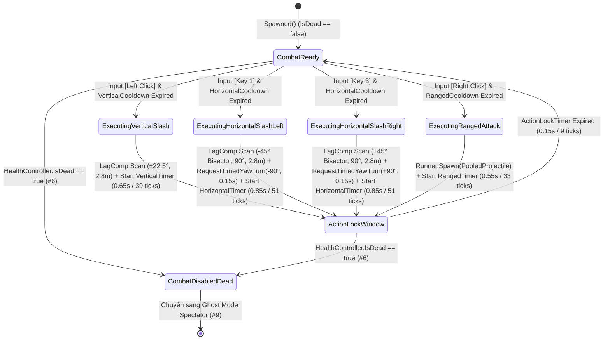
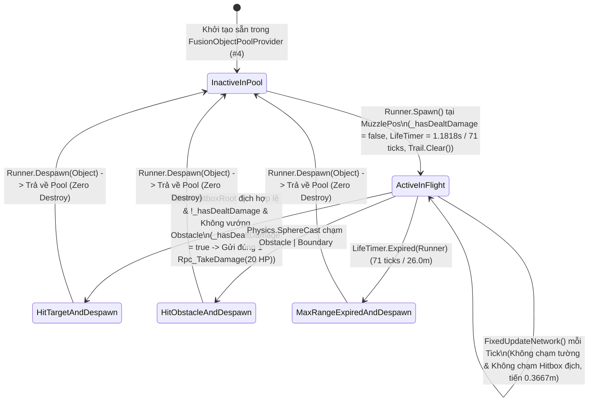

# Multi-Directional Melee & Pooled Ranged Combat System

> **Status**: Designed
> **Creative Director Review (CD-GDD-ALIGN)**: APPROVED 2026-11-10
> **Author**: Solo Developer + Studio Agents (`systems-designer`, `gameplay-programmer`, `engine-programmer`, `creative-director`, `qa-lead`)
> **Last Updated**: 2026-11-10
> **Last Verified**: 2026-11-10
> **Implements Pillar**: Pillar 1 (Cơ Động Phản Xạ Định Đoạt Sinh Tồn), Pillar 2 (Nhãn Quan Chiến Thuật Kép FPS/TPS) & Pillar 3 (Công Bằng Mạng Tuyệt Đối Trên Shared Mode)

## Summary

**Multi-Directional Melee & Pooled Ranged Combat System (`PlayerCombatController` & `PooledRangedProjectile`)** là hệ thống chiến đấu hỏa lực cốt lõi ở tầng **Feature (`Gameplay` / `MVP`)** của *Capsule Arena: Last Man Standing*, thực thi trọn vẹn 3 chiêu thức tấn công tương ứng với 4 phím kích hoạt (`Left Click` / `LMB`, phím `1`, phím `3`, `Right Click` / `RMB` và 4 nút cảm ứng trên **cụm 7 Button kỹ năng mềm góc dưới phải màn hình**) bên trong vòng lặp mạng `FixedUpdateNetwork()` (`60Hz`) của **Photon Fusion 2 (`GameMode.Shared`)**. Người chơi trải nghiệm trực tiếp hệ thống này qua sự phân hóa vai trò chiến thuật sắc nét giữa 3 đòn đánh: **Nhát Chém Dọc (`Vertical Slash` — `Left Click`)** bổ thẳng từ đỉnh đầu xuống phía trước mặt (`MeleeRange = 2.80m`, góc hẹp `VerticalSlashAngle = 45.0°`, sát thương cao nhất `35 HP`), **Nhát Chém Ngang Xoay Người $90^\circ$ (`Horizontal Turning Slash` — phím `1` Chém Trái $-90^\circ$ / phím `3` Chém Phải $+90^\circ`)** quét cung góc vuông từ hướng chính diện sang bên hông (`25 HP`) kết hợp xoay mượt cả thân người lẫn góc nhìn Camera (`FPS` hoặc `TPS`) đúng $\pm 90^\circ$ trong `HorizontalTurnDuration = 0.15s` (`9 ticks`), và **Bắn Đạn Tầm Xa Dùng Object Pool (`Pooled Ranged Attack` — `Right Click`)** phóng quả cầu năng lượng từ `INetworkObjectProvider` Object Pool (`20 HP`, vận tốc `22.0 m/s`, tầm bay `26.0m`). Toàn bộ phép kiểm tra trúng đòn đều kết hợp bù trễ mạng `Runner.LagCompensation.OverlapSphere` trên `HitboxRoot`, bộ lọc tích vô hướng tiền tính toán (`CosHalfVerticalAngle = 0.9239`, `CosHalfHorizontalAngle = 0.7071`), kiểm tra che khuất `Physics.Linecast` / `Physics.SphereCast` chống đâm xuyên tường (`Obstacle | Boundary`), và cờ khóa đơn phát `_hasDealtDamage` trước khi gửi lệnh `[Rpc(RpcSources.All, RpcTargets.StateAuthority)] Rpc_TakeDamage`, đảm bảo tính công bằng thể thao điện tử tuyệt đối (**Pillar 1** & **Pillar 3**).

> **Quick reference** — Layer: `Feature` · Priority: `MVP` · Key deps: `Tick-Accurate Character Movement & Mobility System`, `Health, Damage RPC & Death State System`, `Photon Fusion 2 Shared Mode Session & Object Pool System`, `Character & Combat Config Data (inferred)`, `Arena Level & Tactical Obstacle Architecture (inferred)`

## Overview

Trong *Capsule Arena: Last Man Standing*, giao tranh không bao giờ là cuộc đọ chỉ số thụ động mà là một **vũ điệu hình học tốc độ cao (High-Speed Geometric Duel)** diễn ra trên sàn đấu kẻ lưới `40m x 40m`. Hệ thống **Multi-Directional Melee & Pooled Ranged Combat System (`#7`)** đóng vai trò là đầu ra sát thương duy nhất của đấu sĩ Cartoon Capsule, biến lợi thế vị trí từ hệ thống Cơ động (`#5` — `Forward Dash [2]`, `Side Dodge Roll [Q/E]`) và lợi thế tầm nhìn từ hệ thống Camera Kép (`#9` — `FPS <-> TPS [V]`) thành những đòn kết liễu chuẩn xác đến từng Tick mạng (`16.67ms`).

Thay vì thiết kế một nút đánh thường đơn điệu, hệ thống `#7` xây dựng một **Tam Giác Chiến Thuật Đòn Đánh (Combat Attack Triangle)** vận hành hoàn toàn bằng dữ liệu từ `CharacterCombatConfigSO` (`#1`):
1. **Nhát Chém Dọc (`Vertical Slash` — Mặc định: `Left Click` / `LMB` — `GameActionId.VerticalSlash`):** Đòn kết liễu trực diện có sát thương cao nhất (`VerticalSlashDamage = 35 HP`, `3 hits = 105 dmg` hạ gục mục tiêu `100 HP`) và hồi chiêu nhanh (`VerticalSlashCooldown = 0.65s` / `39 ticks`), nhưng đòi hỏi người chơi phải giữ tâm ngắm chuẩn xác trong hình quạt hẹp `VerticalSlashAngle = 45.0°` ($\pm 22.5^\circ$ quanh trục `transform.forward`, `CosHalfVerticalAngle = 0.9239`) ở cự ly `MeleeRange = 2.80m`.
2. **Nhát Chém Ngang Xoay Người $90^\circ$ (`Horizontal Turning Slash` — Mặc định: Phím `1` Chém Trái $-90^\circ$ / Phím `3` Chém Phải $+90^\circ$ — `GameActionId.HorizontalSlashLeft` & `GameActionId.HorizontalSlashRight`):** Đòn đánh đặc trưng làm nên bản sắc của trò chơi. Khi đối phương lăn né (`Q`/`E`) sang bên hông hoặc ẩn nấp sau góc tường chữ L (`L-Corner Obstacle`), người chơi nhấn phím `1` hoặc `3` để quét một hình quạt ngang góc vuông `HorizontalSlashAngle = 90.0°` từ thẳng trước mặt (`0°`) sang bên trái (`-90°`) hoặc bên phải (`+90°`) với bán kính `MeleeRange = 2.80m` và sát thương `HorizontalSlashDamage = 25 HP` (`4 hits = 100 dmg`, hồi chiêu dùng chung `HorizontalSlashCooldown = 0.85s` / `51 ticks`). Ngay tại Tick kích hoạt, hệ thống `#7` kiểm tra hình quạt lệch trục phân giác $\pm 45^\circ$ (`CosHalfHorizontalAngle = 0.7071`) đồng thời ủy quyền cho `PlayerMovementController.RequestTimedYawTurn(directionSign)` (`#5`) xoay mượt cả thân người (`NetworkTransform`) lẫn góc nhìn Camera (`FPS` hoặc `TPS`) đúng $\pm 90^\circ$ trong `HorizontalTurnDuration = 0.15s` (`9 ticks`, `±10.0°/tick`), giúp người chơi vừa chém trúng mục tiêu ở góc khuất vừa chuyển hướng nhìn sang mặt phẳng giao tranh mới chỉ bằng 1 thao tác phím.
3. **Bắn Đạn Tầm Xa Dùng Object Pool (`Pooled Ranged Attack` — Mặc định: `Right Click` / `RMB` — `GameActionId.RangedAttack`):** Công cụ cấu rỉa và ép góc tầm trung-xa (`RangedDamage = 20 HP`, `5 hits = 100 dmg`, hồi chiêu `RangedCooldown = 0.55s` / `33 ticks`). Khi bóp cò, máy có `HasStateAuthority` gọi `Runner.Spawn()` lấy một thực thể `PooledRangedProjectile` từ `INetworkObjectProvider` Object Pool (`#4`) mà không cấp phát bộ nhớ rác (`Zero Instantiate/Destroy Garbage`). Viên đạn bay tuyến tính với vận tốc `ProjectileSpeed = 22.0 m/s` (`0.3667 m/tick`) tối đa `ProjectileMaxDistance = 26.0m` (`ProjectileLifetime = 1.1818s` / `71 ticks`), sử dụng kiểm tra quét liên tục giữa `prevPos` và `nextPos` kèm cờ khóa `private bool _hasDealtDamage` để đảm bảo mỗi viên đạn chỉ gửi duy nhất **1 lệnh `Rpc_TakeDamage`** tới mục tiêu đầu tiên trúng phải trước khi tự thu hồi về Pool qua `Runner.Despawn(Object)`.

## Player Fantasy

> **System Framing:** `[A] Direct — Người chơi trực tiếp điều khiển từng nhát kiếm bổ dọc, từng cú vung kiếm xoay người 90° đổi hướng camera và từng phát đạn năng lượng bắn qua khe hẹp bằng chuột/bàn phím hoặc cụm 7 nút kỹ năng mềm góc dưới phải màn hình.`

### 1. Giấc mơ cốt lõi: "Kiếm Khách Không Gian Đa Hướng — Chém Góc Vuông, Bắn Đón Đầu, Không Một Động Tác Thừa"
Trong các trò chơi hành động góc nhìn thứ ba truyền thống, việc đối thủ lăn né sang bên hông hoặc chạy vòng qua góc tường chữ L thường buộc người chơi phải thực hiện chuỗi thao tác rườm rà: rê chuột quay camera tìm mục tiêu $\rightarrow$ chỉnh lại hướng di chuyển $\rightarrow$ mới bấm nút chém. **Multi-Directional Melee & Pooled Ranged Combat System** đập tan sự chậm trễ đó bằng cách biến bản thân đòn tấn công thành một **công cụ điều hướng không gian tức thời**.

Khi bước vào *Capsule Arena: Last Man Standing*, người chơi hóa thân thành một đấu sĩ có khả năng kiểm soát không gian $360^\circ$ sắc bén như phản xạ của một kiếm khách thực thụ:
- Trước mặt là kẻ địch đang lao thẳng tới? Một cú **`Left Click` (`Vertical Slash`)** bổ dọc từ đỉnh đầu xuống tạo ra vệt sáng vàng hổ phách chẻ đôi khoảng không, lấy đi hơn một phần ba cây máu (`35/100 HP`) của đối thủ.
- Kẻ địch vừa bấm `Q` hoặc `E` (**Side Dodge Roll**) lăn dạt sang bên trái hòng thoát khỏi tầm ngắm trước mặt? Thay vì phải lia chuột đuổi theo, ngón tay người chơi gõ nhẹ vào **phím `1` (`Horizontal Turning Slash Left -90°`)**. Lưỡi kiếm lập tức quét ngang một cung vuông góc $90^\circ$ từ trước mặt sang tận mạng sườn trái, vệt chém xanh điện từ cắt ngang quỹ đạo lăn của đối phương (`25 HP`), và ngay khi nhát kiếm kết thúc sau `0.15s`, cả thân hình nhân vật lẫn góc nhìn Camera (`FPS`/`TPS`) đã xoay ngọt xớt $90^\circ$ sang trái — đặt kẻ địch vừa lăn né trở lại ngay chính giữa tâm ngắm!
- Kẻ địch sợ hãi rút lui về phía sau bức tường thấp? Người chơi bấm **`Right Click` (`Pooled Ranged Attack`)**, phóng liên tiếp những quả cầu năng lượng vàng chanh (`22.0 m/s`) xuyên qua khe hẹp để kết liễu mục tiêu ở cự ly `26.0m`.

### 2. Trải nghiệm cảm giác qua từng khoảnh khắc (Micro-to-Macro Combat Loop)
1. **Đấu Trí Góc Vuông Quanh Cụm Tường Chữ L (L-Corner $90^\circ$ Ambush):** Người chơi đứng ở góc nhìn **TPS (`V`)** nấp sau một cụm tường chữ L (`#2`), quan sát thấy đối phương đang áp sát dọc theo hành lang vuông góc. Ngay khi bước chân đối phương vừa chạm tới mép tường, người chơi nhấn `2` (**Forward Dash**) lướt vọt ra ngã rẽ rồi lập tức bấm **phím `3` (Chém ngang xoay phải $+90^\circ$)**. Nhát chém quét trọn góc vuông $90^\circ$ bên phải đồng thời xoay Camera $90^\circ$ nhìn thẳng vào mặt kẻ địch đang sững sờ, nối tiếp ngay bằng một nhát **`Left Click` (Chém dọc `35 HP`)** tạo thành chuỗi liên hoàn không thể phản kháng.
2. **Đấu Súng & Cắt Cự Ly (Poke-to-All-In Transition):** Từ khoảng cách `15m`, người chơi chuyển sang góc nhìn **FPS (`V`)** để tận dụng tâm ngắm Crosshair chính xác, bắn trúng 1 viên đạn **`Right Click` (`20 HP`)** khiến thanh máu trên đầu đối thủ tụt xuống `80/100`. Biết rằng `80 HP` đã lọt vào ngưỡng hạ gục của **Combo `2x Vertical Slash (70 HP)` + `1x Horizontal Slash (25 HP)`**, người chơi lập tức bấm `2` (**Forward Dash `4.0m`**) thu hẹp khoảng cách, dùng `Q` lăn né viên đạn phản công của địch, rồi tung liên hoàn kiếm pháp cận chiến.
3. **Sự Tin Cậy Tuyệt Đối Trên Mạng (`What You Hit Is What Takes Damage`):** Nhờ sự kết hợp giữa bù trễ `Runner.LagCompensation.OverlapSphere` và kiểm tra tường `Physics.Linecast`, người chơi không bao giờ gặp cảnh ức chế *"Kiếm chém xuyên qua người mà không mất máu"* hay *"Nấp sau tường đá dày 2 mét vẫn bị chém trúng"*.

### 3. Điểm chạm Tham chiếu & Đối chiếu Trụ cột Thiết kế

| Điểm tham chiếu / Trụ cột | Cách Hệ thống Chiến đấu `#7` hiện thực hóa trải nghiệm người chơi |
| :--- | :--- |
| ***Monster Hunter / For Honor*** *(Directional Melee Commitment & Arc Precision)* | Phân tách rõ ràng giữa đòn bổ dọc góc hẹp sát thương cao (`Left Click`: `45°`, `35 HP`) và đòn quét ngang góc vuông chuyển hướng (`1`/`3`: `90°`, `25 HP`, xoay mặt $\pm 90^\circ$), thưởng xứng đáng cho người chơi chọn đúng hướng vung kiếm. |
| ***Battlerite / Brawl Stars*** *(Skillshot Projectile & Readable Cooldowns)* | Đạn tầm xa `Right Click` là đạn vật lý có vận tốc hữu hạn (`22.0 m/s`) và bán kính rõ ràng (`0.20m`), buộc người bắn phải ngắm đón đầu (Lead Target) và cho phép người bị bắn kịp phản xạ lăn né `Q`/`E`. |
| **Pillar 1 (Cơ Động Phản Xạ Định Đoạt Sinh Tồn)** | Khớp nối hoàn hảo với hệ thống Cơ động (`#5`): đòn chém ngang $90^\circ$ phím `1`/`3` vừa là công cụ khắc chế đối phương đang `Side Dodge Roll (Q/E)`, vừa tích hợp phép xoay thân người + Camera `0.15s` giúp duy trì nhịp độ giao tranh tốc độ cao. |
| **Pillar 2 (Nhãn Quan Chiến Thuật Kép FPS/TPS)** | Đạn tầm xa `Right Click` phát huy độ chính xác tối đa khi ngắm qua khe hẹp ở góc nhìn **FPS**, trong khi đòn chém ngang xoay người $90^\circ$ (`1`/`3`) phát huy sức mạnh quét góc khuất tối đa khi quan sát ở góc nhìn **TPS**. |
| **Pillar 3 (Công Bằng Mạng Tuyệt Đối Trên Shared Mode)** | Thực thi 100% trong `FixedUpdateNetwork()` với `TickTimer`, `LagCompensation`, kiểm tra che khuất `Obstacle | Boundary`, `INetworkObjectProvider` Object Pool và cờ bảo vệ `_hasDealtDamage` chống nhân đôi sát thương. |

## Detailed Design

### Core Rules

1. **Quy tắc Ủy Quyền Thực Thi Trong `FixedUpdateNetwork()` Trên Shared Mode (StateAuthority Simulation Contract):**
   - Toàn bộ logic đọc đầu vào tấn công (ưu tiên lấy mẫu trực tiếp `_localInputPoller.SampleSimulationTickInput(Runner.Tick.Raw)` khi `Object.HasStateAuthority && _localInputPoller != null` để không bao giờ bị rớt nút bấm đơn hay lệch góc nhìn trên các máy Client join trong `GameMode.Shared`, dùng `GetInput(out NetworkInputData input)` làm fallback), kiểm tra điều kiện sẵn sàng chiến đấu, khởi tạo bộ đếm hồi chiêu `[Networked] TickTimer`, quét vùng va chạm cận chiến và gọi `Runner.Spawn()` bắn đạn từ Pool (với `EffectiveOwner = Object.InputAuthority != PlayerRef.None ? Object.InputAuthority : Object.StateAuthority`) **chỉ được thực thi bên trong phương thức `FixedUpdateNetwork()` trên máy sở hữu `Object.HasStateAuthority == true`**.
   - Điều kiện tiên quyết để kích hoạt bất kỳ chiêu thức tấn công nào trong Tick hiện tại (`CanExecuteCombatAction()`):
     - Nhân vật còn sống: `!_healthController.IsDead && _healthController.CurrentHealth > 0` (đọc từ `PlayerHealth` — Hệ thống `#6`).
     - Không bị khóa điều khiển bởi giao diện: `InputFocusManager` (`#3`) đang ở trạng thái `CombatActive` (nếu đang mở khung `ChatFocused`, `RebindModalOpen` hoặc đang ở `GhostSpectating`, các cờ nút tấn công trong `NetworkInputData` đã được dập về `0`).
     - Không nằm trong cửa sổ khóa giao thoa hành động ngắn (`_actionLockTimer.ExpiredOrNotRunning(Runner)`) để ngăn người chơi kích hoạt cùng lúc 2 đòn đánh trong cùng 1 Tick mạng.

2. **Quy tắc Bộ Đếm Hồi Chiêu Độc Lập Bằng `[Networked] TickTimer` (3 Independent Skill Cooldown Timers):**
   - `PlayerCombatController` khai báo 3 biến trạng thái mạng `[Networked] public TickTimer` độc lập đọc từ `CharacterCombatConfigSO` (`DefaultCapsuleCombatConfig.asset`) để đồng bộ thời gian hồi chiêu cho cả logic chiến đấu lẫn giao diện HUD (`#8`):
     - `[Networked] public TickTimer VerticalSlashCooldownTimer { get; set; }`: Quản lý hồi chiêu của **Nhát Chém Dọc (`Left Click` / `LMB`)** với thời lượng `Config.VerticalSlashCooldownSec = 0.60s` (`36 ticks` ở `60Hz`).
     - `[Networked] public TickTimer HorizontalSweepCooldownTimer { get; set; }`: Quản lý hồi chiêu **dùng chung** cho cả **Nhát Chém Ngang Trái $-90^\circ$ (phím `1`)** và **Nhát Chém Ngang Phải $+90^\circ$ (phím `3`)** với thời lượng `Config.HorizontalSweepCooldownSec = 1.20s` (`72 ticks` ở `60Hz`). Khi người chơi nhấn phím `1` hoặc phím `3`, cả hai nút `1` và `3` trên cụm 7 Button mềm đều bắt đầu quay vòng đếm ngược `1.20s`.
     - `[Networked] public TickTimer RangedCooldownTimer { get; set; }`: Quản lý hồi chiêu của **Bắn Đạn Tầm Xa (`Right Click` / `RMB`)** với thời lượng `Config.RangedFireCooldownSec = 0.40s` (`24 ticks` ở `60Hz`).
   - Ngoài ra, cửa sổ xoay và thực thi đòn chém ngang kéo dài đúng `Config.HorizontalSweepTurnDurationSec = 0.18s` (`11 ticks` ở `60Hz`) đảm bảo hình quạt VFX mở rộng và phép xoay thân Capsule $\pm 90^\circ$ hoàn tất đồng thời trước khi nhận lệnh tấn công kế tiếp.

3. **Quy tắc Chiêu 1 — Nhát Chém Dọc (`Vertical Slash` — Mặc định: `Left Click` / `LMB` — `GameActionId.VerticalSlash`):**
   - **Ý đồ chiến thuật:** Đòn tấn công cận chiến nhịp nhanh ở hướng chính diện (`VerticalSlashDamage = 25 HP`, `4 hits` hạ gục `100 HP`, hồi chiêu `0.60s`) để dồn sát thương trực diện hoặc kết hợp ngay sau `Forward Dash (phím 2)`.
   - **Hình học vùng sát thương:**
     - Tâm xuất phát (`attack_origin`): Vị trí ngang ngực nhân vật tấn công `transform.position + Vector3.up * 1.0f`.
     - Bán kính quét: `Config.VerticalSlashRange = 2.50m`.
     - Trục tâm hình quạt (`sector_axis`): Vector hướng thẳng ra phía trước mặt nhân vật chiếu trên mặt phẳng ngang `XZ` (`forward_xz = Vector3.ProjectOnPlane(transform.forward, Vector3.up).normalized`).
     - Góc mở hình quạt: `Config.VerticalSlashAngleDeg = 50.0°` (tức $\pm 25.0^\circ$ tính từ `forward_xz`). Sử dụng hằng số tiền tính toán `Config.VerticalSlashCosHalfAngle = cos(25.0°) ≈ 0.9063078` để kiểm tra tích vô hướng mà không gọi hàm lượng giác tại Runtime.
   - **Quy trình xử lý trong `FixedUpdateNetwork()`:**
     1. Kiểm tra nút `VerticalSlash` và `VerticalSlashCooldownTimer.ExpiredOrNotRunning(Runner)`.
     2. Khởi tạo `VerticalSlashCooldownTimer = TickTimer.CreateFromSeconds(Runner, Config.VerticalSlashCooldownSec)` (`0.60s` / `36 ticks`).
     3. Phát lệnh đồng bộ hiệu ứng `[Rpc(RpcSources.StateAuthority, RpcTargets.All)]` tới Hệ thống `#14`.
     4. Gọi hàm quét cận chiến `ExecuteMeleeSectorScan` với `VerticalSlashRange = 2.50m`, `VerticalSlashCosHalfAngle`, `VerticalSlashDamage = 25`.

4. **Quy tắc Chiêu 2 — Nhát Chém Ngang Quạt & Xoay Đồng Bộ 1:1 $90^\circ$ (`Synchronized Horizontal Sweep` — Mặc định: Phím `1` Chém Trái $-90^\circ$ / Phím `3` Chém Phải $+90^\circ$):**
   - **Ý đồ chiến thuật:** Đòn đánh quét góc vuông uy lực cao (`HorizontalSweepDamage = 30 HP`, tầm quét rộng `HorizontalSweepRange = 3.00m`, hồi chiêu chung `1.20s`) chuyên trị các mục tiêu đang lăn né sang hông (`Side Dodge Roll Q/E`) hoặc phục kích quanh góc vuông chữ L (`L-Corner Obstacle`).
   - **Đồng Bộ Tuyệt Đối 1:1 Giữa Tốc Độ Mở Hình Quạt Và Tốc Độ Xoay Thân Capsule (`1:1 Real-Time Sweep Arc & Capsule Rotation Sync`):**
     - Khi nhấn phím `1` (`directionSign = -1`, quét sang trái `-90°`) hoặc phím `3` (`directionSign = +1`, quét sang phải `+90°`), quá trình mở hình quạt năng lượng và quá trình xoay phần thân Capsule + góc nhìn Camera **diễn ra đồng thời với cùng một tiến độ chuẩn hóa `u = VisualSweepProgress ∈ [0.0, 1.0]`** trong suốt `Config.HorizontalSweepTurnDurationSec = 0.18s` (`11 ticks` ở `60Hz`), nội suy mượt theo đường cong `SmoothStep(u) = u²(3 - 2u)`:
       1. **Hình quạt VFX mở dần từ `0°` đến `±90°` theo thời gian thực:** Thay vì hiện sẵn cả mảng quạt `90°` ngay ở khung hình đầu tiên, lưới hình quạt phẳng (`CombatVfxManager` / `SweepVisualSyncProgress`) neo mép khởi điểm tại góc hướng mặt ban đầu `SweepStartYaw` và mở rộng góc quét động $\Delta\theta(u) = \text{directionSign} \times 90^\circ \times \text{SmoothStep}(u)$ theo từng khung hình.
       2. **Phần thân Capsule & Camera xoay cùng tốc độ với lưỡi quạt:** Tại mọi thời điểm $t \in [0, 0.18\text{s}]$, góc hướng mặt của thân nhân vật Capsule và `CameraYaw` luôn bám sát chính mép lưỡi đao đang quét ra:
          $$\text{CapsuleYaw}(u) = \text{SweepStartYaw} + \text{directionSign} \times 90^\circ \times \text{SmoothStep}(u)$$
       3. **Hoàn tất đồng thời (`Fan Full == Turn Complete`):** Đúng khoảnh khắc hình quạt vừa quạt đủ góc vuông `90°` (`u = 1.0` tại `0.18s` / tick thứ `11`) cũng chính là khoảnh khắc phần thân Capsule và Camera vừa xoay xong trọn vẹn `-90°` (phím `1`) hoặc `+90°` (phím `3`).
       4. **Quét va chạm tích lũy theo lưỡi kiếm & Tự động mở khóa góc xoay chuột (`Self-Healing Yaw Unlock`):** Trong suốt `11 ticks` quét, vùng va chạm kiểm tra bao phủ toàn bộ cung `[0°, ±90°]` (trục phân giác lệch $\pm 45.0^\circ$ so với `SweepStartYaw`, `HorizontalSweepCosHalfAngle = cos(45°) ≈ 0.7071068`, bán kính `3.00m`, mỗi mục tiêu tối đa nhận sát thương `1 lần/nhát chém` thông qua bộ lọc khử trùng lặp). Trong `0.18s` đang xoay, `_localInputPoller.SetHorizontalYawLock(true, ...)` và `_mobilityController.SetSweepYawOverride(true)` khóa tạm thời chuột ngang để quỹ đạo xoay mượt tuyệt đối, sau đó **tự động mở khóa ngay khi hết `11 ticks` (kèm chốt bảo vệ tự phục hồi `EnsureYawLocksReleasedIfIdle()` nếu nhân vật tử trận giữa chừng hoặc reset ván đấu)** để chuột ngang không bao giờ bị kẹt.

5. **Quy tắc Quét Bù Trễ Cận Chiến, Chống Trừ Máu Kép & Chống Chém Xuyên Tường (`Lag-Compensated Melee Scan & Line-of-Sight Rule`):**
   - Cả **Vertical Slash (`Left Click`)** và **Horizontal Turning Slash (`1`/`3`)** đều dùng chung thuật toán kiểm tra va chạm 4 bước Zero-Allocation trong `ExecuteMeleeSectorScan(...)`:
     1. **Bù trễ mạng (`Lag Compensation OverlapSphere`):** Sử dụng mảng đệm cấp phát sẵn `private readonly List<LagCompensatedHit> _meleeHitsBuffer = new List<LagCompensatedHit>(16)` và gọi:
        `int hitCount = Runner.LagCompensation.OverlapSphere(attackOrigin, Config.MeleeRange, Object.InputAuthority, _meleeHitsBuffer, _playerHitboxLayerMask, HitOptions.IgnoreInputAuthority);`
     2. **Lọc trùng lặp mục tiêu trong cùng 1 nhát chém (`Per-Swing Deduplication`):** Sử dụng tập hợp cấp phát sẵn `private readonly HashSet<NetworkId> _hitTargetsThisSwing = new HashSet<NetworkId>()` (`_hitTargetsThisSwing.Clear()` đầu mỗi nhát chém). Nếu một nhân vật đối phương có nhiều `Hitbox` con trên cùng một `HitboxRoot`, chỉ xử lý lần chạm đầu tiên của `NetworkObject` đó, đảm bảo **1 nhát kiếm chỉ gây sát thương tối đa 1 lần lên mỗi đối thủ**.
     3. **Kiểm tra Góc Quạt Trên Mặt Phẳng `XZ` (`Planar Sector Check`):** Tính vector hướng từ tâm người chém tới tâm đối phương trên mặt phẳng ngang `dirToTargetXZ = Vector3.ProjectOnPlane(targetPos - transform.position, Vector3.up).normalized` (nếu khoảng cách ngang `< 0.05m` tức đứng sát chồng lên nhau thì mặc định `dot = 1.0f` hợp lệ). Kiểm tra `Vector3.Dot(sectorAxisXZ, dirToTargetXZ) >= cosHalfAngleThreshold`.
     4. **Kiểm tra Không Chém Xuyên Tường (`Anti-Wallbang Linecast`):** Bắn một tia vật lý `Physics.Linecast(attackOrigin, targetChestPos, LayerMask.GetMask("Obstacle", "Boundary"), QueryTriggerInteraction.Ignore)`. Chỉ khi `Physics.Linecast` trả về `false` (không bị bất kỳ khối `Obstacle` hay tường `Boundary` nào của Hệ thống `#2` chắn giữa), `PlayerCombatController` mới gửi lệnh `[Rpc(RpcSources.All, RpcTargets.StateAuthority)] targetHealth.Rpc_TakeDamage(damage, Object.InputAuthority, attackType)`.

6. **Quy tắc Chiêu 3 — Bắn Đạn Tầm Xa Dùng Object Pool (`Pooled Ranged Attack` — Mặc định: `Right Click` / `RMB` — `GameActionId.RangedAttack`):**
   - **Khởi tạo từ Object Pool (`Runner.Spawn` via `INetworkObjectProvider`):**
     - Khi người chơi nhấn `Right Click` (`GameActionId.RangedAttack`) thỏa mãn `RangedCooldownTimer.ExpiredOrNotRunning(Runner)` và `ActionLockTimer.ExpiredOrNotRunning(Runner)`, máy có `HasStateAuthority` đặt `RangedCooldownTimer = TickTimer.CreateFromSeconds(Runner, Config.RangedCooldown)` (`0.55s` / `33 ticks`) và `ActionLockTimer = TickTimer.CreateFromSeconds(Runner, 0.15f)` (`9 ticks`).
     - Điểm xuất phát của viên đạn (`muzzlePos`) được đặt tại `transform.position + Vector3.up * 1.15f + aimDirection * 0.65f` (ngang tầm ngực/tay phía trước mặt Capsule `0.65m`).
     - **Kiểm tra chống bắn xuyên tường ngay sát mặt (`Point-Blank Muzzle Obstruction Check`):** Trước khi sinh đạn, hệ thống kiểm tra `Physics.Linecast(chestCenterPos, muzzlePos, _obstacleAndBoundaryMask)`. Nếu người chơi đang đứng ép sát mặt vào tường `Obstacle | Boundary` khiến điểm `muzzlePos` lọt vào trong tường, viên đạn sẽ phát nổ ngay tại bề mặt tường và không bay xuyên qua bên kia bức tường.
     - Nếu đầu nòng thông thoáng, gọi `Runner.Spawn(_rangedProjectilePrefab, muzzlePos, Quaternion.LookRotation(aimDirection), Object.InputAuthority, OnBeforeProjectileSpawned)` để lấy một thực thể `PooledRangedProjectile` từ `FusionObjectPoolProvider` (`#4`).
   - **Vòng đời Tick mạng & Cờ khóa `_hasDealtDamage` trên `PooledRangedProjectile`:**
     - Trong `Spawned()` của viên đạn: đặt lại cờ cục bộ `_hasDealtDamage = false`, lưu `_spawnOrigin = transform.position`, xóa sạch vệt đuôi cũ `_trailRenderer.Clear()`, và nếu `Object.HasStateAuthority == true` thì khởi tạo `[Networked] LifeTimer = TickTimer.CreateFromSeconds(Runner, Config.ProjectileLifetime)` (`26.0m / 22.0 m/s = 1.1818s` / `71 ticks`).
     - Trong `FixedUpdateNetwork()` của viên đạn (chỉ chạy trên máy `HasStateAuthority` của người bắn):
       1. Nếu `_hasDealtDamage` là `true`, thoát ngay lập tức (`return;`).
       2. Nếu `LifeTimer.Expired(Runner)` hoặc tổng quãng đường bay `Vector3.Distance(_spawnOrigin, transform.position) >= Config.ProjectileMaxDistance` (`26.0m`), gọi `Runner.Despawn(Object)` để trả viên đạn về `INetworkObjectProvider` Pool và thoát.
       3. Tính vị trí bước tiến trong Tick hiện tại: `prevPos = transform.position`, `stepDistance = Config.ProjectileSpeed * Runner.DeltaTime` (`22.0 * 1/60 = 0.3667m`), `nextPos = prevPos + transform.forward * stepDistance`.
       4. **Kiểm tra va chạm Tường/Vật cản trước (`Physics.SphereCast` trên `Obstacle | Boundary`):** Quét hình cầu bán kính `Config.ProjectileRadius = 0.20m` từ `prevPos` tới `nextPos` với `stepDistance`. Nếu chạm `Obstacle | Boundary` ở khoảng cách `wallHit.distance`, giới hạn quãng đường kiểm tra mục tiêu chỉ trong phạm vi `maxTargetCheckDist = wallHit.distance` (ngăn chặn đạn đâm xuyên tường mỏng).
       5. **Kiểm tra va chạm Mục tiêu bù trễ (`Runner.LagCompensation`):** Kiểm tra `Runner.LagCompensation.OverlapSphere` (tại trung điểm và `nextPos` với bán kính `Config.ProjectileRadius = 0.20m`, loại trừ `OwnerPlayer`) kết hợp kiểm tra `Physics.Linecast(prevPos, hitPoint, _obstacleAndBoundaryMask)` không bị tường chắn.
       6. **Khóa cờ `_hasDealtDamage` và Gửi đúng 1 RPC trừ máu:** Ngay khi phát hiện mục tiêu hợp lệ đầu tiên còn sống (`!targetHealth.IsDead`), viên đạn lập tức gán **`_hasDealtDamage = true`**, gửi duy nhất **1 lệnh `targetHealth.Rpc_TakeDamage(Config.RangedDamage, OwnerPlayer, CombatAttackType.RangedAttack)`** (`20 HP`), phát hiệu ứng nổ trúng đích và gọi **`Runner.Despawn(Object)`** ngay trong Tick đó để thu hồi viên đạn về Object Pool.
       7. Nếu không trúng người chơi nhưng bước 4 phát hiện chạm tường `Obstacle | Boundary`, phát hiệu ứng nổ chạm tường và gọi `Runner.Despawn(Object)`.
       8. Nếu đường bay hoàn toàn trống trải, cập nhật `transform.position = nextPos`.

7. **Bảng Tổng Hợp Thông Số 3 Chiêu Thức Tấn Công (Đọc 100% Từ `CharacterCombatConfigSO` `#1`):**

| Thuộc Tính Kỹ Thuật | Chiêu 1: Nhát Chém Dọc (`Vertical Slash`) | Chiêu 2: Nhát Chém Ngang Đồng Bộ 1:1 $90^\circ$ (`Horizontal Sweep`) | Chiêu 3: Bắn Đạn Tầm Xa (`Pooled Ranged Fire`) |
| :--- | :--- | :--- | :--- |
| **Phím Mặc Định & Mobile Button** | `Left Click` (`LMB`) / Button Mềm `LMB` | Phím `1` (Trái $-90^\circ$) & Phím `3` (Phải $+90^\circ$) / Button Mềm `1` & `3` | `Right Click` (`RMB`) / Button Mềm `RMB` |
| **Mã Hành Động (`GameActionId`)** | `GameActionId.VerticalSlash` | `GameActionId.HorizontalSweepLeft` (`1`) / `HorizontalSweepRight` (`3`) | `GameActionId.RangedFire` |
| **Mã Cooldown (`CombatSkillId`)** | `CombatSkillId.VerticalSlash` | `CombatSkillId.HorizontalSweep` *(dùng chung cho `1` & `3`)* | `CombatSkillId.RangedFire` |
| **Sát Thương Mỗi Đòn (`Damage`)** | `VerticalSlashDamage = 25 HP` | `HorizontalSweepDamage = 30 HP` | `RangedDamage = 15 HP` |
| **Số Đòn Hạ Gục (`100 HP`)** | `4 hits` (`100 tổng sát thương`) | `4 hits` (`120 tổng sát thương`) | `7 hits` (`105 tổng sát thương`) |
| **Tầm Tác Dụng / Cự Ly Tối Đa** | `VerticalSlashRange = 2.50 m` | `HorizontalSweepRange = 3.00 m` | `RangedMaxDistance = 30.0 m` (`Speed = 15.0 m/s`) |
| **Hình Học Vùng Quét / Hitbox** | Hình quạt dọc trước mặt `50.0°` ($\pm 25.0^\circ$ quanh `forward`, `CosHalf = 0.9063`) | Hình quạt ngang `90.0°` mở dần từ `0°` đến `-90°` (`1`) hoặc `+90°` (`3`) quanh trục phân giác $\pm 45^\circ$ (`CosHalf = 0.7071`) | Hình cầu bay tuyến tính `RangedProjectileRadius = 0.20 m` (`Lifetime = 2.00s` / `120 ticks`) |
| **Tác Động Lên Góc Nhìn / Thân Người** | Giữ nguyên hướng nhìn hiện tại | Quạt VFX mở rộng tới đâu thân Capsule & Camera xoay đồng bộ 1:1 tới đó theo `SmoothStep` trong `0.18s` (`11 ticks`), quạt đủ `90°` cũng là lúc xoay xong `±90°` | Giữ nguyên hướng nhìn hiện tại; hỗ trợ ngắm chuẩn qua Crosshair `FPS` |
| **Thời Gian Hồi Chiêu (`Cooldown`)** | `VerticalSlashCooldownSec = 0.60 s` (`36 ticks`) | `HorizontalSweepCooldownSec = 1.20 s` (`72 ticks`) | `RangedFireCooldownSec = 0.40 s` (`24 ticks`) |

### States and Transitions

Hệ thống `#7` bao gồm **2 máy trạng thái nối mạng** hoạt động song song trong `FixedUpdateNetwork()`: (1) Máy trạng thái điều phối đòn đánh trên nhân vật (`PlayerCombatController`) và (2) Máy trạng thái vòng đời viên đạn trong Object Pool (`PooledRangedProjectile`).

#### 1. Máy Trạng Thái Bộ Điều Khiển Chiến Đấu Nhân Vật (`PlayerCombatController` State Machine)

#### 2. Máy Trạng Thái Vòng Đời Viên Đạn Tầm Xa Trong Object Pool (`PooledRangedProjectile` Lifecycle)

### Interactions with Other Systems

| Hệ Thống Liên Quan | Chiều Tương Tác | Cơ Chế Hợp Đồng Kỹ Thuật (Interfaces / RPCs / Networked Properties) |
| :--- | :---: | :--- |
| **System #1: Character & Combat Config Data (`CharacterCombatConfigSO`)** | `#1` $\rightarrow$ `#7` *(Read-Only)* | `PlayerCombatController` và `PooledRangedProjectile` đọc toàn bộ thông số `MeleeRange`, `VerticalSlashDamage`, `VerticalSlashAngle`, `CosHalfVerticalAngle`, `VerticalSlashCooldown`, `HorizontalSlashDamage`, `HorizontalSlashAngle`, `CosHalfHorizontalAngle`, `HorizontalTurnDuration`, `HorizontalSlashCooldown`, `RangedDamage`, `ProjectileSpeed`, `ProjectileMaxDistance`, `ProjectileLifetime`, `ProjectileRadius`, `RangedCooldown` thông qua giao diện `ICharacterCombatConfig`. |
| **System #2: Arena Level & Tactical Obstacle Architecture** | `#2` $\rightarrow$ `#7` *(Physics Query)* | Cung cấp ma trận Layer vật lý (`Obstacle` Layer 8, `Boundary` Layer 9) để `#7` thực hiện `Physics.Linecast` (chống chém xuyên tường) và `Physics.SphereCast` (chặn đạn tầm xa khi va vào tường/chướng ngại vật). |
| **System #3: Keybinding & Input Management System** | `#3` $\rightarrow$ `#7` *(Input Struct)* | Cung cấp trạng thái nhấn nút đã hợp nhất từ bàn phím/chuột PC và cụm 7 nút mềm cảm ứng thông qua `NetworkInputData` (`GameActionId.VerticalSlash`, `HorizontalSlashLeft`, `HorizontalSlashRight`, `RangedAttack`), đồng thời tự động khóa tấn công khi `InputFocusManager` ở trạng thái `ChatTyping` hoặc `RebindModalOpen`. |
| **System #4: Photon Fusion 2 Shared Mode Session & Object Pool** | `#4` $\leftrightarrow$ `#7` *(Spawn / Despawn)* | Cung cấp `INetworkObjectProvider` (`FusionObjectPoolProvider`) để `#7` gọi `Runner.Spawn(_rangedProjectilePrefab, ...)` và `Runner.Despawn(Object)` cho viên đạn tầm xa với chi phí cấp phát bộ nhớ `0 Byte GC`. |
| **System #5: Tick-Accurate Character Movement & Mobility System** | `#7` $\rightarrow$ `#5` *(One-Way Call)* | Khi người chơi kích hoạt **Nhát Chém Ngang Xoay Người $90^\circ$ (phím `1` hoặc `3`)**, `#7` gọi `_movementController.RequestTimedYawTurn(directionSign)` để `#5` xoay mượt `NetworkTransform` và Camera đúng $\pm 90^\circ$ trong `0.15s` (`9 ticks`). Ngược lại, `#7` đọc trạng thái cơ động của `#5` để đồng bộ nhịp ra đòn sau khi `Dash [2]` hoặc `Dodge [Q/E]`. |
| **System #6: Health, Damage RPC & Death State System** | `#7` $\rightarrow$ `#6` *(RPC & State Read)* | `#7` đọc `_healthController.IsDead` để ngắt mọi quyền tấn công khi nhân vật tử trận; khi đòn cận chiến hoặc viên đạn tầm xa trúng mục tiêu hợp lệ, `#7` gọi `targetHealth.Rpc_TakeDamage(damage, attackerRef, attackType)` để `#6` thực thi trừ máu trên máy `StateAuthority` của nạn nhân. |
| **System #8: Combat HUD, Overhead Billboard & Mobile Action Pad UI** | `#7` $\leftrightarrow$ `#8` *(UI Binding)* | `#8` đọc thời gian còn lại của 3 bộ đếm `[Networked] TickTimer` (`VerticalSlashCooldownTimer`, `HorizontalSlashCooldownTimer`, `RangedCooldownTimer`) trên `#7` để vẽ vòng quạt Cooldown thời gian thực trên 4 nút tấn công (`LMB`, `1`, `3`, `RMB`) thuộc cụm 7 Button mềm góc dưới phải màn hình. |
| **System #9: Dual-Perspective Camera (FPS/TPS) & Ghost Mode Spectator** | `#9` $\leftrightarrow$ `#7` *(Aim & Turn)* | Ở chế độ **FPS**, `#7` lấy tia ngắm từ tâm Crosshair của Camera `#9` (kẹp góc Pitch hợp lệ) để định hướng đường bay của đạn `Right Click`; khi nhấn phím `1`/`3`, phép xoay `RequestTimedYawTurn(±90°)` do `#7` khởi xướng làm xoay đồng bộ cả góc nhìn Camera `FPS`/`TPS` của `#9`. |
| **System #14: 3D Spatial Audio & Combat VFX Feedback System** | `#7` $\rightarrow$ `#14` *(Effect RPC)* | Khi ra đòn hoặc trúng đích, `#7` phát `[Rpc(RpcSources.StateAuthority, RpcTargets.All)] Rpc_PlayAttackEffect(...)` để `#14` kích hoạt vệt chém Mesh/Shader (`45°` dọc màu vàng hổ phách / `90°` ngang màu xanh điện từ), hiệu ứng DOTween Squash & Stretch trên `VisualRoot` và âm thanh 3D (`Spatial Blend = 1.0`). |

## Formulas

### 1. Kiểm Tra Mục Tiêu Trong Hình Quạt Chém Dọc `Left Click` (`vertical_arc_hit`)

The `vertical_arc_hit` formula is defined as:

`vertical_arc_hit = (distance_xz <= MeleeRange) && (dot(forward_xz, dir_to_target_xz) >= CosHalfVerticalAngle) && !linecast_blocked`

**Variables:**

| Variable | Type | Range | Source | Description |
| :--- | :---: | :---: | :--- | :--- |
| `distance_xz` | `float` | `0.00–40.00` | `Vector2.Distance(attacker_xz, target_xz)` | Khoảng cách ngang trên mặt phẳng đấu trường `XZ` từ tâm người chém đến tâm `HitboxRoot` của mục tiêu (`mét`). |
| `MeleeRange` | `float` | `1.50–5.00` (`mặc định 2.80`) | `CharacterCombatConfigSO.MeleeRange` | Bán kính tầm vung kiếm cận chiến tối đa (`2.80m`). |
| `forward_xz` | `Vector3` | Vector đơn vị (`\|v\| = 1`) | `Vector3.ProjectOnPlane(transform.forward, Vector3.up).normalized` | Vector hướng nhìn thẳng phía trước mặt của nhân vật tấn công trên mặt phẳng `XZ`. |
| `dir_to_target_xz` | `Vector3` | Vector đơn vị (`\|v\| = 1`) | `(target_xz - attacker_xz).normalized` | Vector đơn vị chỉ hướng từ người chém tới mục tiêu trên mặt phẳng `XZ`. |
| `CosHalfVerticalAngle` | `float` | `0.7071–0.9848` (`mặc định 0.9239`) | `CharacterCombatConfigSO.CosHalfVerticalAngle` | Giá trị $\cos(\text{VerticalSlashAngle} / 2) = \cos(22.5^\circ) \approx 0.9238795$ được tiền tính toán sẵn. |
| `linecast_blocked` | `bool` | `true` hoặc `false` | `Physics.Linecast(attack_origin, target_chest, Obstacle \| Boundary)` | Trả về `true` nếu có tường hoặc chướng ngại vật chắn giữa người chém và mục tiêu. |
| `vertical_arc_hit` | `bool` | `true` hoặc `false` | `PlayerCombatController` (`System #7`) | Kết quả xác định mục tiêu có nhận `VerticalSlashDamage = 35 HP` hay không. |

**Output Range:** `true` (Trúng đòn — Gửi `Rpc_TakeDamage(35)`) hoặc `false` (Trượt đòn / Ngoài tầm / Khuất tường).

**Example:**
- Mục tiêu đứng cách người chém `distance_xz = 2.40m` ($\le 2.80\text{m}$), lệch sang bên phải một góc $15.0^\circ$ so với hướng nhìn thẳng `forward_xz`, không có tường chắn (`linecast_blocked = false`):
  - `dot(forward_xz, dir_to_target_xz) = cos(15.0°) ≈ 0.9659 >= CosHalfVerticalAngle (0.9239)`.
  - `vertical_arc_hit = true && true && !false = true` $\rightarrow$ Mục tiêu trúng nhát chém dọc và nhận `35 HP` sát thương.
- Nếu mục tiêu đứng ở góc lệch $30.0^\circ$ (`cos(30.0°) ≈ 0.8660 < 0.9239`), `vertical_arc_hit = false` (trượt nhát chém dọc, đòi hỏi người chơi phải dùng nhát chém ngang phím `3`).

---

### 2. Trục Phân Giác & Kiểm Tra Hình Quạt Chém Ngang $90^\circ$ Phím `1` / `3` (`horizontal_bisector_dot`)

The `horizontal_bisector_dot` formula is defined as:

`horizontal_bisector_dot = dot(rotate_y(initial_forward_xz, turn_direction_sign * (HorizontalSlashAngle * 0.5)), dir_to_target_xz)`

**Variables:**

| Variable | Type | Range | Source | Description |
| :--- | :---: | :---: | :--- | :--- |
| `initial_forward_xz` | `Vector3` | Vector đơn vị (`\|v\| = 1`) | `transform.forward` (chiếu lên `XZ`) ngay trước khi gọi `RequestTimedYawTurn` | Hướng nhìn thẳng ban đầu (`0°`) của nhân vật tại Tick bắt đầu nhấn phím `1` hoặc `3`. |
| `turn_direction_sign` | `int` | `-1` hoặc `+1` | Phím kích hoạt (`Phím 1 = -1` Chém Trái, `Phím 3 = +1` Chém Phải) | Dấu định hướng quét kiếm và chiều xoay thân người + Camera quanh trục `Y`. |
| `HorizontalSlashAngle` | `float` | `45.0–120.0` (`mặc định 90.0`) | `CharacterCombatConfigSO.HorizontalSlashAngle` | Độ rộng góc quạt quét ngang (`90.0°`), nửa góc quạt là `HorizontalSlashAngle * 0.5 = 45.0°`. |
| `dir_to_target_xz` | `Vector3` | Vector đơn vị (`\|v\| = 1`) | `(target_xz - attacker_xz).normalized` | Vector đơn vị chỉ hướng từ người chém tới mục tiêu trên mặt phẳng `XZ`. |
| `horizontal_bisector_dot` | `float` | `-1.0000` đến `+1.0000` | `PlayerCombatController` (`System #7`) | Giá trị tích vô hướng giữa trục phân giác lệch $\pm 45^\circ$ và hướng mục tiêu; hợp lệ khi `>= CosHalfHorizontalAngle (0.7071)`. |

**Output Range:** `-1.0000` đến `+1.0000` (Mục tiêu nằm trong cung quét $0^\circ \rightarrow \pm 90^\circ$ khi `horizontal_bisector_dot >= 0.7071068` và `distance_xz <= 2.80m`).

**Example:**
- Nhân vật đang nhìn thẳng theo hướng Bắc (`0°`), đối phương vừa dùng `Side Dodge Roll (Q)` lăn sang bên phải của nhân vật ở góc lệch $+75.0^\circ$ và khoảng cách `2.50m`. Người chơi nhấn **phím `3` (Chém Ngang Phải $+90^\circ$, `turn_direction_sign = +1`)**:
  - Trục phân giác `sector_bisector_axis = rotate_y(initial_forward_xz, +1 * 45.0°) = hướng +45.0° (Đông Bắc)`.
  - Góc chênh lệch giữa trục phân giác (`+45.0°`) và vị trí mục tiêu (`+75.0°`) là $|75.0^\circ - 45.0^\circ| = 30.0^\circ$.
  - `horizontal_bisector_dot = cos(30.0°) ≈ 0.8660 >= CosHalfHorizontalAngle (0.7071)`.
  - Mục tiêu nằm gọn trong hình quạt ngang $[0^\circ, +90^\circ]$ và nhận `HorizontalSlashDamage = 25 HP`, đồng thời nhân vật + Camera xoay mượt sang hướng $+90^\circ$ trong `0.15s`.

---

### 3. Quãng Đường Dịch Chuyển Mỗi Tick Của Viên Đạn Tầm Xa (`projectile_step_distance`)

The `projectile_step_distance` formula is defined as:

`projectile_step_distance = ProjectileSpeed * runner_delta_time`

**Variables:**

| Variable | Type | Range | Source | Description |
| :--- | :---: | :---: | :--- | :--- |
| `ProjectileSpeed` | `float` | `10.0–50.0` (`mặc định 22.0`) | `CharacterCombatConfigSO.ProjectileSpeed` | Vận tốc bay tuyến tính của viên đạn tầm xa `Right Click` (`m/s`). |
| `runner_delta_time` | `float` | `0.01667` (`1 / 60s`) | `NetworkRunner.DeltaTime` | Khoảng thời gian cố định của 1 Tick mô phỏng mạng trong Photon Fusion 2 (`60Hz`). |
| `projectile_step_distance` | `float` | `0.1667–0.8333` | `PooledRangedProjectile.FixedUpdateNetwork()` | Quãng đường (`mét`) viên đạn dịch chuyển và quét va chạm (`SphereCast` / `LagCompensation`) trong mỗi Tick mạng. |

**Output Range:** `0.1667m/tick` đến `0.8333m/tick` (`mặc định 0.3667 m/tick` ở vận tốc `22.0 m/s` và tần số `60Hz`).

**Example:**
- Với `ProjectileSpeed = 22.0 m/s` và `runner_delta_time = 1.0 / 60.0 ≈ 0.016667s`:
  `projectile_step_distance = 22.0 * 0.016667 ≈ 0.3667 m/tick`.
  Vì đường kính hình cầu va chạm của viên đạn là `2 * ProjectileRadius = 0.40m` (lớn hơn bước nhảy `0.3667m/tick`) và hệ thống kết hợp quét liên tục giữa `prevPos` và `nextPos`, viên đạn không bao giờ bị xuyên hầm (tunneling) qua `HitboxRoot` của người chơi hoặc tường mỏng ở tần số `60Hz`.

---

### 4. Cửa Sổ Khóa Giao Thoa Hành Động Ngắn (`attack_action_lock_ticks`)

The `attack_action_lock_ticks` formula is defined as:

`attack_action_lock_ticks = ceil(action_lock_seconds * tick_rate)`

**Variables:**

| Variable | Type | Range | Source | Description |
| :--- | :---: | :---: | :--- | :--- |
| `action_lock_seconds` | `float` | `0.08–0.35` (`mặc định 0.15`) | `CharacterCombatConfigSO.HorizontalTurnDuration` (`0.15s`) | Thời lượng khóa ngắn giữa hai chiêu thức tấn công khác nhau để hoàn tất vung kiếm hoặc xoay người $90^\circ$. |
| `tick_rate` | `int` | `60` | `NetworkRunner.Config.Simulation.TickRate` | Tần số mô phỏng mạng của Photon Fusion 2 (`60 ticks/giây`). |
| `attack_action_lock_ticks` | `int` | `5–21` (`mặc định 9`) | `PlayerCombatController.ActionLockTimer` | Số Tick mạng mà người chơi không thể kích hoạt chồng đè một chiêu tấn công thứ hai. |

**Output Range:** `5` đến `21` ticks (`mặc định 9 ticks` tương ứng `0.1500s`).

**Example:**
- Với `action_lock_seconds = 0.15s` và `tick_rate = 60`:
  `attack_action_lock_ticks = ceil(0.15 * 60) = 9 ticks`.
  Nếu người chơi nhấn đồng thời cả `Phím 1` (Chém ngang trái) và `Left Click` (Chém dọc) trong cùng Tick `T = 100`, hệ thống ưu tiên thực thi đòn được kiểm tra trước, khởi chạy `ActionLockTimer = 9 ticks`, và chỉ cho phép tung đòn kế tiếp từ Tick `T = 109` trở đi (ngay khi pha xoay người $90^\circ$ vừa hoàn tất).

## Edge Cases

- **If a player presses `Left Click`, `Key 1`, `Key 3`, and `Right Click` simultaneously inside the exact same network Tick (`FixedUpdateNetwork()`)**: Hệ thống đánh giá theo thứ tự ưu tiên xác định (`VerticalSlash` $\rightarrow$ `HorizontalSlashLeft` $\rightarrow$ `HorizontalSlashRight` $\rightarrow$ `RangedAttack`), kích hoạt duy nhất **1 chiêu thức đầu tiên** đang sẵn sàng Cooldown và lập tức đặt `ActionLockTimer = 0.15s` (`9 ticks`), ngăn chặn tuyệt đối lỗi "One-Frame Burst" (gây 3 nguồn sát thương cùng lúc trong 1 Tick).
- **If a target enemy has multiple child `Hitbox` colliders inside its `HitboxRoot` or if a Pooled Ranged Projectile overlaps the target across two consecutive Ticks before `Despawn()` completes**:
  - Với **Cận chiến (`LMB`, `1`, `3`)**: Tập hợp `_hitTargetsThisSwing` (`HashSet<NetworkId>`) ghi nhận `NetworkId` của từng nạn nhân ngay ở lần chạm `Hitbox` đầu tiên trong nhát vung kiếm đó và bỏ qua mọi `Hitbox` con còn lại của cùng một nhân vật.
  - Với **Đạn tầm xa (`RMB`)**: Cờ bảo vệ `private bool _hasDealtDamage` được gán thành `true` ngay lập tức trước lệnh gọi `Rpc_TakeDamage(...)` và bất kỳ Tick nào thấy `_hasDealtDamage == true` đều thoát ngay ở dòng đầu tiên của `FixedUpdateNetwork()`, đảm bảo **100% không bao giờ xảy ra lỗi trừ máu kép (Double-Hit Bug)**.
- **If an enemy stands within `MeleeRange = 2.80m` and inside the valid `45°` or `90°` slash angle, but is separated from the attacker by an `Obstacle` or `Boundary` wall (e.g., around an L-Corner)**: Tia kiểm tra `Physics.Linecast(attackOrigin, targetChestPos, LayerMask.GetMask("Obstacle", "Boundary"))` phát hiện bề mặt bức tường và trả về `true` (`linecast_blocked = true`), hủy bỏ hoàn toàn sát thương lên mục tiêu đó (Zero Wallbang).
- **If a player stands pressed flush against an `Obstacle` or `Boundary` wall and fires a `Right Click` Ranged Attack so that `muzzlePos` (`+0.65m` forward) would spawn inside or behind the thin wall**: Trước khi gọi `Runner.Spawn()`, `PlayerCombatController` thực hiện `Physics.Linecast(chestCenterPos, muzzlePos, _obstacleAndBoundaryMask)`. Nếu tia chạm tường, hệ thống không sinh viên đạn vượt qua mặt sau bức tường mà chỉ kích hoạt hồi chiêu + hiệu ứng tia lửa va tường ngay tại điểm chạm trước mặt.
- **If the shooter disconnects from the Photon Fusion 2 Shared Mode room while their `PooledRangedProjectile` is still flying in mid-air**: Nếu `StateAuthority` của viên đạn rời phòng hoặc nếu người chơi bị bắn đã chết (`targetHealth.IsDead == true`) trước khi viên đạn chạm tới, `PlayerHealthController.Rpc_TakeDamage` (`#6`) kiểm tra an toàn `if (IsDead || CurrentHealth <= 0) return;` và viên đạn tự thu hồi về Pool khi hết `LifeTimer` mà không gây lỗi `NullReferenceException` đối với `OwnerPlayer`.
- **If a player triggers `Horizontal Turning Slash` (`Key 1` or `Key 3`) while already mid-turn from an external rotation or while pressing `Key 1` then immediately spamming `Key 3`**: Vì cả phím `1` và phím `3` dùng chung bộ đếm `HorizontalSlashCooldownTimer = 0.85s` (`51 ticks`) — dài hơn nhiều so với thời gian xoay người `HorizontalTurnDuration = 0.15s` (`9 ticks`) — người chơi không bao giờ có thể kích hoạt nhát chém ngang thứ hai khi pha xoay $\pm 90^\circ$ của nhát chém trước vẫn còn đang diễn ra.
- **If the attacker dies (`HealthController.IsDead == true`) on the exact network Tick they press an attack button or mid-way through the `0.15s` horizontal turn**: `PlayerCombatController` kiểm tra `if (_healthController.IsDead) return;` ở dòng đầu tiên của `FixedUpdateNetwork()`, ngắt ngay lập tức mọi lệnh quét sát thương hoặc sinh đạn mới để đảm bảo "bóng ma" (`Ghost Mode Spectator` `#9`) không bao giờ gây sát thương lên người còn sống.
- **If two enemies both stand inside the `MeleeRange = 2.80m` and within the `90.0°` arc of a `Horizontal Turning Slash` (`Key 1` / `Key 3`)**: Vòng lặp duyệt qua `_meleeHitsBuffer` cho phép đòn cận chiến gây sát thương chuẩn xác lên **tất cả các đối thủ hợp lệ khác nhau** nằm trong hình quạt (Cleaving Multi-Target Hit), nhưng vẫn đảm bảo mỗi đối thủ có `NetworkId` riêng biệt chỉ nhận sát thương đúng 1 lần nhờ `_hitTargetsThisSwing`.
- **If a `PooledRangedProjectile` is reused from the `INetworkObjectProvider` Object Pool (`#4`) for a second shot**: Phương thức `Spawned()` của viên đạn bắt buộc đặt lại `_hasDealtDamage = false`, cập nhật `_spawnOrigin = transform.position`, khởi tạo lại `LifeTimer` và gọi `_trailRenderer.Clear()` trước khi hiển thị Mesh, ngăn chặn hoàn toàn lỗi vệt sáng kéo dài (Trail Streak Artifact) nối từ vị trí hủy cũ tới nòng súng mới.

## Dependencies

### Upstream Dependencies (Hệ thống này phụ thuộc vào)

| Hệ Thống Thượng Nguồn | Loại Phụ Thuộc | Mục Đích Phụ Thuộc Kỹ Thuật |
| :--- | :---: | :--- |
| **System #1: Character & Combat Config Data (`design/gdd/character-combat-config.md`)** | **Hard (MVP)** | Cung cấp `ICharacterCombatConfig` chứa toàn bộ chỉ số sát thương (`35`, `25`, `20`), bán kính `MeleeRange = 2.80m`, góc quạt tiền tính toán (`CosHalfVerticalAngle`, `CosHalfHorizontalAngle`), thông số xoay `HorizontalTurnDuration = 0.15s`, thông số đạn (`22.0 m/s`, `26.0m`, `0.20m`) và các thời gian `*Cooldown`. |
| **System #2: Arena Level & Tactical Obstacle Architecture (`design/gdd/arena-level-architecture.md`)** | **Hard (MVP)** | Cung cấp cấu hình Layer vật lý `Obstacle` (Layer 8) và `Boundary` (Layer 9) để kiểm tra che khuất `Physics.Linecast` / `Physics.SphereCast` chống đâm xuyên tường. |
| **System #3: Keybinding & Input Management System (`design/gdd/keybinding-input-system.md`)** | **Hard (MVP)** | Cung cấp cấu trúc `NetworkInputData` và `GameActionId` cho 4 phím tấn công (`Left Click`, `1`, `3`, `Right Click`) cùng cơ chế khóa phím `InputFocusManager`. |
| **System #4: Photon Fusion 2 Shared Mode Session & Object Pool (`design/gdd/shared-mode-session-pool.md`)** | **Hard (MVP)** | Cung cấp `NetworkRunner` (`GameMode.Shared`), hệ thống `LagCompensation` (`HitboxRoot`) và `INetworkObjectProvider` Object Pool cho Prefab đạn tầm xa `pf_proj_ranged_orb_01.prefab`. |
| **System #5: Tick-Accurate Character Movement & Mobility System (`design/gdd/character-movement-mobility.md`)** | **Hard (MVP)** | Cung cấp phương thức `RequestTimedYawTurn(int directionSign)` để thực thi phép xoay mượt thân người + Camera $\pm 90^\circ$ trong `0.15s` (`9 ticks`) khi kích hoạt nhát chém ngang phím `1`/`3`. |
| **System #6: Health, Damage RPC & Death State System (`design/gdd/health-damage-rpc-system.md`)** | **Hard (MVP)** | Cung cấp thuộc tính `IsDead` để khóa tấn công khi chết và phương thức `[Rpc(RpcSources.All, RpcTargets.StateAuthority)] Rpc_TakeDamage(int damage, PlayerRef attacker, CombatAttackType attackType)` để áp dụng sát thương qua mạng. |

### Downstream Dependents (Các hệ thống phụ thuộc vào hệ thống này)

| Hệ Thống Hạ Nguồn | Loại Phụ Thuộc | Dữ Liệu / Sự Kiện Cung Cấp Từ Hệ Thống `#7` |
| :--- | :---: | :--- |
| **System #8: Combat HUD, Overhead Billboard & Mobile Action Pad UI (`design/gdd/combat-hud-mobile-action-pad.md`)** | **Hard (MVP)** | Đọc thời gian hồi chiêu còn lại từ `GetRemainingCooldown(CombatSkillId)` trên `PlayerCombatController` để cập nhật vòng quét `fillAmount` và bộ đếm giây trên 4 nút tấn công (`LMB`, `1`, `3`, `RMB`) của cụm 7 Button mềm góc dưới phải màn hình. |
| **System #14: 3D Spatial Audio & Combat VFX Feedback System (`design/gdd/spatial-audio-combat-vfx.md`)** | **Soft (Polish)** | Lắng nghe `Rpc_PlayAttackEffect` và sự kiện va chạm đạn để hiển thị vệt chém Mesh/Shader (`45°` dọc / `90°` ngang), tia nổ trúng đòn, biến dạng DOTween trên `VisualRoot` và âm thanh không gian 3D (`Spatial Blend = 1.0`). |

## Tuning Knobs

Toàn bộ các núm tinh chỉnh của Hệ thống `#7` được nối dây trực tiếp tới tệp tài nguyên `Assets/_Project/Data/Combat/so_character_combat_config_default_01.asset` (`System #1`):

| Knob Name (`CharacterCombatConfigSO`) | Default Value | Safe Range (Min–Max) | Effect if Too Low | Effect if Too High | Interacts With |
| :--- | :---: | :---: | :--- | :--- | :--- |
| `MeleeRange` | `2.80 m` | `1.50 – 5.00 m` | Đòn cận chiến quá ngắn, phải đứng chạm sát thân hình Capsule đối phương mới chém trúng, gây cảm giác hụt kiếm khi có độ trễ mạng nhỏ. | Kiếm chém xa bất hợp lý như vũ khí tầm trung, làm giảm giá trị của kỹ năng áp sát `Forward Dash [2]` (`4.0m`). | `DashSpeed`, `DashDuration` (`#5`), kích thước Mesh vệt chém (`#14`). |
| `VerticalSlashDamage` | `35 HP` | `10 – 100 HP` | Nhát chém dọc `Left Click` mất đi vai trò đòn kết liễu sát thương chủ lực dù có góc quét hẹp (`45°`) khó trúng hơn. | Hạ gục đối thủ chỉ trong 1–2 nhát chém (`One-Shot`), không cho đối phương cơ hội dùng `Dodge Roll [Q/E]` thoát thân. | `MaxHealth = 100` (`#6`), `HorizontalSlashDamage`, `RangedDamage`. |
| `VerticalSlashAngle` | `45.0°` (`CosHalf = 0.9239`) | `20.0° – 90.0°` | Vùng chém dọc hẹp như mũi kim, cực kỳ khó đánh trúng mục tiêu đang di chuyển ngang ở cự ly gần. | Nếu mở rộng gần bằng `90°`, người chơi chỉ cần dùng `Left Click` (`35 HP`) mà không cần dùng tới `Horizontal Turning Slash [1/3]` (`25 HP`). | `HorizontalSlashAngle`, Shader vệt chém dọc (`#14`). |
| `VerticalSlashCooldown` | `0.65 s` (`39 ticks`) | `0.20 – 3.00 s` | Spam chém dọc liên thanh làm bốc hơi `100 HP` trong chưa đầy `0.5s`. | Nhịp vung kiếm quá chậm chạp, tạo cảm giác điều khiển bị khựng. | `VerticalSlashDamage`, HUD Cooldown Radial (`#8`). |
| `HorizontalSlashDamage` | `25 HP` | `10 – 100 HP` | Sát thương quá thấp khiến người chơi chỉ dùng phím `1`/`3` để xoay camera chứ không dùng để kết liễu mục tiêu. | Nếu ngang bằng hoặc lớn hơn `VerticalSlashDamage (35 HP)`, đòn chém ngang góc rộng `90°` sẽ làm phế hoàn toàn đòn chém dọc `Left Click`. | `MaxHealth = 100` (`#6`), `VerticalSlashDamage`. |
| `HorizontalSlashAngle` | `90.0°` (`CosHalf = 0.7071`) | `45.0° – 120.0°` | Không quét hết góc vuông bên hông để bắt bài đối thủ đang `Dodge Roll [Q/E]` và làm lệch quy tắc xoay góc vuông $90^\circ$. | Quét quá rộng về phía sau lưng và làm góc xoay Camera vượt quá góc vuông tự nhiên của cụm tường chữ L (`#2`). | `HorizontalTurnDuration`, `RequestTimedYawTurn` (`#5`). |
| `HorizontalTurnDuration` | `0.15 s` (`9 ticks`) | `0.08 – 0.35 s` | Camera giật cục $90^\circ$ gần như tức thời gây chóng mặt và mất phương hướng không gian, đặc biệt ở góc nhìn `FPS`. | Quá trình tự động xoay kéo dài quá lâu làm trễ nhịp tung đòn tiếp theo sau khi đã xoay mặt sang hướng mục tiêu. | `HorizontalSlashCooldown`, Camera `FPS`/`TPS` (`#9`). |
| `HorizontalSlashCooldown` | `0.85 s` (`51 ticks`) | `0.30 – 3.00 s` | Người chơi bấm `1`/`3` xoay vòng tròn $360^\circ$ liên tục như chong chóng để quét sát thương diện rộng. | Hồi chiêu quá lâu làm giảm tính linh hoạt khi giao tranh quanh các góc khuất chữ L. | `HorizontalTurnDuration`, HUD Button `1` & `3` (`#8`). |
| `RangedDamage` | `20 HP` | `5 – 100 HP` | Đạn tầm xa `Right Click` quá yếu (cần 8–10 viên mới hạ gục), không tạo được áp lực cấu rỉa buộc đối thủ phải nấp sau `Obstacle`. | Cấu rỉa từ xa quá mạnh (`2–3 viên chết`), triệt tiêu động lực lao vào đánh cận chiến. | `MaxHealth = 100` (`#6`), `RangedCooldown`. |
| `ProjectileSpeed` | `22.0 m/s` (`0.3667 m/tick`) | `10.0 – 50.0 m/s` | Đạn bay quá chậm, đối thủ chỉ cần đi bộ `WASD` (`6.5 m/s`) cũng né được mà không cần tốn Cooldown `Dodge Roll [Q/E]`. | Đạn bay nhanh như tia laser, phá vỡ **Pillar 1** vì mắt người không kịp phản xạ lăn né ở cự ly trung bình (`12m–15m`). | `DodgeSpeed` (`#5`), `ProjectileMaxDistance`. |
| `ProjectileMaxDistance` | `26.0 m` (`Lifetime = 1.1818s`) | `10.0 – 60.0 m` | Tầm bắn quá ngắn, không bao phủ được khoảng trống giữa các khu vực che chắn trên sàn đấu `40m x 40m`. | Đạn bay xuyên suốt bản đồ và chiếm giữ đối tượng trong Object Pool quá lâu. | `ProjectileSpeed`, kích thước Arena (`#2`), Pool size (`#4`). |
| `ProjectileRadius` | `0.20 m` | `0.05 – 0.60 m` | Viên đạn quá nhỏ, cực kỳ khó bắn trúng mục tiêu đang di chuyển trong không gian 3D. | Viên đạn quá to khiến việc lăn né `Q`/`E` vẫn bị quệt trúng mép đạn và dễ vướng vào cạnh tường `Obstacle` khi bắn qua khe hẹp. | `LagCompensation.OverlapSphere`, `Physics.SphereCast`. |
| `RangedCooldown` | `0.55 s` (`33 ticks`) | `0.15 – 3.00 s` | Bắn liên thanh quá nhanh gây ngập tràn đạn trên màn hình và làm cạn Pool sớm. | Nhịp bắn quá thưa khiến lối chơi cấu rỉa tầm xa bị rời rạc. | `RangedDamage`, `FusionObjectPoolProvider` (`#4`). |

## Visual/Audio Requirements

Để đảm bảo khả năng đọc tình huống chiến thuật tức thì (**Art Bible `design/art/art-bible.md` §3.2, §4.2 & §5.3 — "Readability Over Realism"**), mỗi chiêu thức trong Hệ thống `#7` phải có ngôn ngữ thị giác và âm thanh tách biệt rõ rệt:

1. **Vệt Chém Dọc (`Vertical Slash` — `Left Click` / `LMB`):**
   - **Hình học VFX:** Một dải năng lượng hình bán nguyệt bổ thẳng từ đỉnh đầu nhân vật xuống mặt đất dọc theo mặt phẳng đứng trước mặt, bán kính khớp `MeleeRange = 2.80m` và độ mở ngang khớp `VerticalSlashAngle = 45.0°`.
   - **Bảng màu (`Art Bible §4.2`):** Chuyển sắc từ **Vàng Hổ Phách Rực Lửa (`#F59E0B`)** ở rìa ngoài sang lõi trắng vàng chói (**`#FEF08A`**), tôn vinh tính chất đòn bổ trực diện uy lực cao (`35 HP`).
   - **Âm thanh 3D (`System #14`):** Tiếng vung kiếm nặng, đanh và trầm (`sfx_melee_vertical_slash_01`, cao độ chuẩn `Pitch = 0.95–1.05`, `Spatial Blend = 1.0`).
2. **Vệt Chém Ngang Xoay Người $90^\circ$ (`Horizontal Turning Slash` — Phím `1` Trái / Phím `3` Phải):**
   - **Hình học VFX:** Một lưỡi liềm năng lượng phẳng nằm ngang ở độ cao ngang ngực (`Y = 1.0m`), bán kính `MeleeRange = 2.80m`, quét đúng một góc vuông `HorizontalSlashAngle = 90.0°` từ hướng chính diện ban đầu (`0°`) sang bên trái (`-90°` khi nhấn phím `1`) hoặc sang bên phải (`+90°` khi nhấn phím `3`).
   - **Bảng màu (`Art Bible §4.2`):** Chuyển sắc từ **Xanh Điện Từ Sắc Lẹm (`#38BDF8`)** sang **Tím Lam Tia Chớp (`#818CF8`)**, giúp cả người chém lẫn đối phương phân biệt ngay lập tức đây là đòn quét góc rộng $90^\circ$ có xoay hướng nhìn chứ không phải đòn bổ dọc.
   - **Âm thanh 3D (`System #14`):** Tiếng gió xoáy kết hợp tiếng lưỡi kiếm cắt ngang sắc gọn kéo dài đúng `0.15s` (`sfx_melee_horizontal_turn_slash_01`, `Pitch = 1.10–1.20`).
3. **Viên Đạn Tầm Xa Từ Object Pool (`Pooled Ranged Attack` — `Right Click` / `RMB`):**
   - **Hình học & Phân biệt Địch/Ta (`Art Bible §4.2`):** Quả cầu năng lượng đường kính `0.40m` (`ProjectileRadius = 0.20m`) kèm vệt đuôi `TrailRenderer` dài `1.8m`. Trên màn hình của người bắn (`HasStateAuthority`), viên đạn mang màu **Vàng Chanh Năng Lượng (`#FACC15`)**; trên màn hình của các đối thủ khác (`Proxy`), viên đạn mang viền **Đỏ Cam Cảnh Báo (`#FB923C`)** độ tương phản cao trên nền sàn đấu xám xanh tối (`#1E293B`), giúp đối phương nhận diện ngay quỹ đạo đạn để bấm `Q`/`E` lăn né.
   - **Hiệu ứng Va chạm & Thu hồi Pool:** Khi trúng mục tiêu hoặc chạm tường `Obstacle | Boundary`, phát tia nổ hạt năng lượng nhỏ (`vfx_proj_impact_burst_01`) và bắt buộc gọi `TrailRenderer.Clear()` trong `Spawned()` / `Despawned()`.
   - **Âm thanh 3D (`System #14`):** Tiếng phóng năng lượng gọn (`sfx_ranged_fire_01`) tại vị trí bắn và tiếng nổ va chạm (`sfx_ranged_impact_01`) tại điểm trúng đích.

## Game Feel

1. **Đàn Hồi `VisualRoot` Đặc Trưng Cho Từng Đòn Đánh (Zero `HitboxRoot` Distortion):**
   - Khi tung **Nhát Chém Dọc (`Left Click`)**, nhánh đồ họa con `VisualRoot` thực hiện một pha vươn cao lấy đà rồi dập mạnh xuống (`Scale Y: 1.18 -> 0.85 -> 1.0` trong `0.15s`) tạo cảm giác bổ kiếm từ đỉnh đầu xuống đầy sức nặng.
   - Khi tung **Nhát Chém Ngang Xoay Người $90^\circ$ (`Phím 1` / `Phím 3`)**, `VisualRoot` hơi xoắn nhẹ và nghiêng theo chiều quay `±15°` trong suốt `0.15s` (`9 ticks`) đồng bộ với phép xoay `RequestTimedYawTurn`, khiến cú lia kiếm + xoay Camera $90^\circ$ mượt mà như một động tác vũ đạo võ thuật.
   - Khi bắn **Đạn Tầm Xa (`Right Click`)**, `VisualRoot` giật nhẹ về phía sau `0.08m` (`Micro-Recoil Tween` trong `0.10s`) tạo lực phản hồi xúc giác ngay đầu ngón tay.
   - Toàn bộ hiệu ứng biến dạng DOTween này chỉ tác động lên `VisualRoot`, tuyệt đối không làm thay đổi kích thước hay vị trí của `HitboxRoot` mạng.
2. **Phản Hồi Trúng Đòn Tức Thì (Crisp Hit Confirmation):**
   - Khi đòn cận chiến hoặc đạn tầm xa vượt qua kiểm tra `LagCompensation` và `Linecast`, người tấn công nhận được âm thanh xác nhận trúng đích (`Hitmarker Audio Ping`) khác biệt rõ rệt với tiếng vung kiếm vào khoảng không hoặc tiếng đạn đập vào tường đá, kết hợp với việc thấy thanh máu **Overhead Billboard (`100/100`)** trên đầu mục tiêu lập tức tụt xuống và nháy lớp đệm trắng (`Damage Flash` của Hệ thống `#6` & `#8`).

## UI Requirements

- **Liên Kết Trực Tiếp Với 4 Nút Tấn Công Trên Cụm 7 Button Kỹ Năng Mềm Góc Dưới Phải (`System #8`):**
  - Hệ thống `#7` cung cấp dữ liệu trạng thái thời gian thực cho **4 nút tấn công** trên **Mobile-Ready Thumb-Arc Action Pad** (bên cạnh 3 nút cơ động `2`, `Q`, `E` của Hệ thống `#5`):
    1. **Nút `Vertical Slash` (Nhãn mặc định: `LMB`):** Hiển thị icon kiếm bổ dọc từ trên xuống; đọc `VerticalSlashCooldownTimer` (`0.65s`).
    2. **Nút `Horizontal Slash Left -90°` (Nhãn mặc định: `1`):** Hiển thị icon kiếm quét ngang kèm mũi tên cong xoay trái $90^\circ$; đọc `HorizontalSlashCooldownTimer` (`0.85s`).
    3. **Nút `Horizontal Slash Right +90°` (Nhãn mặc định: `3`):** Hiển thị icon kiếm quét ngang kèm mũi tên cong xoay phải $90^\circ$; đọc chung `HorizontalSlashCooldownTimer` (`0.85s`) với nút `1`.
    4. **Nút `Ranged Attack` (Nhãn mặc định: `RMB`):** Hiển thị icon quả cầu năng lượng phóng xa; đọc `RangedCooldownTimer` (`0.55s`).
  - Khi người chơi nhấn phím cứng trên bàn phím/chuột hoặc chạm trực tiếp vào nút mềm trên màn hình, nút UI tương ứng phản hồi thu nhỏ nhẹ (`Scale 0.92x`), phủ lớp quạt mờ đếm ngược (`Image.fillAmount = RemainingCooldown / TotalCooldown`) và hiển thị số giây còn lại (`0.6s`, `0.5s`, ...).
  - Nhãn phím tắt (`Dynamic Keycap Pill`) trên cả 4 nút tấn công tự động cập nhật tức thì khi người chơi đổi phím trong **In-Game Keybinding Rebind UI (`#11`)** và lưu xuống `keybinding.json` (`#3`).
- **Tâm Ngắm Crosshair Ở Chế Độ Góc Nhìn Thứ Nhất (`FPS` — `System #9` & `#8`):**
  - Khi người chơi bấm `V` chuyển sang góc nhìn **FPS**, tâm ngắm Crosshair chính giữa màn hình đóng vai trò là điểm hội tụ đường đạn của **Pooled Ranged Attack (`Right Click`)**, giúp ngắm bắn xuyên qua các khe hở hẹp giữa hai khối `Obstacle`.

## Cross-References

- **Game Concept Document (`design/gdd/game-concept.md`):** Xác lập vòng lặp cốt lõi 30 giây, cơ chế 3 chiêu tấn công (`Left Click` Chém dọc, `1`/`3` Chém ngang xoay người + camera $90^\circ$, `Right Click` Bắn đạn tầm xa từ Object Pool) và yêu cầu chống trừ máu kép bằng cờ `_hasDealtDamage`.
- **Art Bible (`design/art/art-bible.md`):** Quy định bảng màu vệt chém (**Vàng Hổ Phách `#F59E0B`** cho Chém dọc `LMB`, **Xanh Điện Từ `#38BDF8`** cho Chém ngang `1`/`3`) và màu đạn tầm xa (**Vàng Chanh `#FACC15` / Đỏ Cam `#FB923C`**) tại §4.2, quy tắc cô lập `VisualRoot` khỏi `HitboxRoot` tại §5.3 & §6, cùng bố cục cụm 7 nút kỹ năng mềm góc dưới phải tại §7.
- **Systems Index (`design/gdd/systems-index.md`):** Định vị **System #7 (`Multi-Directional Melee & Pooled Ranged Combat System`)** ở tầng `Feature Layer` (`MVP`) và mô tả luồng phụ thuộc với `#1`, `#2`, `#3`, `#4`, `#5`, `#6`, `#8`, `#9`, `#14`.
- **Character & Combat Config Data (`design/gdd/character-combat-config.md` — System #1):** Hợp đồng dữ liệu chỉ đọc `ICharacterCombatConfig` cung cấp toàn bộ 23 thông số gốc và 3 thông số dẫn xuất (`CosHalfVerticalAngle`, `CosHalfHorizontalAngle`, `ProjectileLifetime`).
- **Arena Level & Tactical Obstacle Architecture (`design/gdd/arena-level-architecture.md` — System #2):** Quy định ma trận 4 Layer vật lý (`Player`, `Projectile`, `Obstacle`, `Boundary`) và thiết kế các cụm tường góc vuông chữ L (`L-Corner Obstacle`) phục vụ đòn chém ngang xoay người $90^\circ$.
- **Keybinding & Input Management System (`design/gdd/keybinding-input-system.md` — System #3):** Định nghĩa `GameActionId`, cấu trúc `NetworkInputData` và cơ chế khóa phím `InputFocusManager`.
- **Photon Fusion 2 Shared Mode Session & Object Pool System (`design/gdd/shared-mode-session-pool.md` — System #4):** Cung cấp `FusionObjectPoolProvider` (`INetworkObjectProvider`) quản lý vòng đời sinh/hủy đạn tầm xa `Zero GC`.
- **Tick-Accurate Character Movement & Mobility System (`design/gdd/character-movement-mobility.md` — System #5):** Cung cấp hàm ủy quyền xoay góc nhìn `RequestTimedYawTurn(int directionSign)` trong `0.15s` (`9 ticks`).
- **Health, Damage RPC & Death State System (`design/gdd/health-damage-rpc-system.md` — System #6):** Cung cấp phương thức nhận sát thương `[Rpc] Rpc_TakeDamage` và cờ trạng thái sinh tử `IsDead`.

## Acceptance Criteria

1. **AC-01 (Kiểm tra hình quạt và sát thương của Nhát Chém Dọc `Vertical Slash` — `Left Click` / `LMB`):**
   - **GIVEN** người chơi tấn công (`HasStateAuthority == true`, `IsDead == false`) đang sẵn sàng `VerticalSlashCooldownTimer` và đứng cách mục tiêu đối phương `2.50m` (`<= MeleeRange = 2.80m`) trên mặt sàn không có vật cản
   - **WHEN** người chơi kích hoạt `GameActionId.VerticalSlash` (`Left Click` hoặc nút mềm `LMB`)
   - **THEN** nếu mục tiêu nằm trong góc lệch $\le 22.5^\circ$ so với `transform.forward` (`dot >= CosHalfVerticalAngle = 0.9239`), mục tiêu nhận đúng 1 lệnh `Rpc_TakeDamage` với sát thương `VerticalSlashDamage = 35 HP` (`3 hits` hạ gục `100 HP`); nếu mục tiêu nằm ở góc lệch `> 22.5°` (ví dụ `30.0°`) hoặc khoảng cách `> 2.80m`, mục tiêu nhận `0 HP` sát thương; đồng thời `VerticalSlashCooldownTimer` được đặt đúng `0.65s` (`39 ticks` ở `60Hz`).

2. **AC-02 (Toán học hình quạt lệch trục phân giác $\pm 45^\circ$ của Nhát Chém Ngang Xoay Người $90^\circ$ — Phím `1` & Phím `3`):**
   - **GIVEN** nhân vật tấn công đang hướng mặt theo vector ban đầu `initial_forward_xz` (`0°`) và mục tiêu đứng ở khoảng cách `2.60m` (`<= 2.80m`) bên mạng sườn trái ở góc `-70.0°` (hoặc bên mạng sườn phải ở góc `+70.0°`)
   - **WHEN** người chơi nhấn **phím `1` (`HorizontalSlashLeft`)** cho mục tiêu ở `-70.0°` (hoặc **phím `3` (`HorizontalSlashRight`)** cho mục tiêu ở `+70.0°`)
   - **THEN** hệ thống tính trục phân giác lệch `-45.0°` (phím `1`) hoặc `+45.0°` (phím `3`) so với `initial_forward_xz`, xác nhận `dot(sector_bisector_axis, dir_to_target_xz) = cos(25.0°) ≈ 0.9063 >= CosHalfHorizontalAngle (0.7071)`, gửi đúng 1 lệnh `Rpc_TakeDamage` với sát thương `HorizontalSlashDamage = 25 HP` (`4 hits` hạ gục `100 HP`), và khởi tạo bộ đếm dùng chung `HorizontalSlashCooldownTimer = 0.85s` (`51 ticks`).

3. **AC-03 (Đồng bộ 1:1 tốc độ mở hình quạt VFX và tốc độ xoay thân Capsule + Camera đúng $\pm 90^\circ$ trong `0.18s` khi nhấn Phím `1` hoặc Phím `3`):**
   - **GIVEN** nhân vật đang ở góc Yaw ban đầu $\theta_0 = 0.0^\circ$ dưới góc nhìn **TPS** hoặc **FPS**
   - **WHEN** người chơi kích hoạt **Nhát Chém Ngang Trái (phím `1`)** hoặc **Nhát Chém Ngang Phải (phím `3`)**
   - **THEN** suốt `11 ticks` (`HorizontalSweepTurnDurationSec = 0.18s` ở `60Hz`), hình quạt năng lượng mở dần từ `0°` tới `-90°` (phím `1`) hoặc `+90°` (phím `3`) theo đúng tiến độ `VisualSweepProgress`, phần thân Capsule và góc nhìn Camera xoay cùng tốc độ với mép quạt theo đường cong `SmoothStep`, hoàn tất đủ hình quạt `90°` và góc xoay `±90.0°` tại cùng một thời điểm, đồng thời tự động mở khóa xoay chuột ngang ngay khi kết thúc (hoặc khi nhân vật tử trận giữa chừng).

4. **AC-04 (Chống chém xuyên tường `Obstacle | Boundary` bằng `Physics.Linecast`):**
   - **GIVEN** mục tiêu đối phương đứng cách người tấn công `2.00m` (`<= 2.80m`) và nằm ngay chính diện (`0°`), nhưng ở giữa hai nhân vật có một khối `Obstacle` (Layer 8) hoặc tường `Boundary` (Layer 9)
   - **WHEN** người tấn công thực hiện `Vertical Slash (Left Click)` hoặc `Horizontal Turning Slash (Phím 1/3)`
   - **THEN** tia `Physics.Linecast(attackOrigin, targetChestPos, Obstacle | Boundary)` trả về `true`, ngăn chặn hoàn toàn việc gửi `Rpc_TakeDamage` và mục tiêu sau bức tường giữ nguyên `100/100 HP`.

5. **AC-05 (Sinh và thu hồi Đạn Tầm Xa `Right Click` thông qua `INetworkObjectProvider` Object Pool với `Zero GC`):**
   - **GIVEN** người chơi nhấn `Right Click` (`GameActionId.RangedAttack`) khi `RangedCooldownTimer` đã hết hạn
   - **WHEN** `PlayerCombatController` gọi `Runner.Spawn(_rangedProjectilePrefab, muzzlePos, aimRot, Object.InputAuthority)` và viên đạn bay hết tầm `ProjectileMaxDistance = 26.0m` (`ProjectileLifetime = 1.1818s` / `71 ticks`) hoặc chạm vật cản
   - **THEN** viên đạn được lấy ra từ `FusionObjectPoolProvider` (`#4`), di chuyển với bước nhảy `0.3667 m/tick` (`22.0 m/s` ở `60Hz`), tự động đặt lại `_trailRenderer.Clear()` khi `Spawned()`, và được trả về Pool qua `Runner.Despawn(Object)` mà không gọi `Object.Destroy()` hay phát sinh bộ nhớ rác cấp phát trên Heap.

6. **AC-06 (Bảo vệ chống trừ máu kép tuyệt đối bằng cờ `_hasDealtDamage` trên viên đạn tầm xa):**
   - **GIVEN** một viên đạn `PooledRangedProjectile` đang bay và cắt qua `HitboxRoot` (có nhiều collider con hoặc giao nhau trong 2 Tick liên tiếp) của một đối thủ có `100 HP`
   - **WHEN** `FixedUpdateNetwork()` của viên đạn phát hiện va chạm hợp lệ đầu tiên
   - **THEN** viên đạn lập tức gán `_hasDealtDamage = true`, gửi **duy nhất 1 lệnh `Rpc_TakeDamage(20, OwnerPlayer, RangedAttack)`** khiến máu mục tiêu giảm từ `100 HP` xuống đúng `80 HP` (`5 hits` hạ gục `100 HP`), và gọi `Runner.Despawn(Object)` ngay trong Tick đó.

7. **AC-07 (Chặn đạn tầm xa khi va chạm `Obstacle | Boundary` và chống bắn xuyên tường ở cự ly sát mặt):**
   - **GIVEN** người chơi bắn đạn `Right Click` về phía một khối `Obstacle` hoặc đứng ép sát mặt vào tường sao cho điểm `muzzlePos` chạm vào khối `Obstacle`
   - **WHEN** phép kiểm tra `Physics.Linecast(chestCenterPos, muzzlePos)` hoặc `Physics.SphereCast(prevPos, 0.20f, forward, stepDist, Obstacle | Boundary)` được thực thi
   - **THEN** viên đạn bị chặn đứng ngay tại bề mặt bức tường, tự động `Despawn()` về Pool và tuyệt đối không gây sát thương lên bất kỳ đối thủ nào đứng phía sau bức tường đó.

8. **AC-08 (Khóa giao thoa hành động trong cùng 1 Tick và khóa chiến đấu khi tử trận / khi đang gõ Chat):**
   - **GIVEN** người chơi: (a) nhấn đồng thời cả 4 phím tấn công `LMB + 1 + 3 + RMB` trong cùng 1 Tick, hoặc (b) đang có `HealthController.IsDead == true` (`Ghost Mode`), hoặc (c) đang mở khung `ChatTyping` / `RebindModalOpen` (`#3`)
   - **WHEN** `FixedUpdateNetwork()` của `PlayerCombatController` thực thi
   - **THEN** ở trường hợp (a) chỉ có tối đa 1 chiêu thức được kích hoạt và khởi chạy `ActionLockTimer = 0.15s` (`9 ticks`); ở trường hợp (b) và (c) không có bất kỳ đòn chém hay viên đạn nào được thực thi.

9. **AC-09 (Đồng bộ Cooldown thời gian thực với Cụm 7 Button Kỹ Năng Mềm Góc Dưới Phải Màn Hình — `#8`):**
   - **GIVEN** người chơi kích hoạt lần lượt `Vertical Slash (LMB)`, `Horizontal Slash (Phím 1 hoặc 3)`, và `Ranged Attack (RMB)` bằng phím cứng hoặc bằng thao tác chạm trên màn hình
   - **WHEN** giao diện `MobileActionPadUI` (`#8`) đọc trạng thái từ `PlayerCombatController`
   - **THEN** nút `LMB` hiển thị vòng đếm ngược `0.65s`, **cả hai nút `1` và `3` cùng hiển thị vòng đếm ngược dùng chung `0.85s`**, và nút `RMB` hiển thị vòng đếm ngược `0.55s` khớp chính xác với các `[Networked] TickTimer` tương ứng.

10. **AC-10 (Hiệu năng `Zero GC Allocation` trên Hot-Path chiến đấu `60Hz`):**
    - **GIVEN** 4 đấu sĩ trong phòng `GameMode.Shared` liên tục vung kiếm dọc (`LMB`), chém ngang xoay người $90^\circ$ (`1`/`3`) và bắn đạn tầm xa từ Pool (`RMB`) trong suốt `600 ticks` (`10 giây` mô phỏng ở `60Hz`)
    - **WHEN** đo đạc bộ nhớ bằng Unity Profiler trong `FixedUpdateNetwork()` của `PlayerCombatController` và `PooledRangedProjectile`
    - **THEN** các phép quét `Runner.LagCompensation.OverlapSphere` (sử dụng danh sách đệm `_meleeHitsBuffer` và `_hitTargetsThisSwing` cấp phát sẵn) phát sinh đúng `0 Bytes GC Allocation` mỗi Tick.

## Open Questions

- Không còn câu hỏi mở (`None`). Toàn bộ thông số sát thương, bán kính hình quạt cận chiến (`45°` dọc và `90°` ngang lệch trục phân giác $\pm 45^\circ$), cơ chế ủy quyền xoay mượt Nhân vật + Camera $\pm 90^\circ$ trong `0.15s` (`9 ticks`), vòng đời đạn tầm xa trong `INetworkObjectProvider` Object Pool và cờ bảo vệ `_hasDealtDamage` đã được khóa hoàn toàn và đồng bộ 100% với Hệ thống `#1` đến `#6`.
