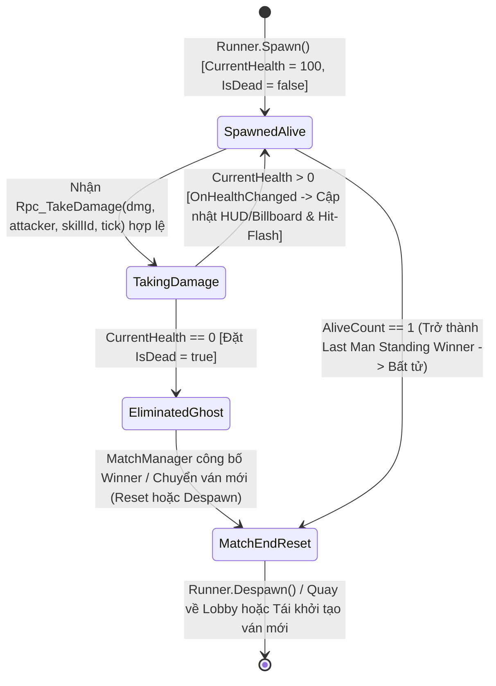

# Health, Damage RPC & Death State System

> **Status**: Designed
> **Creative Director Review (CD-GDD-ALIGN)**: APPROVED 2026-11-10
> **Author**: Solo Developer + Studio Agents (`systems-designer`, `network-engineer`, `gameplay-programmer`, `creative-director`, `qa-lead`)
> **Last Updated**: 2026-11-10
> **Last Verified**: 2026-11-10
> **Implements Pillar**: Pillar 1 (Cơ Động Phản Xạ Định Đoạt Sinh Tồn), Pillar 3 (Công Bằng Mạng Tuyệt Đối Trên Shared Mode) & Pillar 4 (Khán Đài Hồn Ma & Vinh Quang Bảng Vàng)

## Summary

**Health, Damage RPC & Death State System (`PlayerHealthNetworked`)** là hệ thống cốt lõi ở tầng **Core (`MVP`)** chịu trách nhiệm quản lý toàn bộ vòng đời sinh tồn của đấu sĩ Cartoon Capsule trên mạng **Photon Fusion 2 (`GameMode.Shared`)**: khởi tạo máu tối đa (`CurrentHealth = 100`) khi `Spawned()`, tiếp nhận và xác thực sát thương liên máy trạm qua giao thức `[Rpc(RpcSources.All, RpcTargets.StateAuthority)] Rpc_TakeDamage`, đồng bộ hiển thị thanh máu theo hướng sự kiện mạng bằng `[OnChangedRender]` (cam kết `0 Update() polling`), và thực thi chuyển trạng thái tử trận (`IsDead = true`) một cách tức thời, minh bạch. Người chơi cảm nhận trực tiếp hệ thống này mỗi khi tung nhát chém dọc (`35 dmg`), chém ngang xoay người $90^\circ$ (`25 dmg`) hay bắn đạn tầm xa (`20 dmg`) trúng đích và thấy vạch máu đối phương tụt xuống sắc gọn kèm lớp thanh máu trễ (`Catch-up Bar`), hoặc khi nhân vật cạn máu (`0/100 HP`) lập tức biến mất khỏi tầng va chạm vật lý để nhường chỗ cho góc nhìn **Ghost Mode Spectator (`#9`)** và cập nhật bảng điểm sinh tồn **Last Man Standing (`#10`)**.

> **Quick reference** — Layer: `Core` · Priority: `MVP` · Key deps: `Photon Fusion 2 Shared Mode Session & Object Pool System`, `Character & Combat Config Data (inferred)`

## Overview

Trong kiến trúc **Photon Fusion 2 — Shared Mode (`GameMode.Shared`)** của *Capsule Arena: Last Man Standing*, mỗi máy Client giữ quyền `StateAuthority` độc quyền đối với Prefab nhân vật của chính mình. Điều này đặt ra một bài toán kỹ thuật trọng tâm cho thể loại đối kháng PvP (**Pillar 3 — Công Bằng Mạng Tuyệt Đối Trên Shared Mode**): khi Người chơi A (`Attacker`) chém trúng hoặc bắn trúng Người chơi B (`Victim`), máy của Người chơi A không được phép ghi đè trực tiếp vào biến `[Networked] CurrentHealth` trên đối tượng mạng thuộc quyền sở hữu của Người chơi B. **Health, Damage RPC & Death State System (`PlayerHealthNetworked`)** giải quyết triệt để bài toán này bằng mô hình **Ủy Quyền Sát Thương Qua RPC Tới Chủ Sở Hữu Trạng Thái (`Attacker-Confirmed Hit -> Target StateAuthority RPC Validation`)**.

Ngay khi hệ thống chiến đấu (`#7`) trên máy người tấn công xác nhận đòn đánh hợp lệ (đã vượt qua kiểm tra `HitboxRoot` Lag Compensation và tia `Physics.Linecast` chống xuyên tường `Obstacle | Boundary`), máy người tấn công phát lệnh `[Rpc(RpcSources.All, RpcTargets.StateAuthority)] Rpc_TakeDamage(int damageAmount, PlayerRef attacker, CombatSkillId skillId, int attackTick)` tới thẳng máy giữ `StateAuthority` của nạn nhân. Tại đây, `PlayerHealthNetworked` thực thi chốt chặn chống trừ máu kép (`if (IsDead || CurrentHealth <= 0 || damageAmount <= 0) return;`), trừ máu kẹp biên an toàn (`CurrentHealth = Mathf.Max(0, CurrentHealth - damageAmount)`), và ghi nhận `LastAttacker = attacker`. Mọi thay đổi trên `[Networked, OnChangedRender(nameof(OnHealthChanged))] public int CurrentHealth { get; set; }` và `[Networked, OnChangedRender(nameof(OnDeathStateChanged))] public NetworkBool IsDead { get; set; }` sẽ tự động kích hoạt callback giao diện trên toàn bộ các máy trong phòng mà không cần bất kỳ vòng lặp `Update()` nào kiểm tra máu mỗi khung hình. Khi `CurrentHealth == 0`, hệ thống lập tức khóa `IsDead = true`, tắt ngay `CharacterController.enabled = false` và `HitboxRoot.HitboxRootActive = false` để xác người chết không bao giờ cản đường hay chắn đạn, đồng thời phát sự kiện C# một chiều `OnPlayerDeathStateChanged(PlayerRef victim, PlayerRef killer, CombatSkillId killingSkill)` để kích hoạt **Ghost Mode Spectator (`#9`)** và xét điều kiện thắng **Last Man Standing (`AliveCount == 1`)** tại **MatchManager (`#10`)**.

## Player Fantasy

> **System Framing:** `[A] Direct & [B] Indirect — Người chơi trực tiếp theo dõi sinh mệnh của mình và đối thủ qua từng vạch máu tụt xuống theo ngưỡng sát thương cố định (35 / 25 / 20 HP), đồng thời trải nghiệm sự chuyển pha mượt mà từ chiến đấu sinh tử sang khán đài hồn ma (Ghost Mode) ngay khoảnh khắc bị hạ gục.`

### 1. Giấc mơ cốt lõi: "Mỗi Nhát Kiếm Đều Có Trọng Lượng — Sinh Tử Rõ Ràng Trong Từng Vạch Máu"
Trong một đấu trường phản xạ tốc độ cao như *Capsule Arena: Last Man Standing*, không gì phá hủy cảm xúc người chơi nhanh hơn cảm giác "đánh trúng nhưng máu không tụt" hoặc "chết oan vì sát thương ma / xác chết cản đường". Hệ thống **Health, Damage RPC & Death State** hiện thực hóa giấc mơ về một **Đài Sinh Tử Minh Bạch Tuyệt Đối**: mỗi nhát chém, mỗi viên đạn trúng đích đều lập tức khắc dấu ấn lên thanh máu `100/100` với độ chính xác toán học không khoan nhượng.

Khi người chơi nhìn thấy thanh máu **World-Space Overhead Billboard** trên đầu đối thủ tụt từ `100/100` xuống `65/100` sau một cú **Chém dọc (`Left Click` — `35 dmg`)**, phần vạch máu màu trắng vàng (`Catch-up Trail`) co rút dần tạo nên cảm giác "vết thương thực sự đang rỉ máu". Người chơi không cần đoán mò: chỉ cần 1 cú **Lướt tiến (`Phím 2`)**, 1 nhát **Chém ngang xoay người $90^\circ$ (`Phím 1/3` — `25 dmg`)** và 2 viên **Đạn tầm xa (`Right Click` — `20 dmg x 2`)** là đủ kết liễu mục tiêu. Và ngay cả khi bản thân ngã xuống ở mức `0/100 HP`, cuộc vui không hề bị ngắt quãng bởi màn hình đen chờ đợi nhàm chán — người chơi lập tức hóa thành một "Hồn ma khán giả" (**Pillar 4 — Khán Đài Hồn Ma & Vinh Quang Bảng Vàng**), tự do bay lượn qua góc nhìn của những kẻ sống sót và trò chuyện sôi nổi trên kênh Chat trong lúc chờ ván đấu tìm ra nhà vô địch cuối cùng.

### 2. Trải nghiệm cảm giác qua từng khoảnh khắc (How the Player Experiences the Effects)
1. **Phản hồi Trúng đòn Tức thì & Ngưỡng Sát thương Đọc vị được (Crisp Damage Breakpoints):** Ngay khoảnh khắc lưỡi kiếm hoặc viên đạn chạm mục tiêu, gói tin `Rpc_TakeDamage` cập nhật `CurrentHealth` khiến nhân vật bị trúng đòn chớp trắng (`Hit-Flash 0.08s`), thanh máu chính tụt tức khắc xuống mốc mới trong khi thanh máu phụ màu trắng vàng (`Damage Catch-up Fill`) trượt đuổi theo trong `~0.35s`. Nhịp điệu thị giác hai lớp này giúp mắt người chơi dù đang xoay camera $90^\circ$ ở tốc độ cao vẫn nhận biết chính xác lượng máu vừa bốc hơi là `35 HP` (Chém dọc), `25 HP` (Chém ngang) hay `20 HP` (Đạn xa).
2. **Sàn Đấu Sạch Bóng Vật Cản Ma Khi Kết Liễu (Clean Elimination & Zero Corpse Blocking):** Khi đòn đánh cuối cùng đưa `CurrentHealth` về `0`, mục tiêu bị hạ gục lập tức nổ tung thành các hạt năng lượng sáng và giải phóng hoàn toàn không gian vật lý (`CharacterController.enabled = false`, `HitboxRoot.HitboxRootActive = false`). Nếu người chơi đang giao tranh 1 chọi 2 ở góc chữ L hẹp, việc hạ gục tên địch đầu tiên cho phép người chơi lập tức bấm phím `2` (**Forward Dash**) xuyên thẳng qua vị trí xác của hắn hoặc bắn đạn `Right Click` xuyên qua khoảng trống đó để tấn công kẻ thứ hai mà không bao giờ bị "kẹt xác" hay "chắn đạn vô hình".
3. **Chuyển Pha Liền Mạch Sang Ghost Mode Spectator (Seamless Death-to-Spectator Transition):** Không có cảnh nhân vật nằm co giật gây mất kiểm soát hay lỗi nhận thêm sát thương âm (`-35 HP`). Ngay khi `IsDead` chuyển sang `true`, cụm 7 nút kỹ năng chiến đấu khóa lại, camera Cinemachine tự động tách khỏi thân xác cũ để bám theo đấu sĩ còn sống tiếp theo trên sân (`#9`), đồng thời thông báo hạ gục (`Kill Feed / Alive Counter`) của `MatchManager (#10)` nhảy số tức thì.

### 3. Điểm chạm Tham chiếu & Đối chiếu Trụ cột Thiết kế

| Điểm tham chiếu / Trụ cột | Cách `Health, Damage RPC & Death State System` hiện thực hóa trải nghiệm người chơi |
| :--- | :--- |
| ***Brawl Stars*** *(Instant Health Bar Catch-up & Clean Knockouts)* | Thanh máu Overhead Billboard `100/100` phản ứng ngay lập tức qua `[OnChangedRender]` với hiệu ứng vạch trắng co đuổi theo sát thương vừa nhận; khi máu về `0`, nhân vật biến mất gọn gàng khỏi mặt sàn đấu trường. |
| ***Valorant / Battlerite*** *(Deterministic Breakpoints & Zero Ghost Colliders)* | Mọi đòn đánh đều trừ lượng máu nguyên cố định (`35`, `25`, `20`) không có RNG; ngay khi tử trận, toàn bộ Collider và `HitboxRoot` bị ngắt trong cùng 1 khung hình để không bao giờ chắn đạn của người còn sống. |
| **Pillar 1 & Pillar 3** *(Cơ Động Phản Xạ & Công Bằng Mạng Shared Mode)* | Cơ chế `[Rpc(RpcSources.All, RpcTargets.StateAuthority)]` kết hợp chốt chặn chống trừ máu kép tại `StateAuthority` đảm bảo mỗi đòn đánh trúng chỉ trừ máu đúng 1 lần duy nhất, bất kể độ trễ mạng. |
| **Pillar 4** *(Khán Đài Hồn Ma & Vinh Quang Bảng Vàng)* | Sự kiện một chiều `OnPlayerDeathStateChanged(victim, killer, skillId)` là chiếc cầu nối trực tiếp đưa người vừa ngã xuống vào chế độ **Ghost Mode Spectator (`#9`)** và ghi nhận chiến công (`+1 Kill`) lên bảng vàng **MatchManager (`#10`)** $\rightarrow$ **PlayFab Leaderboard (`#13`)**. |

## Detailed Design

### Core Rules

1. **Quy tắc Khởi Tạo Máu & Sinh Mệnh Tại `Spawned()` (StateAuthority Initialization Contract):**
   - Thành phần `PlayerHealthNetworked` (kế thừa `NetworkBehaviour`) trên Prefab nhân vật (`pf_char_capsule_player_01.prefab`) giữ tham chiếu chỉ đọc tới `ICharacterCombatConfig` (`so_character_combat_config_default_01.asset` từ Hệ thống `#1`).
   - Khi phương thức `public override void Spawned()` được Photon Fusion 2 gọi:
     - **Nếu `Object.HasStateAuthority == true`**: Máy chủ sở hữu nhân vật bắt buộc khởi tạo trạng thái mạng chuẩn:
       - `CurrentHealth = Config.MaxHealth;` (mặc định `100 HP`).
       - `IsDead = false;`
       - `LastAttacker = PlayerRef.None;`
       - `LastKillingSkill = CombatSkillId.None;`
       - `LastProcessedAttackTick = -1;`
     - **Trên mọi máy (`StateAuthority` lẫn `Proxy`)**: Khôi phục trạng thái vật lý và hiển thị sống: bật `CharacterController.enabled = true`, bật `HitboxRoot.HitboxRootActive = true`, bật nhánh đồ họa `VisualRoot.gameObject.SetActive(true)`, và gọi một lần `OnHealthChanged()` + `OnDeathStateChanged()` ngay cuối `Spawned()` để đồng bộ giao diện ban đầu (`100/100 HP`) cho cả người chơi vào phòng muộn (`Late Joiner`).

2. **Quy tắc Đồng Bộ Giao Diện Phản Ứng Theo Sự Kiện Mạng (`[OnChangedRender]` — Zero Update Polling):**
   - Nghiêm cấm sử dụng vòng lặp `Update()` hoặc `LateUpdate()` để kiểm tra giá trị máu mỗi khung hình. Hệ thống sử dụng thuộc tính mạng phản ứng của Photon Fusion 2:
     ```csharp
     [Networked, OnChangedRender(nameof(OnHealthChanged))]
     public int CurrentHealth { get; set; }

     [Networked, OnChangedRender(nameof(OnDeathStateChanged))]
     public NetworkBool IsDead { get; set; }
     ```
   - Phương thức `private void OnHealthChanged()` chỉ được Fusion 2 tự động gọi trong bước `Render()` khi giá trị `CurrentHealth` thực sự thay đổi giữa hai bản chụp mạng (Network Snapshot). Tại đây, hệ thống phát sự kiện cục bộ `OnHealthChanged(currentHp, maxHp, delta)` tới thanh máu HUD cá nhân, thanh máu **World-Space Overhead Billboard (`#8`)**, bộ hiển thị **Chữ Số Sát Thương/Hồi Máu Bay Nổi (`FloatingDamageTextManager` — màu Đỏ `#FF3B3B` khi mất máu, màu Xanh Lá `#22C55E` khi tăng máu, không dấu `-`/`+`, bay lên trong `0.85s` với `2/3` phóng to + `1/3` thu nhỏ mờ dần, chỉ ẩn với bản thân khi ở `FPS`)**, đồng thời kích hoạt hiệu ứng chớp trắng `Hit-Flash` trên `VisualRoot` (`#14`) nếu máu giảm.
   - Chốt kiểm tra mạng an toàn trên `PlayerHealth` sử dụng `IsSpawnedOnRunner => _isNetworkSpawned && Object != null && Runner != null && Object.IsValid` kết hợp `ResolveNetworkOwner()` (`Object.InputAuthority != PlayerRef.None ? Object.InputAuthority : Object.StateAuthority`) để hoạt động đối xứng 100% trên cả máy Host lẫn các máy Client join trong `GameMode.Shared`.

3. **Quy tắc Giao Thức Nhận Sát Thương Trong Photon Fusion 2 `GameMode.Shared` (`Rpc_TakeDamage` Protocol):**
   - Do đặc thù của `GameMode.Shared` (mỗi Client giữ `StateAuthority` trên nhân vật của mình và chỉ `StateAuthority` mới có quyền thay đổi các biến `[Networked]`), khi Hệ thống Chiến đấu (`#7`) trên máy người tấn công (`Attacker`) xác nhận một đòn đánh trúng mục tiêu (**Vertical Slash `LMB` = `35 dmg`**, **Horizontal Turning Slash $90^\circ$ `Phím 1/3` = `25 dmg`**, hoặc **Ranged Attack `RMB` = `20 dmg`**), máy người tấn công sẽ gọi RPC tới chủ sở hữu của mục tiêu:
     ```csharp
     [Rpc(RpcSources.All, RpcTargets.StateAuthority, HostMode = RpcHostMode.SourceIsServer)]
     public void Rpc_TakeDamage(int damageAmount, PlayerRef attacker, CombatSkillId skillId, int attackTick)
     ```
   - Ngay khi máy giữ `StateAuthority` của nạn nhân nhận được `Rpc_TakeDamage`, hệ thống thực thi **Chuỗi 5 Chốt Chặn An Toàn & Chống Trừ Máu Kép (`5-Step Authority Validation Gate`)**:
     1. **Chốt chặn Trạng thái Sinh tồn & Lượng sát thương dương:**
        `if (IsDead || CurrentHealth <= 0 || damageAmount <= 0) return;`
     2. **Chốt chặn Trạng thái Trận đấu (`MatchState Gate`):**
        Nếu `MatchManager.Instance != null && !MatchManager.Instance.IsCombatAllowed` (ví dụ trận đấu đang ở trạng thái `WaitingForPlayers` hoặc đã kết thúc `MatchEnded`), lập tức `return;` để đảm bảo bất tử sau khi tìm ra người chiến thắng.
     3. **Chốt chặn Chống Tự Sát Thương (`Anti-Self-Harm Gate`):**
        `if (attacker == Object.InputAuthority && attacker != PlayerRef.None) return;` (người chơi không bao giờ tự chém hoặc tự bắn trúng chính mình).
     4. **Chốt chặn Chống Trùng Lặp Gói Tin Mạng (`Idempotency & Duplicate Packet Gate`):**
        Nếu nhận cùng một cặp `(attacker, skillId, attackTick)` đã được xử lý trước đó (`attackTick == LastProcessedAttackTick && attacker == LastAttacker`), lập tức `return;` để triệt tiêu nguy cơ trừ máu kép trong cùng 1 đòn đánh.
     5. **Chốt chặn Kẹp Biên Sát Thương Hợp Lệ (`Sanity Clamp Gate`):**
        Kẹp `int validDamage = Mathf.Clamp(damageAmount, 1, Config.MaxHealth);` để ngăn chặn gói tin bất thường gây sát thương vượt quá giới hạn cấu hình.
   - Sau khi vượt qua cả 5 chốt chặn, `StateAuthority` thực thi trừ máu nguyên tử:
     ```csharp
     LastAttacker = attacker;
     LastKillingSkill = skillId;
     LastProcessedAttackTick = attackTick;
     CurrentHealth = Mathf.Max(0, CurrentHealth - validDamage);
     if (CurrentHealth == 0)
     {
         IsDead = true;
     }
     ```

4. **Quy tắc Chuyển Trạng Thái Tử Trận & Vô Hiệu Hóa Vật Lý Tức Thì (`Death State & Collision Cleanup`):**
   - Ngay tại thời điểm `CurrentHealth == 0` dẫn tới `IsDead = true` (được thực thi tức thì trên máy `StateAuthority` ngay trong `Rpc_TakeDamage` và được đồng bộ sang toàn bộ máy `Proxy` thông qua callback `[OnChangedRender(nameof(OnDeathStateChanged))]`):
     - **Tắt va chạm di chuyển vật lý:** Đặt `CharacterController.enabled = false;` (và tắt mọi `Collider` phụ nếu có trên thân nhân vật) để các đấu sĩ còn sống có thể chạy hoặc lướt (`Forward Dash [2]`, `Side Dodge Roll [Q/E]`) xuyên qua vị trí vừa tử trận mà không bị vấp hay kẹt đường.
     - **Tắt vùng nhận sát thương bù trễ:** Đặt `HitboxRoot.HitboxRootActive = false;` (và tắt các `Hitbox` con) để xác của người chơi đã chết **không bao giờ** hút mất tia chém cận chiến hoặc chắn mất viên đạn tầm xa (`Right Click`) đang bay tới những người chơi còn sống phía sau.
     - **Thu dọn hiển thị thân xác:** Ẩn nhánh đồ họa `VisualRoot.gameObject.SetActive(false)` (sau khi kích hoạt hạt nổ `Death Shatter VFX` từ Local Pool của `#14`) và ẩn thanh máu **World-Space Overhead Billboard (`#8`)**.

5. **Quy tắc Phát Sự Kiện C# Một Chiều Giải Phóng Phụ Thuộc Vòng (`Unidirectional Death Event Dispatch`):**
   - Để tuân thủ kiến trúc `0 Circular Dependencies` (`design/gdd/systems-index.md`), `PlayerHealthNetworked` ở tầng **Core** không giữ tham chiếu trực tiếp tới lớp điều khiển Camera (`#9`) hay `MatchManager` (`#10`) ở tầng **Feature**. Thay vào đó, khi `OnDeathStateChanged()` nhận thấy `IsDead == true`, hệ thống phát sự kiện C# một chiều:
     ```csharp
     public static event Action<PlayerRef, PlayerRef, CombatSkillId> OnPlayerDeathStateChanged;
     ```
     với 3 tham số tường minh: `victim` (`Object.InputAuthority`), `killer` (`LastAttacker`), và `killingSkill` (`LastKillingSkill`).
   - Hai hệ thống hạ nguồn lắng nghe sự kiện này một cách độc lập:
     1. **Hệ thống `#9` (`Dual-Perspective Camera & Ghost Mode Spectator`):** Nếu `victim == Runner.LocalPlayer` (tức máy của người vừa chết có `Object.HasStateAuthority == true`), `#9` lập tức chuyển `CinemachineCamera` sang chế độ **Ghost Mode Spectator** bám theo một đấu sĩ còn sống, đồng thời thông báo cho `InputFocusManager` (`#3`) chuyển sang trạng thái `GhostSpectating`.
     2. **Hệ thống `#10` (`Last Man Standing Match Manager`):** Máy giữ quyền điều phối (`SharedModeMasterClient`) lắng nghe sự kiện để cộng `+1 Kill` cho `killer` (nếu `killer != PlayerRef.None && killer != victim`), tính lại số người còn sống `AliveCount`, và công bố người chiến thắng ngay khi **Last Man Standing (`AliveCount == 1`)** được thỏa mãn.

6. **Bảng Đặc Tả Thuộc Tính Mạng (`[Networked]`), Phương Thức RPC & Sự Kiện C# (`PlayerHealthNetworked`):**

| Phân Loại | Tên Thành Phần / Chữ Ký (`Signature`) | Nguồn / Đích | Mô Tả Ngữ Nghĩa & Ràng Buộc Kỹ Thuật |
| :--- | :--- | :---: | :--- |
| **`[Networked]` Property** | `[Networked, OnChangedRender(nameof(OnHealthChanged))] public int CurrentHealth { get; set; }` | `StateAuthority` $\rightarrow$ `All` | Lượng máu hiện tại của nhân vật (`0` đến `Config.MaxHealth = 100`). Chỉ `StateAuthority` được phép ghi. |
| **`[Networked]` Property** | `[Networked, OnChangedRender(nameof(OnDeathStateChanged))] public NetworkBool IsDead { get; set; }` | `StateAuthority` $\rightarrow$ `All` | Cờ trạng thái tử trận (`false` khi đang sống, `true` khi `CurrentHealth == 0`). Kích hoạt dọn dẹp vật lý & chuyển Ghost Mode. |
| **`[Networked]` Property** | `[Networked] public PlayerRef LastAttacker { get; set; }` | `StateAuthority` $\rightarrow$ `All` | Lưu định danh `PlayerRef` của người chơi tung đòn đánh hợp lệ cuối cùng vào nạn nhân để trao thưởng `+1 Kill`. |
| **`[Networked]` Property** | `[Networked] public CombatSkillId LastKillingSkill { get; set; }` | `StateAuthority` $\rightarrow$ `All` | Lưu loại kỹ năng gây sát thương cuối cùng (`VerticalSlash`, `HorizontalSlash`, `RangedAttack`) phục vụ Kill Feed & Audio/VFX. |
| **Network RPC** | `[Rpc(RpcSources.All, RpcTargets.StateAuthority)] public void Rpc_TakeDamage(int damageAmount, PlayerRef attacker, CombatSkillId skillId, int attackTick)` | `Attacker Client` $\rightarrow$ `Victim StateAuthority` | Giao thức duy nhất để yêu cầu trừ máu một mục tiêu trong `GameMode.Shared`. Có chốt chặn chống trừ máu kép. |
| **Instance C# Event** | `public event Action<int, int, int> OnHealthValueChanged;` | `PlayerHealthNetworked` $\rightarrow$ `#8 HUD / Billboard` | Phát `(currentHealth, maxHealth, damageDelta)` mỗi khi `OnHealthChanged()` kích hoạt trong `Render()`. |
| **Static C# Event** | `public static event Action<PlayerRef, PlayerRef, CombatSkillId> OnPlayerDeathStateChanged;` | `PlayerHealthNetworked` $\rightarrow$ `#9 Camera`, `#10 MatchManager`, `#14 Audio/VFX` | Phát `(victim, killer, killingSkill)` một chiều khi `IsDead` chuyển từ `false` sang `true`. Tự động dọn dẹp (`null`) khi tắt `NetworkRunner` để tương thích Unity 6.6 Skip Domain Reload. |

### States and Transitions

Vòng đời sinh tồn của mỗi nhân vật người chơi trong `PlayerHealthNetworked` đi qua **4 trạng thái xác định** từ lúc được `Runner.Spawn()` vào đấu trường cho tới khi kết thúc ván đấu:



1. **`SpawnedAlive` (Đang Sống & Sẵn Sàng Giao Tranh):**
   - **Điều kiện vào:** Khi `Spawned()` thực thi: `CurrentHealth = Config.MaxHealth (100)`, `IsDead = false`, `CharacterController.enabled = true`, `HitboxRoot.HitboxRootActive = true`.
   - **Hành vi:** Nhân vật di chuyển bình thường (`#5`), tung đòn tấn công (`#7`), hiển thị thanh máu Overhead Billboard (`#8`), và sẵn sàng tiếp nhận `Rpc_TakeDamage`.
2. **`TakingDamage` (Xử Lý & Phản Ứng Sát Thương Nguyên Tử):**
   - **Điều kiện vào:** Máy giữ `StateAuthority` nhận gói tin `Rpc_TakeDamage` vượt qua 5 chốt chặn hợp lệ (`!IsDead && CurrentHealth > 0 && damageAmount > 0 && IsCombatAllowed && attacker != InputAuthority`).
   - **Hành vi:** Tính `CurrentHealth = Mathf.Max(0, CurrentHealth - validDamage)`, lưu `LastAttacker = attacker`, `LastKillingSkill = skillId`.
   - **Chuyển tiếp:**
     - Nếu `CurrentHealth > 0`: Quay lại `SpawnedAlive` ngay trong cùng Tick mạng; callback `OnHealthChanged()` trong `Render()` cập nhật thanh máu HUD/Billboard (`#8`) và phát hiệu ứng chớp trắng `Hit-Flash` (`#14`).
     - Nếu `CurrentHealth == 0`: Chuyển thẳng sang `EliminatedGhost` bằng cách gán `IsDead = true`.
3. **`EliminatedGhost` (Đã Tử Trận & Hóa Hồn Ma Khán Giả):**
   - **Điều kiện vào:** `CurrentHealth == 0` và `IsDead == true`.
   - **Hành vi:**
     - Ngắt tức thì `CharacterController.enabled = false` và `HitboxRoot.HitboxRootActive = false` trên mọi máy Client.
     - Ẩn `VisualRoot` và thanh máu Overhead Billboard (`#8`).
     - Bỏ qua (`return`) 100% các gói tin `Rpc_TakeDamage` đến muộn sau thời điểm tử trận.
     - Phát `OnPlayerDeathStateChanged(victim, LastAttacker, LastKillingSkill)` để chuyển máy của nạn nhân sang **Ghost Mode Spectator (`#9`)** và báo cho **MatchManager (`#10`)** cập nhật `Kills` / `AliveCount`.
4. **`MatchEndReset` (Khóa Bất Tử Cuối Trận & Thu Hồi):**
   - **Điều kiện vào:** `MatchManager (#10)` chuyển sang trạng thái `MatchEnded` (khi tìm ra người sống sót cuối cùng `AliveCount == 1` hoặc hết giờ `MatchTimer`).
   - **Hành vi:** Mọi đấu sĩ còn sống ở `SpawnedAlive` được khóa bất tử (từ chối mọi `Rpc_TakeDamage` mới) để ăn mừng chiến thắng và gửi thống kê lên **PlayFab (`#13`)** trước khi `Runner.Despawn()` hoặc tái khởi tạo ván mới.

### Interactions with Other Systems

| Hệ Thống Liên Quan | Hướng Luồng Dữ Liệu | Cơ Chế Hợp Đồng Giao Tiếp (`API / Event / Network Property`) |
| :--- | :---: | :--- |
| **System #1: Character & Combat Config Data (`CharacterCombatConfigSO`)** | `#1` $\rightarrow$ `#6` (Upstream Read) | `PlayerHealthNetworked` đọc `ICharacterCombatConfig.MaxHealth` (`100 HP`) khi `Spawned()` để khởi tạo `CurrentHealth` và làm mẫu số chuẩn hóa tỷ lệ máu. |
| **System #3: Keybinding & Input Management (`InputFocusManager`)** | `#6` $\rightarrow$ `#3` (Qua sự kiện Death) | Khi `OnPlayerDeathStateChanged` phát ra cho `Runner.LocalPlayer`, `InputFocusManager` chuyển trạng thái từ `CombatActive` sang `GhostSpectating`, ngừng gửi input di chuyển/chiến đấu của nhân vật đã chết vào `OnInput`. |
| **System #4: Photon Fusion 2 Shared Mode Session & Object Pool** | `#4` $\rightarrow$ `#6` (Upstream Runtime) | Cung cấp ngữ cảnh `NetworkRunner`, quyền `Object.HasStateAuthority`, cơ chế định tuyến `[Rpc]` và đồng bộ snapshot cho `[Networked] CurrentHealth` / `IsDead`. |
| **System #5: Tick-Accurate Character Movement & Mobility** | `#6` $\rightarrow$ `#5` (Local Component Guard) | `#5` kiểm tra thuộc tính chỉ đọc `Health.IsDead` ở đầu `FixedUpdateNetwork()`: nếu `IsDead == true`, `#5` dừng ngay mọi xử lý `WASD`, `Forward Dash [2]`, `Side Dodge Roll [Q/E]` và xoay thân người $90^\circ$, đồng thời `#6` tắt `CharacterController.enabled = false`. |
| **System #7: Multi-Directional Melee & Pooled Ranged Combat** | `#7` $\rightarrow$ `#6` (RPC Call & Guard) | Khi đòn đánh trúng mục tiêu, `#7` gọi `targetHealth.Rpc_TakeDamage(damage, Runner.LocalPlayer, skillId, Runner.Tick)`. Ngược lại, `#7` cũng kiểm tra `selfHealth.IsDead` để ngăn người đã chết tiếp tục vung kiếm hoặc bắn đạn. |
| **System #8: Combat HUD, Overhead Billboard & Mobile Action Pad** | `#6` $\rightarrow$ `#8` (`[OnChangedRender]` Event) | `#8` đăng ký lắng nghe `OnHealthValueChanged` và `OnPlayerDeathStateChanged` để cập nhật thanh máu HUD cá nhân, thanh máu **World-Space Overhead Billboard (`100/100`)** kèm thanh máu trễ (`Catch-up Fill`), và làm mờ cụm 7 nút kỹ năng mềm khi tử trận. |
| **System #9: Dual-Perspective Camera (FPS/TPS) & Ghost Mode Spectator** | `#6` $\rightarrow$ `#9` (Unidirectional Event) | Khi nhận `OnPlayerDeathStateChanged(victim, killer, skill)` với `victim == Runner.LocalPlayer`, `#9` lập tức chuyển góc nhìn từ `FPS/TPS` của bản thân sang chế độ **Ghost Mode Spectator** theo dõi những người còn sống. |
| **System #10: Last Man Standing Match Manager & Authority Failover** | `#6` $\rightarrow$ `#10` (Unidirectional Event) | `#10` lắng nghe `OnPlayerDeathStateChanged` để cộng `+1 Kill` cho `killer`, giảm `AliveCount` đi `1`, và kiểm tra điều kiện thắng **Last Man Standing (`AliveCount == 1`)**. |
| **System #14: 3D Spatial Audio & Combat VFX Feedback** | `#6` $\rightarrow$ `#14` (Render Callback) | Khi `OnHealthChanged()` phát hiện máu giảm, `#14` kích hoạt chớp trắng `Hit-Flash` (`0.08s`) trên `VisualRoot` và âm thanh trúng đòn; khi `IsDead == true`, `#14` phát hiệu ứng vỡ hạt `Death Shatter VFX` và âm thanh hạ gục 3D. |

## Formulas

### 1. Cập Nhật Máu Kẹp Biên An Toàn Sau Sát Thương (`clamped_health_after_damage`)

The `clamped_health_after_damage` formula is defined as:

`clamped_health_after_damage = max(0, current_health - incoming_damage)`

**Variables:**

| Variable | Type | Range | Source | Description |
| :--- | :---: | :---: | :--- | :--- |
| `current_health` | `int` | `1–100` | `PlayerHealthNetworked.CurrentHealth` | Lượng máu nguyên hiện tại của nhân vật trên máy `StateAuthority` ngay trước khi trừ sát thương (`HP`). |
| `incoming_damage` | `int` | `1–100` | Tham số `damageAmount` từ `Rpc_TakeDamage` (đã kẹp biên qua `CharacterCombatConfigSO`) | Lượng sát thương hợp lệ của đòn đánh trúng đích: `VerticalSlash = 35`, `HorizontalSlash = 25`, hoặc `RangedAttack = 20` (`HP`). |
| `clamped_health_after_damage` | `int` | `0–99` | Gán lại vào `[Networked] CurrentHealth` | Lượng máu mới sau khi trừ sát thương, được khóa cứng ở cận dưới bằng `0` để không bao giờ xuất hiện số máu âm trên mạng hoặc UI. |

**Output Range:** `0` đến `99` `HP` (số nguyên `int`; khi đạt `0` sẽ lập tức kích hoạt cờ `IsDead = true`).

**Example:**
- **Đòn đánh cấu máu thông thường:** Mục tiêu đang đầy máu `current_health = 100` bị trúng 1 nhát **Vertical Slash (`Left Click`, `incoming_damage = 35`)**:
  `clamped_health_after_damage = max(0, 100 - 35) = 65 HP` (`IsDead` giữ nguyên `false`).
- **Đòn đánh kết liễu vượt mức máu còn lại (Overkill Clamping):** Mục tiêu chỉ còn `current_health = 15 HP` (sau khi đã trúng 1 nhát Chém dọc `35 dmg`, 1 nhát Chém ngang `25 dmg` và 1 viên Đạn xa `25 dmg`) và nhận tiếp 1 nhát **Vertical Slash (`incoming_damage = 35`)**:
  `clamped_health_after_damage = max(0, 15 - 35) = max(0, -20) = 0 HP` (kẹp biên an toàn về đúng `0 HP` thay vì `-20 HP`, đồng thời chuyển `IsDead = true`).

---

### 2. Tỷ Lệ Phần Trăm Máu Chuẩn Hóa Cho Thanh Máu HUD & Overhead Billboard (`normalized_health_ratio`)

The `normalized_health_ratio` formula is defined as:

`normalized_health_ratio = clamp(current_health / max_health, 0.0, 1.0)`

**Variables:**

| Variable | Type | Range | Source | Description |
| :--- | :---: | :---: | :--- | :--- |
| `current_health` | `float` (ép kiểu từ `int`) | `0.0–100.0` | `PlayerHealthNetworked.CurrentHealth` | Giá trị máu hiện tại được truyền vào callback `[OnChangedRender(nameof(OnHealthChanged))]`. |
| `max_health` | `float` (ép kiểu từ `int`) | `50.0–500.0` | `ICharacterCombatConfig.MaxHealth` (`mặc định 100.0`) | Máu tối đa cấu hình trong `CharacterCombatConfigSO` (luôn `> 0` nhờ khóa biên `OnValidate()`). |
| `normalized_health_ratio` | `float` | `0.00–1.00` | Thuộc tính `Image.fillAmount` của thanh máu chính (`System #8`) | Tỷ lệ lấp đầy chuẩn hóa từ `0.0` (rỗng) đến `1.0` (đầy) dùng cho cả thanh máu HUD góc trên trái lẫn thanh máu **World-Space Overhead Billboard**. |

**Output Range:** `0.00` đến `1.00` (`float` không thứ nguyên, tương ứng `0%` đến `100%` chiều rộng thanh máu).

**Example:**
- Khi vừa `Spawned()` với `current_health = 100` và `max_health = 100`:
  `normalized_health_ratio = clamp(100.0 / 100.0, 0.0, 1.0) = 1.00` (thanh máu hiển thị đầy `100%`, nhãn chữ `"100/100"`).
- Sau khi trúng 1 nhát **Chém ngang xoay người $90^\circ$ (`Phím 1/3`, `25 dmg`)**, máu còn `current_health = 75`:
  `normalized_health_ratio = clamp(75.0 / 100.0, 0.0, 1.0) = 0.75` (thanh máu chính tụt tức thì về mốc `75%`, nhãn chữ `"75/100"`).
- Sau khi trúng thêm 1 viên **Đạn tầm xa (`Right Click`, `20 dmg`)**, máu còn `current_health = 55`:
  `normalized_health_ratio = clamp(55.0 / 100.0, 0.0, 1.0) = 0.55` (mốc `55%`, nhãn chữ `"55/100"`).

---

### 3. Tốc Độ Co Thanh Máu Trễ Màu Trắng Vàng (`damage_catchup_fill`)

The `damage_catchup_fill` formula is defined as:

`damage_catchup_fill = move_towards(current_catchup_fill, normalized_health_ratio, catchup_decay_speed * delta_time)`

**Variables:**

| Variable | Type | Range | Source | Description |
| :--- | :---: | :---: | :--- | :--- |
| `current_catchup_fill` | `float` | `0.00–1.00` | Trạng thái nội bộ của lớp `CatchupBarImage.fillAmount` (`System #8`) | Tỷ lệ lấp đầy hiện tại của lớp thanh máu phụ màu trắng vàng nằm ngay dưới lớp thanh máu chính. |
| `normalized_health_ratio` | `float` | `0.00–1.00` | Kết quả từ Công thức #2 (`current_health / max_health`) | Tỷ lệ đích mà thanh máu trễ cần co rút về sau khi nhân vật bị mất máu. |
| `catchup_decay_speed` | `float` | `0.50–3.00` | Thông số cấu hình UI (`mặc định 0.85 fill/giây`) | Tốc độ co rút tuyến tính của thanh máu trễ (đơn vị: tỷ lệ thanh máu trên mỗi giây, sau thời gian dừng ngắn `catchup_hold_delay = 0.12s`). |
| `delta_time` | `float` | `0.001–0.100` | `Time.deltaTime` (chỉ chạy trong Coroutine/Tween khi `current_catchup_fill > normalized_health_ratio`) | Khoảng thời gian giữa hai khung hình hiển thị (`giây`). Khi `current_catchup_fill == normalized_health_ratio`, quá trình nội suy tự dừng hoàn toàn (`0 Update() polling`). |
| `damage_catchup_fill` | `float` | `0.00–1.00` | Gán vào `CatchupBarImage.fillAmount` | Giá trị lấp đầy mới của lớp thanh máu trễ trong khung hình hiện tại. |

**Output Range:** `0.00` đến `1.00` (`float`, luôn thỏa mãn `normalized_health_ratio <= damage_catchup_fill <= 1.00`).

**Example:**
- Nhân vật đang ở mức máu đầy (`current_catchup_fill = 1.00`) bị trúng 1 nhát **Vertical Slash (`35 dmg`)**, khiến thanh máu chính tụt tức thì xuống `normalized_health_ratio = 0.65`.
- Sau khoảng dừng thị giác `catchup_hold_delay = 0.12s` để mắt người chơi kịp nhìn thấy phần vạch trắng vàng dài `0.35` (`35%`), thanh máu trễ bắt đầu co lại với `catchup_decay_speed = 0.85 /s` ở tốc độ màn hình `60 FPS` (`delta_time ≈ 0.01667s`):
  - Bước giảm mỗi khung hình: `0.85 * 0.01667 ≈ 0.01417`.
  - Sau `10 khung hình` (`~0.167s` co rút): `damage_catchup_fill = 1.00 - (10 * 0.01417) ≈ 0.8583`.
  - Tổng thời gian để thanh máu trễ co hết quãng `0.35` về khớp với `0.65`: `0.35 / 0.85 ≈ 0.4118s` (cộng thêm `0.12s` giữ nhịp ban đầu = `~0.53s` tổng hiệu ứng thị giác).

## Edge Cases

- **If two lethal attacks (e.g., two `Right Click` projectiles `[20 dmg each]` or a `Vertical Slash [35 dmg]` and a `Horizontal Slash [25 dmg]`) hit a target with `20 HP` remaining within the exact same network tick**: Máy giữ `StateAuthority` của mục tiêu xử lý tuần tự từng lệnh `Rpc_TakeDamage` trên luồng chính của Unity. Lệnh RPC đầu tiên được thực thi sẽ trừ `CurrentHealth` từ `20` về `0`, đặt `IsDead = true`, ghi nhận `LastAttacker = attacker_1`, và phát sự kiện `OnPlayerDeathStateChanged` đúng 1 lần duy nhất. Khi lệnh RPC thứ hai được xử lý ngay sau đó vài micro-giây trong cùng Tick, chốt chặn đầu tiên `if (IsDead || CurrentHealth <= 0 || damageAmount <= 0) return;` sẽ lập tức chặn đứng lệnh thứ hai, đảm bảo `LastAttacker` không bị ghi đè sai người, không phát sự kiện tử trận lần hai, và `MatchManager (#10)` không bao giờ bị trừ `AliveCount` hai lần cho cùng một nạn nhân.
- **If a player's own projectile or melee sweep overlaps their own `HitboxRoot` (`attacker == Object.InputAuthority`)**: Chốt chặn chống tự sát thương thứ 3 trong `Rpc_TakeDamage` (`if (attacker == Object.InputAuthority && attacker != PlayerRef.None) return;`) kết hợp với bộ lọc loại trừ bản thân tại Hệ thống Chiến đấu (`#7`) sẽ từ chối hoàn toàn gói tin này, đảm bảo người chơi không bao giờ tự làm mất máu hoặc tự sát trong đấu trường.
- **If an in-flight projectile (`Right Click`) or delayed RPC arrives at the Last Man Standing winner after `MatchManager (#10)` has already declared `MatchState.MatchEnded`**: Chốt chặn trạng thái trận đấu thứ 2 trong `Rpc_TakeDamage` kiểm tra `if (MatchManager.Instance != null && !MatchManager.Instance.IsCombatAllowed) return;`. Nhờ đó, nhà vô địch cuối cùng (`AliveCount == 1`) trở nên bất tử tuyệt đối ngay khoảnh khắc trận đấu kết thúc, loại bỏ hoàn toàn kịch bản bi hài "người thắng cuộc bị viên đạn lạc bắn chết trong lúc đang hiện bảng Victory (`AliveCount == 0`)".
- **If a corrupted or malformed RPC arrives with `damageAmount <= 0` or an abnormally high value `damageAmount > Config.MaxHealth` (e.g., `damageAmount = 9999` or `-50`)**: Nếu `damageAmount <= 0`, chốt chặn đầu tiên lập tức bỏ qua (`return;`) để ngăn chặn việc lợi dụng `Rpc_TakeDamage` với số âm thành cơ chế tự bơm máu trái phép. Nếu `damageAmount > Config.MaxHealth`, hệ thống kẹp biên `validDamage = Mathf.Clamp(damageAmount, 1, Config.MaxHealth)` và `CurrentHealth = Mathf.Max(0, CurrentHealth - validDamage)`, đảm bảo máu luôn nằm trong đoạn hợp lệ `[0, MaxHealth]`.
- **If the attacker fires a `Right Click` projectile and immediately disconnects / leaves the room before the projectile hits and kills the victim**: Vì gói tin `Rpc_TakeDamage` mang theo giá trị nguyên thủy `PlayerRef attacker` đã được đóng gói lúc viên đạn khởi tạo từ Pool, máy `StateAuthority` của nạn nhân vẫn xử lý sát thương, chuyển `IsDead = true` và phát `OnPlayerDeathStateChanged(victim, attacker, skillId)` bình thường. Khi `MatchManager (#10)` nhận sự kiện, nó luôn giảm `AliveCount` của nạn nhân đi `1` để vòng lặp trận đấu không bị kẹt, và kiểm tra `Runner.ActivePlayers.Contains(killer)` trước khi cộng `+1 Kill` vào bảng điểm (nếu `killer` đã rời phòng thì bỏ qua bước cộng Kill mà không văng lỗi `KeyNotFoundException`).
- **If the victim player disconnects or closes the game client while still alive (`IsDead == false`) or at the exact moment of taking lethal damage**: Trong `GameMode.Shared`, khi máy giữ `StateAuthority` của một nhân vật ngắt kết nối, Photon Fusion 2 sẽ tự động hủy (`Despawn`) Prefab nhân vật đó và kích hoạt callback `OnPlayerLeft(NetworkRunner runner, PlayerRef player)`. Phương thức `public override void Despawned(NetworkRunner runner, bool hasState)` trên `PlayerHealthNetworked` kiểm tra nếu nhân vật bị thu hồi khi `IsDead == false` trong lúc trận đấu đang diễn ra, nó sẽ thông báo cho `MatchManager (#10)` cập nhật lại `AliveCount` động từ danh sách người chơi còn trong phòng, ngăn chặn lỗi treo trận đấu vì chờ một người đã thoát.
- **If a dead player's character (`IsDead == true`) lies in a narrow L-corner corridor or directly in front of a living player's line of fire**: Ngay trong callback `OnDeathStateChanged()` khi `IsDead == true`, hệ thống bắt buộc thực thi đồng thời `CharacterController.enabled = false` và `HitboxRoot.HitboxRootActive = false` trên toàn bộ các máy Client (`StateAuthority` lẫn `Proxy`). Nhờ vậy, không gian vật lý tại vị trí tử trận được giải phóng tức khắc 100%: người còn sống lướt `Forward Dash [2]` xuyên qua không bị khựng và bắn đạn `Right Click` xuyên qua không bị chặn.
- **If a late-joining client or a client recovering from a network spike receives the initial state snapshot of an already-dead player (`CurrentHealth == 0`, `IsDead == true`)**: Cuối phương thức `Spawned()`, hệ thống luôn gọi tường minh `ApplyCurrentVitalityVisuals()` để kiểm tra trạng thái `[Networked] IsDead` hiện tại. Nếu `IsDead == true`, máy Client đó lập tức tắt `CharacterController`, tắt `HitboxRoot`, ẩn `VisualRoot` và ẩn thanh máu Overhead Billboard ngay từ khung hình đầu tiên mà không phát lại hiệu ứng nổ `Death Shatter VFX` hay âm thanh tử trận giả tạo.
- **If Unity 6.6 (`6000.6.8f1`) runs with `Enter Play Mode Settings -> Disable Domain Reload` enabled and `OnPlayerDeathStateChanged` is a `static event`**: Các trường `static event` trong C# không tự động được dọn sạch khi thoát Play Mode nếu tắt Domain Reload, dễ dẫn tới lỗi gọi vào đối tượng đã bị hủy (`MissingReferenceException`). Để khắc phục triệt để, hệ thống gắn phương thức `[RuntimeInitializeOnLoadMethod(RuntimeInitializeLoadType.SubsystemRegistration)] private static void ResetStaticEvents() { OnPlayerDeathStateChanged = null; }` và đồng thời hủy đăng ký (`-=`) đầy đủ trong `OnDisable()` / `Despawned()` của mọi hệ thống lắng nghe (`#8`, `#9`, `#10`, `#14`).

## Dependencies

### Upstream Dependencies (Hệ thống này phụ thuộc vào)

| Hệ Thống Thượng Nguồn | Tầng Kiến Trúc | Nội Dung Phụ Thuộc Cụ Thể |
| :--- | :---: | :--- |
| **System #1: Character & Combat Config Data (`CharacterCombatConfigSO`)** | `Layer 1 — Foundation` (`MVP`) | Cung cấp hằng số chỉ đọc `ICharacterCombatConfig.MaxHealth` (`100 HP`) và kiểu liệt kê `CombatSkillId` (`VerticalSlash`, `HorizontalSlash`, `RangedAttack`, `ForwardDash`, `SideDodge`). |
| **System #4: Photon Fusion 2 Shared Mode Session & Object Pool System** | `Layer 1 — Foundation` (`MVP`) | Cung cấp hạ tầng `NetworkBehaviour`, thuộc tính đồng bộ `[Networked]`, cơ chế phản ứng `[OnChangedRender]`, định tuyến `[Rpc(RpcSources.All, RpcTargets.StateAuthority)]`, và thành phần `HitboxRoot` của Photon Fusion 2. |

### Downstream Dependents (Các hệ thống phụ thuộc vào hệ thống này)

| Hệ Thống Hạ Nguồn | Loại Phụ Thuộc | Hợp Đồng Giao Tiếp Với `PlayerHealthNetworked` |
| :--- | :---: | :--- |
| **System #7: Multi-Directional Melee & Pooled Ranged Combat System** | **Hard (MVP)** | Gọi `Rpc_TakeDamage(damageAmount, attacker, skillId, attackTick)` lên mục tiêu bị đánh trúng và đọc thuộc tính `IsDead` để khóa tấn công khi bản thân đã tử trận. |
| **System #8: Combat HUD, Overhead Billboard & Mobile Action Pad UI** | **Hard (MVP)** | Lắng nghe `OnHealthValueChanged` (kích hoạt từ `[OnChangedRender(nameof(OnHealthChanged))]`) và `OnPlayerDeathStateChanged` để cập nhật thanh máu HUD, thanh máu **World-Space Overhead Billboard (`100/100`)** và khóa cụm 7 nút mềm. |
| **System #9: Dual-Perspective Camera (FPS/TPS) & Ghost Mode Spectator System** | **Hard (Vertical Slice)** | Lắng nghe sự kiện một chiều `OnPlayerDeathStateChanged` để tự động chuyển góc nhìn của người chơi vừa tử trận sang **Ghost Mode Spectator**. |
| **System #10: Last Man Standing Match Manager & Authority Failover System** | **Hard (Vertical Slice)** | Lắng nghe sự kiện một chiều `OnPlayerDeathStateChanged` để cộng `+1 Kill` cho `killer`, giảm `AliveCount`, và xét điều kiện thắng **Last Man Standing (`AliveCount == 1`)**. |
| **System #14: 3D Spatial Audio & Combat VFX Feedback System** | **Soft (Polish)** | Lắng nghe sự kiện thay đổi máu và tử trận để kích hoạt chớp trắng `Hit-Flash` (`0.08s`) trên `VisualRoot`, hạt nổ `Death Shatter VFX` và âm thanh không gian 3D. |

## Tuning Knobs

Toàn bộ các thông số tinh chỉnh của Hệ thống `#6` (kết hợp giữa thông số gốc từ `CharacterCombatConfigSO` và thông số phản hồi trên `PlayerHealthNetworked` / `OverheadHealthBarUI`) được hiển thị trên Unity Inspector với giới hạn `[Range]` an toàn:

| Knob Name | Default Value | Safe Range (Min–Max) | Effect if Too Low | Effect if Too High | Interacts With |
| :--- | :---: | :---: | :--- | :--- | :--- |
| `MaxHealth` *(từ `CharacterCombatConfigSO`)* | `100 HP` | `50 – 500 HP` | Trận đấu kết thúc quá chóng vánh sau 1–2 nhát chém, người chơi không kịp phản xạ lăn né `Q`/`E`. | Thời gian hạ gục (TTK) kéo dài lê thê, làm giảm kịch tính của các pha áp sát bằng `Forward Dash [2]`. | `VerticalSlashDamage (35)`, `HorizontalSlashDamage (25)`, `RangedDamage (20)`. |
| `CatchupHoldDelay` (`_catchupHoldDelay`) | `0.12 s` | `0.00 – 0.40 s` | Thanh máu phụ màu trắng vàng co rút ngay lập tức cùng lúc với thanh máu chính, khiến mắt người chơi không kịp nhìn rõ lượng máu vừa mất. | Thanh máu phụ đứng yên quá lâu gây cảm giác giao diện bị đơ hoặc hiển thị sai máu thực tế của mục tiêu. | `CatchupDecaySpeed`, Overhead Billboard (`#8`). |
| `CatchupDecaySpeed` (`_catchupDecaySpeed`) | `0.85 fill/s` | `0.30 – 2.50 fill/s` | Thanh máu trễ co rút quá rề rà, chưa kịp thu hết vạch trắng của đòn trước đã nhận thêm đòn sau gây rối mắt. | Thanh máu trễ tụt nhanh như biến mất, làm mất đi hiệu ứng thị giác "vết chém có lực" trên thanh máu. | `CatchupHoldDelay`, `damage_catchup_fill` (Công thức #3). |
| `HitFlashDuration` (`_hitFlashDuration`) | `0.08 s` | `0.03 – 0.20 s` | Chớp trắng trên thân Capsule quá ngắn (`< 2 frames`), có thể bị bỏ lỡ trên màn hình `60Hz`. | Nhân vật bị trắng xóa liên tục khi trúng nhiều đòn, che mất màu sắc định danh bản thân/kẻ địch (`Cyan` vs `Coral`). | Material Property Block `_EmissionColor` trên `VisualRoot` (`#14`). |
| `LowHealthWarningThreshold` (`_lowHealthThreshold`) | `0.30` (`30 HP`) | `0.15 – 0.45` | Cảnh báo máu nguy kịch xuất hiện quá muộn (khi chỉ còn `< 15 HP`, bất kỳ viên đạn `20 dmg` nào cũng gây chết ngay). | Cảnh báo nhấp nháy đỏ xuất hiện quá sớm ngay từ khi mới trúng 2 nhát chém ngang, gây căng thẳng giả tạo. | Màu thanh máu HUD & Overhead Billboard (`#8`). |

## Visual/Audio Requirements

Tuân thủ nghiêm ngặt **Art Bible (`design/art/art-bible.md` §3.2, §6.2 & §7)**:

1. **Bảng Màu Trạng Thái Thanh Máu (`Overhead Billboard & HUD Health Bar Palette`):**
   - **Lớp Nền Rỗng (`Background Track`):** Xám Đen Bán Trong Suốt `#0F172A` (`Alpha 85%`) kèm viền `1.5px` Đen Tuyền `#020617` để nổi bật tuyệt đối trên nền sàn đấu kẻ lưới.
   - **Lớp Thanh Máu Chính — Bản Thân / Đồng Minh (`Local Player Fill`):** Xanh Ngọc Sinh Lực `#22C55E` (`Emerald Green`).
   - **Lớp Thanh Máu Chính — Đối Thủ (`Enemy Player Fill`):** Đỏ Cam Đối Kháng `#EF4444` (`Crimson Red`).
   - **Lớp Thanh Máu Nguy Kịch (`Critical Low Health <= 30 HP`):** Tự động chuyển sang nhịp nhấp nháy Đỏ Cảnh Báo Cực Độ `#DC2626` $\leftrightarrow$ Cam Rực `#F97316` để báo hiệu mục tiêu đã nằm trong ngưỡng kết liễu (`1 nhát Chém dọc 35 dmg` là tử trận).
   - **Lớp Thanh Máu Trễ (`Damage Catch-up Fill`):** Trắng Vàng Phản Quang `#FEF08A` (`Warm White-Yellow`), nằm kẹp giữa lớp nền và lớp thanh máu chính, co rút mượt theo Công thức #3.
2. **Hiệu Ứng Chớp Trắng Trúng Đòn (`Hit-Flash Material Override`):**
   - Mỗi khi `OnHealthChanged()` phát hiện `CurrentHealth` giảm (`damageDelta > 0`), nhánh đồ họa `VisualRoot` của nạn nhân được ghi đè `MaterialPropertyBlock` (`_BaseColor` / `_EmissionColor` sang Trắng Tinh Khiết `#FFFFFF` cường độ cao) trong đúng `HitFlashDuration = 0.08s` trước khi trả về màu gốc (`#00E5FF` hoặc `#FF3366`), không tạo bản sao Material mới (`0 Material Instance leak`).
3. **Hiệu Ứng Vỡ Hạt & Âm Thanh Khi Tử Trận (`Death Shatter VFX & 3D Audio Stinger`):**
   - Khi `OnDeathStateChanged()` nhận `IsDead == true`, hệ thống `#14` lấy 1 cụm hạt `pf_vfx_death_shatter_01` từ Local Pool phát nổ tại vị trí tâm nhân vật trong `0.60s` đồng thời ẩn ngay `VisualRoot`.
   - Phát âm thanh không gian 3D (`Spatial Blend = 1.0`) cho tiếng trúng đòn (`sfx_combat_hit_impact_01`) và tiếng vỡ giáp tử trận (`sfx_combat_death_shatter_01`).

## Game Feel

1. **Phản Hồi Hai Tầng Tức Thì + Ngân Dài (`Dual-Phase Impact Readability`):**
   - Sự kết hợp giữa **cú tụt tức thời (`0.0s`)** của thanh máu chính + **chớp trắng `Hit-Flash` (`0.08s`)** và **pha trượt đuổi (`~0.41s`)** của thanh máu trễ màu trắng vàng (`damage_catchup_fill`) tạo ra cảm giác mỗi nhát chém dọc (`35 dmg`) hay chém ngang $90^\circ$ (`25 dmg`) đều "cắt ngọt" vào thanh máu đối phương.
2. **Sự Giải Phóng Không Gian Tức Thì Khi Kết Liễu (`Zero-Friction Elimination`):**
   - Việc tắt `CharacterController` và `HitboxRoot` ngay trong cùng khung hình khi `IsDead == true` đảm bảo nhịp độ di chuyển cao của **Pillar 1** không bao giờ bị vấp vào xác chết. Người chơi vừa chém hạ gục mục tiêu trước mặt có thể tiếp tục lao thẳng qua vị trí đó mà không chịu bất kỳ lực cản vật lý nào.
3. **Chuyển Cảnh Tử Trận Không Đứt Mạch Cảm Xúc (`Immediate Spectator Handoff`):**
   - Ngay khi ngã xuống, người chơi không bị khóa cứng trước một màn hình tĩnh mà được chuyển thẳng sang góc nhìn của đối thủ hoặc người chơi còn sống khác thông qua sự kiện `OnPlayerDeathStateChanged` (`#9`), giữ trọn sự hào hứng theo dõi trận đấu cho tới giây cuối cùng (**Pillar 4**).

## UI Requirements

- **Thanh Máu World-Space Overhead Billboard (`System #8`):**
  - Treo ở độ cao `Y = +2.35m` tính từ chân nhân vật Capsule, luôn hướng mặt phẳng Canvas về phía Camera đang kích hoạt (`Camera.main.transform.rotation`).
  - Hiển thị tên người chơi (`PlayerName`) ở phía trên và thanh máu ngang ở phía dưới kèm văn bản số nguyên rõ nét `"{CurrentHealth}/{MaxHealth}"` (ví dụ: `"100/100"`, `"65/100"`, `"0/100"`).
  - Chỉ tính toán lại giao diện khi nhận sự kiện `OnHealthValueChanged` từ callback `[OnChangedRender(nameof(OnHealthChanged))]`; tự động ẩn toàn bộ `CanvasGroup.alpha = 0f` ngay khi `IsDead == true`.
- **Thanh Máu HUD Cá Nhân & Trạng Thái Cụm 7 Nút Mềm (`System #8`):**
  - Góc trên bên trái màn hình hiển thị thanh máu lớn của bản thân (`Object.HasStateAuthority == true`) đồng bộ cùng nguồn sự kiện `OnHealthValueChanged`.
  - Khi `IsDead == true`, cụm **7 Button kỹ năng mềm ở góc dưới phải màn hình** (`LMB`, `RMB`, `1`, `2`, `3`, `Q`, `E`) tự động giảm độ mờ xuống `CanvasGroup.alpha = 0.35f` và tắt tương tác (`interactable = false`, `blocksRaycasts = false`), nhường quyền điều khiển cho thanh công cụ **Ghost Mode Spectator (`Next / Previous Player`)** và khung **In-Game Chat (`#12`)**.

## Cross-References

- **Game Concept Document (`design/gdd/game-concept.md`):** Định nghĩa quy tắc sinh tồn Last Man Standing, yêu cầu đồng bộ thanh máu qua `[Networked]` + `[OnChangedRender]` không dùng `Update()`, giao thức `Rpc_TakeDamage`, và luồng chuyển sang `Ghost Mode Spectator` khi tử trận.
- **Systems Index (`design/gdd/systems-index.md`):** Định vị **System #6 (`Health, Damage RPC & Death State System`)** ở tầng `Layer 2 — Core` (`MVP`), đóng vai trò nút giao trung tâm kết nối hệ thống chiến đấu (`#7`) với HUD (`#8`), Camera Hồn ma (`#9`) và bộ điều phối trận đấu (`#10`) mà không tạo phụ thuộc vòng (`0 Circular Dependencies`).
- **Character & Combat Config Data (`design/gdd/character-combat-config.md`):** Định nghĩa nguồn dữ liệu chỉ đọc `CharacterCombatConfigSO` cung cấp `MaxHealth = 100`, `VerticalSlashDamage = 35`, `HorizontalSlashDamage = 25`, `RangedDamage = 20` và kiểu liệt kê `CombatSkillId`.
- **Art Bible (`design/art/art-bible.md`):** Quy định bảng màu thanh máu Overhead Billboard (`§7`), hiệu ứng chớp trắng `Hit-Flash` trên nhánh `VisualRoot` (`§5.3`) và hiệu ứng vỡ hạt khi tử trận (`§6.2`).

## Acceptance Criteria

1. **AC-01 (Khởi tạo máu và trạng thái sống chuẩn xác khi `Spawned()`):**
   - **GIVEN** Prefab nhân vật người chơi có gắn `PlayerHealthNetworked` tham chiếu tới `CharacterCombatConfigSO` (`MaxHealth = 100`) được khởi tạo qua `Runner.Spawn()`
   - **WHEN** phương thức `Spawned()` hoàn tất thực thi trên máy giữ `Object.HasStateAuthority` và đồng bộ sang các máy `Proxy`
   - **THEN** `[Networked] CurrentHealth` bằng đúng `100`, `[Networked] IsDead` bằng `false`, `LastAttacker` bằng `PlayerRef.None`, `CharacterController.enabled` bằng `true`, và `HitboxRoot.HitboxRootActive` bằng `true`.

2. **AC-02 (Trừ máu chính xác qua `Rpc_TakeDamage` theo đúng 3 ngưỡng kỹ năng chiến đấu):**
   - **GIVEN** mục tiêu đang sống (`CurrentHealth = 100`, `IsDead = false`) và trận đấu đang ở trạng thái cho phép giao tranh (`IsCombatAllowed == true`)
   - **WHEN** máy của đối phương (`attacker != Object.InputAuthority`) gửi lần lượt `Rpc_TakeDamage` với sát thương của **Vertical Slash (`35 dmg`)**, **Horizontal Turning Slash $90^\circ$ (`25 dmg`)**, và **Ranged Attack (`20 dmg`)** ở các Tick mạng khác nhau
   - **THEN** máy giữ `StateAuthority` của mục tiêu cập nhật `CurrentHealth` tuần tự từ `100` $\rightarrow$ `65` $\rightarrow$ `40` $\rightarrow$ `20`, đồng thời lưu `LastAttacker = attacker` và `LastKillingSkill` khớp với kỹ năng vừa nhận.

3. **AC-03 (Kẹp biên máu tối thiểu bằng `0` và kích hoạt `IsDead = true` khi nhận đòn kết liễu):**
   - **GIVEN** mục tiêu đang còn `CurrentHealth = 20` và `IsDead = false`
   - **WHEN** mục tiêu nhận lệnh `Rpc_TakeDamage(35, attacker, CombatSkillId.VerticalSlash, tick)` từ đối phương
   - **THEN** công thức `clamped_health_after_damage = max(0, 20 - 35)` đặt `CurrentHealth` bằng đúng `0` (tuyệt đối không âm `-15`) và lập tức chuyển `[Networked] IsDead` sang `true`.

4. **AC-04 (Chốt chặn chống trừ máu kép khi nhận nhiều RPC sát thương trong cùng 1 Tick mạng):**
   - **GIVEN** mục tiêu chỉ còn `CurrentHealth = 20` và nhận đồng thời 2 lệnh `Rpc_TakeDamage(20, attackerA, ...)` và `Rpc_TakeDamage(25, attackerB, ...)` trong cùng 1 Tick mạng
   - **WHEN** máy giữ `StateAuthority` của mục tiêu xử lý tuần tự hai lệnh RPC
   - **THEN** chỉ có lệnh đầu tiên (`attackerA`) đưa `CurrentHealth` về `0` và đặt `IsDead = true`; lệnh thứ hai (`attackerB`) bị chặn đứng bởi điều kiện `if (IsDead || CurrentHealth <= 0 || damageAmount <= 0) return;`, giữ nguyên `LastAttacker == attackerA` và chỉ phát sự kiện `OnPlayerDeathStateChanged` đúng `1` lần duy nhất.

5. **AC-05 (Tắt tức thì `CharacterController` và `HitboxRoot` ngay khi tử trận — Chống kẹt xác & chắn đạn):**
   - **GIVEN** một nhân vật vừa chuyển sang trạng thái tử trận (`CurrentHealth == 0`, `IsDead == true`)
   - **WHEN** callback `OnDeathStateChanged()` thực thi trên cả máy `StateAuthority` lẫn toàn bộ máy `Proxy`
   - **THEN** `CharacterController.enabled` bằng `false`, `HitboxRoot.HitboxRootActive` bằng `false`, và nhánh `VisualRoot.gameObject.activeSelf` bằng `false` ngay trong cùng khung hình đó, cho phép người chơi còn sống lướt `Forward Dash [2]` hoặc bắn đạn `Right Click` xuyên qua vị trí tử trận mà không bị cản trở.

6. **AC-06 (Đồng bộ giao diện thanh máu qua `[OnChangedRender]` với `0 Update() Polling`):**
   - **GIVEN** 4 nhân vật đang hoạt động trong phòng chơi trong suốt `300 khung hình` liên tiếp mà không có ai nhận sát thương
   - **WHEN** kiểm tra số lần phương thức cập nhật UI thanh máu (`UpdateHealthBarUI`) được gọi
   - **THEN** phương thức cập nhật UI được gọi đúng `0` lần trong suốt `300 khung hình` đó, và chỉ được kích hoạt đúng `1` lần ngay tại khung hình `Render()` mà `[OnChangedRender(nameof(OnHealthChanged))]` phát hiện `CurrentHealth` thay đổi.

7. **AC-07 (Chuẩn hóa tỷ lệ máu `normalized_health_ratio` và nội suy thanh máu trễ `damage_catchup_fill`):**
   - **GIVEN** nhân vật có `MaxHealth = 100`, thanh máu chính và thanh máu trễ đang ở mức `1.00`, sau đó nhận `35 dmg` khiến `CurrentHealth = 65`
   - **WHEN** `OnHealthChanged()` cập nhật giao diện thanh máu (`#8`) với `catchup_hold_delay = 0.12s` và `catchup_decay_speed = 0.85f`
   - **THEN** thanh máu chính lập tức đặt `fillAmount = 0.65f` (nhãn chữ `"65/100"`), trong khi thanh máu trễ giữ ở `1.00f` trong `0.12s` rồi giảm tuyến tính theo công thức `move_towards` về đúng `0.65f` sau khoảng `0.41s` tiếp theo rồi tự dừng hoàn toàn.

8. **AC-08 (Phát sự kiện một chiều `OnPlayerDeathStateChanged` tới Ghost Mode Spectator `#9` và MatchManager `#10`):**
   - **GIVEN** Hệ thống `#9` (Camera Spectator) và Hệ thống `#10` (`MatchManager`) đã đăng ký lắng nghe `PlayerHealthNetworked.OnPlayerDeathStateChanged`
   - **WHEN** nhân vật của `Player_B` bị hạ gục bởi đòn `HorizontalSlash` của `Player_A`
   - **THEN** sự kiện `OnPlayerDeathStateChanged` được phát ra với đúng bộ tham số `(victim: Player_B, killer: Player_A, killingSkill: CombatSkillId.HorizontalSlash)`, kích hoạt máy của `Player_B` chuyển sang **Ghost Mode Spectator** và máy `SharedModeMasterClient` của `MatchManager` cộng `+1 Kill` cho `Player_A` đồng thời giảm `AliveCount` đi `1`.

9. **AC-09 (Từ chối tự sát thương, sát thương âm và sát thương sau khi kết thúc trận đấu):**
   - **GIVEN** một nhân vật đang sống với `CurrentHealth = 80`
   - **WHEN** nhân vật nhận `Rpc_TakeDamage` trong 3 trường hợp: (a) `attacker == Object.InputAuthority` (tự bắn trúng mình), (b) `damageAmount = -25` (số âm), hoặc (c) `MatchManager.IsCombatAllowed == false` (trận đấu đã kết thúc `MatchEnded`)
   - **THEN** cả 3 lời gọi RPC đều bị từ chối an toàn, `CurrentHealth` giữ nguyên ở mức `80` và không phát sinh bất kỳ sự kiện thay đổi máu nào.

10. **AC-10 (An toàn bộ nhớ với `Enter Play Mode without Domain Reload` trên Unity 6.6 và xử lý Late-Joiner / Disconnect):**
    - **GIVEN** trình biên tập Unity 6.6 (`6000.6.8f1`) bật `Disable Domain Reload` và phiên chơi mạng có người chơi tử trận rồi khởi chạy lại Play Mode
    - **WHEN** phiên chơi mới bắt đầu hoặc có một Client mới vào phòng khi trên sân đã có người chơi ở trạng thái `IsDead == true`
    - **THEN** sự kiện tĩnh `OnPlayerDeathStateChanged` không còn giữ bất kỳ delegate rác nào từ phiên chạy trước (`0 MissingReferenceException`), và máy Client mới vào phòng tự động áp dụng trạng thái ẩn + tắt va chạm cho các nhân vật có `IsDead == true` ngay trong `Spawned()`.

## Open Questions

- Không còn câu hỏi mở (`None`). Toàn bộ quy tắc đồng bộ `[Networked]` + `[OnChangedRender]`, giao thức `[Rpc(RpcSources.All, RpcTargets.StateAuthority)] Rpc_TakeDamage`, 5 chốt chặn chống trừ máu kép, quy tắc tắt `CharacterController` / `HitboxRoot` khi tử trận và hợp đồng sự kiện một chiều `OnPlayerDeathStateChanged` cho `#8`, `#9`, `#10`, `#14` đã được khóa hoàn toàn.
