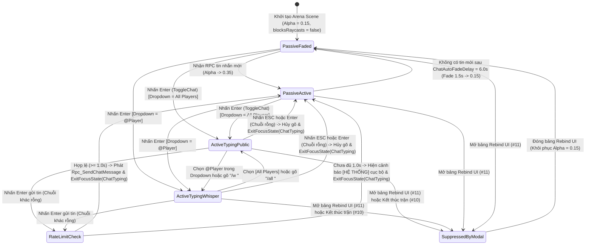

# In-Game Chat System (Public & Private Whisper)

> **Status**: Designed
> **Creative Director Review (CD-GDD-ALIGN)**: APPROVED 2026-11-10
> **Author**: Solo Developer + Studio Agents (`ux-designer`, `network-engineer`, `ui-programmer`, `creative-director`, `qa-lead`)
> **Last Updated**: 2026-11-10
> **Last Verified**: 2026-11-10
> **Implements Pillar**: Pillar 4 (Khán Đài Hồn Ma & Giao Tiếp Chiến Thuật — Public & Whisper Chat) & Pillar 3 (Công Bằng Mạng Tuyệt Đối Trên Shared Mode)

## Summary

**In-Game Chat System (`InGameChatNetworkController` & `ChatUIManager`)** là hệ thống giao tiếp xã hội và chiến thuật thời gian thực ở tầng **Presentation (`UI` / `Alpha`)** của *Capsule Arena: Last Man Standing*, hiện thực hóa trực tiếp **Pillar 4 (Khán Đài Hồn Ma & Giao Tiếp Chiến Thuật — Public & Whisper Chat)** trên nền **Photon Fusion 2 (`GameMode.Shared`)**. Hệ thống cung cấp khung Chat kích thước `380x220 px` đặt tại góc dưới bên trái màn hình (phía trên thanh máu cá nhân `100/100 HP`), vận hành hoàn toàn bằng **`CanvasGroup`** (`Zero Layout Rebuild Spikes`) kết hợp với vòng đệm **`MaxChatHistoryRows = 25` dòng `TMP_Text` (`Ring-Buffer UI Pool` — `0 Instantiate/Destroy`)**. Khi người chơi đang giao tranh (`Passive Mode`), khung Chat tự động hạ độ mờ (`CanvasGroup.alpha = 0.35f` và mờ dần về `0.15f` sau `ChatAutoFadeDelay = 6.0s` yên tĩnh) đồng thời tắt `interactable = false` và `blocksRaycasts = false` để không bao giờ cản trở thao tác chuột bắn/chém. Ngay khi người chơi nhấn phím **`Enter`** (`GameActionId.ToggleChat` nạp động từ `keybinding.json`), khung Chat chuyển sang **`Active Typing Mode`** (`CanvasGroup.alpha = 1.0f`, `interactable = true`, `blocksRaycasts = true`), đặt tiêu điểm vào `TMP_InputField` và gọi `InputFocusManager.SetFocusState(InputFocusState.ChatTyping)` (`#3`) để khóa sạch 100% đầu vào di chuyển/chiến đấu (`W, A, S, D, 1, 2, 3, Q, E, V, LMB, RMB`). Hệ thống hỗ trợ hai chế độ truyền tin qua `[Rpc(RpcSources.All, RpcTargets.All)]`: **Chat Công Khai Toàn Phòng (`Public Chat — [ALL]` màu Trắng `#F8FAFC` khi còn sống hoặc `[GHOST]` màu Xanh Cyan `#22D3EE` khi đang ở Ghost Mode)** và **Chat Mật Cá Nhân (`Private Whisper — [WHISPER]` màu Tím Hồng `#E879F9` qua hộp chọn `Recipient Dropdown` hoặc cú pháp `/w <Tên> <Nội dung>`, chỉ hiển thị trên máy người gửi và người nhận đích danh)**.

> **Quick reference** — Layer: `Presentation` · Priority: `Alpha` · Key deps: `Photon Fusion 2 Shared Mode Session & Object Pool System`, `Keybinding & Input Management System`

## Overview

Trong một tựa game đối kháng sinh tồn nhiều người chơi (**3D Multiplayer Arena Last Man Standing**) như *Capsule Arena: Last Man Standing*, nơi mỗi ván đấu quy tụ từ `2–8` đấu sĩ Cartoon Capsule quyết chiến đến người cuối cùng, giao tiếp văn bản trong trận không chỉ là một tính năng phụ trợ mà là **"chất keo xã hội"** giữ chân người chơi ở lại phòng đấu (**Pillar 4**). Đặc biệt, khi một người chơi chẳng may bị hạ gục sớm (`CurrentHealth <= 0`, `IsDead == true` từ Hệ thống `#6`) và chuyển sang chế độ **Ghost Mode Spectator (`#9`)**, khả năng bình luận trực tiếp những pha lăn né đạn `Q`/`E`, những cú chém ngang xoay người $90^\circ$ (`1`/`3`) nghẹt thở ở vòng tròn trung tâm, hoặc nhắn tin riêng (`Whisper`) trêu đùa cùng bạn bè chính là yếu tố biến thời gian chờ đợi thành một buổi xem truyền hình trực tiếp đầy hứng khởi.

Tuy nhiên, việc tích hợp một hệ thống Chat vào trò chơi hành động góc nhìn kép (`FPS <-> TPS`) tốc độ cao đặt ra **3 bài toán kỹ thuật và UX sống còn** mà **In-Game Chat System (`#12`)** giải quyết triệt để:

1. **Quản lý Hiển thị Bằng `CanvasGroup` Không Gây Giật Khung Hình (`Zero Layout Rebuild & Non-Intrusive Raycast`):**
   - Trong Unity UI (`uGUI`), việc bật/tắt `gameObject.SetActive(true/false)` trên một bảng giao diện phức tạp hoặc liên tục gọi `Instantiate`/`Destroy` tạo dòng văn bản mới sẽ kích hoạt `Canvas.SendWillRenderCanvases()` và gây ra hiện tượng khựng khung hình (Layout Rebuild & GC Spikes) ngay giữa lúc người chơi đang cần phản xạ `60 FPS`.
   - Hệ thống `#12` giữ GameObject gốc của khung Chat (`380x220 px` ở góc dưới bên trái màn hình) luôn hoạt động (`activeSelf == true`) và điều khiển trạng thái hiển thị hoàn toàn qua thành phần **`CanvasGroup`**:
     - **Ở chế độ Thụ động (`Passive Mode` — Đang chiến đấu hoặc quan sát):** `CanvasGroup.alpha` giữ ở mức `0.35f` khi vừa có tin nhắn mới và tự động giảm mượt về `MinPassiveAlpha = 0.15f` sau `ChatAutoFadeDelay = 6.0s` không có hoạt động. Quan trọng nhất, `CanvasGroup.interactable = false` và `CanvasGroup.blocksRaycasts = false` — đảm bảo mọi cú click chuột trái (`Vertical Slash`), chuột phải (`Ranged Attack`) hay lia tâm ngắm ở góc nhìn `FPS`/`TPS` đều xuyên thấu hoàn toàn qua khung Chat mà không bao giờ bị chặn tia Raycast.
     - **Ở chế độ Nhập liệu (`Active Typing Mode` — Nhấn phím `Enter`):** Ngay khi người chơi nhấn phím mở Chat (`GameActionId.ToggleChat` — mặc định là `KeyCode.Return`/`Enter` từ `keybinding.json`, hoặc chạm nút biểu tượng `[💬 CHAT]` trên màn hình), `CanvasGroup.alpha` bật tức thì lên `1.0f`, bật `interactable = true`, `blocksRaycasts = true`, kích hoạt con trỏ nhập liệu trong `TMP_InputField` và gọi `InputFocusManager.SetFocusState(InputFocusState.ChatTyping)` (`#3`). Nhờ cơ chế khóa tiêu điểm độc quyền này, người chơi có thể gõ thoải mái các chữ cái trùng với phím di chuyển và kỹ năng (`w`, `a`, `s`, `d`, `1`, `2`, `3`, `q`, `e`, `v`) mà nhân vật Capsule trên sân vẫn đứng yên an toàn tuyệt đối.

2. **Truyền Tin Nhắn Hai Chế Độ (`Public [ALL]/[GHOST]` & `Private [WHISPER]`) Qua Photon Fusion 2 `[Rpc]`:**
   - Hệ thống định nghĩa một phương thức gọi thủ tục từ xa duy nhất trên `NetworkBehaviour` điều phối Chat trong phòng (`InGameChatNetworkController`):
     ```csharp
     [Rpc(RpcSources.All, RpcTargets.All, InvokeLocal = true, TickAligned = false)]
     public void Rpc_SendChatMessage(
         PlayerRef sender,
         PlayerRef targetRecipient,
         NetworkBool isWhisper,
         NetworkBool senderIsGhost,
         NetworkString<_128> message)
     ```
   - **Chế độ 1 — Chat Công Khai Toàn Phòng (`Public Chat — isWhisper == false`):** Tin nhắn được hiển thị trên màn hình của tất cả người chơi trong phòng. Hệ thống tự động kiểm tra cờ `senderIsGhost` (đồng bộ từ trạng thái `IsDead` của người gửi tại thời điểm nhấn gửi):
     - Nếu người gửi còn sống (`senderIsGhost == false`): Hiển thị với tiền tố **`[ALL] Tên: Nội dung`** mang sắc **Trắng Sáng (`#F8FAFC`)**.
     - Nếu người gửi đã tử trận và đang ở chế độ Khán Đài Hồn Ma (`senderIsGhost == true`): Tự động gắn tiền tố **`[GHOST] Tên: Nội dung`** mang sắc **Xanh Cyan Hồn Ma (`#22D3EE`)**, giúp mọi người nhận biết ngay tiếng vọng bình luận từ khán đài.
   - **Chế độ 2 — Chat Mật Cá Nhân (`Private Whisper — isWhisper == true`):** Người chơi có thể chọn đích danh một người chơi khác trong phòng bằng 2 cách trực quan: (a) chọn tên người nhận trong hộp thả xuống **`Recipient Dropdown` (`[All Players]` / `[@PlayerName]`)** nằm ngay bên trái ô nhập liệu, hoặc (b) gõ trực tiếp cú pháp lệnh nhanh **`/w <Tên> <Nội dung>`** (hoặc `/whisper <Tên> <Nội dung>`, `/r <Nội dung>` để trả lời nhanh người vừa nhắn mật cho mình). Khi gói tin `Rpc_SendChatMessage` tới các máy Client với `isWhisper == true`, bộ lọc tại tầng nhận thực thi kiểm tra nghiêm ngặt: **chỉ máy có `Runner.LocalPlayer == sender || Runner.LocalPlayer == targetRecipient` mới được phép giải mã và đưa dòng tin nhắn lên giao diện** với sắc **Tím Hồng Ánh Kim (`#E879F9`)** (`[WHISPER -> @TênNhận]` hoặc `[WHISPER từ @TênGửi]`). Toàn bộ các máy Client khác trong phòng lập tức thoát sớm (`return;`) ngay dòng đầu tiên của hàm RPC mà không hiển thị hay ghi log nội dung mật.

3. **Chống Spam, Vệ Sinh Chuỗi & Hồ Chứa Dòng Tin Nhắn Xoay Vòng (`Rate Limit & Ring-Buffer UI Pool`):**
   - Mỗi tin nhắn bị giới hạn độ dài tối đa **`MaxChatMessageLength = 120` ký tự** (khớp an toàn bên trong cấu trúc mạng không cấp phát rác `NetworkString<_128>`), tự động loại bỏ các thẻ định dạng Rich Text giả mạo (`<color>`, `<size>`, `<b>`) do người chơi gõ vào, và áp dụng bộ đếm chống spam **`ChatRateLimitCooldown = 1.0s`** giữa hai lần gửi liên tiếp để bảo vệ băng thông mạng `GameMode.Shared` (**Pillar 3**).
   - Bên trong `ScrollRect` của khung Chat, hệ thống khởi tạo sẵn đúng **`MaxChatHistoryRows = 25` phần tử `TMP_Text`** ngay trong `Awake()`. Khi có tin nhắn thứ 26 trở đi, hệ thống xoay vòng chỉ số theo công thức `next_chat_row_index = (current_row_index + 1) % MaxChatHistoryRows`, tái sử dụng dòng cũ nhất và đẩy xuống cuối danh sách (`SetAsLastSibling()`), đảm bảo **`0 Byte GC Allocation`** và **`0 Instantiate/Destroy`** trong suốt trận đấu.

## Player Fantasy

> **System Framing:** `[A] Direct — Người chơi trực tiếp nhấn Enter mở khung Chat, chọn kênh [All Players] hoặc [@PlayerName], gõ lời nhắn chiến thuật hoặc bình luận sôi nổi từ Khán Đài Hồn Ma (Ghost Mode) mà không lo nhân vật bị cướp phím điều khiển.`

### 1. Giấc mơ cốt lõi: "Đấu Trường Sống Động Tiếng Gọi Nhau — Khán Đài Hồn Ma Không Bao Giờ Cô Độc"
Trong một tựa game đối kháng nhiều người chơi, sự im lặng tuyệt đối biến các đối thủ trên sân thành những con bot vô hồn. **In-Game Chat System** thổi hồn vào từng ván đấu của *Capsule Arena: Last Man Standing*, biến mặt sàn `40m x 40m` thành một tụ điểm giao lưu rộn ràng cá tính:
- **Giao tiếp Chiến thuật & Tâm lý chiến Tức thì (Tactical Banter & Mind Games):** Khi chỉ còn 3 người sống sót đang ghìm nhau sau các khối `Obstacle` cao `2.6m`, bạn nép vào góc an toàn, nhấn `Enter` gõ nhanh một dòng `[ALL]`: *"Ai đang nấp ở góc chữ L phía Bắc ra đây quyết đấu nào!"* hay gửi một tin nhắn mật `[WHISPER -> @Minh]`: *"Hợp sức hạ tên dẫn đầu Kills trước nhé!"* Chỉ mất 2 giây gõ phím, nhấn `Enter` gửi đi — khung Chat lập tức mờ xuống trả lại toàn quyền điều khiển chuột và 7 phím kỹ năng để bạn lao ra tung đòn **Forward Dash (`[2]`)**.
- **Tiếng Vọng Từ Khán Đài Hồn Ma (The Ghost Gallery Experience — Pillar 4):** Khi bạn bị hạ gục sau một pha đấu kiếm nghẹt thở và chuyển sang **Ghost Mode Spectator (`#9`)**, bạn không hề bị cô lập. Mỗi dòng chat bạn gõ trên kênh chung tự động khoác lên mình sắc **Xanh Cyan Hồn Ma (`[GHOST] #22D3EE`)** đặc trưng. Bạn vừa bấm `Q`/`E` chuyển góc máy theo dõi người bạn thân đang còn `15/100 HP`, vừa nhắn riêng `[WHISPER -> @Nam]`: *"Coi chừng sau bức tường bên phải có người đang canh chém ngang phím 1 đấy!"* Cảm giác kết nối liền mạch giữa người sống và hồn ma khán giả biến mỗi trận đấu thành một kỷ niệm đáng nhớ cùng bạn bè.

### 2. Trải nghiệm cảm giác qua từng khoảnh khắc (How the Player Experiences the Effects)
1. **Sự An Toàn Tuyệt Đối Khi Gõ Chữ Giữa Trận (`Zero Accidental Movement/Skill Cast`):** Nỗi ám ảnh lớn nhất của game thủ PC khi gõ chat trong trận là gõ chữ `"Chạy qua góc E đi!"` thì nhân vật tự bấm phím `W/A/S/D` lao ra khỏi chỗ nấp, tự xoay camera `V` và tự lăn né `Q`/`E` vào họng súng địch. Nhờ sự phối hợp tức thì giữa `ChatUIManager` và `InputFocusManager.SetFocusState(ChatTyping)` (`#3`), ngay khoảnh khắc khung Chat sáng lên (`alpha = 1.0`), bàn phím hoàn toàn thuộc về ô nhập chữ — nhân vật Capsule đứng vững như bàn thạch sau bức tường che chắn.
2. **Thao Tác Nhắn Mật (`Whisper`) Mượt Mà Cả Bằng Chuột Lẫn Phím Tắt:** Dù người chơi thích thao tác trực quan bằng cách click chọn `[@PlayerName]` từ hộp thả xuống `Recipient Dropdown`, hay là game thủ kỳ cựu thích gõ lệnh nhanh `/w Tên Nội dung` và `/r Nội dung` để trả lời ngay lập tức mà không cần rời tay khỏi bàn phím, hệ thống đều tự động nhận diện, đổi màu viền ô nhập liệu sang **Tím Hồng (`#E879F9`)** để báo hiệu rõ ràng: *"Tin nhắn này hoàn toàn bí mật giữa hai người."*
3. **Trong Suốt Khi Giao Tranh, Rõ Ràng Khi Cần Đọc (`Smart Auto-Fade CanvasGroup`):** Khi không có ai nói chuyện trong `6.0s`, khung Chat lặng lẽ mờ xuống `alpha = 0.15f`, nhường trọn không gian góc dưới trái cho tầm nhìn chiến đấu. Ngay khi có một tin nhắn mới gửi tới, khung Chat sáng nhẹ lên `alpha = 0.35f` kèm tiếng chuông báo tinh tế để mắt người chơi lướt qua đọc được ngay trên nền tối bán trong suốt mà không làm gián đoạn pha ngắm bắn.

### 3. Điểm chạm Tham chiếu & Đối chiếu Trụ cột Thiết kế

| Điểm tham chiếu / Trụ cột | Cách `In-Game Chat System` hiện thực hóa trải nghiệm người chơi |
| :--- | :--- |
| ***Valorant / League of Legends*** *(Instant Enter-to-Chat, `/w` & `/r` Whisper Commands, Focus Lock)* | Nhấn `Enter` mở khung nhập liệu tức thì, khóa toàn bộ phím kỹ năng khi đang gõ, hỗ trợ cú pháp `/w <Tên>` / `/r` và phân biệt màu sắc rõ ràng giữa kênh chung (`[ALL]`) và kênh mật (`[WHISPER]`). |
| ***Among Us / Town of Salem*** *(Distinct Ghost Chat Identity)* | Tự động gắn nhãn `[GHOST]` với sắc Xanh Cyan Hồn Ma (`#22D3EE`) cho những người chơi đã tử trận (`IsDead == true`), tôn vinh bản sắc **Khán Đài Hồn Ma (Pillar 4)**. |
| ***Overwatch 2*** *(Recipient Dropdown + Non-Blocking Passive Overlay)* | Kết hợp hộp chọn người nhận trực quan (`[All Players]` / `[@PlayerName]`) cho cả PC lẫn thao tác chạm trên màn hình, cùng cơ chế `CanvasGroup` tắt `blocksRaycasts` khi không gõ chữ để không bao giờ cản chuột chiến đấu. |
| **Pillar 4 & Pillar 3** | Kết nối giao tiếp xã hội giữa người còn sống và người đang ở Ghost Mode qua `[Rpc]` gọn nhẹ (`NetworkString<_128>`), có giới hạn tốc độ gửi (`1.0s`) chống spam làm nghẽn băng thông phòng `GameMode.Shared`. |

## Detailed Design

### Core Rules

1. **Quy tắc Quản Lý Hiển Thị & Tương Tác Bằng `CanvasGroup` (`Zero Layout Rebuild Spikes`):**
   - Khung **In-Game Chat Panel** được đặt cố định tại **góc dưới bên trái màn hình** (`Anchor: Bottom-Left (0, 0)`, `Pivot: (0, 0)`, tọa độ neo `AnchoredPosition = (24px, 92px)` nằm ngay phía trên cụm Thanh máu cá nhân `100/100 HP`, kích thước chuẩn **`380 x 220 px`** trên độ phân giải tham chiếu `1920 x 1080`).
   - GameObject gốc của khung Chat luôn giữ `gameObject.SetActive(true)` trong suốt thời gian ở Arena Scene. Mọi chuyển đổi trạng thái ẩn/mờ/tương tác **bắt buộc** thực hiện qua thành phần **`CanvasGroup`** gắn trên gốc khung Chat (`_chatPanelCanvasGroup`) và `CanvasGroup` con của thanh nhập liệu (`_inputBarCanvasGroup`):
     - **Chế độ Thụ động khi vừa có tin nhắn mới (`Passive Active Mode`):**
       - `_chatPanelCanvasGroup.alpha = 0.35f` (`PassiveBaseAlpha`).
       - `_chatPanelCanvasGroup.interactable = false`.
       - `_chatPanelCanvasGroup.blocksRaycasts = false` *(Đảm bảo 100% thao tác click chuột trái `LMB` chém dọc, chuột phải `RMB` bắn đạn hoặc kéo chuột xoay góc nhìn xuyên qua khung Chat mà không bị chặn)*.
       - `_inputBarCanvasGroup.alpha = 0.0f` (ẩn thanh nhập liệu và Dropdown khi không gõ chữ để giao diện gọn gàng, chỉ hiển thị khung lịch sử tin nhắn và gợi ý nhỏ `[Enter] Chat`).
     - **Chế độ Tự động Mờ dần khi Yên tĩnh (`Passive Auto-Faded Mode`):**
       - Nếu không có tin nhắn mới nào được nhận và người chơi không mở khung Chat trong khoảng thời gian `ChatAutoFadeDelay = 6.0s`, độ mờ `_chatPanelCanvasGroup.alpha` tự động giảm mượt trong `ChatFadeOutDuration = 1.5s` về mức tối thiểu **`MinPassiveAlpha = 0.15f`**.
     - **Chế độ Đang Gõ Chữ (`Active Typing Mode` — Khi nhấn phím `Enter` / `GameActionId.ToggleChat`):**
       - `_chatPanelCanvasGroup.alpha = 1.0f` (`ActiveTypingAlpha`).
       - `_chatPanelCanvasGroup.interactable = true`.
       - `_chatPanelCanvasGroup.blocksRaycasts = true` *(Cho phép người chơi dùng chuột cuộn `ScrollRect` xem tin nhắn cũ, click chọn người nhận trong `Recipient Dropdown`, hoặc click đặt con trỏ vào `TMP_InputField`)*.
       - `_inputBarCanvasGroup.alpha = 1.0f`.
       - Hệ thống lập tức gọi `_chatInputField.ActivateInputField()` và `_chatInputField.Select()`, đồng thời gọi **`InputFocusManager.SetFocusState(InputFocusState.ChatTyping)`** (`System #3`) để khóa hoàn toàn đầu vào chiến đấu/di chuyển (`NetworkInputData` gửi vào `FixedUpdateNetwork()` trả về `default` rỗng) và mở khóa con trỏ chuột (`Cursor.lockState = CursorLockMode.None; Cursor.visible = true;`).
     - **Thoát Chế độ Gõ Chữ (`Send or Cancel Typing`):**
       - Khi đang ở `Active Typing Mode`, nếu người chơi nhấn **`Enter` (`KeyCode.Return` / `KeyCode.KeypadEnter`)**:
         - Nếu chuỗi văn bản trong `TMP_InputField` sau khi `Trim()` không rỗng: thực thi quy trình kiểm tra và gửi tin nhắn qua RPC, xóa sạch nội dung ô nhập (`_chatInputField.text = string.Empty`), rồi đóng chế độ gõ chữ.
         - Nếu chuỗi văn bản rỗng: đóng ngay chế độ gõ chữ mà không gửi gói tin mạng.
       - Nếu người chơi nhấn phím **`Escape` (`KeyCode.Escape`)** khi đang ở `Active Typing Mode`: hủy bỏ nội dung đang gõ dở, xóa trống `TMP_InputField` và đóng ngay chế độ gõ chữ.
       - Khi đóng chế độ gõ chữ: đặt lại `_chatPanelCanvasGroup.alpha = 0.35f`, `interactable = false`, `blocksRaycasts = false`, `_inputBarCanvasGroup.alpha = 0.0f`, gọi `EventSystem.current.SetSelectedGameObject(null)` và gọi **`InputFocusManager.ExitFocusState(InputFocusState.ChatTyping)`** để trả người chơi về đúng trạng thái trước đó (`CombatActive` nếu `!IsDead` — khóa lại con trỏ chuột `CursorLockMode.Locked`; hoặc `GhostSpectating` nếu `IsDead == true`).

2. **Quy tắc Hai Chế Độ Gửi & Lọc Tin Nhắn Qua Photon Fusion 2 `[Rpc]` (`Public [ALL]/[GHOST]` vs. `Private [WHISPER]`):**
   - Toàn bộ tin nhắn trong phòng được truyền qua phương thức RPC trên `InGameChatNetworkController` (gắn trên Scene `NetworkObject` cố định trong Arena Scene để không phụ thuộc vào việc Prefab nhân vật của một người chơi cụ thể có bị hủy khi rời phòng hay không):
     ```csharp
     [Rpc(RpcSources.All, RpcTargets.All, InvokeLocal = true, TickAligned = false)]
     public void Rpc_SendChatMessage(
         PlayerRef sender,
         PlayerRef targetRecipient,
         NetworkBool isWhisper,
         NetworkBool senderIsGhost,
         NetworkString<_128> message)
     ```
   - **Quy tắc Chế độ 1 — Chat Công Khai Toàn Phòng (`Public Chat — isWhisper == false`, `targetRecipient == PlayerRef.None`):**
     - Mọi máy Client trong phòng (`RpcTargets.All`) đều tiếp nhận và hiển thị tin nhắn này.
     - Tại thời điểm máy người gửi phát lệnh RPC, hệ thống đọc trạng thái sinh tử thực tế từ `PlayerHealthNetworked.IsDead` (`System #6`) của chính người gửi để gán vào tham số `senderIsGhost`:
       - **Trường hợp Người gửi còn sống (`senderIsGhost == false`):**
         - Định dạng hiển thị: **`<color=#94A3B8>[ALL]</color> <color=#38BDF8>{SenderName}:</color> <color=#F8FAFC>{Message}</color>`** (nếu `sender == Runner.LocalPlayer`) hoặc **`<color=#94A3B8>[ALL]</color> <color=#F43F5E>{SenderName}:</color> <color=#F8FAFC>{Message}</color>`** (nếu người gửi là đối thủ). Nội dung tin nhắn luôn mang màu **Trắng Sáng (`#F8FAFC`)** dễ đọc.
       - **Trường hợp Người gửi đang ở Ghost Mode Spectator (`senderIsGhost == true`):**
         - Định dạng hiển thị: **`<color=#22D3EE>[GHOST] {SenderName}: {Message}</color>`** — toàn bộ nhãn `[GHOST]`, tên và nội dung đều được nhuộm sắc **Xanh Cyan Hồn Ma (`#22D3EE`)** chuẩn `Art Bible §4.2`, giúp cả người còn sống lẫn các hồn ma khác nhận diện tức thì thông điệp phát ra từ Khán Đài Hồn Ma.
   - **Quy tắc Chế độ 2 — Chat Mật Cá Nhân (`Private Whisper — isWhisper == true`, `targetRecipient != PlayerRef.None`):**
     - Người chơi có thể kích hoạt gửi tin nhắn mật bằng **1 trong 2 phương thức tương đương**:
       1. **Chọn từ `Recipient Dropdown` (`TMP_Dropdown`) trên UI:** Hộp chọn nằm ở góc trái thanh nhập liệu luôn có mục đầu tiên là `0: [All Players]` (màu Trắng `#F8FAFC`) và danh sách động các người chơi khác đang có mặt trong phòng `1..N: [@PlayerName]` (màu Tím Hồng `#E879F9`). Khi người chơi chọn một `[@PlayerName]`, chế độ gửi mặc định chuyển sang `Whisper` tới `PlayerRef` đó cho đến khi người chơi đổi lại về `[All Players]`.
       2. **Gõ cú pháp lệnh trực tiếp trong `TMP_InputField`:**
          - Gõ `/w <Tên> <Nội dung>` hoặc `/whisper <Tên> <Nội dung>` (không phân biệt chữ hoa/thường ở tên người nhận; hỗ trợ cả `/w @Tên <Nội dung>`): Hệ thống tự động tra cứu `PlayerRef` có `PlayerName` khớp với `<Tên>` trong phòng để gửi tin nhắn mật một lần.
          - Gõ `/r <Nội dung>` hoặc `/reply <Nội dung>`: Hệ thống tự động gửi tin nhắn mật tới `_lastWhisperPartner` (`PlayerRef` của người gần nhất vừa gửi hoặc nhận Whisper với `LocalPlayer`).
          - Gõ `/all <Nội dung>`: Ép gửi tin nhắn ra kênh `[ALL]` công khai đồng thời đặt lại `Recipient Dropdown` về `[All Players]`.
     - **Chốt chặn Bảo mật & Lọc Hiển thị ở Tầng Nhận RPC (`Client-Side Recipient Filtering`):**
       - Ngay khi `Rpc_SendChatMessage` được gọi trên mỗi máy Client, hệ thống kiểm tra công thức lọc:
         `bool shouldDisplay = (!isWhisper) || (Runner.LocalPlayer == sender) || (Runner.LocalPlayer == targetRecipient);`
         `if (!shouldDisplay) return;`
       - Nếu `isWhisper == true` và máy hiện tại **không phải** là người gửi (`sender`) cũng **không phải** là người nhận (`targetRecipient`), hàm RPC kết thúc ngay lập tức (`0 Byte` cấp phát chuỗi, không chạm vào UI, không in ra `Debug.Log`).
       - Trên máy **Người gửi (`Runner.LocalPlayer == sender`)**: Hiển thị với sắc **Tím Hồng (`#E879F9`)**:
         **`<color=#E879F9>[WHISPER -> @{TargetName}] Bạn: {Message}</color>`** (kèm nhãn nhỏ `[GHOST]` nếu người gửi đã tử trận) và lưu `_lastWhisperPartner = targetRecipient`.
       - Trên máy **Người nhận (`Runner.LocalPlayer == targetRecipient`)**: Hiển thị với sắc **Tím Hồng Sáng (`#F0ABFC` / `#E879F9`)**:
         **`<color=#E879F9>[WHISPER từ @{SenderName}] {SenderName}: {Message}</color>`**, phát âm báo Whisper riêng biệt và lưu `_lastWhisperPartner = sender`.

3. **Quy tắc Chống Spam, Giới Hạn Ký Tự & Vệ Sinh Chuỗi Văn Bản (`Rate Limiting & Input Sanitization`):**
   - **Giới hạn độ dài ký tự (`MaxChatMessageLength = 120`):**
     - `TMP_InputField.characterLimit` được khóa cứng ở `120` ký tự.
     - Tại tầng nhận RPC (phòng trường hợp gói tin bị can thiệp ngoài UI), chuỗi `message.ToString()` tiếp tục được kẹp độ dài `if (rawText.Length > 120) rawText = rawText.Substring(0, 120);` để đảm bảo an toàn bộ nhớ tuyệt đối trong `NetworkString<_128>`.
   - **Vệ sinh chuỗi chống tiêm mã Rich Text (`Rich-Text Tag Sanitization`):**
     - Trước khi đóng gói vào `NetworkString<_128>` và một lần nữa trước khi gán vào `TMP_Text` ở máy nhận, hệ thống thay thế các ký tự mở/đóng thẻ `<` và `>` trong nội dung của người chơi (hoặc bật thuộc tính thoát thẻ / lọc bỏ `<...>`) để ngăn chặn người chơi gõ `<size=200>SPAM</size>` hay `<color=red>` làm vỡ khung `ScrollRect` hoặc giả mạo thông báo hệ thống.
   - **Giới hạn tần suất gửi tin (`ChatRateLimitCooldown = 1.0s`):**
     - Hệ thống lưu mốc thời gian gửi tin hợp lệ gần nhất `_lastMessageSentTime` (`Time.unscaledTime`) trên cả máy Client gửi lẫn bảng theo dõi `Dictionary<PlayerRef, float> _lastReceivedTimePerPlayer` ở tầng nhận.
     - Nếu người chơi nhấn `Enter` gửi tin mới khi `Time.unscaledTime - _lastMessageSentTime < ChatRateLimitCooldown (1.0s)`:
       - Hệ thống **từ chối gọi `Rpc_SendChatMessage`** (tiết kiệm 100% băng thông mạng).
       - Hiển thị một dòng thông báo cục bộ màu Vàng Hổ Phách (`#F59E0B`) ngay trên khung Chat của riêng người đó: **`[HỆ THỐNG] Vui lòng chờ {remaining:F1}s trước khi gửi tin nhắn tiếp theo.`**.

4. **Quy tắc Hồ Chứa Dòng Tin Nhắn Xoay Vòng (`Ring-Buffer UI Pool — MaxChatHistoryRows = 25`):**
   - Trong `Awake()` của `ChatUIManager`, hệ thống khởi tạo sẵn đúng **`MaxChatHistoryRows = 25` thực thể `TMP_Text`** (từ Prefab dòng chat `pf_ui_chat_message_row_01.prefab`) làm con của `Content` bên trong `ScrollRect`, lưu vào mảng cố định `private readonly TMP_Text[] _chatRowPool = new TMP_Text[25];` và tắt hiển thị ban đầu (`gameObject.SetActive(false)`).
   - Khi có một tin nhắn mới cần hiển thị (từ RPC hoặc thông báo hệ thống cục bộ):
     - Hệ thống tính chỉ số dòng tiếp theo bằng toán tử chia lấy dư: `_currentRowIndex = (_currentRowIndex + 1) % MaxChatHistoryRows;`.
     - Lấy phần tử `TMP_Text row = _chatRowPool[_currentRowIndex];`, bật `row.gameObject.SetActive(true)` (nếu đang ẩn ở 25 tin đầu tiên), gọi `row.transform.SetAsLastSibling()` để đưa dòng đó xuống đáy danh sách hiển thị, gán chuỗi văn bản đã định dạng màu vào `row.SetText(...)` và cuộn `ScrollRect.verticalNormalizedPosition = 0f` xuống dòng mới nhất.
     - Tuyệt đối **không bao giờ gọi `Object.Instantiate` hay `Object.Destroy`** khi nhận tin nhắn trong suốt ván đấu.

5. **Bảng Tổng Hợp Mã Màu & Định Danh Kênh Chat (Khớp 100% `Art Bible §4.2 & §7.4`):**

| Loại Tin Nhắn / Kênh | Điều Kiện Kích Hoạt | Tiền Tố Bắt Buộc (`Prefix Tag`) | Mã Màu Hex (Chủ Đạo) | Quy Tắc Hiển Thị Trên Các Máy Client |
| :--- | :--- | :--- | :---: | :--- |
| **1. Public Chat (Người sống)** | `isWhisper == false && !senderIsGhost` | **`[ALL]`** | Nhãn: `#94A3B8`<br>Nội dung: **`#F8FAFC`** (Trắng Sáng) | Hiển thị trên **tất cả** máy Client trong phòng (`RpcTargets.All`). |
| **2. Ghost Public Chat (Hồn ma)** | `isWhisper == false && senderIsGhost == true` | **`[GHOST]`** | Toàn dòng: **`#22D3EE`** (Xanh Cyan Hồn Ma) | Hiển thị trên **tất cả** máy Client trong phòng để cổ vũ & bình luận (**Pillar 4**). |
| **3. Private Whisper (Gửi đi)** | `isWhisper == true && LocalPlayer == sender` | **`[WHISPER -> @TênNhận]`** | Toàn dòng: **`#E879F9`** (Tím Hồng Ánh Kim) | **Chỉ** hiển thị trên máy của chính người gửi (`sender`). |
| **4. Private Whisper (Nhận về)** | `isWhisper == true && LocalPlayer == targetRecipient` | **`[WHISPER từ @TênGửi]`** | Toàn dòng: **`#E879F9`** (Tím Hồng Ánh Kim) | **Chỉ** hiển thị trên máy của đúng người nhận (`targetRecipient`); các máy khác bỏ qua 100%. |
| **5. System Feedback (Cục bộ)** | Lỗi cú pháp `/w`, người nhận rời phòng, hoặc chạm ngưỡng `1.0s` Rate Limit | **`[HỆ THỐNG]`** | Toàn dòng: **`#F59E0B`** (Vàng Hổ Phách) | Chỉ hiển thị cục bộ trên máy người vừa thao tác (`0 RPC`). |

### States and Transitions

Máy trạng thái của **In-Game Chat UI & Focus Lifecycle (`ChatUIState`)** vận hành qua **6 trạng thái xác định**, đồng bộ chặt chẽ với `InputFocusManager` (`#3`) và `CanvasGroup`:



1. **`PassiveFaded` (Thụ động Mờ Tối Đa — `Alpha = 0.15f`):** Trạng thái mặc định khi mới vào trận hoặc sau `6.0s` không có tin nhắn mới. `interactable = false`, `blocksRaycasts = false`, thanh nhập liệu ẩn hoàn toàn (`_inputBarCanvasGroup.alpha = 0.0f`).
2. **`PassiveActive` (Thụ động Vừa Có Tin Mới — `Alpha = 0.35f`):** Kích hoạt ngay khi có tin nhắn mới xuất hiện trong `ScrollRect` hoặc vừa thoát khỏi chế độ gõ chữ. Giữ `Alpha = 0.35f` trong `ChatAutoFadeDelay = 6.0s` để người chơi dễ đọc nội dung, nhưng vẫn khóa `interactable = false` và `blocksRaycasts = false` để không cản chuột chiến đấu.
3. **`ActiveTypingPublic` (Đang Gõ Tin Công Khai — `Alpha = 1.0f`):** Khi người chơi nhấn phím `Enter` (`GameActionId.ToggleChat`). `CanvasGroup` bật `alpha = 1.0f`, `interactable = true`, `blocksRaycasts = true`; gọi `InputFocusManager.SetFocusState(InputFocusState.ChatTyping)` để khóa hoàn toàn di chuyển/tấn công của nhân vật. Viền ô nhập liệu mang màu Xanh Lam Nhạt (`#38BDF8`) biểu thị kênh `[All Players]`.
4. **`ActiveTypingWhisper` (Đang Gõ Tin Mật — `Alpha = 1.0f`):** Tương tự `ActiveTypingPublic` nhưng người chơi đã chọn một `[@PlayerName]` trên `Recipient Dropdown` hoặc vừa gõ tiền tố `/w <Tên> ` hay `/r `. Viền ô nhập liệu và chữ trong `TMP_InputField` chuyển sang màu **Tím Hồng (`#E879F9`)** để xác nhận trực quan đang ở chế độ nhắn mật.
5. **`RateLimitCheck` (Kiểm Tra Chốt Chặn & Gửi Tin Tức Thời):** Trạng thái xử lý logic trong cùng khung hình khi người chơi nhấn `Enter` để gửi chuỗi văn bản: kiểm tra rỗng, phân tích cú pháp `/w` / `/r`, kiểm tra `ChatRateLimitCooldown = 1.0s`, phát `Rpc_SendChatMessage` nếu hợp lệ, xóa trắng `TMP_InputField` và chuyển ngay về `PassiveActive` kèm mở khóa điều khiển nhân vật.
6. **`SuppressedByModal` (Tạm Ẩn Khi Mở Bảng Cài Đặt Phím `#11`):** Khi người chơi mở cửa sổ **In-Game Keybinding Rebind UI (`#11`)** (`InputFocusState.RebindModalOpen`), khung Chat tự động hủy trạng thái gõ (nếu đang mở) và hạ `CanvasGroup.alpha = 0.0f` để nhường toàn bộ sự tập trung cho bảng gán phím `keybinding.json`.

### Interactions with Other Systems

| Hệ Thống Liên Quan | Chiều Tương Tác | Cơ Chế Hợp Đồng Dữ Liệu & Sự Kiện (`API / Event Contract`) |
| :--- | :---: | :--- |
| **System #3: Keybinding & Input Management System** | **Upstream (`#3 -> #12`) & Two-Way via `InputFocusManager`** | - `#12` đọc phím mở Chat từ `KeybindingManager.GetKeyCode(GameActionId.ToggleChat)` (mặc định `KeyCode.Return` / `Enter`) và lắng nghe sự kiện `OnKeybindingsUpdated` để cập nhật nhãn gợi ý `[Enter] Chat` trên khung UI.<br>- Khi mở khung Chat, `#12` gọi `InputFocusManager.SetFocusState(InputFocusState.ChatTyping)` khiến `FusionInputAggregator.OnInput` trả về `NetworkInputData` rỗng (`default`), khóa hoàn toàn `WASD`, `1, 2, 3`, `Q, E`, `V`, `LMB, RMB`. Khi gửi/hủy Chat, `#12` gọi `InputFocusManager.ExitFocusState(InputFocusState.ChatTyping)` để khôi phục trạng thái trước đó (`CombatActive` hoặc `GhostSpectating`). |
| **System #4: Photon Fusion 2 Shared Mode Session & Object Pool System** | **Upstream (`#4 -> #12`)** | - Cung cấp `NetworkRunner`, `Runner.LocalPlayer` và danh sách người chơi đang hoạt động trong phòng.<br>- Mỗi khi `OnPlayerJoined(runner, player)` hoặc `OnPlayerLeft(runner, player)` kích hoạt (hoặc khi đồng bộ `[Networked] NetworkString<_16> PlayerName`), `#12` tự động cập nhật lại danh sách mục chọn trong `Recipient Dropdown` (`[All Players]` + các `[@PlayerName]` hiện có). |
| **System #6: Health, Damage RPC & Death State System** | **Upstream (`#6 -> #12`)** | - `#12` đọc thuộc tính `[Networked] public NetworkBool IsDead` trên `PlayerHealthNetworked` của `LocalPlayer` để tự động gán cờ `senderIsGhost = localHealth.IsDead` khi gửi `Rpc_SendChatMessage`.<br>- Lắng nghe sự kiện `OnPlayerDeathStateChanged`: nếu `LocalPlayer` bị hạ gục ngay trong lúc đang mở khung gõ chữ (`ChatTyping`), hệ thống giữ nguyên chuỗi đang gõ dở nhưng tự động cập nhật trạng thái nền bên dưới của `InputFocusManager` từ `CombatActive` sang `GhostSpectating` và đổi nhãn kênh công khai sang `[GHOST]`. |
| **System #8: Combat HUD, Overhead Billboard & Mobile Action Pad UI** | **Peer (`#8 <-> #12`)** | - Khung Chat (`380x220 px`) được quy hoạch ở góc dưới bên trái màn hình (phía trên thanh máu cá nhân `100/100 HP`), tách biệt hoàn toàn với cụm **7 Button kỹ năng mềm góc dưới phải (`#8`)**.<br>- Cung cấp một nút bấm mềm nhỏ **`[💬 Enter]`** ở cạnh trên khung Chat để người chơi thao tác bằng chuột hoặc màn hình cảm ứng có thể chạm mở khung Chat mà không cần phím cứng. |
| **System #9: Dual-Perspective Camera (FPS/TPS) & Ghost Mode Spectator System** | **Peer (`#9 <-> #12`)** | - Khi người chơi đang ở chế độ **Ghost Mode Spectator (`IsDead == true`)**, thanh điều khiển `Spectator Control Bar` (`[◄ Trước (Q/A)] ... [Sau (E/D) ►]`) nằm ở chính giữa cạnh dưới màn hình, không chồng lấn với khung Chat ở góc dưới bên trái.<br>- Khi người chơi ở Ghost Mode nhấn `Enter` mở Chat (`InputFocusState.ChatTyping`), hệ thống `#9` tạm khóa phím chuyển mục tiêu `Q/A/E/D` và xoay camera chuột cho đến khi người chơi gửi xong tin nhắn. |
| **System #11: In-Game Keybinding Rebind UI & Lobby Flow UI** | **Peer (`#11 -> #12`)** | - Khi người chơi mở bảng **Keybinding Rebind UI (`#11`)**, `InputFocusManager` chuyển sang `RebindModalOpen`, tự động đóng chế độ gõ chữ của `#12` (nếu đang mở) để tránh xung đột phím `Enter` và `Escape`. |

## Formulas

### 1. Điều Kiện Lọc Hiển Thị Tin Nhắn Trên Từng Máy Client (`should_display_message`)

The `should_display_message` formula is defined as:

`should_display_message = (!is_whisper) || (local_player == sender_player) || (local_player == target_recipient)`

**Variables:**

| Variable | Type | Range | Source | Description |
| :--- | :---: | :---: | :--- | :--- |
| `is_whisper` | `NetworkBool` (`bool`) | `false` hoặc `true` | Tham số `isWhisper` của `Rpc_SendChatMessage` | Cờ xác định tin nhắn là Chat Mật Cá Nhân (`true`) hay Chat Công Khai Toàn Phòng (`false`). |
| `local_player` | `PlayerRef` | `PlayerRef` hợp lệ trong phòng (`0..7`) | `NetworkRunner.LocalPlayer` | Định danh mạng của người chơi cục bộ trên máy Client đang thực thi hàm nhận RPC. |
| `sender_player` | `PlayerRef` | `PlayerRef` hợp lệ trong phòng (`0..7`) | Tham số `sender` của `Rpc_SendChatMessage` | Định danh mạng của người chơi đã phát đi tin nhắn. |
| `target_recipient` | `PlayerRef` | `PlayerRef.None` hoặc `PlayerRef` (`0..7`) | Tham số `targetRecipient` của `Rpc_SendChatMessage` | Định danh mạng của người nhận đích danh (khi `is_whisper == true`). |
| `should_display_message` | `bool` | `false` hoặc `true` | Chốt chặn đầu hàm `Rpc_SendChatMessage` | Quyết định máy Client hiện tại có được phép giải mã và đẩy dòng tin nhắn lên `ScrollRect` UI hay phải bỏ qua ngay lập tức. |

**Output Range:** `false` (bỏ qua hoàn toàn, `0 Byte` cấp phát) hoặc `true` (hiển thị lên khung Chat).

**Example:**
- **Kịch bản 1 (Public Chat / Ghost Chat):** Người chơi `P1` gửi tin nhắn công khai (`is_whisper = false`, `sender_player = P1`, `target_recipient = PlayerRef.None`). Trên máy của `P3` (`local_player = P3`):
  `should_display_message = (!false) || (P3 == P1) || (P3 == None) = true || false || false = true` $\rightarrow$ Máy `P3` hiển thị tin nhắn (`[ALL]` hoặc `[GHOST]`).
- **Kịch bản 2 (Private Whisper — Máy người nhận):** Người chơi `P1` gửi tin nhắn mật cho `P2` (`is_whisper = true`, `sender_player = P1`, `target_recipient = P2`). Trên máy của `P2` (`local_player = P2`):
  `should_display_message = (!true) || (P2 == P1) || (P2 == P2) = false || false || true = true` $\rightarrow$ Máy `P2` hiển thị tin nhắn mật màu Tím Hồng (`#E879F9`).
- **Kịch bản 3 (Private Whisper — Máy người thứ ba bị chặn):** Với cùng tin nhắn mật từ `P1` gửi cho `P2` (`is_whisper = true`), trên máy của `P3` (`local_player = P3`):
  `should_display_message = (!true) || (P3 == P1) || (P3 == P2) = false || false || false = false` $\rightarrow$ Máy `P3` thoát hàm RPC ngay lập tức, hoàn toàn không biết nội dung tin nhắn giữa `P1` và `P2`.

---

### 2. Độ Mờ Tự Động Của Khung Chat Khi Không Tương Tác (`passive_chat_alpha`)

The `passive_chat_alpha` formula is defined as:

`passive_chat_alpha = clamp(1.0 - ((time_since_last_activity - ChatAutoFadeDelay) / ChatFadeOutDuration), MinPassiveAlpha, 1.0)`

*(Khi áp dụng hệ số trần hiển thị thụ động `PassiveBaseAlpha = 0.35` lúc không gõ chữ, giá trị gán thực tế vào `_chatPanelCanvasGroup.alpha` ở chế độ Passive được chuẩn hóa trong đoạn `[MinPassiveAlpha, PassiveBaseAlpha]` = `[0.15, 0.35]`)*

**Variables:**

| Variable | Type | Range | Source | Description |
| :--- | :---: | :---: | :--- | :--- |
| `time_since_last_activity` | `float` | `0.0–3600.0` | `Time.unscaledTime - _lastChatActivityTime` | Thời gian (giây) trôi qua kể từ lần cuối có tin nhắn mới xuất hiện hoặc lần cuối người chơi đóng khung nhập liệu. |
| `ChatAutoFadeDelay` | `float` | `2.0–15.0` (mặc định `6.0`) | `ChatSystemConfig` (`_chatAutoFadeDelay`) | Thời gian chờ (giây) giữ độ sáng đọc tin trước khi khung Chat bắt đầu mờ dần. |
| `ChatFadeOutDuration` | `float` | `0.5–5.0` (mặc định `1.5`) | `ChatSystemConfig` (`_chatFadeOutDuration`) | Thời lượng chuyển tiếp mờ dần (giây) từ lúc hết `ChatAutoFadeDelay` cho tới khi chạm đáy `MinPassiveAlpha`. |
| `MinPassiveAlpha` | `float` | `0.05–0.30` (mặc định `0.15`) | `ChatSystemConfig` (`_minPassiveAlpha`) | Độ mờ tối thiểu của khung Chat khi yên tĩnh hoàn toàn để không gây xao nhãng thị giác. |
| `passive_chat_alpha` | `float` | `0.15–1.00` (hoặc `0.15–0.35` khi nhân trần `PassiveBaseAlpha`) | `ChatUIManager.UpdatePassiveFade()` | Độ mờ `alpha` áp dụng lên `CanvasGroup` của khung Chat khi người chơi không ở trạng thái `ChatTyping`. |

**Output Range:** `[MinPassiveAlpha, 1.0]` (`0.15` đến `1.0`, và được kẹp trần ở `PassiveBaseAlpha = 0.35` khi `InputFocusState != ChatTyping`).

**Example:**
- Với `ChatAutoFadeDelay = 6.0s`, `ChatFadeOutDuration = 1.5s`, `MinPassiveAlpha = 0.15`:
  - Tại `time_since_last_activity = 3.0s` (vừa có tin nhắn mới cách đây 3 giây):
    `1.0 - ((3.0 - 6.0) / 1.5) = 1.0 - (-2.0) = 3.0` $\rightarrow$ `clamp(3.0, 0.15, 1.0) = 1.0` (ở chế độ Passive giữ nguyên mức trần đọc tin `PassiveBaseAlpha = 0.35f`).
  - Tại `time_since_last_activity = 6.75s` (đã qua nửa thời gian mờ dần):
    `passive_chat_alpha = clamp(1.0 - ((6.75 - 6.0) / 1.5), 0.15, 1.0) = clamp(1.0 - 0.5, 0.15, 1.0) = 0.50` (hoặc nội suy tuyến tính giữa `0.35` và `0.15` đạt `0.25f`).
  - Tại `time_since_last_activity = 8.0s` (đã hoàn tất quá trình mờ dần):
    `passive_chat_alpha = clamp(1.0 - ((8.0 - 6.0) / 1.5), 0.15, 1.0) = clamp(-0.333, 0.15, 1.0) = 0.15` (`MinPassiveAlpha = 0.15f`).

---

### 3. Chỉ Số Xoay Vòng Dòng Tin Nhắn Trong Ring-Buffer UI Pool (`next_chat_row_index`)

The `next_chat_row_index` formula is defined as:

`next_chat_row_index = (current_row_index + 1) % MaxChatHistoryRows`

**Variables:**

| Variable | Type | Range | Source | Description |
| :--- | :---: | :---: | :--- | :--- |
| `current_row_index` | `int` | `-1` đến `24` (`MaxChatHistoryRows - 1`) | Biến trạng thái `_currentRowIndex` trong `ChatUIManager` (khởi tạo bằng `-1`) | Chỉ số trong mảng `_chatRowPool` của dòng `TMP_Text` vừa được sử dụng ở tin nhắn liền trước. |
| `MaxChatHistoryRows` | `int` | `15–50` (mặc định `25`) | `ChatSystemConfig` (`_maxChatHistoryRows`) | Tổng số phần tử `TMP_Text` cố định được khởi tạo sẵn trong `ScrollRect` Ring-Buffer Pool ngay từ `Awake()`. |
| `next_chat_row_index` | `int` | `0` đến `24` | `ChatUIManager.AcquireNextChatRow()` | Chỉ số của phần tử `TMP_Text` tiếp theo sẽ được lấy ra, cập nhật nội dung và đẩy xuống cuối `ScrollRect` (`SetAsLastSibling()`). |

**Output Range:** Số nguyên từ `0` đến `MaxChatHistoryRows - 1` (`0..24` với cấu hình mặc định `MaxChatHistoryRows = 25`).

**Example:**
- **Tin nhắn đầu tiên trong trận (`current_row_index = -1`, `MaxChatHistoryRows = 25`):**
  `next_chat_row_index = (-1 + 1) % 25 = 0 % 25 = 0` $\rightarrow$ Sử dụng `_chatRowPool[0]`.
- **Tin nhắn thứ 25 (`current_row_index = 23`, `MaxChatHistoryRows = 25`):**
  `next_chat_row_index = (23 + 1) % 25 = 24 % 25 = 24` $\rightarrow$ Sử dụng `_chatRowPool[24]` (lấp đầy toàn bộ 25 dòng trong Pool).
- **Tin nhắn thứ 26 (`current_row_index = 24`, `MaxChatHistoryRows = 25`):**
  `next_chat_row_index = (24 + 1) % 25 = 25 % 25 = 0` $\rightarrow$ Tái sử dụng ngay `_chatRowPool[0]` (dòng cũ nhất của tin nhắn số 1), gọi `_chatRowPool[0].transform.SetAsLastSibling()` để chuyển nó xuống vị trí đáy của `ScrollRect` và ghi đè văn bản mới với chi phí cấp phát bộ nhớ bằng `0 Bytes`.

---

### 4. Thời Gian Chờ Chống Spam Còn Lại Giữa Hai Lần Gửi (`remaining_rate_limit_cooldown`)

The `remaining_rate_limit_cooldown` formula is defined as:

`remaining_rate_limit_cooldown = max(0.0, ChatRateLimitCooldown - (current_unscaled_time - last_message_sent_time))`

**Variables:**

| Variable | Type | Range | Source | Description |
| :--- | :---: | :---: | :--- | :--- |
| `ChatRateLimitCooldown` | `float` | `0.5–5.0` (mặc định `1.0`) | `ChatSystemConfig` (`_chatRateLimitCooldown`) | Khoảng thời gian tối thiểu bắt buộc (giây) giữa 2 lần phát `Rpc_SendChatMessage` từ cùng một người chơi. |
| `current_unscaled_time` | `float` | `>= 0.0` | `Time.unscaledTime` | Thời gian thực hiện tại của ứng dụng (giây). |
| `last_message_sent_time` | `float` | `-999.0` đến `current_unscaled_time` | Biến `_lastMessageSentTime` trong `InGameChatNetworkController` | Thời điểm (`Time.unscaledTime`) mà người chơi gửi thành công tin nhắn hợp lệ gần nhất. |
| `remaining_rate_limit_cooldown` | `float` | `0.0–1.0` | Bộ kiểm tra trước khi gọi `Rpc_SendChatMessage` | Số giây còn phải chờ trước khi được phép gửi tin nhắn tiếp theo (`== 0.0` nghĩa là được phép gửi ngay). |

**Output Range:** `0.0s` đến `ChatRateLimitCooldown` (`1.0s`).

**Example:**
- Người chơi gửi tin nhắn thứ nhất tại `last_message_sent_time = 42.00s` và lập tức bấm `Enter` gửi tin nhắn thứ hai tại `current_unscaled_time = 42.35s` (với `ChatRateLimitCooldown = 1.0s`):
  `remaining_rate_limit_cooldown = max(0.0, 1.0 - (42.35 - 42.00)) = max(0.0, 1.0 - 0.35) = 0.65s`.
  Vì `0.65s > 0.0s`, hệ thống chặn lệnh RPC và in thông báo cục bộ: `[HỆ THỐNG] Vui lòng chờ 0.7s trước khi gửi tin nhắn tiếp theo.`

## Edge Cases

- **If the local player is actively typing a message in `Active Typing Mode` (`InputFocusState.ChatTyping`) when an enemy kills them (`CurrentHealth` drops to `0`, `IsDead` becomes `true`)**: Hệ thống **không** đóng đột ngột khung Chat hay xóa mất câu chữ mà người chơi đang gõ dở (tránh gây ức chế khi đang gõ gần xong một câu dài). Thay vào đó, `InputFocusManager` (`#3`) chỉ âm thầm chuyển trạng thái nền cần khôi phục (`_previousCombatOrSpectatorState`) từ `CombatActive` sang `GhostSpectating`, đồng thời nếu người chơi đang ở kênh công khai, huy hiệu kênh bên cạnh ô nhập liệu tự động đổi từ `[ALL]` (Trắng) sang `[GHOST]` (Xanh Cyan `#22D3EE`). Ngay khi người chơi nhấn `Enter` gửi câu đó đi, tin nhắn được phát với cờ `senderIsGhost = true` và người chơi thoát ra thẳng chế độ **Ghost Mode Spectator (`#9`)**.
- **If a player selects `@PlayerB` in the `Recipient Dropdown` (or types `/w PlayerB ...`) and `PlayerB` disconnects from the Photon Fusion 2 session (`OnPlayerLeft`) right before the player presses `Enter`**: Khi callback `OnPlayerLeft(runner, player)` kích hoạt cho `PlayerB`, hệ thống lập tức xóa `@PlayerB` khỏi `Recipient Dropdown`. Nếu người chơi đang chọn `@PlayerB` làm người nhận hoặc gõ lệnh `/w PlayerB`, hệ thống chặn không phát `Rpc_SendChatMessage`, tự động chuyển `Recipient Dropdown` về `[All Players]` và hiển thị thông báo cục bộ màu Vàng Hổ Phách (`#F59E0B`): **`[HỆ THỐNG] Người chơi @PlayerB đã rời khỏi phòng đấu.`**
- **If a player types a `/w <Name> <Message>` command with a misspelled/non-existent player name, or tries to whisper to themselves (`/w <OwnName> ...`)**: Bộ phân tích cú pháp lệnh (`ChatCommandParser`) kiểm tra danh sách người chơi hiện có trong `NetworkRunner.ActivePlayers`:
  - Nếu không tìm thấy ai khớp tên `<Name>`: Không gửi RPC, giữ nguyên cửa sổ hoặc đóng nhẹ và hiện thông báo cục bộ: **`[HỆ THỐNG] Không tìm thấy người chơi "{Name}" trong phòng.`**
  - Nếu `<Name>` trùng với tên của chính `Runner.LocalPlayer`: Không gửi RPC và hiện thông báo cục bộ: **`[HỆ THỐNG] Bạn không thể gửi tin nhắn mật (Whisper) cho chính mình.`**
- **If a player presses `Enter` while the `TMP_InputField` contains an empty string `""` or only whitespace characters (`"     "`)**: Hệ thống gọi `string trimmed = rawInput.Trim();`. Nếu `string.IsNullOrEmpty(trimmed)` là `true`, hệ thống chỉ đơn giản xóa sạch khoảng trắng trong `TMP_InputField`, đóng chế độ `Active Typing Mode` (`CanvasGroup.alpha = 0.35f`, `interactable = false`, `blocksRaycasts = false`), gọi `InputFocusManager.ExitFocusState(InputFocusState.ChatTyping)` và **không** phát bất kỳ gói tin `Rpc_SendChatMessage` nào cũng như **không** tính vào bộ đếm `ChatRateLimitCooldown`.
- **If a player spams `Enter` to send multiple non-empty messages faster than `ChatRateLimitCooldown = 1.0s` (or a modified client floods `Rpc_SendChatMessage` over the network)**:
  - Ở phía máy gửi (Client-Side Gate): Lệnh gửi bị chặn trước khi gọi RPC và hiển thị dòng nhắc nhở `[HỆ THỐNG] Vui lòng chờ 0.Xs...` (giới hạn tối đa 1 dòng cảnh báo Rate Limit liên tiếp để chính cảnh báo đó không làm trôi mất lịch sử Chat).
  - Ở phía máy nhận (Receiver-Side Anti-Flood Gate): `InGameChatNetworkController` duy trì từ điển `_lastReceivedRpcTimeBySender[sender]`. Nếu một `PlayerRef` gửi 2 gói `Rpc_SendChatMessage` cách nhau dưới `0.85s` (dành biên độ `0.15s` cho biến thiên độ trễ mạng jitter), gói tin vi phạm bị hủy bỏ hoàn toàn tại đầu hàm nhận (`return;`), bảo vệ tuyệt đối hiệu năng của mọi máy Client trong phòng `GameMode.Shared`.
- **If a player pastes or types a string longer than `MaxChatMessageLength = 120` characters or includes multi-byte Vietnamese UTF-8 characters (`"Đấu trường sinh tồn..."`) that approach the 128-byte limit of `NetworkString<_128>`**: Trước khi gán vào `NetworkString<_128>`, hàm tiện ích `TruncateToUtf8ByteLimit(string input, int maxCharacters = 120, int maxUtf8Bytes = 120)` cắt chuỗi an toàn ở ranh giới ký tự Unicode hoàn chỉnh sao cho vừa `<= 120 ký tự` vừa `<= 120 bytes UTF-8`, đảm bảo 100% không bao giờ xảy ra lỗi tràn bộ đệm (`BufferOverflow` / cắt cụt giữa chừng một chữ cái tiếng Việt có dấu) trong Photon Fusion 2.
- **If a player types TextMeshPro Rich Text tags inside their message (e.g., `<color=#FF0000><size=300>HACK</size></color>` or `<sprite=0>`)**: Bộ lọc vệ sinh chuỗi (`SanitizeChatMessage`) tự động chèn ký tự `<noparse>` bọc quanh phần nội dung của người chơi hoặc thay thế `<` thành `‹` / `>` thành `›` trước khi ghép với thẻ màu hệ thống (`[ALL]`, `[GHOST]`, `[WHISPER]`), đảm bảo thẻ màu của hệ thống vẫn hoạt động hoàn hảo trong khi mọi thẻ Rich Text do người chơi tự gõ đều chỉ hiển thị như văn bản thuần túy vô hại.
- **If the player opens the `In-Game Keybinding Rebind UI (#11)` or the match ends (`MatchManager #10` announces `Winner` when `AliveCount == 1`) while `Active Typing Mode` is open**:
  - Khi mở bảng **Keybinding Rebind UI (`#11`)**: `InputFocusManager` chuyển sang `RebindModalOpen`, tự động kích hoạt callback `OnFocusStateChanged` buộc khung Chat thoát khỏi `Active Typing Mode` và tạm ẩn (`_chatPanelCanvasGroup.alpha = 0.0f`) để phím `Enter` và `ESC` phục vụ riêng cho việc gán phím.
  - Khi trận đấu kết thúc và bảng **Victory & PlayFab Leaderboard (`#10` / `#13`)** hiện lên: Khung Chat **vẫn được phép hoạt động** ở góc dưới bên trái màn hình (nổi trên lớp nền mờ hoặc đặt cạnh thẻ Winner) để cả người thắng cuộc lẫn các Hồn ma khán giả có thể gõ `"GG!"`, `"Trận hay quá!"` chúc mừng nhau trước khi quay về Lobby.
- **If a player rebinds `GameActionId.ToggleChat` from `Return (Enter)` to another key (e.g., `KeyCode.T` or `KeyCode.Tab`) in the Keybinding Rebind UI (`#11`) and clicks `Save`**:
  - Khi đang ở trạng thái chiến đấu (`CombatActive`) hoặc quan sát (`GhostSpectating`), người chơi nhấn phím mới (ví dụ `T`) để **MỞ** khung Chat (`Active Typing Mode`).
  - Khi đã ở bên trong `Active Typing Mode` (con trỏ đang nằm trong `TMP_InputField`), nếu người chơi gõ phím `T` thì chữ `'t'` phải được nhập bình thường vào câu văn bản (nhờ quy tắc bỏ qua phím tắt mở Chat khi `TMP_InputField.isFocused == true`), và việc **GỬI** tin nhắn hoàn tất vẫn luôn sử dụng phím `Enter (`KeyCode.Return` / `KeyCode.KeypadEnter`)` hoặc nút bấm UI `[Gửi]` chuẩn mực.
- **If two players in the room choose identical or similar display names in the Lobby (e.g., both named `"Hero"`)**: Khi khởi tạo danh sách người chơi trong phòng (`#4`), nếu phát hiện trùng tên hiển thị, hệ thống tự động gắn hậu tố số thứ tự định danh ngắn từ `PlayerRef.PlayerId` (ví dụ `Hero#1`, `Hero#2`) trên cả Overhead Billboard lẫn `Recipient Dropdown` của khung Chat, đảm bảo lệnh `/w Hero#2` và hộp chọn Whisper không bao giờ gửi nhầm người nhận.

## Dependencies

### Upstream Dependencies (Hệ thống này phụ thuộc vào)

| Hệ Thống Thượng Nguồn | Loại Phụ Thuộc | Mục Đích Phụ Thuộc |
| :--- | :---: | :--- |
| **System #3: Keybinding & Input Management System** | **Hard (MVP)** | Truy xuất phím mở Chat (`GameActionId.ToggleChat` từ `keybinding.json`), lắng nghe `OnKeybindingsUpdated`, và gọi `InputFocusManager.SetFocusState(InputFocusState.ChatTyping)` / `ExitFocusState` để khóa/mở khóa điều khiển nhân vật khi gõ chữ. |
| **System #4: Photon Fusion 2 Shared Mode Session & Object Pool System** | **Hard (MVP)** | Sử dụng `NetworkRunner`, `PlayerRef`, `[Rpc(RpcSources.All, RpcTargets.All)]`, kiểu `NetworkString<_128>`, và sự kiện `OnPlayerJoined` / `OnPlayerLeft` để đồng bộ danh sách người nhận Whisper. |
| **System #6: Health, Damage RPC & Death State System** | **Soft (Core)** | Đọc trạng thái `[Networked] NetworkBool IsDead` của `LocalPlayer` để tự động gắn nhãn `[GHOST]` (`#22D3EE`) khi người gửi đang ở chế độ Khán Đài Hồn Ma. |

### Downstream Dependents (Các hệ thống phụ thuộc vào hệ thống này)

- **Không có phụ thuộc cứng (`None — Presentation Leaf System`):** Hệ thống `#12` nằm ở tầng **Presentation (`Alpha`)**, tiêu thụ dữ liệu từ `#3`, `#4`, `#6` và phối hợp ngang hàng qua `InputFocusManager` với `#8`, `#9`, `#11` mà không tạo bất kỳ phụ thuộc ngược nào xuống tầng Core/Feature.

## Tuning Knobs

Toàn bộ các thông số tinh chỉnh của hệ thống Chat được đóng gói trong cấu hình `ChatSystemConfigSO` (hoặc `[Header("Chat System Tuning")]` trên `ChatUIManager`) với khóa biên `[Range]` an toàn:

| Knob Name | Default Value | Safe Range (Min–Max) | Effect if Too Low | Effect if Too High | Interacts With |
| :--- | :---: | :---: | :--- | :--- | :--- |
| `ChatPanelSize` | `380 x 220 px` | `300x160` – `480x300 px` | Quá nhỏ khiến tin nhắn bị ngắt xuống dòng liên tục, khó đọc tên người gửi và tiền tố `[WHISPER]`. | Chiếm quá nhiều diện tích góc dưới trái, che khuất tầm nhìn ngoại vi ở góc nhìn `FPS`/`TPS` và chèn ép vị trí thanh máu cá nhân. | Screen-Space HUD (`#8`), `Art Bible §7.2`. |
| `PassiveBaseAlpha` | `0.35` | `0.20 – 0.60` | Khung Chat quá mờ ngay cả khi vừa có tin nhắn mới, người chơi không đọc rõ chữ trên nền sàn sáng. | Khung nền bán trong suốt quá đậm gây che khuất mặt sàn đấu trường khi đang giao tranh. | `CanvasGroup.alpha`, `MinPassiveAlpha`. |
| `MinPassiveAlpha` | `0.15` | `0.00 – 0.30` | Nếu bằng `0.00`, người chơi mới có thể quên mất vị trí khung Chat hoặc không biết phím `Enter` để mở Chat. | Khung Chat không giảm độ mờ đáng kể khi yên tĩnh, giữ nguyên mảng tối ở góc màn hình. | `passive_chat_alpha` formula, `ChatAutoFadeDelay`. |
| `ActiveTypingAlpha` | `1.00` | `0.85 – 1.00` | Độ tương phản thấp khi người chơi đang tập trung gõ chữ và chọn tên trong `Recipient Dropdown`. | Chuẩn mực ở `1.00` để đạt độ tương phản văn bản WCAG AAA khi đang dừng chiến đấu để gõ tin. | `InputFocusState.ChatTyping` (`#3`). |
| `ChatAutoFadeDelay` | `6.0 s` | `2.0 – 15.0 s` | Tin nhắn mới vừa hiện lên đã vội mờ đi trước khi người chơi kịp liếc mắt đọc xong sau pha lăn né `Q`/`E`. | Khung Chat giữ độ sáng `0.35` quá lâu sau khi cuộc trò chuyện đã kết thúc. | `passive_chat_alpha` formula, `ChatFadeOutDuration`. |
| `ChatFadeOutDuration` | `1.5 s` | `0.5 – 4.0 s` | Độ mờ sụt giảm đột ngột gây chú ý thị giác không cần thiết ở góc mắt. | Quá trình chuyển mờ kéo dài không cần thiết. | `passive_chat_alpha` formula. |
| `MaxChatMessageLength` | `120 chars` | `40 – 120 chars` | Câu chữ bị cắt cụt giữa chừng, không đủ viết một câu trao đổi chiến thuật hoàn chỉnh bằng tiếng Việt. | Nếu vượt quá `120 chars`, chuỗi UTF-8 tiếng Việt có nguy cơ vượt ngưỡng `128 bytes` của `NetworkString<_128>`. | `TMP_InputField.characterLimit`, `NetworkString<_128>`. |
| `ChatRateLimitCooldown` | `1.0 s` | `0.5 – 3.0 s` | Kẻ xấu có thể spam phím `Enter` liên tục làm ngập khung Chat và gây tốn băng thông RPC trên toàn phòng. | Người chơi gõ nhanh 2 câu ngắn liên tiếp (ví dụ `"Coi chừng!"` rồi `"Sau lưng!"`) bị chặn lại gây cảm giác ức chế. | `remaining_rate_limit_cooldown` formula, `Rpc_SendChatMessage`. |
| `MaxChatHistoryRows` | `25 rows` | `15 – 50 rows` | Lịch sử tin nhắn bị ghi đè xoay vòng quá sớm trong các phòng 8 người trò chuyện sôi nổi. | Tăng số lượng đối tượng `TMP_Text` nằm sẵn trong cây phân cấp `ScrollRect`. | `next_chat_row_index` formula, Ring-Buffer UI Pool. |

## Visual/Audio Requirements

Tuân thủ nghiêm ngặt định hướng mỹ thuật trong **Art Bible (`design/art/art-bible.md` §3.3, §4.2, §7.2, §7.4 & §7.5)**:

1. **Thiết kế Khung Giao diện (`Chamfered Tech Panel` & Độ Tương Phản WCAG AAA):**
   - Khung nền của **In-Game Chat Panel (`380x220 px`)** sử dụng hình chữ nhật vát nhẹ góc công nghệ (**Chamfered Tech Panel**, bán kính bo/vát `6px`), màu nền **Đen Đá Phiến Sâu (`#0F172A`, Alpha gốc `82%`)** kèm viền mảnh `1.5px` màu Xám Lam (`#334155` khi ở `Passive Mode`, tự động chuyển sang sáng viền **Xanh Điện Tử `#38BDF8`** khi gõ ở chế độ `[All Players]` hoặc **Tím Hồng `#E879F9`** khi gõ ở chế độ `[@Whisper]`).
   - Phông chữ sử dụng **TextMeshPro (SDF)** Sans-Serif đậm nét hỗ trợ đầy đủ dấu tiếng Việt (**Montserrat / Rubik SemiBold**), kích thước chữ nội dung Chat khóa ở **`14pt–15pt SemiBold`** (tuân thủ quy tắc không có chữ nào nhỏ hơn `14pt` trong `Art Bible §7.5`), có bóng đổ chữ nhẹ (`Drop Shadow / Outline 1px #090D16`) để đọc rõ ngay cả khi `CanvasGroup.alpha = 0.35f`.
2. **Bảng Mã Màu Ngữ Nghĩa & An Toàn Mù Màu (`Colorblind Dual-Coding` — `Art Bible §4.2`):**
   - Luôn kết hợp đồng thời **Màu sắc riêng biệt** và **Tiền tố văn bản trong ngoặc vuông (`[ALL]`, `[GHOST]`, `[WHISPER -> @Tên]`, `[WHISPER từ @Tên]`)** để người chơi mắc hội chứng mù màu vẫn phân biệt chính xác 100% nguồn gốc tin nhắn:
     - **Public Chat (`[ALL]`):** Tiền tố `[ALL]` màu Xám Bạc (`#94A3B8`), tên người gửi màu Xanh Hero (`#38BDF8`) hoặc Đỏ San Hô (`#F43F5E`), nội dung màu **Trắng Sáng (`#F8FAFC`)**.
     - **Ghost Mode Chat (`[GHOST]`):** Toàn bộ dòng tin nhắn mang màu **Xanh Cyan Hồn Ma (`#22D3EE`)** kèm biểu tượng/nhãn `[GHOST]`.
     - **Private Whisper (`[WHISPER]`):** Toàn bộ dòng tin nhắn mang màu **Tím Hồng Ánh Kim (`#E879F9`)** nổi bật hoàn toàn khỏi bảng màu chiến đấu.
     - **System Alert (`[HỆ THỐNG]`):** Màu **Vàng Hổ Phách (`#F59E0B`)**.
3. **Hiệu ứng Âm thanh Giao diện (`Non-Positional 2D UI Audio Stingers` — `Spatial Blend = 0.0`):**
   - *Âm báo tin nhắn Công khai mới (`sfx_ui_chat_public_tick_01.wav`):* Tiếng click cơ học rất nhẹ và trầm (`Volume = 0.25`, độ dài `0.06s`) để không làm át tiếng bước chân hay tiếng đạn 3D trong trận.
   - *Âm báo tin nhắn Mật nhận được (`sfx_ui_chat_whisper_chime_01.wav`):* Tiếng chuông pha lê 2 nốt thanh thoát (`Volume = 0.50`, độ dài `0.18s`), giúp người nhận biết ngay có ai đó vừa nhắn riêng cho mình giữa trận đấu.
   - *Âm báo chạm ngưỡng Chống Spam (`sfx_ui_chat_error_buzz_01.wav`):* Tiếng buzz trầm ngắn (`0.10s`) khi cố gửi tin dưới `1.0s` hoặc gõ sai tên người nhận `/w`.

## Game Feel

1. **Chuyển Trạng Thái Nhập Liệu Tức Thì Không Trễ Nhịp (`Zero-Friction Enter-to-Type-to-Slash`):**
   - Từ lúc người chơi nhấn phím `Enter` để mở khung Chat, gõ một câu ngắn, nhấn `Enter` lần hai để gửi tin, cho tới lúc nhấp chuột trái (`LMB`) tung nhát **Vertical Slash** tiếp theo, mọi chuyển đổi của `CanvasGroup` và `InputFocusManager` diễn ra ngay trong cùng khung hình (`0ms` độ trễ chuyển trạng thái). Người chơi cảm nhận khung Chat nhẹ nhàng và nhạy bén như một phần tự nhiên của ngón tay.
2. **Phản Hồi Thị Giác Khi Đổi Kênh (`Dynamic Channel Color Shifting`):**
   - Ngay khoảnh khắc người chơi chọn một cái tên `[@PlayerName]` trong `Recipient Dropdown` hoặc vừa gõ xong dấu cách sau `/w Tên `, viền của `TMP_InputField` và nhãn kênh bên trái lập tức chuyển sang màu **Tím Hồng (`#E879F9`)** kèm một nhịp nảy nhẹ (`DOTween.PunchScale` biên độ `0.05` trong `0.10s` với `.SetUpdate(true)`), mang lại cảm giác chắc chắn rằng tin nhắn sắp gửi là cuộc trò chuyện riêng tư.
3. **Sự Tĩnh Lặng Tôn Trọng Tầm Nhìn Chiến Đấu (`Respecting the Combat Viewport`):**
   - Bằng cách khóa cứng `blocksRaycasts = false` ở chế độ thụ động và tự động hạ `alpha` từ `0.35f` xuống `0.15f` sau `6.0s`, khung Chat không bao giờ tạo cảm giác "chướng mắt" hay vô tình nuốt mất cú click chuột quyết định sinh tử của người chơi.

## UI Requirements

### 1. Sơ Đồ Bố Cục Chi Tiết Khung Chat (`380x220 px` tại Góc Dưới Bên Trái)

```
+-----------------------------------------------------------------------+  <-- Khung gốc ChatPanel (380 x 220 px, CanvasGroup)
| [💬 KÊNH CHAT PHÒNG ĐẤU]                     [Gợi ý: Nhấn Enter mở]   |  <-- Header mảnh (Cao 24px, chữ 14pt Bold #94A3B8)
+-----------------------------------------------------------------------+
| [ALL] Minh: Chào mọi người, chúc trận đấu vui vẻ!                   ^ |  <-- ScrollRect (Cao 156px, chứa Ring-Buffer
| [ALL] Tuấn: Cẩn thận góc chữ L phía Đông nhé!                       | |      25 dòng TMP_Text 14pt SemiBold,
| [GHOST] Hùng: Pha lăn né Q vừa rồi đỉnh thật sự! (#22D3EE)          | |      ContentSizeFitter / VerticalLayoutGroup
| [WHISPER từ @Minh] Minh: Hợp sức hạ Tuấn trước nhé! (#E879F9)       v |      chỉ cập nhật khi thêm dòng mới)
+-----------------------------------------------------------------------+
| [ ▾ @Minh (#E879F9) ] | [ Nhập tin nhắn... (120 ký tự)      ] | [GỬI] |  <-- Thanh InputBar (Cao 40px, ẩn Alpha=0 khi Passive,
+-----------------------------------------------------------------------+      hiện Alpha=1 khi Active Typing Mode)
  ^-- Recipient Dropdown   ^-- TMP_InputField (characterLimit=120) ^-- Nút Gửi mềm
      (Rộng 115px)             (Rộng 205px)                            (Rộng 50px)
```

### 2. Quy Chuẩn Kỹ Thuật Cho Từng Thành Phần UI (`uGUI` & `TextMeshPro`)
- **`ChatPanelCanvasGroup` (`RectTransform: 380 x 220 px`):**
  - Đặt tại `Anchor Min = (0, 0)`, `Anchor Max = (0, 0)`, `Pivot = (0, 0)`, `AnchoredPosition = (24, 92)` (cách lề trái `24px` và nằm ngay phía trên cụm thanh máu HUD bản thân `100/100 HP`).
  - Khi ở `Passive Mode`: tắt hoàn toàn `interactable = false` và `blocksRaycasts = false`.
- **`Recipient Dropdown` (`TMP_Dropdown`, kích thước `115 x 34 px`):**
  - Chỉ số `0` luôn cố định là **`[All Players]`** (Gửi công khai `[ALL]` hoặc `[GHOST]`).
  - Các chỉ số `1..N` tự động đồng bộ danh sách người chơi khác đang có mặt trong phòng (`@PlayerName`) từ `NetworkSessionManager` (`#4`). Không liệt kê chính `Runner.LocalPlayer` trong danh sách nhận Whisper để tránh tự nhắn cho mình.
- **`ChatInputField` (`TMP_InputField`, kích thước `205 x 34 px`):**
  - `characterLimit = 120` (`MaxChatMessageLength`).
  - `lineType = TMP_InputField.LineType.SingleLine` (để nhấn `Enter` luôn kích hoạt sự kiện gửi tin thay vì xuống dòng).
  - Placeholder Text: `"Nhấn Enter để chat (/w Tên để nhắn mật)..."` (font `14pt Italic`, màu `#64748B`).
- **`MessageHistoryScrollRect` (`ScrollRect`, chứa `25` dòng `TMP_Text` trong Ring-Buffer Pool):**
  - Tắt thanh cuộn ngang (`horizontal = false`), bật thanh cuộn dọc mảnh (`vertical = true`, `movementType = Clamped`).
  - Trên toàn bộ `25` phần tử `TMP_Text` trong Pool: tắt `raycastTarget = false` để giảm chi phí quét đồ họa của `GraphicRaycaster` mỗi khung hình.

## Cross-References

- **Game Concept Document (`design/gdd/game-concept.md`):** Hiện thực hóa **Pillar 4 (Khán Đài Hồn Ma & Giao Tiếp Chiến Thuật)** và yêu cầu kỹ thuật của môn học GAM302 về hệ thống **In-Game Chat (Public & Whisper)** sử dụng `CanvasGroup` và Photon Fusion 2 `[Rpc]`.
- **Art Bible (`design/art/art-bible.md`):** Tuân thủ quy chuẩn bảng màu kênh Chat (`#F8FAFC` cho `[ALL]`, `#22D3EE` cho `[GHOST]`, `#E879F9` cho `[WHISPER]` tại §4.2), bố cục góc dưới bên trái màn hình (§7.2), ma trận trạng thái `InputFocusManager` & `CanvasGroup` (§7.4), và kích thước phông chữ tối thiểu `>= 14pt` (§7.5).
- **Systems Index (`design/gdd/systems-index.md`):** Định vị **System #12 (`In-Game Chat System`)** ở tầng `Layer 4 — Presentation` (`Alpha`) phụ thuộc vào `#3 Keybinding & Input Management System` và `#4 Photon Fusion 2 Shared Mode Session & Object Pool System`.
- **Keybinding & Input Management System (`design/gdd/keybinding-input-system.md` — `#3`):** Định nghĩa `GameActionId.ToggleChat` (`KeyCode.Return` mặc định trong `keybinding.json`) và trạng thái khóa độc quyền `InputFocusState.ChatTyping`.
- **Photon Fusion 2 Shared Mode Session & Object Pool System (`design/gdd/shared-mode-session-pool.md` — `#4`):** Cung cấp phiên `NetworkRunner` (`GameMode.Shared`), danh sách `PlayerRef` và sự kiện `OnPlayerJoined` / `OnPlayerLeft`.
- **Health, Damage RPC & Death State System (`design/gdd/health-damage-rpc-system.md` — `#6`):** Cung cấp biến mạng `[Networked] NetworkBool IsDead` và sự kiện `OnPlayerDeathStateChanged` để phân biệt người chơi còn sống (`[ALL]`) với người chơi đã tử trận (`[GHOST]`).
- **Dual-Perspective Camera & Ghost Mode Spectator System (`design/gdd/camera-fps-tps-spectator.md` — `#9`):** Phối hợp hiển thị khung Chat song song với `Spectator Control Bar` khi người chơi đang ở chế độ Khán Đài Hồn Ma.

## Acceptance Criteria

1. **AC-01 (Quản lý hiển thị bằng `CanvasGroup` ở chế độ `Passive Mode` — Không chặn Raycast chiến đấu):**
   - **GIVEN** người chơi đang ở trong trận đấu (`InputFocusState.CombatActive` hoặc `GhostSpectating`) và không mở chế độ gõ chữ
   - **WHEN** kiểm tra thành phần `CanvasGroup` của khung Chat (`380x220 px` ở góc dưới bên trái màn hình) và thực hiện thao tác click chuột trái (`LMB`) / chuột phải (`RMB`) tại vị trí chồng lên khung Chat
   - **THEN** `gameObject.activeSelf` của khung Chat luôn bằng `true` (`0 Layout Rebuild`), `CanvasGroup.interactable` bằng `false`, `CanvasGroup.blocksRaycasts` bằng `false`, `CanvasGroup.alpha` bằng `0.35f` (khi vừa có tin mới) và giảm mượt về `MinPassiveAlpha = 0.15f` sau `ChatAutoFadeDelay = 6.0s` (`ChatFadeOutDuration = 1.5s`), đồng thời mọi cú click chuột chiến đấu đều xuyên qua khung Chat bình thường.

2. **AC-02 (Chuyển sang `Active Typing Mode` khi nhấn `Enter` và khóa sạch 100% đầu vào nhân vật qua `InputFocusManager`):**
   - **GIVEN** người chơi đang ở trạng thái `CombatActive` (`!IsDead`) và nhấn phím mở Chat (`GameActionId.ToggleChat` — mặc định `KeyCode.Return`/`Enter` từ `keybinding.json`)
   - **WHEN** khung Chat chuyển sang `Active Typing Mode` và người chơi lần lượt gõ các phím `W, A, S, D, 1, 2, 3, Q, E, V` vào trong `TMP_InputField`
   - **THEN** `CanvasGroup.alpha` bằng `1.0f`, `interactable` bằng `true`, `blocksRaycasts` bằng `true`, `TMP_InputField.isFocused` bằng `true`, `InputFocusManager.CurrentState` bằng `InputFocusState.ChatTyping`, và cấu trúc `NetworkInputData` gửi vào `FixedUpdateNetwork()` bằng `default` rỗng (nhân vật đứng yên tuyệt đối, không di chuyển, không lướt `2`, không lăn né `Q/E`, không chém `1/3`, và camera không bị đổi góc nhìn `V`).

3. **AC-03 (Gửi và hiển thị tin nhắn Công khai `[ALL]` khi người gửi còn sống):**
   - **GIVEN** Người chơi A còn sống (`IsDead == false`), đang chọn kênh `[All Players]`, nhập chuỗi `"Tập trung ở vòng tròn giữa sân!"` và nhấn `Enter`
   - **WHEN** `Rpc_SendChatMessage` với `isWhisper = false` và `senderIsGhost = false` được thực thi trên toàn bộ các máy Client trong phòng (`RpcTargets.All`)
   - **THEN** tất cả các máy Client trong phòng đều hiển thị dòng tin nhắn có tiền tố `[ALL]`, tên của Người chơi A và nội dung màu Trắng Sáng (`#F8FAFC`), đồng thời khung Chat của Người chơi A xóa trắng `TMP_InputField`, quay về `Passive Mode` (`alpha = 0.35f`, `blocksRaycasts = false`) và khôi phục `InputFocusState.CombatActive`.

4. **AC-04 (Tự động gắn nhãn `[GHOST]` màu Xanh Cyan `#22D3EE` khi người gửi đang ở Ghost Mode Spectator):**
   - **GIVEN** Người chơi A đã tử trận (`IsDead == true` từ Hệ thống `#6`) và đang theo dõi trận đấu ở chế độ **Ghost Mode Spectator (`#9`)**
   - **WHEN** Người chơi A nhấn `Enter`, gõ tin nhắn công khai `"Pha lăn né Q quá hay!"` và nhấn `Enter` gửi đi
   - **THEN** `Rpc_SendChatMessage` được phát đi với cờ `senderIsGhost = true`, mọi máy Client trong phòng đều hiển thị dòng tin nhắn với tiền tố **`[GHOST]`** mang sắc **Xanh Cyan Hồn Ma (`#22D3EE`)**, và sau khi gửi xong `InputFocusManager` trả Người chơi A về đúng trạng thái `InputFocusState.GhostSpectating`.

5. **AC-05 (Gửi tin nhắn Mật `Private Whisper` qua `Recipient Dropdown` hoặc lệnh `/w <Tên>` và lọc bảo mật ở tầng nhận):**
   - **GIVEN** phòng đấu có 3 người chơi (`P1`, `P2`, `P3`) và `P1` chọn `@P2` trong `Recipient Dropdown` (hoặc gõ cú pháp `/w P2 Cẩn thận phía sau!`) rồi nhấn `Enter`
   - **WHEN** `Rpc_SendChatMessage(sender: P1, targetRecipient: P2, isWhisper: true, ...)` tới cả 3 máy Client
   - **THEN** công thức `should_display_message` trả về `true` trên máy `P1` (hiển thị `[WHISPER -> @P2] Bạn: Cẩn thận phía sau!` màu Tím Hồng `#E879F9`) và trả về `true` trên máy `P2` (hiển thị `[WHISPER từ @P1] P1: Cẩn thận phía sau!` màu `#E879F9`), nhưng trả về **`false`** trên máy `P3` (máy `P3` bỏ qua hoàn toàn, không có dòng tin nhắn nào được thêm vào UI của `P3`).

6. **AC-06 (Giới hạn độ dài `MaxChatMessageLength = 120` ký tự và lọc thẻ Rich Text):**
   - **GIVEN** người chơi nhập hoặc dán một chuỗi văn bản dài `200` ký tự có chứa thẻ `<color=red><size=50>TEXT</size></color>` vào `TMP_InputField`
   - **WHEN** người chơi nhấn `Enter` để gửi tin nhắn
   - **THEN** chuỗi văn bản bị giới hạn ở tối đa `120` ký tự (không gây tràn `NetworkString<_128>`), và các thẻ `<color>`, `<size>` do người chơi gõ bị vô hiệu hóa không làm thay đổi kích thước hay màu sắc chuẩn của khung Chat trên các máy nhận.

7. **AC-07 (Chốt chặn chống Spam `ChatRateLimitCooldown = 1.0s`):**
   - **GIVEN** người chơi vừa gửi thành công một tin nhắn tại thời điểm $t = 10.00\text{s}$
   - **WHEN** người chơi tiếp tục nhập và nhấn `Enter` gửi tin nhắn thứ hai tại thời điểm $t = 10.40\text{s}$ ($\Delta t = 0.40\text{s} < 1.0\text{s}$)
   - **THEN** hệ thống chặn không gọi `Rpc_SendChatMessage` lên mạng và hiển thị một dòng thông báo cục bộ màu Vàng Hổ Phách (`#F59E0B`): `[HỆ THỐNG] Vui lòng chờ 0.6s trước khi gửi tin nhắn tiếp theo.`.

8. **AC-08 (Tái sử dụng vòng tròn `MaxChatHistoryRows = 25` dòng tin nhắn — `Zero Instantiate/Destroy`):**
   - **GIVEN** khung Chat đã khởi tạo sẵn `25` phần tử `TMP_Text` trong `ScrollRect` ngay từ `Awake()`
   - **WHEN** phòng đấu nhận liên tiếp `40` tin nhắn mới trong suốt ván đấu
   - **THEN** tổng số đối tượng `TMP_Text` con bên trong `ScrollRect.content` luôn giữ cố định ở con số `25`, tin nhắn thứ `26` trở đi xoay vòng tái sử dụng phần tử cũ nhất theo công thức `next_chat_row_index = (current_row_index + 1) % 25` kèm `SetAsLastSibling()`, và số lệnh `Object.Instantiate` / `Object.Destroy` phát sinh bằng đúng `0`.

9. **AC-09 (An toàn khi nhân vật bị hạ gục ngay trong lúc đang gõ Chat dở dang):**
   - **GIVEN** người chơi đang mở `Active Typing Mode` (`InputFocusState.ChatTyping`) và đã gõ được nửa câu trong `TMP_InputField` thì nhân vật bị trúng đòn kết liễu (`IsDead` chuyển từ `false` sang `true`)
   - **WHEN** sự kiện `OnPlayerDeathStateChanged` kích hoạt
   - **THEN** chuỗi văn bản đang gõ dở trong `TMP_InputField` được giữ nguyên không bị mất, nhân vật chuyển sang trạng thái tử trận ở nền dưới, và ngay khi người chơi nhấn `Enter` gửi nốt câu đó (hoặc nhấn `ESC` hủy), tin nhắn được gửi với nhãn `[GHOST]` và `InputFocusManager` chuyển thẳng sang `InputFocusState.GhostSpectating`.

10. **AC-10 (Xử lý an toàn khi gửi Whisper cho người chơi không tồn tại hoặc vừa rời phòng `OnPlayerLeft`):**
    - **GIVEN** người chơi gõ lệnh `/w KhongTonTai Xin chào` hoặc chọn `@PlayerB` trong `Recipient Dropdown` đúng lúc `PlayerB` ngắt kết nối rời phòng
    - **WHEN** người chơi nhấn `Enter` để gửi tin nhắn
    - **THEN** hệ thống không phát sinh ngoại lệ `NullReferenceException`, không gọi `Rpc_SendChatMessage`, tự động cập nhật lại `Recipient Dropdown` về `[All Players]` và hiển thị thông báo cục bộ màu `#F59E0B` báo rõ người nhận không còn trong phòng.

## Open Questions

- Không còn câu hỏi mở (`None`). Toàn bộ thông số kích thước khung Chat (`380x220 px`), quy tắc điều khiển `CanvasGroup` (`0.35 -> 0.15` ở Passive, `1.0` ở Active Typing), hợp đồng khóa phím với `InputFocusManager` (`#3`), chữ ký hàm `Rpc_SendChatMessage` cho cả `Public [ALL]/[GHOST]` và `Private [WHISPER]`, giới hạn `120` ký tự, thời gian chờ chống spam `1.0s` và `Ring-Buffer UI Pool` `25` dòng đã được khóa hoàn toàn.
