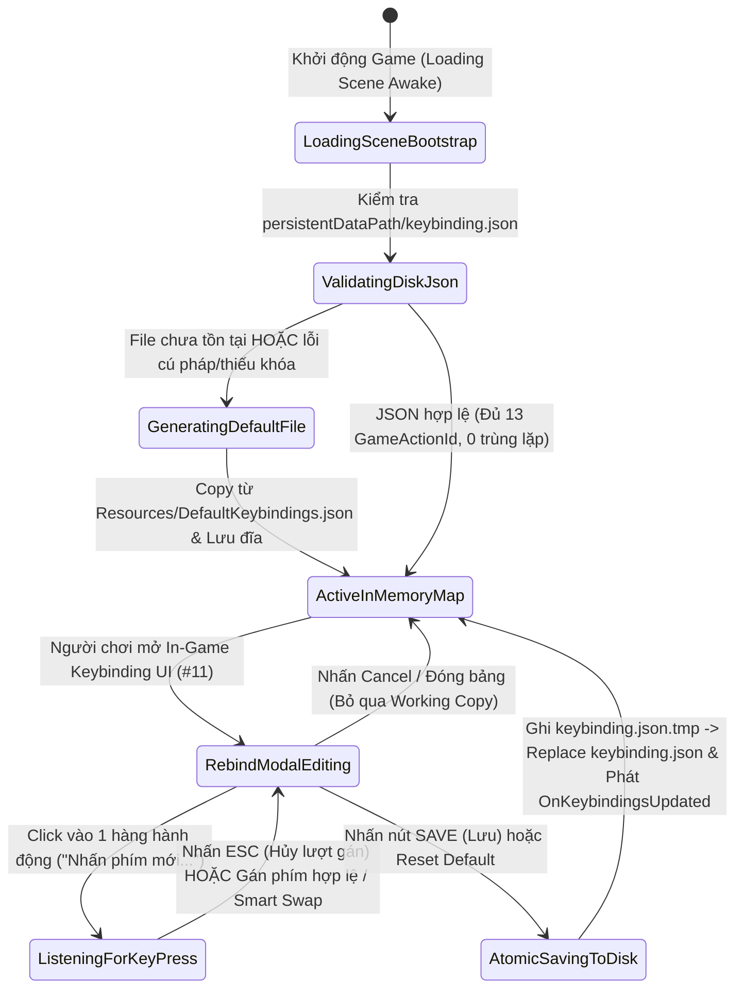
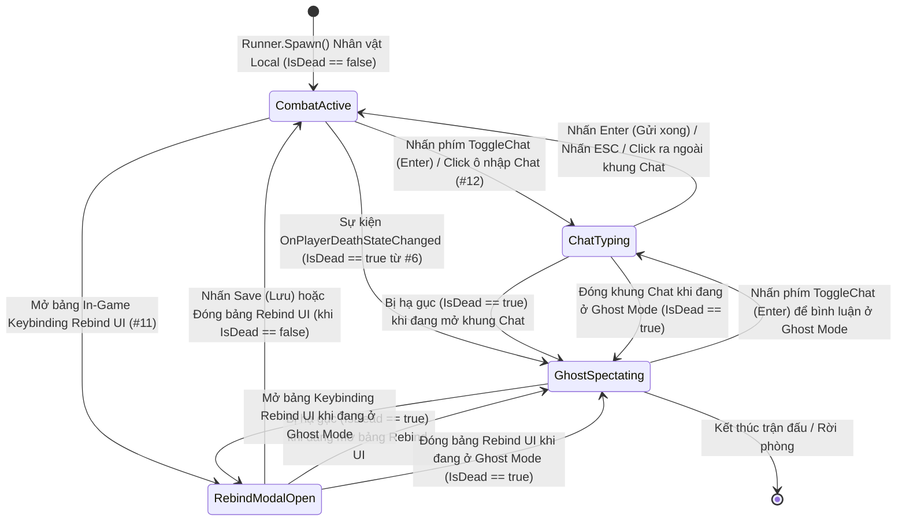

# Keybinding & Input Management System

> **Status**: Designed
> **Creative Director Review (CD-GDD-ALIGN)**: APPROVED 2026-11-10
> **Author**: Solo Developer + Studio Agents (`systems-designer`, `gameplay-programmer`, `network-engineer`, `ux-designer`, `qa-lead`)
> **Last Updated**: 2026-11-10
> **Last Verified**: 2026-11-10
> **Implements Pillar**: Pillar 1 (Cơ Động Phản Xạ Định Đoạt Sinh Tồn), Pillar 2 (Nhãn Quan Chiến Thuật Kép FPS $\leftrightarrow$ TPS) & Pillar 3 (Công Bằng Mạng Tuyệt Đối Trên Shared Mode)

## Summary

**Keybinding & Input Management System (`KeybindingManager`, `InputFocusManager` & `FusionInputAggregator`)** là hệ thống nền tảng ở tầng **Foundation (`Core` / `MVP`)** chịu trách nhiệm quản lý toàn bộ vòng đời ánh xạ phím điều khiển từ tệp `keybinding.json` ngay tại **Loading Scene**, kiểm soát khóa tiêu điểm đầu vào độc quyền giữa chiến đấu và giao diện UI, đồng thời hợp nhất tín hiệu điều khiển từ cả bàn phím/chuột PC lẫn **cụm 7 Button kỹ năng mềm góc dưới phải màn hình** (`LMB`, `RMB`, `1`, `2`, `3`, `Q`, `E`) vào cấu trúc `NetworkInputData : INetworkInput` của **Photon Fusion 2 (`GameMode.Shared`)**. Người chơi trải nghiệm trực tiếp hệ thống này qua sự tự do tùy biến phím bấm cá nhân (lưu trữ bền vững trong `keybinding.json`), nhãn phím tắt (`Dynamic Keycap Pill`) trên cụm nút kỹ năng mềm tự động đổi chữ tức thì ngay khi bấm **Save (Lưu)**, cảm giác điều khiển nhạy bén không trễ nhịp và sự an toàn tuyệt đối khi gõ Chat (`Enter`) hoặc mở bảng cài đặt phím mà nhân vật không bao giờ tự ý di chuyển hay tung chiêu nhầm.

> **Quick reference** — Layer: `Foundation` · Priority: `MVP` · Key deps: `None`

## Overview

Trong một trò chơi hành động đấu trường sinh tồn 3D nhịp độ cao như *Capsule Arena: Last Man Standing*, nơi thắng bại được định đoạt trong vài phần mười giây bởi một cú lăn né ngang (**Side Dodge Roll `Q`/`E`**), một pha lướt tiến áp sát (**Forward Dash phím `2`**), một nhát chém dọc trực diện (**Vertical Slash `Left Click`**), một cú chém ngang quét quạt $90^\circ$ kèm xoay mượt thân người và Camera (**Horizontal Turning Slash phím `1`/`3`**) hay một phát bắn tầm xa (**Ranged Attack `Right Click`**), hệ thống thu thập và quản lý đầu vào chính là "hệ thần kinh cảm giác" nối liền ý đồ của người chơi với mô phỏng mạng `FixedUpdateNetwork()`.

**Keybinding & Input Management System (`System #3`)** giải quyết đồng thời 4 bài toán kiến trúc cốt lõi ở tầng **Foundation**:
1. **Khởi tạo & Lưu trữ Bền vững `keybinding.json` từ Loading Scene (Persistent JSON Keybinding Bootstrap):** Ngay khi trò chơi khởi chạy tại **Loading Scene**, `KeybindingManager` kiểm tra và đọc tệp `Application.persistentDataPath + "/keybinding.json"`. Nếu tệp chưa tồn tại (lần đầu mở game) hoặc bị lỗi cấu trúc, hệ thống tự động khởi tạo tệp mới từ cấu hình gốc `Resources/DefaultKeybindings.json` (`TextAsset`) để ánh xạ đầy đủ 13 hành động (`GameActionId`: `WASD`, `LMB`, `RMB`, `1`, `2`, `3`, `Q`, `E`, `V`, `Enter`) trước khi chuyển sang màn hình Lobby.
2. **Tùy biến Phím Trực tiếp & Đồng bộ Sự kiện Một chiều (Live Rebinding & Event-Driven UI Sync):** Khi người chơi mở bảng **In-Game Keybinding Rebind UI (`System #11`)**, thay đổi phím bấm cho bất kỳ hành động nào và nhấn nút **Save (Lưu)**, hệ thống thực thi kiểm tra xung đột (`Smart Swap` hoán đổi phím trùng hoặc từ chối các phím hệ thống bị khóa như `ESC`), cập nhật bảng tra cứu trong bộ nhớ với độ phức tạp $O(1)$, ghi đè nguyên tử (atomic write qua tệp tạm `.tmp` $\rightarrow$ `.json`) xuống `keybinding.json`, và phát sự kiện C# `OnKeybindingsUpdated(IReadOnlyDictionary<GameActionId, KeyCode>)`. Cụm **7 Button kỹ năng mềm góc dưới phải màn hình (`System #8`)** lắng nghe sự kiện này để đổi nhãn phím tắt (`Dynamic Keycap Pill`) ngay tức khắc mà không tạo phụ thuộc vòng giữa các hệ thống.
3. **Hợp nhất Tín hiệu Đa nguồn PC + Mobile-Ready (`Dual-Source Input Aggregation` qua `IInputProvider`):** Hệ thống thu thập đồng thời thao tác nhấn phím cứng/chuột trên PC và thao tác chạm/click chuột trên **cụm 7 Button kỹ năng mềm góc dưới phải màn hình** (`LMB`, `RMB`, `1`, `2`, `3`, `Q`, `E`) thông qua toán tử hợp logic (`Bitwise OR`), đóng gói thành cấu trúc mạng `NetworkInputData : INetworkInput` siêu nhẹ (`16 bytes`) bên trong callback `OnInput(NetworkRunner runner, NetworkInput input)` của Photon Fusion 2.
4. **Máy Trạng thái Khóa Tiêu điểm Đầu vào Độc quyền (`InputFocusManager`):** Quản lý 4 trạng thái độc quyền (`CombatActive`, `ChatTyping`, `RebindModalOpen`, `GhostSpectating`) để đảm bảo khi người chơi đang gõ tin nhắn trong khung Chat (`System #12`) hoặc đang gán lại phím (`System #11`), toàn bộ đầu vào di chuyển và tấn công gửi vào mạng đều bị khóa sạch về `default`, ngăn chặn triệt để lỗi nhân vật tự chạy vào tường hoặc tự xả chiêu ngoài ý muốn.

## Player Fantasy

> **System Framing:** `[A] Direct & [B] Indirect — Người chơi tương tác trực tiếp khi tùy chỉnh phím bấm theo thói quen tay cá nhân, và cảm nhận gián tiếp sự mượt mà, chính xác tuyệt đối của từng thao tác lướt, lăn né, vung kiếm trong suốt trận đấu.`

### 1. Giấc mơ cốt lõi: "Phản Xạ Ý Niệm — Vũ Khí Tuân Lệnh Theo Từng Đầu Ngón Tay"
Trong tâm thức của một game thủ Arena PvP, không có sự ức chế nào lớn hơn việc "nghĩ kịp trong đầu nhưng bấm nhầm phím do bố cục mặc định lạ tay" hoặc "đang gõ dòng chat trả lời bạn bè thì nhân vật tự động lướt ra khỏi chỗ nấp và bị bắn hạ". **Keybinding & Input Management System** biến chiếc bàn phím, con chuột và cả cụm nút bấm mềm trên màn hình thành phần nối dài tự nhiên của cơ thể người chơi:
- **Tự do cá nhân hóa theo Trí nhớ Cơ bắp (Personalized Muscle Memory):** Một người chơi quen dùng phím `LeftShift` cho **Forward Dash** thay vì phím `2`, hay muốn đổi hai đòn **Chém ngang xoay người $90^\circ$** từ `1`/`3` sang `Z`/`C` hoặc nút phụ chuột `Mouse3`/`Mouse4`, chỉ cần mở bảng gán phím, bấm phím mới và nhấn **Save (Lưu)**. Ngay lập tức, cả hệ thống điều khiển lẫn nhãn chữ nhỏ (`Keycap Pill`) gắn trên 7 nút kỹ năng ở góc dưới phải màn hình đều biến đổi theo đúng ý muốn của họ, và lựa chọn đó được giữ nguyên bền vững trong `keybinding.json` qua mọi lần tắt mở game.
- **Linh hoạt Đa nền tảng PC & Mobile-Ready (Hybrid Control Freedom):** Dù người chơi là game thủ PC kỳ cựu điều khiển bằng tổ hợp phím cứng + chuột tốc độ cao, hay là người chơi trải nghiệm thao tác click/chạm trực tiếp lên **cụm 7 Button kỹ năng mềm góc dưới phải màn hình** theo phong cách hành động Mobile, mọi lệnh điều khiển đều đi qua cùng một đường ống chuẩn hóa công bằng tuyệt đối (**Pillar 1** & **Pillar 3**).

### 2. Trải nghiệm cảm giác qua từng khoảnh khắc (How the Player Experiences the Effects)
1. **Khởi đầu Liền mạch Ngay từ Loading Scene:** Khi vừa bật game, chỉ trong vài mili-giây tại **Loading Scene**, tệp `keybinding.json` đã được nạp xong. Người chơi bước vào trận đấu với bộ phím quen thuộc của riêng mình đã sẵn sàng 100%, không bao giờ phải cài đặt lại phím sau mỗi lần khởi động lại trò chơi.
2. **Phản hồi Thị giác Tức thời trên Cụm 7 Nút Mềm (`Dynamic Keycap Pill`):** Ngay khoảnh khắc người chơi đổi phím **Forward Dash** từ `2` sang `F` và bấm **Lưu (Save)**, nhãn phím tắt trên nút lướt ở góc dưới phải màn hình lập tức đổi từ `[2]` sang `[F]`. Khi người chơi nhấn phím `[F]` trên bàn phím trong giao tranh, chính nút mềm trên màn hình cũng lún xuống đàn hồi (`0.90x scale`), tạo ra sự gắn kết xúc giác hoàn hảo giữa ngón tay và giao diện HUD.
3. **Sự An tâm Tuyệt đối khi Giao tiếp & Cài đặt (`InputFocusManager`):** Khi đang nấp sau khối `Obstacle` và nhấn `Enter` để gõ câu chat `"Cẩn thận góc trái!"` gửi cho đồng đội hoặc nhắn mật (`Whisper`), người chơi hoàn toàn yên tâm gõ các chữ cái `W`, `A`, `S`, `D`, `Q`, `E`, `1`, `2`, `3` trong khung nhập liệu mà chiến binh Capsule vẫn đứng im tuyệt đối sau vật cản.

### 3. Điểm chạm Tham chiếu & Đối chiếu Trụ cột Thiết kế

| Điểm tham chiếu / Trụ cột | Cách `Keybinding & Input Management System` hiện thực hóa trải nghiệm |
| :--- | :--- |
| ***Valorant / Overwatch 2*** *(Zero-Latency Custom Bindings & Smart Conflict Swap)* | Cho phép gán lại toàn bộ phím di chuyển, kỹ năng và tiện ích với cơ chế hoán đổi thông minh (`Smart Swap`) khi trùng phím, lưu trữ bền vững vào `keybinding.json` và không mất dù chỉ 1 khung hình nhấn phím nhờ chốt chặn `Input Edge Latch` giữa `Update()` và `OnInput()`. |
| ***Brawl Stars / Genshin Impact*** *(Hybrid PC Keycaps + Mobile Thumb-Arc Pad)* | Kết hợp cụm 7 nút kỹ năng hình cánh cung ở góc dưới phải màn hình (hỗ trợ chạm/click trực tiếp) với nhãn phím tắt động (`Dynamic Keycap Pill`) phản chiếu thời gian thực cấu hình trong `keybinding.json`. |
| **Pillar 1, Pillar 2 & Pillar 3** | Bảo toàn độ nhạy của phản xạ lăn né `Q/E`, lướt `2`, chém dọc `LMB`, chém ngang xoay $90^\circ$ `1/3`, đổi góc nhìn `V` (`FPS <-> TPS`), và đóng gói toàn bộ đầu vào thành `NetworkInputData` chuẩn Tick mạng `60Hz` của Photon Fusion 2 Shared Mode. |

## Detailed Design

### Core Rules

1. **Quy tắc Định Danh 13 Hành Động Có Thể Gán Phím (`GameActionId` Enum & Default Mapping Table):**
   - Mọi thao tác điều khiển của người chơi trong *Capsule Arena: Last Man Standing* được định danh bằng kiểu liệt kê `GameActionId` gồm đúng **13 hành động độc lập** (chia thành 3 nhóm chức năng: 4 hướng di chuyển cơ bản, 7 kỹ năng chiến đấu/cơ động có nút mềm tương ứng ở góc dưới phải màn hình, và 2 phím tiện ích Camera/Chat).
   - Bảng ánh xạ mặc định chuẩn được đóng gói trong tài nguyên chỉ đọc `Assets/_Project/Resources/DefaultKeybindings.json` và tự động sao chép ra `Application.persistentDataPath + "/keybinding.json"` ở lần khởi chạy đầu tiên tại **Loading Scene**:

| STT | `GameActionId` (Enum) | Nhóm Chức Năng | `KeyCode` Mặc Định | Nhãn Hiển Thị (`DisplayLabel`) | Liên Kết Nút Mềm Góc Dưới Phải (`#8`) | Mô Tả Hành Vi Khi Kích Hoạt |
| :-: | :--- | :---: | :---: | :---: | :---: | :--- |
| 1 | `MoveForward` | Locomotion | `KeyCode.W` | `"W"` | Không *(WASD / Joystick)* | Tiến về phía trước theo hướng nhìn nhân vật (`MoveDirection.y = +1`). |
| 2 | `MoveBackward` | Locomotion | `KeyCode.S` | `"S"` | Không *(WASD / Joystick)* | Lùi về phía sau (`MoveDirection.y = -1`). |
| 3 | `MoveLeft` | Locomotion | `KeyCode.A` | `"A"` | Không *(WASD / Joystick)* | Di chuyển ngang sang trái (`MoveDirection.x = -1`). |
| 4 | `MoveRight` | Locomotion | `KeyCode.D` | `"D"` | Không *(WASD / Joystick)* | Di chuyển ngang sang phải (`MoveDirection.x = +1`). |
| 5 | `VerticalSlash` | Combat (Primary) | `KeyCode.Mouse0` | `"LMB"` | **Button #1 (Tâm chính)** | **Nhát chém dọc thẳng trước mặt từ trên xuống** (`35 dmg`, góc $45^\circ$, tầm `2.80m`, hồi chiêu `0.65s`). |
| 6 | `RangedAttack` | Combat (Secondary) | `KeyCode.Mouse1` | `"RMB"` | **Button #2 (Vòng trong)** | **Bắn đạn tầm xa từ Object Pool** (`20 dmg`, tốc độ `22.0 m/s`, tầm `26.0m`, hồi chiêu `0.55s`). |
| 7 | `HorizontalSlashLeft` | Combat (Turning) | `KeyCode.Alpha1` | `"1"` | **Button #3 (Cung trái)** | **Nhát chém ngang trái $90^\circ$** (`25 dmg`, hồi chiêu `0.85s`) + **xoay mượt nhân vật & Camera $-90^\circ$ trong `0.15s`**. |
| 8 | `ForwardDash` | Mobility (Dash) | `KeyCode.Alpha2` | `"2"` | **Button #4 (Đỉnh cung)** | **Lướt tiến tốc độ cao (`Forward Dash`)** (`16.0 m/s` trong `0.25s` đi được `4.0m`, hồi chiêu `2.50s`). |
| 9 | `HorizontalSlashRight` | Combat (Turning) | `KeyCode.Alpha3` | `"3"` | **Button #5 (Cung phải)** | **Nhát chém ngang phải $90^\circ$** (`25 dmg`, hồi chiêu `0.85s`) + **xoay mượt nhân vật & Camera $+90^\circ$ trong `0.15s`**. |
| 10 | `DodgeLeft` | Mobility (Dodge) | `KeyCode.Q` | `"Q"` | **Button #6 (Rìa trái)** | **Lăn né ngang sang trái (`Side Dodge Roll Left`)** (`12.0 m/s` trong `0.22s` đi `~2.80m`, hồi chiêu chung `1.80s`). |
| 11 | `DodgeRight` | Mobility (Dodge) | `KeyCode.E` | `"E"` | **Button #7 (Rìa phải)** | **Lăn né ngang sang phải (`Side Dodge Roll Right`)** (`12.0 m/s` trong `0.22s` đi `~2.80m`, hồi chiêu chung `1.80s`). |
| 12 | `ToggleCamera` | Tactical Utility | `KeyCode.V` | `"V"` | Nút phụ góc trên phải | **Chuyển đổi góc nhìn `FPS <-> TPS`** tức thời trên `CinemachineCamera` (`System #9`). |
| 13 | `ToggleChat` | Social Utility | `KeyCode.Return` | `"Enter"` | Nút mở khung Chat | **Mở / Gửi tin nhắn Chat** (`Public` / `Private Whisper`) và chuyển trạng thái `InputFocusManager` (`System #12`). |

2. **Quy tắc Nạp & Khởi Tạo `keybinding.json` Ngay Tại Loading Scene (Loading Scene Bootstrap & Schema Contract):**
   - Trong `Awake()` của **Loading Scene** (Scene `0` trong Build Settings), `KeybindingBootstrap` gọi `KeybindingManager.InitializeFromDisk()` trước khi cho phép thanh tiến trình chuyển sang `LobbyScene`.
   - Đường dẫn tệp lưu trữ chuẩn: `string FilePath => Path.Combine(Application.persistentDataPath, "keybinding.json");`.
   - **Quy trình kiểm tra & tự phục hồi 4 bước khi nạp tệp:**
     1. Nếu tệp `keybinding.json` chưa tồn tại tại `Application.persistentDataPath`: Hệ thống đọc nội dung chuỗi JSON từ `Resources.Load<TextAsset>("DefaultKeybindings")`, ghi xuống đĩa tạo tệp `keybinding.json` mới và nạp vào bộ nhớ.
     2. Nếu tệp `keybinding.json` đã tồn tại: Hệ thống đọc chuỗi văn bản và giải tuần tự hóa (`JsonUtility.FromJson<KeybindingSaveData>(json)`).
     3. Kiểm tra tính toàn vẹn của từng mục (`Schema & Completeness Validation`): Nếu chuỗi JSON bị hỏng cú pháp, thiếu bất kỳ `GameActionId` nào trong tổng số 13 hành động, chứa tên `KeyCode` không hợp lệ (`!Enum.TryParse<KeyCode>`), hoặc chứa hai hành động bị gán trùng cùng một `KeyCode` do người dùng sửa tay tệp văn bản ngoài game, hệ thống tự động điền bù các hành động thiếu/lỗi bằng phím mặc định chuẩn và ghi đè lại tệp `keybinding.json` sạch xuống đĩa.
   - **Cấu trúc Schema chuẩn của tệp `keybinding.json`:**
     ```json
     {
       "schemaVersion": 1,
       "lastModifiedUtc": "2026-11-10T05:30:00Z",
       "mouseSensitivityMultiplier": 1.0,
       "bindings": [
         { "action": "MoveForward", "key": "W", "displayLabel": "W" },
         { "action": "MoveBackward", "key": "S", "displayLabel": "S" },
         { "action": "MoveLeft", "key": "A", "displayLabel": "A" },
         { "action": "MoveRight", "key": "D", "displayLabel": "D" },
         { "action": "VerticalSlash", "key": "Mouse0", "displayLabel": "LMB" },
         { "action": "RangedAttack", "key": "Mouse1", "displayLabel": "RMB" },
         { "action": "HorizontalSlashLeft", "key": "Alpha1", "displayLabel": "1" },
         { "action": "ForwardDash", "key": "Alpha2", "displayLabel": "2" },
         { "action": "HorizontalSlashRight", "key": "Alpha3", "displayLabel": "3" },
         { "action": "DodgeLeft", "key": "Q", "displayLabel": "Q" },
         { "action": "DodgeRight", "key": "E", "displayLabel": "E" },
         { "action": "ToggleCamera", "key": "V", "displayLabel": "V" },
         { "action": "ToggleChat", "key": "Return", "displayLabel": "Enter" }
       ]
     }
     ```

3. **Quy tắc Gán Lại Phím, Hoán Đổi Xung Đột Thông Minh & Ghi Đĩa Nguyên Tử (`Smart Swap` & Atomic Save on Rebind):**
   - Khi người chơi mở bảng **In-Game Keybinding Rebind UI (`System #11`)** và chọn một hành động `targetAction` để đổi sang phím mới `newKey`:
     - **Danh sách phím hệ thống bị cấm (`Forbidden System Keys`):** `KeyCode.Escape` (dùng để Hủy gán phím / đóng bảng UI), `KeyCode.LeftWindows`, `KeyCode.RightWindows`, `KeyCode.Print`, `KeyCode.SysReq`, `KeyCode.Break`. Nếu người chơi nhấn `KeyCode.Escape` khi đang chờ gán phím, thao tác gán phím hiện tại lập tức bị hủy và giữ nguyên phím cũ.
     - **Cơ chế Hoán Đổi Thông Minh Khi Trùng Phím (`Conflict Detection & Smart Swap`):** Nếu `newKey` đang được gán cho một hành động khác `existingAction` (`existingAction != targetAction`), hệ thống **không báo lỗi chặn đứng** mà tự động hoán đổi phím cũ của `targetAction` sang cho `existingAction` (`bindingMap[existingAction] = oldKeyOfTarget; bindingMap[targetAction] = newKey;`), đồng thời làm nổi bật (highlight vàng cam) cả hai hàng trên UI để người chơi thấy rõ sự hoán đổi. Đảm bảo 100% tính duy nhất (`Bijective 1-to-1 Mapping`) giữa `GameActionId` và `KeyCode`.
   - **Khi người chơi nhấn nút `Save (Lưu)` trên bảng Rebind UI (`CommitAndSaveToDisk()`):**
     1. Sao chép bảng ánh xạ tạm thời (`Working Copy`) vào mảng tra cứu chính thức trong bộ nhớ (`_activeKeyCodes[(int)actionId]`).
     2. Tuần tự hóa thành chuỗi JSON định dạng đẹp (`JsonUtility.ToJson(saveData, prettyPrint: true)`).
     3. Thực hiện **Ghi Đĩa Nguyên Tử (`Atomic File Write`)**: Ghi toàn bộ nội dung ra tệp tạm `keybinding.json.tmp`, gọi `File.Replace` (hoặc xóa tệp cũ và đổi tên `.tmp` thành `keybinding.json`) để đảm bảo tệp `keybinding.json` không bao giờ bị mất dữ liệu hay trống rỗng (0 byte) nếu máy tính mất điện hoặc đóng ứng dụng đột ngột đúng lúc đang lưu.
     4. Phát sự kiện C# `OnKeybindingsUpdated?.Invoke(ReadOnlyBindings)` để **System #8 (`Mobile Action Pad UI`)** cập nhật tức thì nhãn chữ phím tắt (`Dynamic Keycap Pill`) trên cả 7 Button kỹ năng mềm góc dưới phải màn hình.

4. **Quy tắc Hợp Nhất Đầu Vào Đa Nguồn & Chốt Chặn Cạnh Lên Giữa `Update()` và `OnInput()` (`Dual-Source Aggregation & Edge-Trigger Latch`):**
   - Do Unity thu thập trạng thái nhấn phím một khung hình (`Input.GetKeyDown`) theo tần số dựng hình `Update()` (có thể chạy ở `30–240 FPS`), trong khi **Photon Fusion 2** lấy mẫu đầu vào mạng trong callback `OnInput(NetworkRunner runner, NetworkInput input)` theo tần số Tick mạng cố định (`60Hz`), việc gọi trực tiếp `Input.GetKeyDown` bên trong `OnInput()` sẽ làm rơi (miss) thao tác nhấn phím nhanh giữa hai Tick.
   - Do đó, `FusionInputAggregator` thực thi **Cơ chế Chốt Chặn Cạnh Lên (`Edge-Trigger Input Latch`)** trong mọi khung hình `Update()`:
     - Với 4 phím di chuyển (`MoveForward`, `MoveBackward`, `MoveLeft`, `MoveRight`): Đọc trạng thái giữ liên tục (`Input.GetKey(key)` kết hợp вектор từ cụm điều hướng mềm nếu có).
     - Với 7 kỹ năng chiến đấu/cơ động (`VerticalSlash`, `RangedAttack`, `HorizontalSlashLeft`, `ForwardDash`, `HorizontalSlashRight`, `DodgeLeft`, `DodgeRight`): Trong mỗi `Update()`, nếu `Input.GetKey(boundKey)` hoặc `Input.GetKeyDown(boundKey)` trên bàn phím/chuột PC là `true`, **HOẶC** nút kỹ năng mềm tương ứng trên màn hình (`VirtualSkillButton`) đang được chạm/click (`IsVirtualButtonPressed(buttonIndex) == true`), hệ thống bật bit tương ứng trong biến chốt `_latchedButtonsMask |= (1 << buttonIndex)`.
     - Ngay khi Photon Fusion 2 gọi `OnInput(runner, input)`, hệ thống đóng gói `_latchedButtonsMask` vào `NetworkInputData.Buttons`, truyền cho `input.Set(networkInputData)`, rồi lập tức xóa các bit chốt cạnh lên (`_latchedButtonsMask = 0`) trong khi vẫn giữ các bit đang được đè phím liên tục. Nhờ vậy, không một cú click chuột hay chạm nút mềm nào bị bỏ sót dù chỉ trong `1ms`.
   - **Quy tắc chống nhầm lẫn Chuột Trái (`LMB`) khi bấm lên Nút Mềm UI (`PointerOverUI Guard`):** Khi người chơi dùng chuột trái (`KeyCode.Mouse0`) click trực tiếp vào một trong các nút kỹ năng mềm trên góc dưới phải màn hình (ví dụ click vào nút mềm `Forward Dash [2]` hoặc nút mở bảng Rebind/Chat), hệ thống kiểm tra `EventSystem.current.IsPointerOverGameObject()`. Nếu con trỏ đang nằm trên một thành phần UI tương tác, thao tác click chuột trái đó **chỉ kích hoạt đúng nút UI được bấm** chứ không tự động kích hoạt thêm đòn **Vertical Slash (`LMB`)** ngoài ý muốn.

5. **Quy tắc Cấu Trúc Gói Tin Đầu Vào Mạng (`NetworkInputData : INetworkInput` Schema):**
   - Cấu trúc `NetworkInputData` được truyền từ máy người chơi vào vòng lặp mô phỏng `FixedUpdateNetwork()` của Photon Fusion 2 có kích thước gọn nhẹ cố định (`20 bytes`), định nghĩa tường minh như sau:
     ```csharp
     public enum NetworkInputButton : int
     {
         VerticalSlash        = 0, // Mặc định: LMB (Mouse0)  — Chém dọc thẳng trước mặt
         RangedAttack         = 1, // Mặc định: RMB (Mouse1)  — Bắn đạn tầm xa từ Object Pool
         HorizontalSlashLeft  = 2, // Mặc định: Phím 1        — Chém ngang trái 90° + xoay -90° (0.15s)
         ForwardDash          = 3, // Mặc định: Phím 2        — Lướt tiến Forward Dash
         HorizontalSlashRight = 4, // Mặc định: Phím 3        — Chém ngang phải 90° + xoay +90° (0.15s)
         DodgeLeft            = 5, // Mặc định: Phím Q        — Lăn né ngang trái
         DodgeRight           = 6  // Mặc định: Phím E        — Lăn né ngang phải
     }

     public struct NetworkInputData : INetworkInput
     {
         public NetworkButtons Buttons;      // 4 bytes (Bitmask 7 nút kỹ năng chiến đấu & cơ động)
         public Vector2 MoveDirection;       // 8 bytes (Vector di chuyển mặt phẳng XZ đã chuẩn hóa, độ dài <= 1.0)
         public float YawDelta;              // 4 bytes (Góc xoay chuột ngang cộng thêm trong Tick hiện tại, độ °)
         public float PitchDelta;            // 4 bytes (Góc xoay chuột dọc cộng thêm trong Tick hiện tại cho FPS/TPS, độ °)
     }
     ```
   - *(Lưu ý kiến trúc: Hai hành động tiện ích cục bộ là `ToggleCamera` [phím `V`] và `ToggleChat` [phím `Enter`] chỉ tác động lên `CinemachineCamera` cục bộ của máy người chơi hoặc giao diện `CanvasGroup` Chat, nên được xử lý trực tiếp tại Client thông qua sự kiện của `KeybindingManager` mà không cần đóng gói vào `NetworkInputData`, giúp tiết kiệm băng thông mạng).*

6. **Quy tắc Máy Trạng Thái Khóa Tiêu Điểm Đầu Vào Độc Quyền (`InputFocusManager`):**
   - `InputFocusManager` duy trì một trạng thái `InputFocusState` duy nhất tại mọi thời điểm và áp dụng ma trận cho phép đầu vào nghiêm ngặt:

| Trạng Thái (`InputFocusState`) | Điều Kiện Kích Hoạt | Cho Phép `NetworkInputData` (`WASD`, Chuột Xoay, 7 Kỹ Năng)? | Cho Phép Cụm 7 Nút Mềm Góc Dưới Phải (`#8`)? | Cho Phép Phím Đổi Góc Nhìn `V` (`#9`)? | Cho Phép Phím `Enter` / Gõ Chữ UI? | Trạng Thái Con Trỏ Chuột (`Cursor.lockState`) |
| :--- | :--- | :---: | :---: | :---: | :---: | :---: |
| **`CombatActive`** *(Mặc định khi sống)* | Đang trong trận đấu, `IsDead == false`, không mở Chat hay Rebind UI. | **CÓ (100%)** | **CÓ (100%)** | **CÓ** | `Enter` mở khung Chat | `Locked` (hoặc `Confined` khi giữ `LeftAlt` để bấm nút mềm trên PC) |
| **`ChatTyping`** | Người chơi nhấn `ToggleChat` (`Enter`) hoặc click vào ô `TMP_InputField` của khung Chat (`#12`). | **KHÔNG** *(Gửi `default` 0)* | **KHÔNG** *(Khóa `blocksRaycasts`)* | **KHÔNG** | **CÓ** *(Gõ văn bản, `Enter` gửi tin, `ESC` đóng Chat)* | `Confined` (`Cursor.visible = true`) |
| **`RebindModalOpen`** | Người chơi mở bảng **In-Game Keybinding Rebind UI (`#11`)**. | **KHÔNG** *(Gửi `default` 0)* | **KHÔNG** *(Đang hiển thị nhãn preview)* | **KHÔNG** | **KHÔNG** *(Toàn bộ phím dành cho bộ lắng nghe Rebind / `ESC`)* | `Confined` (`Cursor.visible = true`) |
| **`GhostSpectating`** | Nhân vật tử trận (`IsDead == true` từ `#6`), chuyển sang **Ghost Mode Spectator (`#9`)**. | **KHÔNG** *(Nhân vật đã chết)* | **KHÔNG** *(Ẩn cụm 7 nút chiến đấu)* | **KHÔNG** | **CÓ** (`Q`/`E` chuyển mục tiêu theo dõi, `Enter` mở Chat bình luận) | `Confined` (`Cursor.visible = true`) |

### States and Transitions

Hệ thống bao gồm **2 máy trạng thái hữu hạn (FSM)** hoạt động song song: (1) Vòng đời nạp/chỉnh sửa/lưu trữ của tệp `keybinding.json` và (2) Máy trạng thái khóa tiêu điểm đầu vào `InputFocusManager`.

#### 1. Vòng Đời Tệp Cấu Hình `keybinding.json` & Luồng Rebind (`KeybindingManager Lifecycle`)



#### 2. Máy Trạng Thái Khóa Tiêu Điểm Đầu Vào (`InputFocusManager State Machine`)



### Interactions with Other Systems

| Hệ Thống Liên Quan | Hướng Tương Tác | Giao Diện / Sự Kiện Hợp Đồng (`Data & Event Contract`) | Cơ Chế Phối Hợp Chi Tiết |
| :--- | :---: | :--- | :--- |
| **System #1: Character & Combat Config Data (`CharacterCombatConfigSO`)** | `#1` $\rightarrow$ `#3` *(Read-Only)* | `ICharacterCombatConfig.RotationSensitivity` | `FusionInputAggregator` đọc hệ số nhạy cơ bản `RotationSensitivity` (`mặc định 1.0`) từ `CharacterCombatConfigSO` nhân với `mouseSensitivityMultiplier` trong `keybinding.json` để tính `YawDelta` mỗi Tick. |
| **System #4: Photon Fusion 2 Shared Mode Session** | `#3` $\rightarrow$ `#4` *(Callback)* | `INetworkRunnerCallbacks.OnInput(NetworkRunner, NetworkInput)` | Cung cấp cấu trúc `NetworkInputData` đã hợp nhất từ bàn phím/chuột PC và cụm 7 nút kỹ năng mềm vào đường ống mô phỏng mạng của Photon Fusion 2 mỗi Tick (`60Hz`). |
| **System #5: Tick-Accurate Character Movement & Mobility System** | `#3` $\rightarrow$ `#5` *(Network Input)* | `GetInput<NetworkInputData>(out var input)` (`MoveDirection`, `YawDelta`, `ForwardDash`, `DodgeLeft`, `DodgeRight`) | Trong `FixedUpdateNetwork()`, `#5` đọc `input.MoveDirection` để di chuyển `WASD`, đọc `input.YawDelta` để xoay thân người theo chuột, và kiểm tra `input.Buttons.IsSet(ForwardDash / DodgeLeft / DodgeRight)` để kích hoạt lướt tiến phím `2` hoặc lăn né `Q`/`E`. |
| **System #6: Health, Damage RPC & Death State System** | `#6` $\rightarrow$ `#3` *(One-Way Event)* | `OnPlayerDeathStateChanged(bool isDead)` | Khi nhân vật Local có `CurrentHealth <= 0` (`IsDead = true`), `#6` phát sự kiện để `InputFocusManager` tự động chuyển sang trạng thái `GhostSpectating` (và đóng bảng Rebind UI nếu đang mở dở để người chơi thấy rõ nguyên nhân tử trận). |
| **System #7: Multi-Directional Melee & Pooled Ranged Combat System** | `#3` $\rightarrow$ `#7` *(Network Input)* | `GetInput<NetworkInputData>(out var input)` (`VerticalSlash`, `RangedAttack`, `HorizontalSlashLeft`, `HorizontalSlashRight`) | Trong `FixedUpdateNetwork()`, `#7` kiểm tra các bit nút bấm trong `input.Buttons` để tung đòn **Chém dọc (`LMB`)**, **Bắn đạn tầm xa (`RMB`)**, hoặc **Chém ngang xoay người $\pm 90^\circ$ (`1`/`3`)**. |
| **System #8: Combat HUD, Overhead Billboard & Mobile Action Pad UI** | `#8` $\rightarrow$ `#3` *(Virtual Input)*<br>`#3` $\rightarrow$ `#8` *(Event)* | `IVirtualActionPadBridge.SetVirtualButtonState(NetworkInputButton, bool)`<br>`event Action<IReadOnlyDictionary<GameActionId, KeyCode>> OnKeybindingsUpdated` | Khi người chơi chạm/click lên 1 trong 7 nút mềm góc dưới phải, `#8` báo trạng thái nhấn xuống `#3` để gộp vào `NetworkInputData`. Ngược lại, khi `#3` nạp hoặc lưu `keybinding.json`, `#3` phát sự kiện `OnKeybindingsUpdated` để `#8` đổi nhãn chữ (`Dynamic Keycap Pill`) trên cả 7 nút mềm ngay lập tức. |
| **System #9: Dual-Perspective Camera (`FPS/TPS`) & Ghost Mode Spectator** | `#3` $\rightarrow$ `#9` *(Local Event)* | `event Action OnToggleCameraPerspectivePressed`<br>`event Action<int> OnSpectatorCycleTargetRequested` | Khi ở `CombatActive` và nhấn phím `ToggleCamera` (mặc định `V`), `#3` phát sự kiện để `#9` chuyển đổi giữa `FPS` và `TPS`. Khi ở `GhostSpectating`, nhấn phím `DodgeLeft` (`Q`) hoặc `DodgeRight` (`E`) sẽ phát sự kiện chuyển camera theo dõi người chơi sống sót trước/sau (`-1` / `+1`). |
| **System #11: In-Game Keybinding Rebind UI & Lobby Flow UI** | `#11` $\rightarrow$ `#3` *(Command API)* | `IKeybindingService.TryAssignKey(...)`, `CommitAndSaveToDisk()`, `ResetToDefaults()` | `#11` gọi API của `#3` để hiển thị bảng phím hiện tại, kiểm tra xung đột `Smart Swap`, bấm **Save (Lưu)** để ghi xuống `keybinding.json` và yêu cầu `InputFocusManager` giữ trạng thái `RebindModalOpen`. |
| **System #12: In-Game Chat System (Public & Private Whisper)** | `#12` $\leftrightarrow$ `#3` *(Focus Lock)* | `InputFocusManager.RequestFocus(InputFocusState.ChatTyping)` | Khi nhấn phím `ToggleChat` (mặc định `Enter`), `#3` chuyển sang `ChatTyping` (khóa toàn bộ `WASD` và 7 kỹ năng chiến đấu) và thông báo cho `#12` bật `CanvasGroup` khung Chat cùng con trỏ soạn thảo. |

## Formulas

### 1. Chuẩn Hóa Vector Hướng Di Chuyển Tổng Hợp (`normalized_move_vector`)

Để ngăn chặn triệt để lỗi "chạy chéo nhanh hơn chạy thẳng $1.414$ lần ($\sqrt{2}$)" khi nhấn đồng thời hai phím vuông góc (ví dụ `W + D`) hoặc khi gộp tín hiệu từ bàn phím `WASD` với cần điều khiển ảo trên màn hình, hệ thống chuẩn hóa вектор hướng di chuyển tổng hợp trước khi đóng gói vào `NetworkInputData.MoveDirection`.

The `normalized_move_vector` formula is defined as:

`normalized_move_vector = raw_input_vector / max(1.0, length(raw_input_vector))`

Trong đó thành phần đầu vào thô `raw_input_vector` được tổng hợp từ 4 hành động di chuyển đã gán phím trong `keybinding.json` và вектор điều hướng ảo (nếu có):
- `raw_x = (is_move_right ? 1.0 : 0.0) - (is_move_left ? 1.0 : 0.0) + virtual_stick_x`
- `raw_y = (is_move_forward ? 1.0 : 0.0) - (is_move_backward ? 1.0 : 0.0) + virtual_stick_y`
- `length(raw_input_vector) = sqrt(raw_x * raw_x + raw_y * raw_y)`

**Variables:**

| Variable | Type | Range | Source | Description |
| :--- | :---: | :---: | :--- | :--- |
| `is_move_forward` | `bool` | `false` hoặc `true` | `Input.GetKey(GetKey(GameActionId.MoveForward))` | Trạng thái giữ phím tiến lên (mặc định `W`). |
| `is_move_backward` | `bool` | `false` hoặc `true` | `Input.GetKey(GetKey(GameActionId.MoveBackward))` | Trạng thái giữ phím lùi xuống (mặc định `S`). |
| `is_move_left` | `bool` | `false` hoặc `true` | `Input.GetKey(GetKey(GameActionId.MoveLeft))` | Trạng thái giữ phím sang trái (mặc định `A`). |
| `is_move_right` | `bool` | `false` hoặc `true` | `Input.GetKey(GetKey(GameActionId.MoveRight))` | Trạng thái giữ phím sang phải (mặc định `D`). |
| `virtual_stick_x`, `virtual_stick_y` | `float` | `-1.0` đến `+1.0` | `IVirtualActionPadBridge` (Mobile-Ready Virtual Axis) | Tín hiệu trục ngang/dọc từ điều khiển cảm ứng (bằng `0.0` khi chỉ dùng bàn phím PC). |
| `raw_input_vector` | `Vector2` | `[-2.0, +2.0]` mỗi trục | Tính toán nội bộ trong `FusionInputAggregator` | Vector hướng di chuyển thô chưa chuẩn hóa `(raw_x, raw_y)`. |
| `normalized_move_vector` | `Vector2` | Độ dài Euclid `0.0–1.0` | `NetworkInputData.MoveDirection` | Vector hướng di chuyển hợp lệ truyền vào `FixedUpdateNetwork()` cho `System #5`. |

**Output Range:** Vector 2 chiều `(x, y)` có độ dài Euclid $\|\mathbf{v}\| \in [0.0, 1.0]$ (Nếu `InputFocusState != CombatActive`, đầu ra luôn bị ép cứng về `(0.0, 0.0)`).

**Example:**
- **Đi thẳng về phía trước (Chỉ giữ phím `W`):**
  `raw_input_vector = (0.0, 1.0)`, `length = sqrt(0^2 + 1^2) = 1.0`.
  `normalized_move_vector = (0.0, 1.0) / max(1.0, 1.0) = (0.0, 1.0)` (tốc độ di chuyển thực tế trong `#5` là `1.0 * 6.5 = 6.50 m/s`).
- **Đi chéo tiến-phải (Giữ đồng thời `W` + `D`):**
  `raw_input_vector = (1.0, 1.0)`, `length = sqrt(1^2 + 1^2) = sqrt(2) ≈ 1.4142136`.
  `normalized_move_vector = (1.0, 1.0) / max(1.0, 1.4142136) = (0.7071, 0.7071)`.
  Độ dài вектор sau chuẩn hóa bằng $\sqrt{0.7071^2 + 0.7071^2} = 1.0000$, đảm bảo tốc độ chạy chéo vẫn đúng bằng `6.50 m/s` (công bằng tuyệt đối theo **Pillar 3**).
- **Nhấn đồng thời hai phím đối nghịch (`A` + `D` cùng lúc — SOCD Neutralization):**
  `raw_x = 1.0 - 1.0 = 0.0`, `normalized_move_vector = (0.0, 0.0)` (hai lực ngược chiều tự triệt tiêu sạch sẽ).

---

### 2. Hợp Nhất Bitmask Nút Bấm Phần Cứng PC & Cụm 7 Nút Mềm Mobile (`merged_button_mask`)

Để đảm bảo người chơi có thể kích hoạt bất kỳ kỹ năng nào trong 7 kỹ năng chiến đấu/cơ động (`VerticalSlash`, `RangedAttack`, `HorizontalSlashLeft`, `ForwardDash`, `HorizontalSlashRight`, `DodgeLeft`, `DodgeRight`) bằng **cả phím cứng trên bàn phím/chuột PC** (đã ánh xạ qua `keybinding.json`) **lẫn thao tác chạm/click trên cụm 7 Button kỹ năng mềm góc dưới phải màn hình**, hệ thống sử dụng phép toán hợp bit (`Bitwise OR`) khi đang ở trạng thái `CombatActive`:

The `merged_button_mask` formula is defined as:

`merged_button_mask = pc_hardware_mask | mobile_virtual_pad_mask`

*(Khi kết hợp với mặt nạ khóa tiêu điểm `focus_gate_mask` của `InputFocusManager`, biểu thức đầy đủ tại cổng đầu ra là `final_network_buttons = (pc_hardware_mask | mobile_virtual_pad_mask) & focus_gate_mask`)*.

Trong đó:
- `pc_hardware_mask` = $\sum_{i=0}^{6} \left( \text{IsHardwareKeyActive}(i) \ll i \right)$
- `mobile_virtual_pad_mask` = $\sum_{i=0}^{6} \left( \text{IsVirtualButtonPressed}(i) \ll i \right)$
- `focus_gate_mask` = `0x7F` (`0b0111_1111` = `127`) nếu `InputFocusManager.CurrentState == InputFocusState.CombatActive`, ngược lại bằng `0x00` (`0`).

**Variables:**

| Variable | Type | Range | Source | Description |
| :--- | :---: | :---: | :--- | :--- |
| `pc_hardware_mask` | `int` (`uint`) | `0` đến `127` (`0x00–0x7F`) | Bàn phím & Chuột PC tra cứu qua `KeybindingManager` | Bitmask 7-bit biểu diễn các phím cứng đang được nhấn hoặc chốt cạnh lên (`Latch`) kể từ Tick trước. |
| `mobile_virtual_pad_mask` | `int` (`uint`) | `0` đến `127` (`0x00–0x7F`) | Cụm 7 Button kỹ năng mềm góc dưới phải (`System #8`) | Bitmask 7-bit biểu diễn các nút kỹ năng mềm trên màn hình đang được chạm (`IPointerDownHandler`) hoặc chốt cạnh lên. |
| `focus_gate_mask` | `int` (`uint`) | `0` (`0x00`) hoặc `127` (`0x7F`) | `InputFocusManager.CurrentState` | Mặt nạ cổng an toàn: bằng `127` khi đang ở `CombatActive`, bằng `0` khi đang mở khung Chat (`ChatTyping`), mở bảng gán phím (`RebindModalOpen`) hoặc ở chế độ Hồn ma (`GhostSpectating`). |
| `merged_button_mask` | `int` (`uint`) | `0` đến `127` (`0x00–0x7F`) | `NetworkInputData.Buttons.Bits` | Giá trị bitmask hợp nhất truyền vào `NetworkButtons` của Photon Fusion 2. |

**Output Range:** Số nguyên không dấu 7-bit từ `0` (`0b0000000` — không nhấn nút nào) đến `127` (`0b1111111` — cả 7 bit kỹ năng cùng bật).

**Example:**
- **Tình huống 1 (Phối hợp đa nguồn khi `CombatActive`):** Người chơi nhấn phím cứng `Q` trên bàn phím (`DodgeLeft`, bit `5` $\rightarrow 2^5 = 32`) và đồng thời dùng chuột/ngón tay bấm vào nút mềm **Ranged Attack (`RMB`)** trên màn hình (bit `1` $\rightarrow 2^1 = 2$):
  - `pc_hardware_mask = 32` (`0b0100000`)
  - `mobile_virtual_pad_mask = 2` (`0b0000010`)
  - `merged_button_mask = 32 | 2 = 34` (`0b0100010`).
  Cả bit `DodgeLeft` lẫn bit `RangedAttack` đều được truyền nguyên vẹn vào `FixedUpdateNetwork()`.
- **Tình huống 2 (Nhấn đồng thời cả phím cứng lẫn nút mềm của cùng 1 chiêu):** Người chơi vừa nhấn phím cứng `2` (`ForwardDash`, bit `3` $\rightarrow 2^3 = 8$) vừa chạm vào nút mềm `ForwardDash` trên màn hình (`mobile_virtual_pad_mask = 8`):
  - `merged_button_mask = 8 | 8 = 8` (`0b0001000`).
  Nhờ tính lũy đẳng của phép `Bitwise OR` ($A \lor A = A$), hệ thống chỉ gửi đúng **1 lệnh kích hoạt duy nhất** vào mạng, không bao giờ gây kích hoạt kép hay trừ Cooldown hai lần.
- **Tình huống 3 (Đang gõ Chat `ChatTyping`):** Người chơi đang mở khung Chat và gõ phím `1`, `2`, `3`, `Q`, `E` (`merged_button_mask = 124`), nhưng cổng `focus_gate_mask = 0` nên `final_network_buttons = 124 & 0 = 0`. Nhân vật đứng yên tuyệt đối, không tung ra bất kỳ đòn đánh nào.

---

### 3. Lượng Tử Hóa & Kẹp Biên Góc Xoay Chuột Mỗi Tick Mạng (`clamped_yaw_delta`)

Để đồng bộ góc xoay mặt nhân vật (`NetworkTransform`) theo chuyển động chuột ngang của người chơi một cách mượt mà giữa các Tick mạng `60Hz`, đồng thời ngăn chặn các cú giật chuột bất thường (mouse spike khi vẩy chuột cực mạnh hoặc khi cửa sổ game vừa lấy lại tiêu điểm) làm văng góc quay vượt quá giới hạn vật lý hoặc làm rối loạn phép xoay $\pm 90^\circ$ của đòn chém ngang phím `1`/`3`, hệ thống tính toán và kẹp biên `clamped_yaw_delta` trước khi gửi vào `NetworkInputData.YawDelta`.

The `clamped_yaw_delta` formula is defined as:

`clamped_yaw_delta = clamp(mouse_delta_x * RotationSensitivity * base_deg_per_pixel, -max_yaw_per_tick, max_yaw_per_tick)`

**Variables:**

| Variable | Type | Range | Source | Description |
| :--- | :---: | :---: | :--- | :--- |
| `mouse_delta_x` | `float` | `-500.0` đến `+500.0` | Tích lũy `Input.GetAxisRaw("Mouse X")` giữa 2 lần gọi `OnInput()` | Tổng độ dịch chuyển trục ngang của chuột tích lũy từ các khung hình `Update()` kể từ Tick mạng trước (bằng `0.0` nếu `InputFocusState != CombatActive`). |
| `RotationSensitivity` | `float` | `0.1–5.0` (mặc định `1.0`) | `CharacterCombatConfigSO.RotationSensitivity` (`System #1`) $\times$ `mouseSensitivityMultiplier` (`keybinding.json`) | Hệ số nhạy xoay góc nhìn hiệu dụng từ cấu hình `ScriptableObject` trung tâm kết hợp cài đặt cá nhân của người chơi. |
| `base_deg_per_pixel` | `float` | `0.5–5.0` (mặc định `2.0`) | `FusionInputAggregator.BaseDegreesPerMouseUnit` | Hệ số quy đổi đơn vị dịch chuyển chuột của Unity sang góc độ (`°`). |
| `max_yaw_per_tick` | `float` | `12.0–45.0` (mặc định `30.0°`) | `FusionInputAggregator.MaxYawDeltaPerTick` | Biên độ góc xoay chuột tối đa cho phép trong 1 Tick mạng (`16.67ms` ở `60Hz`, tương đương `1800°/s`) để chống giật hình và chống gian lận xoay tức thời. |
| `clamped_yaw_delta` | `float` | `-30.0°` đến `+30.0°` | `NetworkInputData.YawDelta` | Góc xoay ngang hợp lệ (độ `°`) truyền vào `FixedUpdateNetwork()` của `System #5`. |

**Output Range:** `-30.0°/tick` đến `+30.0°/tick` (tương đương tốc độ lia chuột tối đa `1800°/giây` ở tần số `60Hz`).

**Example:**
- **Lia chuột bình thường trong giao tranh:** Trong khoảng thời gian `16.67ms` của 1 Tick mạng, người chơi di chuyển chuột sang phải với `mouse_delta_x = 3.5`, `RotationSensitivity = 1.0`, `base_deg_per_pixel = 2.0`, `max_yaw_per_tick = 30.0°`:
  `clamped_yaw_delta = clamp(3.5 * 1.0 * 2.0, -30.0, 30.0) = clamp(7.0, -30.0, 30.0) = +7.0°`.
  Trong `FixedUpdateNetwork()`, nhân vật xoay mượt sang phải đúng `7.0°`.
- **Cú giật chuột đột ngột (Mouse Spike do Alt-Tab quay lại cửa sổ):** Trình điều khiển chuột báo `mouse_delta_x = -120.0` trong 1 khung hình:
  `clamped_yaw_delta = clamp(-120.0 * 1.0 * 2.0, -30.0, 30.0) = clamp(-240.0, -30.0, 30.0) = -30.0°`.
  Góc xoay bị kẹp an toàn ở `-30.0°`, ngăn chặn hiện tượng camera quay cuồng mất phương hướng.

## Edge Cases

- **If `keybinding.json` does not exist at `Application.persistentDataPath` on first launch in Loading Scene**: `KeybindingManager` tự động đọc tệp mẫu chỉ đọc `Resources/DefaultKeybindings.json` (`TextAsset`), khởi tạo đầy đủ 13 ánh xạ phím mặc định chuẩn (`WASD`, `LMB`, `RMB`, `1`, `2`, `3`, `Q`, `E`, `V`, `Enter`) trong bộ nhớ và ghi ngay tệp `keybinding.json` mới xuống đĩa trước khi chuyển sang `LobbyScene`.
- **If `keybinding.json` on disk is corrupted (invalid JSON syntax, empty 0-byte file, missing one of the 13 `GameActionId` entries, or contains an unparseable `KeyCode` string)**: Hệ thống bắt ngoại lệ giải tuần tự hóa (`try/catch`), ghi log cảnh báo `Debug.LogWarning("[KeybindingManager] Corrupted or incomplete keybinding.json detected — restoring invalid entries from DefaultKeybindings")`, khôi phục các khóa bị hỏng về giá trị mặc định chuẩn, đổi tên tệp lỗi thành `keybinding.json.bak` để phục vụ gỡ lỗi và ghi đè tệp `keybinding.json` hợp lệ mới xuống đĩa mà không làm văng game (Zero Crash).
- **If a user manually edits `keybinding.json` outside the game and assigns the exact same `KeyCode` to two different actions (e.g., both `ForwardDash` and `DodgeLeft` set to `"Q"`)**: Trong bước kiểm tra `ValidateAndRepairBindings()` tại **Loading Scene**, hành động đầu tiên trong danh sách được giữ nguyên phím `"Q"`, còn hành động bị trùng thứ hai (`DodgeLeft`) tự động được khôi phục về phím mặc định gốc của nó (hoặc phím dự phòng không xung đột) kèm cập nhật lại tệp `keybinding.json`, đảm bảo bất biến **1 phím — 1 hành động duy nhất**.
- **If the player assigns a key in the In-Game Rebind UI (`#11`) that is already bound to another action**: Hệ thống thực thi cơ chế **Hoán Đổi Thông Minh (`Smart Swap`)**: gán phím mới cho hành động đang chọn và tự động chuyển phím cũ của hành động đó sang cho hành động bị trùng, cập nhật hiển thị của cả hai hàng trên bảng UI kèm hiệu ứng nháy sáng báo hiệu.
- **If the player presses `KeyCode.Escape` (`ESC`) or an unsupported OS system key (`LeftWindows`, `PrintScreen`) while the Rebind UI is in the `"ListeningForKeyPress"` state**: Nếu là `ESC`, hệ thống lập tức hủy lượt lắng nghe hiện tại và giữ nguyên phím cũ của hành động đó; nếu là phím hệ thống bị cấm, hệ thống bỏ qua tín hiệu, phát âm báo nhẹ và hiển thị dòng nhắc `"Phím hệ thống không được phép gán"` trong `1.5s`.
- **If the player presses a hardware key on the PC keyboard (e.g., key `2` for `ForwardDash`) and simultaneously clicks/touches the corresponding on-screen virtual button (`Button #4 — Forward Dash`) in the same network tick**: Phép toán hợp bit `merged_button_mask = (pc_hardware_mask | mobile_virtual_pad_mask) & focus_gate_mask` đảm bảo bit `NetworkInputButton.ForwardDash` chỉ mang giá trị `1` duy nhất; kỹ năng **Forward Dash** chỉ kích hoạt đúng 1 lần trong `FixedUpdateNetwork()`.
- **If the player uses the Left Mouse Button (`KeyCode.Mouse0`) to click on one of the 7 bottom-right on-screen skill buttons or UI buttons (`Chat`, `Rebind`, `Camera Toggle`)**: Bộ lọc `EventSystem.current.IsPointerOverGameObject()` trong `FusionInputAggregator` chặn tín hiệu `KeyCode.Mouse0` phần cứng của cú click đó khỏi việc tự động bật bit `VerticalSlash (LMB)`, trừ phi chính nút UI mà người chơi vừa click vào là nút mềm **Vertical Slash (`Button #1`)**.
- **If the player is holding down `W` (moving forward) and `Mouse0` (attacking) when they press `Enter` to open Chat (`ChatTyping`) or open the Keybinding Rebind UI (`RebindModalOpen`)**: Ngay trong khung hình chuyển trạng thái của `InputFocusManager`, toàn bộ bộ đệm tích lũy (`_latchedButtonsMask`, `_accumulatedMouseX`, trạng thái nhấn giữ của các nút mềm `VirtualSkillButton`) bị xóa sạch về `0` (`ClearInputBuffers()`). Nhân vật lập tức dừng bước chạy ngay ở Tick mạng kế tiếp thay vì bị "kẹt phím chạy tự động (stuck running)".
- **If the player's character dies (`CurrentHealth <= 0`, `IsDead = true`) while the In-Game Keybinding Rebind UI (`#11`) is open with unsaved changes**: Sự kiện `OnPlayerDeathStateChanged(true)` từ `System #6` buộc `InputFocusManager` chuyển ngay sang trạng thái `GhostSpectating` và đóng bảng Rebind UI (hủy bản nháp chưa bấm Save, giữ nguyên cấu hình đã lưu trong `keybinding.json`) để người chơi lập tức nhận biết mình đã tử trận và chuyển sang góc nhìn Hồn ma theo dõi trận đấu.
- **If the game window loses OS focus (`Alt-Tab`, clicking outside the window, or `OnApplicationFocus(false)`)**: Phương thức `OnApplicationFocus(bool hasFocus)` tự động gọi `ClearInputBuffers()`, nhả toàn bộ trạng thái giữ nút mềm (`ReleaseAllVirtualButtons()`) và bỏ qua độ lệch chuột của khung hình đầu tiên khi quay lại cửa sổ (`_skipNextMouseDeltaFrame = true`), ngăn chặn hoàn toàn lỗi nhân vật tự chạy hoặc camera giật xoay $180^\circ$ khi người chơi `Alt-Tab` trở lại game.

## Dependencies

### Upstream Dependencies (Hệ thống này phụ thuộc vào)

- **Không có phụ thuộc hệ thống cứng (`None — Layer 1 Foundation`):** Hệ thống nằm ở tầng đáy **Foundation (`Layer 1`)** trong `design/gdd/systems-index.md`, chỉ sử dụng thư viện chuẩn của Unity (`UnityEngine`, `UnityEngine.EventSystems`, `System.IO`, `JsonUtility`), kiểu cấu trúc `INetworkInput` / `NetworkButtons` của gói SDK **Photon Fusion 2**, và đọc tham chiếu hệ số nhạy cơ bản `RotationSensitivity` từ `ICharacterCombatConfig` (`System #1`).

### Downstream Dependents (Các hệ thống phụ thuộc vào hệ thống này)

| Hệ Thống Hạ Nguồn | Loại Phụ Thuộc | Giao Diện Hợp Đồng Dữ Liệu (`IInputProvider`, `IKeybindingService`, `InputFocusManager`) |
| :--- | :---: | :--- |
| **System #5: Tick-Accurate Character Movement & Mobility System** | **Hard (MVP)** | Nhận `NetworkInputData` (`MoveDirection`, `YawDelta`, các bit `ForwardDash`, `DodgeLeft`, `DodgeRight`) trong `FixedUpdateNetwork()`. |
| **System #7: Multi-Directional Melee & Pooled Ranged Combat System** | **Hard (MVP)** | Nhận `NetworkInputData` (các bit `VerticalSlash`, `RangedAttack`, `HorizontalSlashLeft`, `HorizontalSlashRight`) trong `FixedUpdateNetwork()`. |
| **System #8: Combat HUD, Overhead Billboard & Mobile Action Pad UI** | **Hard (MVP)** | Gửi sự kiện chạm/click từ **cụm 7 Button kỹ năng mềm góc dưới phải** vào `IVirtualActionPadBridge`, đồng thời lắng nghe sự kiện `OnKeybindingsUpdated` để đổi nhãn chữ phím tắt (`Dynamic Keycap Pill`) tức thời. |
| **System #9: Dual-Perspective Camera (`FPS/TPS`) & Ghost Mode Spectator** | **Hard (Vertical Slice)** | Lắng nghe sự kiện nhấn phím `ToggleCamera` (`V`) để đổi góc nhìn `FPS <-> TPS` và sử dụng phím `DodgeLeft` (`Q`) / `DodgeRight` (`E`) khi ở trạng thái `GhostSpectating` để chuyển mục tiêu theo dõi (`Previous / Next`). |
| **System #11: In-Game Keybinding Rebind UI & Lobby Flow UI** | **Hard (Vertical Slice)** | Gọi trực tiếp `IKeybindingService` để hiển thị danh sách 13 phím, thực hiện gán phím mới (`Smart Swap`), bấm **Save (Lưu)** xuống `keybinding.json` và quản lý trạng thái khóa `RebindModalOpen`. |
| **System #12: In-Game Chat System (Public & Private Whisper)** | **Hard (Alpha)** | Lắng nghe phím `ToggleChat` (`Enter`) và phối hợp với `InputFocusManager` (`ChatTyping`) để khóa toàn bộ đầu vào chiến đấu khi người chơi đang gõ tin nhắn. |

## Tuning Knobs

Các thông số tinh chỉnh độ nhạy và hành vi đầu vào được cấu hình trên Prefab/ScriptableObject của `Keybinding & Input Management System` và tệp `keybinding.json`:

| Knob Name | Default Value | Safe Range (Min–Max) | Effect if Too Low | Effect if Too High | Interacts With |
| :--- | :---: | :---: | :--- | :--- | :--- |
| `mouseSensitivityMultiplier` *(trong `keybinding.json`)* | `1.0` | `0.20 – 3.00` | Người chơi phải nhấc chuột quét nhiều lần mới xoay hết góc nhìn $180^\circ$, phản xạ chậm khi bị đánh lén sau lưng. | Chỉ nhích nhẹ cổ tay là tâm ngắm `FPS` văng lệch khỏi mục tiêu, cực kỳ khó bắn trúng đạn tầm xa (`Right Click`). | `CharacterCombatConfigSO.RotationSensitivity` (`#1`), Camera (`#9`). |
| `BaseDegreesPerMouseUnit` | `2.0° / unit` | `0.5° – 5.0° / unit` | Tốc độ xoay cơ bản quá lì trên chuột DPI thấp (`400–800 DPI`). | Gây hiện tượng nhảy góc bậc thang (pixel skipping) trên màn hình độ phân giải cao. | `clamped_yaw_delta`, `NetworkTransform` (`#5`). |
| `MaxYawDeltaPerTick` | `30.0° / tick` (`1800°/s` ở `60Hz`) | `12.0° – 45.0° / tick` | Người chơi vẩy chuột nhanh (flick shot) bị cảm giác "cản lực nhớt" (negative acceleration) vì tốc độ quay bị trần kẹp lại. | Cho phép các cú giật chuột lỗi hoặc phần mềm macro xoay nhân vật gần $180^\circ$ chỉ trong 1 Tick mạng (`16.67ms`), làm xấu nội suy `Proxy`. | `FixedUpdateNetwork()` (`#5`), `HorizontalTurnDuration` (`#1`). |
| `VirtualStickDeadzone` | `0.12` (`12%`) | `0.05 – 0.30` | Chạm nhẹ ngón tay hoặc rung cảm ứng cũng làm nhân vật tự trôi đi. | Vùng chết quá lớn làm cảm giác điều khiển hướng di chuyển bị trễ nhịp. | `normalized_move_vector`, Mobile HUD (`#8`). |
| `RebindListenTimeoutSeconds` | `10.0 s` | `3.0 – 30.0 s` | Người chơi chưa kịp tìm phím trên bàn phím thì chế độ chờ `"Nhấn phím mới..."` đã tự tắt. | Nếu người chơi bỏ quên không nhấn phím, bảng UI bị treo ở trạng thái lắng nghe quá lâu. | In-Game Keybinding Rebind UI (`#11`). |
| `CursorUnlockModifierKey` | `KeyCode.LeftAlt` | Cố định (`LeftAlt` / `Tab`) | Không áp dụng. | Không áp dụng (Cho phép người chơi trên PC giữ phím `LeftAlt` để hiện con trỏ chuột và click thử trực tiếp vào 7 nút kỹ năng mềm góc dưới phải khi đang ở `CombatActive`). | `InputFocusManager`, Cụm 7 Button mềm (`#8`). |

## Visual/Audio Requirements

Hệ thống đầu vào phối hợp chặt chẽ với tầng **Presentation & Polish** (tuân thủ **Art Bible `design/art/art-bible.md` §7.2 & §7.3**) để cung cấp phản hồi thị giác và âm thanh tức thời cho mọi thao tác phím:

1. **Phản Hồi Nhãn Phím Tắt Động (`Dynamic Keycap Pill` trên Cụm 7 Nút Mềm — `System #8`):**
   - Mỗi nút trong **cụm 7 Button kỹ năng mềm góc dưới phải màn hình** (`LMB`, `RMB`, `1`, `2`, `3`, `Q`, `E`) có một khung nhãn hình viên thuốc màu **Đen Than Chì (`#090D16`)** viền sáng gắn ở góc dưới của nút, hiển thị chuỗi chữ trả về từ `KeybindingManager.GetDisplayLabel(GameActionId)` bằng phông chữ **Space Grotesk Bold**.
   - Quy tắc rút gọn chuỗi hiển thị (`Keycap Formatter`) để không bao giờ tràn khung UI:
     - `KeyCode.Mouse0` $\rightarrow$ `"LMB"`, `KeyCode.Mouse1` $\rightarrow$ `"RMB"`, `KeyCode.Mouse2` $\rightarrow$ `"MMB"`, `KeyCode.Mouse3` $\rightarrow$ `"M4"`, `KeyCode.Mouse4` $\rightarrow$ `"M5"`.
     - `KeyCode.Alpha0`..`KeyCode.Alpha9` $\rightarrow$ `"0"`..`"9"`; `KeyCode.Keypad0`..`KeyCode.Keypad9` $\rightarrow$ `"NP0"`..`"NP9"`.
     - `KeyCode.LeftShift` $\rightarrow$ `"L-SHF"`, `KeyCode.RightShift` $\rightarrow$ `"R-SHF"`, `KeyCode.LeftControl` $\rightarrow$ `"L-CTL"`, `KeyCode.LeftAlt` $\rightarrow$ `"L-ALT"`, `KeyCode.Space` $\rightarrow$ `"SPC"`, `KeyCode.Return` $\rightarrow$ `"ENT"`, `KeyCode.Tab` $\rightarrow$ `"TAB"`.
2. **Hiệu Ứng Lún Đàn Hồi Đồng Bộ Phím Cứng $\leftrightarrow$ Nút Mềm (`Dual-Input Visual Echo`):**
   - Khi người chơi nhấn phím cứng trên bàn phím/chuột PC (ví dụ bấm phím `2` để `Forward Dash` hoặc `1`/`3` để `Horizontal Turning Slash`) **HOẶC** chạm trực tiếp vào nút mềm trên màn hình, nút UI tương ứng ở góc dưới phải lập tức thực hiện tween đàn hồi `transform.localScale` về `0.90x` trong `0.06s` rồi nảy về `1.0x` kèm viền sáng màu **Trắng Tinh Khiết (`#FFFFFF`)**, giúp người chơi cảm nhận rõ ràng hệ thống đã ghi nhận lệnh bấm.
3. **Âm Thanh Giao Diện Gán Phím (`UI Audio Stingers` — `2D Spatial Blend = 0.0`):**
   - **Bắt đầu chờ gán phím (`OnStartListening`):** Tiếng click cơ học nhẹ (`sfx_ui_rebind_listen_01`, cao độ trung bình).
   - **Gán phím thành công / Hoán đổi `Smart Swap` (`OnKeyAssigned`):** Tiếng "tách" bàn phím cơ sắc gọn (`sfx_ui_rebind_confirm_01`); nếu có `Smart Swap` thì phát âm kép hai nốt đi lên.
   - **Bấm nút `Save (Lưu)` ghi xuống `keybinding.json` (`OnKeybindingsSaved`):** Âm thanh xác nhận trong trẻo (`sfx_ui_rebind_save_01`) đồng bộ với hiệu ứng nháy sáng (`Pulse Glow`) trên 7 nhãn `Dynamic Keycap Pill` ở góc dưới phải màn hình.
   - **Nhấn phím bị khóa hoặc kỹ năng đang trong thời gian Cooldown (`OnInputRejected`):** Tiếng báo đục nhẹ (`sfx_ui_cooldown_deny_01`) kèm lắc ngang nút mềm (`DOTween ShakePosition` biên độ `4px` trong `0.12s`).

## Game Feel

1. **Độ Nhạy Cực Cao Nhờ Chốt Chặn Cạnh Lên (`Zero-Dropped-Click Edge Latch`):**
   - Trong các pha giao tranh sinh tử, người chơi thường nhấp nhả cực nhanh (`tap`) phím `Q`/`E` để lăn né đạn hoặc phím `1`/`3` để chém ngang xoay người $90^\circ$ chỉ trong `8–12ms` (ngắn hơn chu kỳ `16.67ms` của 1 Tick mạng `60Hz`). Nhờ cơ chế chốt chặn `_latchedButtonsMask` thu thập ở mọi khung hình `Update()` và chỉ xóa sau khi `OnInput()` đã đọc xong, **100% thao tác nhấp phím nhanh đều được thực thi ngay ở Tick mạng kế tiếp**, loại bỏ hoàn toàn cảm giác "bấm rồi mà nhân vật không ra chiêu (eaten inputs)".
2. **Sự Liền Mạch Giữa Xoay Chuột Chủ Động & Xoay Tự Động $\pm 90^\circ$ Của Phím `1`/`3`:**
   - Khi người chơi nhấn phím `1` (**Horizontal Slash Left**) hoặc phím `3` (**Horizontal Slash Right**), hệ thống Chiến đấu (`#7`) ủy quyền cho hệ thống Di chuyển (`#5`) xoay mượt thân người và Camera Cinemachine đúng $\pm 90^\circ$ trong `0.15s` (`9 ticks`). Trong suốt `9 ticks` đó, `NetworkInputData.YawDelta` từ chuột vẫn được thu thập chuẩn xác để ngay khi kết thúc `0.15s`, quyền điều khiển tâm ngắm chuột của người chơi nối tiếp mượt mà từ góc hướng mới mà không bị giật trả về góc cũ.
3. **Chuyển Giao Tiêu Điểm Mượt Mà (`Zero-Friction Focus Switching`):**
   - Nhấn `Enter` mở khung Chat (`ChatTyping`), gõ nhanh một câu bình luận rồi nhấn `Enter` lần nữa để gửi tin và quay lại `CombatActive` diễn ra trong chưa đầy `1 khung hình`, không gây khựng hình (0 GC Alloc, 0 Layout Rebuild nhờ điều khiển bằng `CanvasGroup`).

## UI Requirements

1. **Tích Hợp Với Cụm 7 Button Kỹ Năng Mềm Góc Dưới Phải Màn Hình (`System #8`):**
   - Cụm 7 Button kỹ năng mềm (`VerticalSlash`, `RangedAttack`, `HorizontalSlashLeft`, `ForwardDash`, `HorizontalSlashRight`, `DodgeLeft`, `DodgeRight`) phải đăng ký lắng nghe sự kiện `KeybindingManager.OnKeybindingsUpdated` trong `OnEnable()` và hủy đăng ký trong `OnDisable()`.
   - Ngay khi khởi tạo HUD trận đấu hoặc ngay khi nhận sự kiện `OnKeybindingsUpdated`, cả 7 nút phải gọi `GetDisplayLabel(actionId)` để cập nhật văn bản trên `Dynamic Keycap Pill` trong cùng một khung hình.
   - Mỗi nút mềm phải triển khai `IPointerDownHandler` và `IPointerUpHandler` (thay vì chỉ dùng `Button.onClick` phát sinh trễ khi nhả tay) để kích hoạt kỹ năng **ngay tại thời điểm ngón tay/chuột vừa chạm xuống nút (`PointerDown`)**, mang lại tốc độ phản hồi ngang bằng tuyệt đối với phím cứng PC.
2. **Tích Hợp Với Giao Diện Gán Phím Trực Tiếp (`In-Game Keybinding Rebind UI — System #11`):**
   - Bảng UI gán phím phải hiển thị đầy đủ 13 hàng tương ứng với 13 giá trị `GameActionId`, mỗi hàng gồm: Tên hành động bằng tiếng Việt rõ ràng (kèm mô tả ngắn như *"Chém ngang trái 90° + Xoay góc nhìn"*), Nhãn phím hiện tại (`[1]`), và nút bấm chọn đổi phím.
   - Phải có đầy đủ 3 nút điều khiển chính ở chân bảng: **Lưu Cài Đặt (`Save` — ghi đè `keybinding.json` và phát sự kiện cập nhật HUD)**, **Khôi Phục Mặc Định (`Reset Default` — nạp lại từ `DefaultKeybindings.json`)**, và **Hủy / Đóng (`Cancel / ESC` — bỏ qua các thay đổi chưa lưu)**.
3. **Hiển Thị Trạng Thái Khóa Đầu Vào Khi Đang Gõ Chat (`System #12`):**
   - Khi `InputFocusManager.CurrentState == InputFocusState.ChatTyping`, cụm 7 nút kỹ năng mềm góc dưới phải tự động giảm độ mờ `CanvasGroup.alpha` xuống `0.45` và tắt `blocksRaycasts = false` để báo hiệu trực quan rằng điều khiển chiến đấu đang tạm khóa để ưu tiên gõ văn bản.

## Cross-References

- **Game Concept Document (`design/gdd/game-concept.md`):** Quy định yêu cầu nạp tệp `keybinding.json` ngay tại **Loading Scene**, lưu cập nhật vào `keybinding.json` khi bấm **Save** trên bảng Rebind UI, bộ phím mặc định (`WASD`, `LMB` chém dọc, `RMB` bắn xa, `1`/`3` chém ngang xoay người + camera $90^\circ$ trong `0.15s`, `2` Forward Dash, `Q`/`E` lăn né, `V` đổi góc nhìn `FPS <-> TPS`, `Enter` mở Chat), và cụm **7 Button kỹ năng mềm góc dưới phải màn hình** sẵn sàng cho Mobile.
- **Character & Combat Config Data (`design/gdd/character-combat-config.md`):** Cung cấp thông số `RotationSensitivity = 1.0`, thời gian xoay `HorizontalTurnDuration = 0.15s` và phương thức `GetCooldown(CombatSkillId)` phối hợp với 7 nút hành động.
- **Art Bible (`design/art/art-bible.md`):** Quy định bố cục hình cánh cung công thái học của **Cụm 7 Button Kỹ Năng Mềm Góc Dưới Phải (`§7.2`)**, kiểu dáng nhãn phím tắt động `Dynamic Keycap Pill` và bảng màu giao diện **Tactical Slate HUD (`§7.3`)**.
- **Systems Index (`design/gdd/systems-index.md`):** Định vị **System #3 (`Keybinding & Input Management System`)** ở tầng `Layer 1 — Foundation` (`MVP`) và xác lập cơ chế đảo ngược phụ thuộc (`IInputProvider` + sự kiện `OnKeybindingsUpdated`) để triệt tiêu phụ thuộc vòng giữa `#3`, `#8` và `#11`.

## Acceptance Criteria

1. **AC-01 (Tự động khởi tạo và nạp `keybinding.json` ngay tại Loading Scene):**
   - **GIVEN** thư mục `Application.persistentDataPath` chưa có tệp `keybinding.json` khi người chơi mở game lần đầu tiên
   - **WHEN** **Loading Scene** khởi chạy và thực thi `KeybindingManager.InitializeFromDisk()`
   - **THEN** hệ thống tự động tạo tệp `Application.persistentDataPath + "/keybinding.json"` từ cấu hình gốc `Resources/DefaultKeybindings.json` và nạp chính xác 100% cả 13 ánh xạ phím mặc định chuẩn (`MoveForward = W`, `MoveBackward = S`, `MoveLeft = A`, `MoveRight = D`, `VerticalSlash = Mouse0 ["LMB"]`, `RangedAttack = Mouse1 ["RMB"]`, `HorizontalSlashLeft = Alpha1 ["1"]`, `ForwardDash = Alpha2 ["2"]`, `HorizontalSlashRight = Alpha3 ["3"]`, `DodgeLeft = Q`, `DodgeRight = E`, `ToggleCamera = V`, `ToggleChat = Return ["Enter"]`).

2. **AC-02 (Khả năng tự phục hồi Zero-Crash khi tệp `keybinding.json` bị hỏng cú pháp hoặc thiếu khóa):**
   - **GIVEN** tệp `keybinding.json` trên đĩa chứa chuỗi JSON bị cắt cụt lỗi cú pháp (`"{ broken_json: "`), bị rỗng `0 bytes`, hoặc bị xóa mất mục `ForwardDash`
   - **WHEN** `KeybindingManager.InitializeFromDisk()` được gọi tại **Loading Scene**
   - **THEN** không có bất kỳ ngoại lệ chưa xử lý (`Unhandled Exception`) nào làm dừng game; hệ thống tự động khôi phục các mục bị thiếu/hỏng từ `DefaultKeybindings.json`, ghi đè lại tệp `keybinding.json` hợp lệ xuống đĩa và giữ đủ 13 `GameActionId` sẵn sàng hoạt động.

3. **AC-03 (Hoán đổi thông minh `Smart Swap` khi gán trùng phím và từ chối phím `ESC`):**
   - **GIVEN** cấu hình phím hiện tại đang có `ForwardDash = KeyCode.Alpha2` và `DodgeLeft = KeyCode.Q`
   - **WHEN** người chơi chọn đổi phím cho `ForwardDash` và nhấn phím `Q` trên bảng **In-Game Keybinding Rebind UI (`#11`)**
   - **THEN** hệ thống tự động gán `ForwardDash = KeyCode.Q` và hoán đổi `DodgeLeft = KeyCode.Alpha2` (đảm bảo 0 trùng lặp); và nếu người chơi đang ở trạng thái chờ nhấn phím mới mà nhấn `KeyCode.Escape`, hệ thống hủy thao tác chờ và giữ nguyên phím cũ mà không gán `Escape` vào hành động.

4. **AC-04 (Ghi đĩa nguyên tử xuống `keybinding.json` và đồng bộ tức thì nhãn `Dynamic Keycap Pill` khi bấm Save):**
   - **GIVEN** người chơi đã đổi phím `ForwardDash` từ `2` sang `F` và `HorizontalSlashLeft` từ `1` sang `Z` trên bảng Rebind UI
   - **WHEN** người chơi nhấn nút **Save (Lưu)** (`CommitAndSaveToDisk()`)
   - **THEN** tệp `Application.persistentDataPath + "/keybinding.json"` trên đĩa được cập nhật ngay lập tức với `"ForwardDash": "F"` và `"HorizontalSlashLeft": "Z"`, đồng thời sự kiện `OnKeybindingsUpdated` được phát ra làm nhãn chữ trên **cụm 7 Button kỹ năng mềm góc dưới phải màn hình (`#8`)** đổi ngay từ `[2]` $\rightarrow$ `[F]` và từ `[1]` $\rightarrow$ `[Z]` trong cùng khung hình mà không cần tải lại Scene.

5. **AC-05 (Hợp nhất tín hiệu đa nguồn PC + Cụm 7 Nút Mềm Mobile vào `NetworkInputData`):**
   - **GIVEN** phiên chơi **Photon Fusion 2 (`GameMode.Shared`)** đang ở trạng thái `InputFocusState.CombatActive` (`focus_gate_mask = 127`)
   - **WHEN** người chơi nhấn phím cứng trên bàn phím/chuột PC **HOẶC** chạm/click (`PointerDown`) lên bất kỳ nút nào trong **cụm 7 Button kỹ năng mềm góc dưới phải màn hình** (`VerticalSlash`, `RangedAttack`, `HorizontalSlashLeft`, `ForwardDash`, `HorizontalSlashRight`, `DodgeLeft`, `DodgeRight`)
   - **THEN** callback `OnInput(NetworkRunner runner, NetworkInput input)` đóng gói chính xác bit tương ứng trong `NetworkInputData.Buttons` theo công thức `merged_button_mask = (pc_hardware_mask | mobile_virtual_pad_mask) & focus_gate_mask`, và nếu cả phím cứng lẫn nút mềm của cùng 1 chiêu được nhấn đồng thời trong cùng 1 Tick thì bit kỹ năng đó chỉ bật 1 lần duy nhất (`idempotent OR`).

6. **AC-06 (Chốt chặn cạnh lên `Edge-Trigger Latch` không làm rơi thao tác nhấn phím nhanh giữa hai Tick mạng):**
   - **GIVEN** trò chơi đang dựng hình ở `144 FPS` (`~6.9ms / frame`) trong khi Photon Fusion 2 chạy `OnInput()` ở tần số `60Hz` (`16.67ms / tick`)
   - **WHEN** người chơi nhấp và nhả cực nhanh phím `Q` (`DodgeLeft`) hoặc phím `3` (`HorizontalSlashRight`) trong vòng `7ms` nằm trọn giữa hai lần gọi `OnInput()`
   - **THEN** bộ chốt `_latchedButtonsMask` giữ nguyên bit `DodgeLeft` / `HorizontalSlashRight` bằng `1` cho đến khi `OnInput()` kế tiếp đọc và đóng gói xong vào `NetworkInputData`, đảm bảo 100% thao tác nhấp nhanh được thực thi trong `FixedUpdateNetwork()`.

7. **AC-07 (Chuẩn hóa вектор di chuyển `normalized_move_vector` chống tăng tốc chạy chéo):**
   - **GIVEN** người chơi giữ đồng thời hai phím tiến và sang phải (`MoveForward [W]` + `MoveRight [D]`) khiến `raw_input_vector = (1.0, 1.0)` có độ dài $\sqrt{2} \approx 1.4142$
   - **WHEN** `FusionInputAggregator` tính toán `NetworkInputData.MoveDirection` theo công thức `normalized_move_vector = raw_input_vector / max(1.0, length(raw_input_vector))`
   - **THEN** `MoveDirection` đầu ra bằng `(0.7071f, 0.7071f)` với độ dài Euclid bằng đúng `1.0000f` ($\pm 0.0001f$), đảm bảo tốc độ chạy chéo không bao giờ vượt quá tốc độ chạy thẳng.

8. **AC-08 (Khóa tuyệt đối đầu vào chiến đấu và xóa bộ đệm khi mở khung Chat hoặc bảng Rebind UI):**
   - **GIVEN** người chơi đang giữ phím `W` để chạy tiến về phía trước và giữ `Mouse0` trong trận đấu (`CombatActive`)
   - **WHEN** người chơi nhấn phím `Enter` để chuyển sang `InputFocusState.ChatTyping` (hoặc mở bảng Rebind UI chuyển sang `RebindModalOpen`) và tiếp tục gõ các phím `W`, `A`, `S`, `D`, `1`, `2`, `3`, `Q`, `E`
   - **THEN** ngay từ Tick mạng đầu tiên sau khi chuyển trạng thái, `NetworkInputData` gửi vào mạng có `MoveDirection == Vector2.zero`, `YawDelta == 0f` và `Buttons == default` (`0 bits`), khiến nhân vật dừng lại ngay lập tức và không kích hoạt bất kỳ kỹ năng nào.

9. **AC-09 (Bảo vệ chống chém dọc nhầm `PointerOverUI Guard` khi dùng chuột trái click lên nút UI):**
   - **GIVEN** phím `VerticalSlash` đang được gán là `KeyCode.Mouse0` (`LMB`)
   - **WHEN** người chơi dùng con trỏ chuột click chuột trái (`Mouse0`) trực tiếp vào nút mềm `Forward Dash [2]` ở góc dưới phải màn hình (hoặc click vào nút mở bảng Chat/Rebind)
   - **THEN** hệ thống chỉ bật bit `NetworkInputButton.ForwardDash` (hoặc mở bảng UI tương ứng) mà **không** bật bit `NetworkInputButton.VerticalSlash`.

10. **AC-10 (Kẹp biên an toàn `clamped_yaw_delta` và xóa bộ đệm khi mất tiêu điểm cửa sổ `OnApplicationFocus`):**
    - **GIVEN** `MaxYawDeltaPerTick = 30.0f` và người chơi thực hiện cú giật chuột cực mạnh hoặc `Alt-Tab` rời khỏi rồi quay lại cửa sổ trò chơi gây ra giá trị `accumulated_mouse_x = 200.0f`
    - **WHEN** hệ thống xử lý `OnApplicationFocus(false)` và tính toán `clamped_yaw_delta` ở các Tick tiếp theo
    - **THEN** toàn bộ phím đang giữ bị nhả sạch khi mất tiêu điểm cửa sổ, và `NetworkInputData.YawDelta` trong mọi Tick mạng luôn nằm nghiêm ngặt trong đoạn `[-30.0f, +30.0f]`.

## Open Questions

- Không còn câu hỏi mở (`None`). Toàn bộ quy trình nạp/lưu nguyên tử tệp `keybinding.json` từ **Loading Scene**, bảng 13 hành động `GameActionId` mặc định, cơ chế hợp nhất đầu vào đa nguồn PC + Cụm 7 Button kỹ năng mềm góc dưới phải màn hình vào `NetworkInputData`, sự kiện đồng bộ nhãn phím `OnKeybindingsUpdated`, và máy trạng thái khóa tiêu điểm `InputFocusManager` đã được đặc tả đầy đủ.
