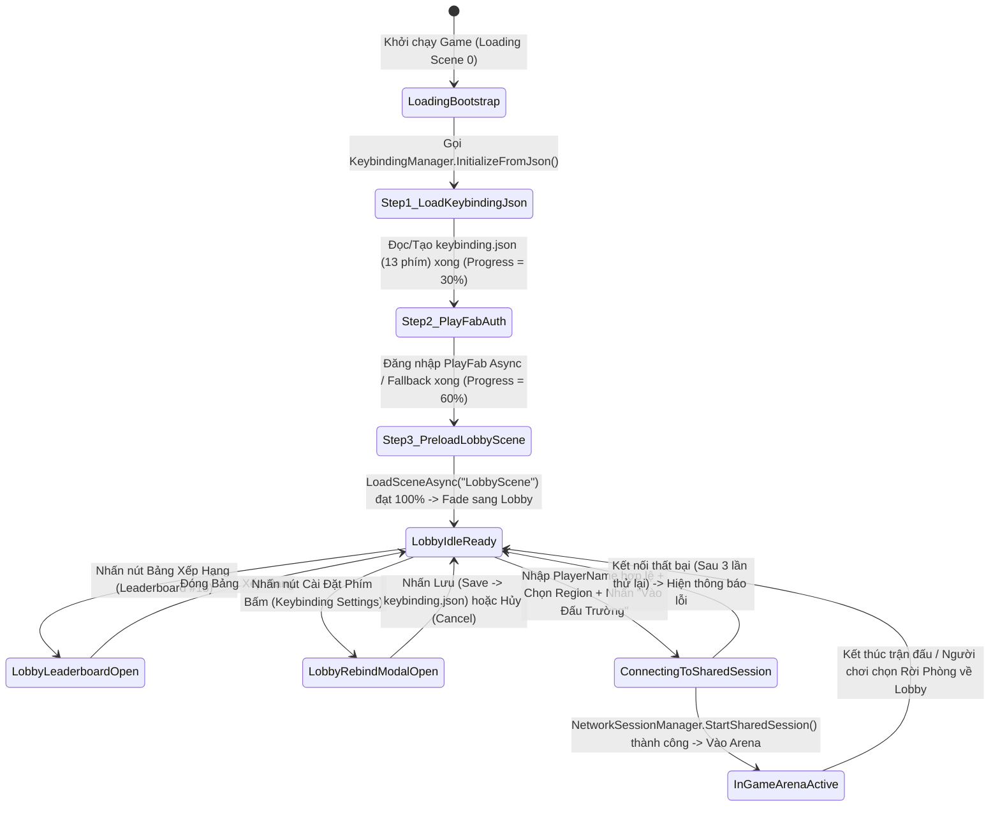
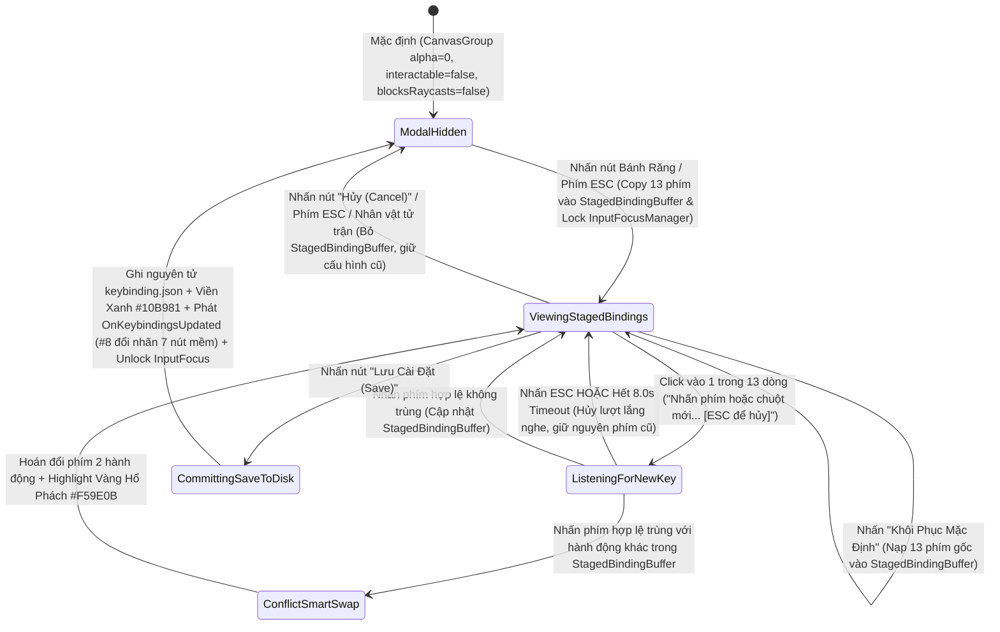

# In-Game Keybinding Rebind UI & Lobby Flow UI (inferred)

> **Status**: Designed
> **Creative Director Review (CD-GDD-ALIGN)**: APPROVED 2026-11-10
> **Author**: Solo Developer + Studio Agents (`ux-designer`, `ui-programmer`, `systems-designer`, `network-engineer`, `qa-lead`)
> **Last Updated**: 2026-11-10
> **Last Verified**: 2026-11-10
> **Implements Pillar**: Pillar 1 (Cơ Động Phản Xạ Định Đoạt Sinh Tồn), Pillar 2 (Nhãn Quan Chiến Thuật Kép FPS $\leftrightarrow$ TPS) & Pillar 3 (Công Bằng Mạng Tuyệt Đối Trên Shared Mode)

## Summary

**In-Game Keybinding Rebind UI & Lobby Flow UI (`LoadingBootstrapUI`, `LobbyPanelUI` & `KeybindingRebindModalUI`)** là hệ thống giao diện điều phối luồng người chơi và tùy biến phím bấm trực tiếp ở tầng **Presentation (`Vertical Slice`)** của *Capsule Arena: Last Man Standing*. Hệ thống dẫn dắt người chơi đi qua 3 điểm chạm liền mạch: **(1) Màn hình Loading Scene Bootstrap** thực thi nạp tệp `Application.persistentDataPath + "/keybinding.json"` cho toàn bộ 13 hành động điều khiển (`GameActionId`) song song với xác thực PlayFab bất đồng bộ trước khi mở sảnh chờ; **(2) Màn hình Lobby Flow UI** cho phép đặt tên đấu sĩ (`PlayerName` từ `3–16 ký tự`), chọn máy chủ khu vực (`Region Dropdown`: `asia`, `jp`, `us`, `eu`), nhập tên phòng (`SessionName`, mặc định `"ArenaRoom_01"`), xem Bảng Xếp Hạng PlayFab (`Leaderboard`) và nhấn **`Vào Đấu Trường (Join / Start Shared Mode)`** để kết nối vào phiên **Photon Fusion 2 (`GameMode.Shared`)**; và **(3) Bảng Cài Đặt & Gán Lại Phím Bấm Trong Trận (`In-Game Keybinding Rebind Modal UI`)** vận hành hoàn toàn bằng `CanvasGroup` (`0 SetActive` spikes) có thể mở tức thì tại cả Lobby lẫn ngay giữa trận đấu qua nút biểu tượng Bánh răng góc trên phải hoặc phím `ESC`. Khi người chơi chỉnh sửa phím trên bảng nháp tạm thời (`StagedBindingBuffer` hỗ trợ hoán đổi xung đột thông minh `Smart Swap`) và nhấn nút **`Lưu Cài Đặt (Save)`**, hệ thống lập tức áp dụng cấu hình mới vào `KeybindingManager`, **ghi đè nguyên tử xuống tệp `keybinding.json`**, đồng thời phát sự kiện `OnKeybindingsUpdated` để **cụm 7 Button kỹ năng mềm góc dưới phải màn hình (`System #8`) cập nhật nhãn phím tắt mới (`Dynamic Keycap Pill`) ngay lập tức trong cùng một khung hình**.

> **Quick reference** — Layer: `Presentation` · Priority: `Vertical Slice` · Key deps: `Keybinding & Input Management System`, `Photon Fusion 2 Shared Mode Session & Object Pool System`

## Overview

Trong một tựa game đấu trường hành động phản xạ nhịp độ cao như *Capsule Arena: Last Man Standing*, ấn tượng đầu tiên của người chơi được quyết định ngay từ giây phút mở game tại **Loading Scene**, sự rõ ràng gọn gàng khi chọn khu vực kết nối tại **Lobby Scene**, và quyền tự do tuyệt đối khi tùy biến bố cục phím bấm ngay trong trận đấu (**In-Game Rebind Modal**). Nếu người chơi phải chịu đựng cảnh cấu hình phím bị mất sau mỗi lần tắt game, bị kẹt ở màn hình chờ không rõ tiến độ, hoặc khi đổi phím xong mà nhãn chữ trên **cụm 7 Button kỹ năng mềm góc dưới phải màn hình** vẫn hiển thị phím cũ gây loạn trí nhớ cơ bắp, toàn bộ trải nghiệm thể thao điện tử (**Pillar 1** & **Pillar 3**) sẽ bị tổn thương nghiêm trọng.

**In-Game Keybinding Rebind UI & Lobby Flow UI (`System #11`)** được thiết kế theo triết lý **"Zero-Friction Tactical Onboarding & Live Muscle-Memory Customization"**, giải quyết trọn vẹn 3 bài toán kiến trúc UI/UX cốt lõi:
1. **Màn hình 1 — Loading Scene Bootstrap UI (`LoadingBootstrapUI`):** Đóng vai trò là cổng khởi tạo dữ liệu bắt buộc (Scene `0` trong Build Settings). Ngay khi khởi chạy, màn hình hiển thị thanh tiến trình tổng hợp (`loading_progress_ratio`) và thực thi tuần tự 3 bước có kiểm soát:
   - **(a) Nạp cấu hình phím bền vững:** Gọi `KeybindingManager.InitializeFromJson()` (`System #3`) để đọc tệp `Application.persistentDataPath + "/keybinding.json"` (tự động tạo tệp mặc định từ `Resources/DefaultKeybindings.json` nếu chưa tồn tại hoặc tự sửa lỗi nếu tệp hỏng) và ánh xạ đầy đủ 13 chức năng (`WASD`, `LMB`, `RMB`, `1`, `2`, `3`, `Q`, `E`, `V`, `Enter`).
   - **(b) Đăng nhập PlayFab bất đồng bộ:** Gọi dịch vụ xác thực định danh thiết bị/tài khoản PlayFab (`System #13`) để đồng bộ `DisplayName` và dữ liệu thống kê cá nhân.
   - **(c) Chuyển cảnh mượt mà:** Sau khi thanh tiến trình đạt `100%` (`1.0`), thực hiện hiệu ứng mờ dần (`CanvasGroup.DOFade`) để chuyển sang **Lobby Scene** mà không gây giật khung hình.
2. **Màn hình 2 — Lobby Flow UI (`LobbyPanelUI`):** Giao diện sảnh chờ chiến thuật mang phong cách **Tactical Slate HUD (`Art Bible §7.3`)**, tập trung toàn bộ thao tác vào một bảng điều khiển trung tâm duy nhất:
   - Ô nhập tên đấu sĩ `PlayerName` (`TMP_InputField` kiểm tra hợp lệ thời gian thực `3–16 ký tự`, lưu bền vững vào `PlayerPrefs` và đồng bộ lên PlayFab `DisplayName`).
   - Hộp chọn máy chủ khu vực (`Region Dropdown` với 4 mã vùng khóa chuẩn: `asia` [mặc định], `jp`, `us`, `eu`), ô nhập tên phòng (`SessionName`, mặc định `"ArenaRoom_01"`), và nút hành động chính **`Vào Đấu Trường (Join / Start Shared Mode)`** gọi trực tiếp `NetworkSessionManager.StartSharedSession()` (`System #4`).
   - Hai nút tiện ích nổi bật ở thanh điều hướng trên: nút mở **Bảng Xếp Hạng PlayFab (`Leaderboard` — `System #13`)** và nút mở **Cài Đặt Phím Bấm (`Keybinding Settings`)**.
3. **Màn hình 3 — Bảng Cài Đặt & Gán Lại Phím Bấm Trong Trận (`In-Game Keybinding Rebind Modal UI`):**
   - Được đóng gói thành một Prefab dùng chung (`pf_ui_keybinding_rebind_modal_01.prefab`) và điều khiển hiển thị 100% bằng `CanvasGroup` (`alpha`, `interactable`, `blocksRaycasts` — cam kết `0 SetActive` spikes, `0 Byte GC Allocation`). Người chơi có thể mở bảng này bất cứ lúc nào từ **Lobby** hoặc ngay **trong trận đấu (In-Game)** qua nút biểu tượng Bánh răng (`Gear Icon`) ở góc trên bên phải màn hình hoặc phím `ESC`.
   - Ngay khi mở bảng trong trận đấu, hệ thống lập tức gọi `InputFocusManager.SetFocusState(InputFocusState.RebindModalOpen)` (`System #3`) để khóa hoàn toàn di chuyển `WASD`, xoay chuột và tấn công của nhân vật, đồng thời giải phóng con trỏ chuột (`CursorLockMode.Confined`, `Cursor.visible = true`).
   - Hiển thị danh sách đầy đủ **13 chức năng** (`MoveForward [W]`, `MoveBackward [S]`, `MoveLeft [A]`, `MoveRight [D]`, `VerticalSlash [LMB]`, `RangedAttack [RMB]`, `HorizontalSlashLeft [1]`, `ForwardDash [2]`, `HorizontalSlashRight [3]`, `DodgeLeft [Q]`, `DodgeRight [E]`, `ToggleCamera [V]`, `ToggleChat [Enter]`) trên một **Bảng Bản Nháp Tạm Thời (`StagedBindingBuffer`)**.
   - Khi người chơi click vào một dòng để đổi phím, dòng đó chuyển sang trạng thái lắng nghe (`"Nhấn phím hoặc chuột mới... [ESC để hủy]"` với viền sáng **Vàng Hổ Phách `#F59E0B`**) kèm bộ đếm ngược tự động hủy sau `RebindListenTimeoutSeconds = 8.0s` nếu không có thao tác. Nếu phím mới trùng với một hành động khác trong bảng nháp, hệ thống thực thi **Hoán đổi Thông minh (`Smart Swap`)** kèm thông báo vàng rõ ràng.
   - Khi người chơi nhấn nút **`Lưu Cài Đặt (Save)`**, hệ thống áp dụng `StagedBindingBuffer` vào `KeybindingManager` (`System #3`), **ghi đè nguyên tử xuống tệp `keybinding.json`**, phát hiệu ứng viền **Xanh Ngọc Lục Bảo `#10B981`** xác nhận thành công, và kích hoạt sự kiện `OnKeybindingsUpdated` để **cụm 7 Button kỹ năng mềm góc dưới phải màn hình (`System #8`) cập nhật nhãn phím tắt mới ngay lập tức**. Ngoài ra, bảng hỗ trợ đầy đủ nút **`Khôi Phục Mặc Định (Reset to Defaults)`** và nút **`Hủy (Cancel)`** (bỏ bản nháp, giữ nguyên cấu hình cũ).

## Player Fantasy

> **System Framing:** `[A] Direct — Người chơi trực tiếp chạm, gõ phím, chọn máy chủ và tùy chỉnh bảng điều khiển theo đúng thói quen phản xạ cá nhân của mình trước và trong khi bước vào sàn đấu sinh tử.`

### 1. Giấc mơ cốt lõi: "Buồng Lái Chiến Thuật Cá Nhân Hóa — Vào Trận Tức Thì, Làm Chủ Mọi Phím Bấm"
Trước khi bước lên sàn đấu kẻ lưới 3D để tung ra những cú lăn né **Side Dodge Roll (`Q`/`E`)** hay những nhát **Chém ngang xoay người $90^\circ$ (`1`/`3`)**, người chơi muốn có cảm giác của một tuyển thủ thể thao điện tử đang ngồi vào buồng lái quen thuộc của chính mình. Không ai muốn phải vật lộn với một giao diện rườm rà, mất hàng chục giây chỉ để tìm nút vào phòng, hay phải cam chịu một bộ phím mặc định trái với thói quen đặt ngón tay hàng nghìn giờ chơi của họ.

**In-Game Keybinding Rebind UI & Lobby Flow UI** hiện thực hóa giấc mơ về một **"Trạm Chỉ Huy Phản Xạ Tức Thì (Instant Tactical Command Deck)"**:
- **Sảnh chờ không rào cản (Zero-Barrier Arena Entry):** Từ lúc bật game tại Loading Scene cho tới khi đặt tên hiệu, chọn cụm máy chủ `asia` có độ trễ thấp nhất và nhấn **`Vào Đấu Trường`**, mọi thứ diễn ra gọn gàng, minh bạch chỉ trên một màn hình duy nhất.
- **Tùy biến trực tiếp giữa chiến trường (Live Mid-Match Ergonomic Tuning):** Ngay cả khi đang đứng sau một khối `Obstacle` trong trận đấu và chợt nhận ra mình muốn đổi kỹ năng **Forward Dash** từ phím `2` sang phím `F` (hoặc nút phụ chuột `Mouse4`) để ngón trỏ phản xạ nhanh hơn, người chơi chỉ cần bấm `ESC`, gán lại phím và nhấn **`Lưu Cài Đặt (Save)`**. Ngay khoảnh khắc đó, tệp `keybinding.json` được lưu bền vững và nhãn phím tắt trên **cụm 7 Button kỹ năng mềm góc dưới phải màn hình** lập tức biến đổi từ `[2]` sang `[F]` ngay trước mắt họ — mang lại sự tự tin tuyệt đối rằng vũ khí đã hoàn toàn tuân theo ý chí của mình.

### 2. Trải nghiệm cảm giác qua từng khoảnh khắc (How the Player Experiences the Effects)
1. **Sự An Tâm Ngay Từ Thanh Nạp Loading Scene (`0% -> 100%`):** Khi mở game, người chơi thấy rõ dòng trạng thái chuyển nhịp mượt mà từ *"Đang nạp cấu hình phím `keybinding.json`..."* (`30%`) $\rightarrow$ *"Đang kết nối định danh PlayFab..."* (`60%`) $\rightarrow$ *"Đang chuẩn bị Sảnh Đấu Trường..."* (`100%`). Bố cục phím cá nhân từ lần chơi trước đã được khôi phục hoàn hảo mà không cần bất kỳ thao tác thủ công nào.
2. **Sự Hào Hứng Khi Khẳng Định Danh Tính Tại Lobby:** Khi gõ tên chiến binh (ví dụ `"ShadowCapsule_99"`) vào ô `PlayerName`, viền ô nhập sáng lên màu **Xanh Ngọc Lục Bảo (`#10B981`)** xác nhận tên hợp lệ. Chọn vùng `asia` (`Singapore`), để tên phòng `"ArenaRoom_01"` và nhấn nút lớn **`VÀO ĐẤU TRƯỜNG`**, tiếng stinger kim loại vang lên đầy uy lực đưa người chơi lao thẳng vào sàn đấu **Photon Fusion 2 (`GameMode.Shared`)**.
3. **Khoảnh Khắc "Ma Thuật Đồng Bộ" Khi Nhấn `Lưu Cài Đặt (Save)` Trên Bảng Rebind UI:** Trong trận đấu, người chơi mở bảng cài đặt phím, click vào dòng `Chém Ngang Xoay Trái 90° (HorizontalSlashLeft)` đang là `[1]` và bấm phím `[Q]`. Vì phím `[Q]` đang thuộc về `Lăn Né Trái (DodgeLeft)`, hệ thống không hề báo lỗi chặn đứng gây cụt hứng mà lập tức thực hiện **Hoán đổi Thông minh (`Smart Swap`)**: `HorizontalSlashLeft` nhận `[Q]`, còn `DodgeLeft` tự động nhận `[1]`, kèm hiệu ứng nháy sáng vàng hổ phách trên cả hai dòng và dòng thông báo *"Đã hoán đổi phím [Q] ↔ [1] giữa Chém Ngang Trái và Lăn Né Trái"*. Khi người chơi nhấn **`Lưu Cài Đặt (Save)`**, khung viền bảng lóe sáng màu **Xanh Ngọc Lục Bảo (`#10B981`)** xác nhận đã ghi xuống `keybinding.json`, và ngay lập tức ở góc dưới phải màn hình, hai nút kỹ năng mềm đổi nhãn chữ cái cái "tách" trong cùng một khung hình.

### 3. Điểm chạm Tham chiếu & Đối chiếu Trụ cột Thiết kế

| Điểm tham chiếu / Trụ cột | Cách `In-Game Keybinding Rebind UI & Lobby Flow UI` hiện thực hóa trải nghiệm |
| :--- | :--- |
| ***Valorant / Overwatch 2*** *(Staged Keybind Buffer, Smart Conflict Swap & Instant HUD Sync)* | Sử dụng bộ đệm nháp `StagedBindingBuffer` cho phép thử nghiệm đổi nhiều phím, tự động hoán đổi `Smart Swap` khi trùng phím, hủy an toàn bằng `Cancel`/`ESC`, hoặc ghi đĩa nguyên tử xuống `keybinding.json` khi nhấn `Save` kèm cập nhật tức thì nhãn phím trên HUD chiến đấu. |
| ***Apex Legends / Brawl Stars*** *(Streamlined One-Screen Tactical Lobby & Region Selector)* | Gom toàn bộ thông tin thiết yếu (`PlayerName`, `Region Dropdown [asia/jp/us/eu]`, `SessionName`, nút `Leaderboard`, nút `Keybinding Settings`, và nút lớn `Vào Đấu Trường`) vào một bố cục trực quan duy nhất, đưa người chơi vào trận chỉ sau 1 cú click. |
| **Pillar 1, Pillar 2 & Pillar 3** | Khóa an toàn đầu vào chiến đấu qua `InputFocusManager` (`RebindModalOpen`) khi đang mở bảng cài đặt giữa trận (**Pillar 3**), cho phép tùy biến cả phím đổi góc nhìn `FPS <-> TPS` (`ToggleCamera [V]` — **Pillar 2**) và 7 phím kỹ năng phản xạ sinh tồn (**Pillar 1**). |

## Detailed Design

### Core Rules

1. **Quy tắc Màn Hình 1 — Loading Scene Bootstrap UI (`LoadingBootstrapUI` Sequential Pipeline):**
   - **Loading Scene** (Scene chỉ số `0` trong Build Settings) là điểm khởi đầu bắt buộc của ứng dụng. `LoadingBootstrapUI` quản lý một thanh tiến trình trượt mượt (`Slider` / `Image.fillAmount`) và nhãn trạng thái văn bản (`TMP_Text`) thực thi tuần tự 3 giai đoạn khởi tạo:
     - **Giai đoạn A — Khởi tạo & Nạp `keybinding.json` (Trọng số `30%`):** Gọi trực tiếp `KeybindingManager.InitializeFromJson()` (tương ứng `InitializeFromDisk()` của `System #3`). Hệ thống kiểm tra tệp tại đường dẫn `Application.persistentDataPath + "/keybinding.json"`. Nếu tệp chưa tồn tại (lần đầu mở game) hoặc bị lỗi cú pháp/thiếu khóa, hệ thống tự động tạo mới hoặc khôi phục từ `Resources/DefaultKeybindings.json` và gán phím đầy đủ cho toàn bộ **13 chức năng (`GameActionId`)** trong bộ nhớ. Ngay khi hoàn tất, cờ `json_config_ready` chuyển từ `0` sang `1`.
     - **Giai đoạn B — Đăng nhập PlayFab Bất đồng bộ (Trọng số `30%`):** Gọi `PlayFabAuthService.AuthenticateAsync()` (`System #13`) bằng `SystemInfo.deviceUniqueIdentifier` (hoặc Custom ID đã lưu). Nếu kết nối thành công hoặc chuyển sang chế độ Offline Fallback sau thời gian chờ tối đa (`5.0s`), cờ `playfab_auth_ready` chuyển từ `0` sang `1`.
     - **Giai đoạn C — Nạp Bất đồng bộ Lobby Scene (Trọng số `40%`):** Gọi `SceneManager.LoadSceneAsync("LobbyScene")` với `allowSceneActivation = false`, cập nhật biến `scene_async_progress` (`0.0 -> 1.0`). Khi `loading_progress_ratio` đạt `1.00` (`100%`), hệ thống kích hoạt `allowSceneActivation = true` kèm hiệu ứng chuyển cảnh `CanvasGroup` mượt mà trong `0.25s`.

2. **Quy tắc Màn Hình 2 — Lobby Flow UI (`LobbyPanelUI` Architecture & Validation Contract):**
   - `LobbyPanelUI` được bố trí trên một `Canvas` (`Screen Space - Overlay`, `UI Scale Mode = Scale With Screen Size`, độ phân giải tham chiếu `1920x1080`, `Match Width Or Height = 0.5`) gồm 4 khu vực chức năng rõ ràng:
     - **Ô Nhập Tên Đấu Sĩ (`PlayerName InputField`):**
       - Khi nạp Lobby, hệ thống đọc tên đã lưu từ `PlayerPrefs.GetString("PlayerPrefs_PlayerName", "")`. Nếu chưa có, hệ thống tự sinh tên mặc định hợp lệ dạng `"Fighter_" + Random.Range(100, 999)` (ví dụ: `"Fighter_482"`).
       - Kiểm tra tính hợp lệ thời gian thực (`OnValueChanged`): Tên hợp lệ phải có độ dài sau khi cắt khoảng trắng hai đầu (`Trim()`) từ **`3` đến `16` ký tự**, và chỉ chứa chữ cái Latin, chữ số hoặc dấu gạch dưới (`^[a-zA-Z0-9_]{3,16}$`) để tương thích tuyệt đối với kiểu `[Networked] NetworkString<_16>` của Photon Fusion 2 (`System #4`).
       - Nếu tên không hợp lệ, viền ô nhập chuyển sang màu **Đỏ Cảnh Báo (`#EF4444`)**, hiển thị dòng nhắc *"Tên đấu sĩ cần từ 3–16 ký tự (chữ cái, số hoặc dấu _)"* và tạm khóa (`interactable = false`) nút **`Vào Đấu Trường`**. Khi tên hợp lệ và người chơi kết thúc chỉnh sửa (`OnEndEdit`), hệ thống lưu ngay vào `PlayerPrefs` và gọi bất đồng bộ `PlayFabClientAPI.UpdateUserTitleDisplayName` (`System #13`).
     - **Hộp Chọn Máy Chủ Khu Vực (`Region Dropdown`) & Ô Nhập Tên Phòng (`SessionName InputField`):**
       - `TMP_Dropdown` chứa đúng **4 tùy chọn mã vùng cố định** khớp với `AllowedRegions` của `System #4`:
         1. `"Châu Á — Singapore (asia)"` $\rightarrow$ mã vùng `"asia"` *(Mặc định, lưu trong `PlayerPrefs_PreferredRegion`)*.
         2. `"Nhật Bản — Tokyo (jp)"` $\rightarrow$ mã vùng `"jp"`.
         3. `"Bắc Mỹ — Đông (us)"` $\rightarrow$ mã vùng `"us"`.
         4. `"Châu Âu — Amsterdam (eu)"` $\rightarrow$ mã vùng `"eu"`.
       - Ô nhập `SessionName` (`TMP_InputField`) có giá trị mặc định là **`"ArenaRoom_01"`** (tự động điền lại `"ArenaRoom_01"` nếu người chơi xóa trắng ô nhập), cho phép từ `3–24 ký tự` chữ/số/gạch dưới để bạn bè dễ dàng nhập cùng tên phòng và vào chung trận đấu Shared Mode (`MaxPlayersPerRoom = 8`).
     - **Nút Hành Động Chính `Vào Đấu Trường (Join / Start Shared Mode)`:**
       - Khi nhấn nút, `LobbyPanelUI` khóa nút bấm để chống click đúp (`double-click guard`), bật lớp phủ trạng thái kết nối (`ConnectingOverlay` qua `CanvasGroup`), và gọi `NetworkSessionManager.StartSharedSession(playerName, sessionName, selectedRegion)` (`System #4`).
       - Nếu kết nối thất bại sau chu kỳ thử lại của `System #4`, bảng thông báo lỗi tiếng Việt hiển thị rõ nguyên nhân (ví dụ: *"Phòng đã đầy (8/8) hoặc mất kết nối mạng. Vui lòng thử lại!"*) và mở khóa lại nút **`Vào Đấu Trường`**.
     - **Thanh Tiện Ích Góc Trên (`Top Utility Bar`):**
       - Nút **`Bảng Xếp Hạng (Leaderboard)`**: Mở cửa sổ Modal hiển thị bảng xếp hạng chiến thắng/hạ gục từ PlayFab (`System #13`).
       - Nút **`Cài Đặt Phím Bấm (Keybinding Settings)`** (biểu tượng Bánh răng + bàn phím): Mở trực tiếp **Bảng `KeybindingRebindModalUI` (Màn hình 3)** ngay tại Lobby.

3. **Quy tắc Màn Hình 3 — Bảng Cài Đặt & Gán Lại Phím Bấm Trong Trận (`In-Game Keybinding Rebind Modal UI`):**
   - **Kiến trúc `CanvasGroup` Thuần Khiết (`Zero SetActive Spikes`):**
     - `KeybindingRebindModalUI` luôn được khởi tạo sẵn trong cây phân cấp UI và tuyệt đối **không dùng `gameObject.SetActive(true/false)`** khi đóng/mở.
     - Khi ẩn (`Closed`): `CanvasGroup.alpha = 0f`, `CanvasGroup.interactable = false`, `CanvasGroup.blocksRaycasts = false`.
     - Khi hiện (`Open`): `CanvasGroup.alpha` nội suy mượt từ `0f -> 1f` trong `0.15s` (`DOTween.To` với `SetUpdate(true)`), `CanvasGroup.interactable = true`, `CanvasGroup.blocksRaycasts = true`.
   - **Kích hoạt Mọi Lúc & Khóa Tiêu Điểm Đầu Vào (`InputFocusManager` Lock):**
     - Người chơi có thể mở bảng từ **Lobby** (qua nút `Cài Đặt Phím Bấm`) hoặc ngay **trong trận đấu (In-Game)** bằng cách nhấn phím `ESC` (khi không có ô Chat hay cửa sổ lắng nghe phím nào đang mở) hoặc click vào **Nút Biểu Tượng Bánh Răng (`Settings Gear Button`)** ở góc trên bên phải HUD.
     - Ngay khi mở bảng trong trận đấu, `KeybindingRebindModalUI` bắt buộc gọi `InputFocusManager.SetFocusState(InputFocusState.RebindModalOpen)` (`System #3`). Toàn bộ lệnh di chuyển `WASD`, xoay góc nhìn chuột và 7 nút kỹ năng chiến đấu lập tức bị khóa sạch về `default (0)`, nhân vật đứng yên an toàn và con trỏ chuột hiện ra (`Cursor.lockState = CursorLockMode.Confined`, `Cursor.visible = true`).
     - Khi đóng bảng (qua nút `Lưu Cài Đặt`, nút `Hủy`, hoặc phím `ESC`), hệ thống trả `InputFocusManager` về trạng thái trước đó (`CombatActive` nếu nhân vật còn sống `IsDead == false`, hoặc `GhostSpectating` nếu đang ở chế độ Hồn ma `IsDead == true`).

4. **Quy tắc Bảng Bản Nháp Tạm Thời (`StagedBindingBuffer`) & Danh Sách 13 Chức Năng (`GameActionId`):**
   - Khi mở `KeybindingRebindModalUI`, hệ thống sao chép ánh xạ phím hiện hành từ `KeybindingManager` sang một bộ đệm nháp trong bộ nhớ gọi là **`StagedBindingBuffer`** (`Dictionary<GameActionId, KeyCode>` hoặc mảng cố định `KeyCode[13]`). Mọi thao tác đổi phím, hoán đổi `Smart Swap` hay `Khôi Phục Mặc Định` đều diễn ra trên `StagedBindingBuffer` trước; chỉ khi người chơi nhấn nút **`Lưu Cài Đặt (Save)`**, bản nháp này mới được ghi chính thức vào `KeybindingManager` và tệp `keybinding.json`.
   - Danh sách **13 dòng chức năng** hiển thị trong khung cuộn (`ScrollRect` chia làm 3 phân nhóm trực quan) tuân thủ chính xác bảng ánh xạ chuẩn:

| STT | Mã Hành Động (`GameActionId`) | Nhóm Hiển Thị Trên UI | Tên Hiển Thị Tiếng Việt Trên Bảng Rebind | Phím Mặc Định (`KeyCode`) | Nhãn Mặc Định (`Keycap`) | Liên Kết Cụm 7 Nút Mềm Góc Dưới Phải (`#8`) |
| :-: | :--- | :--- | :--- | :---: | :---: | :--- |
| 1 | `MoveForward` | **1. Di Chuyển (Locomotion)** | Tiến Về Phía Trước (`Move Forward`) | `KeyCode.W` | `[W]` | Không *(Chỉ bàn phím / Joystick)* |
| 2 | `MoveBackward` | **1. Di Chuyển (Locomotion)** | Lùi Về Phía Sau (`Move Backward`) | `KeyCode.S` | `[S]` | Không *(Chỉ bàn phím / Joystick)* |
| 3 | `MoveLeft` | **1. Di Chuyển (Locomotion)** | Di Chuyển Sang Trái (`Move Left`) | `KeyCode.A` | `[A]` | Không *(Chỉ bàn phím / Joystick)* |
| 4 | `MoveRight` | **1. Di Chuyển (Locomotion)** | Di Chuyển Sang Phải (`Move Right`) | `KeyCode.D` | `[D]` | Không *(Chỉ bàn phím / Joystick)* |
| 5 | `VerticalSlash` | **2. Chiến Đấu & Cơ Động (7 Skills)** | Chém Dọc Trực Diện (`Vertical Slash`) | `KeyCode.Mouse0` | `[LMB]` | **Nút Mềm #1 (Tâm chính)** — *Cập nhật nhãn tức thì khi Save* |
| 6 | `RangedAttack` | **2. Chiến Đấu & Cơ Động (7 Skills)** | Bắn Đạn Tầm Xa (`Ranged Attack`) | `KeyCode.Mouse1` | `[RMB]` | **Nút Mềm #2 (Vòng trong)** — *Cập nhật nhãn tức thì khi Save* |
| 7 | `HorizontalSlashLeft` | **2. Chiến Đấu & Cơ Động (7 Skills)** | Chém Ngang Trái $90^\circ$ + Xoay Camera (`Turn Left 90°`) | `KeyCode.Alpha1` | `[1]` | **Nút Mềm #3 (Cung trái)** — *Cập nhật nhãn tức thì khi Save* |
| 8 | `ForwardDash` | **2. Chiến Đấu & Cơ Động (7 Skills)** | Lướt Tiến Tốc Độ Cao (`Forward Dash`) | `KeyCode.Alpha2` | `[2]` | **Nút Mềm #4 (Đỉnh cung)** — *Cập nhật nhãn tức thì khi Save* |
| 9 | `HorizontalSlashRight` | **2. Chiến Đấu & Cơ Động (7 Skills)** | Chém Ngang Phải $90^\circ$ + Xoay Camera (`Turn Right 90°`) | `KeyCode.Alpha3` | `[3]` | **Nút Mềm #5 (Cung phải)** — *Cập nhật nhãn tức thì khi Save* |
| 10 | `DodgeLeft` | **2. Chiến Đấu & Cơ Động (7 Skills)** | Lăn Né Ngang Trái (`Dodge Roll Left`) | `KeyCode.Q` | `[Q]` | **Nút Mềm #6 (Rìa trái)** — *Cập nhật nhãn tức thì khi Save* |
| 11 | `DodgeRight` | **2. Chiến Đấu & Cơ Động (7 Skills)** | Lăn Né Ngang Phải (`Dodge Roll Right`) | `KeyCode.E` | `[E]` | **Nút Mềm #7 (Rìa phải)** — *Cập nhật nhãn tức thì khi Save* |
| 12 | `ToggleCamera` | **3. Tiện Ích Chiến Thuật (Utility)** | Đổi Góc Nhìn `FPS <-> TPS` (`Toggle Camera`) | `KeyCode.V` | `[V]` | Nút phụ góc trên phải |
| 13 | `ToggleChat` | **3. Tiện Ích Chiến Thuật (Utility)** | Mở / Gửi Tin Nhắn Chat (`Toggle Chat`) | `KeyCode.Return` | `[Enter]` | Nút mở khung Chat góc dưới trái |

5. **Quy tắc Lắng Nghe Phím Mới, Hoán Đổi Thông Minh (`Smart Swap`) & Bộ Đếm Ngược Tự Hủy (`8.0s`):**
   - Khi người chơi click chuột vào ô phím của một dòng `targetAction`:
     - Dòng đó chuyển sang trạng thái **`ListeningForKey`**: Nhãn phím đổi thành chuỗi nhắc **`"Nhấn phím hoặc chuột mới... [ESC để hủy]"`**, khung viền dòng phát sáng màu **Vàng Hổ Phách (`#F59E0B`)** kèm thanh đếm ngược mảnh chạy lùi từ `RebindListenTimeoutSeconds = 8.0s` về `0.0s`.
     - Trong trạng thái này, nếu người chơi nhấn phím `ESC` (`KeyCode.Escape`) **HOẶC** hết `8.0s` mà không nhấn phím nào (`rebind_listen_remaining == 0.0`), hệ thống tự động hủy lượt lắng nghe và trả dòng đó về nhãn phím cũ trong `StagedBindingBuffer` (nhấn `ESC` lúc này chỉ hủy lượt gán phím chứ **không** đóng toàn bộ bảng Modal).
     - Nếu người chơi nhấn một phím hệ thống bị cấm (`LeftWindows`, `RightWindows`, `Print`, `SysReq`, `Break`), hệ thống từ chối gán, rung nhẹ dòng đang chọn (`DOTween.DOShakeAnchorPos`) và hiện thông báo đỏ *"Phím hệ thống không được phép sử dụng!"*.
     - Nếu người chơi nhấn một phím/nút chuột hợp lệ `newKey`:
       - **Trường hợp 1 (`newKey` chưa trùng với hành động nào khác):** Gán `StagedBindingBuffer[targetAction] = newKey`, đánh dấu cờ `HasUnsavedChanges = true`.
       - **Trường hợp 2 (`newKey` đang được giữ bởi một hành động khác `conflictAction` trong `StagedBindingBuffer`):** Thực thi **Hoán đổi Thông minh (`Smart Swap`)**:
         `KeyCode previousKey = StagedBindingBuffer[targetAction];`
         `StagedBindingBuffer[targetAction] = newKey;`
         `StagedBindingBuffer[conflictAction] = previousKey;`
         Cả hai dòng `targetAction` và `conflictAction` đều nháy viền **Vàng Hổ Phách (`#F59E0B`)** trong `0.6s`, đồng thời thanh thông báo ở chân bảng hiện rõ: **`"Đã hoán đổi thông minh: [Tên Hành Động 1] ↔ [Tên Hành Động 2]"`**.

6. **Quy tắc Ba Nút Điều Khiển Chân Bảng (`Save`, `Reset to Defaults`, `Cancel`) & Đồng Bộ Tức Thì Cụm 7 Nút Kỹ Năng Mềm (`#8`):**
   - **Nút `Lưu Cài Đặt (Save)` (Màu Xanh Ngọc Lục Bảo `#10B981`):**
     - Khi người chơi nhấn **`Lưu Cài Đặt (Save)`**, hệ thống thực thi chuỗi lệnh nguyên tử:
       1. Truyền toàn bộ 13 cặp khóa-giá trị từ `StagedBindingBuffer` xuống `KeybindingManager.ApplyAndSaveBindings(StagedBindingBuffer)` (`System #3`).
       2. `KeybindingManager` cập nhật bảng tra cứu $O(1)$ trong bộ nhớ và thực hiện **Ghi Đè Nguyên Tử (`Atomic Write`)** xuống tệp `Application.persistentDataPath + "/keybinding.json"` (ghi qua tệp tạm `keybinding.json.tmp` rồi thay thế sang `keybinding.json`).
       3. Phát hiệu ứng viền sáng **Xanh Ngọc Lục Bảo (`#10B981`)** quanh bảng cài đặt kèm thông báo *"Đã lưu cài đặt phím vào keybinding.json thành công!"* và âm báo xác nhận `sfx_ui_rebind_save_01`.
       4. Kích hoạt sự kiện `KeybindingManager.OnKeybindingsUpdated(ReadOnlyBindings)`. Ngay trong cùng khung hình đó, `MobileActionPadUI` (`System #8`) nhận sự kiện và **cập nhật lại toàn bộ 7 nhãn phím tắt (`Dynamic Keycap Pill`) trên cụm 7 Button kỹ năng mềm góc dưới phải màn hình** (`VerticalSlash`, `RangedAttack`, `HorizontalSlashLeft`, `ForwardDash`, `HorizontalSlashRight`, `DodgeLeft`, `DodgeRight`) kèm hiệu ứng nảy nhẹ (`DOPunchScale`).
   - **Nút `Khôi Phục Mặc Định (Reset to Defaults)` (Màu Vàng Hổ Phách `#F59E0B`):**
     - Nạp lại toàn bộ 13 phím mặc định gốc (`WASD`, `LMB`, `RMB`, `1`, `2`, `3`, `Q`, `E`, `V`, `Enter`) từ `DefaultKeybindings.json` vào `StagedBindingBuffer`, cập nhật hiển thị 13 dòng trên bảng và bật cờ `HasUnsavedChanges = true` để người chơi kiểm tra trước khi nhấn **`Lưu Cài Đặt (Save)`**.
   - **Nút `Hủy / Đóng (Cancel / ESC)` (Màu Xám Đá Phiến `#64748B`):**
     - Hủy bỏ toàn bộ thay đổi trên `StagedBindingBuffer`, giữ nguyên cấu hình đang có trong `KeybindingManager` và tệp `keybinding.json`, ẩn bảng Modal qua `CanvasGroup` và khôi phục trạng thái điều khiển cho `InputFocusManager`.

### States and Transitions

Hệ thống vận hành qua **2 máy trạng thái hữu hạn (FSM)** liên kết chặt chẽ: (1) Luồng chuyển cảnh từ Loading Scene $\rightarrow$ Lobby Scene $\rightarrow$ Arena Scene và (2) Máy trạng thái nội bộ của Bảng Gán Phím `KeybindingRebindModalUI`.

#### 1. Luồng Chuyển Cảnh Loading $\rightarrow$ Lobby $\rightarrow$ Arena (`Scene & Session Flow State Machine`)

#### 2. Máy Trạng Thái Bảng Cài Đặt Phím Trong Trận (`In-Game Keybinding Rebind Modal FSM`)

### Interactions with Other Systems

| Hệ Thống Liên Quan | Hướng Tương Tác | Giao Diện / Sự Kiện Hợp Đồng (`Data & Event Contract`) | Cơ Chế Phối Hợp Chi Tiết |
| :--- | :---: | :--- | :--- |
| **System #3: Keybinding & Input Management System** | `#11` $\leftrightarrow$ `#3` *(Trực tiếp)* | `KeybindingManager.InitializeFromJson()`, `ApplyAndSaveBindings()`, `OnKeybindingsUpdated`, `InputFocusManager.SetFocusState(RebindModalOpen)` | Tại Loading Scene, `#11` kích hoạt nạp `keybinding.json`. Khi mở bảng Rebind trong trận, `#11` khóa đầu vào chiến đấu qua `InputFocusManager`. Khi nhấn **`Lưu Cài Đặt (Save)`**, `#11` truyền `StagedBindingBuffer` xuống `#3` để ghi đè nguyên tử tệp `keybinding.json` và phát sự kiện cập nhật toàn cục. |
| **System #4: Photon Fusion 2 Shared Mode Session & Object Pool** | `#11` $\rightarrow$ `#4` *(Lệnh kết nối & Sự kiện)* | `NetworkSessionManager.StartSharedSession(playerName, sessionName, region)`, `OnSessionConnectionStateChanged` | `LobbyPanelUI` thu thập `PlayerName`, `SessionName` (`"ArenaRoom_01"`) và mã vùng `Region` (`asia`, `jp`, `us`, `eu`) rồi gọi `#4` để khởi chạy `NetworkRunner` ở chế độ `GameMode.Shared` (`60Hz`, `MaxPlayers = 8`). |
| **System #6: Health, Damage RPC & Death State System** | `#6` $\rightarrow$ `#11` *(Sự kiện một chiều)* | `OnPlayerDeathStateChanged(bool isDead)` | Nếu người chơi đang mở bảng `KeybindingRebindModalUI` giữa trận mà nhân vật bị kẻ địch hạ gục (`IsDead == true`), `#11` tự động hủy bản nháp chưa lưu và đóng bảng Modal để người chơi thấy rõ khoảnh khắc tử trận và chuyển sang góc nhìn Hồn ma (`GhostSpectating`). |
| **System #8: Combat HUD, Overhead Billboard & Mobile Action Pad UI** | `#11` $\rightarrow$ `#3` $\rightarrow$ `#8` *(Đồng bộ sự kiện)* | `event Action<IReadOnlyDictionary<GameActionId, KeyCode>> OnKeybindingsUpdated` | Ngay khoảnh khắc người chơi nhấn **`Lưu Cài Đặt (Save)`** trên `#11`, sự kiện `OnKeybindingsUpdated` được phát tới `#8` để **cụm 7 Button kỹ năng mềm góc dưới phải màn hình** (`LMB`, `RMB`, `1`, `2`, `3`, `Q`, `E`) cập nhật nhãn phím tắt (`Dynamic Keycap Pill`) tức thì trong cùng khung hình. |
| **System #12: In-Game Chat System (Public & Private Whisper)** | `#11` $\leftrightarrow$ `#12` *(Loại trừ tiêu điểm)* | `InputFocusManager.CurrentState` (`ChatTyping` vs `RebindModalOpen`) | Hai bảng Chat và Rebind Modal không bao giờ chiếm quyền bàn phím cùng lúc. Nếu đang mở khung Chat (`ChatTyping`) mà người chơi mở bảng Rebind UI, khung Chat tự động thu gọn và nhường trạng thái độc quyền cho `RebindModalOpen`. |
| **System #13: PlayFab Auth, Leaderboard & Cloud Stats** | `#11` $\leftrightarrow$ `#13` *(Async API)* | `PlayFabAuthService.AuthenticateAsync()`, `UpdateDisplayNameAsync(playerName)`, `LeaderboardModalUI.Open()` | Loading Scene chờ xác thực PlayFab hoàn tất (`30%` tiến độ); Lobby Scene đồng bộ `PlayerName` lên PlayFab `DisplayName` và mở bảng xếp hạng cao thủ khi người chơi nhấn nút **`Leaderboard`**. |

## Formulas

### 1. Tiến Độ Nạp Tổng Hợp Tại Loading Scene (`loading_progress_ratio`)

Để thanh tiến trình tại **Loading Scene** phản ánh trung thực cả 3 tác vụ khởi tạo bắt buộc (nạp tệp `keybinding.json`, xác thực PlayFab bất đồng bộ, và nạp trước `LobbyScene`) mà không bao giờ nhảy lùi hay đứng khựng ở `90%`, hệ thống tính toán tỷ lệ hoàn thành tổng hợp theo trọng số chuẩn:

The `loading_progress_ratio` formula is defined as:

`loading_progress_ratio = (0.30 * json_config_ready) + (0.30 * playfab_auth_ready) + (0.40 * scene_async_progress)`

**Variables:**

| Variable | Type | Range | Source | Description |
| :--- | :---: | :---: | :--- | :--- |
| `json_config_ready` | `int` (`float`) | `0` hoặc `1` (`0.0` hoặc `1.0`) | `KeybindingManager.IsInitialized` (`System #3`) | Bằng `1` ngay khi tệp `Application.persistentDataPath + "/keybinding.json"` được đọc/khởi tạo xong cho đủ 13 hành động; bằng `0` khi đang xử lý. |
| `playfab_auth_ready` | `int` (`float`) | `0` hoặc `1` (`0.0` hoặc `1.0`) | `PlayFabAuthService.IsAuthCompleted` (`System #13`) | Bằng `1` khi phiên đăng nhập PlayFab bất đồng bộ hoàn tất (hoặc chuyển sang chế độ Offline Fallback sau timeout); bằng `0` khi đang chờ phản hồi. |
| `scene_async_progress` | `float` | `0.0–1.0` | `Mathf.Clamp01(asyncOp.progress / 0.9f)` | Tiến độ nạp bất đồng bộ của `LobbyScene` từ `SceneManager.LoadSceneAsync` (chuẩn hóa từ ngưỡng `0.9f` của Unity lên `1.0f`). |
| `loading_progress_ratio` | `float` | `0.00–1.00` | `LoadingBootstrapUI` (`ProgressSlider.value`) | Tỷ lệ tiến trình tổng hợp (`0%` đến `100%`); chỉ khi đạt đúng `1.00` mới cho phép kích hoạt chuyển sang `LobbyScene`. |

**Output Range:** `0.00` đến `1.00` (hiển thị trên UI dưới dạng phần trăm `round(loading_progress_ratio * 100)%` từ `0%` đến `100%`).

**Example:**
- **Bước 1 (Vừa nạp xong `keybinding.json`, đang đăng nhập PlayFab, chưa nạp Scene):**
  Với `json_config_ready = 1`, `playfab_auth_ready = 0`, `scene_async_progress = 0.0`:
  `loading_progress_ratio = (0.30 * 1) + (0.30 * 0) + (0.40 * 0.0) = 0.30` (Thanh tiến trình hiển thị **`30%`**).
- **Bước 2 (Đã nạp xong `keybinding.json` và xác thực PlayFab, `LobbyScene` nạp được một nửa `0.5`):**
  Với `json_config_ready = 1`, `playfab_auth_ready = 1`, `scene_async_progress = 0.5`:
  `loading_progress_ratio = (0.30 * 1) + (0.30 * 1) + (0.40 * 0.5) = 0.30 + 0.30 + 0.20 = 0.80` (Thanh tiến trình hiển thị **`80%`**).
- **Bước 3 (Cả 3 tác vụ hoàn tất 100%):**
  Với `json_config_ready = 1`, `playfab_auth_ready = 1`, `scene_async_progress = 1.0`:
  `loading_progress_ratio = 0.30 + 0.30 + 0.40 = 1.00` (**`100%`** $\rightarrow$ Mở khóa chuyển sang **Lobby Scene**).

---

### 2. Kiểm Tra Tính Hợp Lệ Của Tên Đấu Sĩ Tại Lobby (`is_player_name_valid`)

Để đảm bảo tên người chơi nhập tại `LobbyPanelUI` luôn hiển thị đẹp trên bảng thanh máu **Overhead Billboard (`System #8`)**, tương thích 100% với cấu trúc chuỗi mạng cố định `[Networked] NetworkString<_16>` của Photon Fusion 2 (`System #4`) và hợp lệ khi đồng bộ lên PlayFab `DisplayName` (`System #13`), hệ thống áp dụng công thức kiểm tra logic nhị phân:

The `is_player_name_valid` formula is defined as:

`is_player_name_valid = (trimmed_length >= 3) && (trimmed_length <= 16) && ( alphanumeric_match == 1 )`

**Variables:**

| Variable | Type | Range | Source | Description |
| :--- | :---: | :---: | :--- | :--- |
| `trimmed_length` | `int` | `0–64` | `rawPlayerName.Trim().Length` | Số lượng ký tự thực tế của tên đấu sĩ sau khi đã cắt bỏ khoảng trắng thừa ở đầu và cuối chuỗi. |
| `alphanumeric_match` | `int` | `0` hoặc `1` | Biểu thức chính quy `Regex.IsMatch(trimmed, @"^[a-zA-Z0-9_]+$")` | Bằng `1` nếu toàn bộ ký tự trong chuỗi đã cắt khoảng trắng chỉ gồm chữ cái Latin (`a-z`, `A-Z`), chữ số (`0-9`) hoặc dấu gạch dưới (`_`); bằng `0` nếu chứa ký tự đặc biệt, khoảng trắng giữa chừng hoặc mã điều khiển RichText (`<color>`, `\n`). |
| `is_player_name_valid` | `bool` | `false` hoặc `true` | `LobbyPanelUI.ValidatePlayerName()` | Kết quả kiểm tra hợp lệ: `true` cho phép lưu `PlayerPrefs`, đồng bộ PlayFab và bật sáng nút **`Vào Đấu Trường`**; `false` khóa nút vào trận và báo viền đỏ `#EF4444`. |

**Output Range:** `false` (`0` — Không hợp lệ) hoặc `true` (`1` — Hợp lệ).

**Example:**
- **Hợp lệ:** Người chơi nhập `"Capsule_Pro99"` $\rightarrow$ `trimmed_length = 13` (thỏa mãn `3 <= 13 <= 16`) và chỉ gồm chữ, số, dấu `_` (`alphanumeric_match = 1`):
  `is_player_name_valid = (13 >= 3) && (13 <= 16) && (1 == 1) = true`.
- **Không hợp lệ (Quá ngắn):** Người chơi nhập `"AB"` $\rightarrow$ `trimmed_length = 2 < 3`:
  `is_player_name_valid = (2 >= 3) && (2 <= 16) && (1 == 1) = false`.
- **Không hợp lệ (Chứa thẻ RichText tiêm mã màu):** Người chơi nhập `"<b>Hacker</b>"` $\rightarrow$ chứa ký tự `<`, `>`, `/` nên `alphanumeric_match = 0`:
  `is_player_name_valid = (13 >= 3) && (13 <= 16) && (0 == 1) = false`.

---

### 3. Thời Gian Chờ Tự Động Hủy Lắng Nghe Phím Khi Gán Phím (`rebind_listen_remaining`)

Khi người chơi click vào một dòng chức năng trên bảng `KeybindingRebindModalUI` để chuyển sang trạng thái chờ nhấn phím mới (`ListeningForNewKey`), nếu người chơi bỏ quên không bấm phím nào, hệ thống sử dụng bộ đếm ngược theo thời gian thực không phụ thuộc `Time.timeScale` (`Time.unscaledDeltaTime`) để tự động thoát khỏi trạng thái chờ sau `8.0 giây`:

The `rebind_listen_remaining` formula is defined as:

`rebind_listen_remaining = max(0.0, RebindListenTimeoutSeconds - elapsed_listen_time)`

**Variables:**

| Variable | Type | Range | Source | Description |
| :--- | :---: | :---: | :--- | :--- |
| `RebindListenTimeoutSeconds` | `float` | `3.0–15.0` (khóa chuẩn `8.0s`) | `KeybindingRebindModalUI.RebindListenTimeoutSeconds` | Tổng thời gian tối đa (giây) mà dòng đang chọn giữ trạng thái `"Nhấn phím hoặc chuột mới... [ESC để hủy]"` trước khi tự động hủy. |
| `elapsed_listen_time` | `float` | `0.0–15.0` | Tích lũy $\sum \text{Time.unscaledDeltaTime}$ kể từ lúc click vào dòng | Thời gian thực tế (giây) đã trôi qua kể từ khi bắt đầu lắng nghe phím mới. |
| `rebind_listen_remaining` | `float` | `0.0–8.0` | `KeybindingRebindModalUI` (Thanh tiến trình đếm ngược trên dòng đang chọn) | Số giây còn lại trước khi tự động hủy lượt lắng nghe và khôi phục lại nhãn phím cũ; khi chạm `0.0`, trạng thái quay về `ViewingStagedBindings`. |

**Output Range:** `0.0s` đến `8.0s` (Tỷ lệ thanh đếm ngược trên dòng UI bằng `rebind_listen_remaining / RebindListenTimeoutSeconds` từ `1.0` giảm dần về `0.0`).

**Example:**
- Với `RebindListenTimeoutSeconds = 8.0s`:
  - Tại thời điểm vừa click vào dòng `ForwardDash [2]` (`elapsed_listen_time = 0.0s`):
    `rebind_listen_remaining = max(0.0, 8.0 - 0.0) = 8.0s` (Hiển thị `"Nhấn phím hoặc chuột mới... (8.0s) [ESC để hủy]"`).
  - Sau `3.5s` người chơi vẫn đang suy nghĩ chưa bấm phím (`elapsed_listen_time = 3.5s`):
    `rebind_listen_remaining = max(0.0, 8.0 - 3.5) = 4.5s`.
  - Sau `8.2s` người chơi không bấm phím nào (`elapsed_listen_time = 8.2s`):
    `rebind_listen_remaining = max(0.0, 8.0 - 8.2) = 0.0s` $\rightarrow$ Hệ thống tự động thoát chế độ lắng nghe và giữ nguyên phím `[2]` cho `ForwardDash`.

## Edge Cases

- **If `keybinding.json` is missing or corrupted on first launch during `LoadingBootstrapUI` Step 1**: `LoadingBootstrapUI` bắt sự kiện tự phục hồi từ `KeybindingManager.InitializeFromJson()` (`System #3`). Hệ thống tự động tạo mới tệp `Application.persistentDataPath + "/keybinding.json"` từ `Resources/DefaultKeybindings.json` với đầy đủ 13 phím mặc định, đánh dấu `json_config_ready = 1` (`30%` tiến độ) và tiếp tục nạp sang Lobby mà không bao giờ treo ở màn hình Loading hay văng game.
- **If PlayFab authentication in `LoadingBootstrapUI` Step 2 times out due to no internet or PlayFab maintenance (`> 5.0s`)**: Hệ thống tự động kích hoạt nhánh `Offline Guest Fallback`, gán `playfab_auth_ready = 1`, sử dụng tên đấu sĩ lưu cục bộ trong `PlayerPrefs` (hoặc `"Fighter_" + Random(100,999)`) và cho phép người chơi vào **Lobby Scene** để kết nối trực tiếp vào **Photon Fusion 2 Shared Mode** bình thường.
- **If a player enters a `PlayerName` containing HTML/TextMeshPro RichText tags (e.g., `<color=red>Admin</color>`), spaces only, or fewer than 3 / more than 16 characters**: Công thức `is_player_name_valid` trả về `false` ngay trong sự kiện `OnValueChanged`. Ô nhập hiển thị viền đỏ `#EF4444`, thông báo rõ quy tắc `3–16 ký tự chữ/số/_` và vô hiệu hóa nút **`Vào Đấu Trường`** cho đến khi người chơi sửa lại tên hợp lệ.
- **If a player clicks the `Vào Đấu Trường (Join / Start Shared Mode)` button multiple times rapidly**: Ngay ở cú click đầu tiên (`PointerDown` / `onClick`), `LobbyPanelUI` lập tức đặt `joinButton.interactable = false` và bật lớp chắn `ConnectingOverlay` (`blocksRaycasts = true`), ngăn chặn tuyệt đối việc gọi `NetworkSessionManager.StartSharedSession()` hai lần gây xung đột `NetworkRunner`.
- **If a player is in the `"ListeningForNewKey"` state on a row and presses `ESC` (`KeyCode.Escape`)**: Thay vì đóng toàn bộ bảng `KeybindingRebindModalUI` làm mất các phím khác vừa chỉnh trong `StagedBindingBuffer`, phím `ESC` lúc này chỉ được xử lý bởi bộ lắng nghe để **hủy lượt gán phím của dòng hiện tại** và trả dòng đó về phím cũ. Chỉ khi không có dòng nào đang lắng nghe (`ViewingStagedBindings`), nhấn `ESC` mới đóng bảng Modal.
- **If a player assigns a key that is already bound to another action in `StagedBindingBuffer` (e.g., binding `ForwardDash` to `Q`, which is currently `DodgeLeft`)**: Hệ thống thực thi **Hoán đổi Thông minh (`Smart Swap`)** ngay trên `StagedBindingBuffer` (`ForwardDash` nhận `Q`, `DodgeLeft` nhận phím cũ `2` của `ForwardDash`), nháy sáng viền **Vàng Hổ Phách (`#F59E0B`)** trên cả hai dòng và hiển thị thông báo hoán đổi rõ ràng, đảm bảo không bao giờ tồn tại 2 hành động trùng phím.
- **If a player modifies several keys in `StagedBindingBuffer` and then clicks `Hủy (Cancel)` or closes the modal via `ESC` without clicking `Lưu Cài Đặt (Save)`**: Hệ thống xóa bỏ hoàn toàn `StagedBindingBuffer`, **không** ghi xuống `keybinding.json` và **không** phát sự kiện `OnKeybindingsUpdated`. Toàn bộ 13 phím điều khiển thực tế cũng như nhãn chữ trên **cụm 7 Button kỹ năng mềm góc dưới phải màn hình (`#8`)** giữ nguyên cấu hình đã lưu trước đó.
- **If the player's Capsule character is killed by an enemy (`IsDead == true`) while the player has `KeybindingRebindModalUI` open mid-match**: Khi nhận sự kiện `OnPlayerDeathStateChanged(true)` từ `System #6`, `KeybindingRebindModalUI` lập tức hủy lượt lắng nghe phím (nếu có), bỏ qua bản nháp chưa lưu, đóng bảng Modal (`CanvasGroup.alpha = 0`) và chuyển `InputFocusManager` sang `GhostSpectating` để người chơi không bị che khuất màn hình khi tử trận.
- **If the player uses Left Mouse Click (`Mouse0`) to click on the `Lưu Cài Đặt (Save)` button or on another row while `ListeningForNewKey` is active**: Nếu người chơi click chuột trái vào đúng vùng khung lắng nghe của dòng đang chọn, hệ thống ghi nhận `KeyCode.Mouse0` (`[LMB]`) là phím mới muốn gán; nhưng nếu người chơi click trực tiếp lên nút **`Hủy (Cancel)`** ở chân bảng, hệ thống ưu tiên thực thi lệnh Hủy thay vì gán nhầm `Mouse0`.
- **If a disk I/O error occurs when clicking `Lưu Cài Đặt (Save)` (e.g., disk full or file locked by an external text editor)**: `KeybindingManager` vẫn áp dụng `StagedBindingBuffer` vào bộ nhớ RAM và vẫn phát sự kiện `OnKeybindingsUpdated` để **cụm 7 Button kỹ năng mềm góc dưới phải (`#8`)** đổi nhãn phím ngay lập tức cho phiên chơi hiện tại, đồng thời hiển thị dòng cảnh báo màu cam trên bảng UI: *"Đã áp dụng phím cho trận đấu hiện tại (Không thể ghi tệp keybinding.json do tệp đang bị khóa)"*.

## Dependencies

### Upstream Dependencies (Hệ thống này phụ thuộc vào)

| Hệ Thống Thượng Nguồn | Loại Phụ Thuộc | Hợp Đồng Giao Tiếp & Dữ Liệu Sử Dụng |
| :--- | :---: | :--- |
| **System #3: Keybinding & Input Management System** | **Hard (MVP)** | Gọi `KeybindingManager.InitializeFromJson()` tại Loading Scene; đọc/ghi ánh xạ 13 `GameActionId` qua `StagedBindingBuffer` $\rightarrow$ `ApplyAndSaveBindings()`; gọi `InputFocusManager.SetFocusState(InputFocusState.RebindModalOpen)` khi mở bảng trong trận. |
| **System #4: Photon Fusion 2 Shared Mode Session & Object Pool** | **Hard (MVP)** | Gọi `NetworkSessionManager.StartSharedSession(playerName, sessionName, region)` từ `LobbyPanelUI` với 4 mã vùng chuẩn (`asia`, `jp`, `us`, `eu`) và lắng nghe trạng thái kết nối/lỗi phòng. |
| **System #6: Health, Damage RPC & Death State System** | **Soft (MVP)** | Lắng nghe sự kiện `OnPlayerDeathStateChanged(bool isDead)` để tự động đóng bảng Rebind Modal nếu nhân vật bị hạ gục giữa lúc đang mở cài đặt. |
| **System #13: PlayFab Auth, Leaderboard & Cloud Stats** | **Soft (Alpha)** | Chờ xác thực bất đồng bộ tại Loading Scene (`playfab_auth_ready`), đồng bộ `PlayerName` lên PlayFab `DisplayName` và mở bảng xếp hạng `Leaderboard` tại Lobby. |

### Downstream Dependents (Các hệ thống phụ thuộc vào hệ thống này)

| Hệ Thống Hạ Nguồn | Loại Phụ Thuộc | Cơ Chế Tác Động Qua Sự Kiện Một Chiều |
| :--- | :---: | :--- |
| **System #8: Combat HUD, Overhead Billboard & Mobile Action Pad UI** | **Event-Driven (MVP)** | Khi người chơi nhấn nút **`Lưu Cài Đặt (Save)`** trên `KeybindingRebindModalUI` (`#11`), lệnh lưu kích hoạt sự kiện `KeybindingManager.OnKeybindingsUpdated` (`#3`) khiến **cụm 7 Button kỹ năng mềm góc dưới phải màn hình (`#8`)** cập nhật tức thì nhãn phím tắt (`Dynamic Keycap Pill`) mà `#8` không cần giữ tham chiếu trực tiếp tới `#11`. |

## Tuning Knobs

| Knob Name | Default Value | Safe Range (Min–Max) | Effect if Too Low | Effect if Too High | Interacts With |
| :--- | :---: | :---: | :--- | :--- | :--- |
| `RebindListenTimeoutSeconds` | `8.0 s` | `3.0 – 15.0 s` | Người chơi chưa kịp nhìn bàn phím để chọn phím mới thì dòng lắng nghe đã tự hủy. | Nếu người chơi vô tình click nhầm mà không biết bấm `ESC`, bảng UI giữ trạng thái chờ quá lâu. | Công thức `rebind_listen_remaining`, `KeybindingRebindModalUI`. |
| `PlayerNameMinLength` / `PlayerNameMaxLength` | `3` / `16 ký tự` | `3 – 16 ký tự` *(Khóa cứng theo mạng)* | Tên quá ngắn (`1–2 ký tự`) khó nhận diện trên thanh máu Overhead Billboard. | Vượt quá `16 ký tự` sẽ gây tràn bộ đệm `[Networked] NetworkString<_16>` của Photon Fusion 2 (`#4`). | Công thức `is_player_name_valid`, `LobbyPanelUI`, Overhead Billboard (`#8`). |
| `ModalFadeDurationSeconds` | `0.15 s` | `0.05 – 0.35 s` | Bảng Modal bật/tắt đột ngột thiếu độ mượt thị giác. | Chuyển cảnh mở bảng quá chậm làm người chơi sốt ruột khi cần chỉnh nhanh giữa trận. | `CanvasGroup.DOFade` (`SetUpdate(true)`), `KeybindingRebindModalUI`. |
| `SaveConfirmGlowDuration` | `0.60 s` | `0.25 – 1.50 s` | Viền sáng **Xanh Ngọc Lục Bảo (`#10B981`)** tắt quá nhanh, người chơi không kịp nhận ra đã lưu `keybinding.json` thành công. | Hiệu ứng sáng giữ quá lâu trên màn hình. | Nút `Lưu Cài Đặt (Save)`, Cụm 7 Button kỹ năng mềm (`#8`). |
| `PlayFabAuthTimeoutSeconds` | `5.0 s` | `2.0 – 10.0 s` | Mạng hơi chậm một chút đã bị đẩy sang chế độ Offline Fallback. | Người chơi mất mạng phải đợi quá lâu ở mốc `30%` trên màn hình Loading Scene. | `LoadingBootstrapUI`, `PlayFabAuthService` (`#13`). |

## Visual/Audio Requirements

Thiết kế thị giác và âm thanh của cả 3 màn hình tuân thủ nghiêm ngặt hệ thống thiết kế **Tactical Slate HUD (`Art Bible §7.2 & §7.3`)**:

1. **Bảng Màu & Chất Liệu Giao Diện (`Tactical Slate Palette`):**
   - **Nền Bảng Chính (`Lobby Card` & `Rebind Modal Window`):** Màu **Xanh Đen Đá Phiến (`#0F172A`, độ mờ `alpha = 0.92`)** với đường viền mảnh `2px` màu **Xám Kim Loại Sáng (`#334155`)** và bo góc `12px`.
   - **Trạng Thái Đang Lắng Nghe Phím Mới (`Listening Row Highlight`) & Cảnh Báo `Smart Swap`:** Khung viền dòng phát sáng màu **Vàng Hổ Phách (`#F59E0B`)** kèm hiệu ứng nhịp thở (`alpha` dao động `0.6 <-> 1.0` chu kỳ `0.5s`) và chữ nhắc màu **Vàng Sáng (`#FEF08A`)**.
   - **Trạng Thái Xác Nhận `Lưu Cài Đặt (Save)` Thành Công & Tên Hợp Lệ:** Khung viền bảng và nút `Save` phát sáng màu **Xanh Ngọc Lục Bảo (`#10B981`)**, đồng bộ với hiệu ứng nháy sáng trên 7 nhãn `Dynamic Keycap Pill` của cụm 7 nút kỹ năng mềm góc dưới phải màn hình.
   - **Trạng Thái Lỗi Nhập Liệu / Phím Bị Cấm:** Màu **Đỏ Cảnh Báo (`#EF4444`)**.
2. **Phông Chữ Chuẩn (`Typography Hierarchy`):**
   - Tiêu đề bảng, nút **`VÀO ĐẤU TRƯỜNG`**, và toàn bộ nhãn phím tắt (`[W]`, `[LMB]`, `[RMB]`, `[1]`, `[2]`, `[3]`, `[Q]`, `[E]`, `[V]`, `[Enter]`): Sử dụng phông **Space Grotesk Bold** (in hoa, tương phản cực cao trên nền `#090D16`).
   - Tên mô tả tiếng Việt của 13 hành động, thông báo `Smart Swap` và nhãn hướng dẫn tại Lobby: Sử dụng phông **Inter SemiBold / Medium** hỗ trợ đầy đủ dấu tiếng Việt sắc nét.
3. **Hiệu Ứng Âm Thanh Giao Diện (`2D UI Audio Stingers` — `Spatial Blend = 0.0`):**
   - `sfx_ui_loading_complete_01`: Âm thanh chime công nghệ nhẹ nhàng khi thanh tiến trình Loading Scene đạt `100%` chuyển sang Lobby.
   - `sfx_ui_lobby_join_click_01`: Tiếng stinger kim loại dứt khoát khi nhấn nút **`Vào Đấu Trường`**.
   - `sfx_ui_rebind_listen_01`: Tiếng click cơ học khi chọn 1 dòng để bắt đầu chờ gán phím mới.
   - `sfx_ui_rebind_swap_01`: Âm báo hai nốt đi lên vui tai khi thực hiện **Hoán đổi Thông minh (`Smart Swap`)** giữa hai hành động.
   - `sfx_ui_rebind_save_01`: Âm thanh xác nhận trong trẻo khi nhấn **`Lưu Cài Đặt (Save)`** ghi đè `keybinding.json` và đồng bộ nhãn 7 nút kỹ năng mềm.

## Game Feel

1. **Hiệu Năng Khung Hình Tuyệt Đối (`Zero SetActive Spikes & Zero GC Alloc`):**
   - Việc mở hoặc đóng bảng `KeybindingRebindModalUI` ngay giữa cuộc giao tranh 8 người chơi được thực hiện 100% bằng cách thay đổi thuộc tính `CanvasGroup` (`alpha`, `interactable`, `blocksRaycasts`) trên các đối tượng UI đã khởi tạo sẵn. Không có bất kỳ lời gọi `gameObject.SetActive()`, `Instantiate()` hay `LayoutRebuilder.ForceRebuildLayoutImmediate()` nào phát sinh, đảm bảo tốc độ khung hình không bao giờ bị khựng dù chỉ `1ms`.
2. **Phản Hồi Xúc Giác Khi Đổi Phím & Đồng Bộ Tức Thì Cụm 7 Nút Kỹ Năng Mềm:**
   - Ngay khoảnh khắc người chơi nhấn phím mới trong chế độ chờ, ô `Keycap Pill` trên dòng đó lập tức nảy đàn hồi (`transform.DOPunchScale(Vector3.one * 0.15f, 0.15f)`).
   - Đặc biệt, khi người chơi nhấn nút **`Lưu Cài Đặt (Save)`** trong trận đấu, người chơi có thể nhìn thấy ngay ở góc dưới bên phải màn hình (qua lớp nền bán trong suốt của Modal hoặc ngay khi bảng vừa đóng) **cả 7 Button kỹ năng mềm (`LMB`, `RMB`, `1`, `2`, `3`, `Q`, `E`) đồng loạt lóe sáng viền xanh `#10B981` và đổi sang nhãn phím tắt mới ngay lập tức**, tạo cảm giác kết nối cơ học hoàn hảo giữa bảng cài đặt và giao diện chiến đấu.

## UI Requirements

1. **Bố Cục Chi Tiết 3 Màn Hình Chuẩn `1920x1080` (`Scale With Screen Size`):**
   - **Màn hình 1 (`LoadingBootstrapUI`):** Nền tối chiến thuật `#090D16`, Logo *Capsule Arena: Last Man Standing* ở tâm trên, thanh tiến trình `ProgressBar` rộng `640px x 16px` ở phần dưới kèm số phần trăm `0% – 100%` (phông `Space Grotesk Bold 24pt`) và dòng mô tả trạng thái chi tiết bên dưới (`Inter Medium 16pt`).
   - **Màn hình 2 (`LobbyPanelUI`):** Khung thẻ trung tâm `560px x 620px` chứa:
     - Ô nhập `PlayerName` (`TMP_InputField`, chiều cao `52px`, giới hạn `characterLimit = 16`).
     - Hàng đôi gồm `Region Dropdown` (`asia`, `jp`, `us`, `eu`) bên trái (`250px`) và ô nhập `SessionName` (mặc định `"ArenaRoom_01"`) bên phải (`250px`).
     - Nút chính **`VÀO ĐẤU TRƯỜNG (JOIN ARENA)`** rộng `500px x 68px` màu **Cam Năng Lượng (`#F97316` $\rightarrow$ `#F59E0B`)**.
     - Thanh công cụ góc trên phải chứa nút **`Bảng Xếp Hạng (Leaderboard)`** và nút **`Cài Đặt Phím Bấm (Keybinding Settings)`**.
   - **Màn hình 3 (`KeybindingRebindModalUI`):** Khung cửa sổ Modal trung tâm `820px x 740px` gồm:
     - **Header (`64px`):** Tiêu đề `"CÀI ĐẶT & GÁN LẠI PHÍM BẤM (KEYBINDING SETTINGS)"` và nút đóng nhanh `[X]` góc phải.
     - **Body (`ScrollRect` cao `540px`):** Chứa 13 hàng `KeybindRowUI` (mỗi hàng cao `44px`, khoảng cách `6px`), bên trái hiển thị tên hành động tiếng Việt + mô tả ngắn, bên phải là nút `KeycapButton` rộng `180px x 36px` hiển thị nhãn phím hiện tại trong `StagedBindingBuffer` (hoặc dòng nhắc vàng `#F59E0B` khi đang chờ nhấn phím).
     - **Status Banner (`48px`):** Dòng thông báo động hiển thị kết quả `Smart Swap`, cảnh báo phím cấm hoặc xác nhận đã lưu `keybinding.json`.
     - **Footer (`72px`):** Ba nút bấm rõ ràng nằm ngang:
       1. **`Khôi Phục Mặc Định (Reset to Defaults)`** (bên trái, viền Vàng Hổ Phách `#F59E0B`).
       2. **`Hủy (Cancel / ESC)`** (ở giữa-phải, màu Xám Đá Phiến `#64748B`).
       3. **`Lưu Cài Đặt (Save)`** (ngoài cùng bên phải, nổi bật nhất với màu **Xanh Ngọc Lục Bảo `#10B981`**).

## Cross-References

- **Game Concept Document (`design/gdd/game-concept.md`):** Quy định luồng khởi chạy từ **Loading Scene** (nạp `keybinding.json`) $\rightarrow$ **Lobby Scene** $\rightarrow$ **Arena Scene**, danh sách 13 phím chức năng chuẩn, yêu cầu lưu cập nhật vào `keybinding.json` khi bấm **Save**, và yêu cầu đồng bộ nhãn phím với **cụm 7 Button kỹ năng mềm góc dưới phải màn hình**.
- **Keybinding & Input Management System (`design/gdd/keybinding-input-system.md` — `System #3`):** Định nghĩa cấu trúc tệp `keybinding.json`, enum `GameActionId` (13 hành động), cơ chế ghi đĩa nguyên tử (`Atomic File Write`), sự kiện `OnKeybindingsUpdated`, và máy trạng thái `InputFocusManager` (`RebindModalOpen`).
- **Photon Fusion 2 Shared Mode Session & Object Pool System (`design/gdd/shared-mode-session-pool.md` — `System #4`):** Định nghĩa API `NetworkSessionManager.StartSharedSession()`, danh sách 4 mã vùng `AllowedRegions` (`asia`, `jp`, `us`, `eu`), và giới hạn `MaxPlayersPerRoom = 8`.
- **Art Bible (`design/art/art-bible.md`):** Quy định phong cách giao diện **Tactical Slate HUD (`§7.3`)**, bảng màu cảnh báo `#F59E0B` / `#10B981` / `#EF4444`, quy tắc `CanvasGroup` không dùng `SetActive`, và bố cục **Cụm 7 Button Kỹ Năng Mềm Góc Dưới Phải (`§7.2`)**.

## Acceptance Criteria

1. **AC-01 (Luồng nạp tuần tự `keybinding.json` và xác thực PlayFab tại Loading Scene):**
   - **GIVEN** người chơi khởi chạy trò chơi tại **Loading Scene** (Scene `0`)
   - **WHEN** `LoadingBootstrapUI` thực thi quy trình khởi tạo
   - **THEN** hệ thống gọi `KeybindingManager.InitializeFromJson()` (`System #3`) để đọc/khởi tạo tệp `Application.persistentDataPath + "/keybinding.json"` cho đủ 13 hành động (`json_config_ready = 1`, tiến độ đạt tối thiểu `30%`), tiếp tục thực thi đăng nhập PlayFab bất đồng bộ (`playfab_auth_ready = 1`, tiến độ đạt `60%`), nạp bất đồng bộ `LobbyScene` (`40%` còn lại) và chỉ chuyển sang **Lobby Scene** sau khi `loading_progress_ratio` đạt đúng `1.00` (`100%`).

2. **AC-02 (Kiểm tra hợp lệ tên đấu sĩ `PlayerName` theo công thức `is_player_name_valid` và đồng bộ tại Lobby):**
   - **GIVEN** người chơi đang ở màn hình `LobbyPanelUI`
   - **WHEN** người chơi nhập chuỗi tên vào ô `PlayerName`
   - **THEN** nếu chuỗi sau khi `Trim()` có độ dài `< 3` hoặc `> 16` ký tự hoặc chứa ký tự ngoài `[a-zA-Z0-9_]` (`is_player_name_valid == false`), nút **`Vào Đấu Trường`** lập tức bị khóa (`interactable = false`) kèm viền đỏ `#EF4444`; ngược lại nếu `is_player_name_valid == true`, nút **`Vào Đấu Trường`** được mở khóa, tên được lưu vào `PlayerPrefs` và đồng bộ lên PlayFab `DisplayName`.

3. **AC-03 (Chọn khu vực `Region`, nhập tên phòng `SessionName` và kết nối vào Photon Fusion 2 Shared Mode):**
   - **GIVEN** `LobbyPanelUI` đang hiển thị với `PlayerName` hợp lệ, `Region Dropdown` cung cấp đúng 4 mã vùng (`asia`, `jp`, `us`, `eu`, mặc định `asia`) và ô `SessionName` mặc định là `"ArenaRoom_01"`
   - **WHEN** người chơi nhấn nút **`Vào Đấu Trường (Join / Start Shared Mode)`**
   - **THEN** nút bấm lập tức khóa chống click đúp, lớp phủ `ConnectingOverlay` hiện lên qua `CanvasGroup`, và hệ thống gọi `NetworkSessionManager.StartSharedSession(playerName, sessionName, selectedRegion)` (`System #4`) để kết nối vào phiên `GameMode.Shared`.

4. **AC-04 (Đóng/mở bảng `KeybindingRebindModalUI` bằng `CanvasGroup` và khóa đầu vào `InputFocusManager` trong trận):**
   - **GIVEN** người chơi đang trong trận đấu (`InputFocusState.CombatActive`) và nhấn phím `ESC` hoặc click vào nút biểu tượng Bánh răng góc trên phải
   - **WHEN** `KeybindingRebindModalUI` mở lên
   - **THEN** bảng hiển thị bằng cách bật `CanvasGroup` (`alpha = 1`, `interactable = true`, `blocksRaycasts = true` với `0` lời gọi `gameObject.SetActive`), đồng thời gọi `InputFocusManager.SetFocusState(InputFocusState.RebindModalOpen)` (`System #3`) khiến mọi đầu vào di chuyển `WASD`, xoay chuột và tấn công của nhân vật bị khóa hoàn toàn về `0` ngay trong Tick mạng kế tiếp.

5. **AC-05 (Hiển thị đầy đủ 13 chức năng `GameActionId` trên bộ đệm nháp `StagedBindingBuffer`):**
   - **GIVEN** bảng `KeybindingRebindModalUI` được mở tại Lobby hoặc trong trận đấu
   - **WHEN** hệ thống khởi tạo danh sách dòng từ `StagedBindingBuffer`
   - **THEN** bảng hiển thị chính xác đủ 13 dòng chức năng với nhãn hiện hành: `MoveForward [W]`, `MoveBackward [S]`, `MoveLeft [A]`, `MoveRight [D]`, `VerticalSlash [LMB]`, `RangedAttack [RMB]`, `HorizontalSlashLeft [1]`, `ForwardDash [2]`, `HorizontalSlashRight [3]`, `DodgeLeft [Q]`, `DodgeRight [E]`, `ToggleCamera [V]`, và `ToggleChat [Enter]`.

6. **AC-06 (Trạng thái chờ lắng nghe phím mới, hủy bằng `ESC` và tự động hủy sau `8.0s`):**
   - **GIVEN** người chơi click vào một dòng chức năng trên bảng `KeybindingRebindModalUI`
   - **WHEN** dòng đó chuyển sang trạng thái `ListeningForNewKey`
   - **THEN** dòng đó hiển thị thông báo `"Nhấn phím hoặc chuột mới... [ESC để hủy]"` với viền sáng **Vàng Hổ Phách (`#F59E0B`)**; và nếu người chơi nhấn `ESC` hoặc không bấm phím nào cho đến khi `rebind_listen_remaining = max(0.0, 8.0 - elapsed_listen_time)` chạm `0.0s`, hệ thống tự động hủy trạng thái chờ và giữ nguyên phím cũ của dòng đó mà không đóng bảng Modal.

7. **AC-07 (Cơ chế Hoán đổi Thông minh `Smart Swap` khi gán trùng phím trên bảng nháp):**
   - **GIVEN** trong `StagedBindingBuffer`, `ForwardDash` đang gán là `[2]` (`KeyCode.Alpha2`) và `DodgeLeft` đang gán là `[Q]` (`KeyCode.Q`)
   - **WHEN** người chơi click vào dòng `ForwardDash` và nhấn phím `Q`
   - **THEN** hệ thống tự động thực hiện `Smart Swap` trong `StagedBindingBuffer` để gán `ForwardDash = [Q]` và chuyển `DodgeLeft = [2]`, làm sáng viền **Vàng Hổ Phách (`#F59E0B`)** trên cả hai dòng kèm thông báo hoán đổi rõ ràng, đảm bảo 100% không có hai hành động nào bị trùng phím.

8. **AC-08 (Lưu nguyên tử vào `keybinding.json` và cập nhật tức thì nhãn trên cụm 7 Button kỹ năng mềm góc dưới phải khi nhấn `Lưu Cài Đặt`):**
   - **GIVEN** người chơi đang ở trong trận đấu, mở bảng `KeybindingRebindModalUI` và đổi phím của bất kỳ kỹ năng nào trong 7 kỹ năng chiến đấu/cơ động (ví dụ đổi `ForwardDash` từ `[2]` sang `[F]` và `HorizontalSlashLeft` từ `[1]` sang `[Z]`) trên `StagedBindingBuffer`
   - **WHEN** người chơi nhấn nút **`Lưu Cài Đặt (Save)`**
   - **THEN** hệ thống áp dụng `StagedBindingBuffer` vào `KeybindingManager` (`System #3`), **ghi đè nguyên tử xuống tệp `Application.persistentDataPath + "/keybinding.json"`**, phát hiệu ứng viền **Xanh Ngọc Lục Bảo (`#10B981`)**, và kích hoạt sự kiện `OnKeybindingsUpdated` làm **cụm 7 Button kỹ năng mềm góc dưới phải màn hình (`System #8`) đổi nhãn phím tắt (`Dynamic Keycap Pill`) sang `[F]` và `[Z]` ngay lập tức trong cùng một khung hình**.

9. **AC-09 (Hoạt động chính xác của nút `Khôi Phục Mặc Định (Reset to Defaults)` và nút `Hủy (Cancel)`):**
   - **GIVEN** người chơi đã thay đổi nhiều phím trên `StagedBindingBuffer`
   - **WHEN** người chơi nhấn **`Khôi Phục Mặc Định (Reset to Defaults)`** thì toàn bộ 13 dòng trên bảng nháp quay về đúng bộ phím mặc định gốc (`WASD`, `LMB`, `RMB`, `1`, `2`, `3`, `Q`, `E`, `V`, `Enter`); còn nếu người chơi nhấn **`Hủy (Cancel)`** mà không nhấn **`Lưu Cài Đặt (Save)`**
   - **THEN** mọi thay đổi trên `StagedBindingBuffer` bị hủy bỏ, tệp `keybinding.json` và nhãn trên cụm 7 Button kỹ năng mềm góc dưới phải giữ nguyên cấu hình đã lưu trước đó.

10. **AC-10 (Tự động đóng bảng Rebind Modal an toàn khi nhân vật tử trận giữa trận đấu):**
    - **GIVEN** người chơi đang mở bảng `KeybindingRebindModalUI` trong trận đấu (`InputFocusState.RebindModalOpen`)
    - **WHEN** nhân vật của người chơi bị hạ gục (`CurrentHealth <= 0`, sự kiện `OnPlayerDeathStateChanged(true)` từ `System #6` kích hoạt)
    - **THEN** bảng `KeybindingRebindModalUI` lập tức hủy bản nháp chưa lưu, ẩn đi qua `CanvasGroup` (`alpha = 0`, `blocksRaycasts = false`) và chuyển quyền tiêu điểm sang `InputFocusState.GhostSpectating` để người chơi theo dõi trận đấu ở chế độ Hồn ma.

## Open Questions

- Không còn câu hỏi mở (`None`). Toàn bộ luồng nạp `keybinding.json` tại **Loading Scene**, bố cục sảnh chờ **Lobby Flow UI**, cơ chế bảng nháp `StagedBindingBuffer` kèm `Smart Swap` của **In-Game Keybinding Rebind Modal UI**, quy trình ghi đè nguyên tử tệp `keybinding.json` khi nhấn **`Lưu Cài Đặt (Save)`** và cơ chế đồng bộ nhãn phím tức thì với **cụm 7 Button kỹ năng mềm góc dưới phải màn hình (`System #8`)** đã được khóa hoàn toàn.
