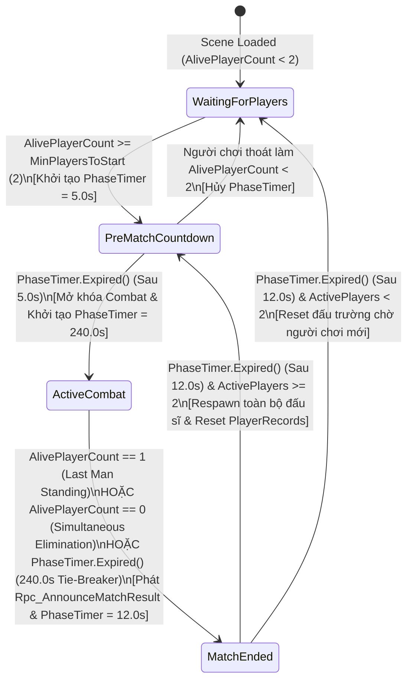
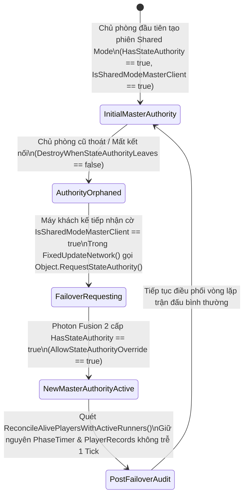

# Last Man Standing Match Manager & Authority Failover System

> **Status**: Designed
> **Creative Director Review (CD-GDD-ALIGN)**: APPROVED 2026-11-10
> **Author**: Solo Developer + Studio Agents (`systems-designer`, `network-engineer`, `gameplay-programmer`, `creative-director`, `qa-lead`)
> **Last Updated**: 2026-11-10
> **Last Verified**: 2026-11-10
> **Implements Pillar**: Pillar 3 (Công Bằng Mạng Tuyệt Đối Trên Shared Mode) & Pillar 4 (Khán Đài Hồn Ma & Vinh Quang Bảng Vàng)

## Summary

**Last Man Standing Match Manager & Authority Failover System (`MatchManager`)** là hệ thống điều phối trung tâm ở tầng **Feature (`Vertical Slice`)**, vận hành dưới dạng một **Scene `NetworkObject`** cố định trong Arena Scene để quản lý toàn bộ vòng đời trận đấu sinh tồn 3–5 phút (`WaitingForPlayers` $\rightarrow$ `PreMatchCountdown` $\rightarrow$ `ActiveCombat` $\rightarrow$ `MatchEnded`) trên kiến trúc **Photon Fusion 2 (`GameMode.Shared`)**. Người chơi cảm nhận trực tiếp hệ thống này qua nhịp đếm ngược `5.0s` khai cuộc, đồng hồ sinh tử `240.0s` (`4 phút`) trên đỉnh màn hình, bộ đếm số người còn sống (`AlivePlayerCount`), phán quyết phân xử thắng thua tức thì ngay khi chỉ còn 1 đấu sĩ trụ vững (`Last Man Standing`), và đặc biệt là sự liền mạch tuyệt đối không bị đứt gãy trận đấu ngay cả khi chủ phòng (`SharedModeMasterClient`) thoát đột ngột giữa chừng. Hệ thống tồn tại nhằm đảm bảo tính toàn vẹn của chế độ đấu trường sinh tồn nhiều người chơi (**Pillar 3** & **Pillar 4**) thông qua giao thức tự động chuyển giao quyền điều khiển (`Authority Failover Protocol` với `Allow State Authority Override = true` và `Destroy When State Authority Leaves = false`), đồng thời kết nối trực tiếp kết quả ván đấu với chế độ khán giả hồn ma (`System #9`) và bảng xếp hạng đám mây PlayFab (`System #13`).

> **Quick reference** — Layer: `Feature` · Priority: `Vertical Slice` · Key deps: `Photon Fusion 2 Shared Mode Session & Object Pool System`, `Health, Damage RPC & Death State System`

## Overview

**Last Man Standing Match Manager & Authority Failover System (`MatchManager`)** đóng vai trò là "Trọng Tài Tối Cao Bất Tử" của *Capsule Arena: Last Man Standing*. Trong mô hình mạng **Photon Fusion 2 `GameMode.Shared`**, không có máy chủ Dedicated Server riêng biệt giữ quyền điều khiển toàn cục mà quyền quản trị phòng được trao cho một máy khách đóng vai trò `SharedModeMasterClient`. Nếu đặt logic quản lý trận đấu trên đối tượng nhân vật của chủ phòng hoặc để cấu hình mặc định, việc chủ phòng thoát game hoặc rớt mạng sẽ xóa sổ đối tượng quản lý hoặc làm đóng băng hoàn toàn đồng hồ trận đấu. Để giải quyết triệt để bài toán kỹ thuật rủi ro cao này, `MatchManager` được thiết kế là một **Scene `NetworkObject`** gắn sẵn trong cảnh đấu trường với hai cờ cấu hình bắt buộc: **`Allow State Authority Override = true`** và **`Destroy When State Authority Leaves = false`**.

Trong suốt trận đấu, máy giữ quyền `StateAuthority` của `MatchManager` (luôn đồng bộ với `Runner.IsSharedModeMasterClient`) quản lý máy trạng thái 4 pha (`[Networked] MatchPhase CurrentPhase`), bộ đếm thời gian theo Tick mạng (`[Networked] TickTimer PhaseTimer`), tổng số đấu sĩ còn sống (`[Networked] int AlivePlayerCount`), định danh nhà vô địch (`[Networked] PlayerRef WinnerPlayer`), và từ điển bảng điểm đồng bộ (`[Networked, Capacity(8)] NetworkDictionary<PlayerRef, PlayerMatchRecord> PlayerRecords`). Bất cứ khi nào chủ phòng cũ rời trận khiến `MatchManager` mất `StateAuthority`, máy khách vừa được Photon Fusion 2 bầu làm `SharedModeMasterClient` mới sẽ phát hiện trạng thái mồ côi ngay trong vòng lặp `FixedUpdateNetwork()` kế tiếp và gọi `Object.RequestStateAuthority()` để tiếp quản liền mạch đồng hồ `PhaseTimer` cùng toàn bộ dữ liệu `PlayerRecords` mà không làm trễ dù chỉ 1 Tick mạng (`16.67ms`). Khi điều kiện kết thúc ván đấu xảy ra (`AlivePlayerCount == 1`, `AlivePlayerCount == 0` đồng quy vu tận, hoặc hết `240.0s` thời gian giao tranh), `MatchManager` phân xử ngôi vô địch theo bộ quy tắc ưu tiên minh bạch, phát thông báo `[Rpc(RpcSources.StateAuthority, RpcTargets.All)] public void Rpc_AnnounceMatchResult(PlayerRef winner, int winnerKills, MatchEndReason reason)` tới toàn phòng và kích hoạt đồng bộ chỉ số `+1 TotalWins` / `+Kills` lên **Hệ thống #13 (`PlayFab Cloud Identity, Stats & Leaderboard System`)**.

## Player Fantasy

> **System Framing:** `[A] Direct & [B] Indirect — Người chơi trực tiếp theo dõi đồng hồ đếm ngược, số người sống sót và màn hình vinh danh Nhà Vô Địch từ MatchManager, đồng thời hưởng thụ sự ổn định vô hình của cơ chế Authority Failover giữ cho trận đấu không bao giờ bị hủy ngang.`

### 1. Giấc mơ cốt lõi: "Đấu Trường Sinh Tử Công Minh — Nơi Người Trụ Vững Cuối Cùng Bước Lên Đỉnh Vinh Quang"
Trong một tựa game đối kháng **Last Man Standing**, mọi pha lăn né đạn bằng `Q`/`E`, mọi cú lướt `Forward Dash [2]` áp sát và mọi nhát chém xoay góc vuông $90^\circ$ (`1`/`3`) đều hướng tới một khoảnh khắc cảm xúc đỉnh cao duy nhất: **trở thành đấu sĩ cuối cùng còn đứng vững trên sàn đấu (`Alive: 1/8`) khi tất cả đối thủ đã hóa thành Hồn Ma khán giả**. `MatchManager` chính là hệ thống đóng khung và tôn vinh khoảnh khắc chiến thắng đó.

Không giống như các chế độ Deathmatch hồi sinh vô tận dễ gây nhàm chán, cấu trúc trận đấu 4 pha rõ ràng (`WaitingForPlayers` $\rightarrow$ `PreMatchCountdown 5s` $\rightarrow$ `ActiveCombat 240s` $\rightarrow$ `MatchEnded 12s`) tạo ra một đường cong kịch tính hoàn chỉnh trong vòng 3–5 phút. Áp lực từ con số `AlivePlayerCount` giảm dần từng người một kết hợp với đồng hồ `PhaseTimer` đếm ngược về `00:00` buộc người chơi phải tính toán chiến thuật thông minh: khi nào nên ẩn nấp sau khối `Obstacle` quan sát bằng góc nhìn `TPS`, và khi nào phải chủ động tấn công giành lợi thế máu (`CurrentHealth`) cùng điểm hạ gục (`Kills`) để chiến thắng trong phán quyết Tie-Breaker khi hết giờ. Hơn thế nữa, cơ chế **Authority Failover** bảo vệ trọn vẹn công sức của người chơi: không một kẻ thua cuộc cay cú nào (kể cả người tạo phòng ban đầu) có thể bấm `Alt+F4` để "lật bàn" hay làm treo ván đấu đang lúc gay cấn nhất (**Pillar 3** & **Pillar 4**).

### 2. Trải nghiệm cảm giác qua từng khoảnh khắc (How the Player Experiences the Effects)
1. **Sự Hồi Hộp Trước Giờ Khai Cuộc (`PreMatchCountdown — 5.0s`):** Ngay khi đủ tối thiểu 2 đấu sĩ gia nhập phòng (`MinPlayersToStart = 2`), tiếng còi đếm ngược `5... 4... 3... 2... 1... FIGHT!` vang lên. Các đấu sĩ đã xuất hiện tại `SpawnPoint` xoay camera quan sát đối phương nhưng chưa thể gây sát thương, dồn nén sự tập trung cao độ trước giây phút khai hỏa.
2. **Nhịp Đập Sinh Tồn Theo Từng Mạng Hạ Gục (`ActiveCombat — Alive Count Tracking`):** Mỗi khi một đối thủ bị hạ gục (`CurrentHealth <= 0`), `MatchManager` lập tức cập nhật bảng điểm `PlayerRecords`, cộng `+1 Kills` cho người kết liễu, gán thứ hạng sinh tồn (`FinalPlacement`) cho người nằm xuống và giảm `AlivePlayerCount` trên HUD. Khi con số trên đỉnh màn hình nhảy xuống **`ALIVE: 2`**, nhịp tim của hai đấu sĩ cuối cùng tăng vọt — trong khi những người chơi đã tử trận đang bay lượn ở chế độ **Ghost Mode Spectator (`System #9`)** hào hứng bình luận qua kênh **Public Chat (`System #12`)** xem ai sẽ là người chiến thắng.
3. **Sự Phẫn Nộ Bằng Không Khi Chủ Phòng Thoát Trận (`Zero-Interruption Authority Failover`):** Giả sử người chơi tạo phòng (`Player 1`) bị hạ gục sớm ở phút thứ 2 và lập tức thoát khỏi phòng. Trên màn hình của những người chơi còn lại, đồng hồ trận đấu vẫn nhảy giây mượt mà, các pha chém kiếm và bắn đạn vẫn tính điểm chính xác, và ván đấu tiến tới màn trao cúp vô địch mà không hề có bất kỳ màn hình "Host Migrating..." gây đứng hình nào.
4. **Khoảnh Khắc Đăng Quang & Lưu Danh Bảng Vàng (`MatchEnded & PlayFab Sync`):** Ngay giây phút đối thủ cuối cùng ngã xuống, biểu ngữ **VICTORY — LAST MAN STANDING!** bừng sáng cùng tên nhà vô địch, số `Kills` đạt được và lý do thắng cuộc. Thành tích `+1 TotalWins` và `+Kills` tự động được gửi lên đám mây **PlayFab Leaderboard (`System #13`)**, khép lại vòng lặp 3–5 phút đầy thỏa mãn trước khi tự động chuyển sang ván mới.

### 3. Điểm chạm Tham chiếu & Đối chiếu Trụ cột Thiết kế

| Điểm tham chiếu / Trụ cột | Cách `MatchManager` hiện thực hóa trải nghiệm người chơi |
| :--- | :--- |
| ***Brawl Stars (Solo Showdown)*** *(Fast-Paced Last Man Standing Loop)* | Vòng lặp trận đấu ngắn gọn (`240s` tối đa), hiển thị trực quan số đấu sĩ còn sống (`AlivePlayerCount`) và trao thứ hạng sinh tồn (`#1` đến `#8`) ngay thời điểm từng người bị loại. |
| ***Fall Guys / Battlerite*** *(Sudden Tie-Breaker & Final Showdown Clarity)* | Quy tắc phân xử thắng thua cuối trận (`Tie-Breaker Rules`) theo Máu hiện tại $\rightarrow$ Số mạng hạ gục (`Kills`) ngăn chặn lối chơi trốn chạy tiêu cực khi đồng hồ sắp điểm `00:00`. |
| **Pillar 3 (Công Bằng Mạng Tuyệt Đối Trên Shared Mode)** | Giao thức `Authority Failover` (`Allow State Authority Override = true` + `Destroy When State Authority Leaves = false`) đảm bảo quyền điều phối trận đấu tự động chuyển giao sang `SharedModeMasterClient` mới trong đúng `1 Tick` mà không làm mất trạng thái trận đấu. |
| **Pillar 4 (Khán Đài Hồn Ma & Vinh Quang Bảng Vàng)** | Giữ kết nối giữa những người đã hy sinh (`IsAlive == false` ở chế độ `GhostSpectating`) với những người đang chiến đấu, và kích hoạt lưu trữ thành tích lên PlayFab ngay khi chuyển sang `MatchEnded`. |

## Detailed Design

### Core Rules

1. **Quy tắc Định Danh & Cấu Hình Bắt Buộc Của Scene `NetworkObject` (`MatchManager Prefab/Scene Contract`):**
   - `MatchManager` **bắt buộc** là một đối tượng **Scene `NetworkObject`** đặt sẵn cố định trong cảnh đấu trường (`Arena.unity`), tuyệt đối không được khởi tạo động bằng `Runner.Spawn()` từ một máy khách cá nhân để tránh phụ thuộc vòng đời vào người tạo.
   - Cấu hình thành phần `NetworkObject` của `MatchManager` trên Unity Inspector **bắt buộc** khóa cứng hai thuộc tính:
     - **`Allow State Authority Override = true`**: Cho phép một máy khách khác gọi `Object.RequestStateAuthority()` để giành lấy quyền điều khiển khi chủ phòng cũ rời đi.
     - **`Destroy When State Authority Leaves = false`**: Ngăn chặn Photon Fusion 2 tự động hủy (`Despawn`) đối tượng `MatchManager` khi máy khách đang giữ `StateAuthority` ngắt kết nối khỏi phiên `GameMode.Shared`.

2. **Quy tắc Trạng Thái Mạng Đồng Bộ (`[Networked]` State Schema):**
   - Toàn bộ trạng thái điều phối trận đấu được khai báo bằng thuộc tính `[Networked]` trên lớp `MatchManager : NetworkBehaviour` để tự động nhân bản (replicate) từ máy giữ `StateAuthority` tới mọi máy `Proxy` trong phòng:
     - `[Networked, OnChangedRender(nameof(OnMatchPhaseChanged))] public MatchPhase CurrentPhase { get; set; }` — Pha hiện tại của trận đấu (`WaitingForPlayers = 0`, `PreMatchCountdown = 1`, `ActiveCombat = 2`, `MatchEnded = 3`).
     - `[Networked] public TickTimer PhaseTimer { get; set; }` — Đồng hồ đếm ngược đa năng theo Tick mạng dùng cho cả 3 pha có thời hạn:
       - `PreMatchCountdownSeconds = 5.0f` (`300 ticks` ở `60Hz`)
       - `MatchDurationSeconds = 240.0f` (`4 phút` = `14,400 ticks` ở `60Hz`)
       - `PostMatchCelebrationSeconds = 12.0f` (`720 ticks` ở `60Hz`)
     - `[Networked] public int AlivePlayerCount { get; set; }` — Số lượng người chơi đang có trạng thái `IsAlive == true` trong trận hiện tại.
     - `[Networked] public PlayerRef WinnerPlayer { get; set; }` — Định danh `PlayerRef` của người chiến thắng chung cuộc (`PlayerRef.None` khi chưa xác định).
     - `[Networked, Capacity(8)] public NetworkDictionary<PlayerRef, PlayerMatchRecord> PlayerRecords => default;` — Từ điển lưu trữ hồ sơ thi đấu của tối đa `8` đấu sĩ trong phòng.
   - Cấu trúc dữ liệu hồ sơ người chơi `PlayerMatchRecord : INetworkStruct` (cấp phát `0 Byte GC`, tuần tự hóa trực tiếp vào Snapshot mạng) bao gồm:

| Trường Dữ Liệu (`PlayerMatchRecord`) | Kiểu Dữ Liệu | Kích Thước Bit/Byte | Ý Nghĩa Ngữ Nghĩa & Quy Tắc Cập Nhật |
| :--- | :---: | :---: | :--- |
| `PlayerName` | `NetworkString<_16>` | `68 Bytes` cố định | Tên hiển thị của đấu sĩ (tối đa 16 ký tự UTF-8), đăng ký khi gia nhập phòng từ `Lobby` / `PlayFab`. |
| `Kills` | `int` | `4 Bytes` | Tổng số mạng hạ gục hợp lệ người chơi đạt được trong ván đấu hiện tại (`+1` mỗi khi hạ gục đối phương). |
| `CurrentHealthSnapshot` | `int` | `4 Bytes` | Bản chụp lượng máu hiện tại (`0–100 HP`) được cập nhật khi nhận sát thương và dùng để xét Tie-Breaker khi hết giờ. |
| `IsAlive` | `NetworkBool` | `4 Bytes` (`int` nền) | Cờ trạng thái sống còn trong ván hiện tại (`true` khi đang thi đấu, `false` khi đã tử trận hoặc vào muộn làm khán giả). |
| `FinalPlacement` | `int` | `4 Bytes` | Thứ hạng chung cuộc trong ván đấu (`1` cho Winner, `2..8` tính theo thứ tự bị loại, `0` khi đang thi đấu chưa có hạng). |

3. **Quy tắc Giao Thức Tự Động Chuyển Giao Quyền Điều Khiển (`Authority Failover Protocol`):**
   - Trong chế độ `GameMode.Shared`, khi máy khách giữ vai trò `SharedModeMasterClient` rời phòng (do bấm thoát, mất kết nối mạng hoặc đóng ứng dụng), máy chủ đám mây Photon Cloud tự động chỉ định một máy khách còn lại trong phòng làm `SharedModeMasterClient` mới (`Runner.IsSharedModeMasterClient == true`). Tuy nhiên, đối tượng Scene `NetworkObject` (`MatchManager`) không tự động chuyển `StateAuthority` nếu không có lệnh yêu cầu tường minh.
   - Do đó, ngay ở dòng đầu tiên của hàm `FixedUpdateNetwork()` trên `MatchManager`, hệ thống thực thi kiểm tra:
     - **Điều kiện kích hoạt Failover:** `if (!Object.HasStateAuthority && Runner.IsSharedModeMasterClient)`
     - **Hành động tiếp quản:** Gọi ngay lập tức `Object.RequestStateAuthority()` và đánh dấu cờ nội bộ `_isAcquiringAuthority = true`.
     - **Tính liên tục tuyệt đối (Zero-Tick Interruption):** Bởi vì `CurrentPhase`, `PhaseTimer`, `AlivePlayerCount`, `WinnerPlayer` và `PlayerRecords` đều là các biến `[Networked]` đã được đồng bộ sẵn trên bộ nhớ Snapshot của mọi máy khách ở từng Tick, ngay khi máy `SharedModeMasterClient` mới nhận được `Object.HasStateAuthority == true`, nó tiếp tục chạy logic kiểm tra `PhaseTimer.Expired(Runner)` và đếm `AlivePlayerCount` từ đúng Tick hiện tại mà không cần khởi tạo lại bộ đếm hay làm gián đoạn trận đấu dù chỉ 1 Tick!
     - **Đồng bộ kiểm toán hậu chuyển giao (`Post-Failover State Audit`):** Trong Tick đầu tiên nhận được `HasStateAuthority` (hoặc bên trong callback `StateAuthorityChanged()`), máy chủ phòng mới thực hiện một lượt quét nhanh (`ReconcileAlivePlayersWithActiveRunners()`) đối chiếu danh sách `Runner.ActivePlayers` với `PlayerRecords` để đảm bảo nếu chủ phòng cũ vừa thoát khi đang còn sống (`IsAlive == true`), hồ sơ của chủ phòng cũ được đánh dấu `IsAlive = false`, cập nhật lại `AlivePlayerCount` và kiểm tra ngay điều kiện thắng thua nếu phòng chỉ còn đúng 1 người sống sót.

4. **Quy tắc Gia Nhập Phòng & Phân Luồng Đấu Sĩ / Khán Giả (`Join-Phase Routing Rules`):**
   - **Nếu người chơi vào phòng khi `CurrentPhase == WaitingForPlayers` hoặc `PreMatchCountdown`:**
     - Người chơi được đăng ký vào `PlayerRecords` với `IsAlive = true`, `CurrentHealthSnapshot = 100`, `Kills = 0`, `FinalPlacement = 0`.
     - Hệ thống `#4` (`Shared Mode Session`) sinh nhân vật đấu sĩ tại một `SpawnPoint` trống và tăng `AlivePlayerCount`.
     - Nếu đang ở `WaitingForPlayers` và tổng số người chơi hợp lệ đạt `AlivePlayerCount >= MinPlayersToStart` (`2` người), `MatchManager` lập tức chuyển `CurrentPhase = MatchPhase.PreMatchCountdown` và khởi tạo `PhaseTimer = TickTimer.CreateFromSeconds(Runner, PreMatchCountdownSeconds)` (`5.0s`).
   - **Nếu người chơi mới gia nhập phòng khi trận đấu đang diễn ra (`CurrentPhase == ActiveCombat` hoặc `MatchEnded` — Late Joiner):**
     - Để bảo vệ tính công bằng của thể thức Last Man Standing (**Pillar 3**), người vào muộn **không** được sinh nhân vật chiến đấu giữa chừng.
     - `MatchManager` đăng ký người chơi vào `PlayerRecords` với `IsAlive = false`, `CurrentHealthSnapshot = 0`, `FinalPlacement = AlivePlayerCount + 1` (hoặc trạng thái Spectator), không cộng vào `AlivePlayerCount`, và phát tín hiệu để **Hệ thống #9 (`Ghost Mode Spectator System`)** cùng **Hệ thống #3 (`InputFocusManager`)** đưa người chơi đó vào thẳng chế độ `GhostSpectating` theo dõi trận đấu cho tới khi ván mới bắt đầu.

5. **Quy tắc Xét Thắng Thua & Phân Xử Hòa (`Last Man Standing & Tie-Breaker Rules`):**
   - Trong suốt thời gian `CurrentPhase == MatchPhase.ActiveCombat` (khi trận đấu đã bắt đầu với ít nhất `MinPlayersToStart = 2` người chơi), máy giữ `StateAuthority` của `MatchManager` lắng nghe sự kiện tử trận từ **Hệ thống #6 (`Health, Damage RPC & Death State System`)**, sự kiện `OnPlayerLeft` từ `NetworkRunner`, và kiểm tra `PhaseTimer.Expired(Runner)` trong mỗi `FixedUpdateNetwork()`:
     1. **Kịch bản 1 — Chiến thắng Sinh tồn Tuyệt đối (`Last Man Standing` — `AlivePlayerCount == 1`):**
        - Ngay tại Tick mà `AlivePlayerCount` giảm xuống bằng `1`, người chơi duy nhất còn `IsAlive == true` trong `PlayerRecords` được gán `FinalPlacement = 1` và tuyên bố là `WinnerPlayer`.
        - `MatchManager` chuyển `CurrentPhase = MatchPhase.MatchEnded`, đặt `PhaseTimer = TickTimer.CreateFromSeconds(Runner, PostMatchCelebrationSeconds)` (`12.0s`), và phát `[Rpc(RpcSources.StateAuthority, RpcTargets.All)] public void Rpc_AnnounceMatchResult(PlayerRef winner, int winnerKills, MatchEndReason.LastManStanding)`.
     2. **Kịch bản 2 — Hòa đồng quy vu tận (`Simultaneous Elimination` — `AlivePlayerCount == 0`):**
        - Nếu 2 (hoặc nhiều) đấu sĩ cuối cùng bắn đạn tầm xa hoặc vung kiếm hạ gục lẫn nhau trong cùng một Tick mạng khiến `AlivePlayerCount` giảm thẳng từ `>= 2` về `0`:
        - `MatchManager` xét danh sách những đấu sĩ vừa tử trận trong chính Tick cuối cùng đó (`_eliminatedThisTickBuffer`): người chơi có chỉ số **`Kills` cao nhất** (bao gồm cả mạng vừa hạ gục ở Tick đó) được trao ngôi `WinnerPlayer` (`FinalPlacement = 1`). Nếu số `Kills` vẫn bằng nhau, người chơi gia nhập phòng sớm hơn (có `PlayerRef.RawEncoded` nhỏ hơn) giành chiến thắng với lý do `MatchEndReason.SimultaneousTieBreaker`.
     3. **Kịch bản 3 — Hết giờ thi đấu (`MatchTimer Expired` sau `240.0s` mà `AlivePlayerCount > 1`):**
        - Ngay khi `PhaseTimer.Expired(Runner) == true` ở pha `ActiveCombat` mà vẫn còn từ 2 đấu sĩ trở lên còn sống (`IsAlive == true`), hệ thống ngừng nhận sát thương mới và chấm điểm phân xử (`tiebreaker_score`) cho toàn bộ những người chơi đang còn sống theo **thứ tự ưu tiên 3 tầng nghiêm ngặt**:
          - **(a) Ưu tiên 1 — Máu hiện tại cao nhất (`CurrentHealthSnapshot` cao nhất):** Khuyến khích lối chơi giữ máu và trao đổi chiêu thức chính xác.
          - **(b) Ưu tiên 2 — Số mạng hạ gục cao nhất (`Kills` cao nhất):** Nếu máu bằng nhau, người chủ động giao tranh và tiêu diệt nhiều đối thủ hơn sẽ thắng.
          - **(c) Ưu tiên 3 — Thứ tự gia nhập phòng sớm nhất (`PlayerRef.RawEncoded` nhỏ nhất):** Phân định dứt điểm 100% không bao giờ xảy ra kết quả hòa vô định.
        - Người có điểm phân xử cao nhất trở thành `WinnerPlayer` (`FinalPlacement = 1`), các đấu sĩ còn sống khác được xếp hạng `FinalPlacement` lần lượt từ `2` trở đi theo thứ tự `tiebreaker_score` giảm dần, và hệ thống phát `Rpc_AnnounceMatchResult(winner, winnerKills, MatchEndReason.TimeExpiredTieBreaker)`.

6. **Quy tắc Báo Cáo Thành Tích Lên Đám Mây PlayFab (`End-of-Match Cloud Stat Commit Rule`):**
   - Ngay khi `CurrentPhase` chuyển sang `MatchPhase.MatchEnded` (kích hoạt qua `OnMatchPhaseChanged` hoặc nhận `Rpc_AnnounceMatchResult`):
     - Máy khách của người chiến thắng (`Runner.LocalPlayer == WinnerPlayer`) tự động gửi yêu cầu cộng **`+1 TotalWins`** và **`+Kills`** (số mạng hạ gục của bản thân trong ván đó) lên **Hệ thống #13 (`PlayFab Cloud Identity, Stats & Leaderboard System`)**.
     - Tất cả các máy khách khác trong phòng (`Runner.LocalPlayer != WinnerPlayer` có `Kills > 0`) tự động gửi yêu cầu cộng **`+Kills`** của riêng mình lên **Hệ thống #13**.
     - Cơ chế cờ khóa một lần (`_hasCommittedStatsForCurrentMatch = true`, chỉ reset khi quay về `PreMatchCountdown`) đảm bảo mỗi máy khách chỉ gửi dữ liệu lên PlayFab đúng **1 lần duy nhất** cho mỗi ván đấu, kể cả khi có sự kiện `Authority Failover` xảy ra trong lúc đang ăn mừng chiến thắng.

### States and Transitions

Hệ thống `MatchManager` vận hành đồng thời **2 máy trạng thái**: (1) Máy trạng thái Vòng đời Trận đấu (`MatchPhase State Machine`) và (2) Máy trạng thái Chuyển giao Quyền điều khiển (`SharedMode Authority Failover State Machine`).

#### 1. Sơ Đồ Máy Trạng Thái Vòng Đời Trận Đấu (`MatchPhase State Machine`)

#### 2. Sơ Đồ Máy Trạng Thái Tự Động Chuyển Giao Quyền Điều Khiển (`Authority Failover Protocol`)

#### Bảng Đặc Tả Chi Tiết 4 Pha Trận Đấu (`MatchPhase`)

| Pha (`MatchPhase`) | Giá Trị Enum | Thời Lượng (`PhaseTimer`) | Quyền Điều Khiển Nhân Vật & Sát Thương | Quy Tắc Xử Lý Người Chơi Vào / Ra |
| :--- | :---: | :---: | :--- | :--- |
| **`WaitingForPlayers`** | `0` | Vô thời hạn (`TickTimer.None`) | Nhân vật di chuyển tự do trong khu vực chờ/sàn đấu nhưng **vô hiệu hóa trừ máu** (`Damage Immunity = true`). | Người mới vào được `Spawn()` ngay với `IsAlive = true`. Khi `AlivePlayerCount >= 2`, chuyển ngay sang `PreMatchCountdown`. |
| **`PreMatchCountdown`** | `1` | `5.0s` (`300 ticks`) | Nhân vật được đặt lại vị trí tại các `SpawnPoint` cách đều nhau, xoay camera tự do nhưng **khóa di chuyển `WASD` / kỹ năng** cho tới khi hết `5.0s`. | Nếu có người thoát khiến `AlivePlayerCount < 2`, hủy đếm ngược và lùi về `WaitingForPlayers`. Nếu đủ người khi hết `5.0s`, chuyển sang `ActiveCombat`. |
| **`ActiveCombat`** | `2` | `240.0s` (`14,400 ticks` / `4 phút`) | Mở khóa 100% di chuyển (`WASD`, Dash `2`, Dodge `Q/E`) và chiến đấu (`LMB`, `RMB`, `1`, `3`). Sát thương và tử trận tính điểm thật. | Người tử trận chuyển sang `GhostSpectating`. Người mới vào phòng giữa chừng (`Late Joiner`) được gán `IsAlive = false` và vào thẳng `GhostSpectating`. |
| **`MatchEnded`** | `3` | `12.0s` (`720 ticks`) | Vô hiệu hóa nhận sát thương mới cho người sống sót; hiển thị bảng vinh danh `WinnerPlayer`, gửi chỉ số lên PlayFab (`#13`). | Khi hết `12.0s`, hồi sinh toàn bộ người chơi đang có mặt trong phòng (`Runner.ActivePlayers`), đặt lại máu `100/100` và bắt đầu ván mới. |

### Interactions with Other Systems

| Hệ Thống Liên Quan | Chiều Tương Tác | Cơ Chế Giao Tiếp Kỹ Thuật (Events / RPCs / Networked Properties) |
| :--- | :---: | :--- |
| **System #4: Photon Fusion 2 Shared Mode Session & Object Pool System** | **Upstream (`#4` $\rightarrow$ `#10`) & Downstream (`#10` $\rightarrow$ `#4`)** | `#4` cung cấp callbacks `OnPlayerJoined(NetworkRunner, PlayerRef)` và `OnPlayerLeft(NetworkRunner, PlayerRef)` cùng trạng thái `Runner.IsSharedModeMasterClient`. Khi kết thúc `MatchEnded` chuyển sang ván mới, `#10` yêu cầu `#4` đặt lại vị trí các nhân vật về `SpawnPoint` và thu hồi toàn bộ đạn tồn đọng về `INetworkObjectProvider` Pool. |
| **System #6: Health, Damage RPC & Death State System** | **Upstream (`#6` $\rightarrow$ `#10`)** | Khi một đấu sĩ bị giảm máu hoặc tử trận (`CurrentHealth <= 0`, `IsDead = true`), `#6` phát sự kiện tĩnh/cục bộ `OnPlayerHealthUpdated(PlayerRef victim, int currentHp)` và `OnPlayerDeathStateChanged(PlayerRef victim, PlayerRef killer)`. Máy giữ `StateAuthority` của `#10` lắng nghe sự kiện này để cộng `+1 Kills` cho `killer`, gán `IsAlive = false` + `FinalPlacement` cho `victim`, và giảm `AlivePlayerCount`. Đồng thời `#6` đọc `MatchManager.CurrentPhase == MatchPhase.ActiveCombat` để chỉ cho phép trừ máu khi trận đấu đang diễn ra. |
| **System #3: Keybinding & Input Management System (`InputFocusManager`)** | **Downstream (`#10` $\rightarrow$ `#3`)** | Khi người chơi vào phòng muộn giữa lúc `CurrentPhase == ActiveCombat` hoặc khi trận đấu chuyển фа, `#10` thông báo trạng thái để `InputFocusManager` chuyển sang `GhostSpectating` (cho Late Joiner) hoặc `CombatActive` (khi bắt đầu `ActiveCombat`). |
| **System #8: Combat HUD, Overhead Billboard & Mobile Action Pad UI** | **Downstream (`#10` $\rightarrow$ `#8`)** | `#8` đọc trực tiếp `[Networked] PhaseTimer`, `[Networked] AlivePlayerCount`, `[Networked] CurrentPhase` và `PlayerRecords` trong hàm `Render()` để hiển thị đồng hồ đếm ngược `MM:SS`, bộ đếm `ALIVE: X/Y`, số `KILLS` cá nhân và màn hình tổng kết chiến thắng (`Victory / Defeat Banner`). |
| **System #9: Dual-Perspective Camera (FPS/TPS) & Ghost Mode Spectator System** | **Downstream (`#10` $\rightarrow$ `#9`)** | `#9` truy vấn danh sách các đấu sĩ có `IsAlive == true` từ `MatchManager.PlayerRecords` để cho phép người chơi ở chế độ **Ghost Mode Spectator** bấm `Next / Previous` (`Q`/`E`) chuyển góc nhìn bám theo những người còn sống, và tự động chuyển camera về chiếu cận cảnh `WinnerPlayer` khi `CurrentPhase == MatchEnded`. |
| **System #12: In-Game Chat System (Public & Private Whisper)** | **Downstream (`#10` $\rightarrow$ `#12`)** | Khi có người bị hạ gục hoặc khi công bố `WinnerPlayer`, `#10` có thể đẩy một thông báo hệ thống cục bộ vào khung Chat (`"[SYSTEM] Đấu sĩ A đã hạ gục Đấu sĩ B — Còn lại 3 người!"`). |
| **System #13: PlayFab Cloud Identity, Stats & Leaderboard System** | **Downstream (`#10` $\rightarrow$ `#13`)** | Khi `CurrentPhase` chuyển sang `MatchPhase.MatchEnded`, `#10` kích hoạt sự kiện `OnMatchEndedForStats(PlayerRef winner, int localPlayerKills, bool isLocalWinner)` để `#13` gửi bất đồng bộ `+1 TotalWins` (nếu `LocalPlayer == WinnerPlayer`) và `+Kills` lên dịch vụ đám mây PlayFab. |

## Formulas

### 1. Thứ Hạng Sinh Tồn Của Người Chơi Khi Bị Loại (`elimination_placement_rank`)

The `elimination_placement_rank` formula is defined as:

`elimination_placement_rank = alive_players_remaining + 1`

**Variables:**

| Variable | Type | Range | Source | Description |
| :--- | :---: | :---: | :--- | :--- |
| `alive_players_remaining` | `int` | `0–7` | `MatchManager.AlivePlayerCount` (sau khi đã trừ người vừa bị loại) | Số lượng đấu sĩ vẫn còn sống (`IsAlive == true`) trên sàn đấu ngay sau thời điểm người chơi hiện tại bị hạ gục hoặc thoát trận. |
| `elimination_placement_rank` | `int` | `1–8` | `PlayerMatchRecord.FinalPlacement` | Thứ hạng sinh tồn chung cuộc của người chơi bị loại trong ván đấu (`1` là Vô địch, `8` là người bị loại đầu tiên trong phòng 8 người). |

**Output Range:** `1` đến `8` (số nguyên dương biểu thị thứ hạng từ `#1` đến `#8`).

**Example:**
- Phòng đấu có `6` người chơi tham gia. Đấu sĩ A bị hạ gục đầu tiên, số người còn sống giảm từ `6` xuống `alive_players_remaining = 5`:
  `elimination_placement_rank = 5 + 1 = 6` (Đấu sĩ A nhận hạng `#6`).
- Khi trận đấu chỉ còn 2 người và Đấu sĩ B bị Đấu sĩ C hạ gục, số người còn sống giảm xuống `alive_players_remaining = 1`:
  - Hạng của Đấu sĩ B (người vừa tử trận): `elimination_placement_rank = 1 + 1 = 2` (Á quân `#2`).
  - Hạng của Đấu sĩ C (người sống sót cuối cùng): được trao trực tiếp hạng `#1` (`WinnerPlayer`).

---

### 2. Điểm Phân Xử Thắng Thua Khi Hết Giờ (`tiebreaker_score`)

The `tiebreaker_score` formula is defined as:

`tiebreaker_score = (current_health * 1000) + (kills * 100) - player_join_order`

**Variables:**

| Variable | Type | Range | Source | Description |
| :--- | :---: | :---: | :--- | :--- |
| `current_health` | `int` | `1–100` | `PlayerMatchRecord.CurrentHealthSnapshot` (`System #6`) | Lượng máu hiện tại của đấu sĩ còn sống tại thời điểm đồng hồ `PhaseTimer` chạm mốc `0.0s`. |
| `kills` | `int` | `0–7` | `PlayerMatchRecord.Kills` | Tổng số mạng hạ gục hợp lệ mà đấu sĩ đó đã ghi được trong ván đấu hiện tại. |
| `player_join_order` | `int` | `0–63` | `PlayerRef.RawEncoded` (hoặc chỉ số thứ tự vào phòng `0..7`) | Định danh thứ tự gia nhập phòng của người chơi (người vào sớm hơn có giá trị nhỏ hơn). |
| `tiebreaker_score` | `int` | `937–100700` | Hàm phân xử `EvaluateTimeExpiredTieBreaker()` trong `MatchManager` | Điểm số tổng hợp dùng để xếp hạng tuyệt đối các đấu sĩ còn sống khi hết `240.0s` mà không bao giờ xảy ra trùng điểm. |

**Output Range:** `937` đến `100,700` (Vì `kills * 100` tối đa là `700 < 1000` và `player_join_order` tối đa là `63 < 100`, trọng số `1000` và `100` đảm bảo tuyệt đối 100% mặt toán học rằng `current_health` luôn quyết định trước, sau đó mới đến `kills`, và cuối cùng là `player_join_order`).

**Example:**
- Hết `240.0s` thời gian thi đấu, trên sàn đấu còn 3 đấu sĩ sống sót:
  - **Đấu sĩ 1:** `current_health = 65 HP`, `kills = 1`, `player_join_order = 2`
    `tiebreaker_score = (65 * 1000) + (1 * 100) - 2 = 65000 + 100 - 2 = 65,098`.
  - **Đấu sĩ 2:** `current_health = 65 HP`, `kills = 3`, `player_join_order = 4`
    `tiebreaker_score = (65 * 1000) + (3 * 100) - 4 = 65000 + 300 - 4 = 65,296`.
  - **Đấu sĩ 3:** `current_health = 45 HP`, `kills = 4`, `player_join_order = 1`
    `tiebreaker_score = (45 * 1000) + (4 * 100) - 1 = 45000 + 400 - 1 = 45,399`.
- **Kết quả phân xử:** **Đấu sĩ 2** (`65,296 điểm`) giành chiến thắng chung cuộc (`WinnerPlayer`, hạng `#1`) vì có cùng mức máu cao nhất (`65 HP`) với Đấu sĩ 1 nhưng nhiều `Kills` hơn (`3 > 1`); **Đấu sĩ 1** xếp hạng `#2` (`65,098 điểm`); **Đấu sĩ 3** xếp hạng `#3` (`45,399 điểm`).

---

### 3. Thời Gian Còn Lại Của Trận Đấu Hiển Thị Trên HUD (`remaining_match_seconds`)

The `remaining_match_seconds` formula is defined as:

`remaining_match_seconds = max(0.0, phase_timer_remaining_ticks / tick_rate)`

**Variables:**

| Variable | Type | Range | Source | Description |
| :--- | :---: | :---: | :--- | :--- |
| `phase_timer_remaining_ticks` | `int` | `-60` đến `14400` | `MatchManager.PhaseTimer.RemainingTicks(Runner)` | Số Tick mạng còn lại trước khi `PhaseTimer` hết hạn tính từ `Runner.Tick` hiện tại. |
| `tick_rate` | `float` | `60.0` (cố định) | `NetworkRunner.Config.Simulation.TickRate` | Tần số mô phỏng mạng của Photon Fusion 2 (`60.0 ticks/giây`). |
| `remaining_match_seconds` | `float` | `0.00–240.00` | Thuộc tính `MatchManager.RemainingPhaseTimeSeconds` đọc bởi `System #8 HUD` | Số giây thực tế còn lại của pha hiện tại để định dạng thành chuỗi đồng hồ `MM:SS` (hoặc `0.0s` khi dưới `10 giây`). |

**Output Range:** `0.00s` đến `240.00s`.

**Example:**
- Trận đấu đang ở pha `ActiveCombat` (`240.0s` = `14,400 ticks`), đã trôi qua `90 giây` (`5,400 ticks`), số Tick còn lại là `phase_timer_remaining_ticks = 9,000 ticks` ở tần số `tick_rate = 60.0`:
  `remaining_match_seconds = max(0.0, 9000 / 60.0) = 150.0s` (Hiển thị trên HUD là `02:30`).
- Khi `PhaseTimer` vừa hết hạn (`phase_timer_remaining_ticks = -3`), hàm `max(0.0, -3 / 60.0)` kẹp giá trị trả về đúng `0.0s` (`00:00`), ngăn chặn lỗi hiển thị số âm trên giao diện người dùng.

## Edge Cases

- **If the current `SharedModeMasterClient` disconnects or closes the game at the exact final second (`t = 0.0s`) or on the exact Tick the winning kill occurs**: Nhờ `Destroy When State Authority Leaves = false` và `Allow State Authority Override = true`, đối tượng `MatchManager` vẫn tồn tại nguyên vẹn với giá trị `PhaseTimer` và `PlayerRecords` đã đồng bộ tới mọi máy. Ngay ở Tick tiếp theo (`+16.67ms`), máy khách được Photon bầu làm `SharedModeMasterClient` mới gọi `Object.RequestStateAuthority()`, chạy `ReconcileAlivePlayersWithActiveRunners()`, phát hiện `PhaseTimer.Expired(Runner) == true` hoặc `AlivePlayerCount <= 1` và lập tức công bố `WinnerPlayer` qua `Rpc_AnnounceMatchResult` mà không bị kẹt trận đấu.
- **If a new player joins the Photon session while `CurrentPhase == MatchPhase.ActiveCombat` or `MatchPhase.MatchEnded` (Late Joiner)**: `MatchManager` không gọi `Spawn()` nhân vật chiến đấu cho người chơi này, mà ghi nhận vào `PlayerRecords` với `IsAlive = false`, `CurrentHealthSnapshot = 0`, giữ nguyên `AlivePlayerCount` của những người đang đấu, và chuyển thẳng máy khách của người mới vào chế độ **Ghost Mode Spectator (`System #9`)** kèm thông báo trên HUD `"TRẬN ĐẤU ĐANG DIỄN RA — BẠN ĐANG Ở CHẾ ĐỘ KHÁN GIẢ HỒN MA (CHỜ VÁN MỚI)"`.
- **If the last 2 surviving players hit each other with ranged projectiles or melee slashes in the exact same network Tick (`Simultaneous Elimination` causing `AlivePlayerCount == 0`)**: `MatchManager` thu thập danh sách các đấu sĩ vừa chuyển sang `IsAlive == false` trong chính Tick hiện tại (`_eliminatedThisTickBuffer`), cộng đầy đủ `+1 Kills` cho cả hai, sau đó trao chiến thắng (`WinnerPlayer`, `FinalPlacement = 1`) cho người có tổng `Kills` cao hơn (nếu `Kills` bằng nhau thì ưu tiên người có `PlayerRef.RawEncoded` nhỏ hơn) với lý do `MatchEndReason.SimultaneousTieBreaker`.
- **If `AlivePlayerCount` drops to `1` during `ActiveCombat` because all other opponents disconnected (`OnPlayerLeft`) rather than being killed by damage**: Trong callback `OnPlayerLeft(NetworkRunner runner, PlayerRef player)`, máy giữ `StateAuthority` đánh dấu hồ sơ của người thoát là `IsAlive = false`, gán `FinalPlacement = AlivePlayerCount`, giảm `AlivePlayerCount` đi `1`, và ngay lập tức kích hoạt chiến thắng `LastManStanding` (`MatchEndReason.OpponentForfeit`) cho người chơi duy nhất còn trụ lại trong phòng.
- **If a player disconnects during `PreMatchCountdown` (`5.0s`) causing the total number of players in the room to drop below `MinPlayersToStart` (`< 2` players)**: `MatchManager` lập tức hủy đếm ngược (`PhaseTimer = TickTimer.None`), chuyển `CurrentPhase` lùi về `MatchPhase.WaitingForPlayers`, mở khóa di chuyển trong phòng chờ và hiển thị thông báo `"Đang chờ thêm đấu sĩ (1/2)..."` cho tới khi có người chơi mới gia nhập.
- **If a dying player shoots a ranged projectile (`Right Click`) just before dying, and that projectile kills another player 0.5 seconds after the shooter is already dead (`Post-Mortem Kill`)**: Khi sự kiện tử trận của nạn nhân gửi `killer = deadShooterRef` về `MatchManager`, hệ thống vẫn cộng chính xác `+1 Kills` vào `PlayerRecords[deadShooterRef]` (giúp tăng thành tích gửi lên PlayFab ở cuối trận), nhưng **không** hồi sinh hay thay đổi trạng thái `IsAlive = false` của người bắn đã chết.
- **If two or more surviving players have the exact same `CurrentHealth` AND the exact same `Kills` when `PhaseTimer` expires at `240.0s`**: Công thức `tiebreaker_score = (current_health * 1000) + (kills * 100) - player_join_order` sử dụng `player_join_order` (`PlayerRef.RawEncoded` — luôn là số nguyên duy nhất cho mỗi kết nối trong phòng Photon Fusion 2) làm tiêu chí phân xử thứ 3, đảm bảo toán học 100% không bao giờ có 2 người chơi có cùng `tiebreaker_score`.
- **If `Authority Failover` happens while `CurrentPhase == MatchPhase.MatchEnded` (during the `12.0s` celebration window)**: Máy khách vừa tiếp quản `StateAuthority` thấy `CurrentPhase == MatchPhase.MatchEnded` sẽ không gọi lại `Rpc_AnnounceMatchResult`, và cờ cục bộ `_hasCommittedStatsForCurrentMatch == true` trên từng máy khách ngăn chặn tuyệt đối việc gửi trùng lặp (`Duplicate Commit`) chỉ số `+1 TotalWins` hoặc `+Kills` lên PlayFab (`System #13`).
- **If a player attempts to deal damage during `WaitingForPlayers`, `PreMatchCountdown`, or `MatchEnded`**: Hệ thống máu (`System #6`) kiểm tra điều kiện cổng `if (MatchManager.Instance != null && MatchManager.Instance.CurrentPhase != MatchPhase.ActiveCombat) return;` ngay đầu hàm `Rpc_TakeDamage`, từ chối mọi sát thương ngoài pha giao tranh chính thức.

## Dependencies

### Upstream Dependencies (Hệ thống này phụ thuộc vào)

| Hệ Thống Thượng Nguồn | Loại Phụ Thuộc | Hợp Đồng Giao Tiếp & Dữ Liệu Đầu Vào |
| :--- | :---: | :--- |
| **System #4: Photon Fusion 2 Shared Mode Session & Object Pool System** | **Hard (MVP)** | Cung cấp môi trường `NetworkRunner` (`GameMode.Shared`), thuộc tính `Runner.IsSharedModeMasterClient`, danh sách `Runner.ActivePlayers`, và các sự kiện vòng đời kết nối `OnPlayerJoined` / `OnPlayerLeft`. |
| **System #6: Health, Damage RPC & Death State System** | **Hard (MVP)** | Phát sự kiện một chiều `OnPlayerHealthUpdated(PlayerRef player, int currentHealth)` và `OnPlayerDeathStateChanged(PlayerRef victim, PlayerRef attacker)` mỗi khi máu thay đổi hoặc có người chơi tử trận (`CurrentHealth <= 0`, `IsDead == true`). |

### Downstream Dependents (Các hệ thống phụ thuộc vào hệ thống này)

| Hệ Thống Hạ Nguồn | Loại Phụ Thuộc | Hợp Đồng Giao Tiếp & Dữ Liệu Đầu Ra |
| :--- | :---: | :--- |
| **System #13: PlayFab Cloud Identity, Stats & Leaderboard System** | **Hard (Alpha)** | Lắng nghe sự kiện kết thúc ván đấu từ `MatchManager` (`CurrentPhase == MatchPhase.MatchEnded`) để gửi `+1 TotalWins` từ máy `WinnerPlayer` và `+Kills` từ mọi máy khách lên đám mây PlayFab. |
| **System #8: Combat HUD, Overhead Billboard & Mobile Action Pad UI** | **Soft (Presentation)** | Đọc `CurrentPhase`, `RemainingPhaseTimeSeconds`, `AlivePlayerCount`, `WinnerPlayer` và `PlayerRecords` để hiển thị đồng hồ trận đấu, số người sống sót và bảng vinh danh chiến thắng. |
| **System #9: Dual-Perspective Camera (FPS/TPS) & Ghost Mode Spectator System** | **Soft (Feature)** | Đọc danh sách người chơi có `IsAlive == true` từ `PlayerRecords` để điều hướng camera `GhostSpectating` và đưa Late Joiner vào chế độ khán giả. |

## Tuning Knobs

Các thông số điều chỉnh nhịp độ vòng lặp trận đấu được đóng gói trên Inspector của `MatchManager` (hoặc `MatchConfigSO` đi kèm) với các giới hạn an toàn:

| Knob Name | Default Value | Safe Range (Min–Max) | Effect if Too Low | Effect if Too High | Interacts With |
| :--- | :---: | :---: | :--- | :--- | :--- |
| `MinPlayersToStart` | `2 players` | `2 – 8 players` | Nếu đặt bằng `1`, trận đấu vừa bắt đầu đã kết thúc ngay lập tức vì `AlivePlayerCount == 1`. | Người chơi phải chờ đợi quá lâu trong phòng `WaitingForPlayers` mới đủ người mở trận (đặc biệt khi test 2 máy). | `WaitingForPlayers` $\rightarrow$ `PreMatchCountdown` transition. |
| `MaxPlayersPerRoom` | `8 players` | `2 – 8 players` | Phòng quá ít người làm giảm tính hỗn chiến kịch tính của thể thức Last Man Standing. | Vượt quá sức chứa `[Capacity(8)]` của `NetworkDictionary` và làm chật sàn đấu `40m x 40m` (`System #2`). | `NetworkDictionary<PlayerRef, PlayerMatchRecord>`, số lượng `SpawnPoint` (`#2`). |
| `PreMatchCountdownSeconds` | `5.0 s` (`300 ticks`) | `3.0 – 10.0 s` | Người chơi vừa tải xong Scene chưa kịp định hướng vị trí `SpawnPoint` đã bị đối phương lao vào tấn công. | Khoảng chờ đầu trận quá lê thê gây sốt ruột trước khi được điều khiển nhân vật. | `PhaseTimer`, HUD Countdown Banner (`#8`), Audio Stinger (`#14`). |
| `MatchDurationSeconds` | `240.0 s` (`4 phút` / `14,400 ticks`) | `120.0 – 300.0 s` (`2 – 5 phút`) | Trận đấu quá ngắn khiến các cuộc đấu trí quanh vật cản (`Obstacle`) thường xuyên bị cắt ngang bởi hết giờ. | Trận đấu kéo dài quá 5 phút khiến những người chơi bị loại sớm ở chế độ `GhostSpectating` (`#9`) phải chờ ván mới quá lâu. | `PhaseTimer`, `tiebreaker_score`, Ghost Mode Spectator (`#9`). |
| `PostMatchCelebrationSeconds` | `12.0 s` (`720 ticks`) | `5.0 – 20.0 s` | Màn hình vinh danh `WinnerPlayer` tắt quá nhanh, người chơi chưa kịp xem bảng xếp hạng hoặc gõ Chat chúc mừng (`#12`). | Thời gian nghỉ giữa hai ván quá dài làm nguội nhịp độ chơi liên tục (Rematch Loop). | `PhaseTimer`, Victory UI (`#8`), PlayFab Stat Commit (`#13`), Chat (`#12`). |

## Visual/Audio Requirements

Để truyền tải trọn vẹn sự kịch tính của thể thức **Last Man Standing**, các chuyển đổi trạng thái của `MatchManager` kích hoạt các tín hiệu thị giác và âm thanh rõ ràng (phối hợp với **System #8 HUD** và **System #14 Audio/VFX**):

1. **Hiệu Ứng Đếm Ngược Khai Cuộc (`PreMatchCountdown — 5.0s`):**
   - Hiển thị chữ số đếm ngược cỡ lớn (`5`, `4`, `3`, `2`, `1`, `FIGHT!`) giữa màn hình kèm hiệu ứng phóng đại đàn hồi (`DOTween PunchScale`) và âm thanh nhịp trống dồn dập (`SFX_Countdown_Tick` $\rightarrow$ `SFX_Match_Start_Horn`).
2. **Cảnh Báo Hết Giờ & Cảnh Báo Sinh Tử (`Final 30s & Final 2 Duel`):**
   - Khi `RemainingPhaseTimeSeconds <= 30.0s` trong pha `ActiveCombat`, chữ số đồng hồ trên HUD chuyển sang màu **Đỏ Cảnh Báo (`#EF4444`)** và nhấp nháy nhẹ mỗi giây.
   - Ngay khi `AlivePlayerCount == 2` (chỉ còn 2 đấu sĩ cuối cùng trên sàn đấu), phát âm thanh cảnh báo cao trào (`SFX_Showdown_TwoLeft`) và hiển thị dòng chữ thoáng qua `"SHOWDOWN — 1v1 FINAL!"` để đẩy cảm xúc lên đỉnh điểm.
3. **Màn Hình Vinh Danh Nhà Vô Địch (`MatchEnded Celebration — 12.0s`):**
   - Khi nhận `Rpc_AnnounceMatchResult`, phát âm thanh chiến thắng vang dội (`SFX_Match_Victory_Fanfare`), chiếu sáng nhân vật của `WinnerPlayer` và hiển thị biểu ngữ vinh danh tên nhà vô địch, tổng số `Kills`, thứ hạng cá nhân (`#1` đến `#8`) cùng lý do kết thúc trận đấu (`Last Man Standing` / `Time Expired Tie-Breaker` / `Simultaneous Elimination`).

## Game Feel

1. **Sự Liền Mạch Vô Hình Của Authority Failover (Invisible Network Resilience):**
   - Phẩm chất "Game Feel" quan trọng nhất của `MatchManager` ở góc độ kỹ thuật mạng là **sự vô hình tuyệt đối khi xảy ra sự cố chủ phòng thoát trận**. Nhờ cơ chế tiếp quản `RequestStateAuthority()` trong đúng `1 Tick` trên dữ liệu `[Networked]` có sẵn, người chơi đang thực hiện pha lăn né `Q`/`E` hoặc xoay kiếm $90^\circ$ (`1`/`3`) không cảm nhận bất kỳ sự khựng hình, giật lùi thời gian hay thông báo lỗi nào.
2. **Phản Hồi Tức Thì Khi Kết Liễu Đối Thủ Cuối Cùng (`Instant Final Blow Gratification`):**
   - Ngay tại Tick mà nhát kiếm hoặc viên đạn hạ gục đối thủ cuối cùng (`AlivePlayerCount` giảm từ `2` xuống `1`), `MatchManager` chuyển trạng thái sang `MatchEnded` và phát `Rpc_AnnounceMatchResult` trong cùng một khung hình mạng, tạo ra cảm giác đòn kết liễu có sức nặng quyết định vận mệnh cả trận đấu.

## UI Requirements

- **Thanh Trạng Thái Trận Đấu Đỉnh Màn Hình (`Top-Center Match Status Bar — System #8`):**
  - Hiển thị đồng hồ đếm ngược `MM:SS` đọc từ `remaining_match_seconds` (khi `< 10.0s` hiển thị định dạng thập phân `09.4s` để tăng kịch tính).
  - Hiển thị huy hiệu số người còn sống **`ALIVE: X / Y`** (cập nhật ngay khi `[Networked] AlivePlayerCount` thay đổi) và bộ đếm **`KILLS: K`** của người chơi cục bộ đọc từ `PlayerRecords[Runner.LocalPlayer].Kills`.
- **Bảng Tổng Kết Trận Đấu & Đếm Ngược Ván Mới (`Match Result Overlay — System #8`):**
  - Khi `CurrentPhase == MatchPhase.MatchEnded`, bật lớp phủ `CanvasGroup` hiển thị:
    - Tiêu đề lớn: **`VICTORY — #1 LAST MAN STANDING`** (nếu `LocalPlayer == WinnerPlayer`) hoặc **`ELIMINATED — RANK #N`** (hiển thị `FinalPlacement` của bản thân và vinh danh tên `WinnerPlayer`).
    - Bảng xếp hạng tóm tắt cả phòng (sắp xếp theo `FinalPlacement` từ `#1` đến `#8`, hiển thị `PlayerName`, `Kills`, `CurrentHealthSnapshot` và trạng thái `+1 Win Synced to PlayFab`).
    - Đồng hồ đếm ngược `"Ván đấu tiếp theo bắt đầu sau: XXs"` đọc từ `PhaseTimer` (`12.0s`).

## Cross-References

- **Game Concept Document (`design/gdd/game-concept.md`):** Định nghĩa vòng lặp trận đấu 3–5 phút, trụ cột **Pillar 3 (Công Bằng Mạng Tuyệt Đối Trên Shared Mode)** và **Pillar 4 (Khán Đài Hồn Ma & Vinh Quang Bảng Vàng)**.
- **Systems Index (`design/gdd/systems-index.md`):** Định vị **System #10 (`Last Man Standing Match Manager & Authority Failover System`)** ở tầng `Layer 3 — Feature` (`Vertical Slice`), nhận diện rủi ro kỹ thuật chủ phòng thoát giữa trận (`High-Risk Systems`) và xác lập luồng dữ liệu với `#4`, `#6`, `#8`, `#9`, `#13`.
- **Character & Combat Config Data (`design/gdd/character-combat-config.md`):** Cung cấp hằng số `MaxHealth = 100` làm giá trị khởi tạo cho `CurrentHealthSnapshot` khi bắt đầu trận đấu và khi hồi sinh sang ván mới.

## Acceptance Criteria

1. **AC-01 (Cấu hình bắt buộc của Scene `NetworkObject` cho `MatchManager`):**
   - **GIVEN** đối tượng `MatchManager` được đặt trong cảnh đấu trường (`Arena.unity`)
   - **WHEN** kiểm tra thành phần `NetworkObject` đi kèm bằng bài kiểm thử tự động hoặc Scene Validator
   - **THEN** `MatchManager` phải là một Scene `NetworkObject` hợp lệ với cờ `Allow State Authority Override == true` và `Destroy When State Authority Leaves == false`.

2. **AC-02 (Khởi tạo và đồng bộ đầy đủ các thuộc tính `[Networked]` và `PlayerMatchRecord`):**
   - **GIVEN** phiên chơi mạng `GameMode.Shared` đang hoạt động với tối đa `8` người chơi
   - **WHEN** `MatchManager.Spawned()` thực thi và người chơi gia nhập phòng
   - **THEN** các thuộc tính `[Networked] CurrentPhase`, `PhaseTimer`, `AlivePlayerCount`, `WinnerPlayer` và `[Networked, Capacity(8)] NetworkDictionary<PlayerRef, PlayerMatchRecord> PlayerRecords` (chứa `PlayerName`, `Kills`, `CurrentHealthSnapshot`, `IsAlive`, `FinalPlacement`) được đồng bộ chính xác tới toàn bộ máy khách với `0 Byte GC Allocation` trong `FixedUpdateNetwork()`.

3. **AC-03 (Chuyển pha tự động từ `WaitingForPlayers` $\rightarrow$ `PreMatchCountdown (5.0s)` $\rightarrow$ `ActiveCombat (240.0s)`):**
   - **GIVEN** phòng đấu đang ở trạng thái `CurrentPhase == MatchPhase.WaitingForPlayers` với `1` người chơi
   - **WHEN** người chơi thứ `2` gia nhập phòng (`AlivePlayerCount == MinPlayersToStart == 2`)
   - **THEN** `MatchManager` chuyển ngay sang `MatchPhase.PreMatchCountdown` với `PhaseTimer = 5.0s` (`300 ticks` ở `60Hz`), và ngay khi `PhaseTimer.Expired(Runner)` sau `5.0s`, hệ thống tự động chuyển sang `MatchPhase.ActiveCombat` với `PhaseTimer = 240.0s` (`14,400 ticks`).

4. **AC-04 (Giao thức Tự động Chuyển giao Quyền điều khiển `Authority Failover` không gián đoạn 1 Tick):**
   - **GIVEN** trận đấu đang ở pha `ActiveCombat` (ví dụ đồng hồ `PhaseTimer` còn `145.0s`) và máy chủ phòng ban đầu (`Player 1` giữ `StateAuthority` của `MatchManager`) đột ngột thoát khỏi phiên chơi
   - **WHEN** hàm `FixedUpdateNetwork()` chạy ở Tick kế tiếp trên máy khách được Photon bầu làm `Runner.IsSharedModeMasterClient == true` (`Player 2`)
   - **THEN** `Player 2` phát hiện `!Object.HasStateAuthority && Runner.IsSharedModeMasterClient`, gọi `Object.RequestStateAuthority()`, tiếp quản thành công `StateAuthority` của `MatchManager`, giữ nguyên giá trị `PhaseTimer` (`~145.0s`) cùng toàn bộ bảng điểm `PlayerRecords`, và cập nhật trạng thái của `Player 1` thành `IsAlive = false` mà không làm đóng băng hay khởi động lại trận đấu.

5. **AC-05 (Xử lý Chiến thắng Sinh tồn Tuyệt đối `Last Man Standing` khi `AlivePlayerCount == 1`):**
   - **GIVEN** trận đấu đang ở `MatchPhase.ActiveCombat` với `2` người chơi còn sống (`Player A` và `Player B`)
   - **WHEN** `Player A` hạ gục `Player B` khiến `Player B` chuyển sang `IsAlive = false` và `AlivePlayerCount` giảm xuống bằng `1`
   - **THEN** trong cùng Tick mạng đó, `PlayerRecords[Player A]` được cộng `+1 Kills` và gán `FinalPlacement = 1`, `PlayerRecords[Player B]` nhận `FinalPlacement = 2`, `WinnerPlayer` được gán bằng `Player A`, `CurrentPhase` chuyển sang `MatchPhase.MatchEnded` (`PhaseTimer = 12.0s`), và `Rpc_AnnounceMatchResult(Player A, winnerKills, MatchEndReason.LastManStanding)` được phát tới toàn bộ người chơi.

6. **AC-06 (Xử lý Hòa đồng quy vu tận `Simultaneous Elimination` khi `AlivePlayerCount == 0`):**
   - **GIVEN** trận đấu chỉ còn `2` đấu sĩ cuối cùng (`Player A` có `2 Kills`, `Player B` có `1 Kill`)
   - **WHEN** cả hai bắn đạn hạ gục lẫn nhau trong cùng một Tick mạng khiến `AlivePlayerCount` giảm về `0`
   - **THEN** `MatchManager` cộng `+1 Kills` cho cả hai (`Player A = 3 Kills`, `Player B = 2 Kills`), xét danh sách tử trận trong Tick cuối cùng và tuyên bố `Player A` (người có `Kills` cao hơn) là `WinnerPlayer` (`FinalPlacement = 1`) với lý do `MatchEndReason.SimultaneousTieBreaker`.

7. **AC-07 (Phân xử thắng thua khi Hết giờ `240.0s` bằng công thức `tiebreaker_score`):**
   - **GIVEN** đồng hồ `PhaseTimer` của pha `ActiveCombat` hết hạn sau `240.0s` mà vẫn còn `>= 2` đấu sĩ sống sót
   - **WHEN** `MatchManager` tính điểm phân xử theo công thức `tiebreaker_score = (current_health * 1000) + (kills * 100) - player_join_order`
   - **THEN** đấu sĩ còn sống có `tiebreaker_score` cao nhất (ưu tiên `CurrentHealthSnapshot` cao nhất $\rightarrow$ `Kills` cao nhất $\rightarrow$ `PlayerRef.RawEncoded` nhỏ nhất) được tuyên bố là `WinnerPlayer` (`FinalPlacement = 1`) và trận đấu chuyển sang `MatchPhase.MatchEnded` với lý do `MatchEndReason.TimeExpiredTieBreaker`.

8. **AC-08 (Phân luồng người chơi vào phòng muộn `Late Joiner` sang thẳng chế độ `GhostSpectating`):**
   - **GIVEN** trận đấu đang diễn ra ở pha `MatchPhase.ActiveCombat`
   - **WHEN** một người chơi mới (`Player C`) gia nhập vào phòng đấu
   - **THEN** `MatchManager` ghi nhận `Player C` vào `PlayerRecords` với `IsAlive = false`, không làm tăng `AlivePlayerCount`, không sinh nhân vật chiến đấu trên sàn đấu, và chuyển thẳng `Player C` sang chế độ **Ghost Mode Spectator (`System #9`)** cho đến khi ván đấu hiện tại kết thúc.

9. **AC-09 (Đồng bộ chỉ số `+1 TotalWins` và `+Kills` một lần duy nhất lên `System #13 PlayFab` khi `MatchEnded`):**
   - **GIVEN** trận đấu vừa chuyển sang `CurrentPhase == MatchPhase.MatchEnded` với `WinnerPlayer == Player A` (`3 Kills`) và `Player B` (`1 Kill`)
   - **WHEN** sự kiện kết thúc trận đấu kích hoạt kết nối với **Hệ thống #13 (`PlayFab Cloud Identity, Stats & Leaderboard System`)**
   - **THEN** máy khách của `Player A` gửi đúng 1 yêu cầu cộng `+1 TotalWins` và `+3 TotalKills` lên PlayFab, máy khách của `Player B` gửi đúng 1 yêu cầu cộng `+1 TotalKills`, và không gửi trùng lặp lần thứ 2 ngay cả khi có `Authority Failover` trong 12 giây ăn mừng.

10. **AC-10 (Tự động khởi tạo lại ván đấu mới `Rematch Loop` sau `12.0s` `PostMatchCelebrationSeconds`):**
    - **GIVEN** trận đấu đang ở `CurrentPhase == MatchPhase.MatchEnded` và đồng hồ `PhaseTimer` (`12.0s`) vừa hết hạn
    - **WHEN** số lượng người chơi đang kết nối trong phòng `Runner.ActivePlayers.Count >= MinPlayersToStart (2)`
    - **THEN** `MatchManager` tự động đặt lại toàn bộ bản ghi trong `PlayerRecords` về `IsAlive = true`, `Kills = 0`, `CurrentHealthSnapshot = 100`, `FinalPlacement = 0`, cập nhật `AlivePlayerCount = ActivePlayers.Count`, đặt lại `WinnerPlayer = PlayerRef.None`, hồi sinh toàn bộ người chơi (kể cả những người đang ở `GhostSpectating`) về các `SpawnPoint` và chuyển sang `MatchPhase.PreMatchCountdown` (`5.0s`) để bắt đầu ván mới.

## Open Questions

- Không còn câu hỏi mở (`None`). Toàn bộ cấu hình Scene `NetworkObject` (`Allow State Authority Override = true`, `Destroy When State Authority Leaves = false`), cấu trúc `[Networked]` / `PlayerMatchRecord`, giao thức `Authority Failover` trong `FixedUpdateNetwork()`, quy tắc phân xử `Last Man Standing & Tie-Breaker Rules`, và luồng tích hợp với **Hệ thống #9 (`Ghost Mode Spectator`)** cùng **Hệ thống #13 (`PlayFab Leaderboard`)** đã được khóa hoàn toàn.
