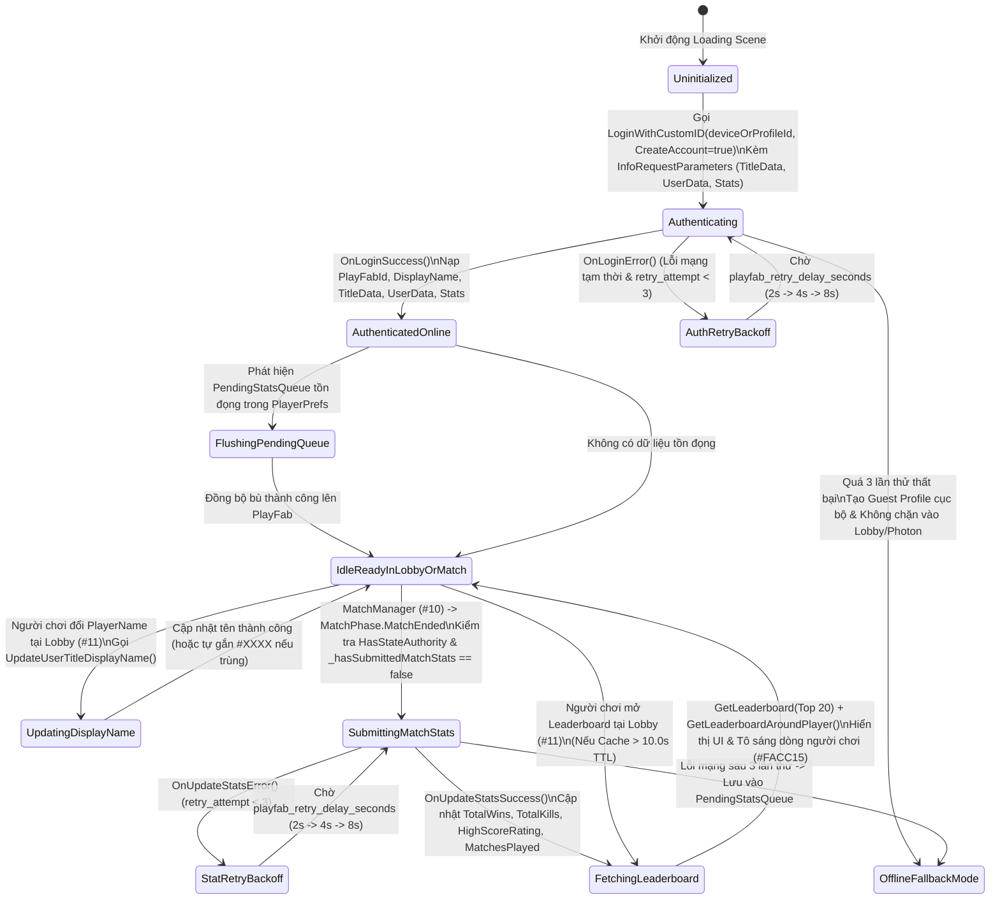

# PlayFab Cloud Identity, Stats & Leaderboard System

> **Status**: Designed
> **Creative Director Review (CD-GDD-ALIGN)**: APPROVED 2026-11-10
> **Author**: Solo Developer + Studio Agents (`systems-designer`, `network-engineer`, `ui-programmer`, `creative-director`, `qa-lead`)
> **Last Updated**: 2026-11-10
> **Last Verified**: 2026-11-10
> **Implements Pillar**: Pillar 4 (Khán Đài Hồn Ma & Vinh Quang Bảng Vàng — Cloud Persistence & Competitive Glory) & Pillar 3 (Công Bằng Mạng Tuyệt Đối Trên Shared Mode)

## Summary

**PlayFab Cloud Identity, Stats & Leaderboard System (`PlayFabCloudService` & `LeaderboardUIManager`)** là hệ thống định danh đám mây, lưu trữ hồ sơ bền vững và bảng xếp hạng toàn cầu ở tầng **Polish (`Alpha`)** của *Capsule Arena: Last Man Standing*, tích hợp trực tiếp **PlayFab C# SDK** để khép kín vòng lặp tiến trình dài hạn (**Pillar 4: Vinh Quang Bảng Vàng**). Người chơi cảm nhận trực tiếp hệ thống này ngay từ khoảnh khắc đăng nhập tự động không cần mật khẩu tại **Loading Scene**, thông điệp chào mừng mùa giải động (`SeasonBannerText`) tại **Lobby (`#11`)**, thông báo xác nhận **`+1 TotalWins` / `+Kills` Synced to Cloud** đầy tự hào ngay khi trận đấu sinh tồn kết thúc (`MatchPhase.MatchEnded`), và bảng vinh danh **Top 20 Đấu Sĩ Toàn Cầu (`PlayFab Leaderboard`)** với dòng tên của chính mình được tô sáng rực rỡ bằng sắc Vàng Kim (`#FACC15`). Hệ thống tồn tại nhằm biến mỗi chiến thắng kịch tính trong trận đấu 3–5 phút thành di sản cạnh tranh lâu dài trên đám mây, đồng thời đảm bảo khả năng kiểm thử nhiều cửa sổ trên cùng một máy PC (`Multi-Instance CustomId Resolution`) và cơ chế vận hành dự phòng ngoại tuyến (`Offline Fallback Mode`) không bao giờ chặn luồng vào trận **Photon Fusion 2 (`GameMode.Shared`)**.

> **Quick reference** — Layer: `Polish` · Priority: `Alpha` · Key deps: `Last Man Standing Match Manager & Authority Failover System`, `In-Game Keybinding Rebind UI & Lobby Flow UI (inferred)`

## Overview

Trong một tựa game đấu trường sinh tồn nhiều người chơi (**3D Multiplayer Arena Last Man Standing**), kỹ năng phản xạ lăn né đạn (`Q`/`E`), lướt áp sát (`Forward Dash [2]`) và tung đòn chém xoay người $90^\circ$ (`1`/`3`) mang lại sự phấn khích tức thời trong vòng lặp 30 giây, nhưng chính **hệ thống lưu danh và xếp hạng đám mây** mới là động lực giữ chân người chơi quay lại chinh phục từng ván đấu tiếp theo. **PlayFab Cloud Identity, Stats & Leaderboard System (`System #13`)** đóng vai trò là cầu nối bất đồng bộ giữa phiên mô phỏng mạng thời gian thực của **Photon Fusion 2 (`System #4` & `System #10`)** và cơ sở dữ liệu đám mây **Microsoft Azure PlayFab**.

Hệ thống được kiến trúc xoay quanh 4 trụ cột chức năng gắn kết chặt chẽ:
1. **Đăng nhập Định danh Bất đồng bộ Đa Thực thể (`PlayFab Auth & Multi-Instance Identity`):** Ngay tại **Loading Scene** đầu game (song song với quá trình nạp `keybinding.json` của `System #3`), hệ thống tự động gọi `PlayFabClientAPI.LoginWithCustomID` với cờ `CreateAccount = true` và gói `InfoRequestParameters` gộp (`GetUserAccountInfo`, `GetTitleData`, `GetUserData`, `GetPlayerStatistics`) để hoàn tất xác thực chỉ trong 1 vòng gọi HTTP duy nhất. Đặc biệt, thuật toán sinh `CustomId` hỗ trợ tự động phân tách định danh theo tham số dòng lệnh (`--profile_N`), nhánh clone của **ParrelSync**, hoặc chỉ số cửa sổ Build độc lập, cho phép nhà phát triển mở 2–4 cửa sổ game trên cùng một máy PC để kiểm thử Multiplayer mà mỗi cửa sổ vẫn sở hữu một tài khoản `PlayFabId` riêng biệt. Khi người chơi đổi tên `PlayerName` tại màn hình **Lobby (`System #11`)**, hệ thống đồng bộ tức thì lên đám mây qua `PlayFabClientAPI.UpdateUserTitleDisplayName`.
2. **Đồng bộ Dữ liệu Đám mây (`TitleData` & `UserData` Synchronization):** Ngay sau khi đăng nhập, hệ thống trích xuất `TitleData` (chứa thông điệp mùa giải `SeasonBannerText`, phiên bản tối thiểu `MinSupportedGameVersion`, hệ số điểm vinh quang `SeasonalGloryMultiplier`) để hiển thị lên màn hình **Lobby (`#11`)**, đồng thời nạp `UserData` cá nhân (`MatchesPlayed`, `LastSelectedRegion`, `CareerHighestKillsInMatch`) để tính toán tỷ lệ thắng sự nghiệp (`career_win_rate_percent`).
3. **Ghi nhận Thành tích Sau Trận Đấu Dưới Quyền `StateAuthority` (`Match-End Stat Submission`):** Khi **Hệ thống #10 (`MatchManager`)** chuyển sang pha `MatchPhase.MatchEnded` và phát `Rpc_AnnounceMatchResult`, mỗi máy Client kiểm tra nhân vật cục bộ có `Object.HasStateAuthority == true` (`Runner.LocalPlayer`) để gửi kết quả thực tế của chính mình trong ván đó lên PlayFab thông qua `PlayFabClientAPI.UpdatePlayerStatistics` (cập nhật `TotalWins`, `TotalKills`, `HighScoreRating`) và `UpdateUserData` (`MatchesPlayed + 1`). Toàn bộ tiến trình gửi điểm được bảo vệ bởi khóa chống trùng lặp một lần mỗi trận (`_hasSubmittedMatchStats`) và thuật toán tự động thử lại theo cấp số nhân (`Exponential Backoff Retry` tối đa `3 lần`) nếu đường truyền Internet chập chờn.
4. **Bảng Xếp Hạng Vinh Danh Toàn Cầu (`PlayFab Global & Around-Player Leaderboard UI`):** Cung cấp giao diện bảng xếp hạng 3 chế độ lọc (`TotalWins`, `TotalKills`, `HighScoreRating`) kết hợp dữ liệu từ `PlayFabClientAPI.GetLeaderboard` (`Top 20`) và `PlayFabClientAPI.GetLeaderboardAroundPlayer` (vị trí thực tế của người chơi hiện tại). Bảng xếp hạng tự động mở ra hoặc cập nhật trên màn hình **Tổng kết cuối trận (`Victory / Match Summary Screen — System #8`)** và có thể truy cập bất cứ lúc nào từ **Lobby (`System #11`)** với cơ chế bộ nhớ đệm (`10.0s TTL Cache`) chống quá tải API.

## Player Fantasy

> **System Framing:** `[A] Direct & [B] Indirect — Người chơi trực tiếp chiêm ngưỡng tên tuổi, thứ hạng, tổng số trận thắng (TotalWins) và tổng mạng hạ gục (TotalKills) của mình trên Bảng Vàng PlayFab, đồng thời thụ hưởng sự tiện lợi vô hình của cơ chế đăng nhập tự động không mật khẩu và đồng bộ đám mây ngầm.`

### 1. Giấc mơ cốt lõi: "Chiến Công Khắc Ghi Lên Bảng Vàng — Từ Đấu Sĩ Vô Danh Thành Huyền Thoại Đấu Trường"
Trong *Capsule Arena: Last Man Standing*, mỗi ván đấu sinh tồn là một cuộc đấu trí căng thẳng nơi chỉ duy nhất 1 người bước ra với tư cách **Nhà Vô Địch (`Last Man Standing`)**. Nếu chiến thắng đó chỉ hiện lên vài giây rồi biến mất khi chuyển sang ván mới, niềm vui chiến thắng sẽ nhanh chóng phai nhạt. **PlayFab Cloud Identity, Stats & Leaderboard System** hiện thực hóa giấc mơ lớn nhất của người chơi cạnh tranh (**Pillar 4**): **mọi giọt mồ hôi, mọi pha lăn né đạn sinh tử ở 10 HP cuối cùng và mọi nhát kiếm kết liễu đều được khắc ghi vĩnh viễn trên Bảng Vàng Toàn Cầu**.

Ngay khi dòng chữ **VICTORY — #1 LAST MAN STANDING!** bừng sáng, huy hiệu **`[PLAYFAB CLOUD: +1 WIN | +4 KILLS | +270 GLORY SYNCED]`** xuất hiện kèm âm thanh vinh danh trang trọng. Người chơi mở bảng **Global Leaderboard**, nhìn thấy tên đấu sĩ của mình leo từ hạng `#14` lên lọt vào **Top 3 Đấu Sĩ Vĩ Đại Nhất**, nổi bật dưới lớp viền Vàng Kim (`#FACC15`). Dù ngày mai họ mở game lại hay đối thủ khác vào sảnh chờ **Lobby (`#11`)** tra cứu bảng xếp hạng, con số `TotalWins` và `TotalKills` ấy vẫn sừng sững ở đó như một lời khẳng định đẳng cấp không thể chối cãi.

### 2. Trải nghiệm cảm giác qua từng khoảnh khắc (How the Player Experiences the Effects)
1. **Vào Game Tức Thì Không Rào Cản (`Zero-Friction Cloud Onboarding`):** Người chơi mở game tại **Loading Scene**, không cần phải điền biểu mẫu đăng ký email hay mật khẩu rườm rà. Chỉ trong chưa đầy 1 giây, hệ thống đã tự động định danh thiết bị/hồ sơ qua PlayFab, tải xong tên đấu sĩ quen thuộc, thông báo mùa giải từ `TitleData` và sẵn sàng đưa họ vào sảnh chờ **Lobby**.
2. **Định Danh Cá Nhân Độc Bản (`Seamless DisplayName Sync`):** Khi người chơi gõ một cái tên mới đầy khí chất tại **Lobby (`#11`)** (ví dụ: `"BladeMaster_VN"`), tên đó không chỉ hiện trên thanh máu **Overhead Billboard (`100/100`)** trong trận đấu Photon mà còn lập tức được cập nhật lên máy chủ PlayFab qua `UpdateUserTitleDisplayName`, đồng bộ hóa danh tính của họ trên bảng xếp hạng toàn cầu.
3. **Khoảnh Khắc Thăng Hạng Cuối Trận (`Post-Match Rank Climb Euphoria`):** Kết thúc ván đấu 4 phút nghẹt thở, ngay trên màn hình tổng kết, bảng **PlayFab Leaderboard** tự động làm mới. Người chơi thấy số `TotalWins` và `TotalKills` của mình nhảy số tăng lên theo hiệu ứng đếm số (`DOTween Counter Roll`), kéo theo thứ hạng cá nhân tăng bậc ngay trước mắt.
4. **Sự An Tâm Tuyệt Đối Trước Sự Cố Mạng (`Resilient Cloud Sync & Offline Fallback`):** Kể cả khi mạng Wi-Fi chập chờn đúng giây phút trao cúp, biểu tượng xoay đồng bộ nhỏ góc màn hình tự động thử lại ngầm (`Exponential Backoff Retry`) và báo **"Đã lưu thành tích lên Đám mây!"** chỉ vài giây sau đó — không bao giờ làm mất đi chiến thắng quý giá của người chơi.

### 3. Điểm chạm Tham chiếu & Đối chiếu Trụ cột Thiết kế

| Điểm tham chiếu / Trụ cột | Cách `PlayFab Cloud Identity, Stats & Leaderboard System` hiện thực hóa trải nghiệm người chơi |
| :--- | :--- |
| ***Brawl Stars / Apex Legends*** *(Post-Match Stat Progression & Trophy Climb)* | Hiển thị trực quan lượng điểm vinh quang (`match_glory_points`), số mạng hạ gục (`+Kills`) và trận thắng (`+1 TotalWins`) được cộng dồn ngay trên màn hình tổng kết cuối trận. |
| ***Rocket League / Fall Guys*** *(Frictionless Device/Platform Auto-Login)* | Sử dụng `LoginWithCustomID` kết hợp `InfoRequestParameters` để đăng nhập ngầm trong 1 bước tại Loading Scene mà không bắt người chơi tạo tài khoản thủ công. |
| **Pillar 4 (Khán Đài Hồn Ma & Vinh Quang Bảng Vàng)** | Hiện thực hóa nửa sau của Pillar 4: lưu trữ bền vững `Player Data`, `Title Data` và vinh danh Top đấu sĩ trên `PlayFab Leaderboard` theo cả 3 tiêu chí `TotalWins`, `TotalKills` và `HighScoreRating`. |
| **Pillar 3 (Công Bằng Mạng Tuyệt Đối Trên Shared Mode)** | Chỉ gửi chỉ số từ nhân vật cục bộ có `Object.HasStateAuthority == true` khi `MatchManager` chính thức công bố kết quả (`MatchPhase.MatchEnded`), kèm khóa chống gửi trùng lặp (`_hasSubmittedMatchStats`). |

## Detailed Design

### Core Rules

1. **Quy tắc Đăng Nhập Định Danh Bất Đồng Bộ Đa Thực Thể (`PlayFab Auth & Multi-Instance CustomId Resolution Rule`):**
   - Ngay khi khởi động **Loading Scene** (`Boot/Loading`), dịch vụ `PlayFabCloudService` (tồn tại xuyên suốt các Scene với `DontDestroyOnLoad`) tự động khởi tạo tiến trình đăng nhập bất đồng bộ thông qua `PlayFabClientAPI.LoginWithCustomID`.
   - **Quy tắc phân giải `CustomId` hỗ trợ kiểm thử Multiplayer nhiều cửa sổ trên cùng 1 máy PC (`Multi-Instance Safe Identity`):**
     - Nếu gọi thẳng `SystemInfo.deviceUniqueIdentifier` mặc định, khi mở 2–4 cửa sổ game trên cùng 1 máy PC để test phòng **Photon Fusion 2 (`GameMode.Shared`)**, tất cả các cửa sổ sẽ đăng nhập vào cùng 1 tài khoản PlayFab duy nhất, dẫn đến ghi đè `DisplayName` và trộn lẫn chỉ số `TotalWins`/`TotalKills`.
     - Do đó, hàm `ResolvePlayFabCustomId()` **bắt buộc** ghép chuỗi định danh theo thứ tự ưu tiên 3 tầng:
       1. **Tham số dòng lệnh (`Command-Line Profile Argument`):** Quét `System.Environment.GetCommandLineArgs()` tìm cờ `--profile_N` (ví dụ: `--profile_1`, `--profile_2`). Nếu có, tạo `CustomId = $"{SystemInfo.deviceUniqueIdentifier}_PROF_{profileIndex}"`.
       2. **Môi trường Editor / ParrelSync Clone (`Editor & ParrelSync Isolation`):** Nếu đang chạy trong Unity Editor hoặc bản clone ParrelSync, băm (`MD5/SHA256` rút gọn 8 ký tự) đường dẫn thư mục dự án `Application.dataPath` để tạo `CustomId = $"{SystemInfo.deviceUniqueIdentifier}_PATH_{dataPathHash8}"`.
       3. **Định danh Hồ sơ Cục bộ cho Bản Build Độc lập (`Standalone Multi-Window Instance Index`):** Khi chạy nhiều tiến trình `.exe` trên cùng 1 máy mà không truyền tham số dòng lệnh, hệ thống kiểm tra khóa `Mutex` tên định danh hoặc hậu tố hồ sơ trong `Lobby` để tự động gán hậu tố `_INST_0`, `_INST_1`, `_INST_2`... đảm bảo mỗi cửa sổ có `CustomId` dài từ `16` đến `64` ký tự ASCII hợp lệ và hoàn toàn tách biệt trên PlayFab.
   - **Gói yêu cầu thông tin gộp (`Combined InfoRequestParameters`):** Trong `LoginWithCustomIDRequest`, hệ thống thiết lập `CreateAccount = true` và bật `InfoRequestParameters = new GetPlayerCombinedInfoRequestParams { GetUserAccountInfo = true, GetTitleData = true, GetUserData = true, GetPlayerStatistics = true }` nhằm lấy toàn bộ dữ liệu tài khoản, `TitleData`, `UserData` và các chỉ số hiện tại chỉ trong **1 lượt gọi HTTP duy nhất** lúc khởi động.

2. **Quy tắc Đồng Bộ Tên Hiển Thị Đấu Sĩ (`DisplayName Synchronization & Collision Handling Rule`):**
   - Sau khi đăng nhập thành công, nếu tài khoản PlayFab đã có `TitleInfo.DisplayName` hợp lệ, hệ thống đồng bộ tên này sang **Hệ thống #11 (`Lobby UI`)** làm tên mặc định cho đấu sĩ. Ngược lại, nếu tài khoản mới tạo chưa có `DisplayName`, hệ thống khởi tạo tên mặc định dạng `"Gladiator_" + PlayFabId.Substring(0, 4)` và gọi `PlayFabClientAPI.UpdateUserTitleDisplayName`.
   - Bất cứ khi nào người chơi thay đổi `PlayerName` (`3–16` ký tự) tại màn hình **Lobby (`System #11`)** và nhấn xác nhận / vào phòng:
     - Hệ thống kiểm tra nếu tên mới khác với `CachedDisplayName` hiện tại thì gọi bất đồng bộ `PlayFabClientAPI.UpdateUserTitleDisplayName(new UpdateUserTitleDisplayNameRequest { DisplayName = sanitizedName }, OnDisplayNameSuccess, OnDisplayNameError)`.
     - Nếu PlayFab trả về lỗi `PlayFabErrorCode.NameNotAvailable` (trùng tên với người chơi khác trên Title), hệ thống tự động nối thêm hậu tố định danh 4 ký tự cuối của `PlayFabId` (ví dụ: `"Knight#A9F2"`, cắt gọn đảm bảo tổng độ dài `<= 16` ký tự cho khớp với `NetworkString<_16>` của `System #10` và yêu cầu `3–25` ký tự của PlayFab) và gửi lại yêu cầu cập nhật tên.

3. **Quy tắc Đồng Bộ Dữ Liệu Đám Mây (`TitleData` & `UserData` Schema Contract):**
   - **Dữ liệu Cấu hình Trò chơi Toàn cục (`TitleData` — Chỉ đọc từ PlayFab Game Manager qua `GetTitleDataRequest`):**
     - Được nạp tự động lúc đăng nhập (hoặc gọi làm mới qua `PlayFabClientAPI.GetTitleData(new GetTitleDataRequest(), ...)` khi quay về Lobby).
   - **Dữ liệu Hồ sơ Cá nhân Người chơi (`UserData` — Đọc/Ghi qua `GetUserDataRequest` & `UpdateUserDataRequest`):**
     - Lưu trữ dưới dạng cặp khóa–giá trị (`Key-Value JSON/String`) gắn với từng `PlayFabId`.
   - **Bảng Đặc Tả Các Khóa `TitleData`, `UserData` và `PlayerStatistics` Trên PlayFab:**

| Phân Loại Dữ Liệu | Tên Khóa (`Key` / `StatisticName`) | Kiểu Dữ Liệu / Quy Tắc Cộng Dồn | Giá Trị Mặc Định | Ý Nghĩa Ngữ Nghĩa & Hệ Thống Tiêu Thụ |
| :--- | :--- | :---: | :---: | :--- |
| **`TitleData`** *(Read-Only)* | `SeasonBannerText` | `string` | `"SEASON 1: CAPSULE ARENA CHAMPIONSHIP"` | Thông điệp chào mừng mùa giải / thông báo sự kiện hiển thị trên dải băng đầu màn hình **Lobby (`#11`)**. |
| **`TitleData`** *(Read-Only)* | `MinSupportedGameVersion` | `string` | `"1.0.0"` | Phiên bản client tối thiểu được phép đấu xếp hạng; đối chiếu với `Application.version` khi khởi động. |
| **`TitleData`** *(Read-Only)* | `SeasonalGloryMultiplier` | `float` (chuỗi số) | `"1.0"` | Hệ số nhân điểm vinh quang theo sự kiện cuối tuần (`1.0` đến `2.0`). |
| **`UserData`** *(Read/Write)* | `MatchesPlayed` | `int` (chuỗi số) | `"0"` | Tổng số trận đấu người chơi đã hoàn thành; cộng `+1` sau mỗi trận (`MatchEnded`) để tính tỷ lệ thắng `career_win_rate_percent`. |
| **`UserData`** *(Read/Write)* | `CareerBestKillsSingleMatch` | `int` (chuỗi số) | `"0"` | Kỷ lục cá nhân về số mạng hạ gục cao nhất đạt được trong 1 ván đấu duy nhất (`0–7`). |
| **`UserData`** *(Read/Write)* | `PreferredPhotonRegion` | `string` | `"asia"` | Khu vực máy chủ Photon yêu thích gần nhất của người chơi, tự động điền sẵn cho Dropdown Region tại **Lobby (`#11`)**. |
| **`PlayerStatistics`** *(Leaderboard)* | `TotalWins` | `int` (`Aggregation: Sum`) | `0` | Tổng số trận giành ngôi vô địch **Last Man Standing (`#1`)**; cộng `+1` khi `Runner.LocalPlayer == WinnerPlayer`. |
| **`PlayerStatistics`** *(Leaderboard)* | `TotalKills` | `int` (`Aggregation: Sum`) | `0` | Tổng số mạng hạ gục tích lũy xuyên suốt sự nghiệp; cộng `+matchKills` sau mỗi ván đấu. |
| **`PlayerStatistics`** *(Leaderboard)* | `HighScoreRating` | `int` (`Aggregation: Sum`) | `0` | Tổng điểm vinh quang xếp hạng tích lũy (`match_glory_points`) phản ánh toàn diện cả chiến thắng, số mạng hạ gục và thứ hạng sinh tồn. |

4. **Quy tắc Ghi Nhận Thành Tích Sau Trận Đấu Dưới Quyền `StateAuthority` (`Match-End Stat Submission & Anti-Duplicate Guard`):**
   - Khi **Hệ thống #10 (`MatchManager`)** chuyển sang pha `CurrentPhase == MatchPhase.MatchEnded` và phát thông báo `Rpc_AnnounceMatchResult(PlayerRef winner, int winnerKills, MatchEndReason reason)` (hoặc phát sự kiện C# `OnMatchEndedForStats`), quy trình gửi chỉ số lên PlayFab được kích hoạt trên từng máy Client theo đúng nguyên tắc phân quyền của **Photon Fusion 2 (`GameMode.Shared`)**:
     - **Kiểm tra Quyền Sở Hữu Cục Bộ (`StateAuthority` / `LocalPlayer` Verification):** Mỗi máy Client chỉ được phép đọc và gửi kết quả của chính nhân vật thuộc quyền điều khiển cục bộ của mình (`Runner.LocalPlayer`, tương ứng với nhân vật đấu sĩ có `Object.HasStateAuthority == true` trên máy đó). Tuyệt đối không có chuyện một máy gửi thay chỉ số `PlayerStatistics` cho tài khoản PlayFab của máy khác.
     - **Khóa Chống Gửi Trùng Lặp Một Lần Mỗi Trận (`Single-Commit Guard`):** Dịch vụ `PlayFabCloudService` duy trì cờ trạng thái `_hasSubmittedMatchStats` (kiểu `bool`) cùng mã định danh ván đấu `_lastSubmittedMatchSequenceId` (kiểu `int`).
       - Ngay khi bắt đầu xử lý kết quả của pha `MatchEnded`, nếu `_hasSubmittedMatchStats == true` thì hàm thoát ngay lập tức (`return;`).
       - Nếu `_hasSubmittedMatchStats == false`, hệ thống lập tức gán `_hasSubmittedMatchStats = true` **trước khi** thực hiện lời gọi mạng bất đồng bộ, và cờ này chỉ được đặt lại về `false` khi `MatchManager` chuyển sang `MatchPhase.PreMatchCountdown` hoặc `MatchPhase.ActiveCombat` của ván đấu mới.
     - **Đóng gói và Gửi Chỉ Số (`PlayFabClientAPI.UpdatePlayerStatistics`):**
       - Trích xuất hồ sơ cá nhân từ `MatchManager.PlayerRecords[Runner.LocalPlayer]`:
         - `isWinner = (Runner.LocalPlayer == MatchManager.WinnerPlayer) ? 1 : 0`
         - `matchKills = localRecord.Kills` (`0..7`)
         - `finalPlacement = (isWinner == 1) ? 1 : clamp(localRecord.FinalPlacement, 2, 8)`
       - Tính điểm vinh quang trận đấu `match_glory_points` theo Công thức #1.
       - Tạo danh sách `List<StatisticUpdate>` cho `UpdatePlayerStatisticsRequest`:
         - Nếu `isWinner == 1`: thêm `new StatisticUpdate { StatisticName = "TotalWins", Value = 1 }` (do cấu hình `Aggregation: Sum` trên PlayFab Server, gửi giá trị delta `1` sẽ tự động cộng thêm `+1` vào tổng số trận thắng hiện có trên đám mây; hoặc nếu cấu hình `Last` thì gửi `CachedTotalWins + 1` — thiết kế chuẩn hóa dùng `Aggregation: Sum` trên PlayFab kết hợp cập nhật bộ đệm cục bộ `CachedTotalWins += 1`).
         - Nếu `matchKills > 0`: thêm `new StatisticUpdate { StatisticName = "TotalKills", Value = matchKills }`.
         - Nếu `match_glory_points > 0`: thêm `new StatisticUpdate { StatisticName = "HighScoreRating", Value = match_glory_points }`.
       - Đồng thời gọi `PlayFabClientAPI.UpdateUserData` để tăng `MatchesPlayed = (CachedMatchesPlayed + 1).ToString()` và cập nhật `CareerBestKillsSingleMatch` nếu `matchKills > CachedBestKills`.

5. **Quy tắc Tự Động Thử Lại Theo Cấp Số Nhân & Hàng Đợi Bù Ngoại Tuyến (`Exponential Backoff Retry & Offline Pending Queue`):**
   - Mọi yêu cầu ghi dữ liệu quan trọng lên PlayFab (`LoginWithCustomID`, `UpdatePlayerStatistics`, `UpdateUserData`, `UpdateUserTitleDisplayName`) đều được bọc trong bộ điều phối thử lại `PlayFabRetryExecutor`:
     - Nếu lời gọi API thất bại do lỗi mạng tạm thời (`ServiceUnavailable`, `ConnectionError`, `Timeout`, HTTP `5xx` hoặc `429`), hệ thống tự động chờ một khoảng thời gian tính theo Công thức #2 (`playfab_retry_delay_seconds = min(16.0, base_retry_delay * (2 ^ retry_attempt))`) rồi thử gửi lại, tối đa **`MaxRetryAttempts = 3` lần** (`2.0s` $\rightarrow$ `4.0s` $\rightarrow$ `8.0s`).
     - Nếu sau cả 3 lần thử lại mà kết nối PlayFab vẫn không phản hồi, gói chỉ số vừa đạt được (`PendingWinsDelta`, `PendingKillsDelta`, `PendingGloryDelta`, `PendingMatchesPlayedDelta`) được tuần tự hóa an toàn xuống `PlayerPrefs` (`Key: "PF_PendingStatsQueue_ ProfileId"`). Ngay khi kết nối PlayFab khôi phục ở ván sau hoặc lần mở game kế tiếp, hệ thống tự động đẩy (`Flush`) toàn bộ lượng chỉ số tồn đọng này lên đám mây trước khi tải bảng xếp hạng.

6. **Quy tắc Truy Vấn Bảng Xếp Hạng Toàn Cầu & Tô Sáng Vị Trí Bản Thân (`Global & Around-Player Leaderboard Rules`):**
   - Hệ thống hỗ trợ 3 tab bảng xếp hạng chuyển đổi tức thì trên UI:
     1. **Tab `TOP WINS` (`StatisticName = "TotalWins"`):** Xếp hạng theo tổng số lần giành chiến thắng **Last Man Standing (`#1`)**.
     2. **Tab `TOP KILLS` (`StatisticName = "TotalKills"`):** Xếp hạng theo tổng số mạng hạ gục tích lũy.
     3. **Tab `GLORY RATING` (`StatisticName = "HighScoreRating"`):** Xếp hạng theo tổng điểm vinh quang sự nghiệp.
   - Khi mở bảng xếp hạng (tự động ở màn hình **Tổng kết cuối trận `MatchEnded`** sau khi `UpdatePlayerStatistics` trả về kết quả thành công, hoặc khi người chơi bấm nút **"LEADERBOARD / BẢNG VÀNG"** tại **Lobby `#11`**):
     - Hệ thống gọi `PlayFabClientAPI.GetLeaderboard(new GetLeaderboardRequest { StatisticName = activeStatName, StartPosition = 0, MaxResultsCount = 20 })` để lấy danh sách **Top 20 đấu sĩ dẫn đầu toàn cầu**.
     - Nếu `PlayFabId` của người chơi hiện tại đã nằm trong danh sách Top 20 trả về, dòng tương ứng trong danh sách được đánh dấu `IsLocalPlayerRow = true` và tô sáng bằng nền **Vàng Kim (`#FACC15` ở độ trong suốt `25%` + viền `#FACC15` dày `2px`)**.
     - Nếu người chơi hiện tại nằm ngoài Top 20 (ví dụ hạng `#45`), hệ thống gọi bổ sung `PlayFabClientAPI.GetLeaderboardAroundPlayer(new GetLeaderboardAroundPlayerRequest { StatisticName = activeStatName, MaxResultsCount = 1 })` và ghim cố định dòng thông tin thứ hạng của chính người chơi ở thanh chân bảng (**Pinned Footer Row: `HẠNG CỦA BẠN: #45 — TênĐấuSĩ — X Wins`**) cũng với sắc Vàng Kim `#FACC15`.
   - **Cơ chế Bộ nhớ đệm Chống Spam API (`10.0s Leaderboard Cache TTL`):** Kết quả của mỗi tab `StatisticName` được lưu đệm trong bộ nhớ RAM kèm dấu thời gian `LastFetchRealtimeSinceStartup`. Nếu người chơi chuyển tab qua lại hoặc bấm nút **"Làm mới (Refresh)"** liên tục khi chưa qua `LeaderboardCacheTTL = 10.0s` (và không có sự kiện cập nhật chỉ số mới sau trận đấu), UI hiển thị ngay lập tức dữ liệu từ bộ đệm mà không phát sinh lệnh gọi HTTP mới lên PlayFab.

### States and Transitions

Hệ thống `PlayFabCloudService` vận hành qua máy trạng thái bất đồng bộ gồm 2 luồng chính: (1) Luồng Định danh & Đồng bộ Hồ sơ Khởi động, và (2) Luồng Ghi nhận Thành tích Cuối trận & Tải Bảng Xếp Hạng.

### Interactions with Other Systems

| Hệ Thống Liên Quan | Chiều Tương Tác | Cơ Chế Giao Tiếp Kỹ Thuật (Events / APIs / Data Contracts) |
| :--- | :---: | :--- |
| **System #10: Last Man Standing Match Manager & Authority Failover System** | **Upstream (`#10` $\rightarrow$ `#13`)** | Khi trận đấu chuyển sang `CurrentPhase == MatchPhase.MatchEnded` và phát `Rpc_AnnounceMatchResult(PlayerRef winner, int winnerKills, MatchEndReason reason)`, `#10` kích hoạt sự kiện `OnMatchEndedForStats`. `#13` đọc `MatchManager.WinnerPlayer` và `MatchManager.PlayerRecords[Runner.LocalPlayer]` (chỉ cho nhân vật có `Object.HasStateAuthority == true` của máy cục bộ) để gửi `+1 TotalWins`, `+Kills` và `+match_glory_points` lên PlayFab. Khi `#10` chuyển sang `PreMatchCountdown`, `#13` reset cờ `_hasSubmittedMatchStats = false`. |
| **System #11: In-Game Keybinding Rebind UI & Lobby Flow UI (inferred)** | **Bidirectional (`#11` $\leftrightarrow$ `#13` qua Service Interface)** | Tại **Lobby Scene**, `#11` đọc `SeasonBannerText` (`TitleData`), `CachedDisplayName`, `CareerWinRatePercent` và các chỉ số cá nhân từ `IPlayFabCloudService` để hiển thị trên bảng Hồ sơ Đấu sĩ. Khi người chơi sửa ô nhập `PlayerName` ở Lobby, `#11` gọi `IPlayFabCloudService.UpdateDisplayNameAsync(newName)`. Khi người chơi bấm nút **"Bảng Xếp Hạng (Leaderboard)"** tại Lobby, `#11` bật cửa sổ `LeaderboardModalCanvasGroup` của `#13`. |
| **System #8: Combat HUD, Overhead Billboard & Mobile Action Pad UI** | **Downstream (`#13` $\rightarrow$ `#8`)** | Trên màn hình **Tổng kết cuối trận (`Match Result Overlay`)** trong `12.0s` của pha `MatchEnded`, `#13` cung cấp trạng thái đồng bộ đám mây (`"Đang lưu thành tích lên PlayFab..."` $\rightarrow$ `"+1 WIN & +K KILLS ĐÃ LƯU LÊN BẢNG VÀNG!"`) và nhúng trực tiếp bảng xếp hạng `PlayFab Leaderboard` rút gọn / nút mở rộng ngay cạnh bảng điểm phòng đấu. |
| **System #4: Photon Fusion 2 Shared Mode Session & Object Pool System** | **Peer (`#13` $\rightarrow$ `#4`)** | Định danh `PlayFabId` và `DisplayName` đã xác thực từ `#13` (hoặc tên tạm ở `OfflineFallbackMode`) được truyền sang `#4` khi khởi tạo phiên `NetworkRunner.StartGame` để đăng ký tên đấu sĩ đồng bộ vào `PlayerMatchRecord.PlayerName` (`NetworkString<_16>`) và hiển thị trên thanh máu **Overhead Billboard (`#8`)**. |
| **System #3: Keybinding & Input Management System (`InputFocusManager`)** | **Downstream (`#13` $\rightarrow$ `#3`)** | Khi người chơi mở bảng xếp hạng toàn màn hình (`LeaderboardModalCanvasGroup`) trong lúc đang ở trong trận đấu hoặc ở chế độ `GhostSpectating`, `#13` thông báo cho `InputFocusManager` khóa thao tác chuột/phím chiến đấu hoặc cho phép đóng nhanh bằng phím `ESC`. |

## Formulas

### 1. Điểm Vinh Quang Tổng Hợp Sau Mỗi Trận Đấu (`match_glory_points`)

The `match_glory_points` formula is defined as:

`match_glory_points = (is_winner * 100) + (match_kills * 25) + max(0, (8 - final_placement) * 10)`

**Variables:**

| Variable | Type | Range | Source | Description |
| :--- | :---: | :---: | :--- | :--- |
| `is_winner` | `int` | `0` hoặc `1` | `MatchManager.WinnerPlayer == Runner.LocalPlayer ? 1 : 0` (`System #10`) | Cờ nhị phân xác định người chơi cục bộ có phải là Nhà Vô Địch (`Last Man Standing`) của ván đấu hay không (`1` nếu thắng, `0` nếu bị loại). |
| `match_kills` | `int` | `0–7` | `MatchManager.PlayerRecords[Runner.LocalPlayer].Kills` (`System #10`) | Tổng số mạng hạ gục hợp lệ mà người chơi cục bộ đạt được trong ván đấu vừa kết thúc. |
| `final_placement` | `int` | `1–8` | `MatchManager.PlayerRecords[Runner.LocalPlayer].FinalPlacement` (`System #10`) | Thứ hạng sinh tồn chung cuộc của người chơi trong ván đấu (`1` là Vô địch, `2` là Á quân, ..., `8` là bị loại đầu tiên). |
| `match_glory_points` | `int` | `0–345` | Hàm `CalculateMatchGloryPoints()` trong `PlayFabCloudService` | Lượng điểm vinh quang tổng hợp đạt được trong trận đấu, dùng để gửi cộng dồn lên bảng xếp hạng `HighScoreRating` của PlayFab. |

**Output Range:** `0` đến `345` điểm mỗi trận đấu.

**Example:**
- **Trường hợp 1 (Nhà Vô Địch toàn diện):** Đấu sĩ A giành chiến thắng chung cuộc (`is_winner = 1`, `final_placement = 1`) và hạ gục được `4` đối thủ (`match_kills = 4`):
  `match_glory_points = (1 * 100) + (4 * 25) + max(0, (8 - 1) * 10) = 100 + 100 + 70 = 270 điểm`.
- **Trường hợp 2 (Á quân giao tranh năng nổ):** Đấu sĩ B về nhì (`is_winner = 0`, `final_placement = 2`) và hạ gục được `2` đối thủ (`match_kills = 2`):
  `match_glory_points = (0 * 100) + (2 * 25) + max(0, (8 - 2) * 10) = 0 + 50 + 60 = 110 điểm`.
- **Trường hợp 3 (Bị loại đầu tiên ở phòng 8 người và không có mạng hạ gục):** Đấu sĩ C xếp hạng `#8` (`is_winner = 0`, `final_placement = 8`, `match_kills = 0`):
  `match_glory_points = (0 * 100) + (0 * 25) + max(0, (8 - 8) * 10) = 0 + 0 + 0 = 0 điểm`.

---

### 2. Thời Gian Chờ Thử Lại API PlayFab Khi Lỗi Mạng (`playfab_retry_delay_seconds`)

The `playfab_retry_delay_seconds` formula is defined as:

`playfab_retry_delay_seconds = min(16.0, base_retry_delay * (2 ^ retry_attempt))`

**Variables:**

| Variable | Type | Range | Source | Description |
| :--- | :---: | :---: | :--- | :--- |
| `base_retry_delay` | `float` | `1.0–2.0` (Mặc định `1.0s`) | Hằng số cấu hình `PlayFabServiceConfig.BaseRetryDelaySeconds` | Thời gian chờ cơ sở tính bằng giây trước khi nhân lũy thừa cấp số nhân. |
| `retry_attempt` | `int` | `1–3` | Bộ đếm lần thử lại hiện tại trong `PlayFabRetryExecutor` | Thứ tự lần thử lại sau khi yêu cầu HTTP đầu tiên (`attempt 0`) gặp lỗi mạng tạm thời. |
| `playfab_retry_delay_seconds` | `float` | `2.0–16.0` | Bộ định thời bất đồng bộ `Awaitable.WaitForSecondsAsync` (Unity 6.6) | Khoảng thời gian chờ chính xác bằng giây trước khi phát lại yêu cầu API lên máy chủ PlayFab. |

**Output Range:** `2.0s` đến `16.0s` (với `base_retry_delay = 1.0s` và `retry_attempt` từ `1` đến `3`, chuỗi thời gian chờ thực tế là `2.0s`, `4.0s`, `8.0s`, tổng thời gian chờ tối đa `14.0s` trước khi chuyển sang hàng đợi lưu tạm ngoại tuyến).

**Example:**
- Với `base_retry_delay = 1.0s`:
  - **Lần thử lại thứ 1 (`retry_attempt = 1`):** `playfab_retry_delay_seconds = min(16.0, 1.0 * (2 ^ 1)) = 2.0s`.
  - **Lần thử lại thứ 2 (`retry_attempt = 2`):** `playfab_retry_delay_seconds = min(16.0, 1.0 * (2 ^ 2)) = 4.0s`.
  - **Lần thử lại thứ 3 (`retry_attempt = 3`):** `playfab_retry_delay_seconds = min(16.0, 1.0 * (2 ^ 3)) = 8.0s`.

---

### 3. Tỷ Lệ Thắng Sự Nghiệp Hiển Thị Trên Bảng Hồ Sơ (`career_win_rate_percent`)

The `career_win_rate_percent` formula is defined as:

`career_win_rate_percent = (total_wins / max(1, total_matches_played)) * 100.0`

**Variables:**

| Variable | Type | Range | Source | Description |
| :--- | :---: | :---: | :--- | :--- |
| `total_wins` | `int` | `0–99999` | PlayFab Statistic `TotalWins` | Tổng số trận giành chiến thắng hạng `#1` (`Last Man Standing`) tích lũy của người chơi trên PlayFab. |
| `total_matches_played` | `int` | `0–99999` | PlayFab UserData `MatchesPlayed` | Tổng số trận đấu mà người chơi đã tham gia và hoàn thành trong sự nghiệp. |
| `career_win_rate_percent` | `float` | `0.0–100.0` | Thuộc tính hiển thị trên Hồ sơ Lobby (`#11`) & Header Leaderboard (`#13`) | Tỷ lệ phần trăm chiến thắng sự nghiệp của đấu sĩ (làm tròn 1 chữ số thập phân khi hiển thị, ví dụ `37.5%`). |

**Output Range:** `0.0%` đến `100.0%` (Hàm `max(1, total_matches_played)` bảo vệ tuyệt đối chống lỗi chia cho `0` (`DivideByZeroException` / `NaN`) khi tài khoản mới tạo chưa đấu trận nào).

**Example:**
- **Tài khoản mới tinh vừa đăng nhập lần đầu (`total_wins = 0`, `total_matches_played = 0`):**
  `career_win_rate_percent = (0 / max(1, 0)) * 100.0 = (0 / 1) * 100.0 = 0.0%`.
- **Đấu sĩ đã hoàn thành `16` trận đấu (`total_matches_played = 16`) và giành chiến thắng `6` trận (`total_wins = 6`):**
  `career_win_rate_percent = (6 / max(1, 16)) * 100.0 = 0.375 * 100.0 = 37.5%`.

## Edge Cases

- **If the developer or QA tester runs 2 to 4 instances of the game (via ParrelSync or multiple Standalone `.exe` builds) on the exact same PC to test Multiplayer**: Nếu tất cả các cửa sổ dùng chung `SystemInfo.deviceUniqueIdentifier`, chúng sẽ ghi đè cùng 1 tài khoản PlayFab. Hàm `ResolvePlayFabCustomId()` giải quyết triệt để kịch bản này bằng cách kiểm tra tham số dòng lệnh `--profile_N`, mã băm đường dẫn `Application.dataPath` (cho ParrelSync/Editor) và chỉ số thực thể `Mutex` (`_INST_0`, `_INST_1`...) cho nhiều cửa sổ Build trên cùng máy, đảm bảo cả 4 cửa sổ trên cùng 1 PC được cấp 4 `PlayFabId` độc lập 100% và xuất hiện thành 4 dòng riêng biệt trên bảng xếp hạng `PlayFab Leaderboard`.
- **If PlayFab Cloud servers are unreachable or the player's internet blocks PlayFab API calls at startup, while Photon Fusion 2 still works (`Offline Fallback Mode`)**: Sau 3 lần thử lại (`2s`, `4s`, `8s`) không thành công hoặc hết thời gian chờ khởi động tối đa tại Loading Scene, hệ thống tự động kích hoạt **`OfflineFallbackMode`**: khởi tạo hồ sơ khách cục bộ (`Guest_XXXX`), hiển thị huy hiệu nhỏ `"Chế độ Ngoại tuyến Đám mây (Offline Cloud Mode)"` ở góc Lobby, và **tuyệt đối không chặn** người chơi vào **Lobby (`#11`)** hay tham gia phòng đấu **Photon Fusion 2 (`#4`)**.
- **If the player repeatedly clicks the "Refresh Leaderboard" button or rapidly switches tabs (`TotalWins` $\leftrightarrow$ `TotalKills` $\leftrightarrow$ `HighScoreRating`) multiple times per second**: Bộ nhớ đệm `LeaderboardCache` kiểm tra dấu thời gian `Time.realtimeSinceStartup - lastFetchTime < LeaderboardCacheTTL` (`10.0s`). Mọi thao tác chuyển tab hoặc bấm làm mới trong vòng `10.0s` sẽ đọc trực tiếp từ danh sách đã lưu trong RAM (`0 HTTP requests`), đồng thời nút `"Làm mới"` hiển thị đếm ngược nhẹ (`"Làm mới (8s)"`), ngăn chặn hoàn toàn lỗi `PlayFabErrorCode.APIClientRequestRateLimitExceeded`.
- **If `Authority Failover` (`System #10`) occurs right in the middle of the `12.0s` `MatchPhase.MatchEnded` celebration window**: Khi chủ phòng cũ thoát trong lúc đang ăn mừng kết quả trận đấu và chủ phòng mới tiếp quản `MatchManager`, thuộc tính `[Networked] CurrentPhase` vẫn giữ nguyên là `MatchEnded`. Trên mọi máy khách, cờ khóa cục bộ `_hasSubmittedMatchStats == true` (đã được bật ngay ở mili-giây đầu tiên khi kết thúc trận) chặn đứng mọi lệnh gọi trùng lặp vào `UpdatePlayerStatistics`, đảm bảo người chiến thắng không bao giờ được cộng nhầm `+2 TotalWins` cho 1 ván đấu.
- **If a player enters a `PlayerName` in the Lobby (`System #11`) that is already taken by another player on PlayFab (`PlayFabErrorCode.NameNotAvailable`) or contains invalid characters**: Trước khi gọi API, hệ thống lọc bỏ ký tự đặc biệt và kẹp độ dài `3–16` ký tự. Nếu PlayFab báo lỗi `NameNotAvailable`, hệ thống tự động ghép thêm hậu tố `#` + `4` ký tự cuối của `PlayFabId` (ví dụ: `"Dragon"` $\rightarrow$ `"Dragon#7B4C"`, cắt phần gốc nếu cần để tổng độ dài `<= 16` ký tự) và gọi lại `UpdateUserTitleDisplayName` một cách liền mạch kèm thông báo nhẹ `"Tên đã có người dùng — Đã tự động gắn thẻ định danh #7B4C"`.
- **If a player loses the match early (`is_winner == 0`), finishes at rank `#8` (`final_placement == 8`), and gets `0 Kills` (`match_kills == 0`)**: Khi đó cả 3 giá trị delta cho `TotalWins` (`0`), `TotalKills` (`0`) và `HighScoreRating` (`match_glory_points == 0`) đều bằng `0`. Để tiết kiệm tài nguyên mạng, hệ thống **bỏ qua** lệnh gọi `PlayFabClientAPI.UpdatePlayerStatistics` (vì không có chỉ số bảng xếp hạng nào thay đổi), mà chỉ gọi `UpdateUserData` để cộng `+1` vào `MatchesPlayed` và tải bảng xếp hạng `GetLeaderboard` bình thường.
- **If a player joins a match late as a `Ghost Mode Spectator` (`Late Joiner` in `System #9` & `#10` who never spawned as an active combatant in that round)**: Khi ván đấu đó kết thúc (`MatchEnded`), hệ thống kiểm tra cờ `WasActiveParticipantInCurrentMatch`. Nếu người chơi chỉ vào xem với tư cách khán giả vào muộn mà chưa từng tham chiến ở pha `ActiveCombat`, hệ thống không cộng `MatchesPlayed` và không gửi `UpdatePlayerStatistics` cho ván đó, tránh làm giảm oan tỷ lệ thắng `career_win_rate_percent` của người chơi.
- **If the player's internet connection drops for 5 seconds right at the moment `MatchPhase.MatchEnded` triggers `UpdatePlayerStatistics`**: Bộ điều phối `PlayFabRetryExecutor` bắt lỗi mạng, hiển thị trạng thái `"Đang thử đồng bộ lại (Lần 1/3)..."` trên màn hình tổng kết và tự động gửi lại sau `2.0s` $\rightarrow$ `4.0s` $\rightarrow$ `8.0s`. Nếu người chơi bấm thoát về Lobby hoặc đóng game trước khi mạng khôi phục, gói điểm chiến thắng đã được ghi xuống `PlayerPrefs` (`PendingStatsQueue`) và sẽ tự động được cộng bù lên PlayFab ngay ở lần kết nối thành công tiếp theo.
- **If the player is ranked outside the Global Top 20 (e.g., Rank `#128` out of 500 players)**: Danh sách cuộn chính vẫn hiển thị đầy đủ Top 20 đấu sĩ dẫn đầu từ `GetLeaderboard(StartPosition = 0, MaxResultsCount = 20)`, đồng thời kết quả từ `GetLeaderboardAroundPlayer(MaxResultsCount = 1)` được hiển thị cố định tại thanh ghim dưới đáy bảng (**Pinned Self-Rank Bar**) với nền Vàng Kim `#FACC15` để người chơi luôn biết chính xác vị trí `#128` và điểm số hiện tại của mình.

## Dependencies

### Upstream Dependencies (Hệ thống này phụ thuộc vào)

| Hệ Thống Thượng Nguồn | Loại Phụ Thuộc | Hợp Đồng Giao Tiếp & Dữ Liệu Đầu Vào |
| :--- | :---: | :--- |
| **System #10: Last Man Standing Match Manager & Authority Failover System** | **Hard (Alpha)** | Cung cấp sự kiện kết thúc trận đấu (`MatchPhase.MatchEnded` / `Rpc_AnnounceMatchResult`), định danh `WinnerPlayer`, và bảng điểm `PlayerRecords[Runner.LocalPlayer]` (`Kills`, `FinalPlacement`, `IsAlive`). |
| **System #11: In-Game Keybinding Rebind UI & Lobby Flow UI (inferred)** | **Hard (Alpha)** | Cung cấp sự kiện người chơi đổi tên `PlayerName` tại Lobby, vùng hiển thị thông báo `SeasonBannerText` (`TitleData`), và nút bấm mở bảng xếp hạng `PlayFab Leaderboard` tại sảnh chờ. |
| **PlayFab C# SDK (`PlayFabClientAPI`)** | **Hard (External SDK)** | Thư viện SDK chính thức của Microsoft Azure PlayFab cấu hình với `PlayFabSettings.staticSettings.TitleId` của dự án. |

### Downstream Dependents (Các hệ thống phụ thuộc vào hệ thống này)

| Hệ Thống Hạ Nguồn | Loại Phụ Thuộc | Hợp Đồng Giao Tiếp & Dữ Liệu Đầu Ra |
| :--- | :---: | :--- |
| **System #8: Combat HUD, Overhead Billboard & Mobile Action Pad UI** | **Soft (Presentation)** | Nhận trạng thái đồng bộ thành tích cuối trận (`SyncStatusText`) và dữ liệu bảng xếp hạng để hiển thị trên màn hình tổng kết chiến thắng (`Victory / Match Summary Screen`). |
| **System #4: Photon Fusion 2 Shared Mode Session & Object Pool System** | **Soft (Identity)** | Nhận `DisplayName` và `PlayFabId` đã xác thực từ `#13` để gắn tên hiển thị cho nhân vật đấu sĩ khi gia nhập phòng `GameMode.Shared`. |

## Tuning Knobs

Các thông số cấu hình dịch vụ đám mây và bảng xếp hạng được đóng gói trong `PlayFabServiceConfigSO` (hoặc Inspector của `PlayFabCloudService`) với các biên an toàn:

| Knob Name | Default Value | Safe Range (Min–Max) | Effect if Too Low | Effect if Too High | Interacts With |
| :--- | :---: | :---: | :--- | :--- | :--- |
| `LeaderboardMaxResultsCount` | `20 entries` | `10 – 50 entries` | Bảng xếp hạng quá ngắn, người chơi ở hạng `#11–#20` không nhìn thấy tên mình trong danh sách chính. | Gói JSON trả về quá lớn và tạo quá nhiều dòng UI (nếu không dùng danh sách tái sử dụng), gây tốn băng thông. | `GetLeaderboardRequest.MaxResultsCount`, Leaderboard ScrollView UI. |
| `LeaderboardCacheTTLSeconds` | `10.0 s` | `5.0 – 30.0 s` | Người chơi bấm làm mới liên tục dễ chạm ngưỡng giới hạn tần suất gọi API (`Rate Limit`) của PlayFab. | Dữ liệu bảng xếp hạng chậm cập nhật khi người chơi muốn xem thứ hạng mới ở Lobby. | `LeaderboardUIManager`, nút `Refresh`. |
| `BaseRetryDelaySeconds` | `1.0 s` | `0.5 – 3.0 s` | Các lần thử lại diễn ra quá dồn dập khi mạng người chơi đang rớt gói tin ngắn hạn. | Thời gian chờ giữa các lần thử lại quá lâu, vượt quá `12.0s` của màn hình ăn mừng cuối trận (`MatchEnded`). | Công thức `playfab_retry_delay_seconds`, `PostMatchCelebrationSeconds` (`#10`). |
| `MaxRetryAttempts` | `3 attempts` | `1 – 5 attempts` | Dễ bỏ cuộc sớm và chuyển sang lưu ngoại tuyến dù mạng chỉ vừa chập chờn 1 giây. | Kéo dài chuỗi thử lại ngầm không cần thiết khi máy chủ thực sự mất kết nối. | `PlayFabRetryExecutor`, `PendingStatsQueue`. |
| `WinGloryBonus` | `100 points` | `50 – 250 points` | Giành ngôi vô địch `#1` không tạo được cách biệt điểm vinh quang rõ rệt so với người về nhì có nhiều `Kills`. | Điểm thắng quá lớn làm lu mờ nỗ lực hạ gục đối phương (`Kills`) của các đấu sĩ khác. | Công thức `match_glory_points`, Statistic `HighScoreRating`. |
| `KillGloryBonus` | `25 points` | `10 – 50 points` | Không đủ khuyến khích người chơi chủ động giao tranh tiêu diệt đối thủ. | Người chơi chỉ lao vào đổi mạng lấy `Kills` thay vì ưu tiên sinh tồn đến cuối cùng (`Last Man Standing`). | Công thức `match_glory_points`, Statistic `HighScoreRating`. |

## Visual/Audio Requirements

1. **Bảng Màu & Phân Cấp Thị Giác Bảng Xếp Hạng (`Leaderboard Visual Hierarchy`):**
   - **Top 3 Đấu Sĩ Dẫn Đầu (`#1`, `#2`, `#3`):**
     - Hạng `#1`: Huy hiệu Vương miện Vàng Hoàng Kim (`#FACC15`), chữ in đậm cỡ lớn.
     - Hạng `#2`: Huy hiệu Bạc Bạch Kim (`#E2E8F0`).
     - Hạng `#3`: Huy hiệu Đồng Ánh Kim (`#D97706`).
   - **Dòng Của Chính Người Chơi (`Local Player Row Highlight`):** Tô sáng nền bằng màu **Vàng Kim (`#FACC15` với `Alpha = 0.25`)**, khung viền ngoài màu **Vàng Kim rực rỡ (`#FACC15`, `Alpha = 1.0`)**, kèm nhãn **`[BẠN / YOU]`** nổi bật để người chơi nhận diện vị trí của mình ngay lập tức trong tích tắc.
2. **Hiệu Ứng Chuyển Động & Âm Thanh Vinh Danh (`DOTween & Audio Polish`):**
   - Khi bảng xếp hạng mở ra: sử dụng `CanvasGroup` kết hợp `DOTween` trượt nhẹ các dòng Top đấu sĩ và chạy hiệu ứng đếm số tăng dần (`DOCounter`) cho điểm số vừa cộng thêm sau trận đấu.
   - Phát âm thanh xác nhận đồng bộ đám mây thành công (`SFX_Cloud_Sync_Chime`) khi `UpdatePlayerStatistics` hoàn tất, và âm thanh lật bảng vàng (`SFX_Leaderboard_Open_Whoosh`) khi mở cửa sổ Leaderboard.

## Game Feel

1. **Cảm Giác Thành Tựu Tức Thì & Đáng Tin Cậy (`Immediate & Trustworthy Progression Feel`):**
   - Ngay khi trận đấu kết thúc (`MatchPhase.MatchEnded`), dòng trạng thái đồng bộ PlayFab trên màn hình tổng kết chuyển mượt từ biểu tượng xoay nhẹ `"Đang lưu chiến tích lên PlayFab..."` sang tích xanh lá **`"ĐÃ LƯU LÊN BẢNG VÀNG: +1 WIN | +K KILLS"`** chỉ trong `~0.4–0.8 giây`. Sự phản hồi rõ ràng, minh bạch này mang lại cảm giác an tâm tuyệt đối rằng chiến thắng vừa giành được đã thực sự thuộc về hồ sơ vĩnh viễn của người chơi.
2. **Không Gián Đoạn Khung Hình (`Zero Frame-Stutter Async Execution`):**
   - Toàn bộ các lời gọi `PlayFabClientAPI` và phân tích cú pháp JSON đều chạy bất đồng bộ trên luồng nền/callback, còn danh sách `20 dòng` của bảng xếp hạng (`LeaderboardRowUI`) được khởi tạo sẵn một lần duy nhất lúc nạp Scene (**Pre-allocated UI Row Pool — 0 `Instantiate`/`Destroy` tại Runtime**). Nhờ đó, việc mở hay chuyển tab bảng xếp hạng đạt độ mượt `60 FPS` tuyệt đối mà không gây ra bất kỳ đỉnh rác bộ nhớ (`GC Spike`) hay xây dựng lại bố cục (`Layout Rebuild`) nặng nề nào.

## UI Requirements

- **Thanh Thông Báo Mùa Giải & Hồ Sơ Ngắn Tại Lobby (`Lobby Cloud Header & Profile Card — System #11`):**
  - Hiển thị dòng chữ `SeasonBannerText` tải từ PlayFab `TitleData` trên đỉnh màn hình Lobby.
  - Hiển thị thẻ hồ sơ cá nhân gồm: `DisplayName` (cho phép sửa trực tiếp), `PlayFabId` rút gọn, tổng số trận thắng (`TotalWins`), tổng mạng hạ gục (`TotalKills`), điểm vinh quang (`HighScoreRating`), và tỷ lệ thắng sự nghiệp (`career_win_rate_percent` định dạng `XX.X%`).
- **Cửa Sổ Bảng Xếp Hạng Toàn Cầu (`PlayFab Leaderboard Modal — CanvasGroup`):**
  - Điều khiển ẩn/hiện hoàn toàn bằng `CanvasGroup` (`alpha`, `interactable`, `blocksRaycasts`) để tránh chi phí kích hoạt lại `GameObject.SetActive`.
  - **Thanh 3 Tab Chuyển Đổi (`Tab Bar`):** `TOP CHIẾN THẮNG (TotalWins)` | `TOP HẠ GỤC (TotalKills)` | `ĐIỂM VINH QUANG (HighScoreRating)`.
  - **Bảng Danh Sách 20 Dòng Cố Định (`Pre-allocated 20-Row Pool`):** Mỗi dòng hiển thị 4 cột: `Hạng (#Rank)`, `Tên Đấu Sĩ (DisplayName)`, `Chỉ Số Chính (Wins / Kills / Glory)`, và `Huy Hiệu Đặc Biệt` (Vương miện cho Top 3, nhãn `[BẠN]` nền Vàng Kim `#FACC15` cho người chơi cục bộ).
  - **Thanh Chân Bảng Ghim Thứ Hạng Cá Nhân (`Pinned Around-Player Footer`):** Luôn hiển thị thứ hạng hiện tại của chính người chơi lấy từ `GetLeaderboardAroundPlayer` nếu người chơi nằm ngoài Top 20.
  - **Nút Làm Mới (`Refresh Button`) & Nút Đóng (`Close [ESC]`):** Hiển thị bộ đếm thời gian hồi `10.0s` khi vừa làm mới để thông báo trực quan cơ chế Cache.

## Cross-References

- **Game Concept Document (`design/gdd/game-concept.md`):** Xác lập **Pillar 4 (Khán Đài Hồn Ma & Vinh Quang Bảng Vàng)** và yêu cầu tích hợp **PlayFab C# SDK** (đăng nhập bất đồng bộ, `TitleData` / `UserData`, cập nhật `TotalWins` & `TotalKills` sau trận đấu, hiển thị `PlayFab Leaderboard`).
- **Systems Index (`design/gdd/systems-index.md`):** Định vị **System #13 (`PlayFab Cloud Identity, Stats & Leaderboard System`)** ở tầng `Layer 5 — Polish` (`Alpha`), phụ thuộc một chiều vào **System #10 (`MatchManager`)** và **System #11 (`Lobby & Keybinding UI`)**.
- **Last Man Standing Match Manager & Authority Failover System (`design/gdd/match-manager-authority-failover.md`):** Quy định quy tắc `End-of-Match Cloud Stat Commit Rule` (Core Rule #6 và `AC-09`) kích hoạt gửi chỉ số lên `#13` ngay khi `CurrentPhase == MatchPhase.MatchEnded`.

## Acceptance Criteria

1. **AC-01 (Đăng nhập bất đồng bộ tự động tại Loading Scene hỗ trợ đa cửa sổ kiểm thử trên cùng 1 PC):**
   - **GIVEN** ứng dụng khởi động tại **Loading Scene** trên 2–4 cửa sổ khác nhau trên cùng một máy PC (qua tham số `--profile_N`, ParrelSync clone, hoặc nhiều bản Build độc lập)
   - **WHEN** `PlayFabCloudService` thực thi `PlayFabClientAPI.LoginWithCustomID` với `CreateAccount = true` và `InfoRequestParameters`
   - **THEN** mỗi cửa sổ sinh ra một `CustomId` duy nhất, đăng nhập thành công vào một tài khoản `PlayFabId` độc lập mà không ghi đè phiên của nhau, và nạp xong `TitleData`, `UserData`, `PlayerStatistics` chỉ trong 1 vòng gọi HTTP.

2. **AC-02 (Đồng bộ tên hiển thị `PlayerName` lên PlayFab qua `UpdateUserTitleDisplayName` và xử lý trùng tên):**
   - **GIVEN** người chơi đang ở màn hình **Lobby (`System #11`)** và nhập một tên `PlayerName` mới hợp lệ (`3–16` ký tự)
   - **WHEN** người chơi xác nhận đổi tên hoặc bấm vào phòng đấu
   - **THEN** hệ thống gọi `PlayFabClientAPI.UpdateUserTitleDisplayName` cập nhật tên mới lên PlayFab; nếu gặp lỗi `NameNotAvailable` do trùng tên, hệ thống tự động gắn thêm hậu tố `#XXXX` (4 ký tự cuối của `PlayFabId`) và cập nhật thành công mà không báo lỗi chặn người chơi.

3. **AC-03 (Nạp và hiển thị chính xác `TitleData` và `UserData` trên giao diện Lobby):**
   - **GIVEN** tiến trình đăng nhập PlayFab hoàn tất với dữ liệu `TitleData` (`SeasonBannerText`, `MinSupportedGameVersion`) và `UserData` (`MatchesPlayed`, `CareerBestKillsSingleMatch`)
   - **WHEN** chuyển sang màn hình **Lobby (`System #11`)**
   - **THEN** dải băng thông báo mùa giải hiển thị đúng nội dung `SeasonBannerText` từ đám mây và thẻ hồ sơ cá nhân tính đúng tỷ lệ thắng theo công thức `career_win_rate_percent = (total_wins / max(1, total_matches_played)) * 100.0` (hiển thị `0.0%` an toàn khi `total_matches_played == 0`).

4. **AC-04 (Gửi chỉ số `+1 TotalWins`, `+TotalKills` và `+HighScoreRating` từ máy có `HasStateAuthority` khi `MatchEnded`):**
   - **GIVEN** trận đấu trên **System #10 (`MatchManager`)** chuyển sang `MatchPhase.MatchEnded` và phát `Rpc_AnnounceMatchResult` với `WinnerPlayer == Player A` (`4 Kills`, hạng `#1`) và `Player B` (`2 Kills`, hạng `#2`)
   - **WHEN** mỗi máy Client kiểm tra nhân vật cục bộ có `Object.HasStateAuthority == true` (`Runner.LocalPlayer`)
   - **THEN** máy của `Player A` gọi `PlayFabClientAPI.UpdatePlayerStatistics` gửi `+1 TotalWins`, `+4 TotalKills`, `+270 HighScoreRating` (`match_glory_points`), còn máy của `Player B` gửi `+2 TotalKills`, `+110 HighScoreRating` (không gửi `TotalWins`), và cả hai máy đều cộng `+1 MatchesPlayed` vào `UserData`.

5. **AC-05 (Chống gửi trùng lặp 100% trong cùng 1 ván đấu bằng cờ `_hasSubmittedMatchStats`):**
   - **GIVEN** máy khách đã kích hoạt gửi chỉ số cuối trận khi bước vào pha `MatchPhase.MatchEnded` (`_hasSubmittedMatchStats == true`)
   - **WHEN** xảy ra sự kiện chuyển giao quyền điều khiển `Authority Failover` hoặc callback `OnMatchPhaseChanged` bị gọi lại trong suốt `12.0s` ăn mừng chiến thắng
   - **THEN** khóa `_hasSubmittedMatchStats` ngăn chặn hoàn toàn việc gọi `UpdatePlayerStatistics` lần thứ 2 cho cùng một trận đấu, và chỉ mở khóa lại (`false`) khi `MatchManager` bước sang pha `PreMatchCountdown` của ván đấu mới.

6. **AC-06 (Tự động thử lại theo cấp số nhân `Exponential Backoff Retry` và lưu hàng đợi bù khi mất mạng):**
   - **GIVEN** yêu cầu `UpdatePlayerStatistics` hoặc `LoginWithCustomID` gặp lỗi kết nối mạng tạm thời
   - **WHEN** bộ điều phối `PlayFabRetryExecutor` kích hoạt thử lại tối đa `3 lần`
   - **THEN** hệ thống chờ chính xác theo công thức `playfab_retry_delay_seconds = min(16.0, base_retry_delay * (2 ^ retry_attempt))` (`2.0s` $\rightarrow$ `4.0s` $\rightarrow$ `8.0s`), và nếu sau 3 lần vẫn lỗi thì lưu toàn bộ lượng điểm delta vào `PendingStatsQueue` trong `PlayerPrefs` để đồng bộ bù ngay khi mạng khôi phục.

7. **AC-07 (Chế độ dự phòng ngoại tuyến `Offline Fallback Mode` không chặn vào trận Photon Fusion 2):**
   - **GIVEN** máy chủ PlayFab đang bảo trì hoặc bị chặn kết nối hoàn toàn nhưng mạng Photon Cloud vẫn hoạt động
   - **WHEN** quá trình đăng nhập PlayFab tại Loading Scene thất bại sau chuỗi thử lại
   - **THEN** hệ thống tự động chuyển sang `OfflineFallbackMode` với định danh tạm `Guest_XXXX` và cho phép người chơi vào **Lobby (`#11`)** cũng như khởi chạy trận đấu **Photon Fusion 2 (`#4`)** bình thường 100%.

8. **AC-08 (Truy vấn `GetLeaderboard` Top 20 kết hợp `GetLeaderboardAroundPlayer` và tô sáng dòng người chơi `#FACC15`):**
   - **GIVEN** người chơi mở bảng xếp hạng **PlayFab Leaderboard** (tự động ở màn hình tổng kết cuối trận hoặc bấm mở tại Lobby)
   - **WHEN** hệ thống gọi `PlayFabClientAPI.GetLeaderboard` (`StartPosition = 0`, `MaxResultsCount = 20`) và `GetLeaderboardAroundPlayer` (`MaxResultsCount = 1`) cho tab đang chọn (`TotalWins`, `TotalKills`, hoặc `HighScoreRating`)
   - **THEN** UI hiển thị danh sách Top 20 đấu sĩ kèm vị trí hạng hiện tại của chính người chơi (trong danh sách hoặc ở thanh ghim cuối bảng) được tô sáng nổi bật bằng màu Vàng Kim `#FACC15`.

9. **AC-09 (Bộ nhớ đệm `10.0s Cache TTL` chống spam nút làm mới Leaderboard):**
   - **GIVEN** dữ liệu của tab bảng xếp hạng hiện tại vừa được tải thành công cách đây dưới `10.0s`
   - **WHEN** người chơi bấm nút **"Làm mới (Refresh)"** hoặc chuyển qua lại giữa các tab liên tục
   - **THEN** hệ thống hiển thị ngay dữ liệu từ bộ nhớ đệm RAM mà không gửi thêm yêu cầu HTTP lên PlayFab cho đến khi hết `10.0s` (hoặc cho đến khi có trận đấu mới vừa cập nhật điểm).

10. **AC-10 (Tái sử dụng Pool 20 dòng UI và điều khiển bằng `CanvasGroup` đạt `0 Byte GC` khi đóng/mở bảng xếp hạng):**
    - **GIVEN** cửa sổ `PlayFab Leaderboard` được khởi tạo sẵn 20 đối tượng `LeaderboardRowUI` trong bộ nhớ
    - **WHEN** người chơi đóng/mở bảng xếp hạng nhiều lần tại Lobby hoặc cuối trận đấu
    - **THEN** cửa sổ ẩn/hiện tức thì thông qua `CanvasGroup` (`alpha`, `interactable`, `blocksRaycasts`) mà không gọi `Instantiate` hay `Destroy` bất kỳ dòng UI nào.

## Open Questions

- Không còn câu hỏi mở (`None`). Toàn bộ cơ chế phân giải `CustomId` đa cửa sổ (`--profile_N` / ParrelSync / Multi-Build), quy tắc đồng bộ `TitleData` / `UserData` / `DisplayName`, giao thức gửi chỉ số cuối trận dưới quyền `HasStateAuthority` (`TotalWins`, `TotalKills`, `HighScoreRating`), bộ điều phối `Exponential Backoff Retry`, chế độ `Offline Fallback Mode` và bảng xếp hạng `PlayFab Leaderboard` đã được khóa hoàn toàn.
