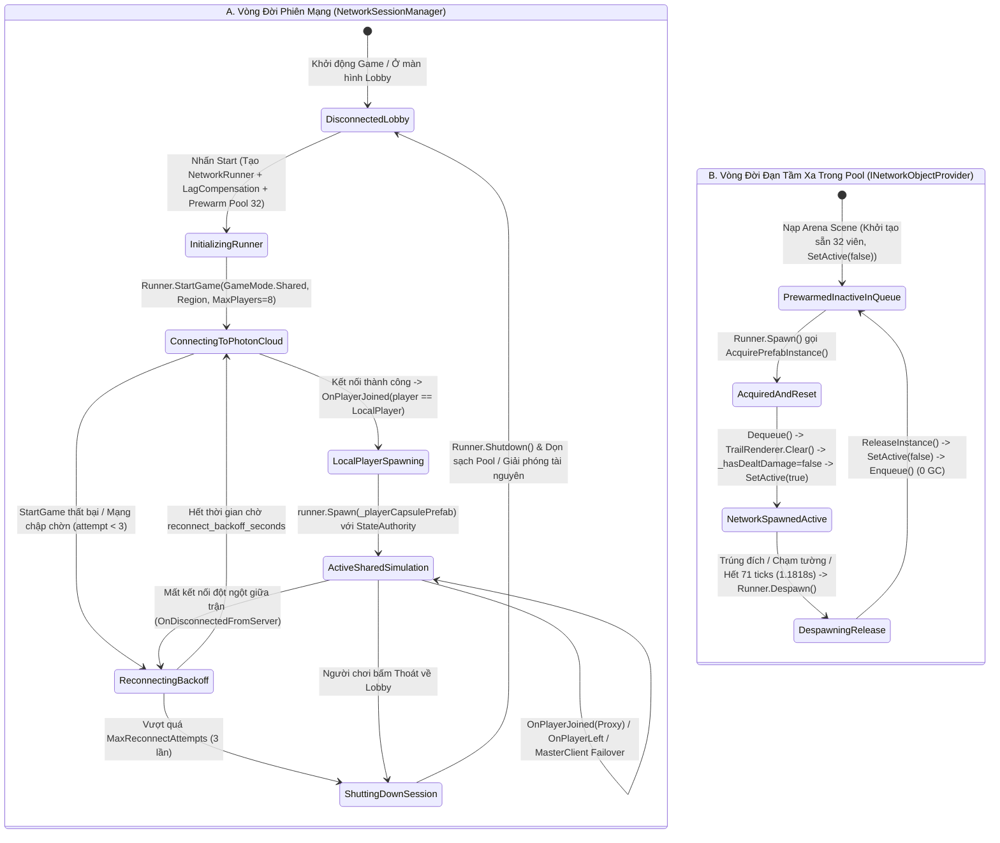

# Photon Fusion 2 Shared Mode Session & Object Pool System

> **Status**: Designed
> **Creative Director Review (CD-GDD-ALIGN)**: APPROVED 2026-11-10
> **Author**: Solo Developer + Studio Agents (`network-engineer`, `gameplay-programmer`, `unity-specialist`, `creative-director`, `qa-lead`)
> **Last Updated**: 2026-11-10
> **Last Verified**: 2026-11-10
> **Implements Pillar**: Pillar 3 (Công Bằng Mạng Tuyệt Đối Trên Shared Mode) & Pillar 1 (Cơ Động Phản Xạ Định Đoạt Sinh Tồn)

## Summary

**Photon Fusion 2 Shared Mode Session & Object Pool System (`NetworkSessionManager` & `NetworkObjectPoolManager`)** là hệ thống hạ tầng mạng và quản lý bộ nhớ đối tượng ở tầng **Foundation (`Core` / `MVP`)** của *Capsule Arena: Last Man Standing*, chịu trách nhiệm khởi tạo phiên kết nối `NetworkRunner` ở chế độ **`GameMode.Shared`** (`PhotonAppId = "fbee3c4f-1f3b-42da-80b9-0e4d2b47f3a9"`, tần số mô phỏng `TickRate = 60` / `60Hz`, quy mô `MaxPlayersPerRoom = 8` trên danh sách Region cố định `asia`, `jp`, `us`, `eu`), cấp quyền **`StateAuthority`** trực tiếp cho từng máy Client đối với nhân vật của chính mình khi `OnPlayerJoined` kích hoạt, đăng ký mô-đun bù trễ **`LagCompensation`** hỗ trợ `HitboxRoot`, và vận hành bộ cấp phát **`INetworkObjectProvider` Object Pool** (`PrewarmPoolCount = 32` viên đạn tầm xa `pf_proj_ranged_orb_01.prefab`). Người chơi cảm nhận gián tiếp sức mạnh của hệ thống này qua tốc độ vào phòng nhanh gọn từ Lobby, cảm giác điều khiển nhân vật di chuyển/lướt/lăn/chém phản hồi tức thì không độ trễ đầu vào (Zero Input Lag trên Local Authority), và tốc độ khung hình luôn mượt mà tuyệt đối (`0 Byte GC Allocation`) ngay cả khi 8 đấu sĩ đồng loạt xả đạn tầm xa (`Right Click`) kín mặt sàn `40m x 40m`.

> **Quick reference** — Layer: `Foundation` · Priority: `MVP` · Key deps: `None`

## Overview

**Photon Fusion 2 Shared Mode Session & Object Pool System** đóng vai trò là "xương sống đồng bộ mạng và quản trị vòng đời thực thể" ở tầng **Foundation** của *Capsule Arena: Last Man Standing* trên nền **Unity 6.6 (`6000.6.8f1`, URP)**. Thay vì sử dụng mô hình Server-Authoritative truyền thống đòi hỏi máy chủ chuyên dụng (Dedicated Server) tốn kém hoặc Host-Mode dễ gây lợi thế bất công cho chủ phòng, hệ thống khai thác kiến trúc phi tập trung **Photon Fusion 2 — Shared Mode (`GameMode.Shared`)** kết nối qua Photon Cloud (`PhotonAppId = "fbee3c4f-1f3b-42da-80b9-0e4d2b47f3a9"`).

Hệ thống được cấu thành từ hai mô-đun gắn kết chặt chẽ trên cùng chuỗi khởi tạo phiên chơi:
1. **Bộ Điều Phối Phiên Mạng (`NetworkSessionManager` thực thi `INetworkRunnerCallbacks`):** Tiếp nhận thông tin từ màn hình Lobby (`PlayerName`, tên phòng `SessionName`, mã vùng `Region` thuộc tập cố định `asia`, `jp`, `us`, `eu`), khởi tạo `NetworkRunner` với cấu hình `TickRate = 60` (`60Hz`, $\Delta t \approx 16.67\text{ms}$), `PlayerCount = 8` (`MaxPlayersPerRoom = 8`, tối ưu cho 2–8 đấu sĩ trong đấu trường `40m x 40m`), kích hoạt thành phần `LagCompensation` trên `NetworkRunner` để phục vụ kiểm tra va chạm bù trễ với `HitboxRoot`, và thực thi quy tắc phân quyền vàng của Shared Mode trong `OnPlayerJoined(NetworkRunner runner, PlayerRef player)`: chỉ khi `player == runner.LocalPlayer`, máy khách đó mới gọi `runner.Spawn(_playerCapsulePrefab, spawnPos, spawnRot, player)` — đảm bảo mỗi Client nắm giữ `Object.HasStateAuthority == true` đối với chính đấu sĩ Capsule của mình.
2. **Hồ Chứa Đối Tượng Mạng (`NetworkObjectPoolManager` thực thi `INetworkObjectProvider`):** Được truyền trực tiếp vào `StartGameArgs.ObjectProvider` khi khởi chạy `Runner.StartGame(...)`. Ngay khi nạp Arena Scene, hệ thống khởi tạo sẵn (`PrewarmPoolCount = 32` thực thể) cho Prefab đạn tầm xa (`pf_proj_ranged_orb_01.prefab` — kỹ năng `Right Click`) vào hàng đợi `Queue<NetworkObject>`. Trong suốt trận đấu, mọi lệnh `Runner.Spawn()` và `Runner.Despawn()` đối với viên đạn đều đi qua cặp hàm `AcquirePrefabInstance` và `ReleaseInstance` để bật/tắt `gameObject.SetActive(true/false)` và đặt lại trạng thái vật lý/hiệu ứng (`TrailRenderer.Clear()`, reset `_hasDealtDamage = false`) thay vì gọi `Object.Instantiate` / `Object.Destroy`, triệt tiêu hoàn toàn hiện tượng giật khung hình do thu gom rác bộ nhớ (Garbage Collection Spikes) và hiện thực hóa trọn vẹn **Pillar 3 (Công Bằng Mạng Tuyệt Đối Trên Shared Mode)** cùng **Pillar 1 (Cơ Động Phản Xạ Định Đoạt Sinh Tồn)**.

## Player Fantasy

> **System Framing:** `[B] Indirect — Trải nghiệm kết nối mượt mà, phản hồi tức thì và không bao giờ giật khung hình khi mưa đạn bay qua đấu trường.`

### 1. Giấc mơ cốt lõi: "Đấu Trường Không Độ Trễ — Nơi Ý Chí Phản Xạ Biến Thành Hành Động Tức Thì"
Người chơi không bao giờ trực tiếp nhìn thấy các hàng đợi `Queue<NetworkObject>` hay gói tin đồng bộ `60Hz` của `NetworkRunner`, nhưng chính hệ thống nền tảng này quyết định việc giấc mơ võ thuật phản xạ của *Capsule Arena: Last Man Standing* có trở thành hiện thực hay sụp đổ. Trong một trò chơi sinh tồn đối kháng nơi ranh giới giữa sống và chết được đo bằng vài phần mười giây của cú lăn né **Side Dodge Roll (`Q`/`E`)** hay cú phóng **Forward Dash (phím `2`)**, bất kỳ sự chậm trễ đầu vào (Input Delay) hay một nhịp khựng khung hình (Frame Stutter) nào khi đạn bay tới đều phá hủy hoàn toàn cảm giác làm chủ cuộc chơi.

Nhờ kiến trúc phân quyền `StateAuthority` trực tiếp cho từng máy khách trong `GameMode.Shared` kết hợp tần số mô phỏng `60Hz` và hồ chứa đạn mạng `INetworkObjectProvider` được khởi tạo sẵn 32 viên, người chơi bước vào đấu trường với sự tự tin tuyệt đối: **"Mọi nút bấm của mình đều phản hồi ngay lập tức như đang chơi Offline, và mọi phát đạn bay qua màn hình đều mượt như lụa."**

### 2. Trải nghiệm cảm giác qua từng khoảnh khắc (How the Player Experiences the Effects)
1. **Phản hồi cơ bắp tức thời nhờ Local `StateAuthority` (Zero Input Latency Feel):** Ngay khoảnh khắc người chơi nhấn phím `2` để lướt tiến áp sát, nhấn `Q`/`E` để lăn né ngang hoặc nhấn phím `1`/`3` để tung nhát **Chém ngang xoay người $90^\circ$**, nhân vật Cartoon Capsule của họ thực thi hành động ngay ở Tick mạng hiện tại trên chính máy của họ (`Object.HasStateAuthority == true`) mà không phải đợi gói tin khứ hồi từ một máy chủ ở xa cho phép di chuyển. Cảm giác điều khiển sắc bén, dính tay 1:1 với chuột và bàn phím chính là thành quả trực tiếp của quy tắc `if (player == runner.LocalPlayer) runner.Spawn(...)`.
2. **Mưa đạn năng lượng không bao giờ gây khựng hình (Zero-Spike Bullet Hell):** Khi 8 đấu sĩ Capsule cùng vây quanh khu vực trung tâm đấu trường `40m x 40m` và liên tục nhấp **Chuột phải (`Right Click`)** mỗi `0.55s` để bắn các quả cầu năng lượng tầm xa, hàng chục viên đạn đồng thời xuất hiện, rẽ gió bay đi và phát nổ vào các khối `Obstacle`. Nhờ `NetworkObjectPoolManager` tái sử dụng vòng tròn 32 thực thể đạn đã nạp sẵn từ đầu trận (`0 Byte GC Allocation`), khung hình vẫn giữ vững ở mức tối đa, không có bất kỳ vệt `TrailRenderer` lỗi nào nối dài qua bản đồ, giúp mắt người chơi theo dõi quỹ đạo đạn trong veo để căn nhịp lăn né.
3. **Sự liền mạch từ sảnh chờ vào trận và bền bỉ khi có biến cố mạng (Resilient Arena Continuity):** Từ lúc chọn Region (`asia`, `jp`, `us`, `eu`) và nhấn vào phòng tại Lobby cho tới khi nhân vật xuất hiện tại điểm `SpawnPoint` thông thoáng trên mặt sàn kẻ lưới chỉ mất vài giây. Ngay cả khi một người chơi khác trong phòng đột ngột rớt mạng hoặc thoát ngang, nhân vật của người đó được dọn dẹp sạch sẽ qua `OnPlayerLeft` và quyền điều phối phòng (`SharedModeMasterClient`) tự động chuyển giao ngầm mà những đấu sĩ còn lại không hề cảm thấy một nhịp khựng nào.

### 3. Điểm chạm Tham chiếu & Đối chiếu Trụ cột Thiết kế

| Điểm tham chiếu / Trụ cột | Cách `Shared Mode Session & Object Pool System` hiện thực hóa trải nghiệm người chơi |
| :--- | :--- |
| ***Brawl Stars*** *(Instant Match Entry & Pooled Projectile Barrage)* | Kết nối nhanh vào phòng đấu trường 2–8 người theo Region gần nhất; toàn bộ đạn bắn xa (`Right Click`) đều lấy từ `INetworkObjectProvider` Pool để duy trì tốc độ khung hình ổn định tuyệt đối trong giao tranh dày đặc. |
| ***Valorant*** *(60Hz+ Tick-Accurate Responsiveness & Lag Compensation)* | Khóa tần số mô phỏng mạng ở `TickRate = 60` (`60Hz`) kết hợp thành phần `LagCompensation` trên `NetworkRunner`, đảm bảo các pha bắn đạn và quét kiếm bù trễ chính xác với vị trí `HitboxRoot` của mục tiêu. |
| ***Fall Guys*** *(Drop-In / Drop-Out Shared Room Resilience)* | Xử lý mượt mà sự kiện `OnPlayerJoined` và `OnPlayerLeft` cho tối đa 8 đấu sĩ trong cùng phiên `GameMode.Shared`, tự động thu hồi thực thể rời phòng và bảo toàn trạng thái ván đấu khi chủ phòng thoát. |
| **Pillar 3 & Pillar 1** | Bảo đảm mỗi Client có `StateAuthority` hợp lệ trên nhân vật của mình để phản xạ `Dash [2]` / `Dodge [Q/E]` tức thì (**Pillar 1**), đồng thời duy trì sự đồng bộ Tick mạng minh bạch, công bằng giữa mọi máy trạm (**Pillar 3**). |

## Detailed Design

### Core Rules

1. **Quy tắc Cấu Hình Phiên Mạng Photon Fusion 2 Shared Mode (`Session Configuration Contract`):**
   - Toàn bộ kết nối nhiều người chơi bắt buộc sử dụng chế độ **`GameMode.Shared`** của Photon Fusion 2 với định danh ứng dụng cố định **`PhotonAppId = "fbee3c4f-1f3b-42da-80b9-0e4d2b47f3a9"`**.
   - Tần số mô phỏng mạng được khóa ở **`TickRate = 60` (`60Hz`)** ($\Delta t = 1/60\text{s} \approx 0.01667\text{s}$), khớp tuyệt đối với công thức quy đổi Tick của `CharacterCombatConfigSO` (`System #1`).
   - Quy mô phòng tối đa được khóa ở **`MaxPlayersPerRoom = 8`** (hỗ trợ tối ưu từ `2–8` người chơi giao tranh sinh tồn trong không gian đấu trường `40m x 40m` của `System #2`).
   - Danh sách máy chủ khu vực (`AllowedRegions`) được giới hạn cố định trong 4 mã vùng chuẩn: **`asia`** (Châu Á - Singapore, mặc định), **`jp`** (Nhật Bản - Tokyo), **`us`** (Bắc Mỹ - Đông), và **`eu`** (Châu Âu - Amsterdam) nhằm tránh phân mảnh người chơi và đảm bảo RTT thấp nhất.

2. **Quy tắc Khởi Tạo `NetworkRunner` & Đăng Ký `LagCompensation` (`Runner Bootstrap & Hitbox Registration`):**
   - Khi người chơi nhấn bắt đầu từ Lobby, `NetworkSessionManager` khởi tạo một thực thể `NetworkRunner` sạch, bật `runner.ProvideInput = true`, gắn đồng thời thành phần **`LagCompensation`** (để theo dõi lịch sử vị trí các `HitboxRoot` trên mỗi nhân vật Capsule phục vụ `System #7`) và **`NetworkSceneManagerDefault`**.
   - Phiên chơi được khởi chạy bất đồng bộ thông qua lệnh chuẩn:
     `Runner.StartGame(new StartGameArgs { GameMode = GameMode.Shared, SessionName = roomName, PlayerCount = 8, ObjectProvider = _networkObjectPool, SceneManager = _networkSceneManager, CustomPhotonAppSettings = appSettings })`.

3. **Quy tắc Phân Quyền `StateAuthority` & Khởi Tạo Nhân Vật Trong `OnPlayerJoined` (`Local Authority Spawn Rule`):**
   - Trong kiến trúc `GameMode.Shared`, callback `OnPlayerJoined(NetworkRunner runner, PlayerRef player)` được kích hoạt trên tất cả các máy Client đang có mặt trong phòng mỗi khi có một người chơi mới tham gia.
   - Để ngăn chặn lỗi nhân bản thực thể (mỗi máy tự tạo ra 8 bản sao của cùng một người chơi), hệ thống **bắt buộc** kiểm tra điều kiện độc quyền:
     `if (player == runner.LocalPlayer)`
     Chỉ khi điều kiện này đúng, máy khách đó mới truy vấn một điểm xuất hiện thông thoáng từ `ArenaSpawnManager` (`System #2`) và gọi:
     `runner.Spawn(_playerCapsulePrefab, spawnPos, spawnRot, player)`
   - Nhờ cơ chế này, mỗi máy Client nắm quyền **`Object.HasStateAuthority == true`** đối với duy nhất nhân vật Cartoon Capsule của chính mình (cho phép xử lý di chuyển `WASD`, `Forward Dash [2]`, `Side Dodge Roll [Q/E]`, `Vertical Slash [LMB]` và `Horizontal Turning Slash 90° [1/3]` tức thì trong `FixedUpdateNetwork()` không bị trễ đầu vào), trong khi nhìn thấy nhân vật của 7 người chơi còn lại dưới dạng **`Proxy` (`Object.HasStateAuthority == false`)** được nội suy mượt qua mạng.
   - Khi callback `OnPlayerLeft(NetworkRunner runner, PlayerRef player)` kích hoạt trên máy còn ở lại hoặc khi chính người chơi ngắt kết nối, thực thể nhân vật gắn với `PlayerRef` đó được thu hồi an toàn và xóa khỏi bảng tra cứu `Dictionary<PlayerRef, NetworkObject> _spawnedPlayers`.

4. **Quy tắc Hồ Chứa Đối Tượng Mạng `INetworkObjectProvider` (`Zero-GC Network Object Pool Rule`):**
   - Lớp **`NetworkObjectPoolManager`** kế thừa `MonoBehaviour` và thực thi trực tiếp giao diện **`INetworkObjectProvider`** của Photon Fusion 2 để quản lý việc cấp phát và thu hồi Prefab đạn tầm xa (`pf_proj_ranged_orb_01.prefab` — kỹ năng `Right Click`).
   - **Khởi tạo sẵn (`PrewarmPoolCount = 32`):** Ngay khi vào Arena Scene (trước khi giao tranh bắt đầu), `NetworkObjectPoolManager` khởi tạo sẵn **32 thực thể** `pf_proj_ranged_orb_01.prefab` dưới nhánh con `_poolRootTransform`, tắt hoạt động (`gameObject.SetActive(false)`) và đưa vào hàng đợi `Queue<NetworkObject> _projectilePoolQueue`. Con số 32 được tính toán chặt chẽ để ngay cả khi cả 8 người chơi trong phòng cùng bắn liên tục ở tốc độ hồi chiêu tối đa (`RangedCooldown = 0.55s`, thời gian đạn bay `ProjectileLifetime = 1.1818s`), hồ chứa vẫn dư thêm 14 viên dự phòng, đảm bảo **`0 Byte GC Allocation`** và **không bao giờ gọi `Object.Instantiate` hay `Object.Destroy`** trong lúc giao tranh.
   - **Cấp phát trong `AcquirePrefabInstance(NetworkRunner runner, NetworkPrefabAcquireContext context, out NetworkObject instance)`:**
     - Nếu `context.PrefabId` khớp với Prefab đạn tầm xa: lấy 1 thực thể từ `_projectilePoolQueue.Dequeue()` (nếu hàng đợi tạm thời rỗng trong trường hợp cực đoan, tự động mở rộng thêm 1 thực thể kèm cảnh báo `Debug.LogWarning`), đặt lại toàn bộ trạng thái bẩn từ lần bay trước (**gọi `TrailRenderer.Clear()`, đặt cờ `_hasDealtDamage = false`, xóa vận tốc dư thừa**), bật `instance.gameObject.SetActive(true)` và trả về `NetworkObjectAcquireResult.Success`.
     - Nếu `context.PrefabId` là Prefab nhân vật người chơi (`pf_char_capsule_player_01.prefab` — tần suất tạo rất thấp, chỉ 1 lần khi vào phòng): khởi tạo chuẩn qua `Instantiate` và trả về `NetworkObjectAcquireResult.Success`.
   - **Thu hồi trong `ReleaseInstance(NetworkRunner runner, NetworkObjectReleaseContext context)`:**
     - Khi viên đạn chạm mục tiêu, đập vào khối `Obstacle` / `Boundary` hoặc hết thời gian sống `ProjectileLifetime = 1.1818s` (`71 ticks` ở `60Hz`) và máy có `StateAuthority` gọi `Runner.Despawn(Object)`, Photon Fusion 2 tự động gọi `ReleaseInstance` trên mọi máy Client.
     - Tại đây, nếu đối tượng thuộc loại đạn tầm xa, hệ thống **không hủy đối tượng (`Destroy`)** mà gọi `TrailRenderer.Clear()`, tắt `context.Object.gameObject.SetActive(false)`, gắn lại vào `_poolRootTransform` và đẩy trả về `_projectilePoolQueue.Enqueue(context.Object)`.

5. **Quy tắc Bảo Toàn Trạng Thái Khi Chủ Phòng Rời Trận (`SharedModeMasterClient Continuity Rule`):**
   - Trong `GameMode.Shared`, Photon Cloud tự động chỉ định một người chơi làm `SharedModeMasterClient` và tự động bầu lại người kế nhiệm nếu người đó rời phòng (`OnPlayerLeft`).
   - `NetworkSessionManager` phát sự kiện `OnMasterClientUpdated(PlayerRef newMaster)` và đảm bảo các Scene `NetworkObject` dùng chung (như `MatchManager` của `System #10`) luôn được cấu hình `Allow State Authority Override = true` và `Destroy When State Authority Leaves = false` để máy `SharedModeMasterClient` mới tiếp quản quyền đếm `MatchTimer` ngay trong Tick kế tiếp.

6. **Bảng Đặc Tả Cấu Trúc Dữ Liệu & Thông Số Cấu Hình (`Session & Object Pool Parameters`):**

| Nhóm Cấu Hình | Tên Tham Số / Thuộc Tính | Kiểu Dữ Liệu | Giá Trị Mặc Định / Khóa | Đơn Vị | Mô Tả Ngữ Nghĩa & Vai Trò Kiến Trúc |
| :--- | :--- | :---: | :---: | :---: | :--- |
| **1. Photon App & Region** | `PhotonAppId` | `string` | `"fbee3c4f-1f3b-42da-80b9-0e4d2b47f3a9"` | `GUID` | Mã định danh ứng dụng Photon Fusion 2 Realtime chính thức của dự án trên Photon Cloud Dashboard. |
| **1. Photon App & Region** | `AllowedRegions` | `string[]` | `["asia", "jp", "us", "eu"]` | `Region Code` | Danh sách 4 cụm máy chủ khu vực cố định cho phép người chơi chọn tại màn hình Lobby (`DefaultRegion = "asia"`). |
| **1. Photon App & Region** | `DefaultRoomName` | `string` | `"CapsuleArena_Room_01"` | `string` | Tên phòng mặc định nếu người chơi nhấn Quick Join mà không tự nhập tên phòng riêng. |
| **2. Shared Mode Simulation** | `GameMode` | `GameMode` | `GameMode.Shared` | `enum` | Chế độ mạng phi tập trung nơi mỗi Client nắm `StateAuthority` trên các thực thể do mình gọi `Runner.Spawn()`. |
| **2. Shared Mode Simulation** | `TickRate` | `int` | `60` | `Hz (ticks/s)` | Tần số mô phỏng mạng cố định (`FixedUpdateNetwork` chạy mỗi `16.67ms`), đồng bộ với `CharacterCombatConfigSO`. |
| **2. Shared Mode Simulation** | `MaxPlayersPerRoom` | `int` | `8` | `players` | Sức chứa tối đa của một phòng đấu trường `40m x 40m` (hỗ trợ tối ưu từ `2` đến `8` đấu sĩ cùng lúc). |
| **3. Network Object Pool** | `PrewarmPoolCount` | `int` | `32` | `instances` | Số lượng viên đạn mạng (`pf_proj_ranged_orb_01.prefab`) được khởi tạo sẵn trong `Queue<NetworkObject>` ngay khi nạp Arena Scene. |
| **3. Network Object Pool** | `MaxPoolCapacity` | `int` | `64` | `instances` | Ngưỡng trần an toàn tối đa nếu hồ chứa phải mở rộng động trong tình huống cực đoan. |
| **4. Reconnection & Timeout** | `BaseReconnectBackoff` | `float` | `1.0` | `giây (s)` | Thời gian chờ cơ sở ở lần thử kết nối lại đầu tiên (`attempt_index = 0`) khi rớt mạng tạm thời. |
| **4. Reconnection & Timeout** | `MaxReconnectBackoff` | `float` | `8.0` | `giây (s)` | Thời gian chờ tối đa giữa hai lần thử kết nối lại liên tiếp (`MaxReconnectAttempts = 3`). |

### States and Transitions

Hệ thống quản lý đồng thời **2 máy trạng thái vòng đời độc lập nhưng phối hợp chặt chẽ**: (A) Vòng đời kết nối của `NetworkRunner` (`NetworkSessionManager`) và (B) Vòng đời của mỗi thực thể viên đạn tầm xa trong `INetworkObjectProvider` (`NetworkObjectPoolManager`):

1. **`DisconnectedLobby` $\rightarrow$ `InitializingRunner`:** Khi người chơi nhập `PlayerName`, chọn `Region` (`asia`/`jp`/`us`/`eu`) và nhấn nút vào trận trên Lobby UI (`System #11`), `NetworkSessionManager` khởi tạo `NetworkRunner`, gắn `LagCompensation`, và yêu cầu `NetworkObjectPoolManager` thực thi `PrewarmPool(32)`.
2. **`ConnectingToPhotonCloud` $\rightarrow$ `LocalPlayerSpawning`:** Sau khi `Runner.StartGame` trả về `result.Ok == true`, Photon Fusion 2 kích hoạt `OnPlayerJoined`. Máy khách xác thực `player == runner.LocalPlayer` và gọi `runner.Spawn(_playerCapsulePrefab, spawnPos, spawnRot, player)`.
3. **`ActiveSharedSimulation`:** Phiên chơi chạy vòng lặp `FixedUpdateNetwork()` ở tần số `60Hz`. Trong trạng thái này, mỗi khi bất kỳ người chơi nào nhấn `Right Click` bắn đạn tầm xa, `NetworkObjectPoolManager` chuyển trạng thái viên đạn từ `PrewarmedInactiveInQueue` $\rightarrow$ `AcquiredAndReset` $\rightarrow$ `NetworkSpawnedActive`, và thu hồi về `PrewarmedInactiveInQueue` qua `DespawningRelease` ngay khi `Runner.Despawn()` được gọi.
4. **`ReconnectingBackoff` $\rightarrow$ `ShuttingDownSession`:** Nếu kết nối bị gián đoạn, hệ thống thử kết nối lại theo hàm mũ (`1s`, `2s`, `4s`); nếu hết 3 lần vẫn thất bại hoặc người chơi chủ động thoát, hệ thống gọi `Runner.Shutdown()`, dọn sạch `_projectilePoolQueue` và quay về `DisconnectedLobby`.

### Interactions with Other Systems

| Hệ Thống Liên Kết | Chiều Tương Tác | Cơ Chế Hợp Đồng Giao Tiếp & Luồng Dữ Liệu |
| :--- | :---: | :--- |
| **System #1: Character & Combat Config Data** | `#4` $\leftarrow$ `#1` *(Đọc cấu hình)* | Đọc `ProjectileLifetime` (`1.1818s` / `71 ticks`) và `RangedCooldown` (`0.55s` / `33 ticks`) từ `ICharacterCombatConfig` để xác định dung lượng khởi tạo sẵn `PrewarmPoolCount = 32` và thời hạn tự thu hồi đạn về Pool. |
| **System #2: Arena Level & Tactical Obstacle Architecture** | `#4` $\leftarrow$ `#2` *(Truy vấn vị trí)* | Khi `OnPlayerJoined(player == runner.LocalPlayer)` kích hoạt, `#4` gọi sang bộ quản lý `SpawnPoint` của `#2` để lấy tọa độ mặt sàn thông thoáng nhất trước khi gọi `runner.Spawn(_playerCapsulePrefab, ...)`. |
| **System #3: Keybinding & Input Management System** | `#4` $\leftrightarrow$ `#3` *(Cầu nối `OnInput`)* | Callback `OnInput(NetworkRunner runner, NetworkInput input)` trên `NetworkRunner` thu thập cấu trúc `NetworkInputData` từ `#3` (đã được lọc qua `InputFocusManager`) để cung cấp cho `GetInput(out NetworkInputData data)` trong `FixedUpdateNetwork()`. |
| **System #5: Tick-Accurate Character Movement & Mobility** | `#5` $\leftarrow$ `#4` *(Phụ thuộc hạ tầng)* | `#5` dựa hoàn toàn vào quyền `Object.HasStateAuthority == true` (do `#4` cấp khi `Spawn`) và nhịp `TickRate = 60Hz` của `NetworkRunner` để thực thi di chuyển `WASD`, `Forward Dash [2]`, `Side Dodge Roll [Q/E]` và xoay góc $90^\circ$. |
| **System #6: Health, Damage RPC & Death State System** | `#6` $\leftarrow$ `#4` *(Phụ thuộc hạ tầng)* | `#6` sử dụng định danh `PlayerRef` và luồng định tuyến gói tin `[Rpc(RpcSources.All, RpcTargets.StateAuthority)]` của `NetworkRunner` để trừ máu chính xác trên máy sở hữu nhân vật. |
| **System #7: Multi-Directional Melee & Pooled Ranged Combat** | `#7` $\leftarrow$ `#4` *(Pool & LagComp)* | `#7` gọi `Runner.Spawn(_rangedProjectilePrefab, ...)` để lấy đạn từ `INetworkObjectProvider` Pool của `#4`, gọi `Runner.Despawn(Object)` để trả đạn về Pool, và sử dụng `Runner.LagCompensation.OverlapSphere` của `#4` để xét va chạm với `HitboxRoot`. |
| **System #10: Last Man Standing Match Manager** | `#10` $\leftarrow$ `#4` *(MasterClient & PlayerList)* | `#10` lắng nghe sự kiện `OnPlayerJoined`, `OnPlayerLeft` và trạng thái `runner.IsSharedModeMasterClient` từ `#4` để tính toán `AliveCount` động và tự động chuyển giao quyền điều khiển `MatchManager` khi chủ phòng thoát. |
| **System #11: In-Game Keybinding Rebind UI & Lobby Flow UI** | `#11` $\rightarrow$ `#4` *(Lệnh kết nối)* | Giao diện Lobby của `#11` truyền `PlayerName`, `SessionName` và mã `Region` (`asia`, `jp`, `us`, `eu`) xuống `NetworkSessionManager.StartSharedSessionAsync(...)` và hiển thị trạng thái kết nối/lỗi từ `#4`. |

## Formulas

### 1. Dung Lượng Khởi Tạo Sẵn Tối Thiểu Của Pool Đạn Mạng (`required_projectile_pool_size`)

The `required_projectile_pool_size` formula is defined as:

`required_projectile_pool_size = ceil(MaxPlayersPerRoom * (ProjectileLifetime / RangedCooldown)) + pool_safety_buffer`

**Variables:**

| Variable | Type | Range | Source | Description |
| :--- | :---: | :---: | :--- | :--- |
| `MaxPlayersPerRoom` | `int` | `2–8` | `NetworkSessionManager.MaxPlayersPerRoom` | Số lượng đấu sĩ tối đa trong một phòng đấu trường Shared Mode (`mặc định 8`). |
| `ProjectileLifetime` | `float` | `0.20–6.00` | `CharacterCombatConfigSO.ProjectileLifetime` (`26.0m / 22.0m/s`) | Thời gian sống tối đa của một viên đạn tầm xa trước khi tự hủy (`mặc định 1.1818s`). |
| `RangedCooldown` | `float` | `0.15–3.00` | `CharacterCombatConfigSO.RangedCooldown` | Thời gian hồi chiêu tối thiểu giữa 2 phát bắn đạn tầm xa liên tiếp của một người chơi (`mặc định 0.55s`). |
| `pool_safety_buffer` | `int` | `8–24` | `NetworkObjectPoolManager` (`14`) | Lượng đạn dự phòng chống cạn Pool khi có độ trễ gói tin hủy (`Despawn` delay) trên mạng (`mặc định 14`). |
| `required_projectile_pool_size` | `int` | `16–64` | `NetworkObjectPoolManager.PrewarmPoolCount` | Tổng số thực thể `pf_proj_ranged_orb_01.prefab` được khởi tạo sẵn trong `Queue<NetworkObject>` khi nạp Arena Scene. |

**Output Range:** `16` đến `64` thực thể đạn trong Pool (Giá trị khóa chuẩn của dự án là **`32` viên đạn**).

**Example:**
- Với `MaxPlayersPerRoom = 8`, `ProjectileLifetime = 1.1818s`, `RangedCooldown = 0.55s`, và `pool_safety_buffer = 14`:
  `required_projectile_pool_size = ceil(8 * (1.1818 / 0.55)) + 14 = ceil(8 * 2.1487) + 14 = ceil(17.19) + 14 = 18 + 14 = 32` viên đạn.
- Như vậy, ngay cả trong kịch bản khắc nghiệt nhất khi cả 8 người chơi giữ chặt nút `Right Click` bắn không ngừng nghỉ và không viên đạn nào trúng tường sớm (luôn tồn tại tối đa `18` viên đạn đang bay trên không trung tại mọi thời điểm), hồ chứa `PrewarmPoolCount = 32` vẫn luôn còn dư ít nhất `14` viên đạn rảnh rỗi trong hàng đợi, cam kết `0 Byte GC Allocation`.

---

### 2. Thời Gian Chờ Kết Nối Lại Có Thoái Lui Hàm Mũ (`reconnect_backoff_seconds`)

The `reconnect_backoff_seconds` formula is defined as:

`reconnect_backoff_seconds = min(max_backoff, base_backoff * (2 ^ attempt_index))`

**Variables:**

| Variable | Type | Range | Source | Description |
| :--- | :---: | :---: | :--- | :--- |
| `base_backoff` | `float` | `0.5–2.0` | `NetworkSessionManager.BaseReconnectBackoff` | Thời gian chờ cơ sở ở lần thử kết nối lại đầu tiên (`mặc định 1.0s`). |
| `attempt_index` | `int` | `0–2` | Bộ đếm thử lại nội bộ (`0`, `1`, `2` tương ứng tối đa 3 lần thử) | Chỉ số lần thử kết nối lại hiện tại sau khi bị ngắt kết nối hoặc `StartGame` lỗi mạng tạm thời. |
| `max_backoff` | `float` | `4.0–15.0` | `NetworkSessionManager.MaxReconnectBackoff` | Ngưỡng trần thời gian chờ tối đa giữa hai lần thử liên tiếp (`mặc định 8.0s`). |
| `reconnect_backoff_seconds` | `float` | `0.5–8.0` | Bộ hẹn giờ bất đồng bộ trong `NetworkSessionManager` | Số giây hệ thống đợi trước khi gọi lại `Runner.StartGame(...)`. |

**Output Range:** `0.5s` đến `8.0s`.

**Example:**
- Với `base_backoff = 1.0s` và `max_backoff = 8.0s`:
  - Lần thử lại thứ 1 (`attempt_index = 0`): `reconnect_backoff_seconds = min(8.0, 1.0 * (2 ^ 0)) = 1.0s`.
  - Lần thử lại thứ 2 (`attempt_index = 1`): `reconnect_backoff_seconds = min(8.0, 1.0 * (2 ^ 1)) = 2.0s`.
  - Lần thử lại thứ 3 (`attempt_index = 2`): `reconnect_backoff_seconds = min(8.0, 1.0 * (2 ^ 2)) = 4.0s`.
  (Tổng thời gian chờ tối đa qua 3 lần thử là `1.0 + 2.0 + 4.0 = 7.0s` trước khi thông báo lỗi kết nối và đưa người chơi về Lobby).

---

### 3. Băng Thông Ước Tính Mỗi Client Trên Shared Mode (`estimated_client_bandwidth_kbps`)

The `estimated_client_bandwidth_kbps` formula is defined as:

`estimated_client_bandwidth_kbps = (tick_rate * state_packet_bytes * 8.0 * active_players) / 1000.0`

**Variables:**

| Variable | Type | Range | Source | Description |
| :--- | :---: | :---: | :--- | :--- |
| `tick_rate` | `int` | `60` (cố định) | `NetworkRunner.Config.Simulation.TickRate` | Tần số đồng bộ trạng thái mạng mỗi giây (`60Hz`). |
| `state_packet_bytes` | `int` | `32–96` | Kích thước dữ liệu `[Networked]` mỗi nhân vật + đạn (`bytes/tick`) | Dung lượng gói tin nén trung bình của một người chơi trong 1 Tick (gồm `NetworkTransform`, `CurrentHealth`, `TickTimer`, `PlayerName`). |
| `active_players` | `int` | `2–8` | `Runner.ActivePlayers.Count()` | Số lượng người chơi đang kết nối trong phòng (`MaxPlayersPerRoom = 8`). |
| `estimated_client_bandwidth_kbps` | `float` | `30.0–370.0` | Chỉ số giám sát hiệu năng mạng (`Network Profiler`) | Lưu lượng băng thông tải xuống ước tính trên mỗi máy Client tính bằng kilobits/giây (`kbps`). |

**Output Range:** `30.72 kbps` đến `368.64 kbps` (nhỏ hơn nhiều so với ngưỡng giới hạn `512 kbps` của đường truyền băng rộng tiêu chuẩn).

**Example:**
- Trong phòng đầy `active_players = 8` người chơi, ở tần số `tick_rate = 60` (`60Hz`) và kích thước gói trạng thái nén trung bình `state_packet_bytes = 56 bytes`:
  `estimated_client_bandwidth_kbps = (60 * 56 * 8.0 * 8) / 1000.0 = 215040.0 / 1000.0 = 215.04 kbps` (`~26.88 KB/s` — cực kỳ nhẹ, đảm bảo độ trễ thấp và không gây nghẽn cổ chai trên Photon Cloud Relay).

## Edge Cases

- **If the projectile pool (`Queue<NetworkObject>`) is temporarily exhausted when `AcquirePrefabInstance` is called (e.g., extreme network lag delays `Despawn` packets while 8 players fire continuously)**: Thay vì trả về `NetworkObjectAcquireResult.Failed` làm mất viên đạn của người chơi, `NetworkObjectPoolManager` tự động khởi tạo bổ sung 1 thực thể `pf_proj_ranged_orb_01.prefab` mới (miễn là tổng số thực thể chưa vượt quá `MaxPoolCapacity = 64`), ghi cảnh báo `Debug.LogWarning("[NetworkObjectPoolManager] Pool exhausted at 32 — expanding dynamically")` và đưa thực thể đó vào vòng quay tái sử dụng của Pool.
- **If a reused projectile from `INetworkObjectProvider` still retains old visual trails or its previous damage flag (`_hasDealtDamage == true`)**: Ngay bên trong `AcquirePrefabInstance` trước khi bật `instance.gameObject.SetActive(true)` (và lặp lại một lần nữa trong `Spawned()` của script viên đạn), hệ thống bắt buộc gọi `IPooledNetworkObject.OnAcquireFromPool()` để thực thi `TrailRenderer.Clear()`, đặt lại `_hasDealtDamage = false` và xóa vận tốc cũ, ngăn chặn tuyệt đối hiện tượng vệt sáng kéo dài xuyên bản đồ (Trail Teleport Glitch) hoặc viên đạn mới bắn ra bị vô hiệu hóa sát thương.
- **If a player disconnects abruptly (Alt+F4, crash, or network drop) while their ranged projectiles are still flying in mid-air**: Khi `OnPlayerLeft(NetworkRunner runner, PlayerRef player)` kích hoạt, hệ thống thu hồi thực thể nhân vật của người chơi đó, đồng thời kiểm tra mọi viên đạn mồ côi mất `StateAuthority` (hoặc cấu hình Prefab đạn tự gọi `Runner.Despawn()` khi hết `ProjectileLifetime = 1.1818s` / mất `StateAuthority`) để trả toàn bộ các viên đạn đó về `Queue<NetworkObject>` qua `ReleaseInstance`, không để lại đạn treo lơ lửng vĩnh viễn trên đấu trường.
- **If a player attempts to join a room that has already reached `MaxPlayersPerRoom = 8` or enters an invalid Region code**: Trước khi gọi `StartGame`, `NetworkSessionManager` chuẩn hóa mã vùng (nếu mã vùng không nằm trong `["asia", "jp", "us", "eu"]`, tự động ép về `"asia"`). Nếu phòng đích đã đủ 8/8 người (`ShutdownReason.GameIsFull`), hệ thống tự động tạo hoặc chuyển sang phòng mở rộng có hậu tố tăng dần (ví dụ: `CapsuleArena_Room_02`) hoặc thông báo rõ ràng trên Lobby UI (`System #11`) mà không làm treo màn hình chờ.
- **If `Runner.StartGame(...)` fails due to internet disconnection or Photon Cloud timeout**: `NetworkSessionManager` bắt kết quả `StartGameResult.Ok == false`, chuyển sang trạng thái `ReconnectingBackoff` và thử kết nối lại tối đa `3 lần` theo công thức `reconnect_backoff_seconds` (`1s`, `2s`, `4s`). Nếu sau lần thử thứ 3 vẫn thất bại, hệ thống gọi `Runner.Shutdown()`, dọn sạch `NetworkRunner` lỗi và phát sự kiện trả giao diện Lobby về trạng thái cho phép bấm nút thử lại kèm thông báo lỗi tiếng Việt tường minh.
- **If two or more players join the session on the exact same simulation Tick (`OnPlayerJoined` triggered simultaneously)**: Vì mỗi máy khách chỉ tự gọi `runner.Spawn(_playerCapsulePrefab, ...)` cho chính `runner.LocalPlayer` của mình, để tránh hai người chơi cùng chọn trúng 1 điểm `SpawnPoint` ở Tick đầu tiên, bộ chọn điểm xuất hiện kết hợp chỉ số `player.PlayerId % SpawnPointCount` làm độ lệch hạt giống (deterministic index offset) kèm kiểm tra bán kính thông thoáng, đảm bảo 8 người chơi luôn xuất hiện ở 8 vị trí tách biệt.
- **If the player holding `SharedModeMasterClient` disconnects mid-match**: Photon Fusion 2 tự động chỉ định một `PlayerRef` còn sống trong phòng làm `SharedModeMasterClient` mới. Nhờ `NetworkSessionManager` cấu hình các Scene `NetworkObject` dùng chung (`MatchManager`) bật `Allow State Authority Override = true` và tắt `Destroy When State Authority Leaves = false`, máy chủ phòng mới tiếp quản quyền điều phối ngay lập tức mà không làm gián đoạn trận đấu.
- **If Unity 6.6 (`6000.6.8f1`) runs with `Enter Play Mode without Domain Reload` enabled or the player returns to the Lobby and starts a second match in the same session**: Khi `OnShutdown` kích hoạt hoặc trong `OnDisable()`, `NetworkObjectPoolManager` xóa sạch hàng đợi `_projectilePoolQueue.Clear()` và `NetworkSessionManager` đặt lại toàn bộ biến trạng thái phiên về mặc định, đảm bảo 100% không còn tham chiếu `MissingReferenceException` tới các `NetworkObject` của ván đấu trước.
- **If `PlayerName` entered in the Lobby is empty, whitespace-only, or exceeds the 16-character capacity of `[Networked] NetworkString<_16>`**: `NetworkSessionManager` tự động cắt khoảng trắng (`Trim()`), tạo tên mặc định `"Fighter_" + Random.Range(100, 999)` nếu chuỗi rỗng, và cắt ngắn tối đa `15 ký tự` trước khi lưu vào phiên chơi để tránh lỗi tràn bộ đệm chuỗi mạng của Photon Fusion 2.

## Dependencies

### Upstream Dependencies (Hệ thống này phụ thuộc vào)

- **Không có phụ thuộc cứng trong nội bộ Gameplay (`None — Layer 1 Foundation`):** Hệ thống nằm ở tầng đáy `Layer 1 — Foundation` (`design/gdd/systems-index.md`), chỉ phụ thuộc vào gói SDK nền tảng **Photon Fusion 2 (`Fusion.Runtime`)** và **Unity Engine (`UnityEngine.SceneManagement`)**. Ở bước khởi tạo kích thước Pool và chọn vị trí xuất hiện, hệ thống đọc thông số tĩnh từ `System #1 (CharacterCombatConfigSO)` và danh sách tọa độ từ `System #2 (Arena SpawnPoints)` thông qua giao diện lỏng.

### Downstream Dependents (Các hệ thống phụ thuộc vào hệ thống này)

| Hệ Thống Hạ Nguồn | Loại Phụ Thuộc | Hợp Đồng Hạ Tầng Mạng & Object Pool Cung Cấp |
| :--- | :---: | :--- |
| **System #5: Tick-Accurate Character Movement & Mobility System** | **Hard (MVP)** | Cung cấp vòng lặp `FixedUpdateNetwork()` (`60Hz`), quyền `Object.HasStateAuthority == true` cho nhân vật Local và luồng dữ liệu đầu vào `GetInput(out NetworkInputData)`. |
| **System #6: Health, Damage RPC & Death State System** | **Hard (MVP)** | Cung cấp định tuyến `[Rpc(RpcSources.All, RpcTargets.StateAuthority)]` và đồng bộ thuộc tính `[Networked]` cho máu và trạng thái tử trận. |
| **System #7: Multi-Directional Melee & Pooled Ranged Combat System** | **Hard (MVP)** | Cung cấp `INetworkObjectProvider` (`PrewarmPoolCount = 32`) cho đạn tầm xa `Right Click` và mô-đun `Runner.LagCompensation` cho kiểm tra va chạm `HitboxRoot`. |
| **System #10: Last Man Standing Match Manager & Authority Failover** | **Hard (Vertical Slice)** | Cung cấp danh sách `Runner.ActivePlayers`, callback `OnPlayerJoined` / `OnPlayerLeft` và cơ chế chuyển giao quyền `SharedModeMasterClient`. |
| **System #11: In-Game Keybinding Rebind UI & Lobby Flow UI** | **Hard (Vertical Slice)** | Cung cấp API `StartSharedSessionAsync(SessionStartRequest)` và các sự kiện trạng thái kết nối để điều khiển luồng màn hình Lobby. |
| **System #12: In-Game Chat System (Public & Private Whisper)** | **Hard (Alpha)** | Cung cấp hạ tầng `[Rpc]` trên `NetworkRunner` và bảng tra cứu `PlayerRef` $\leftrightarrow$ `PlayerName` để định tuyến tin nhắn Public và Whisper đích danh. |

## Tuning Knobs

Các thông số cấu hình mạng và Object Pool dưới đây được đóng gói trên Inspector của `NetworkSessionManager` và `NetworkObjectPoolManager` với khóa biên an toàn:

| Knob Name | Default Value | Safe Range (Min–Max) | Effect if Too Low | Effect if Too High | Interacts With |
| :--- | :---: | :---: | :--- | :--- | :--- |
| `TickRate` | `60 Hz` | `30 – 60 Hz` | Giảm xuống `< 30Hz` làm chuyển động `Forward Dash [2]` (`0.25s`) và cú xoay người $90^\circ$ (`0.15s`) bị thô ráp, tăng sai số vị trí đạn bay. | Vượt quá `60Hz` (`120Hz`) làm tăng gấp đôi băng thông và tải CPU thực thi `FixedUpdateNetwork()` mà không mang lại khác biệt rõ rệt cho đấu trường Capsule. | `CharacterCombatConfigSO` (`System #1`), `System #5`, `System #7`. |
| `MaxPlayersPerRoom` | `8 players` | `2 – 8 players` | Phòng chỉ có `2–3` người làm ván đấu `Last Man Standing` kết thúc quá nhanh và thiếu không khí hỗn chiến sôi động. | Vượt quá `8` người trên mặt sàn `40m x 40m` gây quá tải mật độ đạn, thiếu điểm ẩn nấp sau `Obstacle` và tăng băng thông theo cấp số nhân. | Kích thước sàn đấu & số lượng `SpawnPoint` (`System #2`), `MatchManager` (`System #10`). |
| `PrewarmPoolCount` | `32 instances` | `20 – 64 instances` | Nhỏ hơn `18` viên sẽ khiến Pool cạn kiệt khi 8 người cùng bắn `Right Click` liên tục, buộc phải gọi `Instantiate` lúc đang giao tranh gây giật khung hình (GC spike). | Khởi tạo sẵn quá nhiều (`> 64` viên) gây lãng phí bộ nhớ RAM cho các GameObject không bao giờ dùng tới trong phòng 8 người. | `ProjectileLifetime`, `RangedCooldown` (`System #1`, `System #7`). |
| `BaseReconnectBackoff` | `1.0 s` | `0.5 – 3.0 s` | Gọi thử kết nối lại quá dồn dập (`< 0.5s`) khi card mạng vừa rớt sẽ bị Photon Cloud từ chối liên tiếp. | Người chơi phải nhìn màn hình chờ kết nối lại quá lâu ngay ở lần rớt mạng nhẹ đầu tiên. | `MaxReconnectBackoff`, Lobby UI (`System #11`). |
| `MaxReconnectAttempts` | `3 attempts` | `1 – 5 attempts` | Bỏ cuộc ngay sau 1 lần thử khiến người chơi bị văng ra Lobby chỉ vì một nhịp chập chờn Wi-Fi ngắn. | Kéo dài chuỗi thử lại quá lâu (`> 15s`) khi mất mạng hẳn, gây sốt ruột cho người chơi. | `BaseReconnectBackoff`, `MaxReconnectBackoff`. |

## Visual/Audio Requirements

Mặc dù là hệ thống hạ tầng mạng và quản lý bộ nhớ ở tầng **Foundation**, `Photon Fusion 2 Shared Mode Session & Object Pool System` quyết định trực tiếp tính toàn vẹn thị giác và âm thanh của toàn bộ trò chơi (tuân thủ **Art Bible `design/art/art-bible.md` §4.2, §5.3 & §6**):

1. **Xóa Sạch Dấu Vết Thị Giác Khi Tái Sử Dụng Đạn Từ Pool (`Zero Visual Ghosting on Pool Acquire/Release`):**
   - Quả cầu năng lượng đạn tầm xa (`pf_proj_ranged_orb_01.prefab` — màu **Vàng Chanh Năng Lượng `#FACC15`** cho đạn bản thân / **Đỏ Cam Cảnh Báo `#FB923C`** cho đạn đối phương) có gắn thành phần `TrailRenderer` và `ParticleSystem`.
   - Khi `NetworkObjectPoolManager.ReleaseInstance` thu hồi đạn và khi `AcquirePrefabInstance` cấp phát lại viên đạn ở một tọa độ mới trên đấu trường, hệ thống **bắt buộc** gọi `TrailRenderer.Clear()` và `ParticleSystem.Clear(true)` trước khi bật `gameObject.SetActive(true)`. Quy tắc này ngăn chặn hoàn toàn lỗi một vệt tia sáng dài ngoẵng nối từ điểm nổ cũ của người chơi A sang đầu nòng súng mới của người chơi B.
2. **Bảo Toàn Tách Biệt Giữa `HitboxRoot` Mạng Và `VisualRoot` Đồ Họa Khi `Runner.Spawn()`:**
   - Khi `OnPlayerJoined` gọi `runner.Spawn(_playerCapsulePrefab, ...)` và đăng ký nhân vật với mô-đun `LagCompensation` trên `NetworkRunner`, nhánh `HitboxRoot` giữ nguyên kích thước hình học chuẩn `(1, 1, 1)` để xét va chạm bù trễ, trong khi nhánh con `VisualRoot` được tự do thực hiện hiệu ứng xuất hiện (Spawn Pop-in Elastic Scale từ `0.0` $\rightarrow$ `1.0` trong `0.20s` bằng DOTween) mà không làm sai lệch hộp va chạm mạng.
3. **Phản Hồi Âm Thanh Trạng Thái Kết Nối & Xuất Hiện (`Session & Spawn Audio Cues`):**
   - Phát âm thanh UI xác nhận sắc gọn (`2D Spatial Blend = 0.0`) khi `Runner.StartGame` kết nối thành công vào phòng Shared Mode và âm thanh dịch chuyển năng lượng 3D (`Spatial Blend = 1.0`) tại vị trí `SpawnPoint` khi đấu sĩ Capsule được `Runner.Spawn()` xuống sàn đấu.

## Game Feel

1. **Cảm Giác Điều Khiển "Dính Tay" Nhờ Quyền `StateAuthority` Cục Bộ (`Zero-Latency Local Control`):**
   - Trong các game đấu trường phản xạ nhanh, nếu người chơi nhấn `Q`/`E` (**Side Dodge Roll**) hoặc phím `2` (**Forward Dash**) mà phải chờ `60ms–100ms` để máy chủ xác nhận mới thấy nhân vật nhúc nhích, cảm giác điều khiển sẽ trở nên nặng nề như lội bùn. Nhờ việc trao `Object.HasStateAuthority == true` trực tiếp cho từng Client đối với nhân vật của họ ngay từ lúc `OnPlayerJoined`, mọi thao tác di chuyển, lướt, lăn và xoay góc nhìn $90^\circ$ (phím `1`/`3`) đều khởi phát tức thì ngay ở khung hình kế tiếp (`<= 16.67ms` ở `60Hz`), tạo nên cảm giác điều khiển mượt mà, nhạy bén chuẩn thể thao điện tử.
2. **Độ Mượt Khung Hình Tuyệt Đối Trong Giao Tranh Cường Độ Cao (`Frame-Time Stability via Prewarmed Pooling`):**
   - Bằng cách dồn toàn bộ chi phí cấp phát bộ nhớ của **32 viên đạn mạng** vào giai đoạn chuyển cảnh trước khi vào trận (`PrewarmPoolCount = 32`), thời gian dựng hình mỗi khung hình (`Frame Time`) trong suốt 3–5 phút giao tranh không bao giờ bị vọt lên (spike) do `Instantiate` hay `Garbage Collector`, giữ cho chuyển động camera `FPS <-> TPS` luôn mượt mà.

## UI Requirements

- **Đồng Bộ Trạng Thái Kết Nối Với Màn Hình Lobby (`System #11`):**
  - `NetworkSessionManager` cung cấp các sự kiện trạng thái tường minh (`OnConnectionStatusChanged(SessionConnectionState state, string message)`) để Lobby UI hiển thị tiến trình: *"Đang khởi tạo Hồ chứa mạng..."* $\rightarrow$ *"Đang kết nối máy chủ khu vực [ASIA]..."* $\rightarrow$ *"Đang vào đấu trường..."*, đồng thời khóa nút **Start / Join (`interactable = false`)** ngay khi bắt đầu gọi `Runner.StartGame` nhằm ngăn người chơi nhấn đúp tạo ra nhiều `NetworkRunner` trùng lặp.
  - Dropdown chọn Region trên Lobby UI liên kết trực tiếp với danh sách 4 mã vùng cố định `asia`, `jp`, `us`, `eu` của `NetworkSessionManager`.
- **Hiển Thị Chỉ Số Ping / RTT & Mã Vùng Trên HUD Góc Màn Hình (`System #8`):**
  - Cung cấp phương thức đọc nhanh độ trễ khứ hồi hiện tại `GetLocalPlayerRttMs()` (quy đổi từ `Runner.GetPlayerRtt(Runner.LocalPlayer) * 1000.0`) và chuỗi `CurrentRegion` (`ASIA`, `JP`, `US`, `EU`) để góc trên màn hình HUD hiển thị nhỏ gọn (ví dụ: `ASIA · 38 ms`), giúp người chơi luôn nắm rõ chất lượng kết nối của mình.
- 📌 **UX Flag (`System #11 — Lobby Flow UI`)**: Khi kết nối thất bại sau 3 lần thử tự động (`ReconnectingBackoff`), hộp thoại thông báo lỗi trên Lobby cần hiển thị rõ lý do tiếng Việt (ví dụ: *"Không thể kết nối tới máy chủ khu vực đã chọn. Vui lòng kiểm tra mạng hoặc đổi Region."*) và mở khóa lại nút **Vào Trận** ngay lập tức.

## Cross-References

- **Game Concept Document (`design/gdd/game-concept.md`):** Xác lập kiến trúc **Photon Fusion 2 — Shared Mode (`GameMode.Shared`, AppId `fbee3c4f-1f3b-42da-80b9-0e4d2b47f3a9`)**, phân quyền `StateAuthority` trên từng Client, `LagCompensation` với `HitboxRoot`, và `INetworkObjectProvider` Object Pooling cho đạn tầm xa (`Right Click`) nhằm phục vụ **Pillar 3 (Công Bằng Mạng Tuyệt Đối Trên Shared Mode)**.
- **Systems Index (`design/gdd/systems-index.md`):** Định vị **System #4 (`Photon Fusion 2 Shared Mode Session & Object Pool System`)** ở tầng `Layer 1 — Foundation` (`Core` / `MVP`) và quy định rõ sơ đồ phụ thuộc một chiều từ các hệ thống `#5`, `#6`, `#7`, `#10`, `#11`, `#12` xuống `#4`.
- **System #1 — Character & Combat Config Data (`design/gdd/character-combat-config.md`):** Cung cấp các hằng số `TickRate = 60` (`60Hz`), `ProjectileSpeed = 22.0 m/s`, `ProjectileMaxDistance = 26.0m`, `ProjectileLifetime = 1.1818s` (`71 ticks`), và `RangedCooldown = 0.55s` (`33 ticks`) làm cơ sở toán học trực tiếp cho công thức `required_projectile_pool_size = 32`.
- **Art Bible (`design/art/art-bible.md`):** Quy định chuẩn phân tách nhánh `HitboxRoot` và `VisualRoot` trên Prefab nhân vật (`pf_char_capsule_player_01.prefab`) cũng như yêu cầu xóa sạch `TrailRenderer` trên Prefab đạn (`pf_proj_ranged_orb_01.prefab`) khi thu hồi về Pool.

## Acceptance Criteria

1. **AC-01 (Khởi tạo phiên chơi `GameMode.Shared` với đúng `PhotonAppId`, `TickRate = 60` và `MaxPlayersPerRoom = 8`):**
   - **GIVEN** người chơi tại màn hình Lobby nhập tên hợp lệ, chọn một Region trong danh sách cố định (`asia`, `jp`, `us`, `eu`) và nhấn nút bắt đầu trận đấu
   - **WHEN** `NetworkSessionManager` thực thi `Runner.StartGame(StartGameArgs)`
   - **THEN** `StartGameArgs` được truyền chính xác `GameMode = GameMode.Shared`, `PlayerCount = 8`, `ObjectProvider = _networkObjectPool`, `CustomPhotonAppSettings.AppIdFusion = "fbee3c4f-1f3b-42da-80b9-0e4d2b47f3a9"`, tần số mô phỏng của `NetworkRunner` hoạt động ở đúng `60Hz` (`TickRate == 60`), và thành phần `LagCompensation` được đăng ký hoạt động trên `NetworkRunner`.

2. **AC-02 (Phân quyền `StateAuthority` chuẩn xác khi `OnPlayerJoined` kích hoạt):**
   - **GIVEN** một phòng chơi `GameMode.Shared` đang có nhiều máy Client cùng kết nối
   - **WHEN** callback `OnPlayerJoined(NetworkRunner runner, PlayerRef player)` được gọi trên tất cả các máy trong phòng khi một người chơi mới vào trận
   - **THEN** chỉ duy nhất máy khách thỏa mãn điều kiện `player == runner.LocalPlayer` mới thực thi lệnh `runner.Spawn(_playerCapsulePrefab, spawnPos, spawnRot, player)`, giúp máy đó nắm quyền `Object.HasStateAuthority == true` trên nhân vật của chính mình, trong khi các máy Client khác nhận bản sao đồng bộ (`Object.HasStateAuthority == false`) và tổng số nhân vật được tạo ra trong toàn phòng luôn bằng đúng số lượng người chơi đang kết nối (`1 nhân vật / 1 PlayerRef`).

3. **AC-03 (Khởi tạo sẵn `PrewarmPoolCount = 32` viên đạn trong `NetworkObjectPoolManager`):**
   - **GIVEN** cấu hình chiến đấu có `MaxPlayersPerRoom = 8`, `ProjectileLifetime = 1.1818s`, `RangedCooldown = 0.55s` và `pool_safety_buffer = 14`
   - **WHEN** Arena Scene được nạp và `NetworkObjectPoolManager.PrewarmPool()` hoàn tất trước khi giao tranh bắt đầu
   - **THEN** hàng đợi `_projectilePoolQueue` chứa chính xác `32` thực thể `pf_proj_ranged_orb_01.prefab` ở trạng thái `gameObject.SetActive(false)` nằm gọn dưới nhánh `_poolRootTransform` theo đúng công thức `required_projectile_pool_size = ceil(8 * (1.1818 / 0.55)) + 14 = 32`.

4. **AC-04 (Cấp phát đạn qua `AcquirePrefabInstance` và làm sạch trạng thái `TrailRenderer` / `_hasDealtDamage`):**
   - **GIVEN** hàng đợi `_projectilePoolQueue` đang có sẵn các thực thể đạn đã qua sử dụng từ những lần bắn trước
   - **WHEN** một người chơi nhấn `Right Click` khiến hệ thống gọi `Runner.Spawn(_rangedProjectilePrefab, ...)` và kích hoạt `AcquirePrefabInstance(runner, context, out instance)`
   - **THEN** `NetworkObjectPoolManager` lấy 1 thực thể từ `_projectilePoolQueue` (`Count` giảm đi 1), gọi `TrailRenderer.Clear()`, đặt lại cờ `_hasDealtDamage == false`, bật `instance.gameObject.SetActive(true)` tại đúng vị trí/góc quay yêu cầu và trả về `NetworkObjectAcquireResult.Success` mà không gọi `Object.Instantiate`.

5. **AC-05 (Thu hồi đạn về Pool qua `ReleaseInstance` khi `Runner.Despawn()` mà không hủy bộ nhớ):**
   - **GIVEN** một viên đạn tầm xa đang bay trên đấu trường chạm mục tiêu, va vào tường `Obstacle`/`Boundary` hoặc hết thời gian sống `ProjectileLifetime = 1.1818s` (`71 ticks` ở `60Hz`)
   - **WHEN** máy nắm `StateAuthority` của viên đạn gọi `Runner.Despawn(Object)` kích hoạt `ReleaseInstance(runner, context)`
   - **THEN** thực thể viên đạn không bị gọi `Object.Destroy`, được tắt `gameObject.SetActive(false)`, xóa sạch `TrailRenderer`, đưa về làm con của `_poolRootTransform` và được đẩy trở lại vào `_projectilePoolQueue` (`Count` tăng lên 1) để sẵn sàng cho phát bắn tiếp theo.

6. **AC-06 (Cam kết `0 Byte GC Allocation` khi 8 người chơi bắn đạn liên tục):**
   - **GIVEN** phiên chơi có 8 đấu sĩ cùng bắn đạn tầm xa (`Right Click`) liên tục mỗi `0.55s` (`33 ticks`) trong suốt `600 ticks` (`10 giây` mô phỏng ở `60Hz`)
   - **WHEN** đo đạc bộ nhớ bằng Unity Profiler trong các lệnh gọi `AcquirePrefabInstance` và `ReleaseInstance` của `NetworkObjectPoolManager`
   - **THEN** không có bất kỳ lệnh `Object.Instantiate` hay `Object.Destroy` nào được gọi cho Prefab đạn và lượng bộ nhớ rác phát sinh (`GC.Alloc`) từ cơ chế cấp phát/thu hồi của Object Pool bằng đúng `0 Bytes`.

7. **AC-07 (Mở rộng động an toàn khi Pool cạn tạm thời trong điều kiện cực đoan):**
   - **GIVEN** toàn bộ `32` thực thể trong `_projectilePoolQueue` đều đang hoạt động ngoài mặt trận (`_projectilePoolQueue.Count == 0`)
   - **WHEN** có thêm một yêu cầu `AcquirePrefabInstance` thứ 33 cho Prefab đạn tầm xa
   - **THEN** `NetworkObjectPoolManager` tự động khởi tạo thêm 1 thực thể mới (tổng số thực thể quản lý tăng lên `33 <= MaxPoolCapacity`), ghi 1 dòng `Debug.LogWarning` và trả về `NetworkObjectAcquireResult.Success` để phát bắn của người chơi không bị nuốt mất.

8. **AC-08 (Dọn dẹp thực thể sạch sẽ khi người chơi rời phòng qua `OnPlayerLeft`):**
   - **GIVEN** một người chơi đang có nhân vật hoạt động trong phòng đột ngột đóng ứng dụng hoặc ngắt kết nối mạng
   - **WHEN** callback `OnPlayerLeft(NetworkRunner runner, PlayerRef player)` kích hoạt trên các máy còn lại trong phòng
   - **THEN** thực thể nhân vật gắn với `PlayerRef` đó được thu hồi hoàn toàn khỏi Scene, mục tương ứng trong từ điển `_spawnedPlayers` bị xóa bỏ, và mọi viên đạn do người chơi đó bắn ra được trả về `_projectilePoolQueue` an toàn sau khi hết chu kỳ sống.

9. **AC-09 (Thử kết nối lại theo công thức thoái lui hàm mũ `reconnect_backoff_seconds` khi lỗi mạng):**
   - **GIVEN** `BaseReconnectBackoff = 1.0s`, `MaxReconnectBackoff = 8.0s`, `MaxReconnectAttempts = 3` và quá trình `Runner.StartGame` gặp lỗi mạng tạm thời
   - **WHEN** `NetworkSessionManager` kích hoạt quy trình tự động thử kết nối lại qua 3 lần liên tiếp (`attempt_index = 0, 1, 2`)
   - **THEN** thời gian chờ trước mỗi lần thử lại tuân thủ chính xác công thức `reconnect_backoff_seconds` lần lượt là `1.0s`, `2.0s` và `4.0s`; nếu lần thứ 3 vẫn thất bại, hệ thống gọi `Runner.Shutdown()` và thông báo lỗi về Lobby UI.

10. **AC-10 (Tương thích hoàn toàn với chế độ `Enter Play Mode without Domain Reload` trên Unity 6.6):**
    - **GIVEN** Unity 6.6 (`6000.6.8f1`) bật tùy chọn `Disable Domain Reload` trong `Project Settings -> Editor`
    - **WHEN** nhà phát triển vào Play Mode, kết nối phòng Shared Mode, bắn đạn từ Pool, sau đó thoát Play Mode và vào lại Play Mode lần thứ hai
    - **THEN** `NetworkSessionManager` và `NetworkObjectPoolManager` khởi tạo lại trạng thái sạch 100%, tạo mới đủ `32` thực thể đạn hợp lệ trong Pool mà không phát sinh bất kỳ lỗi `MissingReferenceException` hay rò rỉ đối tượng nào từ phiên chạy trước.

## Open Questions

- Không còn câu hỏi mở (`None`). Toàn bộ thông số kiến trúc mạng **Photon Fusion 2 — Shared Mode (`GameMode.Shared`)**, định danh `PhotonAppId = "fbee3c4f-1f3b-42da-80b9-0e4d2b47f3a9"`, tần số `TickRate = 60` (`60Hz`), quy mô `MaxPlayersPerRoom = 8`, danh sách 4 Region cố định (`asia`, `jp`, `us`, `eu`), quy tắc phân quyền `StateAuthority` trong `OnPlayerJoined`, và bộ quản lý `INetworkObjectProvider` Object Pool (`PrewarmPoolCount = 32`) đã được khóa hoàn toàn.
