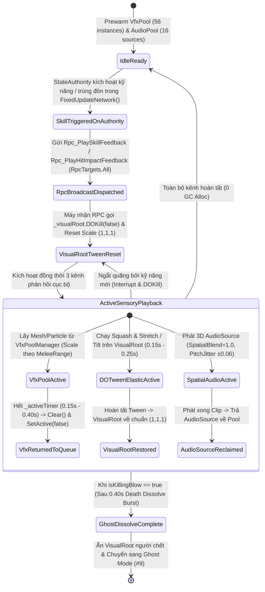

# 3D Spatial Audio & Combat VFX Feedback System

> **Status**: Designed
> **Creative Director Review (CD-GDD-ALIGN)**: APPROVED 2026-11-10
> **Author**: Solo Developer + Studio Agents (`technical-artist`, `sound-designer`, `gameplay-programmer`, `creative-director`, `qa-lead`)
> **Last Updated**: 2026-11-10
> **Last Verified**: 2026-11-10
> **Implements Pillar**: Pillar 1 (Cơ Động Phản Xạ Định Đoạt Sinh Tồn), Pillar 2 (Nhãn Quan Chiến Thuật Kép FPS/TPS) & Pillar 3 (Công Bằng Mạng Tuyệt Đối Trên Shared Mode) — **MDA Aesthetic 3: Sensation ("Game Feel" / Juiciness)**

## Summary

**3D Spatial Audio & Combat VFX Feedback System** là hệ thống phản hồi cảm giác chiến đấu đa giác quan (**MDA Aesthetic 3: Sensation / "Game Feel"**) ở tầng **Polish (`Full Vision`)** của *Capsule Arena: Last Man Standing*, chịu trách nhiệm biến mọi quyết định chiến thuật và trạng thái mạng khô khan trong `FixedUpdateNetwork()` thành những tín hiệu thị giác – thính giác sống động, tức thời và chuẩn xác tuyệt đối. Người chơi tương tác và cảm nhận trực tiếp hệ thống này trong từng pha giao tranh 30 giây: từ vệt kiếm bán nguyệt **Vàng Hổ Phách (`#F59E0B` $\rightarrow$ `#FEF08A`)** bổ thẳng từ đỉnh đầu xuống đất khi nhấn **Chuột trái (`Vertical Slash`)**, vệt quạt ngang góc vuông $90^\circ$ màu **Xanh Điện Từ (`#38BDF8` $\rightarrow$ `#818CF8`)** quét ngang hông đồng bộ hoàn hảo với cú xoay mượt thân người + Camera $90^\circ$ trong `0.15s` khi nhấn **phím `1` / `3` (`Horizontal Turning Slash`)**, độ nảy đàn hồi **DOTween Squash & Stretch** của thân hình Cartoon Capsule khi lướt tiến **phím `2` (`Forward Dash`)** và lăn né **phím `Q`/`E` (`Side Dodge Roll`)**, cho tới âm thanh không gian 3D (`spatialBlend = 1.0f`) cho phép định vị chính xác tiếng bước chân, tiếng gió lướt hay tiếng vung kiếm của kẻ địch khuất sau khối `Obstacle`. Hệ thống tồn tại nhằm đảm bảo: (1) mọi hiệu ứng hình học khớp 1:1 với vùng va chạm vật lý trong `CharacterCombatConfigSO` (`#1`); (2) đồng bộ tới toàn bộ máy trạm qua `[Rpc(RpcSources.StateAuthority, RpcTargets.All)]` mà không tốn chi phí `Runner.Spawn()` đối tượng mạng cho hiệu ứng thuần túy; và (3) duy trì `0 Instantiate / 0 Destroy / 0 Byte GC Allocation` trong trận đấu nhờ **Local VFX Object Pool (`VfxPoolManager`)**, **3D Spatial Audio Pool (`SoundManager`)** và cô lập hoàn toàn biến dạng DOTween trên nhánh con `VisualRoot` (**Pillar 1**, **Pillar 2** & **Pillar 3**).

> **Quick reference** — Layer: Polish · Priority: Full Vision · Key deps: Multi-Directional Melee & Pooled Ranged Combat System, Tick-Accurate Character Movement & Mobility System, Health, Damage RPC & Death State System

## Overview

Trong một trò chơi đối kháng đấu trường nhiều người chơi góc nhìn **TPS / FPS** tốc độ cao vận hành trên **Unity 6.6 (`6000.6.8f1`, URP)** và **Photon Fusion 2 (`GameMode.Shared`)**, ranh giới giữa một bản thử nghiệm kỹ thuật cứng nhắc và một tựa game hành động cuốn hút nằm ở **tính tức thời của phản hồi cảm giác (Kinetic & Sensory Feedback)** kết hợp với **tính trung thực của thông tin chiến thuật (Esports Visual & Acoustic Readability)**. **3D Spatial Audio & Combat VFX Feedback System (`System #14`)** đóng vai trò là chiếc cầu nối cuối cùng giữa tầng mô phỏng mạng (`#5 Movement`, `#6 Health`, `#7 Combat`) và giác quan của người chơi, được xây dựng xoay quanh 4 trụ cột kỹ thuật – mỹ thuật cốt lõi (tuân thủ nghiêm ngặt **Art Bible `design/art/art-bible.md` §3.2, §4.2, §5.3 & §8**):

1. **Đồng Bộ Hiệu Ứng Chiến Đấu & Cơ Động Qua `[Rpc]` (`Zero NetworkObject Spawn Overhead for Pure Visuals`):**
   - Thay vì khởi tạo `NetworkObject` nặng nề qua `Runner.Spawn()` cho các vệt chém kiếm, khói bụi lăn né hay tia lửa trúng đòn (vốn chỉ tồn tại `0.15s–0.40s` và không mang logic vật lý mạng), ngay khi người chơi có `Object.HasStateAuthority == true` kích hoạt kỹ năng hoặc xác nhận va chạm trong `FixedUpdateNetwork()`, hệ thống phát sóng hai thủ tục gọi từ xa siêu nhẹ:
     - `[Rpc(RpcSources.StateAuthority, RpcTargets.All)] public void Rpc_PlaySkillFeedback(CombatSkillId skillId, int directionSign, Vector3 originPos, float yawAngle)`: Kích hoạt đồng bộ vệt chém VFX, dải đuôi lướt/lăn, hiệu ứng đàn hồi DOTween trên `VisualRoot` và âm thanh 3D của kỹ năng tại đúng vị trí/góc quay khởi phát.
     - `[Rpc(RpcSources.StateAuthority, RpcTargets.All)] public void Rpc_PlayHitImpactFeedback(Vector3 hitWorldPos, CombatSkillId skillId, NetworkBool isKillingBlow)`: Kích hoạt tia nổ trúng đòn (`Hit Spark`), âm thanh va chạm uy lực tại tọa độ `hitWorldPos`, và bùng nổ hạt tan biến (`Death Dissolve Burst` trong `0.40s`) nếu đó là đòn kết liễu (`isKillingBlow == true`).
2. **Hệ Thống Hồ Chứa Hiệu Ứng Cục Bộ (`VfxPoolManager` — `0 Instantiate/Destroy` Trong Trận Đấu):**
   - Quản lý các hàng đợi `Queue<PooledVfxInstance>` được khởi tạo sẵn (`Prewarm`) ngay khi nạp Scene, sử dụng **Mesh hình quạt tĩnh (`Fan Arc Mesh`)** và `Shared VFX Atlas Material` (tương thích **URP SRP Batcher**). Kích thước hiển thị của vệt chém đọc trực tiếp `MeleeRange = 2.80m`, `VerticalSlashAngle = 45.0°` và `HorizontalSlashAngle = 90.0°` từ `CharacterCombatConfigSO` (`#1`), đảm bảo người chơi nhìn thấy vệt sáng ở đâu thì vùng sát thương vật lý nằm chính xác ở đó.
3. **Bộ Điều Khiển Đàn Hồi `DOTween Squash & Stretch` Cô Lập Trên `VisualRoot` (`CapsuleVisualFeelController`):**
   - Biến nhân vật từ một khối hình trụ tĩnh thành một **"Đấu Sĩ Đồ Chơi Đàn Hồi" (`Elastic Toy Gladiator`)** thông qua các phép biến đổi tỷ lệ (`DOScale`), nghiêng thân (`DOLocalRotate`) và giật lùi (`DOLocalMove`) đọc thông số từ `CharacterCombatConfigSO` (`VisualStretchScale = (0.78, 1.28, 0.78)`, `VisualSquashScale = (1.30, 0.70, 1.15)`, `DodgeVisualTiltAngle = 35.0°`, `TweenElasticityDuration = 0.18s`). Mọi Tween bắt buộc gọi `_visualRoot.DOKill(false)` và đưa về tỷ lệ chuẩn `(1, 1, 1)` trước khi thực thi Tween mới, đồng thời **tuyệt đối không chạm vào `transform.localScale` của `NetworkObject` gốc hay `HitboxRoot`**.
4. **Hệ Thống Âm Thanh Không Gian 3D (`3D Spatial Audio Pool — SoundManager`):**
   - Quản lý Pool gồm `PrewarmAudioSources = 16` nguồn phát `AudioSource` cấu hình chuẩn 3D (`spatialBlend = 1.0f`, `rolloffMode = AudioRolloffMode.Linear`, `minDistance = 2.50m`, `maxDistance = 32.0m`, biến thiên cao độ ngẫu nhiên `PitchJitter = ±0.06`). Hệ thống cho phép người chơi đeo tai nghe định vị phương hướng 360° và khoảng cách của tiếng bước chân, tiếng gió lướt `Forward Dash [2]`, tiếng vung kiếm $90^\circ$ (`1`/`3`) hay tiếng bắn đạn `Right Click` của đối thủ đang rình rập phía sau khối `Obstacle`.

## Player Fantasy

> **System Framing:** `[A] Direct Sensory Feedback — Người chơi nhìn thấy, nghe thấy và cảm nhận trực tiếp lực đàn hồi của từng thao tác bấm phím cũng như từng mối đe dọa xung quanh mình trong không gian 3D.`

### 1. Giấc mơ cốt lõi: "Cảm Giác Ra Đòn Đầy Sức Nặng & Giác Quan Thứ Sáu Trong Đấu Trường 3D"
Trong *Capsule Arena: Last Man Standing*, người chơi không điều khiển một khối hình học vô hồn trượt trên mặt phẳng; họ hóa thân thành một **Đấu Sĩ Đồ Chơi Đàn Hồi (Elastic Toy Gladiator)** tràn đầy nội lực, nơi mỗi lần nhấn phím trên bàn phím hoặc chạm vào cụm **7 nút hành động mềm góc dưới phải** đều trả về một khoái cảm xúc giác – thị giác – thính giác tức thì (**MDA Aesthetic 3: Sensation / "Juiciness"**).

Khi bạn nhấn phím `2` (**Forward Dash**), thân hình Capsule của bạn nén nhẹ lấy đà rồi vút dài về phía trước với dải lụa khí động học màu **Trắng Xanh (`#BAE6FD`)** xé gió bên tai. Khi một viên đạn năng lượng màu **Đỏ Cam (`#FB923C`)** rít lên từ phía bên phải, bạn nhấn `Q` (**Side Dodge Roll**): nhân vật lập tức ép rạp trọng tâm sát mặt đất (`Scale Y = 0.70`), nghiêng mình $35^\circ$ lăn vọt qua một bên trong làn khói bụi **Xanh Ngọc (`#34D399`)**, để mặc viên đạn sượt qua khoảng không vừa đứng. Và khoảnh khắc thăng hoa nhất là khi bạn lao tới góc tường chữ L, nhấn phím `1` hoặc `3` (**Horizontal Turning Slash $90^\circ$**): một lưỡi đao hình quạt vuông góc $90^\circ$ màu **Xanh Điện Từ (`#38BDF8`)** quét ngang không trung với tiếng chém sắc lẹm, đồng bộ tuyệt đối với cú xoay mượt $90^\circ$ của cả thân người lẫn góc nhìn Camera trong `0.15s`, tiếp nối bằng tiếng nổ **Hit Spark** giòn tan khi lưỡi kiếm chạm trúng mục tiêu và làm đối thủ tan biến thành hàng chục hạt sáng bay lên bầu trời (**Death Dissolve Burst**).

### 2. Trải nghiệm cảm giác qua từng khoảnh khắc (How the Player Experiences the Effects)
1. **Đọc Vị Chiêu Thức Trong Chớp Mắt Dưới 100ms (100ms Telegraph & Spatial Readability):** Nhờ sự phân tách triệt để cả về **Trục Không Gian** lẫn **Bảng Màu Ngữ Nghĩa** (`Art Bible §3.2 & §4.2`), ngay khi đối phương vừa ra đòn, não bộ người chơi lập tức phân biệt được: vệt bán nguyệt dựng đứng màu **Vàng Hổ Phách (`#F59E0B`)** là nhát **Chém dọc (`Left Click` — `35 HP`)** cần lăn ngang `Q`/`E` để né; còn mảng quạt phẳng nằm ngang rộng đúng góc vuông $90^\circ$ màu **Xanh Điện Từ (`#38BDF8`)** là nhát **Chém ngang xoay người (`1`/`3` — `25 HP`)** cần giữ khoảng cách ngoài `MeleeRange = 2.80m`.
2. **Định Vị Kẻ Địch Khuất Tầm Nhìn Bằng Thính Giác 3D (Acoustic Radar Behind Cover):** Khi đang đứng ở góc nhìn thứ nhất (**FPS**) nép sau một khối `Obstacle` cao `2.8m` (che khuất hoàn toàn tầm nhìn mắt thường), đôi tai của người chơi trở thành một radar chiến thuật (**Pillar 2**). Tiếng gió rít trầm đục của cú lướt `Forward Dash [2]` vang lên từ tai trái ở khoảng cách `~8m` báo hiệu đối thủ đang lao vào bọc sườn chữ L, cho phép người chơi bấm sẵn phím `1` (Chém ngang xoay trái $90^\circ$) để đón lõng ngay khi địch vừa bước qua mép tường.
3. **Sự Thỏa Mãn Khi Trúng Đòn & Kết Liễu (Impact Confirmation & Victory Euphoria):** Người chơi không cần phải căng mắt nhìn con số trên thanh máu mới biết mình đánh trúng. Ngay tại khoảnh khắc đòn đánh hợp lệ trên máy `StateAuthority`, một chùm tia lửa **Hit Spark** bùng sáng tại đúng điểm tiếp xúc kèm âm thanh va chạm đanh gọn (với cao độ được biến thiên nhẹ `±0.06` để không bao giờ nghe máy móc). Khi nhát kiếm cuối cùng hạ gục đối thủ (`CurrentHealth <= 0`), hiệu ứng **Death Dissolve Burst** phân rã mục tiêu thành cột hạt sáng bay lên trời trong `0.40s` kèm âm vang kết liễu đặc trưng, mang lại cảm giác chiến thắng dứt khoát đồng thời dọn sạch tầm nhìn sàn đấu tức thì.

### 3. Điểm chạm Tham chiếu & Đối chiếu Trụ cột Thiết kế

| Điểm tham chiếu / Trụ cột | Cách `3D Spatial Audio & Combat VFX Feedback System` hiện thực hóa trải nghiệm |
| :--- | :--- |
| ***Brawl Stars*** *(Exact Hitbox-to-VFX Arc Matching)* | Mesh quạt chém dọc (`45°`) và quạt chém ngang (`90°`) được co giãn động theo `MeleeRange = 2.80m` từ `CharacterCombatConfigSO`, đảm bảo biên hiển thị của VFX trùng khít 100% với biên kiểm tra sát thương. |
| ***Fall Guys*** *(Elastic Vinyl Toy Squash & Stretch)* | Ứng dụng `DOTween Squash & Stretch` trên nhánh `VisualRoot` với biên độ nén/giãn `0.70x–1.30x` trong `0.18s`, tạo độ nảy hoạt hình sống động cho nhân vật Cartoon Capsule mà không làm biến dạng `HitboxRoot`. |
| ***Valorant / PUBG*** *(Competitive 3D Positional Audio)* | Toàn bộ âm thanh hành động trong đấu trường sử dụng `spatialBlend = 1.0f` với khoảng cách suy giảm tuyến tính `2.50m–32.0m`, giúp người chơi phán đoán chính xác vị trí giao tranh và tiếng bước chân/lướt quanh khối `Obstacle`. |
| **Pillar 1, Pillar 2 & Pillar 3** | Phản hồi thị giác/âm thanh tức thời cho 7 nút kỹ năng (**Pillar 1**), giữ màn hình FPS trong suốt nhờ quy tắc `ShadowsOnly` khi đang Squash & Stretch (**Pillar 2**), và đồng bộ qua `[Rpc]` không tạo rác bộ nhớ hay lệch Hitbox mạng (**Pillar 3**). |

## Detailed Design

### Core Rules

1. **Quy tắc Đồng Bộ Hiệu Ứng Qua `[Rpc]` Không Sinh `NetworkObject` (`Zero NetworkObject Spawn Overhead for Pure Visuals`):**
   - Nghiêm cấm sử dụng `Runner.Spawn()` hoặc gắn `NetworkObject` lên các Prefab hiệu ứng thuần túy (vệt chém kiếm, khói lăn né, tia nổ trúng đòn, hạt tan biến tử trận) nhằm bảo toàn băng thông gói tin trạng thái của **Photon Fusion 2 (`GameMode.Shared`)**.
   - Khi người chơi có `Object.HasStateAuthority == true` kích hoạt thành công một kỹ năng trong `FixedUpdateNetwork()`, thành phần chiến đấu/di chuyển gọi ngay:
     ```csharp
     [Rpc(RpcSources.StateAuthority, RpcTargets.All)]
     public void Rpc_PlaySkillFeedback(CombatSkillId skillId, int directionSign, Vector3 originPos, float yawAngle)
     ```
     Trong đó:
     - `skillId`: Định danh kỹ năng (`VerticalSlash`, `HorizontalSlash`, `RangedAttack`, `ForwardDash`, `SideDodge`).
     - `directionSign`: Dấu hướng thực thi (`-1` cho Trái `[1]`/`[Q]`, `+1` cho Phải `[3]`/`[E]`, `0` cho hướng thẳng chính diện `[LMB]`/`[RMB]`/`[2]`).
     - `originPos`: Tọa độ thế giới (`Vector3`) của nhân vật tại Tick kích hoạt.
     - `yawAngle`: Góc hướng mặt khởi điểm (`eulerAngles.y`) của nhân vật tại Tick kích hoạt, dùng để định hướng chính xác góc mở của vệt quạt chém.
   - Khi hệ thống chiến đấu (`#7`) hoặc hệ thống máu (`#6`) xác nhận một đòn đánh gây sát thương hợp lệ, máy thực thi gọi:
     ```csharp
     [Rpc(RpcSources.StateAuthority, RpcTargets.All)]
     public void Rpc_PlayHitImpactFeedback(Vector3 hitWorldPos, CombatSkillId skillId, NetworkBool isKillingBlow)
     ```
     Để phát tia lửa va chạm (`Hit Spark`) + âm thanh trúng đòn tại `hitWorldPos`, và kích hoạt thêm hiệu ứng phân rã tử trận (`Death Dissolve Burst`) nếu `isKillingBlow == true`.

2. **Quy tắc Hồ Chứa Hiệu Ứng Cục Bộ (`VfxPoolManager` — `0 Instantiate/Destroy` Trong Trận Đấu):**
   - Toàn bộ Prefab VFX chiến đấu và cơ động được quản lý bởi `VfxPoolManager` (Scene Singleton khởi tạo sẵn trong `Awake()`). Mỗi loại hiệu ứng có một hàng đợi `Queue<PooledVfxInstance>` riêng được `Prewarm` trước khi trận đấu bắt đầu.
   - Khi lấy một thực thể từ Pool (`SpawnFromPool`), hệ thống:
     1. Đặt `transform.SetPositionAndRotation(pos, rot)` và tính tỷ lệ `localScale` động từ `CharacterCombatConfigSO`.
     2. Bật `gameObject.SetActive(true)`, gọi `particleSystem.Clear(true)` và `trailRenderer.Clear()` trước khi gọi `particleSystem.Play(true)` nhằm xóa sạch mọi vệt hạt/đuôi cũ từ lần sử dụng trước.
     3. Khởi chạy bộ đếm thời gian cục bộ (`_activeTimer = duration`) trong vòng lặp `Update()` của `VfxPoolManager` (không dùng `Coroutine` hay `Invoke` để tránh cấp phát rác `GC.Alloc`). Khi `_activeTimer <= 0f`, thực thể tự động `Stop()`, `SetActive(false)` và đẩy trả về `Queue`.
   - **Đặc tả 4 nhóm Hiệu Ứng Cốt Lõi (Khớp 1:1 với `CharacterCombatConfigSO` & `Art Bible §3.2, §4.2`):**

| Nhóm Hiệu Ứng (`VfxType`) | Prefab Chuẩn (`Art Bible §8.2`) | Kích Thước & Hình Học (`CharacterCombatConfigSO`) | Bảng Màu Ngữ Nghĩa (`Art Bible §4.2`) | Thời Lượng (`Duration`) | Số Lượng Prewarm |
| :--- | :--- | :--- | :--- | :---: | :---: |
| **1. Vệt Chém Dọc (`VerticalSlashArc`)** | `vfx_slash_vertical_lmb_m.prefab` | Mesh bán nguyệt dựng đứng (Trục Y–Z, cao `Y = 0.2m -> 2.2m`), bán kính **`MeleeRange = 2.80m`**, góc mở ngang **`VerticalSlashAngle = 45.0°`**. | **Vàng Hổ Phách Rực Lửa (`#F59E0B` $\rightarrow$ `#FEF08A`)** (HDR Emission). | **`0.18s`** | `12` |
| **2. Vệt Quạt Chém Ngang Xoay $90^\circ$ (`HorizontalSlashFan90`)** | `vfx_slash_horizontal_turn90_m.prefab` | Mesh quạt phẳng nằm ngang ở độ cao ngực **`Y = 1.0m`** (Trục X–Z), bán kính **`MeleeRange = 2.80m`**, góc mở vuông góc **`HorizontalSlashAngle = 90.0°`** quét từ hướng mặt ban đầu sang Trái (`-90°`, phím `1`) hoặc sang Phải (`+90°`, phím `3`). | **Xanh Điện Từ / Lam Sắc Lẹm (`#38BDF8` $\rightarrow$ `#818CF8` $\rightarrow$ Trắng ở lưỡi đao)**. | **`0.15s`** *(Khớp `HorizontalTurnDuration`)* | `12` |
| **3. Lướt Tiến (`DashTrail`) & Lăn Né (`DodgeDustBurst`)** | `vfx_dash_trail_cyan_m.prefab`<br>`vfx_dodge_dust_emerald_s.prefab` | - **Dash (`[2]`):** Dải `TrailRenderer` rộng `0.60m` tại `Y = 1.0m` gắn trên `VisualRoot` (kéo dài theo quãng đường lướt `4.00m`).<br>- **Dodge (`[Q/E]`):** Cụm `12` hạt khói bụi bung ngang dưới chân (`Y = 0.15m`) theo hướng ngược chiều lăn. | - **Dash (`[2]`):** **Trắng Xanh Khí Động Học (`#BAE6FD` $\rightarrow$ `#00F5D4`)**.<br>- **Dodge (`[Q/E]`):** **Xanh Ngọc Cơ Động (`#34D399`)**. | - Dash: **`0.25s`** (`DashDuration`)<br>- Dodge: **`0.22s`** (`DodgeDuration`) | `8` (Trail gắn sẵn) + `16` (Dust Pool) |
| **4. Tia Nổ Trúng Đòn (`HitSpark`) & Tan Biến Tử Trận (`DeathDissolveBurst`)** | `vfx_hit_spark_impact_s.prefab`<br>`vfx_death_dissolve_burst_m.prefab` | - **Hit Spark:** Cụm `15` tia lửa góc cạnh bung hướng tâm tại `hitWorldPos` + vòng xung kích nhỏ (`Radius = 0.65m`).<br>- **Death Dissolve:** Cột `24` hạt năng lượng bay vọt lên trời (`Y = 0.0m -> 3.5m`) khi `isKillingBlow == true`. | - **Hit Spark:** Lõi Trắng Vàng **`#FEF08A`** + viền Đỏ San Hô **`#F43F5E`**.<br>- **Death Dissolve:** Xanh Hồn Ma **`#06B6D4` $\rightarrow$ `#67E8F9`**. | - Hit Spark: **`0.20s`**<br>- Death Dissolve: **`0.40s`** | `16` (Hit Spark) + `8` (Death Burst) |

3. **Quy tắc Cô Lập Biến Dạng Đàn Hồi `DOTween Squash & Stretch` Trên `VisualRoot` (`CapsuleVisualFeelController`):**
   - Thành phần `CapsuleVisualFeelController` chỉ giữ tham chiếu tới `Transform _visualRoot` (nhánh con thứ `[2]` của Prefab nhân vật `chr_capsule_player_networked_m.prefab` theo `Art Bible §8.4`).
   - **Luật Bất Khả Xâm Phạm Về Hitbox Mạng:** Nghiêm cấm thay đổi `transform.localScale`, `transform.localPosition` hay `transform.localRotation` của `NetworkObject` gốc hoặc nhánh `[1] Hitbox_Body` (`HitboxRoot`). Nhờ đó, dù nhân vật có đang nén dẹt xuống `70%` chiều cao khi lăn né hay kéo giãn `128%` khi lướt tiến, vùng kiểm tra `Runner.LagCompensation` của Photon Fusion 2 vẫn giữ nguyên tỷ lệ chuẩn `(1.0, 1.0, 1.0)`.
   - **Quy Trình Dọn Dẹp Trước Mỗi Tween (`Clean Reset Before Tween`):** Trước khi kích hoạt bất kỳ hiệu ứng đàn hồi mới nào, `CapsuleVisualFeelController` bắt buộc thực thi 4 lệnh chuẩn hóa:
     ```csharp
     _visualRoot.DOKill(complete: false);
     _visualRoot.localScale = Vector3.one;
     _visualRoot.localPosition = Vector3.zero;
     _visualRoot.localRotation = Quaternion.identity;
     ```
   - **Bảng Đặc Tả Phản Hồi Đàn Hồi Theo Từng Hành Động (Đọc Từ `CharacterCombatConfigSO`):**
     - **Forward Dash (`Phím 2`):** Kéo giãn tức thì tới `Config.VisualStretchScale = (0.78, 1.28, 0.78)` kết hợp nghiêng thân tới trước `+22.0°` quanh trục X trong nửa đầu `TweenElasticityDuration` (`0.09s`), giữ tư thế khí động học trong suốt `DashDuration = 0.25s`, sau đó bật nảy đàn hồi về `(1, 1, 1)` và `(0°, 0°, 0°)` với hàm `Ease.OutBack` trong `0.09s`.
     - **Side Dodge Roll (`Phím Q` Trái / `Phím E` Phải):** Nén thấp trọng tâm xuống `Config.VisualSquashScale = (1.30, 0.70, 1.15)` đồng thời nghiêng gập trục Z một góc `+Config.DodgeVisualTiltAngle` (`+35.0°` khi lăn trái `Q`) hoặc `-Config.DodgeVisualTiltAngle` (`-35.0°` khi lăn phải `E`) trong `DodgeDuration = 0.22s`, rồi hồi phục về `(1, 1, 1)` với `Ease.OutElastic`.
     - **Vertical Slash (`Left Click`):** Vươn cao lấy đà `(0.88, 1.20, 0.88)` trong `0.05s` rồi dập mạnh xuống `(1.16, 0.85, 1.16)` trong `0.08s`, trước khi trả về `(1, 1, 1)` trong `0.05s` (tổng thời gian đúng bằng `TweenElasticityDuration = 0.18s`).
     - **Horizontal Turning Slash $90^\circ$ (`Phím 1` Trái / `Phím 3` Phải):** Mở rộng trục ngang `(1.22, 0.90, 1.10)` và nghiêng nhẹ vai theo chiều quay (`±15.0°` trục Z) đồng bộ suốt `HorizontalTurnDuration = 0.15s` trong khi `NetworkTransform` và Camera Cinemachine xoay mượt $\pm 90^\circ$.
     - **Ranged Attack (`Right Click`):** Giật lùi `VisualRoot.localPosition` về phía sau `-0.12m` dọc trục Z và nén ngắn chiều sâu `(1.08, 1.08, 0.84)` trong `0.06s`, sau đó trượt mượt về `Vector3.zero` và `Vector3.one` trong `0.12s` (`Ease.OutQuad`), kèm tia chớp đầu nòng tại `MuzzlePoint (0, 1.15m, 0.60m)`.

4. **Quy tắc Hệ Thống Âm Thanh Không Gian 3D (`3D Spatial Audio Pool — SoundManager`):**
   - `SoundManager` khởi tạo sẵn một hồ chứa gồm **`PrewarmAudioSources = 16`** đối tượng `AudioSource` con tại `Awake()`.
   - Mỗi `AudioSource` trong Pool được khóa cấu hình âm thanh 3D chuẩn đấu trường:
     - `spatialBlend = 1.0f` (**100% 3D Spatial Audio** — âm lượng và cân bằng tai trái/phải phụ thuộc hoàn toàn vào vị trí tương đối so với `AudioListener` gắn trên Camera chính).
     - `rolloffMode = AudioRolloffMode.Linear` (suy giảm tuyến tính rõ ràng, giúp người chơi ước lượng khoảng cách chính xác hơn hàm Logarithmic trong không gian `40m x 40m`).
     - `minDistance = 2.50f` (`AudioMinDistance` — trong bán kính `2.50m` gần bằng `MeleeRange = 2.80m`, âm thanh phát ở mức âm lượng tối đa `100%`).
     - `maxDistance = 32.0f` (`AudioMaxDistance` — vượt quá `32.0m`, âm thanh suy giảm về `0%`, tránh nhiễu tạp âm từ góc chéo xa nhất của bản đồ).
     - `dopplerLevel = 0.0f` (tắt hiệu ứng biến dạng tần số Doppler để tránh méo tiếng kỳ dị khi nhân vật lướt `DashSpeed = 16.0 m/s` hoặc xoay Camera $90^\circ$ tốc độ cao).
   - **Biến Thiên Cao Độ Chống Mỏi Tai (`Pitch Jitter`):** Mỗi khi phát một hiệu ứng âm thanh chiến đấu hoặc cơ động, `SoundManager` áp dụng độ lệch ngẫu nhiên `pitch = 1.0f + Random.Range(-0.06f, +0.06f)` (`PitchJitterRange = 0.06`), giúp chuỗi tiếng chém kiếm, tiếng bắn đạn và tiếng bước chân liên tiếp luôn tự nhiên, sống động.
   - **Chính Sách Thu Hồi Giọng Ưu Tiên (`Voice Stealing Policy`):** Nếu cả `16` nguồn `AudioSource` đều đang bận phát khi có yêu cầu âm thanh thứ `17`, `SoundManager` không tạo mới `GameObject` mà tự động thu hồi nguồn phát có **độ ưu tiên thấp nhất và ở xa `AudioListener` nhất** (hoặc sắp kết thúc nhất) để phát âm thanh mới.

### States and Transitions

Vòng đời xử lý một sự kiện phản hồi chiến đấu/cơ động (từ lúc kích hoạt trong `FixedUpdateNetwork()` trên máy `StateAuthority` cho đến khi hoàn tất hiển thị VFX, DOTween và 3D Audio trên mọi máy Client) vận hành theo máy trạng thái xác định dưới đây:



1. **`IdleReady` (Sẵn sàng trong Hồ chứa):** Toàn bộ thực thể VFX và `AudioSource` nằm chờ ở trạng thái `SetActive(false)` / `isPlaying == false` trong bộ nhớ đã Prewarm; nhánh `VisualRoot` của các nhân vật còn sống ở tỷ lệ chuẩn `(1, 1, 1)`.
2. **`SkillTriggeredOnAuthority` $\rightarrow$ `RpcBroadcastDispatched` (Phát Tín Hiệu Mạng):** Máy có `Object.HasStateAuthority` xác nhận thao tác hợp lệ trong `FixedUpdateNetwork()` và phát lệnh `[Rpc]` tới `RpcTargets.All` (bao gồm cả chính máy `StateAuthority` để đồng nhất đường ống hiển thị).
3. **`VisualRootTweenReset` (Dọn Dẹp Chống Chồng Chéo):** Ngay khi nhận `[Rpc]`, `CapsuleVisualFeelController` hủy Tween đang chạy dở (`DOKill(false)`) và đặt lại `VisualRoot` về trạng thái gốc trước khi áp dụng biến dạng mới.
4. **`ActiveSensoryPlayback` (Phát Đồng Bộ Đa Giác Quan):** Hệ thống đồng thời (a) bật vệt chém / hạt nổ từ `VfxPoolManager`, (b) chạy chuỗi `DOTween` trên `VisualRoot`, và (c) định vị `AudioSource` 3D tại tọa độ phát sinh âm thanh.
5. **`GhostDissolveComplete` (Chuyển Tiếp Tử Trận Sang Khán Đài Hồn Ma):** Nếu nhận `Rpc_PlayHitImpactFeedback` với `isKillingBlow == true`, hiệu ứng `Death Dissolve Burst` bùng lên trong `0.40s` trong khi `VisualRoot` co rút nhanh về `0` và ẩn hẳn, bàn giao mượt mà sang trạng thái **Ghost Mode Spectator (`#9`)**.

### Interactions with Other Systems

| Hệ Thống Liên Quan | Hướng Tương Tác | Cơ Chế Hợp Đồng Dữ Liệu & Sự Kiện (`Method / RPC / Event`) |
| :--- | :---: | :--- |
| **System #1: Character & Combat Config Data (`CharacterCombatConfigSO`)** | **Upstream (`#1 -> #14`)** | Hệ thống `#14` đọc trực tiếp `MeleeRange` (`2.80m`), `VerticalSlashAngle` (`45.0°`), `HorizontalSlashAngle` (`90.0°`), `HorizontalTurnDuration` (`0.15s`), `DashDuration` (`0.25s`), `DodgeDuration` (`0.22s`), `VisualStretchScale` (`(0.78, 1.28, 0.78)`), `VisualSquashScale` (`(1.30, 0.70, 1.15)`), `DodgeVisualTiltAngle` (`35.0°`) và `TweenElasticityDuration` (`0.18s`). |
| **System #5: Tick-Accurate Character Movement & Mobility System** | **Upstream (`#5 -> #14`)** | Khi người chơi kích hoạt **Forward Dash (`[2]`)** hoặc **Side Dodge Roll (`[Q]`/`[E]`)** trong `FixedUpdateNetwork()`, `#5` gọi `Rpc_PlaySkillFeedback(CombatSkillId.ForwardDash / SideDodge, directionSign, originPos, yawAngle)`. Ngoài ra, khi nhân vật di chuyển `WASD` trên mặt sàn với vận tốc `> 1.0 m/s`, bộ đếm nhịp bước chân cục bộ gọi `SoundManager.PlayFootstep3D(footPos)` mỗi `0.34s`. |
| **System #6: Health, Damage RPC & Death State System** | **Upstream (`#6 -> #14`)** | Khi `Rpc_TakeDamage` trên máy `StateAuthority` trừ máu mục tiêu, `#6` kích hoạt `Rpc_PlayHitImpactFeedback(hitWorldPos, skillId, isKillingBlow)`. Nếu `isKillingBlow == true` (`CurrentHealth <= 0`), `#14` phát `Death Dissolve Burst` (`0.40s`) và âm thanh tử trận 3D, đồng thời dọn sạch mọi Tween/Trail trên `VisualRoot` của người vừa chết. |
| **System #7: Multi-Directional Melee & Pooled Ranged Combat System** | **Upstream (`#7 -> #14`)** | Khi tung đòn **Vertical Slash (`LMB`)**, **Horizontal Turning Slash $90^\circ$ (`1`/`3`)** hoặc **Ranged Attack (`RMB`)**, `#7` gọi `Rpc_PlaySkillFeedback(...)`. Riêng với đạn tầm xa (`pf_proj_ranged_orb_01.prefab` quản lý bởi `#4 INetworkObjectProvider`), khi viên đạn `Spawned()` hoặc `Despawned()`, thành phần hiển thị của đạn gọi `trailRenderer.Clear()` và phát tiếng nổ va chạm qua `SoundManager` khi chạm tường `Obstacle` / `Boundary`. |
| **System #8: Combat HUD, Overhead Billboard & Mobile Action Pad UI** | **Parallel (`#8 <-> #14`)** | Các âm thanh giao diện 2D (`spatialBlend = 0.0f` như tiếng click nút mềm trên cụm **7 Button góc dưới phải**, tiếng báo kỹ năng đang Cooldown, tiếng ting thông báo Chat) được định tuyến qua kênh `PlayUiSound2D()` tách biệt hoàn toàn với Pool 16 nguồn âm thanh không gian 3D của sàn đấu. |
| **System #9: Dual-Perspective Camera (FPS/TPS) & Ghost Mode Spectator** | **Bidirectional (`#9 <-> #14`)** | - `AudioListener` duy nhất của Scene luôn gắn chặt trên Camera chính (`MainCamera` do Cinemachine điều khiển), đảm bảo khi đổi góc nhìn `FPS <-> TPS` (phím `V`), xoay nhanh $90^\circ$ (phím `1`/`3`) hoặc chuyển đổi mục tiêu xem trong **Ghost Mode (`Next / Previous`)**, tâm nghe 3D luôn khớp với vị trí mắt người chơi.<br>- Khi ở chế độ **FPS**, `#9` chuyển `MeshRenderer` thân của `LocalPlayer` sang `ShadowCastingMode.ShadowsOnly`; `#14` vẫn chạy `DOTween Squash & Stretch` bình thường trên `VisualRoot` để bóng đổ dưới đất co giãn sống động mà không bao giờ làm Mesh nhân vật lọt vào che khuất tâm ngắm FPS. |

## Formulas

### 1. Hệ Số Suy Giảm Âm Lượng Không Gian 3D Theo Khoảng Cách (`spatial_audio_attenuation`)

The `spatial_audio_attenuation` formula is defined as:

`spatial_audio_attenuation = clamp(1.0 - ((listener_distance - AudioMinDistance) / (AudioMaxDistance - AudioMinDistance)), 0.0, 1.0)`

**Variables:**

| Variable | Type | Range | Source | Description |
| :--- | :---: | :---: | :--- | :--- |
| `listener_distance` | `float` | `0.0–68.0` | `Vector3.Distance(audioListenerPos, soundOriginPos)` | Khoảng cách Euclid trong không gian 3D (mét) từ vị trí `AudioListener` (Camera người nghe) tới nguồn phát âm thanh. |
| `AudioMinDistance` | `float` | `1.50–5.00` | `SoundManager` (`mặc định 2.50m`) | Bán kính cự ly gần mà bên trong đó âm thanh giữ nguyên âm lượng cực đại `1.0` (`100%`), khớp với tầm cận chiến `MeleeRange = 2.80m`. |
| `AudioMaxDistance` | `float` | `20.0–50.0` | `SoundManager` (`mặc định 32.0m`) | Bán kính cự ly tối đa mà tại đó âm thanh suy giảm tuyến tính về `0.0` (`0%`), bao phủ tầm bắn đạn `ProjectileMaxDistance = 26.0m` cộng biên dự phòng. |
| `spatial_audio_attenuation` | `float` | `0.0–1.0` | Hệ số khuếch đại khoảng cách của `AudioSource` (`Linear Rolloff`) | Tỷ lệ âm lượng thực tế (`0%` đến `100%`) truyền tới tai người chơi trước khi nhân với `base_clip_volume`. |

**Output Range:** `0.0` (im lặng hoàn toàn khi ở ngoài `32.0m`) đến `1.0` (âm lượng tối đa `100%` khi ở trong phạm vi `<= 2.50m`).

**Example:**
- **Giao tranh cận chiến (`listener_distance = 2.20m`):** Với `AudioMinDistance = 2.50m` và `AudioMaxDistance = 32.0m`:
  `spatial_audio_attenuation = clamp(1.0 - ((2.20 - 2.50) / (32.0 - 2.50)), 0.0, 1.0) = clamp(1.0 - (-0.0102), 0.0, 1.0) = 1.0` (`100%` âm lượng — tiếng chém dọc `LMB` và chém ngang $90^\circ$ `1`/`3` nghe rõ mồn một).
- **Đối phương lướt `Forward Dash [2]` sau khối `Obstacle` ở cự ly trung bình (`listener_distance = 17.25m`):**
  `spatial_audio_attenuation = clamp(1.0 - ((17.25 - 2.50) / 29.50), 0.0, 1.0) = clamp(1.0 - (14.75 / 29.50), 0.0, 1.0) = 0.50` (`50%` âm lượng — đủ rõ để người chơi đeo tai nghe nhận biết hướng địch đang áp sát).
- **Giao tranh ở góc đối diện sàn đấu (`listener_distance = 35.0m`):**
  `spatial_audio_attenuation = clamp(1.0 - (32.50 / 29.50), 0.0, 1.0) = 0.0` (`0%` âm lượng — cắt bỏ hoàn toàn tạp âm ở quá xa để người chơi tập trung vào mối đe dọa gần).

---

### 2. Tỷ Lệ Kích Thước Động Của Mesh Quạt Chém Cận Chiến (`vfx_arc_mesh_scale`)

The `vfx_arc_mesh_scale` formula is defined as:

`vfx_arc_mesh_scale = MeleeRange / base_mesh_unit_radius`

**Variables:**

| Variable | Type | Range | Source | Description |
| :--- | :---: | :---: | :--- | :--- |
| `MeleeRange` | `float` | `1.50–5.00` | `CharacterCombatConfigSO.MeleeRange` (`mặc định 2.80m`) | Bán kính vùng gây sát thương cận chiến thực tế của cả nhát chém dọc (`Left Click`) và nhát chém ngang xoay người $90^\circ$ (`1`/`3`). |
| `base_mesh_unit_radius` | `float` | `1.0` (chuẩn hóa) | Tài nguyên Mesh gốc (`vfx_slash_vertical_lmb_m` & `vfx_slash_horizontal_turn90_m`) | Bán kính hình học cơ sở của Mesh hình quạt khi xuất từ phần mềm 3D (`1.0m` đơn vị chuẩn). |
| `vfx_arc_mesh_scale` | `float` | `1.50–5.00` | `VfxPoolManager.SpawnSlashArc()` | Hệ số nhân `transform.localScale` (trên mặt phẳng bán kính) áp dụng cho Prefab vệt chém ngay khi lấy ra từ Pool. |

**Output Range:** `1.50` đến `5.00` (tương ứng bán kính hiển thị `1.50m` đến `5.00m` trong không gian thế giới).

**Example:**
- Với `MeleeRange = 2.80m` (mặc định trong `CharacterCombatConfigSO`) và Mesh gốc được dựng ở bán kính chuẩn `base_mesh_unit_radius = 1.0m`:
  `vfx_arc_mesh_scale = 2.80 / 1.0 = 2.80`.
  Khi người chơi nhấn phím `1` (Chém ngang trái $90^\circ$), `VfxPoolManager` đặt `localScale = new Vector3(-2.80f, 1.0f, 2.80f)` (dấu âm trục X lật cung quạt $90^\circ$ sang bên trái khi `directionSign == -1`), giúp mép ngoài của lưỡi đao ánh sáng **Xanh Điện Từ (`#38BDF8`)** vươn tới đúng cự ly `2.80m` khớp 100% với `Runner.LagCompensation.OverlapSphere`.

---

### 3. Cao Độ Âm Thanh Ngẫu Nhiên Hóa Chống Mỏi Tai (`randomized_audio_pitch`)

The `randomized_audio_pitch` formula is defined as:

`randomized_audio_pitch = base_pitch + random_range(-PitchJitterRange, PitchJitterRange)`

**Variables:**

| Variable | Type | Range | Source | Description |
| :--- | :---: | :---: | :--- | :--- |
| `base_pitch` | `float` | `0.85–1.20` | Cấu hình `AudioClipEntry` trong `SoundManager` (`mặc định 1.00`) | Cao độ chuẩn của tệp âm thanh gốc (`.wav` / `.ogg`). |
| `PitchJitterRange` | `float` | `0.00–0.15` | `SoundManager.PitchJitterRange` (`mặc định 0.06`) | Biên độ dao động cao độ ngẫu nhiên tối đa về hai phía âm/dương (`±6%`). |
| `random_range(min, max)` | `float` | `[-0.06, +0.06]` | `UnityEngine.Random.Range(-PitchJitterRange, PitchJitterRange)` | Hàm sinh số thực ngẫu nhiên phân bố đều tại thời điểm kích hoạt `AudioSource.Play()`. |
| `randomized_audio_pitch` | `float` | `0.70–1.35` | Gán vào `audioSource.pitch` | Cao độ thực tế của hiệu ứng âm thanh trong lần phát đó. |

**Output Range:** `0.94` đến `1.06` (với `base_pitch = 1.00` và `PitchJitterRange = 0.06`).

**Example:**
- Khi 2 người chơi liên tục vung kiếm **Vertical Slash (`Left Click`, cooldown `0.65s`)** hoặc bắn đạn **Ranged Attack (`Right Click`, cooldown `0.55s`)** với `base_pitch = 1.00` và `PitchJitterRange = 0.06`:
  - Lần phát 1: `random_range(-0.06, 0.06) = +0.042` $\rightarrow$ `randomized_audio_pitch = 1.042`.
  - Lần phát 2: `random_range(-0.06, 0.06) = -0.035` $\rightarrow$ `randomized_audio_pitch = 0.965`.
  Sự khác biệt tinh tế này xóa bỏ hoàn toàn hiện tượng "tiếng súng máy lặp lại cơ học" (machine-gunning effect) mà vẫn giữ nguyên bản sắc âm thanh dễ nhận diện của từng kỹ năng.

## Edge Cases

1. **Khi người chơi bấm liên tiếp `Forward Dash [2]` hoặc `Side Dodge Roll [Q/E]` ngay sau khi vừa vung kiếm `Left Click` khiến hai chuỗi `DOTween` chồng lên nhau:**
   - Trước khi khởi chạy bất kỳ Tween mới nào trên `VisualRoot`, phương thức `CapsuleVisualFeelController.PlaySkillFeel()` bắt buộc gọi `_visualRoot.DOKill(complete: false)` và gán cứng `_visualRoot.localScale = Vector3.one`, `_visualRoot.localPosition = Vector3.zero`, `_visualRoot.localRotation = Quaternion.identity`. Quy tắc này ngăn chặn triệt để lỗi nhân dồn tỷ lệ biến dạng (ví dụ: nhân vật bị kẹt vĩnh viễn ở trạng thái méo mó `(0.65, 1.50, 0.65)` do hai Tween cùng sửa `localScale`).
2. **Khi có hơn `16` hiệu ứng âm thanh 3D kích hoạt đồng thời trong một pha giao tranh hỗn loạn 8 người chơi (`Audio Pool Exhaustion`):**
   - `SoundManager` không bao giờ gọi `Instantiate()` tạo thêm `AudioSource` mới lúc đang chiến đấu. Thay vào đó, thuật toán **Voice Stealing** quét qua mảng 16 nguồn phát cố định: ưu tiên thu hồi nguồn có `Priority` thấp nhất (như tiếng bước chân `Footstep`) đang nằm xa `AudioListener` nhất; nếu mọi nguồn đều cùng mức ưu tiên, hệ thống thu hồi nguồn có thời gian phát còn lại ngắn nhất (`clip.length - time`) để nhường chỗ cho âm thanh quan trọng mới (như `Hit Spark` hoặc `Killing Blow`).
3. **Khi người chơi `LocalPlayer` đang ở chế độ góc nhìn thứ nhất (`FPS` — `ShadowCastingMode.ShadowsOnly`) và thực hiện `Squash & Stretch` hoặc xoay người $90^\circ$ (`[1]`/`[3]`):**
   - Nhờ nhánh `CameraTargets` (`FPS_CameraTarget` tại `(0, 1.65m, 0.15m)`) là anh em độc lập với nhánh `VisualRoot` (theo cây Prefab `Art Bible §8.4`), mọi phép biến dạng tỷ lệ, nghiêng người $35^\circ$ hay giật lùi `-0.12m` trên `VisualRoot` **không làm rung lắc hay nghiêng trục Roll của Camera FPS**. Đồng thời, việc giữ `MeshRenderer` ở trạng thái `ShadowsOnly` đảm bảo phần thân Capsule khi phình to `(1.30, 0.70, 1.15)` không bao giờ đâm xuyên vào ống kính Camera FPS gây chớp hình, trong khi bóng đổ dưới mặt đất vẫn co giãn chân thực.
4. **Khi viên đạn tầm xa (`Right Click`) hoặc nhân vật có gắn `TrailRenderer` được lấy ra từ Object Pool ở vị trí mới cách xa vị trí thu hồi cũ:**
   - Nếu chỉ bật `gameObject.SetActive(true)` hoặc dịch chuyển `transform.position` tức thời, Unity `TrailRenderer` sẽ vẽ một vệt sáng thẳng băng cắt ngang toàn bộ bản đồ nối từ điểm chết cũ sang điểm xuất hiện mới. Do đó, hệ thống bắt buộc gọi `trailRenderer.Clear()` và `particleSystem.Clear(true)` **sau khi** đã gán `transform.SetPositionAndRotation()` và **trước khi** bật `trailRenderer.emitting = true`.
5. **Khi nhân vật bị hạ gục (`IsDead == true` / `isKillingBlow == true`) ngay giữa lúc đang lướt `Forward Dash [2]` hoặc đang xoay người chém ngang $90^\circ$ (`[1]`/`[3]`):**
   - Ngay khi nhận `Rpc_PlayHitImpactFeedback(..., isKillingBlow: true)` hoặc callback trạng thái tử trận từ `System #6`, `CapsuleVisualFeelController` lập tức gọi `_visualRoot.DOKill(false)`, tắt `DashTrailRenderer.emitting = false`, ẩn `VisualRoot` của người chết và kích hoạt `Death Dissolve Burst` (`0.40s`) tại đúng vị trí tử trận, đảm bảo không còn vệt kiếm hay thân xác biến dạng nào lơ lửng trên sàn đấu khi người chơi đã chuyển sang **Ghost Mode Spectator (`#9`)**.
6. **Khi một máy Client mới tham gia muộn hoặc vừa xử lý xong một đợt trễ mạng ngắn (Packet Burst) khiến nhiều gói `[Rpc]` hiệu ứng dồn về cùng một khung hình:**
   - Mỗi nhân vật có một bộ lọc chống dồn hiệu ứng cục bộ (`_lastSkillRpcTimestamp` cách nhau tối thiểu `0.04s` trên cùng một nhân vật). Nếu 2 lệnh `Rpc_PlaySkillFeedback` của cùng một đấu sĩ đến trong cùng một khung hình `Render()` do dồn gói tin mạng, hệ thống chỉ phát hiệu ứng của lệnh mới nhất nhằm tránh hiện tượng phát chập 2 âm thanh cùng lúc gây nổ loa (audio clipping).
7. **Khi người chơi đã tử trận và đang ở chế độ `Ghost Mode Spectator` bấm `Next / Previous` (`Q`/`E`) để đổi mục tiêu quan sát:**
   - Vì `AudioListener` gắn trên `MainCamera` di chuyển theo `CinemachineCamera` tới vị trí của đấu sĩ đang được theo dõi mới, toàn bộ trường âm thanh không gian 3D (`spatialBlend = 1.0f`) tự động cập nhật tức thì quanh góc nhìn của người đang được xem mà không cần gắn lại `AudioListener` hay khởi tạo lại `SoundManager`.
8. **Khi chạy kiểm thử 3–4 cửa sổ Client song song trên cùng một máy PC (`Multi-Client Testing Context`):**
   - Để tránh việc 4 cửa sổ cùng phát âm thanh chồng chéo gây hỗn loạn thính giác cho người kiểm thử, `SoundManager` lắng nghe sự kiện `Application.focusChanged`: chỉ cửa sổ Client đang được Focus (`Application.isFocused == true`) mới giữ `AudioListener.volume = 1.0f`, trong khi các cửa sổ chạy nền tự động hạ `AudioListener.volume = 0.0f` (vẫn chạy đầy đủ logic Pool và VFX để đảm bảo kiểm thử hiệu năng chuẩn xác).
9. **Khi chạy trong Unity 6.6 (`6000.6.8f1`) với chế độ `Enter Play Mode without Domain Reload`:**
   - Các tham chiếu tĩnh trong `VfxPoolManager` và `SoundManager` được khởi tạo lại sạch sẽ trong `Awake()` và giải phóng hàng đợi `Queue.Clear()` kèm `DOTween.KillAll()` trong `OnDestroy()`, đảm bảo không còn tham chiếu tới các `GameObject` hoặc `Tween` đã hủy từ phiên Play Mode trước.

## Dependencies

### Upstream Dependencies (Hệ thống này phụ thuộc vào)

| Hệ Thống Thượng Nguồn | Loại Phụ Thuộc | Nội Dung Phụ Thuộc Cụ Thể |
| :--- | :---: | :--- |
| **System #1: Character & Combat Config Data (`design/gdd/character-combat-config.md`)** | **Hard** | Đọc các hằng số hình học (`MeleeRange`, `VerticalSlashAngle`, `HorizontalSlashAngle`), thời lượng (`HorizontalTurnDuration`, `DashDuration`, `DodgeDuration`) và bộ thông số đàn hồi (`VisualStretchScale`, `VisualSquashScale`, `DodgeVisualTiltAngle`, `TweenElasticityDuration`). |
| **System #5: Tick-Accurate Character Movement & Mobility System (`design/gdd/character-movement-mobility.md`)** | **Hard** | Nhận tín hiệu kích hoạt `Forward Dash [2]`, `Side Dodge Roll [Q/E]` qua `Rpc_PlaySkillFeedback` và vận tốc bước chạy trên mặt đất để phát tiếng bước chân 3D. |
| **System #6: Health, Damage RPC & Death State System (`design/gdd/health-damage-rpc-system.md`)** | **Hard** | Nhận tín hiệu trúng đòn và kết liễu qua `Rpc_PlayHitImpactFeedback(hitWorldPos, skillId, isKillingBlow)` cùng trạng thái `IsDead` để kích hoạt `Death Dissolve Burst` và ẩn `VisualRoot`. |
| **System #7: Multi-Directional Melee & Pooled Ranged Combat System (`design/gdd/combat-melee-ranged-system.md`)** | **Hard** | Nhận tín hiệu ra đòn `Vertical Slash [LMB]`, `Horizontal Turning Slash 90° [1/3]` và `Ranged Attack [RMB]` qua `Rpc_PlaySkillFeedback`. |
| **System #9: Dual-Perspective Camera (FPS/TPS) & Ghost Mode Spectator (`design/gdd/camera-fps-tps-spectator.md`)** | **Soft** | Phối hợp vị trí `AudioListener` trên `MainCamera` và tuân thủ quy tắc ẩn thân `ShadowCastingMode.ShadowsOnly` khi ở góc nhìn `FPS`. |

### Downstream Dependents (Các hệ thống phụ thuộc vào hệ thống này)

- **Không có (`None — Layer 5 Polish Leaf System`):** Hệ thống `#14` nằm ở đỉnh tháp kiến trúc (`Layer 5 — Polish` trong `design/gdd/systems-index.md`), chỉ tiêu thụ sự kiện từ các hệ thống bên dưới để hiển thị phản hồi nghe nhìn mà không có bất kỳ hệ thống logic mạng nào phụ thuộc ngược lại vào nó. Nếu tắt toàn bộ VFX và Audio trong các bài kiểm thử Headless Server/Unit Test, kết quả vật lý và sát thương của trận đấu vẫn không thay đổi dù chỉ `1 bit`.

## Tuning Knobs

Ngoài các thông số đọc trực tiếp từ `CharacterCombatConfigSO` (`#1`), `VfxPoolManager` và `SoundManager` cung cấp bảng thông số tinh chỉnh cảm giác chiến đấu trên Unity Inspector như sau:

| Knob Name | Default Value | Safe Range (Min–Max) | Effect if Too Low | Effect if Too High | Interacts With |
| :--- | :---: | :---: | :--- | :--- | :--- |
| `VerticalSlashVfxDuration` | `0.18 s` | `0.10 – 0.35 s` | Vệt chém dọc màu Vàng Hổ Phách chớp tắt quá nhanh (`< 6 frames`), mắt người chơi không kịp nhìn rõ biên độ đòn đánh. | Vệt sáng lưu lại trên không trung quá lâu sau khi sát thương đã kết thúc, gây hiểu lầm rằng vùng chém vẫn còn gây sát thương (lingering hitbox illusion). | `VerticalSlashCooldown (0.65s)` (`#1`, `#7`). |
| `HorizontalSlashVfxDuration` | `0.15 s` | `0.08 – 0.30 s` | Vệt quạt ngang $90^\circ$ biến mất trước khi nhân vật và Camera hoàn tất cú xoay $90^\circ$, làm đứt gãy sự liền mạch thị giác. | Vệt quạt xanh lưu lại cản trở tầm nhìn trung tâm ngay sau khi người chơi vừa xoay Camera sang hướng hành lang mới. | `HorizontalTurnDuration (0.15s)` (`#1`, `#5`, `#7`). |
| `HitSparkDuration` | `0.20 s` | `0.10 – 0.40 s` | Tia nổ trúng đòn quá mờ nhạt, người bắn đạn từ xa (`26m`) không nhận biết được đạn đã trúng mục tiêu hay chạm tường. | Khói lửa che khuất thân hình đối thủ và thanh máu Overhead Billboard trong các pha giao tranh cận chiến liên hoàn. | `Rpc_PlayHitImpactFeedback`, Overhead Billboard (`#8`). |
| `DeathDissolveDuration` | `0.40 s` | `0.20 – 0.80 s` | Nhân vật biến mất đột ngột như bị lỗi mất kết nối mạng, thiếu cảm giác bùng nổ thỏa mãn khi hạ gục đối thủ. | Xác nhân vật phân rã quá chậm trên sàn đấu, làm cản tầm nhìn của những người còn sống đang giao tranh tiếp. | `IsDead` (`#6`), Ghost Mode Camera transition (`#9`). |
| `PrewarmAudioSources` | `16 sources` | `8 – 32 sources` | Thuật toán Voice Stealing phải ngắt âm thanh liên tục khi 8 người chơi giao tranh cùng lúc, làm mất tiếng bước chân hoặc tiếng đạn bay. | Tăng chi phí bộ nhớ và xử lý trộn âm (Audio Mixing CPU) không cần thiết cho quy mô phòng 4–8 người chơi. | `SoundManager`, Unity Audio DSP Buffer. |
| `AudioMinDistance` | `2.50 m` | `1.50 – 5.00 m` | Ngay cả các đòn chém cận chiến sát người (`MeleeRange = 2.80m`) cũng bị suy giảm âm lượng, làm giảm uy lực của tiếng kiếm. | Mọi âm thanh ở cự ly trung bình đều phát to hết cỡ (`100%`), khiến người chơi không phân biệt được kẻ địch đang ở cách `2m` hay `6m`. | `MeleeRange (2.80m)` (`#1`), `spatial_audio_attenuation`. |
| `AudioMaxDistance` | `32.0 m` | `20.0 – 50.0 m` | Đạn bắn từ cự ly tối đa (`ProjectileMaxDistance = 26.0m`) không phát ra âm thanh cảnh báo tới tai người bị nhắm bắn. | Người chơi nghe thấy toàn bộ tạp âm từ đầu bên kia sàn đấu `40m x 40m`, gây nhiễu loạn thông tin định vị phương hướng. | `ProjectileMaxDistance (26.0m)` (`#1`), kích thước Arena (`#2`). |
| `PitchJitterRange` | `±0.06` (`6%`) | `0.00 – 0.15` | Bằng `0.00` khiến các tiếng chém và tiếng bắn đạn liên tiếp nghe cứng nhắc, lặp lại y hệt nhau như máy móc. | Dao động quá lớn (`> 0.12`) làm biến dạng âm sắc đặc trưng của kỹ năng, khiến tiếng chém dọc nghe lẫn với tiếng chém ngang. | `randomized_audio_pitch`, `SoundManager`. |
| `FootstepInterval` | `0.34 s` | `0.20 – 0.50 s` | Tiếng bước chân dồn dập giả tạo như đang chạy tua nhanh so với `MoveSpeed = 6.5 m/s`. | Nhịp bước chân quá thưa, đối phương khó theo dõi quỹ đạo di chuyển của kẻ địch phía sau khối `Obstacle`. | `MoveSpeed (6.5 m/s)` (`#1`, `#5`). |

## Visual/Audio Requirements

Toàn bộ tài nguyên mỹ thuật và âm thanh của Hệ thống #14 tuân thủ nghiêm ngặt quy chuẩn đặt tên và ngân sách hiệu năng trong **Art Bible (`design/art/art-bible.md` §3.2, §4.2, §5.3, §8.2 & §8.3)**:

1. **Danh Mục Tài Nguyên VFX & Shader Graph (`URP Unlit HDR` — `0 Realtime Point Lights`):**
   - `vfx_slash_vertical_lmb_m.prefab`: Sử dụng 1 Mesh hình bán nguyệt dọc (`16 Tris`, bán kính cơ sở `1.0m`, góc mở `45.0°`) gắn Material `mat_vfx_slash_amber_hdr.mat` (dải màu **Vàng Hổ Phách `#F59E0B` $\rightarrow$ `#FEF08A`**, cường độ HDR `+2.2 EV` kích hoạt URP Bloom nhẹ) kèm `10` hạt tia lửa dọc.
   - `vfx_slash_horizontal_turn90_m.prefab`: Sử dụng 1 Mesh hình quạt phẳng nằm ngang (`20 Tris`, bán kính cơ sở `1.0m`, góc mở vuông góc `90.0°` tại cao độ `Y = 1.0m`) gắn Material `mat_vfx_slash_cyan_hdr.mat` (dải màu **Xanh Điện Từ `#38BDF8` $\rightarrow$ `#818CF8` $\rightarrow$ Trắng `#FFFFFF` ở mép lưỡi đao**) kèm `12` hạt gió xoáy ngang.
   - `vfx_dash_trail_cyan_m.prefab` & `vfx_dodge_dust_emerald_s.prefab`: Dải `TrailRenderer` (`0.25s`, màu `#BAE6FD` $\rightarrow$ `#00F5D4`) cho **Forward Dash (`[2]`)** và cụm `12` hạt khói tròn (`0.22s`, màu `#34D399`) dưới chân cho **Side Dodge Roll (`[Q]`/`[E]`)**.
   - `vfx_hit_spark_impact_s.prefab` & `vfx_death_dissolve_burst_m.prefab`: Chùm tia lửa va chạm (`15 particles`, màu `#FEF08A` / `#F43F5E`, `0.20s`) và cột hạt phân rã tử trận (`24 particles` bay lên theo trục `+Y` trong `0.40s`, màu `#06B6D4` $\rightarrow$ `#67E8F9`).
   - **Ràng buộc Kỹ thuật URP:** Tuyệt đối không gắn `Light` thời gian thực (`Point Light` / `Spot Light`) vào bất kỳ Prefab VFX nào để giữ vững ngân sách **$\le 25$ SetPass Calls** và **$\le 250$ tổng số hạt Particles toàn Scene** khi mở 3–4 cửa sổ Client song song (`Art Bible §8.1 & §8.3`).

2. **Danh Mục Tài Nguyên Âm Thanh Không Gian 3D (`Mono 44.1kHz .wav / Vorbis .ogg`):**
   - Toàn bộ các tệp âm thanh phát qua Pool 3D bắt buộc xuất ở định dạng **1 kênh (`Force To Mono = true`)** để Unity 3D Spatializer tính toán chuẩn xác độ lệch pha/âm lượng giữa tai trái và tai phải:
     - `sfx_combat_slash_vertical_01.wav`: Tiếng chém bổ dọc trầm, nặng và sắc (`0.22s`, dải tần trung-trầm mạnh `250Hz–1.2kHz` thể hiện uy lực `35 HP`).
     - `sfx_combat_slash_turn90_01.wav`: Tiếng quét kiếm xoay gió $90^\circ$ cao và lanh lảnh như tia điện (`0.18s`, dải tần cao `1.5kHz–4.5kHz` khớp với cú xoay `0.15s` của phím `1`/`3`).
     - `sfx_combat_ranged_shot_01.wav`: Tiếng phóng xung năng lượng gọn, đanh (`0.16s`) tại đầu nòng `MuzzlePoint`.
     - `sfx_combat_hit_impact_01.wav` & `sfx_combat_kill_burst_01.wav`: Tiếng va chạm thịt/nhựa Vinyl giòn chắc khi trúng đòn (`0.18s`) và tiếng ngân vang kết liễu kèm hiệu ứng tan biến (`0.45s`) khi hạ gục mục tiêu.
     - `sfx_move_dash_whoosh_01.wav`, `sfx_move_dodge_roll_01.wav` & `sfx_move_footstep_slate_01.wav`: Tiếng xé gió khí động học khi lướt phím `2` (`0.25s`), tiếng trượt lăn gọn khi né `Q`/`E` (`0.22s`), và tiếng bước chân nhịp nhàng trên sàn đá phiến (`0.10s`).

## Game Feel

Hệ thống #14 là nơi hội tụ trực tiếp các nguyên lý **"Game Feel" (Juiciness & Kinetic Feedback)** mà không làm tổn hại đến tính toàn vẹn thể thao điện tử của trò chơi:

1. **Nguyên Lý "Anticipation – Impact – Follow-Through" Trên `VisualRoot`:**
   - Mỗi hành động của nhân vật Cartoon Capsule đều tuân theo quy luật hoạt họa cổ điển thông qua `DOTween`: có nhịp nén lấy đà ngắn (`0.04s–0.05s`), nhịp bung lực cực đại khớp với khoảnh khắc xuất hiện vệt chém/đường lướt (`Stretch (0.78, 1.28, 0.78)` hoặc `Squash (1.30, 0.70, 1.15)`), và nhịp đàn hồi thu về trạng thái cân bằng (`Ease.OutBack` / `Ease.OutElastic`). Nhờ đó, dù gói tài nguyên *Cartoon Capsule Pack Lite* có hình khối tối giản, nhân vật luôn toát lên sức sống dẻo dai và tràn đầy lực đạo.
2. **Sự Ăn Khớp Tuyệt Đối Trong Pha Chém Ngang Xoay Người $90^\circ$ (`0.15s` Synesthetic Turn):**
   - Khi nhấn phím `1` (Trái) hoặc phím `3` (Phải), ba giác quan của người chơi được kích thích đồng bộ trong đúng `0.15s` (`9 ticks` mạng ở `60Hz`):
     - *Thị giác không gian:* Camera Cinemachine và hướng mặt nhân vật xoay mượt $\pm 90^\circ$ (`10°/tick`).
     - *Thị giác hiệu ứng:* Vệt quạt phẳng màu **Xanh Điện Từ (`#38BDF8`)** mở rộng đúng một góc vuông $90^\circ$ dẫn đường cho mắt người chơi lia sang hướng hành lang mới, đồng thời thân `VisualRoot` nghiêng nhẹ vào tâm quay.
     - *Thính giác 3D:* Tiếng kiếm quét gió `sfx_combat_slash_turn90_01` lướt ngang qua hai bên tai nghe theo đúng chiều quay, xóa tan cảm giác choáng váng (Motion Sickness) và biến một phép xoay góc vuông thành một động tác võ thuật sắc ngọt.
3. **Phản Hồi Xác Nhận Trúng Đích Đa Tầng (`Multi-Sensory Hit Confirmation`):**
   - Khi một nhát chém hoặc viên đạn trúng đối phương, sự kết hợp tức thì giữa chùm tia lửa `Hit Spark` (`#FEF08A`), âm thanh va chạm 3D tại vị trí mục tiêu, và hiệu ứng giật thanh máu **World-Space Overhead Billboard (`#8`)** tạo ra phản hồi xác nhận ("Hit Confirm") cực kỳ rõ ràng mà không cần làm đóng băng khung hình (Hitstop) gây lệch Tick mạng trên **Photon Fusion 2 Shared Mode**.

## UI Requirements

- **Không Hiển Thị Chỉ Báo Âm Thanh Giả Lập Trên Màn Hình (`Zero Screen-Space Audio Radar Clutter`):**
   - Để giữ vùng ngắm trung tâm thông thoáng $\ge 78\%$ diện tích màn hình theo quy chuẩn `Art Bible §7.1` và bảo toàn giá trị kỹ năng lắng nghe thực tế của người chơi, hệ thống **không** vẽ các vòng tròn radar chỉ hướng tiếng bước chân trên màn hình HUD. Toàn bộ việc định vị âm thanh dựa trên cấu hình `spatialBlend = 1.0f` chuẩn xác.
- **Tách Biệt Kênh Âm Thanh UI 2D & Âm Thanh Chiến Đấu 3D:**
   - `SoundManager` cung cấp một `AudioSource` 2D riêng biệt (`_uiAudioSource2D.spatialBlend = 0.0f`, bỏ qua hiệu ứng suy giảm khoảng cách) dành riêng cho Hệ thống `#8` (tiếng nhấn cụm **7 Button kỹ năng mềm góc dưới phải**, tiếng cảnh báo nhấn phím khi kỹ năng đang Cooldown), Hệ thống `#11` (tiếng gán phím và lưu `keybinding.json` thành công) và Hệ thống `#12` (tiếng thông báo tin nhắn **Whisper Chat** mới).
- **Đồng Bộ Ẩn Overhead Billboard Cùng Hiệu Ứng `Death Dissolve Burst`:**
   - Ngay tại thời điểm kích hoạt hiệu ứng phân rã tử trận `Death Dissolve Burst` (`isKillingBlow == true`), thanh máu và tên nhân vật trên **World-Space Overhead Billboard (`#8`)** của người bị hạ gục phải được ẩn tức thì (`CanvasGroup.alpha = 0f`), chỉ để lại cột hạt sáng Xanh Hồn Ma (`#06B6D4`) bay lên trời trong `0.40s`.

## Cross-References

- **Game Concept Document (`design/gdd/game-concept.md`):** Xác lập mục tiêu cảm xúc **MDA Aesthetic 3: Sensation (Cảm giác chiến đấu sống động — "Game Feel")**, yêu cầu đồng bộ hiệu ứng qua `[Rpc]` (`Rpc_PlaySkillFeedback` / `Rpc_PlayHitImpactFeedback`), cấu hình âm thanh 3D (`Spatial Blend = 1.0`) và biến dạng `DOTween Squash & Stretch` trên `VisualRoot`.
- **Art Bible (`design/art/art-bible.md`):**
   - **§3.2 (Combat VFX Geometry):** Quy định hình học bán nguyệt dọc (`Left Click`) đối lập với hình quạt phẳng ngang $90^\circ$ (`Phím 1/3`).
   - **§4.2 (Semantic Color System):** Khóa mã màu **Vàng Hổ Phách (`#F59E0B` $\rightarrow$ `#FEF08A`)** cho chém dọc, **Xanh Điện Từ (`#38BDF8` $\rightarrow$ `#818CF8`)** cho chém ngang $90^\circ$, **`#BAE6FD`** cho lướt tiến `2` và **`#34D399`** cho lăn né `Q`/`E`.
   - **§5.3 (Pose, DOTween & Occlusion Rules):** Quy định cô lập `DOTween` trên nhánh con `VisualRoot` và quy tắc `ShadowCastingMode.ShadowsOnly` khi ở góc nhìn `FPS`.
   - **§8 (Asset Standards & Prefab Hierarchy):** Quy định tên file chuẩn (`vfx_*`, `sfx_*`), ngân sách $\le 250$ Particles toàn Scene và sơ đồ phân cấp Prefab `chr_capsule_player_networked_m.prefab`.
- **Character & Combat Config Data (`design/gdd/character-combat-config.md` — System #1):** Cung cấp 23 thông số cấu hình gốc, đặc biệt là nhóm **Header 3 (`MeleeRange`, `VerticalSlashAngle`, `HorizontalSlashAngle`, `HorizontalTurnDuration`)** và **Header 5 (`VisualStretchScale`, `VisualSquashScale`, `DodgeVisualTiltAngle`, `TweenElasticityDuration`)**.
- **Systems Index (`design/gdd/systems-index.md`):** Định vị **System #14 (`3D Spatial Audio & Combat VFX Feedback System`)** ở tầng `Layer 5 — Polish` (`Full Vision`) phụ thuộc vào `#5`, `#6`, `#7`.

## Acceptance Criteria

1. **AC-01 (Đồng bộ hiệu ứng kỹ năng qua `Rpc_PlaySkillFeedback` tới mọi Client mà không sinh `NetworkObject`):**
   - **GIVEN** phiên chơi mạng **Photon Fusion 2 (`GameMode.Shared`)** có từ 2 máy Client trở lên đang kết nối
   - **WHEN** người chơi có `Object.HasStateAuthority == true` kích hoạt bất kỳ kỹ năng nào trong 5 nhóm `CombatSkillId` (`VerticalSlash [LMB]`, `HorizontalSlash [1/3]`, `RangedAttack [RMB]`, `ForwardDash [2]`, `SideDodge [Q/E]`) bên trong `FixedUpdateNetwork()`
   - **THEN** thủ tục `[Rpc(RpcSources.StateAuthority, RpcTargets.All)] Rpc_PlaySkillFeedback` được thực thi trên toàn bộ các máy Client trong phòng, kích hoạt đồng bộ VFX, DOTween và âm thanh 3D tại đúng `originPos` và `yawAngle` mà số lượng `NetworkObject` được `Runner.Spawn()` thêm cho hiệu ứng bằng đúng `0`.

2. **AC-02 (Khớp 1:1 kích thước và góc mở của vệt chém VFX với `CharacterCombatConfigSO` và bảng màu `Art Bible`):**
   - **GIVEN** `CharacterCombatConfigSO` có `MeleeRange = 2.80f`, `VerticalSlashAngle = 45.0f`, `HorizontalSlashAngle = 90.0f`, và `HorizontalTurnDuration = 0.15f`
   - **WHEN** `VfxPoolManager` phát hiệu ứng **Vertical Slash (`Left Click`)** hoặc **Horizontal Turning Slash (`Phím 1` Trái / `Phím 3` Phải)**
   - **THEN** vệt chém dọc hiển thị dưới dạng Mesh bán nguyệt dựng đứng có bán kính đúng `2.80m` (`vfx_arc_mesh_scale = 2.80`), màu **Vàng Hổ Phách (`#F59E0B` $\rightarrow$ `#FEF08A`)** trong `0.18s`; còn vệt chém ngang hiển thị dưới dạng Mesh quạt phẳng nằm ngang tại `Y = 1.0m`, bán kính đúng `2.80m`, góc mở đúng `90.0°` sang trái (`directionSign = -1`) hoặc sang phải (`directionSign = +1`), màu **Xanh Điện Từ (`#38BDF8` $\rightarrow$ `#818CF8`)** trong đúng `0.15s`.

3. **AC-03 (Đảm bảo `0 Instantiate / 0 Destroy / 0 GC Alloc` nhờ `VfxPoolManager` và xóa sạch vệt `TrailRenderer` cũ):**
   - **GIVEN** `VfxPoolManager` đã thực hiện `Prewarm` đầy đủ các hàng đợi VFX (`VerticalSlashArc`, `HorizontalSlashFan90`, `DodgeDustBurst`, `HitSpark`, `DeathDissolveBurst`) khi khởi tạo Scene
   - **WHEN** người chơi kích hoạt liên tiếp 100 lần các kỹ năng chém, lướt, lăn né và bắn trúng đích trong suốt trận đấu
   - **THEN** không có bất kỳ lệnh `Object.Instantiate` hay `Object.Destroy` nào được gọi cho VFX, dung lượng `GC.Alloc` của `VfxPoolManager.Update()` bằng `0 Bytes`, và mỗi thực thể lấy ra từ Pool đều được gọi `particleSystem.Clear(true)` / `trailRenderer.Clear()` nên không bao giờ xuất hiện vệt sáng nối dài từ vị trí cũ sang vị trí mới.

4. **AC-04 (Cô lập tuyệt đối biến dạng `DOTween Squash & Stretch` trên nhánh `VisualRoot` khỏi `HitboxRoot` mạng):**
   - **GIVEN** nhân vật thực hiện **Forward Dash (`Phím 2`)** với `VisualStretchScale = (0.78, 1.28, 0.78)` hoặc **Side Dodge Roll (`Phím Q/E`)** với `VisualSquashScale = (1.30, 0.70, 1.15)` và `DodgeVisualTiltAngle = ±35.0°`
   - **WHEN** hiệu ứng `DOTween` đang biến dạng nhân vật ở biên độ cực đại
   - **THEN** chỉ có `VisualRoot.localScale` và `VisualRoot.localRotation` thay đổi theo thông số cấu hình, trong khi `transform.localScale` của `NetworkObject` gốc và nhánh `Hitbox_Body` (`HitboxRoot`) giữ nguyên tuyệt đối ở `(1.0, 1.0, 1.0)` với sai số `0.000f`.

5. **AC-05 (Xử lý ngắt quãng `_visualRoot.DOKill(false)` và đưa về `(1, 1, 1)` khi bấm kỹ năng liên tiếp):**
   - **GIVEN** nhánh `VisualRoot` đang ở giữa quá trình biến dạng `DOTween` của nhát chém dọc (`Left Click`) hoặc cú lướt (`Phím 2`)
   - **WHEN** người chơi kích hoạt ngay một kỹ năng tiếp theo (ví dụ: bấm `Q` để lăn né ngay khi vừa chém xong) khiến Tween mới được gọi trước khi Tween cũ kết thúc
   - **THEN** `CapsuleVisualFeelController` lập tức gọi `_visualRoot.DOKill(false)` và đặt lại `localScale = Vector3.one`, `localPosition = Vector3.zero`, `localRotation = Quaternion.identity` trước khi áp dụng Tween mới, và sau khi chuỗi hành động kết thúc, `VisualRoot.localScale` trở về chính xác `(1.0, 1.0, 1.0)`.

6. **AC-06 (Tương thích chế độ góc nhìn `FPS` — `ShadowCastingMode.ShadowsOnly` khi đang chạy `Squash & Stretch`):**
   - **GIVEN** người chơi `LocalPlayer` (`Object.HasStateAuthority == true`) đang ở chế độ góc nhìn thứ nhất (`FPS` — `MeshRenderer` thân ở trạng thái `ShadowCastingMode.ShadowsOnly`)
   - **WHEN** người chơi thực hiện **Forward Dash (`[2]`)**, **Side Dodge Roll (`[Q]`/`[E]`)** hoặc **Horizontal Turning Slash $90^\circ$ (`[1]`/`[3]`)**
   - **THEN** Mesh thân nhân vật bản thân không bao giờ hiển thị che khuất tâm ngắm `Crosshair` trên màn hình FPS, trục Roll/Pitch của Camera FPS không bị nghiêng lắc theo `VisualRoot`, nhưng bóng đổ của nhân vật trên mặt sàn vẫn co giãn đàn hồi đầy đủ.

7. **AC-07 (Cấu hình chuẩn 16 nguồn phát `3D Spatial Audio Pool` và công thức suy giảm âm lượng theo khoảng cách):**
   - **GIVEN** `SoundManager` đã khởi tạo Pool gồm `PrewarmAudioSources = 16` nguồn `AudioSource` với `spatialBlend = 1.0f`, `rolloffMode = AudioRolloffMode.Linear`, `minDistance = 2.50f`, và `maxDistance = 32.0f`
   - **WHEN** một âm thanh kỹ năng phát ra tại khoảng cách `listener_distance = 2.0m`, `17.25m`, và `35.0m` tính từ `AudioListener`
   - **THEN** hệ số suy giảm âm lượng khoảng cách (`spatial_audio_attenuation`) đạt tương ứng `1.00` (`100%`), `0.50` (`50%` $\pm 0.02$), và `0.00` (`0%`), đồng thời cao độ âm thanh `audioSource.pitch` nằm trong dải `[0.94, 1.06]` theo đúng `PitchJitterRange = ±0.06`.

8. **AC-08 (Thu hồi giọng ưu tiên `Voice Stealing` khi vượt quá 16 âm thanh 3D đồng thời):**
   - **GIVEN** toàn bộ `16` nguồn `AudioSource` trong Pool của `SoundManager` đều đang ở trạng thái `isPlaying == true`
   - **WHEN** yêu cầu phát âm thanh thứ `17` (ví dụ: tiếng nổ trúng đòn `sfx_combat_hit_impact_01`) được gửi tới `SoundManager`
   - **THEN** hệ thống tự động thu hồi nguồn phát có độ ưu tiên thấp nhất / ở xa `AudioListener` nhất để phát âm thanh thứ `17` ngay lập tức mà không tạo thêm `GameObject` hay `AudioSource` mới (`Pool.Count == 16` cố định) và không phát sinh ngoại lệ.

9. **AC-09 (Phản hồi trúng đòn `Hit Spark` và hiệu ứng kết liễu `Death Dissolve Burst` qua `Rpc_PlayHitImpactFeedback`):**
   - **GIVEN** một đòn tấn công hợp lệ gây sát thương lên mục tiêu tại tọa độ `hitWorldPos`
   - **WHEN** `Rpc_PlayHitImpactFeedback(hitWorldPos, skillId, isKillingBlow)` được gọi với `isKillingBlow == false` (chưa chết) hoặc `isKillingBlow == true` (`CurrentHealth <= 0`)
   - **THEN** ở cả hai trường hợp đều xuất hiện hiệu ứng `Hit Spark` (`0.20s`) và âm thanh trúng đòn 3D tại `hitWorldPos`; riêng khi `isKillingBlow == true`, hệ thống kích hoạt thêm hiệu ứng phân rã hạt `Death Dissolve Burst` (`0.40s`, màu `#06B6D4`), phát âm thanh kết liễu, dừng mọi `DOTween` / `TrailRenderer` và ẩn hoàn toàn `VisualRoot` của nhân vật bị hạ gục.

10. **AC-10 (Tự động tắt tiếng các cửa sổ chạy nền khi kiểm thử Multi-Client trên cùng một máy PC):**
    - **GIVEN** 3–4 cửa sổ bản Build của trò chơi đang chạy song song trên cùng một máy PC để kiểm thử đồng bộ mạng
    - **WHEN** người kiểm thử chuyển đổi cửa sổ đang hoạt động (`Application.isFocused`)
    - **THEN** chỉ cửa sổ đang được Focus mới có `AudioListener.volume == 1.0f`, trong khi toàn bộ các cửa sổ không được Focus tự động chuyển `AudioListener.volume == 0.0f` ngay trong callback `OnApplicationFocus(bool hasFocus)`.

## Open Questions

- Không còn câu hỏi mở (`None`). Toàn bộ hợp đồng `[Rpc]` (`Rpc_PlaySkillFeedback`, `Rpc_PlayHitImpactFeedback`), cấu trúc `VfxPoolManager` khớp 1:1 với `CharacterCombatConfigSO` & `Art Bible`, cơ chế cô lập `DOTween Squash & Stretch` trên `VisualRoot` và thông số `3D Spatial Audio Pool (16 sources)` đã được khóa hoàn toàn.
