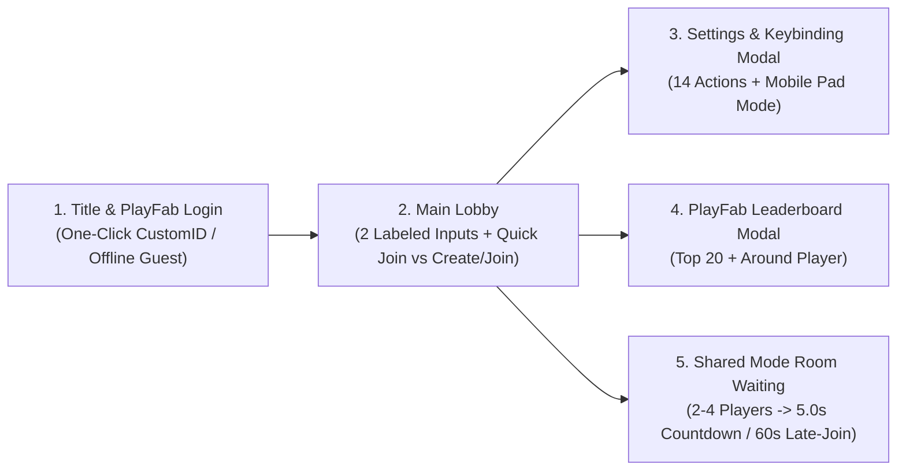

# UX Specification: Lobby Flow, Keybinding Rebind Modal & Leaderboard Screen

> **System**: `keybinding-rebind-lobby-ui`, `shared-mode-session-pool` & `playfab-cloud-leaderboard`
> **Engine**: Unity 6.6 (`6000.6.8f1`, uGUI `1920x1080` `Match=0.5`) | **Last Updated**: 2026-11-11
> **Status**: `APPROVED` (`UX-ACCESSIBILITY: PASS`, `CD-GDD-ALIGN: APPROVE`)

## 1. Screen Flow & State Transitions (`LobbyViewController`)

### 1.1. Main Lobby Inputs & Room Connection Modes (`LobbyViewController` + `FusionSessionManager`)
- **Hai ô nhập liệu có nhãn tường minh phía trên (`Explicit Field Labels`)**:
  1. **`PLAYER DISPLAY NAME`**: Ô nhập tên hiển thị của người chơi (`3–16` ký tự, tự động lưu cục bộ và đồng bộ lên PlayFab `DisplayName`; nếu người chơi join phòng khi `MatchManager` chưa kịp `Spawned()`, tên được xếp hàng đợi `PendingDisplayName` và gửi RPC đăng ký ngay khi `MatchManager.Spawned()` hoàn tất).
  2. **`ROOM CODE (FOR CREATE / JOIN)`**: Ô nhập mã phòng tùy chọn (tự động chuẩn hóa `Trim().ToUpperInvariant()`, ví dụ `"ROOM1"`, `"TEST"`). Nhãn ghi rõ ô này chỉ áp dụng cho nút **Create / Join Room**.
- **Sự khác biệt rõ ràng giữa 2 nút vào trận (`Quick Join` vs `Create / Join Room`)**:
  - **`QUICK JOIN` (Màu Xanh Cyan `#00B4D8`)**: Bỏ qua nội dung ô `ROOM CODE`, truyền `SessionName = ""` (`string.Empty`) với `IsOpen = true`, `IsVisible = true`, `PlayerCount = 4` vào Photon Fusion `GameMode.Shared`. Photon Cloud tự động ghép người chơi vào bất kỳ phòng công khai nào đang mở và chưa đầy (`< 4` người); nếu chưa có phòng công khai nào trống thì tự tạo một phòng công khai mới để người bấm `Quick Join` tiếp theo tự động vào chung.
  - **`CREATE / JOIN ROOM` (Màu Cam Hổ Phách `#F59E0B`)**: Đọc mã phòng từ ô `ROOM CODE` (nếu để trống tự sinh mã mặc định `"ARENA"`), chuẩn hóa chữ in hoa (`SessionName = normalizedCode`). Những người chơi nhập **cùng một mã phòng** sẽ vào chính xác phòng riêng đó; người đầu tiên tạo phòng giữ vai trò `SharedModeMasterClient` (`HOST`), tối đa `4` người/phòng (`ROOM: <CODE> (X/4)`).
- **Quy tắc Đếm ngược Bắt đầu & Vào Trận Muộn (`MatchRulesConfigSO` — `DefaultMatchRulesConfig.asset`)**:
  - Ngay khi có **người chơi thứ 2** kết nối (`MinPlayersToStart = 2`, không cần chờ đủ 4 người), phòng tự động chuyển sang **`Countdown` trong `5.0s`** (`CountdownDurationSeconds = 5.0s`, chỉnh được trong `MatchRulesConfigSO`).
  - Khi trận đấu đã chuyển sang `Playing` (`180.0s`), trong **`60.0s` đầu tiên** (`LateJoinActiveWindowSeconds = 60.0s`, chỉnh được trong `MatchRulesConfigSO`), người chơi thứ 3 và thứ 4 vào phòng **vẫn được tham gia chiến đấu trực tiếp** với đầy đủ `100/100 HP`. Chỉ khi vào phòng **sau mốc `60.0s`** kể từ lúc trận đấu bắt đầu thì người vào muộn mới chuyển sang chế độ **Ghost Spectator** chờ ván kế tiếp.

## 2. Keybinding Rebind Modal (`KeybindingRebindModal`)

- **Kích thước**: `1280 x 820 px` đặt chính giữa màn hình trên nền mờ tối `#0F172AE6`.
- **Danh sách 14 Hành động**: Chia thành 3 nhóm rõ ràng (`Di chuyển & Cơ động` gồm `WASD`, `Space` Jump, `2` Dash, `Q/E` Dodge; `Chiến đấu Đa hướng` gồm `LMB`, `1`, `3`, `RMB`; `Camera & Giao tiếp` gồm `V`, `Enter`).
- **Trạng thái Lắng nghe Phím (`Listening Overlay`)**: Khi bấm vào một dòng phím, hiển thị lớp phủ `"Đang chờ bấm phím hoặc chuột... (Nhấn ESC để hủy — 5.0s)"`.
- **Tự động Hoán đổi Xung đột (`Swap-on-Conflict`)**: Khi gán phím trùng với hành động khác, tự động đổi chỗ hai phím và nháy sáng màu vàng hổ phách (`#F59E0B`) trên cả hai dòng trong `1.2s`.
- **Tùy chọn Hiển thị Cụm Nút Mobile (`MobileActionPadVisibilityMode`)**: Cho phép chọn `Auto` (Tự động theo thiết bị), `AlwaysOn` (Luôn bật trên cả PC để luyện tập/click chuột), hoặc `Off` (Thu gọn).

## 3. PlayFab Leaderboard Modal (`LeaderboardModalView`)

- **Kích thước**: `1100 x 760 px`, gồm 2 tab chuyển đổi (`Top 20 Toàn Cầu` và `Xung Quanh Tôi`) cho 2 bảng xếp hạng `MatchesWon` (Số trận thắng) và `TotalKills` (Tổng hạ gục).
- **Hàng Người chơi Cục bộ**: Luôn tô sáng bằng viền và nền xanh băng `#38BDF833` để dễ nhận diện ngay lập tức.
- **Bộ đệm Làm mới (`15.0s Cache TTL`)**: Hiển thị trạng thái đồng bộ đám mây hoặc huy hiệu `"Chế độ Khách Ngoại tuyến (Offline Guest)"` nếu không có kết nối mạng.
