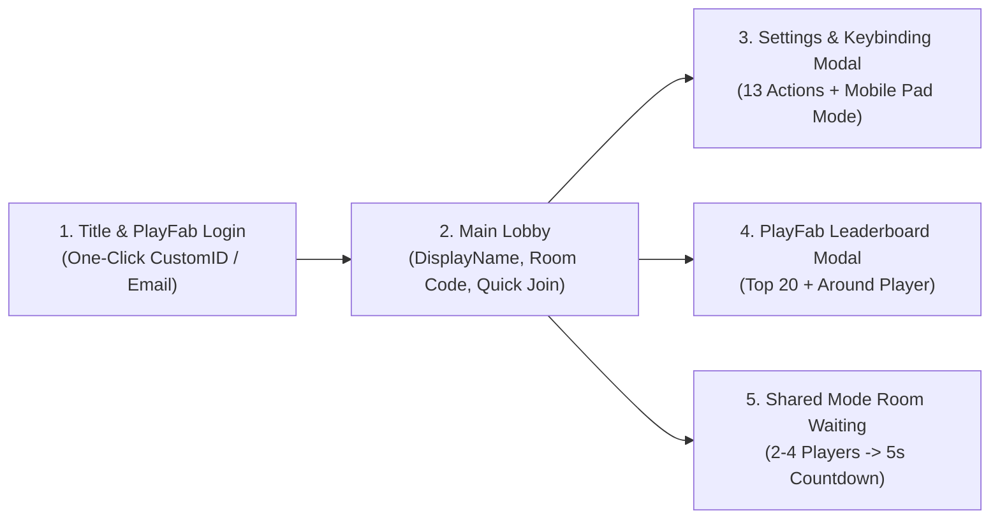

# UX Specification: Lobby Flow, Keybinding Rebind Modal & Leaderboard Screen

> **System**: `keybinding-rebind-lobby-ui` & `playfab-cloud-leaderboard`
> **Engine**: Unity 6.6 (`6000.6.8f1`, uGUI `1920x1080` `Match=0.5`) | **Date**: 2026-11-10
> **Status**: `APPROVED` (`UX-ACCESSIBILITY: PASS`, `CD-GDD-ALIGN: APPROVE`)

## 1. Screen Flow & State Transitions (`LobbyFlowController`)

## 2. Keybinding Rebind Modal (`KeybindingRebindModal`)

- **Kích thước**: `1280 x 820 px` đặt chính giữa màn hình trên nền mờ tối `#0F172AE6`.
- **Danh sách 13 Hành động**: Chia thành 3 nhóm rõ ràng (`Di chuyển & Cơ động`, `Chiến đấu Đa hướng`, `Camera & Giao tiếp`).
- **Trạng thái Lắng nghe Phím (`Listening Overlay`)**: Khi bấm vào một dòng phím, hiển thị lớp phủ `"Đang chờ bấm phím hoặc chuột... (Nhấn ESC để hủy — 5.0s)"`.
- **Tự động Hoán đổi Xung đột (`Swap-on-Conflict`)**: Khi gán phím trùng với hành động khác, tự động đổi chỗ hai phím và nháy sáng màu vàng hổ phách (`#F59E0B`) trên cả hai dòng trong `1.2s`.
- **Tùy chọn Hiển thị Cụm Nút Mobile (`MobileActionPadVisibilityMode`)**: Cho phép chọn `Auto` (Tự động theo thiết bị), `AlwaysOn` (Luôn bật trên cả PC để luyện tập/click chuột), hoặc `Off` (Thu gọn).

## 3. PlayFab Leaderboard Modal (`LeaderboardModalView`)

- **Kích thước**: `1100 x 760 px`, gồm 2 tab chuyển đổi (`Top 20 Toàn Cầu` và `Xung Quanh Tôi`) cho 2 bảng xếp hạng `MatchesWon` (Số trận thắng) và `TotalKills` (Tổng hạ gục).
- **Hàng Người chơi Cục bộ**: Luôn tô sáng bằng viền và nền xanh băng `#38BDF833` để dễ nhận diện ngay lập tức.
- **Bộ đệm Làm mới (`15.0s Cache TTL`)**: Hiển thị trạng thái đồng bộ đám mây hoặc huy hiệu `"Chế độ Khách Ngoại tuyến (Offline Guest)"` nếu không có kết nối mạng.
