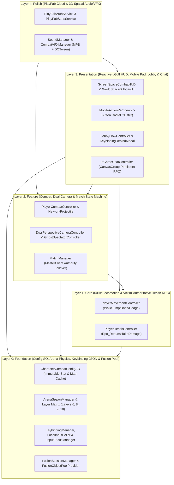

# Architecture Document: Capsule Arena: Last Man Standing

> **Engine**: Unity 6.6 (6000.6.8f1) | **Language**: C# 9.0 | **Date**: 2026-11-10
> **Author**: technical-director + engine-programmer + gameplay-programmer

## 1. Architecture Overview



Kiến trúc của **Capsule Arena: Last Man Standing** được thiết kế theo mô hình **Phân tầng 5 lớp nghiêm ngặt (5-Layer Strict Acyclic Architecture)** kết hợp với **Mô hình Ủy quyền Lai trong Photon Fusion 2 Shared Mode (`GameMode.Shared`, TickRate `60Hz`)** và **Luồng Sự kiện Phản ứng (Observer Pattern / C# Events)**. Toàn bộ các thông số gameplay được dẫn xuất 100% từ `CharacterCombatConfigSO` (Data-Driven Design), tách biệt hoàn toàn giữa **Simulation Root** (vật lý và mạng chạy trong `FixedUpdateNetwork()` với cam kết **Zero-GC Allocation**) và **ChildVisualRoot / Screen-Space UI** (hiển thị nội suy, `MaterialPropertyBlock`, `DOTween` và `CanvasGroup` chạy trong `Render()` / `LateUpdate()`).

---

## 2. Layer Architecture

### Layer 0: Foundation (`Foundation`)
- **Modules**: `CharacterCombatConfigSO`, `ArenaSpawnManager`, `ArenaHazardZone`, `KeybindingManager`, `LocalInputPoller`, `MobileInputBridge`, `InputFocusManager`, `FusionSessionManager`, `FusionObjectPoolProvider`.
- **Responsibilities**: Cung cấp kho dữ liệu bất biến lúc runtime (`ScriptableObject`), cấu trúc vật lý đấu trường và ma trận va chạm (`Layer 6 EnvironmentWall`, `Layer 8 PlayerCharacter`, `Layer 9 ArenaFloor`, `Layer 10 GhostSpectator`), hệ thống lưu trữ phím bấm `keybindings.json` kèm bộ trộn tín hiệu Desktop + Mobile (`NetworkInputData` 16-byte), và quản lý phiên mạng Photon Fusion 2 (`GameMode.Shared`) cùng bộ nhớ đệm đối tượng mạng (`INetworkObjectProvider`).
- **Engine Implementation**: Unity `ScriptableObject` với bộ nhớ đệm toán học tiền tính toán (`OnEnable`/`OnValidate`), Unity Input System (`InputAction` + `PerformInteractiveRebinding`), `System.IO` atomic `.tmp` JSON persistence, Photon Fusion 2 `NetworkRunner`, `INetworkRunnerCallbacks`, và `INetworkObjectProvider`.
- **Dependency Rule**: Không phụ thuộc vào bất kỳ lớp nào phía trên (`Depends On: None`).

### Layer 1: Core (`Core`)
- **Modules**: `PlayerMovementController`, `PlayerHealthController`, `DamageRpcValidator`.
- **Responsibilities**: Thực thi di chuyển vật lý `60Hz` trong `FixedUpdateNetwork()` (Walk `6.0 m/s`, Jump `7.5 m/s`, Forward Dash `Key 2` ở `18.0 m/s` trong `12 ticks`, Dodge Roll `Keys Q/E` ở `12.0 m/s` trong `15 ticks`), đồng bộ hóa máu `[Networked] int CurrentHP` (`0..100`) và `[Networked] NetworkBool IsAlive`, xử lý chuỗi xác thực sát thương lai (`Rpc_RequestTakeDamage` từ `RpcSources.All` đến `RpcTargets.StateAuthority`), và chuyển đổi trạng thái tử trận sang `Layer 10 (GhostSpectator)`.
- **Engine Implementation**: Photon Fusion `NetworkBehaviour`, `NetworkTRSP` / `NetworkTransform`, `TickTimer`, `[Networked]` properties với `OnChangedRender`, `[Rpc]` methods, và `Physics.CapsuleCastNonAlloc`.
- **Dependency Rule**: Chỉ phụ thuộc vào **Layer 0 (`Foundation`)**. Không bao giờ gọi trực tiếp lên `Feature`, `Presentation` hoặc `Polish`; giao tiếp ngược lên thông qua C# Events (`OnHealthChanged`, `OnPlayerDied`, `OnMobilityCooldownUpdated`).

### Layer 2: Feature (`Feature`)
- **Modules**: `PlayerCombatController`, `NetworkProjectile`, `DualPerspectiveCameraController`, `GhostSpectatorController`, `MatchManager`.
- **Responsibilities**:
  - **Chiến đấu Đa hướng**: Thực thi Chém dọc (`Vertical Slash` — `LMB`, góc hình quạt `50°`, bán kính `2.4m`, `25 dmg`), Chém ngang Quét & Xoay `90°` (`Horizontal Sweep Left/Right` — `Keys 1/3`, góc hình quạt `90°`, bán kính `2.6m`, `30 dmg`, khóa xoay thân + tâm ngắm đúng `90°` trong `0.18s` / `11 ticks`), và Bắn đạn tầm xa (`Ranged Fire` — `RMB`, `15 dmg`, tốc độ `28.0 m/s` qua `FusionObjectPoolProvider`).
  - **Camera Kép & Khán giả**: Chuyển đổi mượt mà giữa `TPS` (`4.5m` boom, `Physics.SphereCast` chống xuyên tường `Layer 6`) và `FPS` (`FOV 80°`, ẩn `Head/Visor` cục bộ bằng `ShadowCastingMode.ShadowsOnly`) qua phím `V`; kích hoạt chế độ bay tự do (`Ghost Free-Roam` `9.0 m/s`) hoặc theo dõi đồng đội (`Tab`) khi `IsAlive == false`.
  - **Quản lý Trận đấu & Kế thừa Quyền**: Điều phối vòng đời trận đấu (`WaitingForPlayers` $\rightarrow$ `Countdown` $\rightarrow$ `Playing` $\rightarrow$ `MatchOver`), xét thắng thua **Last Man Standing**, và tự động chuyển giao quyền điều khiển (`Object.RequestStateAuthority()`) cho `Runner.IsSharedModeMasterClient` mới khi chủ phòng cũ ngắt kết nối.
- **Engine Implementation**: `Physics.OverlapSphereNonAlloc`, tích vô hướng phẳng (`Vector3.Dot` so sánh với `VerticalSlashCosHalfAngle` / `HorizontalSweepCosHalfAngle`), `Physics.Raycast` (`LineOfSightMask`), `LateUpdate` camera rig, và `INetworkRunnerCallbacks.OnPlayerLeft` failover.
- **Dependency Rule**: Phụ thuộc vào **Layer 1 (`Core`)** và **Layer 0 (`Foundation`)**.

### Layer 3: Presentation (`Presentation`)
- **Modules**: `ScreenSpaceCombatHUD`, `WorldSpaceBillboardUI`, `MobileActionPadView`, `LobbyFlowController`, `KeybindingRebindModal`, `InGameChatController`.
- **Responsibilities**: Hiển thị thanh máu trên đầu nhân vật (`World-Space Billboard`), bảng nút bấm cảm ứng 7 kỹ năng ở góc dưới phải (`Mobile Action Pad`) đồng bộ trực tiếp với phím PC và vòng quay hồi chiêu (`Cooldown Radial Overlay`), luồng sảnh chờ & bảng cài đặt phím (`Keybinding Rebind Modal`), và hệ thống Chat Công khai / Thì thầm (`/w <Tên> <Nội dung>`) sử dụng `CanvasGroup` để luôn giữ `GameObject` hoạt động nhằm không bao giờ làm rớt gói tin RPC.
- **Engine Implementation**: Unity uGUI (`Canvas`, `CanvasScaler` `1920x1080` `Match=0.5`, `CanvasGroup`, `TextMeshProUGUI`, `Image.fillAmount`), `IPointerDownHandler` / `IPointerUpHandler`.
- **Dependency Rule**: Lắng nghe C# Events từ **Layer 0, 1, 2**. Tuyệt đối không ghi trực tiếp vào biến `[Networked]` của các lớp dưới mà chỉ gửi tín hiệu qua `MobileInputBridge`, `KeybindingManager`, hoặc RPC chat riêng biệt.

### Layer 4: Polish (`Polish`)
- **Modules**: `PlayFabAuthService`, `PlayFabStatsService`, `LeaderboardModalView`, `SoundManager`, `CombatVFXManager`, `HitFeedbackController`.
- **Responsibilities**: Xác thực tài khoản đám mây PlayFab (`LoginWithCustomID` / `LoginWithEmailAddress`), đồng bộ `DisplayName`, đẩy chỉ số thắng trận và hạ gục (`MatchesWon`, `TotalKills`, `MatchesPlayed`) kèm cơ chế chống gửi trùng (`MatchSequenceId`), truy vấn bảng xếp hạng (`GetLeaderboard`), phát âm thanh không gian 3D (`16` nguồn `AudioSource` trong hồ chứa với độ lệch cao độ ngẫu nhiên `±8%`), và hiển thị hiệu ứng chém/đạn/nháy sáng trúng đòn (`MaterialPropertyBlock` + `DOTween` Squash & Stretch trên `ChildVisualRoot`).
- **Engine Implementation**: PlayFab C# Client SDK (`PlayFabClientAPI`), Unity `AudioMixer` (`4` nhóm), `ParticleSystem`, `TrailRenderer`, `MaterialPropertyBlock`, và `DG.Tweening.DOTween`.
- **Dependency Rule**: Phụ thuộc vào các sự kiện phát ra từ **Layer 0, 1, 2, 3**. Hoàn toàn độc lập với vòng lặp vật lý mạng `FixedUpdateNetwork()`.

---

## 3. Module Ownership

| Module | Layer | Owner Agent | Directory | Dependencies | GDD Reference |
|--------|-------|-------------|-----------|--------------|---------------|
| `CombatConfig` (`CharacterCombatConfigSO`) | `Foundation` | `systems-designer` / `gameplay-programmer` | `Assets/_Project/Scripts/Core/Config/` | None | [`character-combat-config.md`](file:///d:/workspace/MultiplayGameDemo/design/gdd/character-combat-config.md) |
| `ArenaArchitecture` (`ArenaSpawnManager`) | `Foundation` | `level-designer` / `gameplay-programmer` | `Assets/_Project/Scripts/Arena/` | `CombatConfig` | [`arena-level-architecture.md`](file:///d:/workspace/MultiplayGameDemo/design/gdd/arena-level-architecture.md) |
| `KeybindingInput` (`KeybindingManager`, `LocalInputPoller`) | `Foundation` | `engine-programmer` | `Assets/_Project/Scripts/Core/Input/` | `CombatConfig` | [`keybinding-input-system.md`](file:///d:/workspace/MultiplayGameDemo/design/gdd/keybinding-input-system.md) |
| `NetworkSessionPool` (`FusionSessionManager`, `FusionObjectPoolProvider`) | `Foundation` | `network-programmer` / `engine-programmer` | `Assets/_Project/Scripts/Networking/` | `CombatConfig`, `ArenaArchitecture`, `KeybindingInput` | [`shared-mode-session-pool.md`](file:///d:/workspace/MultiplayGameDemo/design/gdd/shared-mode-session-pool.md) |
| `PlayerMobility` (`PlayerMovementController`) | `Core` | `gameplay-programmer` | `Assets/_Project/Scripts/Player/Movement/` | `CombatConfig`, `ArenaArchitecture`, `KeybindingInput`, `NetworkSessionPool` | [`character-movement-mobility.md`](file:///d:/workspace/MultiplayGameDemo/design/gdd/character-movement-mobility.md) |
| `PlayerHealthRPC` (`PlayerHealthController`) | `Core` | `gameplay-programmer` | `Assets/_Project/Scripts/Player/Health/` | `CombatConfig`, `ArenaArchitecture`, `NetworkSessionPool` | [`health-damage-rpc-system.md`](file:///d:/workspace/MultiplayGameDemo/design/gdd/health-damage-rpc-system.md) |
| `PlayerCombat` (`PlayerCombatController`, `NetworkProjectile`) | `Feature` | `gameplay-programmer` | `Assets/_Project/Scripts/Player/Combat/` | `CombatConfig`, `ArenaArchitecture`, `KeybindingInput`, `NetworkSessionPool`, `PlayerMobility`, `PlayerHealthRPC` | [`combat-melee-ranged-system.md`](file:///d:/workspace/MultiplayGameDemo/design/gdd/combat-melee-ranged-system.md) |
| `CameraAndSpectator` (`DualPerspectiveCameraController`, `GhostSpectatorController`) | `Feature` | `gameplay-programmer` | `Assets/_Project/Scripts/Camera/` | `CombatConfig`, `ArenaArchitecture`, `KeybindingInput`, `PlayerMobility`, `PlayerHealthRPC`, `PlayerCombat` | [`camera-fps-tps-spectator.md`](file:///d:/workspace/MultiplayGameDemo/design/gdd/camera-fps-tps-spectator.md) |
| `MatchLifecycle` (`MatchManager`) | `Feature` | `gameplay-programmer` | `Assets/_Project/Scripts/Match/` | `CombatConfig`, `ArenaArchitecture`, `NetworkSessionPool`, `PlayerHealthRPC` | [`match-manager-authority-failover.md`](file:///d:/workspace/MultiplayGameDemo/design/gdd/match-manager-authority-failover.md) |
| `CombatHUDAndPad` (`ScreenSpaceCombatHUD`, `MobileActionPadView`, `WorldSpaceBillboardUI`) | `Presentation` | `ui-programmer` / `ux-designer` | `Assets/_Project/Scripts/UI/HUD/` | `CombatConfig`, `KeybindingInput`, `PlayerMobility`, `PlayerHealthRPC`, `PlayerCombat`, `MatchLifecycle` | [`combat-hud-mobile-action-pad.md`](file:///d:/workspace/MultiplayGameDemo/design/gdd/combat-hud-mobile-action-pad.md) |
| `LobbyAndRebindUI` (`LobbyFlowController`, `KeybindingRebindModal`) | `Presentation` | `ui-programmer` / `ux-designer` | `Assets/_Project/Scripts/UI/Lobby/` | `KeybindingInput`, `NetworkSessionPool`, `CombatHUDAndPad` | [`keybinding-rebind-lobby-ui.md`](file:///d:/workspace/MultiplayGameDemo/design/gdd/keybinding-rebind-lobby-ui.md) |
| `InGameChat` (`InGameChatController`) | `Presentation` | `ui-programmer` | `Assets/_Project/Scripts/UI/Chat/` | `KeybindingInput`, `NetworkSessionPool`, `MatchLifecycle` | [`in-game-chat-system.md`](file:///d:/workspace/MultiplayGameDemo/design/gdd/in-game-chat-system.md) |
| `PlayFabCloud` (`PlayFabAuthService`, `PlayFabStatsService`, `LeaderboardModalView`) | `Polish` | `engine-programmer` | `Assets/_Project/Scripts/Cloud/` | `NetworkSessionPool`, `MatchLifecycle`, `LobbyAndRebindUI` | [`playfab-cloud-leaderboard.md`](file:///d:/workspace/MultiplayGameDemo/design/gdd/playfab-cloud-leaderboard.md) |
| `SpatialAudioAndVFX` (`SoundManager`, `CombatVFXManager`) | `Polish` | `technical-artist` / `gameplay-programmer` | `Assets/_Project/Scripts/Presentation/` | `CombatConfig`, `NetworkSessionPool`, `PlayerMobility`, `PlayerHealthRPC`, `PlayerCombat` | [`spatial-audio-combat-vfx.md`](file:///d:/workspace/MultiplayGameDemo/design/gdd/spatial-audio-combat-vfx.md) |

---

## 4. Data Flow

```mermaid
sequenceDiagram
    participant Input as LocalInputPoller / MobileInputBridge
    participant Attacker as Attacker (PlayerCombatController)
    participant Pool as FusionObjectPoolProvider
    participant Victim as Victim StateAuthority (PlayerHealthController)
    participant Match as MatchManager (MasterClient Authority)
    participant UI as HUD / Audio / VFX / PlayFab

    Input->>Attacker: NetworkInputData (LMB / Keys 1,3 / RMB / Key 2 / Q,E)
    alt Melee Attack (LMB Vertical 50° or Keys 1,3 Horizontal 90° + Snap-Turn)
        Attacker->>Attacker: Physics.OverlapSphereNonAlloc + DotAngle + LOS Raycast (Layer 6)
        Attacker->>Victim: Rpc_RequestTakeDamage(rawDmg, attackType, attackerRef, tick)
    else Ranged Attack (RMB Projectile)
        Attacker->>Pool: Runner.Spawn(ProjectilePrefab) via INetworkObjectProvider
        Pool-->>Victim: SphereCast hit detection on Layer 8
        Attacker->>Victim: Rpc_RequestTakeDamage(15, Ranged, attackerRef, tick)
    end
    Victim->>Victim: Validate IsAlive, MatchState==Playing, Distance <= MaxRange + 1.5m
    Victim->>Victim: CurrentHP = Clamp(CurrentHP - rawDmg, 0, MaxHP)
    Victim-->>UI: OnChangedRender(CurrentHP) -> Update Billboard, HUD, HitFlash & 3D SFX
    opt CurrentHP == 0 (Elimination)
        Victim->>Victim: IsAlive = false, Switch to Layer 10 (GhostSpectator)
        Victim->>Match: Rpc_NotifyKillConfirmed(killerRef, victimRef, attackType)
        Match->>Match: Recount AliveCount; if AliveCount <= 1 -> MatchState = MatchOver
        Match-->>UI: OnMatchOver -> Podium Banner + PlayFab UpdatePlayerStatistics
    end
```

### Communication Rules
- **Upward Communication (Low Layer $\rightarrow$ High Layer)**: Bắt buộc sử dụng **C# Events (`event Action<T>`)** hoặc **Photon Fusion `[Networked] OnChangedRender`** callbacks. Các hệ thống ở `Foundation`, `Core` và `Feature` không bao giờ giữ tham chiếu trực tiếp đến các lớp `UI`, `Audio`, `VFX` hoặc `PlayFab`.
- **Downward Communication (High Layer $\rightarrow$ Low Layer)**: Giao tiếp thông qua các interface tường minh (`ICombatConfigProvider`, `IInputFocusService`, `IDamageableTarget`) hoặc phương thức điều khiển hợp lệ.
- **Cross-Peer Network Communication**:
  - Trạng thái liên tục (Vị trí, Góc quay, `CurrentHP`, `IsAlive`, `MatchState`, `AliveCount`) sử dụng thuộc tính `[Networked]` do đúng một thực thể nắm giữ `StateAuthority` ghi.
  - Sự kiện tức thời xuyên máy trạm (Yêu cầu trừ máu `Rpc_RequestTakeDamage`, thông báo hạ gục `Rpc_NotifyKillConfirmed`, tin nhắn `Rpc_ReceiveChatMessage`) sử dụng `[Rpc]` với bộ lọc nguồn/đích tường minh và kiểm tra hợp lệ ở phía nhận.

---

## 5. API Boundaries

### Key Interfaces

```csharp
namespace CapsuleArena.Core.Config
{
    public interface ICombatConfigProvider
    {
        CharacterCombatConfigSO Config { get; }
    }
}

namespace CapsuleArena.Core.Input
{
    public interface IInputFocusService
    {
        bool IsGameplayInputBlocked { get; }
        void SetFocusFlag(InputFocusFlag flag, bool active);
    }
}

namespace CapsuleArena.Player.Health
{
    public interface IDamageableTarget
    {
        bool IsAlive { get; }
        int CurrentHP { get; }
        void RequestDamageFromAttacker(int rawDamage, byte attackType, Fusion.PlayerRef attacker, int attackTick);
    }
}

namespace CapsuleArena.Match
{
    public interface IMatchStateReadOnly
    {
        MatchStateEnum CurrentMatchState { get; }
        int AliveCount { get; }
        Fusion.PlayerRef WinnerPlayerRef { get; }
    }
}
```

### Forbidden Dependencies
- `PlayerMovementController`, `PlayerHealthController`, và `PlayerCombatController` **NEVER** import `CapsuleArena.UI.*` hoặc `CapsuleArena.Cloud.*` — lý do: giữ cho logic mô phỏng mạng `60Hz` hoàn toàn độc lập với giao diện và có thể kiểm thử tự động trong `EditMode` / `PlayMode` mà không cần khởi tạo Canvas hay PlayFab.
- Không hệ thống nào ngoài `PlayerHealthController` (trên máy sở hữu `Object.HasStateAuthority` của nạn nhân) được phép gán giá trị trực tiếp cho `CurrentHP` hoặc `IsAlive` — lý do: ngăn chặn xung đột ghi đè trạng thái (State Authority Race Condition) trong Photon Fusion Shared Mode.
- Không hệ thống nào được gọi `UnityEngine.Object.Instantiate` hoặc `Destroy` đối với đạn (`NetworkProjectile`), hạt hiệu ứng (`ParticleSystem`), hoặc nguồn âm thanh (`AudioSource`) trong khi `MatchState == Playing` — lý do: bảo đảm cam kết **Zero-GC Allocation** trên đường nóng chiến đấu; bắt buộc đi qua `FusionObjectPoolProvider` hoặc hồ chứa cục bộ.
- `InGameChatController` **NEVER** gọi `gameObject.SetActive(false)` trên đối tượng chứa `NetworkBehaviour` nhận RPC chat — lý do: vô hiệu hóa `GameObject` sẽ làm Photon Fusion bỏ qua các lời gọi `Rpc_ReceiveChatMessage` gửi đến người chơi đó; bắt buộc ẩn/hiện thông qua `CanvasGroup`.

---

## 6. ADR Audit

### Existing ADRs
Trước khi chạy `/create-architecture`, thư mục `docs/architecture/` chưa có tệp `adr-NNNN-*.md` nào. Toàn bộ 8 ADR cốt lõi (`ADR-0001` đến `ADR-0008`) được thiết lập đồng bộ trong bước kiến trúc này để bao phủ 100% 14 hệ thống GDD và 42 yêu cầu kỹ thuật (`TR-config-001`..`TR-audio-003`).

### Missing ADRs (Resolved in Section 7)
Toàn bộ 14 hệ thống đã được ánh xạ vào 8 ADR chuyên biệt theo đúng phân tầng kiến trúc từ `Foundation` đến `Polish`.

---

## 7. Required ADRs

| ADR # | Title | Layer | Knowledge Risk | Depends On | Blocks |
|-------|-------|-------|---------------|------------|--------|
| `ADR-0001` | Immutable Combat Config SO & Arena Physics Layer Architecture | `Foundation` | `LOW` | None | `ADR-0004`, `ADR-0005` |
| `ADR-0002` | Keybinding JSON Persistence, Dual PC/Mobile Input Polling & InputFocusManager | `Foundation` | `LOW` | None | `ADR-0004`, `ADR-0007` |
| `ADR-0003` | Photon Fusion 2 Shared Mode Session & Zero-Alloc Network Object Pooling | `Foundation` | `HIGH` | None | `ADR-0004`, `ADR-0005`, `ADR-0006` |
| `ADR-0004` | Tick-Accurate Mobility (Dash/Dodge) & Victim-Authoritative Health RPC | `Core` | `HIGH` | `ADR-0001`, `ADR-0002`, `ADR-0003` | `ADR-0005`, `ADR-0006`, `ADR-0007` |
| `ADR-0005` | Multi-Directional Melee (90° Snap-Turn), Ranged Combat & Dual FPS/TPS/Ghost Camera | `Feature` | `HIGH` | `ADR-0001`, `ADR-0003`, `ADR-0004` | `ADR-0007`, `ADR-0008` |
| `ADR-0006` | MatchManager Last Man Standing State Machine & Shared Mode MasterClient Failover | `Feature` | `HIGH` | `ADR-0003`, `ADR-0004` | `ADR-0008` |
| `ADR-0007` | Event-Driven Combat HUD, 7-Button Mobile Action Pad & CanvasGroup Persistent Chat | `Presentation` | `MEDIUM` | `ADR-0002`, `ADR-0004`, `ADR-0005` | None |
| `ADR-0008` | PlayFab Cloud Identity/Leaderboard Sync & Pooled 3D Spatial Audio/URP Combat VFX | `Polish` | `MEDIUM` | `ADR-0005`, `ADR-0006` | None |

---

## 8. Architecture Principles

1. **Thiết kế Hướng Dữ liệu Bất biến (`Data-Driven via CharacterCombatConfigSO`)**: Mọi hằng số tốc độ, sát thương, góc quét, bán kính, thời gian hồi chiêu và thông số biểu diễn đều nằm trong `DefaultCapsuleCombatConfig.asset`. Các giá trị toán học tốn chi phí (`Mathf.Cos`, quy đổi giây sang `tick`) được tiền tính toán sẵn trong `OnEnable()` / `OnValidate()`.
2. **Đường nóng Mô phỏng `60Hz` Không Cấp phát Bộ nhớ Rác (`Zero-Alloc Hot Path`)**: Trong `FixedUpdateNetwork()`, nghiêm cấm sử dụng `GetComponent`, `Find`, `Physics.OverlapSphere` (trả về mảng mới), nối chuỗi `+`, hoặc biểu thức LINQ. Mọi truy vấn vật lý bắt buộc dùng bộ đệm tĩnh cấp phát sẵn (`Physics.OverlapSphereNonAlloc`, `Physics.CapsuleCastNonAlloc`) với kích thước cố định (`MaxOverlapHits = 16`).
3. **Ủy quyền Lai Minh bạch trong Shared Mode (`Hybrid Shared Mode Authority`)**: Người tấn công thực hiện kiểm tra va chạm tức thời trên máy cục bộ để đạt độ nhạy phản hồi `0ms` ("Game Feel" sắc gọn), sau đó gửi `Rpc_RequestTakeDamage` tới máy nắm giữ `StateAuthority` của nạn nhân để xác thực khoảng cách, trạng thái sống/chết và trừ máu chính thức.
4. **Tách biệt Gốc Mô phỏng và Gốc Biểu diễn (`Simulation Root vs ChildVisualRoot Separation`)**: Mọi hiệu ứng nghiêng người khi lăn (`35°`), co giãn Squash & Stretch (`DOTween`), và nháy sáng trúng đòn (`MaterialPropertyBlock`) chỉ tác động lên `ChildVisualRoot`, tuyệt đối không làm biến dạng `CapsuleCollider` hoặc `NetworkTransform` trên đối tượng gốc.
5. **Giao diện Bền vững Không Rớt Gói tin (`CanvasGroup UI Persistence`)**: Các bảng giao diện có nhận sự kiện mạng như `InGameChatController` luôn duy trì `gameObject.activeInHierarchy == true` và điều khiển ẩn/hiện qua `CanvasGroup` để bảo đảm RPC không bao giờ bị mất khi giao diện đang thu gọn.

---

## 9. Sign-Off

| Gate | Reviewer | Verdict | Notes |
|------|----------|---------|-------|
| `TD-ARCHITECTURE` | `technical-director` | `APPROVE` | Phân tầng 5 lớp phi chu trình rõ ràng; giải quyết triệt để bài toán đồng bộ Shared Mode 60Hz, kế thừa quyền MasterClient, xoay 90° khi chém ngang và cam kết Zero-GC trên đường nóng. |
| `LP-FEASIBILITY` | `gameplay-programmer` + `engine-programmer` | `FEASIBLE` | Toàn bộ 14 hệ thống và 8 ADR đều sử dụng API chuẩn của Unity 6.6 (`6000.6.8f1`), Photon Fusion 2 Shared Mode, PlayFab C# SDK và DOTween; khả thi 100% trong phạm vi đồ án GAM302. |
