# Sơ Đồ Tiến Trình Triển Khai Dự Án Mới (Claude Code Game Studios — Antigravity 2.0)

Tài liệu này mô tả **toàn bộ tiến trình triển khai dự án mới từ lúc bắt đầu đến khi hoàn tất phát hành** bằng hệ thống **49 AI Subagents & 74 Skills**, được ánh xạ trực tiếp vào dự án **GAM302 — Đấu Trường Sinh Tử 3D (Photon Fusion 2 Shared Mode)**.

---

## 1. Sơ Đồ Tổng Thể Tiến Trình Triển Khai (Mermaid Flowchart)

> [!TIP]
> Hệ thống hỗ trợ **3 chế độ độ sâu (`modes.rigor`)**:
> - **`minimal` (Nhanh nhất - 4 bước tới khi viết code):** `/start` $\rightarrow$ `/setup-engine` $\rightarrow$ `/brainstorm` $\rightarrow$ `/create-stories` $\rightarrow$ `/dev-story`
> - **`standard` (Cân bằng - Khuyên dùng cho đồ án GAM302):** Đầy đủ tài liệu GDD cốt lõi, Kiến trúc ADR mạng Shared Mode, Epics/Stories, Sprint & Kiểm thử.
> - **`full` (Quy chuẩn Studio lớn):** Bao gồm toàn bộ quy trình dưới đây kèm Vertical Slice, Art Bible, Review đa tầng và Soak Test.

```mermaid
flowchart TD
    subgraph P0["Giai đoạn 0: Khởi tạo & Định hình (Onboarding)"]
        S01["1. /start - Khởi tạo dự án, chọn Rigor va Automation"]
        S02["2. /setup-engine - Cấu hình Unity 6 URP va ghim phiên bản"]
        S01 --> S02
    end

    subgraph P1["Giai đoạn 1: Ý tưởng (Stage 1 - Concept)"]
        S03["3. /brainstorm - Chốt ý tưởng từ idea.md ra game-concept.md hoặc game-brief.md"]
        S04["4. /prototype - Dựng bản thử nghiệm nhanh (Tùy chọn)"]
        S05["5. /art-bible - Định hình phong cách hình ảnh Cartoon Capsule 3D"]
        G1{"6. /gate-check systems-design"}
        S02 --> S03 --> S04 --> S05 --> G1
    end

    subgraph P2["Giai đoạn 2: Thiết kế Hệ thống (Stage 2 - Systems Design)"]
        S06["7. /map-systems - Phân rã các hệ thống game và lập danh mục systems-index.md"]
        S07["8. /design-system - Viết GDD chi tiết cho từng hệ thống (Shared Mode, Combat, Camera, UI, PlayFab)"]
        S08["9. /design-review - Đánh giá từng tài liệu GDD"]
        S09["10. /consistency-check - Kiểm tra xung đột số liệu giữa các GDD"]
        S10["11. /review-all-gdds - Duyệt tổng thể toàn bộ GDD"]
        G2{"12. /gate-check technical-setup"}
        G1 -->|"PASS"| S06 --> S07 --> S08 --> S09 --> S10 --> G2
    end

    subgraph P3["Giai đoạn 3: Thiết kế Kiến trúc Kỹ thuật (Stage 3 - Technical Setup)"]
        S11["13. /create-architecture - Thiết kế kiến trúc tổng thể Unity 6 + Photon Fusion 2 Shared Mode"]
        S12["14. /architecture-decision - Viết các ADR (StateAuthority, RPC Damage, LagComp, Object Pool, PlayFab)"]
        S13["15. /create-control-manifest - Tạo bảng quy tắc code bắt buộc từ ADR"]
        S14["16. /architecture-review - Đối chiếu kiến trúc với GDD"]
        S15["17. /test-setup va /test-helpers - Dựng khung kiểm thử EditMode va PlayMode"]
        G3{"18. /gate-check pre-production"}
        G2 -->|"PASS"| S11 --> S12 --> S13 --> S14 --> S15 --> G3
    end

    subgraph P4["Giai đoạn 4: Tiền Sản xuất & Lập Kế hoạch (Stage 4 - Pre-Production)"]
        S16["19. /ux-design va /ux-review - Thiết kế Lobby, Overhead UI, HUD, Spectate UI, Chat UI"]
        S17["20. /asset-spec - Đặc tả Prefab nhân vật, Vũ khí, Đạn, VFX, Âm thanh 3D"]
        S18["21. /create-epics - Chia dự án thành các Epic theo module kiến trúc"]
        S19["22. /create-stories va /estimate - Bẻ từng Epic thành các Story nhỏ kèm ước lượng"]
        S20["23. /sprint-plan va /story-readiness - Lập kế hoạch Sprint va kiểm tra điều kiện sẵn sàng"]
        S21["24. /vertical-slice - Kiểm chứng vòng lặp cốt lõi (Tùy chọn ở chế độ Full)"]
        G4{"25. /gate-check production"}
        G3 -->|"PASS"| S16 --> S17 --> S18 --> S19 --> S20 --> S21 --> G4
    end

    subgraph P5["Giai đoạn 5: Sản xuất & Lập trình (Stage 5 - Production Loop)"]
        S22["26. /dev-story - Triển khai code C# va Scene cho từng Story"]
        S23["27. /team-combat, /team-ui, /team-audio, /team-level - Phối hợp nhóm Agent chuyên trách"]
        S24["28. /code-review va /test-evidence-review - Review code C# va bằng chứng kiểm thử/ảnh chụp"]
        S25["29. /story-done - Nghiệm thu đóng Story khi đạt toàn bộ tiêu chí"]
        S26["30. /sprint-status, /smoke-check, /retrospective - Theo dõi tiến độ va kiểm tra cuối mỗi Sprint"]
        G5{"31. /gate-check polish"}
        G4 -->|"PASS"| S22
        S22 --> S23 --> S24 --> S25
        S25 -->|"Còn Story trong Sprint"| S22
        S25 -->|"Hết Sprint"| S26 --> G5
    end

    subgraph P6["Giai đoạn 6: Tối ưu hóa & Kiểm thử (Stage 6 - Polish & QA)"]
        S27["32. /team-polish va /perf-profile - Tối ưu Object Pool, Layer va chạm, CanvasGroup, Tick Rate"]
        S28["33. /balance-check va /security-audit - Cân bằng sát thương/kỹ năng va kiểm tra bảo mật mạng Shared Mode"]
        S29["34. /team-qa, /regression-suite, /bug-triage - Chạy kiểm thử toàn diện va xử lý lỗi"]
        G6{"35. /gate-check release"}
        G5 -->|"PASS"| S27 --> S28 --> S29 --> G6
    end

    subgraph P7["Giai đoạn 7: Đóng gói & Phát hành (Stage 7 - Release)"]
        S30["36. /release-checklist va /team-release - Kiểm tra bản Build cuối cùng"]
        S31["37. /changelog va /patch-notes - Xuất tài liệu tổng kết dự án & thuyết trình GAM302"]
        G6 -->|"PASS"| S30 --> S31
    end
```

---

## 2. Checklist Công Việc Tuần Tự Các Skill Từ Đầu Đến Cuối (Bảng 2 Cột)

Dưới đây là danh sách tuần tự từng bước từ lúc khởi tạo cho đến khi hoàn thành dự án **GAM302 — Photon Fusion 2 Shared Mode**. Bạn có thể đánh dấu `[x]` vào cột bên trái khi hoàn thành từng bước.

### Giai đoạn 0: Khởi tạo & Cấu hình Nền tảng (Onboarding & Engine Setup)

| Checklist & Skill cần gọi | Giải thích công việc & Sản phẩm đầu ra (Áp dụng cho dự án GAM302) |
| :--- | :--- |
| - [ ] **Bước 1:** `/start` | **Khởi tạo quy trình Studio:** Đọc trạng thái dự án hiện tại, xác nhận điểm xuất phát (đã có ý tưởng rõ ràng từ `idea.md`), thiết lập mức độ chặt chẽ (`modes.rigor`: `minimal`, `standard` hoặc `full`) và chế độ tự động hóa (`modes.automation`) vào `project.yaml`. |
| - [ ] **Bước 2:** `/settings` *(Tùy chọn)* | **Tinh chỉnh cấu hình dự án:** Xem hoặc điều chỉnh các thông số cấu hình trong `project.yaml` / `project.local.yaml` nếu muốn tùy biến riêng mức độ kiểm duyệt tài liệu hoặc QA. |
| - [ ] **Bước 3:** `/setup-engine` | **Định cấu hình Engine:** Xác nhận và ghim phiên bản **Unity 6 (URP)** trong `project.yaml` và `CLAUDE.md`, kiểm tra cấu trúc thư mục gốc `Assets/` và cài đặt các gói nền tảng (Photon Fusion 2 SDK với AppId `fbee3c4f-1f3b-42da-80b9-0e4d2b47f3a9`, Cinemachine, PlayFab SDK, Cartoon Capsule Pack Lite). |

---

### Giai đoạn 1: Định hình Ý tưởng (Stage 1 — Concept)

| Checklist & Skill cần gọi | Giải thích công việc & Sản phẩm đầu ra (Áp dụng cho dự án GAM302) |
| :--- | :--- |
| - [ ] **Bước 4:** `/brainstorm` | **Chính thức hóa tài liệu Concept:** Chuyển hóa toàn bộ nội dung từ file `idea.md` thành tài liệu chuẩn của Studio (`design/gdd/game-concept.md` & `design/gdd/game-pillars.md` ở chế độ `standard`/`full`, hoặc `design/game-brief.md` ở chế độ `minimal`). |
| - [ ] **Bước 5:** `/prototype` *(Tùy chọn)* | **Thử nghiệm cơ chế cốt lõi:** Kiểm chứng nhanh vòng lặp kết nối Shared Mode + Spawn nhân vật + Di chuyển trước khi viết tài liệu chi tiết. |
| - [ ] **Bước 6:** `/art-bible` *(Chế độ Standard/Full)* | **Định hướng mỹ thuật (`design/art-bible.md`):** Quy định phong cách thị giác 3D Arena, bảng màu sàn đấu/chướng ngại vật, chất liệu nhân vật Cartoon Capsule, giao diện thanh máu và hiệu ứng đòn đánh. |
| - [ ] **Bước 7:** `/gate-check systems-design` | **Cổng kiểm duyệt chuyển sang Giai đoạn 2:** Kiểm tra các tài liệu Concept đã đầy đủ chưa và nâng trạng thái dự án trong `project.yaml` sang `Systems Design`. |

---

### Giai đoạn 2: Thiết kế Hệ thống Chi tiết (Stage 2 — Systems Design)

| Checklist & Skill cần gọi | Giải thích công việc & Sản phẩm đầu ra (Áp dụng cho dự án GAM302) |
| :--- | :--- |
| - [ ] **Bước 8:** `/map-systems` | **Phân rã hệ thống & Lập chỉ mục (`design/gdd/systems-index.md`):** Tách dự án thành các hệ thống độc lập, xác định thứ tự phụ thuộc: (1) *Network & Session Shared Mode*, (2) *Arena Environment*, (3) *Character Movement & Dodge/Dash*, (4) *Combat (Melee/Ranged) & Lag Compensation*, (5) *Camera (FPS/TPS) & Ghost Spectator*, (6) *HUD, Overhead UI & Chat*, (7) *PlayFab Cloud & Leaderboard*. |
| - [ ] **Bước 9:** `/design-system` *(Gọi cho từng hệ thống)* | **Viết tài liệu GDD chi tiết (`design/gdd/<system>.md`):** Đi qua từng mục chuẩn (Overview, Player Fantasy, Detailed Rules, Formulas, Edge Cases, Dependencies, Tuning Knobs, Acceptance Criteria) cho từng hệ thống đã liệt kê ở Bước 8. |
| - [ ] **Bước 10:** `/design-review` *(Chế độ Full)* | **Đánh giá chất lượng từng GDD:** Kiểm tra tính đầy đủ, khả năng lập trình được và tính nhất quán nội bộ của từng file GDD trước khi bàn giao cho lập trình viên. |
| - [ ] **Bước 11:** `/consistency-check` | **Kiểm tra đồng bộ số liệu chéo:** Quét toàn bộ thư mục `design/gdd/` để đảm bảo các thông số (như Máu khởi điểm = `100`, tốc độ chạy, thời gian hồi chiêu Dash/Roll, sát thương đòn đánh) không bị mâu thuẫn giữa các tài liệu. |
| - [ ] **Bước 12:** `/review-all-gdds` | **Duyệt tổng thể thiết kế Game:** Đánh giá sự phối hợp giữa tất cả các hệ thống (ví dụ: khi chuyển FPS sang TPS hay khi chết sang Ghost Mode thì HUD và điều khiển thay đổi ra sao). |
| - [ ] **Bước 13:** `/gate-check technical-setup` | **Cổng kiểm duyệt chuyển sang Giai đoạn 3:** Xác nhận bộ GDD đã hoàn chỉnh và chuyển trạng thái dự án sang `Technical Setup`. |

---

### Giai đoạn 3: Thiết kế Kiến trúc Kỹ thuật (Stage 3 — Technical Setup)

| Checklist & Skill cần gọi | Giải thích công việc & Sản phẩm đầu ra (Áp dụng cho dự án GAM302) |
| :--- | :--- |
| - [ ] **Bước 14:** `/create-architecture` | **Thiết kế kiến trúc tổng thể (`docs/architecture/overview.md`):** Định nghĩa cấu trúc thư mục code trong `Assets/_Project/Scripts/`, phân tầng trách nhiệm giữa `NetworkRunner`, `SimulationBehaviour`, `NetworkBehaviour`, hệ thống sự kiện C# Events và tích hợp PlayFab. |
| - [ ] **Bước 15:** `/architecture-decision` *(Gọi cho từng quyết định lớn)* | **Ghi nhận các Quyết định Kiến trúc (`docs/architecture/adr-NNN-*.md`):** Tạo các ADR quan trọng cho môn GAM302: • **ADR-001:** Mô hình Photon Fusion 2 **Shared Mode** & Quyền `StateAuthority` phân tán. • **ADR-002:** Cơ chế đồng bộ `[Networked]`, `[OnChangedRender]` và trừ máu qua `[Rpc(RpcSources.All, RpcTargets.StateAuthority)]`. • **ADR-003:** Đồng bộ Vật lý & Bù trễ mạng (`LagCompensation` / Hitbox & Raycast). • **ADR-004:** Object Pooling (`INetworkObjectProvider`) cho đạn và VFX. • **ADR-005:** Kiến trúc Chat RPC & Lưu trữ đám mây PlayFab. |
| - [ ] **Bước 16:** `/create-control-manifest` | **Tạo bản quy tắc lập trình bắt buộc:** Trích xuất các quy tắc *"Phải làm (Must-Do)"* và *"Cấm làm (Never-Do)"* từ các ADR (ví dụ: không dùng `Instantiate` cho đối tượng mạng, luôn di chuyển trong `FixedUpdateNetwork()`, không gọi `GetComponent` trong `Update()`). |
| - [ ] **Bước 17:** `/architecture-review` | **Kiểm tra ma trận truy vết (Traceability Matrix):** Đối chiếu mọi yêu cầu trong GDD của môn GAM302 đã có giải pháp kỹ thuật tương ứng trong Kiến trúc & ADR chưa. |
| - [ ] **Bước 18:** `/test-setup` & `/test-helpers` | **Khởi tạo khung Kiểm thử tự động:** Tạo cấu trúc thư mục `Assets/Tests/EditMode/` và `Assets/Tests/PlayMode/`, cùng các hàm hỗ trợ test logic máu, sát thương, trạng thái sinh tồn và bảng xếp hạng. |
| - [ ] **Bước 19:** `/gate-check pre-production` | **Cổng kiểm duyệt chuyển sang Giai đoạn 4:** Xác nhận kiến trúc kỹ thuật vững chắc và chuyển dự án sang `Pre-Production`. |

---

### Giai đoạn 4: Tiền Sản xuất & Lập Kế hoạch Sprint (Stage 4 — Pre-Production)

| Checklist & Skill cần gọi | Giải thích công việc & Sản phẩm đầu ra (Áp dụng cho dự án GAM302) |
| :--- | :--- |
| - [ ] **Bước 20:** `/ux-design` & `/ux-review` | **Thiết kế & Duyệt Giao diện người dùng (`design/ux/`):** Đặc tả luồng màn hình: (1) *Pre-game Lobby* (nhập tên, chọn Region, nút Join Shared Mode), (2) *Overhead World-Space UI* (tên + thanh máu 100/100 + Billboard), (3) *Main HUD* (máu, điểm, đồng hồ trận đấu), (4) *Ghost Mode Spectate UI* (nút chuyển người chơi còn sống), (5) *In-game Chat & PlayFab Leaderboard UI*. |
| - [ ] **Bước 21:** `/asset-spec` | **Đặc tả Tài nguyên cần dùng:** Danh sách chi tiết các Prefab cần tạo từ **Cartoon Capsule Pack Lite**, sàn `Plane`, biên `BoxCollider`, chướng ngại vật `Cube`, đạn bắn xa, hiệu ứng và các file âm thanh 3D. |
| - [ ] **Bước 22:** `/create-epics` | **Tạo danh sách Epics (`production/epics/`):** Chia toàn bộ khối lượng công việc thành các Epic lớn tương ứng với từng nhóm luận điểm GAM302 (ví dụ: `EPIC-001: Kết nối Shared Mode & Đấu trường`, `EPIC-002: Nhân vật, Di chuyển & Kỹ năng`, `EPIC-003: Chiến đấu, RPC, Âm thanh 3D & Lag Compensation`, `EPIC-004: Camera FPS/TPS, Ghost Mode & Last Man Standing`, `EPIC-005: HUD, Chat & PlayFab`, `EPIC-006: Tối ưu hóa hiệu suất`). |
| - [ ] **Bước 23:** `/create-stories` & `/estimate` | **Phân rã từng Epic thành các Story khả thi (`production/stories/`):** Viết các Story nhỏ có tiêu chí nghiệm thu (Acceptance Criteria) rõ ràng kèm ước lượng độ phức tạp. |
| - [ ] **Bước 24:** `/sprint-plan` & `/story-readiness` | **Lập Kế hoạch Sprint (`production/sprints/`):** Sắp xếp thứ tự triển khai các Story vào các Sprint và kiểm tra tất cả Story đã đủ điều kiện sẵn sàng để code chưa. |
| - [ ] **Bước 25:** `/vertical-slice` *(Chế độ Full)* | **Xây dựng bản mẫu dọc (Vertical Slice):** Kiểm chứng một luồng chạy xuyên suốt từ đầu đến cuối trước khi sản xuất hàng loạt. |
| - [ ] **Bước 26:** `/gate-check production` | **Cổng kiểm duyệt chuyển sang Giai đoạn 5 (Production):** Xác nhận toàn bộ kế hoạch, thiết kế và kiến trúc đã sẵn sàng để bắt đầu lập trình chính thức. |

---

### Giai đoạn 5: Sản xuất & Triển khai Code (Stage 5 — Production Loop)

| Checklist & Skill cần gọi | Giải thích công việc & Sản phẩm đầu ra (Áp dụng cho dự án GAM302) |
| :--- | :--- |
| - [ ] **Bước 27:** `/dev-story` *(Lặp lại cho từng Story)* | **Triển khai Lập trình & Dựng Scene cho từng Story:** Skill trung tâm trong giai đoạn Production. Thực hiện viết code C#, tạo Prefab, cấu hình `NetworkRunner`, `NetworkObject`, `Cinemachine`, `AudioSource`, `Canvas` theo đúng quy chuẩn C# (`_camelCase`, Event-driven, DOTween, Object Pooling) và kiểm thử trực tiếp trên Unity. |
| - [ ] **Bước 28:** `/team-level`, `/team-combat`, `/team-ui`, `/team-audio` *(Tùy chọn phối hợp nhóm)* | **Triển khai theo tổ đội Agent chuyên môn:** • `/team-level`: Dựng sàn `Plane`, biên `Collider`, chướng ngại vật `Cube` và điểm Spawn. • `/team-combat`: Triển khai đánh gần, bắn xa, `Rpc_TakeDamage`, Lag Compensation & Ghost Mode. • `/team-ui`: Xây dựng Lobby đặt tên, Overhead Health Bar Billboard, HUD, Chat UI & PlayFab Leaderboard. • `/team-audio`: Cấu hình `AudioSource` 3D (`Spatial Blend = 1`) đồng bộ qua RPC. |
| - [ ] **Bước 29:** `/code-review` & `/test-evidence-review` | **Kiểm duyệt chất lượng Code & Bằng chứng Test:** Kiểm tra code C# có tuân thủ chuẩn kiến trúc (không gọi hàm nặng trong `Update`, dùng đúng `HasStateAuthority`, đóng gói dữ liệu `[Networked]`) và kiểm tra kết quả Unit Test + ảnh chụp màn hình nghiệm thu (`production/qa/evidence/`). |
| - [ ] **Bước 30:** `/story-done` *(Lặp lại cho từng Story)* | **Nghiệm thu hoàn tất Story:** Đánh dấu Story hoàn thành (`[x]`) sau khi đã có đủ code, test pass và hình ảnh minh chứng. |
| - [ ] **Bước 31:** `/sprint-status` & `/smoke-check` | **Theo dõi tiến độ & Kiểm tra khói (Smoke Gate):** Kiểm tra dự án biên dịch không lỗi, chạy thử luồng chính (Join Shared Mode $\rightarrow$ Chiến đấu $\rightarrow$ Ghost Mode $\rightarrow$ Tìm người thắng cuối cùng). |
| - [ ] **Bước 32:** `/qa-plan` & `/retrospective` | **Lập kế hoạch QA & Tổng kết Sprint:** Đánh giá những gì đã làm xong trong Sprint và chuẩn bị cho Sprint kế tiếp. |
| - [ ] **Bước 33:** `/gate-check polish` | **Cổng kiểm duyệt chuyển sang Giai đoạn 6 (Polish):** Khi toàn bộ tính năng trong `idea.md` đã được lập trình xong và hoạt động đầy đủ. |

---

### Giai đoạn 6: Tối ưu hóa, Cân bằng & Kiểm thử Toàn diện (Stage 6 — Polish & QA)

| Checklist & Skill cần gọi | Giải thích công việc & Sản phẩm đầu ra (Áp dụng cho dự án GAM302) |
| :--- | :--- |
| - [ ] **Bước 34:** `/team-polish` & `/perf-profile` | **Tối ưu hóa hiệu suất (Luận điểm 6 môn GAM302):** Rà soát và chứng minh hiệu quả của **Object Pooling** (đạn/VFX), **Ma trận Layer va chạm** (`Physics Layer Matrix`), **Giảm tải UI bằng `CanvasGroup`**, **Chọn Region** và cấu hình **Tick Rate** của Photon Fusion 2. |
| - [ ] **Bước 35:** `/balance-check` | **Kiểm tra cân bằng đấu trường:** Đánh giá lượng máu (`100`), sát thương cận chiến vs đánh xa, tốc độ đạn, thời gian hồi chiêu Lướt (Dash) và Lăn (Dodge Roll) để trận đấu công bằng, hấp dẫn. |
| - [ ] **Bước 36:** `/security-audit` | **Kiểm tra an toàn mạng Shared Mode:** Đảm bảo chỉ `StateAuthority` mới sửa được trạng thái nhân vật của mình, kiểm tra tính hợp lệ của các lệnh gọi `[Rpc]`, dữ liệu chat và điểm gửi lên PlayFab. |
| - [ ] **Bước 37:** `/asset-audit` & `/content-audit` | **Kiểm toán tài nguyên & nội dung:** Đối chiếu toàn bộ yêu cầu trong `idea.md` và GDD đã được hiện thực hóa 100% trong Scene và Prefab chưa, dọn dẹp các asset thừa. |
| - [ ] **Bước 38:** `/team-qa`, `/regression-suite` & `/bug-triage` | **Kiểm thử toàn diện & Xử lý lỗi:** Chạy kiểm thử nhiều Client kết nối cùng lúc vào phòng Shared Mode, kiểm tra chuyển đổi FPS/TPS, kiểm tra Ghost Mode chuyển qua lại giữa những người còn sống và vinh danh người thắng cuộc. |
| - [ ] **Bước 39:** `/gate-check release` | **Cổng kiểm duyệt chuyển sang Giai đoạn 7 (Release):** Xác nhận dự án không còn lỗi chặn (Blocker) và sẵn sàng đóng gói nộp bài/thuyết trình. |

---

### Giai đoạn 7: Đóng gói, Tổng kết & Bàn giao (Stage 7 — Release)

| Checklist & Skill cần gọi | Giải thích công việc & Sản phẩm đầu ra (Áp dụng cho dự án GAM302) |
| :--- | :--- |
| - [ ] **Bước 40:** `/release-checklist` & `/team-release` | **Kiểm tra đóng gói bản Build cuối cùng:** Xuất bản Build thực thi (Executable Build) để có thể mở nhiều cửa sổ game cùng lúc trên máy tính và kết nối vào cùng một phòng **Photon Fusion 2 Shared Mode** phục vụ demo trực tiếp. |
| - [ ] **Bước 41:** `/changelog` & `/patch-notes` | **Tạo tài liệu Tổng kết & Nhật ký phiên bản:** Tự động tổng hợp toàn bộ tính năng đã xây dựng theo đúng 6 luận điểm môn **GAM302** để bạn dùng làm tài liệu báo cáo và bảo vệ đồ án. |

---

### Các Skill Trợ giúp Bất kỳ Lúc nào (On-Demand Utility Skills)

| Skill trợ giúp | Khi nào nên gọi? |
| :--- | :--- |
| `/help` | Khi bạn phân vân *"Bước tiếp theo tôi nên làm gì?"* — hệ thống sẽ đọc trạng thái hiện tại và gợi ý đúng lệnh kế tiếp. |
| `/project-stage-detect` | Khi muốn quét toàn bộ thư mục dự án để biết dự án đang ở giai đoạn nào và còn thiếu những file tài liệu/code nào. |
| `/propagate-design-change` | Khi bạn thay đổi một thông số hoặc quy tắc trong GDD và muốn tự động tìm các file Kiến trúc (ADR) cần cập nhật theo. |
| `/quick-design` | Khi muốn thêm nhanh một tinh chỉnh nhỏ vào game mà không cần viết lại cả một file GDD lớn. |
